# Nymph Toolkit（NTK）最終ビジョン・初期設計・開発ロードマップ・Codex引継ぎ書

初稿2026年11月19日 ｜ R1〜R37を収録 ｜ 統合リポジトリ `nymph-toolkit`

本書は個別Docs・ADRを全文収録した単一配布用文書である。Nymphは、経験から言葉と世界を学び、記憶を積み重ね、自ら考え、行動し、成長する人工人格を目指す。最終ビジョンは収録したProject Visionに従う。

GitHub公開をv0.1.0、合意したCore機能の完成をv0.9.0、接続契約整備をv1.0.0の目標とする。R11に伴うv0.2の実装判断はADR 0014に記録し、過去に確定していた方針と区別する。現在の実装・公開状況は収録したREADME・release・受入記録で確認する。

Nymphが活動を決定し、Coreが実行を管理する。R12・ADR 0015により、Coreが管理・許可した接続で直接通信を認める。Core経由も利用でき、具体的な許可範囲・API・解除時の動作は実装前に判断する。後続バージョンの名称・順序・機能配分と契約詳細は採用状態を確認して読む。

R14・ADR 0017の接続管理方針を、R15・ADR 0018で具体化した。Coreが契約に合致する候補・属性・稼働情報を返し、要求側が選定する。接続設定を永続保存し、稼働中の接続先固定・再審査省略を維持する。協調的中断、期限付き待機、個別のヘルス申請、期間別の履歴保存、保存失敗時のCore内蔵の救命措置を採用方針として記録する。容量不足には即時応答し、ヘルス確認中の待機と区別する。R15反映時点ではConnections未実装・A04未検証であり、API・保存形式・設定値などの未採用案を採用済み事項へ含めなかった。後続の実装判断と現在の進捗はR16・ADR 0019を参照する。

R10により、コード変更はマイルストーン、親Issue、対応単位の子Issue登録の順に前提を整えてから行う。元会話の確認範囲と各指示の根拠はDocs索引に記録する。

R16でv0.4を実装し、ADR 0019で公開契約・状態・保存等の判断を記録した。要求元＋契約ID・版につき1接続とする固定単位、通常バッファの上限なし・新規受付継続はユーザー回答で採用した。保存エラー時の受付停止・救命は維持する。実装・A04・性能・配布の証拠と、最終公開の状態は個別資料で確認する。

R17でv0.5に着手し、ADR 0020へ判断を記録した。予定時間到達は通知して継続し、終了は安全な区切りを待つ。過去の開始時刻は返却し、再起動時の再登録・再開はNymphが判断する。D1〜D4のユーザー回答とD5〜D8の実装判断、実装・A05・公開の進捗を分けて記録する。

R31でv1.1 Memoryの最小保存・取得を具体化し、親#11・子#105〜#108をコード変更前に登録した。ADR 0027は今回の実装判断で、Coreの安定API・採用64項目を維持する。出典区分・SQLite・3操作とB01を扱い、後続の学習・統合・忘却と公開段階は分離する。

R32でPR #109のレビュー・マージ・v1.1.0公開・公開後確認と課題終了が指示された。公開子#110をヘッダー変更前に登録し、最終CI・マージ・タグ・4添付・匿名取得と通常導入を追跡する。最終証拠は#110とReleaseへ記録する。

R33でv1.2 Document AdapterとMemory連携の開発が指示された。親#12・子#112〜#115をコード変更前に登録し、ADR 0028でUTF-8文書の1記録取込・出典/hash・失敗/取消・B02を具体化した。利用ガイド・9番目の例・検証記録を収録する。公開v1.1と開発候補を区別し、新規Releaseは作らない。

本書にもApache-2.0を適用し、末尾にLICENSEの公式本文を収録する。第三者成果物と個体データの条件は別途扱う。ファイル名のv0.1は初稿の識別子であり、リポジトリ内の本文は更新する。公開済みRelease添付は各公開時点のスナップショットとして保持する。

R18で、開始時刻変更・期間変更・優先度・中断再開の全4項目をv0.6の対象として採用した。ADR 0021のD1・D2へユーザーの範囲採用と個別回答を記録し、残事項を決める委任に基づくCodexの設計判断をD3〜D10へ分けた。子Issue #53〜#59をコード変更前に登録し、振る舞い・API・A06条件に従って実装した。実装、最終受入、配布・CI、公開後の取得確認の結果を個別に記録する。

R19でv0.9までの64項目をADR 0022へ採用記録した。1〜18は一問一答の個別回答、19〜64は一覧の推奨設定に対する明示一括採用である。同一PCの子プロセス管理、ループバックTCP、許可済み直接通信、連続ストリーム、活動管理、保存、受入・完成条件とv0.7〜v0.9の配分を設計採用した。A07〜A09へ全項目を対応付け、設計子Issue #60で資料を同期する。R19時点では製品コードは未実装だった。R20でv0.7を実装し、A07の結果を検証記録へ分離した。R20時点でA08・A09は未完了だった。具体的なAPI・形式・設定はADR 0023に記録する。v1.xの配分案と公開済みのタグ・添付は変更しない。

R20で資料をGitHub mainへ反映し、v0.7の実装に着手する。子Issue #61〜#68を先に登録し、ADR 0023に具体的な契約を記録した。実装・A07・配布・CIの結果は各子Issueと検証記録で追跡し、R20時点の作業を新規Release作成と区別する。

R21でPR #69のレビュー、問題解消後のマージ、v0.7.0公開が指示された。#70・#71をコード変更前に登録し、境界不具合の修正・回帰確認、最終CI・タグ・Release・4配布物・匿名取得を追跡する。最終SHAと公開後の結果は#71へ記録する。

R22でv0.8の統合・障害・負荷検証を実施する。親#8・マイルストーンv0.8.0に#72〜#77を先に登録し、検出した管理通信の結果解放不具合を#78で修正した。ADR 0024に試験・測定・30分の継続負荷とCIの条件を記録する。採用済み64項目を維持し、A08の結果は検証記録へ分離する。新規Release作成とA09の完成判定は別段階である。

R23でPR #79のレビュー、問題がなければマージとv0.8.0公開まで進めることが指示された。公開#81を親#8・同じマイルストーンへ先に登録し、公開状態の文書・最終CI・マージ・タグ・Release・4添付・匿名取得を追跡する。製品コードに追加修正が必要な問題は見つからず、関連42テストを再確認した。公開対象SHAと公開後の結果は#81・Releaseへ記録し、30分測定と後続修正の検証範囲を維持する。

R24でv0.9のCore機能完成に向けた実装・検証・資料整備が指示された。親#9・同じマイルストーンへ#82〜#85を先に登録し、ADR 0025で64項目と既存受入の証拠照合、公開APIの意味と生成一覧、新しい環境での配布検証を具体化する。実装・受入の結果と、A09-04のタグ・Release・公開後照合は分けて記録する。採用64項目とNymph/Core境界を維持し、v1.0の接続契約整備を前倒ししない。

R25でPR #86のレビュー・問題解消後のマージ・v0.9.0公開・A09-04完了後の親#9とマイルストーン終了が指示された。公開#88、停止競合の修正#89を各変更前に登録し、最終CI・マージ・タグ・4添付の匿名取得を追跡する。公開後結果は#88とReleaseへ記録し、公開済みスナップショットを差し替えない。

R26でv0.9.0利用者向けの入口・導入・6実行例・トラブルシューティングと引継ぎ書同期が指示された。親#90・子#91/#92を生成ツール変更前に登録し、3つの利用ガイドを全文収録する。v0.9.0の公開は完了済みであり、公開後の文書改善を未リリースの変更として記録する。製品仕様・API・版と過去の公開物は維持する。

R27で導入担当者・開発担当者の両方に向けた契約・利用の図解資料が指示された。親#90を拡張し、本文#95と任意のPDF/HTML生成・同期#96を変更前に登録した。現行v0.9.0の説明と開発者向け付録、作成手順・検証記録を全文収録する。製品設計の新たな採用はなく、公開済みタグ・添付を維持する。

R28で既知課題#94のWindows終了時エラーの調査・修正・回帰検証が指示された。親#10・v1.0.0配下で範囲・完了条件・内部修正判断をコード変更前に記録し、NTK所有TCPの解放を妨げる終了時resetへ対処する。制御再現と自然発生の確認範囲は検証記録へ分け、公開API・採用64項目・版と公開済み配布物は維持する。

R29でv1.0のCore接続契約整備と必要な破壊的API整理が指示された。親#10・子#98〜#102をコード変更前に登録し、ADR 0026で6契約・公開Protocol・登録前検証・安定API基準・B00を具体化した。移行資料と契約資料を全文収録し、実装・受入・公開を区別する。新規Releaseや過去の公開物の差替えは行わない。

R30でPR #103レビュー・マージ・v1.0.0公開と公開後確認・課題終了が指示された。公開子#104をヘッダー変更前に登録し、最終CI・マージ・タグ・4添付の匿名取得と通常導入を追跡する。最終証拠は#104とReleaseへ残し、公開済みスナップショットを差し替えない。

R34でPR #116レビュー・マージ・v1.2.0公開と公開後確認・課題終了が指示された。公開#117・レビュー修正#118を各変更前に登録し、二重障害時の結果不明保持、最終CI・タグ・4添付と通常導入を確認する。最終結果は#117とReleaseへ記録し、既存Core/Memory契約と過去の公開物を維持する。

R35でv1.3 CognitionとMemory連携の開発が指示された。親#13・子#119〜#122をコード変更前に登録し、ADR 0029で区切り/概念ラベル付きの初期学習、根拠・保存・失敗/取消・B03を具体化した。初期入力方式は2026年11月23日の補足回答でユーザーが明示採用し、詳細アルゴリズム・API・具体値はCodexの実装判断と区別する。自然言語理解の完成ではない。公開v1.2と開発候補を区別し、利用資料・検証記録・10番目の例を収録する。後続の資料整合点検とこの説明の同期は#122へ変更前に範囲を追加した。今回はレビュー用PRまで。

R36で顧客向けMarkdown・PDF・HTMLも主要Docsとし、対象コミットの実装と常に同期することが明示指示された。親#13の子#124・#125を変更前に登録し、ADR 0030へ採用方針を記録した。原稿・図・公開状態の更新、同期証跡、必須CI生成、全ページの表示確認を行う。開発候補と公開版を区別し、過去の公開スナップショットは保持する。

R37でv1.10まで実装・検証を反復する目標が指示された。v1.4は親#14・子#126〜#130を先行登録し、ADR 0031で対話・Web入力・学習注釈訂正を具体化。具体API・数値はCodexの実装判断として区別する。前段PR #123は未マージで、公開版v1.2と開発候補v1.4を分ける。v1.5は親#15・子#132〜#136、ADR 0032で活動選択・変更判断・決定保存とB05を具体化した。v1.6は親#16・子#138〜#142、ADR 0034で活動循環とCore適用・B06を具体化した。v1.7は親#17・子#144〜#148、ADR 0035でPersonaの保持/外部修正/履歴とB07を具体化した。v1.8は親#18・子#151〜#155、ADR 0036でPersona参照・動機の重み・履歴とB08を具体化した。v1.9は親#19・子#157〜#161、ADR 0037でSleep所有の統合根拠/忘却・夢/人格修正案とB09を具体化した。v1.10は親#20・子#163〜#168、ADR 0038で睡眠活動・音声受信/ASR・同意/保持とB10を具体化した。実Discordと先行#169を含む最終受入・主要Docs同期を継続し、途中版だけで全体目標を完了としない。

## 収録文書

1. [Nymph Toolkit（NTK）](#section-1)
2. [NTKへの参加](#section-2)
3. [NTKの作業ルール](#section-3)
4. [Docsの読み方と根拠](#section-4)
5. [NTK 契約・利用ガイド](#section-5)
6. [顧客向け主要Docsの更新・同期・配布](#section-6)
7. [v1.2.0のインストールと最初の実行](#section-7)
8. [v1.2.0の9つの実行例ガイド](#section-8)
9. [v1.2.0のトラブルシューティング](#section-9)
10. [Project Vision — 人工人格Nymphの最終到達目標](#section-10)
11. [Architecture](#section-11)
12. [v0.2 Runtimeの使い方](#section-12)
13. [RegistryとModuleGroup](#section-13)
14. [Connectionsの操作契約（v0.4）](#section-14)
15. [TaskManagerの操作契約と活動履歴](#section-15)
16. [v0.7 ハイブリッド実行と通信](#section-16)
17. [睡眠活動と人格更新の循環（v1.10開発候補）](#section-17)
18. [Discord音声観測とローカルASR（v1.10開発候補）](#section-18)
19. [Sleep：根拠の統合・忘却・夢と人格修正案（v1.9候補）](#section-19)
20. [PersonaとAgency：人格特性を活動選択へ反映する（v1.8候補）](#section-20)
21. [Persona：人格特性の参照と外部修正（v1.7候補）](#section-21)
22. [Agencyの活動実行と継続判断（v1.6候補）](#section-22)
23. [Agency：根拠と内部状態から活動を決める](#section-23)
24. [Text Interaction・Web入力と学習訂正（v1.4開発候補）](#section-24)
25. [v1.10.0までの実装・検証の進捗](#section-25)
26. [Cognition Subsystem — v1.3の初期学習](#section-26)
27. [Document Adapter — v1.2の文書入力とMemory連携](#section-27)
28. [Memory Subsystem v1.1](#section-28)
29. [Core APIと利用上の契約](#section-29)
30. [公開APIの実装一覧](#section-30)
31. [v1.0 Core接続契約](#section-31)
32. [v0.9からv1.0への移行](#section-32)
33. [ADR索引と更新方法](#section-33)
34. [ADR 0001 Coreと統合リポジトリ](#section-34)
35. [ADR 0002 実行モデル](#section-35)
36. [ADR 0003 通信経路](#section-36)
37. [ADR 0004 活動の決定権](#section-37)
38. [ADR 0005 初期実装の範囲](#section-38)
39. [ADR 0006 v1.0.0のCore接続契約](#section-39)
40. [ADR 0007 v1.x以降のリリース運用と開発順序](#section-40)
41. [ADR 0008 v1.xのSubsystem・Adapter責務案](#section-41)
42. [ADR 0009 単一リポジトリと段階的な配布パッケージ分割](#section-42)
43. [ADR 0010 Nymphの最終ビジョンと実装範囲の区別](#section-43)
44. [ADR 0011 自作コード・Contracts・設計文書へのApache-2.0適用](#section-44)
45. [ADR 0012 個人アカウントでのv0.1.0公開と参加方針](#section-45)
46. [ADR 0013 マイルストーン・親子Issueを前提とするコード変更](#section-46)
47. [ADR 0014 v0.2の開発環境と最小Runtime](#section-47)
48. [ADR 0015 Coreが許可する直接通信の採用](#section-48)
49. [ADR 0016 v0.3のRegistryと複数対象のライフサイクル](#section-49)
50. [ADR 0017 接続先の選定・固定とヘルスチェック](#section-50)
51. [ADR 0018 要求側の接続選定・稼働管理・履歴保存と救命措置](#section-51)
52. [ADR 0019 v0.4のConnections実装判断](#section-52)
53. [ADR 0020 v0.5のTaskManager基本機能と活動判断の境界](#section-53)
54. [ADR 0021 v0.6の活動変更の採用範囲と詳細設計](#section-54)
55. [ADR 0022 v0.9までのハイブリッド実行・ストリーム・Core完成条件](#section-55)
56. [ADR 0023 v0.7の実装契約](#section-56)
57. [ADR 0024 v0.8の統合・障害・負荷検証条件](#section-57)
58. [ADR 0025 v0.9のCore完成監査と配布前判定](#section-58)
59. [ADR 0026 v1.0のCore接続契約と互換性境界](#section-59)
60. [ADR 0027 v1.1 Memoryの最小保存・取得](#section-60)
61. [ADR 0028 v1.2 Document AdapterとMemory連携](#section-61)
62. [ADR 0029 v1.3 Cognitionの初期学習とMemory連携](#section-62)
63. [ADR 0030 顧客向けMarkdown・PDF・HTMLを主要Docsとして同期する](#section-63)
64. [ADR 0031 v1.4 対話・Web入力と学習注釈の訂正](#section-64)
65. [ADR 0032 v1.5 Agencyの根拠付き活動決定](#section-65)
66. [ADR 0033 入力候補の共通契約と前処理アダプタ](#section-66)
67. [ADR 0034 v1.6 Agencyの活動循環とTaskManager適用](#section-67)
68. [ADR 0035 v1.7 Personaの人格特性・外部修正・履歴](#section-68)
69. [ADR 0036 v1.8 Personaを根拠にしたAgencyの選択](#section-69)
70. [ADR 0037 v1.9 Sleepの初期統合・忘却・夢・人格修正案](#section-70)
71. [ADR 0038 v1.10 睡眠活動循環と音声観測](#section-71)
72. [NTK開発ロードマップ](#section-72)
73. [受入基準・検討案と検証記録](#section-73)
74. [Core採用事項と検証証拠の対応](#section-74)
75. [顧客向け契約・利用ガイドの検証記録](#section-75)
76. [v1.3候補までの実装機能と資料の整合点検](#section-76)
77. [v0.9.0利用者向けDocsの検証記録](#section-77)
78. [v0.2 Runtime受入記録](#section-78)
79. [v0.3受入記録](#section-79)
80. [v0.4の受入記録](#section-80)
81. [v0.5の受入確認と検証経過](#section-81)
82. [v0.6の受入確認と検証経過](#section-82)
83. [v0.7の受入確認と検証経過](#section-83)
84. [v0.8 統合・障害・負荷検証記録](#section-84)
85. [v0.9 Core機能完成の検証記録](#section-85)
86. [v1.0 Core接続契約の検証](#section-86)
87. [v1.1 Memoryの受入記録](#section-87)
88. [v1.10 睡眠活動・音声観測の検証記録](#section-88)
89. [v1.2 Document Adapterの受入・検証記録](#section-89)
90. [v1.3 Cognitionの受入・検証記録](#section-90)
91. [v1.4 B04実装・検証記録](#section-91)
92. [v1.5 Agencyの検証記録](#section-92)
93. [v1.6 Agency活動循環の検証記録](#section-93)
94. [v1.7 Personaの検証記録](#section-94)
95. [v1.8 Persona連携の検証記録](#section-95)
96. [v1.9 Sleep初期機能の検証記録](#section-96)
97. [WindowsのTCP終了処理の修正・検証（#94）](#section-97)
98. [開発準備とGit運用](#section-98)
99. [マイルストーンと親子Issueの運用](#section-99)
100. [公開準備とリリース手順](#section-100)
101. [変更履歴](#section-101)
102. [Apache License 2.0（原文）](#section-102)

---

<a id="section-1"></a>

収録元 `README.md`

## Nymph Toolkit（NTK）

Nymph Toolkit（NTK）は、人間との継続的な交流や外部環境での経験を通じて、知識・言語・行動能力・人格を発達させる人工人格「Nymph」を構築するためのソフトウェア基盤です。Apache-2.0で開発資料を公開し、オープンソースでの実装を進めます。GitHubの統合リポジトリは [Tao-pyth/nymph-toolkit](https://github.com/Tao-pyth/nymph-toolkit) です。

**Nymphは、経験から言葉と世界を学び、記憶を積み重ね、自ら考え、行動し、成長する人工人格を目指します。** 限定的な能力から「赤ちゃんを育てるような感覚」で成長を支え、自然な日本語で交流し、権限の範囲でPC環境を観測・操作できる姿を最終目標とします。

基本機構と経験から獲得する知識を区別し、言語獲得そのものを研究します。既存LLMを言語理解・文章生成の中核にする方式は採らず、音声認識などの補助技術は利用できます。記憶・自己理解・自律活動・人格・睡眠の長期構想と評価領域はProject Vision（`docs/vision.md`）にまとめています。最終的な完成を特定のバージョンに固定せず、各段階で実装範囲と到達基準を具体化します。

構成は、Nymphが決めた活動を実行管理するCoreを中心に、Subsystem・Adapterを着脱するPython基盤です。

配布方針は、単一リポジトリでCoreとContractsを一つの配布パッケージから始め、Subsystem・Adapterを必要に応じて分割するものです。個別の分割は依存関係・独立更新・単独配布の必要性に基づいて判断します。採用した配布方針（`docs/adr/0009-package-distribution.md`）

### 現在使える機能と公開状態

2026年11月25日の作業時点で、公開版は **v1.2.0**、このブランチは **v1.10.0開発候補** です。未マージのv1.3〜v1.9候補（PR #123 / #131 / #137 / #143 / #149 / #156 / #162）へ積み重ねて実装・検証しています。機能実装版、接続契約の版、配布パッケージの版を区別します。

| 機能 | 実装した範囲・操作 | 利用できる版・資料 |
|---|---|---|
| Core・Contracts | Runtime / Registry / Connections / TaskManager、LOCALと子プロセスの併用、6区分の共通接続契約 | 公開v1.2.0に同梱。Core API（`docs/core-api.md`）・接続契約（`docs/module-contracts.md`） |
| Memory Subsystem | 出典付き記録のSQLite保存、`put` / `get` / `query`（`ntk.memory.records/1`） | v1.1.0から同梱。Memory（`docs/memory.md`） |
| Document Adapter | ローカルUTF-8 txt/mdを1記録としてMemoryへ保存、`ingest`（`ntk.document.import/1`） | v1.2.0から同梱。Document（`docs/document.md`） |
| Cognition Subsystem | 区切り・概念ラベル付き例の統計学習と根拠照会、`learn` / `inspect`（`ntk.cognition.learning/1`） | v1.3候補から継続。Cognition（`docs/cognition.md`） |
| Text Interaction・Cognition訂正 | 観測・教師情報・照会の5操作、revisionと命令ID付き注釈訂正 | v1.4開発候補。入力・訂正ガイド（`docs/interaction.md`） |
| Web Adapter | 許可originのHTTP文章取得・HTML本文抽出・Memory保存 | v1.4開発候補。入力・訂正ガイド（`docs/interaction.md`） |
| Agency | 根拠と内部状態からの決定・保存、Coreへの適用と活動循環 | v1.5/1.6開発候補。判断（`docs/agency.md`）・実行（`docs/agency-execution.md`） |
| Persona | 長期特性の参照、外部差分、現在値/修正履歴の原子的保存 | v1.7開発候補。Persona（`docs/persona.md`） |
| 睡眠活動の実行側 | 周期・人格案適用・永続結果照合、協調中断/再開 | v1.10開発候補。睡眠活動（`docs/sleep-activity.md`） |
| Discord Voice | 明示同意の受信・ASR・音響特徴・期限付き観測。実受信・通常停止と受信後の退出停止を確認、残る受入は検証中 | v1.10開発候補。音声（`docs/voice.md`） |
| Sleep | 根拠の統合/減衰・現在夢の再結合/失効・人格修正案 | v1.9開発候補。Sleep（`docs/sleep.md`） |

Agencyの初期決定・保存・照会に加え、v1.6候補で活動登録・変更・中断再開・結果を使う継続判断を実装しています。Personaの保持・参照・外部修正をv1.7候補で追加しました。v1.8候補でPersonaの特性をAgencyの選択へ反映します。v1.9候補でSleepの統合根拠/忘却・夢/人格修正案を追加しました。v1.10候補で睡眠活動の循環とDiscord Voice Adapterを追加し検証中です。実Discord受信の初回成功を確認しましたが、最終受入は未完了、Desktop Adapterは将来課題です。v1.5の実装受入はB05記録（`docs/validation/v1.5.md`）、v1.10までの残作業は進捗（`docs/implementation-progress.md`）へ記録します。将来案と各段階の採用範囲はロードマップ（`docs/roadmap.md`）にあります。

### v1.10.0開発候補 — 睡眠活動と音声観測

Agencyの睡眠活動からSleep周期とPersona適用を接続し、結果不明を照会する実行側を追加しました。音声側は明示同意・期限付き観測・日本語ASR・所有helper/workerの後処理を実装しています。2026年11月28日の利用者提供ログで、実Discord受信と通常停止に加え、2件受信後の参加者変更停止・停止後の観測0件・Bot退出・後処理を確認しました。停止後の再読出し・同一IDの非再接続、話者照合・参加・撤回・切断などの実機確認は残ります。各実行の結果と限界（`docs/validation/v1.10.md#live-voice-followup`）

睡眠活動（`docs/sleep-activity.md`）・音声導入/契約（`docs/voice.md`）・ADR 0038（`docs/adr/0038-v1.10-sleep-cycle-and-voice.md`）・B10記録（`docs/validation/v1.10.md`）。音声は任意依存です。v1.9のCIで見つかった終了確認失敗も[#169](https://github.com/Tao-pyth/nymph-toolkit/issues/169)で調査中であり、v1.10全体の完成とはしません。

実音声の残る受入には、本文や個人IDを出さないケース別検証ツール（`docs/voice.md#voice-live-acceptance`）を用意しています。各ケースへの同意と手動操作を確認して明示実行し、合成音声によるツール試験と実Discordの結果を区別します。

### v1.9で追加したSleepの初期統合

Memory原本とCognitionの教師注釈から根拠を統合し、使わない根拠を成功周期ごとに減衰させます。夢の再結合/失効と、初めて評価する実経験から小さな人格修正案を生成します。忘却対象はSleepの現在統合状態で、Memory原本/Cognitionの学習は保持します。Personaへの適用は利用側の明示操作です。

Sleepガイド（`docs/sleep.md`）・ADR 0037（`docs/adr/0037-v1.9-sleep.md`）・B09記録（`docs/validation/v1.9.md`）を参照してください。規則/保存/サービスと実4配置/両経路/再起動、17番目の実行例を確認。全回帰・配布・CI・主要Docsの最終受入は継続中です。

### v1.8で追加したPersonaとAgencyの連携

任意のpersona設定で、人格特性を活動の得点へ反映し、どの版・値・規則で選んだかを判断履歴へ残します。特性の外部更新後に再観測すると、Agencyが選択を見直し、Coreへ中断・切替・再開を依頼します。設定省略時は旧動作を維持し、有効時は別のAgency DB形式2を使用します。

連携ガイド（`docs/persona-agency.md`）・ADR 0036（`docs/adr/0036-v1.8-persona-agency.md`）・B08記録（`docs/validation/v1.8.md`）を参照してください。PR #156 / 9d690eaで全485件・通常配布/16例・9ジョブCI、顧客32ページ/20図のWindows/Linux全表示・全形式照合を確認済みです。未マージです。

### v1.7で追加したPersonaの人格特性

業務契約は`ntk.persona.traits/1`（get/apply/get_update/history）。初期値を再起動で再適用せず、未知形式・破損・設定違いを拒否します。

1〜32の名前付き特性を整数0〜1000で保持し、外部からの差分を観測版・命令ID・根拠付きで適用します。現在値と修正履歴を同一トランザクションで保存し、再起動後も照会できます。Persona自身は更新を開始しません。

Personaガイド（`docs/persona.md`）・ADR 0035（`docs/adr/0035-v1.7-persona.md`）・B07記録（`docs/validation/v1.7.md`）を参照してください。PR #149 / 2acecefで開始競合の修正を含む全469件・通常配布/15例・9ジョブCI、顧客30ページ/19図の全形式/表示を確認済みです。未マージです。

### 前段v1.6.0 — AgencyとTaskManagerの活動循環

Agencyが観測と学習根拠から活動を選び、Coreへ登録・変更・中断/再開・終了を依頼します。実行状態と予定到達を使って継続判断し、明示有効化前や再起動直後には活動を開始しません。14番目の例では実際のCognition学習と、休息への切替・元の活動の再開を確認できます。

活動循環ガイド（`docs/agency-execution.md`）・ADR 0034（`docs/adr/0034-v1.6-agency-execution.md`）・B06記録（`docs/validation/v1.6.md`）で範囲と検証進捗を追います。PR #143 / d0f22ebは全450テスト・通常配布/14例・9ジョブCIが成功。顧客29ページ/18図をWindows/Linuxで確認済みです。未マージです。

### 前段v1.5.0開発候補 — Agencyの活動決定

内部状態・目標とMemory/Cognitionの根拠から活動内容・時刻・期間・優先度・変更案を選び、専用SQLiteへ決定を保存します。同じ決定IDは元の結果を返し、学習後の再評価には新しいIDを使います。Agencyガイド（`docs/agency.md`）・ADR 0032（`docs/adr/0032-v1.5-agency-decisions.md`）・B05検証記録（`docs/validation/v1.5.md`）を参照してください。`python examples/agency_demo.py`が13番目の例です。

v1.5は決定・保存・照会まで。PR #137 / 30f2639は全432テスト・通常配布/13例・9ジョブCI成功、顧客28ページ/17図を確認済みです。TaskManager適用は後続v1.6で具体化しました。公開済みではありません。

### v1.4.0から継承 — 対話・Web入力と学習訂正

R37・ADR 0031（`docs/adr/0031-v1.4-text-web-and-correction.md`）で初期範囲を具体化し、親#14・子#126〜#130をコード変更前に登録しました。出典付き観測と明示学習を分け、Memory原本を維持した注釈訂正、命令の重複適用防止、DB形式1→2の移行を追加しています。Web取得は許可origin・UTF-8・上限付きGETです。自由会話や未分割文の自律学習は含みません。

Windows/Python 3.15.2で全411テスト、通常wheel導入・12例・sdist再構築が成功しました。Core API/契約基準と顧客資料27ページ・16図も確認済みです。6ace316の8環境CIとCustomer Docsは全9ジョブ成功し、Linux生成の27ページ/16図も照合しました。B04記録（`docs/validation/v1.4.md`）と親#14で追跡します。公開済みではありません。

### 前段v1.3.0開発候補 — Cognition Subsystem

R35により、Memoryの記録へ語の区切りと概念ラベルを添え、語彙頻度・例内の隣接語順・語とラベルの関連を学ぶ最小機構を実装しました。利用ガイド（`docs/cognition.md`）、ADR 0029（`docs/adr/0029-v1.3-cognition-learning.md`）、B03検証記録（`docs/validation/v1.3.md`）に初期スコープ・未採用範囲・結果をまとめています。親[#13](https://github.com/Tao-pyth/nymph-toolkit/issues/13)に子#119〜#122をコード変更前に登録しました。 Cognition実装時に全378テスト・10例・8環境CI・通常wheel/sdistを確認し、[PR #123](https://github.com/Tao-pyth/nymph-toolkit/pull/123)でレビューします。最終SHAと結果は[#122](https://github.com/Tao-pyth/nymph-toolkit/issues/122)に記録します。

v1.3の初期実装をこのcheckoutの1.7.0候補へ継承しています。`python examples/cognition_demo.py`が10番目の開発用例です。根拠ID/hash・出典区分を保持し、専用SQLiteで最大256例を保存、再起動後に同じ統計を再現します。区切りとラベルは要求側の教師情報であり、未分割日本語の分節・完全な構文/意味理解・自律的な概念形成・会話生成は含めません。Core/Memory/Documentの既存契約は維持します。通常導入先は公開済みv1.2.0のままで、v1.3.0のタグ/Releaseは未作成です。

### 公開済みv1.2.0 — Document Adapter

R33により、ローカルUTF-8テキスト/Markdownの取込とMemory連携を実装しました。Document利用ガイド（`docs/document.md`）、ADR 0028（`docs/adr/0028-v1.2-document-adapter.md`）、B02検証記録（`docs/validation/v1.2.md`）に契約・範囲・結果をまとめています。親[#12](https://github.com/Tao-pyth/nymph-toolkit/issues/12)・子#112〜#115をコード変更前に登録しました。R34の[PR #116](https://github.com/Tao-pyth/nymph-toolkit/pull/116)レビューで二重障害時の結果不明保持を修正し、全357テスト・9例・8環境CI・通常wheel/sdistを確認して公開しました。最終SHAと公開後確認は[#117](https://github.com/Tao-pyth/nymph-toolkit/issues/117)に記録済みです。

公開済み配布版は1.2.0です。`python examples/document_demo.py`が9番目の実行例です。1ファイルを1記録に保存し、Memory上限超過は保存せず返します。PDF・URL・分割取込・学習は含めません。[v1.2.0 Release](https://github.com/Tao-pyth/nymph-toolkit/releases/tag/v1.2.0)から取得できます。

### v1.1.0で追加したMemory Subsystem

R31により経験・知識と出典の最小保存/取得を実装しました。Memory利用ガイド（`docs/memory.md`）に3操作・設定・障害時の扱い、ADR 0027（`docs/adr/0027-v1.1-memory.md`）に今回の設計判断、B01記録（`docs/validation/v1.1.md`）に検証結果をまとめています。親[#11](https://github.com/Tao-pyth/nymph-toolkit/issues/11)、コード変更前に登録した子#105〜#108で追跡します。

全334テスト、8例、Windows/Linux × Python 3.12〜3.15のCI、通常wheel/sdistを確認しました（LinuxはWindows専用6件skip）。Memoryは同じ配布物に同梱し、専用SQLiteへ保存します。v1のCore APIは維持します。学習・記憶統合・忘却・Document Adapterは含めません。8番目の実行例`python examples/memory_demo.py`で保存・再起動取得を試せます。公開先は[v1.1.0 Release](https://github.com/Tao-pyth/nymph-toolkit/releases/tag/v1.1.0)、公開後確認の記録は[#110](https://github.com/Tao-pyth/nymph-toolkit/issues/110)です。

### Core接続契約と動作基盤

CoreとSubsystem・Adapterをつなぐ6区分の接続契約（`docs/module-contracts.md`）を整備しました。公開ContractsのProtocol、登録前検証、安定API基準、両種別・4配置の契約試験を提供します。v0.9から必要なAPI整理を含むため、移行手順（`docs/migration-v1.md`）を確認してください。ADR 0026（`docs/adr/0026-v1.0-core-connection-contracts.md`）に判断を記録しています。

配布先は[v1.2.0 Release](https://github.com/Tao-pyth/nymph-toolkit/releases/tag/v1.2.0)。wheel・sdist・引継ぎ書・SHA256SUMSを公開しています。CPython 3.12以上、実行時の外部Python依存はありません。Windows／Linux × CPython 3.12〜3.15で検証しています。公開後の取得確認と完了結果は[公開課題 #117](https://github.com/Tao-pyth/nymph-toolkit/issues/117)に記録済みです。

公開v1.2.0の成果物はCore・Contracts、最小MemoryとDocument Adapterのライブラリです。9つの実行例で起動・接続・活動・別プロセス実行・文書取込を試せます。開発候補v1.10.0はCognition・Text/Web・訂正・Agencyの判断/活動循環・Persona連携・Sleepと睡眠活動・音声を含み、通常の実行例は19例です。音声依存と実Discord接続は音声ガイド（`docs/voice.md`）の明示手順を使い、初回成功と未確認の受入項目を区別します。Text例には明示指示を受けるJSON-linesモードもあります。各例は後処理を終えると終了します。会話相手としてのNymph、常駐アプリ、GUIは未実装です。

| 実装済みの責務 | 主な機能 |
|---|---|
| Runtime | 起動・実行・停止、失敗と後処理の管理 |
| Registry | 機能の登録・識別・依存確認。ModuleGroupで複数機能を実行 |
| Connections | 契約に合う候補の照会、要求側が選んだ接続の管理、直接／Core経由通信、FileStoreによる保存 |
| TaskManager | Nymphが指定する活動の時刻・期間・変更・実行状態の管理 |

HybridGroup・HybridTaskManagerにより、同一PC・同じPython環境でLOCAL／Core所有の子プロセスを組み合わせられます。機能の構成は起動前に決め、稼働中は固定します。接続の初回追加はできますが、確定済みの接続先は稼働中に変更しません。

**Nymphが活動内容・時刻・期間・優先度・変更を決め、Coreが実行を管理します。** 予定時間に達すると通知して活動を継続し、終了指示後は実行側の安全な区切りと後処理を待ちます。再起動後の活動の再登録・再開もNymphが判断します。

通信はCoreが管理・許可した直接接続とCore経由を利用できます。Coreは候補・属性・稼働情報を返し、要求側が利用先を選びます。採用した契約はCore API（`docs/core-api.md`）、判断履歴はADR索引（`docs/adr/README.md`）で確認できます。

### 目的から読む

| やりたいこと | 最初に読む資料 | 確認できること |
|---|---|---|
| 導入・接続の全体像を説明する | 顧客向け契約・利用ガイド（`docs/customer-guide.md`） → PDF/HTMLの取得・同期手順（`docs/customer-guide-authoring.md`） | Core・6契約・Memory・Document・Cognition・Text/Web・訂正・Agencyの図解。公開版と開発候補を区別 |
| 公開版を試す | インストールと最初の実行（`docs/getting-started.md`） → 9つの実行例（`docs/tutorials.md`） | Windows/Linuxの通常導入、期待出力、正常終了、ログ |
| 機能を接続する | Architecture（`docs/architecture.md`） → Core API（`docs/core-api.md`） | 責務と配置、現在の契約、各機能Docsへの入口 |
| 開発に参加する | 参加方針（`CONTRIBUTING.md`） → Issue運用（`docs/issue-workflow.md`） → 開発手順（`docs/development.md`） | 着手前の課題管理、editable環境、テストと配布検証 |
| 問題を調べる | トラブルシューティング（`docs/troubleshooting.md`） | 症状からの確認・対処・回復確認、報告に必要な情報 |
| 設計と経緯を追う | Docs索引（`docs/README.md`） → ADR（`docs/adr/README.md`）・ロードマップ（`docs/roadmap.md`） | 採用済み事項、提案、過去の判断と受入 |
| 一つの文書で引き継ぐ | 日本語引継ぎ書（`docs/NTK-Core-v0.1-Handoff-ja.md`） | 現在のREADME・Docs・ADR・検証記録の全文 |

通常導入は公開wheelを使います。開発手順の `pip install -e .` は作業ツリーを読む開発用導入です。wheelには実行例が入っていないため、導入ガイドでは同じ版のsdistから例を取得します。

### 検証結果と今後の範囲

v1.0.0は316テスト（製品304件＋検査12件）、7実行例、全8環境CI、通常wheelとsdistの再現を確認しています。LinuxではWindows専用6件をskipします。B00検証記録（`docs/validation/v1.0.md`）と採用64項目（`docs/validation/core-coverage.md`）を参照してください。最終コミット・マージ後CI・タグ・公開添付の照合結果は[#104](https://github.com/Tao-pyth/nymph-toolkit/issues/104)で追跡します。

30分の負荷測定はv0.8の特定コミットに対する結果です。後続修正の検証範囲とともにv0.8検証記録（`docs/validation/v0.8.md`）へ記録しており、現在の全環境で同じ長時間性能を保証するものではありません。

v0.1.0はGitHub公開、v0.9.0は合意したCore機能完成の節目です。v1.0.0はCoreとSubsystem・Adapterの接続契約整備の節目です。v1.1 MemoryはR31・ADR 0027で初期範囲を具体化しました。v1.2はR33・ADR 0028でDocumentの初期範囲を具体化しました。v1.3はR35・ADR 0029で初期学習の範囲を具体化しました。v1.4はR37・ADR 0031で範囲を具体化しました。v1.5はADR 0032、v1.6はADR 0034、v1.7はADR 0035で具体化しました。v1.8はADR 0036で具体化しました。v1.9はADR 0037で具体化しました。後続v1.10.0の名称・実装順・機能配分、奇数／偶数マイナーの運用は提案段階です。最終ビジョンと各版の実装範囲を区別します。

将来のPC全体の状況取得はAdapterが担当します。Desktop Adapterはv1.10.0までの配分に含めず将来課題とし、複製・移植・伝播機構は初期スコープ外です。

顧客向けMarkdown・PDF・HTMLも主要Docsとして、対象コミットの実装と同時に更新します。ADR 0030（`docs/adr/0030-customer-docs-as-primary.md`）に基づき、同期検査・CI生成・表示確認を必須にしました。最新コミットの一式はCustomer Docsの取得手順（`docs/customer-guide-authoring.md`）を参照してください。公開済みタグ・Release添付は当時の記録として保持します。過去の変更はCHANGELOG（`CHANGELOG.md`）にあります。

### ライセンス

NTKの自作コード、Contracts、設計文書には **Apache License 2.0（SPDX: `Apache-2.0`）** を適用します。設計文書にはREADME、Docs・ADR、配布用引継ぎ書を含みます。将来の自作Subsystem・Adapterにもこの方針を適用し、パッケージ分割後も各配布物にライセンスを含めます。

ライセンス本文はLICENSE（`LICENSE`）、採用理由と適用範囲はADR 0011（`docs/adr/0011-apache-2.0-license.md`）を参照してください。第三者のコード・依存ライブラリ・モデル・文書・音声などは各権利者の条件に従います。Nymphの会話・記憶・人格データへ、このソフトウェアライセンスを一律に適用するものではありません。

---

<a id="section-2"></a>

収録元 `CONTRIBUTING.md`

## NTKへの参加

NTKは、人工人格Nymphの成長を支える基盤を開発するプロジェクトです。Core接続契約をv1.0.0で公開し、v1.1ではMemoryの最小保存・取得、v1.2ではDocument Adapterの文書取込を追加しています。各段階の採用範囲に沿って実機能とダミーを使い分けて検証します。実装状況はREADME（`README.md`）を参照してください。

### 提案・報告

質問、文書の誤り、設計提案は[GitHub Issues](https://github.com/Tao-pyth/nymph-toolkit/issues)へお願いします。関連する文書・ADR、現状の問題、提案する変更とその理由を記載してください。日本語での投稿を歓迎します。

実装に着手する前にREADME（`README.md`）、Project Vision（`docs/vision.md`）、ロードマップ（`docs/roadmap.md`）、ADR索引（`docs/adr/README.md`）を確認してください。確定事項と提案・未決事項を区別し、設計や開発範囲を変える場合は先にIssueで相談してください。

### コード変更の前提

コードの新規作成・修正を伴う対応は、**バージョン別マイルストーン → 親Issue → 対応単位の子Issue登録 → 対応**の順を必須とします。親子関係はGitHubのsub-issueで設定し、親・子の両方に対象マイルストーンを設定してください。

子Issueに目的・範囲・完了条件・検証方法・先行課題を記載し、実装に必要な未決事項を判断してから着手します。新規実装、不具合修正、リファクタリング、テスト・実行・配布設定の変更も対象です。Issueの登録だけで提案が採用済みになることはありません。

具体的な運用と登録済み課題はIssue運用（`docs/issue-workflow.md`）、採用記録はADR 0013（`docs/adr/0013-milestone-issue-workflow.md`）を参照してください。

### Pull Request

- 文書修正は小さな単位で送れます。変更した内容と理由、確認した項目を記載してください。
- 設計変更はメンテナーと議論し、採用された判断をADRへ記録します。提案段階の内容を確定仕様として記載しないでください。
- 実装変更は合意した段階・範囲に合わせ、対応する子Issue、必要な検証結果と関連Docsの更新を含めてください。完了時は子IssueへコミットまたはPR・検証結果・残課題を記録します。
- Docsを変更した場合は文書の更新方法（`docs/README.md`）に従い、単一配布用引継ぎ書との整合を確認してください。
- 顧客向けMarkdown・PDF・HTMLも主要Docsです。機能・契約・利用・制約を変える場合は同じPRで本文と図を更新・照合し、同期・生成手順（`docs/customer-guide-authoring.md`）とCustomer Docs CIを完了してください。公開済み版と開発候補を区別し、過去の公開物は差し替えません。

変更の採否とマージはメンテナーが判断します。提案やPRの提出だけで採用とはなりません。

### ライセンスと投稿内容

自作コード・Contracts・設計文書への貢献は、プロジェクトのApache-2.0ライセンス（`LICENSE`）を前提とします。第三者の成果物を含める場合は、出典と利用条件を示し、元の権利表示を保持してください。

IssueやPRには、認証情報や他者の非公開データを含めないでください。再現にデータが必要な場合は、共有できるダミーデータを使用してください。

---

<a id="section-3"></a>

収録元 `AGENTS.md`

## NTKの作業ルール

このリポジトリで作業するCodexなどの開発エージェントは、参加方針（`CONTRIBUTING.md`）とIssue運用（`docs/issue-workflow.md`）に従う。

### コード変更に着手する前

1. 対象バージョンのGitHubマイルストーンがあることを確認する。
2. 対象範囲をまとめた親Issueがあり、そのマイルストーンに属することを確認する。
3. 今回の対応単位の子Issueを登録し、GitHubの親子関係と同じマイルストーンを設定する。
4. 子Issueの目的、対象範囲、完了条件、検証方法、先行課題・未決事項を確認する。実装に必要な判断を記録してからコードを変更する。

親Issueだけで実装を始めず、コード変更後に子Issueを後付けしない。新規実装、不具合修正、リファクタリング、テストや実行・配布に影響する設定変更もこの順序で扱う。文書だけの修正は対象外だが、設計判断の変更は関連Issue・ADRへ記録する。

マイルストーンやIssueの作成は仕様採用を意味しない。確定事項・提案・要決定を区別し、既存ADRを確認する。Nymphの意思決定とCoreの実行管理の境界を維持する。通信はADR 0015（`docs/adr/0015-core-authorized-direct-communication.md`）によりCoreが管理・許可した接続で直接通信を認める。Core経由も利用できる。許可範囲・API・解除時の動作などの詳細は、対象の実装前に記録する。

変更を関連する子Issueへ紐付け、コミットまたはPR、確認結果、残課題を記録する。採用範囲の対応・検証・文書更新が完了してから子Issueを閉じる。対象が広がる場合は、追加範囲のコード変更前に子Issueを更新するか別の子Issueを登録する。

接続管理はADR 0017（`docs/adr/0017-connection-binding-and-health.md`）と、R15で具体化したADR 0018（`docs/adr/0018-connection-selection-health-and-recovery.md`）を確認する。Coreは契約に合致する候補・属性・稼働情報を返し、要求側が選定する。Coreに選定関数を渡す途中の案は訂正済み。接続の永続保存、稼働中の初回追加と確定済み接続先の固定、利用ごとの再審査省略、起動時・申請時の検証を維持する。

容量不足の即時応答と、ヘルス確認中・中断中の期限付き待機を混同しない。ヘルス申請を統合せず、Coreの定期実行や機能の自己診断呼出しを追加しない。連携エラーは要求元機能の協調的中断・後処理・完了報告で扱い、無関係な機能の一律停止、元の失敗処理の自動再実行、稼働中の接続先自動切替を追加しない。

稼働情報は機能側が変更時に通知する。履歴は変更を記録して非同期にまとめて保存し、再起動時の現在状態は機能から取り直す。保存失敗では新規受付停止・古い履歴の退避・回復または未保存報告と終了というCore内蔵の救命手順を守る。R16では通常バッファの上限なし・新規受付継続を採用した。API・保存形式・固定単位など0018で未決だった事項は、後続のADR 0019（`docs/adr/0019-v0.4-connections.md`）の採用判断と実装を確認する。将来のTaskManager・IPC等の提案を、実装済みConnectionsの契約へ暗黙に追加しない。

失効の目的はエラー回避であり、各機能がCoreの管理結果に従う連携を前提とする。望まない参照を続ける相手への強制遮断やセキュリティ境界を要件に追加しない。接続情報の有効性、通知、通常の連携エラーへの対処を具体化する。

活動管理はADR 0020（`docs/adr/0020-v0.5-task-manager.md`）を確認する。予定時間到達はNymphへ通知して活動を継続し、Coreが自動終了・延長しない。過去の開始時刻は開始せず返す。Nymphの終了指示は実行側の安全な区切りと後処理を待つ。再起動後は過去履歴を渡し、再登録・再開はNymphが判断する。最小の終了要求を、期間・優先度変更や中断再開の一括採用に広げない。

v0.6はADR 0021（`docs/adr/0021-v0.6-activity-changes.md`）を確認する。全4項目と一問一答の回答はD1・D2、残事項を決定してよいという委任に基づく設計はD3〜D10へ分けて採用済み。追加の同じ確認を求めず、実装単位の子Issue登録後に採用契約に従う。優先度は開始・再開待ちの順序にのみ使い、自動中断しない。中断状態は実行側が保持し、同一起動内でNymphの指示により続きから再開する。任意の実行枠をConnectionsの容量応答や履歴バッファ上限へ流用しない。設計採用と実装・A06受入・公開の完了を区別する。

v0.7〜v0.9はR19・ADR 0022（`docs/adr/0022-v0.7-v0.9-hybrid-and-completion.md`）を確認する。1〜18の個別回答と19〜64の明示一括採用を合わせた64項目は設計採用済みであり、同じ採否を再質問しない。R20・ADR 0023でv0.7を実装した。A07・配布・CIの結果はdocs/validation/v0.7.mdを参照し、R20時点で未完了だったA08・A09と区別する。A08は後続R22・ADR 0024の検証記録、v0.8.0公開はR23・#81を参照する。各実装子IssueでAPI・形式・具体値を記録してからコードを変更する。管理は親Coreへ集約し、同一PC・同じPython・Core所有の子・稼働中構成固定を守る。直接データ通信と管理通信を分け、利用ごとの許可再審査を追加しない。

通常の連携エラーは既存の要求元中断で扱い、子プロセスの予期しない終了は未処理の機能障害としてRuntimeを停止する。停止期限後の強制終了はCore停止時の所有子だけに限定し、通常の活動終了へ広げない。転送バッファ上限と上限なしの履歴バッファ、送信受付と受信確認、終了待機期限切れと処理打切りを区別する。子だけの再起動・自動再送・接続先切替・活動自動復元を追加しない。

v0.8の統合・障害・負荷検証はADR 0024（`docs/adr/0024-v0.8-integration-validation.md`）とA08検証記録（`docs/validation/v0.8.md`）を参照する。管理RPCと直接RPCの一時結果は照会・明示解放できる。内部報告の完了後回収と、既存活動・命令・保存履歴の保持を混同しない。短いCI試験と別途の長時間測定を区別し、実測条件・未検証範囲を記録する。

v0.9の完成確認はR24・ADR 0025（`docs/adr/0025-v0.9-core-completion.md`）を参照する。公開API一覧と64項目の証拠はtools/check_api.py・tools/check_completion.pyで照合し、動作試験の代わりにしない。A09-01〜03の実装・配布候補の結果と、A09-04のタグ・Release・公開後照合を分け、公開前に全A09合格や親#9完了としない。

Docs更新時は文書の更新方法（`docs/README.md`）に従って単一配布用引継ぎ書を同期する。公開済みのタグやRelease添付を後続の文書修正で差し替えない。

R36・ADR 0030（`docs/adr/0030-customer-docs-as-primary.md`）により、顧客向けMarkdown・PDF・HTMLも主要Docsとする。実装・契約・利用・制約・公開状態の変更時は同じPRで本文/図を照合し、check_customer_docs.pyの証跡をレビュー理由付きで更新する。生成とPDF全ページの表示確認、HTML/PDF/Markdown一致、Customer Docs CIの成功を必須とし、古い版のまま後回しにしない。開発候補と公開版を区別し、公開済みスナップショットは保持する。ハッシュだけを更新して内容確認を省略しない。

v1.0の接続契約はR29・ADR 0026（`docs/adr/0026-v1.0-core-connection-contracts.md`）に従う。必要な破壊的API整理は許可され、理由と移行手順を記録する。採用64項目の動作やNymph/Core境界を暗黙に変えない。公開型・登録前検証・初期化中の提供登録、安定APIの基準はdocs/module-contracts.mdとdocs/contracts-v1.jsonを参照する。tools/check_contracts.pyの差分を基準の無条件再生成で解消せず、互換性とIssue/ADRを先に確認する。B00の実装・受入とタグ/Release・公開後確認は区別する。

v1.1 MemoryはR31・ADR 0027（`docs/adr/0027-v1.1-memory.md`）の初期範囲に従う。Coreの履歴とMemory記録を混同しない。Core安定APIを維持し、出典付き記録の保存/取得を公開Contractsで接続する。編集・忘却・意味検索・学習・Document Adapter・複製/移植/伝播は暗黙に追加しない。B01実装受入と公開後確認を分ける。

v1.2 DocumentはR33・ADR 0028（`docs/adr/0028-v1.2-document-adapter.md`）に従う。UTF-8 txt/mdの明示取込を1記録としてMemoryへ保存する。区分/時刻/IDは要求側が指定し、出典/hashを保持する。Core/Memory内部をimportせず公開Contractsで接続する。超過を切捨て・自動分割せず、取消/結果不明を未保存保証としない。B02実装受入と公開後確認を分ける。

v1.3 CognitionはR35・ADR 0029（`docs/adr/0029-v1.3-cognition-learning.md`）の初期学習に従う。語の区切りと概念ラベルは要求側の教師情報で、完全な意味理解/文法獲得と表現しない。Memory ID・fingerprint・出典区分を保持し、専用SQLiteへ最大256例を保存する。Core/Memory/Documentの公開契約を維持し、公開Contractsだけで連携する。訂正/忘却・未分割文・会話生成・自律学習計画を暗黙に追加しない。B03実装受入と公開後確認を分ける。

v1.4はR37・ADR 0031（`docs/adr/0031-v1.4-text-web-and-correction.md`）で対話/Web・学習注釈訂正を具体化した。ADR 0029の旧対象外を暗黙に上書きせず、この後続判断を参照する。Memory原本を維持し、訂正は明示契約/設定と命令ID・expected_revisionで行う。Web取得と保存と学習を分ける。v1.10全体の目標と未着手段階は進捗（`docs/implementation-progress.md`）で追跡し、v1.4のみの完了を全体達成としない。

v1.5 AgencyはR37・ADR 0032（`docs/adr/0032-v1.5-agency-decisions.md`）を確認する。価値判断はAgency、実行管理はCore。utility-v1の入力/根拠/予定/変更案と決定履歴を扱い、決定保存を活動登録成功と扱わない。Memory原本・Core安定APIを維持し、再起動では決定を照会する。TaskManager適用循環はv1.6で具体化する。

v1.6のAgency活動循環はADR 0034（`docs/adr/0034-v1.6-agency-execution.md`）に従う。任意execution_factoryは起動時inactive。保存済み決定と実際の適用結果を分け、受付だけで現在planを置換しない。容量不足は新観測/状態変化まで待ち、連携エラーは所有活動の後処理後に中断完了を報告する。結果不明は同一管理要求の照会で解決し、元の操作を自動再送しない。

v1.7 PersonaはADR 0035（`docs/adr/0035-v1.7-persona.md`）を確認する。外部差分だけを原子的に適用し、Coreへ人格評価を置かない。現在値/版と成功履歴を同時保存し、同じID/要求を再適用しない。初期値は空DBだけ、設定違い/破損を自動初期化しない。通信取消は未保存保証ではなく、get_updateで照合する。Agency連携はv1.8、Sleepの修正生成は後続へ分ける。

v1.8のPersona/Agency連携はADR 0036（`docs/adr/0036-v1.8-persona-agency.md`）に従う。任意persona設定の省略時は旧utility-v1/DB形式1を維持し、有効時は新しい形式2で根拠を保存する。Personaの値を中立値で代用せず、Agencyが選択する。外部更新の再評価には新しい決定IDまたはobserveを使い、過去判断を書き換えない。自動移行・Personaの自発更新・Coreの価値判断を追加しない。

v1.9 SleepはADR 0037（`docs/adr/0037-v1.9-sleep.md`）に従う。初期の忘却はSleep現在統合状態の寄与に限定し、Memory原本/Cognition既存学習を削除しない。夢は次の成功周期で失効し、人格根拠にしない。observedの初回評価だけから修正案を生成し、案と適用成功を分ける。Sleep自身のPersona.apply・睡眠活動循環はv1.10の別判断へ残す。

v1.10はADR 0038（`docs/adr/0038-v1.10-sleep-cycle-and-voice.md`）。睡眠実行側の意図/送信/確定を分け、結果照会を自動再送へ変えない。音声は明示告知/同意・期限付き観測とし、保存/学習へ自動投入しない。native ASRの排出と結果破棄、helper回収を確認する。実Discord未検証をfixture成功で完了扱いにしない。主要Docs同期にはbridge/モデルmanifest/Node manifest/lockも含める。

---

<a id="section-4"></a>

収録元 `docs/README.md`

## Docsの読み方と根拠

初稿の文書整備日は2026年11月19日。現在は最終ビジョン、Core・共通接続契約、公開v1.2.0までのMemory/Document、開発候補v1.10.0のCognition・Text/Web・訂正・Agency判断/活動循環・Persona・Sleepと後続ロードマップを扱う。版ごとの履歴と現在の実装を区別する。機能・公開状態の一覧（`README.md`）と2026年11月23日の整合点検（`docs/validation/docs-current.md`）を参照する。

R31のv1.1 Memoryは利用ガイド（`docs/memory.md`）・ADR 0027（`docs/adr/0027-v1.1-memory.md`）・B01結果（`docs/validation/v1.1.md`）を参照する。v1.1.0の公開後確認は[#110](https://github.com/Tao-pyth/nymph-toolkit/issues/110)で追跡する。

v1.2のDocument Adapterは利用ガイド（`docs/document.md`）・ADR 0028（`docs/adr/0028-v1.2-document-adapter.md`）・B02結果（`docs/validation/v1.2.md`）を参照する。R34のレビュー・公開後確認は[#117](https://github.com/Tao-pyth/nymph-toolkit/issues/117)で追跡する。

### 目的別の読み順

**v1.0.0の接続契約と導入資料を整備した。** 実装・受入はB00記録（`docs/validation/v1.0.md`）、公開後の取得確認と完了は[#104](https://github.com/Tao-pyth/nymph-toolkit/issues/104)で追跡する。v0.9.0のCore完成・公開後確認は[#88](https://github.com/Tao-pyth/nymph-toolkit/issues/88#issuecomment-7067230161)の記録を保持する。

| 目的 | 読み順 |
|---|---|
| 導入担当者・開発担当者へ説明する | Architecture（`docs/architecture.md`） → 共通接続契約（`docs/module-contracts.md`） → Memory（`docs/memory.md`）・Document（`docs/document.md`）・Cognition候補（`docs/cognition.md`） |
| 最新実装の顧客向け図解を読む・配布する | 顧客向け契約・利用ガイド（`docs/customer-guide.md`） → PDF/HTML取得・必須同期（`docs/customer-guide-authoring.md`） |
| まず試す | 通常導入（`docs/getting-started.md`） → 9つの実行例（`docs/tutorials.md`） |
| v1.0へ機能を接続する | 6契約（`docs/module-contracts.md`） → 移行手順（`docs/migration-v1.md`） → B00結果（`docs/validation/v1.0.md`） |
| 機能を接続する | Architecture（`docs/architecture.md`） → Core API（`docs/core-api.md`） → 対象のRuntime／Registry／Connections／TaskManager／HybridのDocs |
| 開発する | 参加方針（`CONTRIBUTING.md`） → Issue運用（`docs/issue-workflow.md`） → 開発手順（`docs/development.md`） |
| 問題を調べる | トラブルシューティング（`docs/troubleshooting.md`） → 対象機能のDocs・検証記録 |
| 判断を追う | ADR索引（`docs/adr/README.md`） → 採用64項目（`docs/adr/0022-v0.7-v0.9-hybrid-and-completion.md`） → 証拠対応表（`docs/validation/core-coverage.md`） |

導入・実行例はv1.2、Memoryはv1.1から維持し、Core接続契約はv1.0から維持し、顧客向けMarkdown/PDF/HTMLは対象コミットの最新版を説明する（現在はv1.10候補と公開v1.2を区別）。Runtime等の見出しにあるv0.2〜v0.7は主な導入時点を示す。各版のvalidationとR番号の説明は当時の検証・判断の記録であり、現在の未実装事項一覧ではない。後続の判断と公開結果を併せて読む。Vision（`docs/vision.md`）は長期目標、v1.xの名称・配分はロードマップ（`docs/roadmap.md`）の採用状態に従う。

### 文書一覧と格納場所

| 文書 | 用途 |
|---|---|
| ルートREADME（`README.md`） | プロジェクト概要と現在の実装状況 |
| CONTRIBUTING（`CONTRIBUTING.md`） | Issue・Pull Requestによる参加と設計判断の扱い |
| AGENTS.md（`AGENTS.md`） | Codexなどの開発エージェントが守る着手前・完了時のルール |
| 単一配布用の引継ぎ書（`docs/NTK-Core-v0.1-Handoff-ja.md`） | 以下のDocs・ADRを一つに収録したスナップショット |
| customer-guide.md（`docs/customer-guide.md`） | 主要Docs。対象コミットのCore・実機能・契約・利用を図解 |
| customer-guide.sources.json（`docs/customer-guide.sources.json`） | 対象版/状態と本文レビュー済み入力のハッシュ。更新漏れ検知 |
| customer-guide-authoring.md（`docs/customer-guide-authoring.md`） | 同じ原稿からPDF・HTMLを再生成し、表示と同期を確認する手順 |
| validation/customer-guide.md（`docs/validation/customer-guide.md`） | 顧客資料の契約照合・PDF表示・実行例・同期の検証範囲 |
| validation/windows-shutdown.md（`docs/validation/windows-shutdown.md`） | #94のWindows終了時エラーの原因・内部修正・制御再現・回帰 |
| getting-started.md（`docs/getting-started.md`） | v1.2.0の通常導入・checksum・版とimport元・最初の実行 |
| tutorials.md（`docs/tutorials.md`） | 9実行例の目的・コマンド・期待結果・終了・保存物 |
| troubleshooting.md（`docs/troubleshooting.md`） | 症状別の確認・対処・回復確認と報告方法 |
| validation/docs-onboarding.md（`docs/validation/docs-onboarding.md`） | D01〜D04・D09の検証結果、対象版、確認範囲 |
| validation/docs-current.md（`docs/validation/docs-current.md`） | v1.3候補までの実装・資料・公開状態の点検、訂正箇所と確認範囲 |
| sleep-activity.md（`docs/sleep-activity.md`） | 睡眠活動・人格案適用・結果照合 |
| voice.md（`docs/voice.md`） | 音声導入・同意・契約・保持/削除 |
| validation/v1.10.md（`docs/validation/v1.10.md`） | B10の試験と未検証範囲 |
| sleep.md（`docs/sleep.md`） | v1.9候補の統合根拠/忘却・夢・人格修正案と保存 |
| validation/v1.9.md（`docs/validation/v1.9.md`） | B09の確認状況 |
| persona-agency.md（`docs/persona-agency.md`） | v1.8候補の人格特性と活動選択・保存互換・再評価 |
| validation/v1.8.md（`docs/validation/v1.8.md`） | B08の確認状況 |
| persona.md（`docs/persona.md`） | v1.7候補の人格特性・外部差分・原子的保存/履歴 |
| validation/v1.7.md（`docs/validation/v1.7.md`） | B07の局所/統合・回帰/配布/CI/主要Docsの確認状況 |
| agency-execution.md（`docs/agency-execution.md`） | v1.6候補の明示有効化・観測・活動循環・Core適用・停止 |
| agency.md（`docs/agency.md`） | v1.5の判断・根拠・決定保存/照会 |
| interaction.md（`docs/interaction.md`） | v1.4候補の対話/Web・訂正、契約・移行・CLI |
| validation/v1.4.md（`docs/validation/v1.4.md`） | B04の実装受入、回帰・配布・CI・資料確認 |
| implementation-progress.md（`docs/implementation-progress.md`） | R37のv1.10までの残作業と証拠 |
| cognition.md（`docs/cognition.md`） | 開発候補v1.3の初期学習・根拠・運用・能力の限界 |
| validation/v1.3.md（`docs/validation/v1.3.md`） | B03のモデル/Memory連携・回帰・配布・CI結果 |
| document.md（`docs/document.md`） | v1.2の文書取込・Memory連携・上限と失敗時動作 |
| validation/v1.2.md（`docs/validation/v1.2.md`） | B02の実装・回帰・配布・公開後確認の参照先 |
| memory.md（`docs/memory.md`） | v1.1の保存/取得・出典・運用・実行例 |
| validation/v1.1.md（`docs/validation/v1.1.md`） | B01の実装・回帰・配布・CI結果 |
| vision.md（`docs/vision.md`） | 人工人格Nymphの最終ビジョン・研究方針・長期評価領域 |
| architecture.md（`docs/architecture.md`） | Coreの責務、境界、フォルダ構成、未決事項 |
| runtime.md（`docs/runtime.md`） | v0.2の実装済みRuntime・Contractsの使い方と制約 |
| registry.md（`docs/registry.md`） | v0.3のRegistry・ModuleGroup契約、着脱・依存管理の境界 |
| connections.md（`docs/connections.md`） | v0.4の接続API、操作・中断・ヘルス・保存の使い方と制約 |
| task-manager.md（`docs/task-manager.md`） | v0.5基本操作・v0.6変更要求・中断再開・優先度・履歴の契約 |
| hybrid.md（`docs/hybrid.md`） | v0.7の配置・CoreClient・直接通信・ストリーム・遠隔活動と制約 |
| validation/v0.7.md（`docs/validation/v0.7.md`） | A07・回帰・配布・CIの検証記録 |
| validation/v0.8.md（`docs/validation/v0.8.md`） | A08・統合障害・競合・保存・負荷・配布の検証記録 |
| core-api.md（`docs/core-api.md`） | 実装済み公開入口の入力・結果・失敗・所有と配置差 |
| api-reference.md（`docs/api-reference.md`） | v1.0のCore 15件・Contracts 98件の生成API一覧 |
| module-contracts.md（`docs/module-contracts.md`） | v1.0で確立し現行でも維持する6区分の共通接続契約 |
| migration-v1.md（`docs/migration-v1.md`） | v0.9からv1.0への移行差分 |
| validation/v1.0.md（`docs/validation/v1.0.md`） | B00の契約・回帰・配布・公開後確認の参照先 |
| validation/core-coverage.md（`docs/validation/core-coverage.md`） | 採用64項目と製品テストへの証拠参照。Windows専用回帰の実行／skipは結果記録を参照 |
| validation/v0.9.md（`docs/validation/v0.9.md`） | A09の完成監査・通常配布・公開前後の判定 |
| ADR索引（`docs/adr/README.md`） | 判断履歴と採用状態 |
| ADR 0022（`docs/adr/0022-v0.7-v0.9-hybrid-and-completion.md`） | v0.9までの64項目の採用記録と受入ID対応。v0.7の具体化は0023 |
| roadmap.md（`docs/roadmap.md`） | 各段階の着手条件、作業、成果物、完了条件 |
| acceptance.md（`docs/acceptance.md`） | バージョン別の検証シナリオと結果の記録方法 |
| validation/v0.2.md（`docs/validation/v0.2.md`） | v0.2の受入結果、環境・再現手順、制約 |
| validation/v0.3.md（`docs/validation/v0.3.md`） | v0.3のA03、回帰・配布検証、後続へ残す範囲 |
| validation/v0.4.md（`docs/validation/v0.4.md`） | v0.4のA04、ダミーと実ファイルの検証、配布・性能と制約 |
| validation/v0.5.md（`docs/validation/v0.5.md`） | v0.5のA05要件別の証拠・制約と公開後確認の参照先 |
| validation/v0.6.md（`docs/validation/v0.6.md`） | v0.6のA06・変更と中断再開の証拠・制約・公開確認 |
| development.md（`docs/development.md`） | Git、環境構築、日常開発、文書更新 |
| issue-workflow.md（`docs/issue-workflow.md`） | マイルストーン・親子Issueによるコード変更の前提と登録済み課題 |
| release.md（`docs/release.md`） | 公開前の判断欄、GitHub公開、タグ・リリースの手順 |
| LICENSE（`LICENSE`） | 自作コード・Contracts・設計文書に適用するApache-2.0の公式本文 |

### 根拠と確認範囲

| 根拠ID | 資料 | 確認できる範囲 |
|---|---|---|
| R1 | 会話「構想整理」の提示プレビュー。会話ID `6afe67b5-b89c-83ec-af64-a9eb8bc285d6` | ユーザーのPC状況取得Adapterへの言及、リポジトリに関する質問、引継ぎ資料の依頼。アシスタントの本文は参照記号のみで、会話全文は未取得 |
| R2 | 本チャットの最初の引継ぎ依頼 | 確定方針、通信経路の採用履歴、Coreだけの初期実装とダミー検証、統合リポジトリ名の明示 |
| R3 | 本チャットの追加依頼と実装指定された計画 | 公開準備とGitの用意、V0.1＝GitHub公開、V0.9＝Core機能完成、Docs・ADRの配置、段階別ロードマップの作成 |
| R4 | 本チャットで提示された「NTK Coreロードマップの整合性レビュー」 | 意思決定と実行管理の境界の再確認、通信経路の解釈、時間・優先度・活動変更・Subsystem独立性の明確化案。個々の機能の実装採用は未確定 |
| R5 | 本チャットの「Codex編集依頼書：NTK v1.0.0以降の開発ロードマップ案」 | v1.0.0の接続契約整備という目標と既存方針の維持、v1.1.0〜v1.10.0の推奨配分、暫定名称、研究方針・責務境界、リリース運用案の明示 |
| R6 | 本チャットの配布方針の採用・資料反映指示 | 単一リポジトリでCoreとContractsを一つの配布パッケージから始め、Subsystem・Adapterは必要に応じて分割する方針を明示的に採用 |
| R7 | 添付「Project Vision — 人工人格Nymphの最終到達目標」と反映指示 | 添付本文全16節とVision Statementを確認。最終ビジョンは同内容に沿う。完成像・研究方針として扱い、各能力を確定した実装要件へ一括追加しない |
| R8 | 本チャットのApache-2.0採用・資料反映指示 | 自作コード・Contracts・設計文書へのApache-2.0適用、LICENSE追加、README・ADR・公開準備資料・引継ぎ書への反映を明示的に指示 |
| R9 | 本チャットの個人アカウントでのpublic公開指示 | `Tao-pyth/nymph-toolkit` を資料中心にpublic公開し、簡潔な参加方針とv0.1.0タグ・リリースを整える方針を採用 |
| R10 | 本チャットのコード変更に先立つ課題管理の指示 | バージョン別マイルストーン、親Issue、対応単位の子Issue登録の順に整備してから対応することを、コード変更の前提として採用 |
| R11 | 本チャットの「v0.2までの作業」指示 | 登録済みのv0.2課題を設計判断・環境構築・実装・受入・公開の順に進める実施指示。具体的な実装判断はADR 0014へ記録し、過去に確定済みだった仕様と区別する |
| R12 | 本チャットの「直接通信の緩和は採用ください」という指示 | Coreが管理・許可した接続で直接通信を認める既存の緩和案を採用。許可対象・API・解除時の動作などの詳細は今回の指示では未決 |
| R13 | 本チャットの「v 0.3まで進行してください」という実施指示 | 登録済みのv0.3課題を設計・実装・受入・公開まで進める。具体的な実装判断はADR 0016へ記録し、過去の確定事項と区別する |
| R14 | 本チャットの接続選定・保存・継続利用・ヘルスチェック方針と固定範囲の補足回答 | 機能要求をCoreへ照会し、条件による候補選定と利用情報保存を行う。確立後の利用ごとの再審査を省き、起動時・ヘルスチェック時に存在とバージョンを確認して失効を扱う。稼働中の初回追加は認め、確定済み接続先は変更しない。連携エラーは処理を中断してヘルスチェックを申請する |
| R15 | 本チャットの接続管理に関する一問一答、途中の訂正、資料反映と計画実施の指示 | 要求側による候補選定、属性・稼働状況、契約互換性、接続の永続化、協調的中断と期限付き待機、ヘルス申請の個別処理、履歴保存・Core内蔵の救命措置を具体化。Coreへの選定関数渡しは訂正済み。前の計画のAPI・保存形式・バッファ数値等は採用済み回答と区別 |
| R16 | 本チャットのv0.4着手指示と、接続先固定単位・バッファ受付方針への回答 | v0.4の設計・実装・検証へ着手する。要求元＋契約ID・版につき1接続、バッファ上限なしで新規受付継続を明示採用。保存失敗時の受付停止は維持。具体的な実装判断はADR 0019へ記録し、R15時点の未採用案との違いを明示する |
| R17 | 本チャットのv0.5実施指示と、時間到達・再起動・過去時刻・終了指示への回答 | 時間到達時は通知して継続し、Nymphが判断する。再起動時は履歴を返してNymphが再登録・再開を決める。過去時刻は開始せず返し、終了要求は実行側の安全な区切りを待つ。API等の実装判断はADR 0020へ区別して記録 |
| R18 | 本チャットの「①の全てを決定する」、続く一問一答、最後の「よい　全体想定回答で決め打ちして良い」 | 全4項目の範囲採用と、開始時刻・期間・通知・安全な中断再開・計時・優先度の個別回答をADR 0021 D1・D2へ記録。残事項の判断委任を受け、D3〜D10をCodexの設計判断として採用。設計の採用を製品コード・受入・公開の完了と扱わない |
| R19 | 本チャットのv0.9までの一問一答、確認事項1〜64の一覧、「19〜64はすべて推奨設定で採用してください。決定済みの1〜18と合わせて、ADR・ロードマップ・受入基準・引継ぎ書に反映してください。」 | 1〜18は個別回答、19〜64は推奨案から明示一括採用。ADR 0022で番号と採用内容を維持し、v0.7〜v0.9の配置・IPC・ストリーム・活動管理・保存・受入・完成条件を記録。今回の設計反映は製品実装・受入合格・公開を意味しない |
| R20 | 本チャットの資料GitHub反映・v0.7実装指示 | 資料をmainへ反映し、#61〜#68を子Issueとして先に登録。ADR 0022に沿って実装・検証し、詳細判断は0023へ記録。R20の範囲は新規Release作成を含めない |
| R21 | 本チャットのPR #69レビュー・マージ・v0.7.0公開指示 | 問題解消後のマージと公開をユーザーが明示承認。コード変更前に修正#70・公開#71を親#7・v0.7.0の子Issueとして登録。採用済み64項目と既存公開物は維持 |
| R22 | 本チャットのv0.8統合・障害・負荷検証の実施指示 | 親#8配下へ対応単位の子Issueを先に登録し、ADR 0022・A08に従って実装・検証。#72〜#77を先行登録し、再現した不具合#78・#80を各製品修正前に追加。詳細試験条件はADR 0024。新規ReleaseとA09判定を含めない |
| R23 | 本チャットのPR #79レビュー・マージ・v0.8.0公開指示 | 問題がなければマージと公開まで進める明示指示。公開#81を親#8・v0.8.0配下へ先に登録し、公開状態の文書・生成ヘッダー、最終検証・タグ・Release・匿名取得を追跡。R22の非公開範囲は当時の履歴として維持 |
| R24 | 本チャットのv0.9実装・検証・資料整備の指示 | 親#9配下へ子#82〜#85をコード変更前に登録。ADR 0022とA09を根拠に64項目・公開API・通常配布を照合。実施の具体化はADR 0025。公開後判定は別工程 |
| R25 | 本チャットのPR #86レビュー・マージ・v0.9.0公開・親#9とマイルストーン完了の指示 | 公開#88を先に登録し、レビューで再現した停止競合の修正#89も変更前に登録。最終CI・マージ・タグ・Release・4添付の匿名取得でA09-04を確認後、親#9とマイルストーンを完了する |
| R26 | Docs充実の要件整理と「まずD01〜D04を整備し、D09に従って引継ぎ書の同期と検証まで」の実施指示 | v0.9.0の利用導線・通常導入・6実行例・トラブルシューティングを整える。生成ツール変更前にv1.0.0準備の親#90・子#91/#92を同じマイルストーンへ登録。製品仕様・API・版は維持し、D05〜D08の全面整備と新規公開は含めない |
| R27 | 顧客向けに現時点の契約・利用を図示する依頼と、読者は導入担当者・開発担当者の両方という回答 | 現行v0.9.0の本文・API付録、PDF/HTML、生成手順と検証・同期を追加。生成変更前に親#90・子#95/#96を同じマイルストーンへ登録。新しい製品仕様の採用は行わない |
| R28 | 既知課題#94のWindows／Python 3.15終了時エラーの原因調査・修正・再現・回帰指示 | 親#10・v1.0.0配下の#94へ範囲・完了条件・内部修正判断をコード変更前に記録。公開API・採用64項目・版・公開物を維持し、未リリースの修正と検証を記録する |

初稿作成時の環境では `read_thread` が利用できず、元会話全文との照合は未実施である。確定事項の記述はR2・R3の明示指示を根拠にし、R4で責務境界の説明と判断対象を補う。R4のレビュー本文が述べる過去の経緯と、元会話の直接確認は確認範囲を区別する。既存稿だけにある断定は根拠として採用しない。原文確認後に追加する場合は、発言と採用状況を照合してからADRへ記録する。

R31の根拠は本書末尾のv1.1実施記録に記す。

R5は今回の明示的な編集根拠として扱う。v1.0.0で接続契約を大きく形作る目標は確定事項として追加する。契約詳細、Subsystem・Adapterの正式名称・実装順序・機能配分、奇数・偶数マイナーとパッチの運用は提案・要決定として記録する。R5が指定した研究方針と責務境界を各提案の前提にする。

R6の配布方針はADR 0009で採用として記録する。前段で提示されたフォルダ構成案のうち、将来の個別パッケージ名や分割対象、Capability照合の担当などは引き続き具体化する事項として扱う。

R7の最終ビジョンはvisionに収録し、ADR 0010で長期ビジョンとして採用する。元の本文にある具体的な構想は長期目標として位置付け、現行バージョンへの割当や受入条件は後続判断へ残す。本文には現在の通信方針、ロードマップの採用状態、公開準備の状態を補って既存資料と整合させる。

R8によりApache-2.0を採用し、ADR 0011に適用範囲を記録する。R7反映時点では未決だったライセンス選定は解消済みである。第三者成果物と個体データの条件、公開先・公開範囲の判断は別途扱う。

R9により公開先を個人アカウント `Tao-pyth`、公開範囲をpublicへ確定し、ADR 0012へ記録する。公開の判断と作業の完了は区別し、実際の状態はreleaseで管理する。

R10の着手前ルールはADR 0013へ採用として記録する。既存の各段階をマイルストーンと親Issueへ展開し、コード変更は対応単位の子Issueを登録してから行う。課題への登録を仕様採用と混同しない。

R11に伴うv0.2のPython・配布・Runtimeの実装判断はADR 0014に記録する。残りのバージョンの機能配分案や通信緩和案を採用する指示ではない。

R12による後続判断で直接通信の緩和を採用し、ADR 0015へ記録する。ADR 0003のCore経由のみという旧判断は履歴として保持する。Coreが管理・許可した経路での直接通信とCore経由の通信を認め、具体的な許可範囲・接続契約は実装前に判断する。採用判断と通信機能の実装状況を区別する。

R13に伴うv0.3の登録・依存・着脱・Runtime連携の判断はADR 0016に記録する。v0.4以降の通信契約・活動管理・IPCや本番Subsystem・Adapterを先行採用する指示とは扱わない。

R14の接続管理方針はADR 0017（`docs/adr/0017-connection-binding-and-health.md`）へ採用として記録した。この時点で未決だった選定担当、永続化、互換性、ヘルスチェック・中断の範囲は、後続のR15・ADR 0018で具体化する。前のアシスタント回答にある毎回の許可証検証は未採用の提案であり、必須要件にしない。方針の採用とConnectionsの実装を区別する。

R14追補として、失効はエラー回避を目的とし、「参照して欲しくないのに参照する」状況を想定しないというユーザーの説明を記録する。ADR 0017・受入案にあった利用停止の検討を、協調する機能間の記録・通知・処理の整合へ明確化し、強制的な参照遮断を実装要件にしない。

R15の最終回答はADR 0018（`docs/adr/0018-connection-selection-health-and-recovery.md`）のD1〜D7へ記録する。候補選定の途中回答より後の訂正を優先し、Coreに条件関数を渡す案は採用しない。容量不足への即時応答とヘルス確認中の期限付き待機、元の失敗処理とその後の新規要求、接続設定と現在の稼働状態の復元を区別する。履歴の退避はCoreの運用上の救命措置であり、Nymphの個体データの複製・移植を採用したものではない。

資料作成者が提示したJSON/JSON Lines、接続の識別キー、初回要求の競合規則、バッファ件数・書込間隔等は0018の実装提案として分離する。具体的な公開API・設定値等は未決。R15への回答と資料反映指示の確認範囲を根拠とし、取得していない元会話の全文を照合済みとは扱わない。

### 状態の読み方

R16のv0.4作業はADR 0019（`docs/adr/0019-v0.4-connections.md`）で段階的に具体化する。#37〜#44を親Issue #4・v0.4.0配下へ先に登録した。API・保存等の実装判断は採用した節と未決の節を分け、方針・実装・受入・公開をそれぞれ記録する。

R17のv0.5作業はADR 0020（`docs/adr/0020-v0.5-task-manager.md`）へ記録する。#45〜#51を親Issue #5・v0.5.0配下へコード変更前に登録した。D1〜D4はユーザー回答、D5〜D8は今回の実装判断である。最初の期間起点の選択肢を採用したことにしない。再起動時の自動再実行を追加せず、履歴をNymphへ渡す。実装の進捗とA05全体の完了は検証記録（`docs/validation/v0.5.md`）で分けて扱う。

| 表記 | 扱い |
|---|---|
| 確定・採用 | R2・R3の設計・開発目標、R5のv1.0.0目標、R6の配布方針、R8のApache-2.0、R9の公開・参加方針、R10のコード変更前の課題登録、R12の直接通信、R14・R15の接続管理等、明示的に決めた事項 |
| 方向性確定 | 技術の方向が採用済み。具体的なAPI・内部方式は要設計 |
| 提案 | 実装順、検証方法、責務の詳細整理などの案 |
| 要決定 | 対象の実装や公開に先立ち、判断を記録する事項 |
| 長期ビジョン | R7で示された最終到達目標・研究方針。具体的な実装要件・時期・合格基準は段階ごとに判断する |
| 初期スコープ外 | 今回計画するCore初期開発の対象から除く事項 |

計画の整備を依頼されたことと、計画内の製品仕様案が採用されたことは、それぞれ状態を記録する。v0.2はR11・ADR 0014、v0.3はR13・ADR 0016、v0.4はR16・ADR 0019で具体化した。v0.5はR17・ADR 0020で採用範囲を具体化した。後続の未決部分を実装仕様として扱わない。v0.6はR18・ADR 0021で範囲・詳細契約・受入条件を設計採用した。D1・D2の個別回答とD3〜D10の委任に基づく判断、実装の完了と最終受入・公開を区別し、v0.6受入記録（`docs/validation/v0.6.md`）に証拠を残す。v0.7〜v0.8への機能配分はR18時点では提案であり、R19・ADR 0022で開発計画として採用した。

R4で列挙された時間・優先度の変更、中断・再開、取消・終了は採否を判断する対象として追記する。Subsystemの機能的依存と独立性の整理案のうち、v0.3の採用範囲はR13・ADR 0016で具体化した。Coreが扱う機械的な実行順序と、Nymphが決める活動の価値・優先度の境界を明示し、優先度機能とその作用、任意実行枠はR18・ADR 0021で設計採用した。過去の採否検討と、その後の採用判断を区別する。

既存のV0.1〜V0.9という表記はv0.1.0〜v0.9.0の節目を指す。v1.xの名称・配分の変更時には、roadmap、architecture、関連ADR、acceptance、releaseと単一配布用引継ぎ書を照合する。

### R27による顧客向け契約・利用ガイド

顧客向けに現時点の契約・利用を図示した資料を作成する依頼と、主な読者を「導入担当者と開発担当者の両方」とする回答をR27として記録する。本文・設定・運用の説明と開発者向け付録を一つにまとめ、Markdown原稿から配布用PDF・HTMLを作成する。対象は公開v0.9.0で、v1.0以降の提案や製品仕様の採用状態を変更しない。

親#90の範囲を拡張し、本文・図解を[#95](https://github.com/Tao-pyth/nymph-toolkit/issues/95)、任意の生成ツール・引継ぎ書同期・検証を[#96](https://github.com/Tao-pyth/nymph-toolkit/issues/96)で管理する。コード変更前にGitHubの親子関係とv1.0.0マイルストーンへの所属を確認した。R26で先送りした契約・運用説明のうち、今回求められた顧客資料の範囲を追加する。新規ADRや新規Releaseは作らず、結果は顧客資料の検証記録（`docs/validation/customer-guide.md`）へ記載する。

### R26による利用者向けDocs整備

2026年11月22日の指示により、D01は現状と目的別の入口、D02は公開wheelの通常導入、D03は既存6例の解説、D04は問題切り分け、D09は同期・検証として実施する。親[#90](https://github.com/Tao-pyth/nymph-toolkit/issues/90)、文書子[#91](https://github.com/Tao-pyth/nymph-toolkit/issues/91)、生成・検証子[#92](https://github.com/Tao-pyth/nymph-toolkit/issues/92)を既存v1.0.0マイルストーンに置く。これは次段階の準備作業の管理先であり、ガイド対象は公開済みv0.9.0である。製品仕様の新たな採用はなく、新規ADRは作らない。

実行例は公開版のまま使い、ガイドとソースの一致を確認する。結果と未実施範囲は文書整備の検証記録（`docs/validation/docs-onboarding.md`）へ分離する。v0.9.0の公開は完了しており、以下のR24・R25の経過を現在の公開待ちという意味に読み替えない。

### R24によるv0.9の完成確認

2026年11月22日の実施指示をR24として記録する。#82〜#85を親#9・v0.9.0のsub-issueとして先に登録した。ADR 0025（`docs/adr/0025-v0.9-core-completion.md`）で完成監査と配布前判定を具体化し、64項目と既存受入の証拠、APIの意味と生成一覧、通常配布物の再現を整える。v0.8.0は公開済み。v0.9の実装・受入結果は検証記録（`docs/validation/v0.9.md`）へ分離し、A09-04の公開後照合を完了前に合格としない。

### R23によるv0.8.0レビュー・公開

2026年11月22日の「PR #79をレビューし、問題がなければマージしてv0.8.0の公開まで進めてください。」をR23として記録する。公開子Issue [#81](https://github.com/Tao-pyth/nymph-toolkit/issues/81)を親#8・同じマイルストーンへ登録し、生成ヘッダー変更前に親子関係を確認した。RPC・保持・送信境界・統合試験・測定記録・配布をレビューし、製品コードに追加の修正を必要とする問題は見つからなかった。最終CI・マージ・タグ・4添付・公開後の匿名取得を追跡し、release（`docs/release.md`）とv0.8検証記録（`docs/validation/v0.8.md`）へ対応を記載する。公開済みタグ・添付と採用済み64項目を維持する。

### R22によるv0.8の統合検証

2026年11月22日のv0.8実施指示をR22として記録する。親#8・マイルストーンv0.8.0へ子#72〜#77をコード変更前に登録し、ADR 0024（`docs/adr/0024-v0.8-integration-validation.md`）で試験条件を具体化する。統合・障害・競合・保存・測定・30分の継続負荷・8環境CI・通常配布を検証し、結果はv0.8検証記録（`docs/validation/v0.8.md`）へ分離する。実施開始と受入合格・マージ・公開は区別する。新規Release作成とA09判定を含めない。

### R21によるレビューとv0.7.0公開

R21は2026年11月21日の「PR #69をレビューし、問題がなければマージしてv0.7.0の公開まで進めてください。」である。レビューで見つかった境界不具合を子Issue #70で修正・検証し、#71で最終CI・マージ・タグ・Release・添付・匿名取得を追跡する。両Issueはコード変更と生成ヘッダー更新の前に、親#7と同じマイルストーンへ登録しGitHubの親子関係を確認した。公開を含めないR20時点の範囲は履歴として残し、今回の明示指示を現在の実施根拠とする。A08・A09やv1.xの追加採用は行わない。

### R20によるv0.7の実施

R20は2026年11月21日の「今回の資料変更をGitHubへ反映し、v0.7の実装を進めてください。着手前に対応単位の子Issueを登録し、ADR 0022に沿って実装・検証してください。」である。資料コミットc3f0868をGitHub mainへ反映し、親#7・マイルストーンv0.7.0配下に#61〜#68を登録してから着手した。具体的なAPI・通信・プロセス・ストリーム・遠隔活動はADR 0023（`docs/adr/0023-v0.7-implementation-contracts.md`）へ実装判断として記録する。R19の採用済み64項目を再決定せず、新規Release作成とは区別する。

### R19によるv0.9までの採用

2026年11月21日のR19をADR 0022（`docs/adr/0022-v0.7-v0.9-hybrid-and-completion.md`）に記録する。1〜18の個別回答と19〜64の明示一括採用を区別し、全64項目をA07〜A09へ対応付ける。v0.7〜v0.8の機能配分はこの後続判断で開発計画として採用し、理由を記録した再配分を認める。前節の提案・未決という記述はR18以前の判断範囲を示す。v1.xの名称・順序・配分案は今回採用しない。

設計子Issue [#60](https://github.com/Tao-pyth/nymph-toolkit/issues/60)を親#7・マイルストーンv0.7.0配下へ登録し、引継ぎ書生成ヘッダー変更前にGitHubの親子関係を確認した。API名・型・フレーム・具体的設定値などの実装詳細は後続の対応単位で記録し、採用済みの64項目を再質問しない。これはR19時点の状態である。R20によるv0.7の実装・A07確認は検証記録（`docs/validation/v0.7.md`）で追跡し、A08は後続R22で実施し、v0.8検証記録（`docs/validation/v0.8.md`）で追跡する。A09は後続R24・ADR 0025で実施し、現在の判定は検証記録（`docs/validation/v0.9.md`）へ分離する。

### 文書の更新

顧客向けMarkdown・PDF・HTMLも主要Docsとし、実装・契約・利用・制約を変えるPRで同時に更新する。check_customer_docs.pyの確認証跡、Customer Docs CI、全ページの表示確認を更新手順（`docs/customer-guide-authoring.md`）に従って完了する。判断履歴は個別ADR、実装状況はルートREADME、実装手順と検証条件は各Docsで管理する。矛盾を見つけた場合は根拠表と後続の採用記録を確認し、関係する文書を同じ変更で整合させる。

単一配布用の引継ぎ書は、ルートREADME、CONTRIBUTING、AGENTS、本書、customer-guide、customer-guide-authoring、getting-started、tutorials、troubleshooting、vision、architecture、runtime、registry、connections、task-manager、hybrid、core-api、api-reference、module-contracts、migration-v1、ADR索引と各ADR、roadmap、acceptance、validation配下の記録、development、issue-workflow、release、CHANGELOG、LICENSEの順に全文を収録する。再作成時はMarkdown文書の見出しを一段下げ、ローカルリンクを表示名とリポジトリ直下からのパス表記へ展開する。LICENSEは原文を変更せずtextコードブロックに収録する。収録元のファイル名を各章に付ける。

Python 3.12以上で `python tools/build_handoff.py` を実行して再生成し、`python tools/check_docs.py` で本文一致・ローカルリンク・文字コード・改行・LICENSEを確認する。再生成ツール（`tools/build_handoff.py`）と文書確認ツール（`tools/check_docs.py`）はCIでも使用する。

新しいトップレベルDocsを追加する場合は、`sources()`の収録一覧も更新する。そのツール変更には着手前の親子Issue登録が必要である。APIの説明は`python tools/check_api.py`、採用64項目と証拠参照は`python tools/check_completion.py`でも照合する。コマンド・期待出力を変える場合は実行例と照らし合わせ、使用版・OS・結果・未検証範囲を記録する。外部URLの到達性とMarkdownの画面表示は`check_docs.py`の検査対象には含まれない。

リポジトリ内の引継ぎ書は最新の資料へ同期し、公開済みReleaseの添付とタグはその時点のスナップショットとして保持する。v0.1.0以降の更新内容はCHANGELOGの未リリース欄で区別する。

### R29のv1.0 Core接続契約

親#10と既存ADRを確認し未決・受入を整理して設計・実装・検証・資料整備を行う指示、および「必要な破壊的API整理も今回に含める」という回答を根拠とする。子#98〜#102をコード変更前に登録し、同じv1.0.0マイルストーンと実親子関係を確認した。公開型・補助・安定対象・B00はADR 0026（`docs/adr/0026-v1.0-core-connection-contracts.md`）のCodex実装判断。過去会話で個別採用された仕様とは区別する。6契約（`docs/module-contracts.md`）・移行（`docs/migration-v1.md`）・結果（`docs/validation/v1.0.md`）を全文収録する。

### R30のv1.0レビュー・公開

ユーザーのPR #103レビュー、問題解消後のマージ・v1.0.0公開、公開後確認と対応済み子/親#10/マイルストーン終了の指示を根拠とする。公開子#104を同じマイルストーン・実親子関係へ登録し、引継ぎ書ヘッダー更新前に範囲・完了条件を記録した。R29の「PRまで」という範囲を今回の公開まで拡張する。採用64項目とADR 0026の契約は変更しない。公開後の最終証拠は#104・Releaseへ記録し、公開済みタグ/添付は差し替えない。

### R31のv1.1 Memory開発

ユーザーの「v1.1.0のMemory Subsystem開発、親Issue・ADR確認、初期スコープ/未決/受入整理、コード変更前の子Issue登録、設計・実装・検証・資料整備」という明示指示を根拠とする。子#105〜#108を親#11・マイルストーン11へ実親子関係付きで先行登録した。ADR 0027の具体的API・SQLite・上限等は今回のCodex実装判断であり、過去の会話で個別採用された仕様とは区別する。未決だったMemoryの最小範囲を具体化し、残りのSubsystem/Adapter案・長期ビジョンとCoreの安定契約は維持する。レビュー用PRまでを今回の範囲とし、タグ/Release・公開後確認は別段階とする。

### R32のv1.1レビュー・公開

PR #109のレビュー、問題がなければマージ・v1.1.0公開、公開後確認、対応済み子#105〜#108と親#11・マイルストーン終了という明示指示を根拠とする。子[#110](https://github.com/Tao-pyth/nymph-toolkit/issues/110)を同じマイルストーン・実親子関係へ先に登録し、公開用資料・生成ヘッダー・最終CI・公開後取得を追跡する。R31のPRまでという範囲を公開まで拡張する。契約や延期事項の新たな採用はなく、最終SHA・公開後結果は#110・Releaseへ記録する。

### R33：v1.2 Document Adapter

本チャットのv1.2.0開発・Memory連携・設計/実装/検証/資料整備指示をR33とする。親#12・子#112〜#115をコード変更前に登録し、実親子関係と同じマイルストーンを確認した。ADR 0028（`docs/adr/0028-v1.2-document-adapter.md`）のAPI・形式・具体値は今回の指示を具体化するCodexの実装判断で、過去に個別採用された仕様とは区別する。

Document利用ガイド（`docs/document.md`）で設定・取込・失敗/取消と図解、B02結果（`docs/validation/v1.2.md`）で検証を追う。公開済みv1.1の導入/8例と区別し、開発候補には9番目のDocument例を追加する。新規Release・公開後確認・親/マイルストーン終了を含めない。引継ぎ書へ新規Docs/ADR/検証記録を収録する。

### R34：v1.2レビュー・公開

PR #116のレビュー、問題解消後のマージ・v1.2.0公開、公開後確認と子#112〜#115・親#12・マイルストーン終了という明示指示を根拠とする。公開子[#117](https://github.com/Tao-pyth/nymph-toolkit/issues/117)とレビュー修正子[#118](https://github.com/Tao-pyth/nymph-toolkit/issues/118)をコード/生成ヘッダー変更前に同じマイルストーン・実親子関係へ登録した。R33のPRまでという範囲を公開まで拡張する。結果不明保持の修正はADR 0028へ追記し、最終SHA・CI・公開後結果は#117へ記録する。過去のタグ・Release添付を変更しない。

### R35：v1.3 Cognition開発

Cognition開発・親/ADR確認・未決/初期スコープ/受入整理・子Issue先行登録・Memory連携の設計/実装/検証/資料整備というユーザーの指示を根拠とする。親#13とマイルストーンv1.3.0を確認し、子#119〜#122をコード変更前に実親子関係付きで登録した。着手時はCodexの初期実装判断として具体化したが、2026年11月23日の補足回答で「区切り・概念ラベル付きの学習例から始める」をユーザーが明示採用した。ADR 0029（`docs/adr/0029-v1.3-cognition-learning.md`）に履歴を残し、アルゴリズム・API・具体値の個別承認とは区別する。

入力の区切り/ラベル付き推奨案を提示し、回答がない時点ではその前提で進める旨を明示した。Cognitionガイド（`docs/cognition.md`）とB03検証記録（`docs/validation/v1.3.md`）で、能力の限界・未採用事項・実装と確認済み結果を追う。開発候補1.3.0・10番目の例と、公開v1.2の導入/9例を区別し、今回の範囲はレビュー用PRまでとする。

### R36：顧客資料を主要Docsとして同期

ユーザーが顧客向けMarkdown・PDF・HTMLも主要Docsとし、常に最新版と同様にすることを明示指示した。ADR 0030（`docs/adr/0030-customer-docs-as-primary.md`）で採用し、R27の任意生成・v0.9固定の運用を更新する。親#13・v1.3.0に文書#124・生成/CI#125をコード変更前に登録した。最新とは対象ブランチ/コミットの実装であり、公開候補を公開済みと扱わず、過去のタグ/Release添付を置換しない。本文・図・全形式を同期し、ハッシュ検査に加えて内容・表示をレビューする。

### R37：v1.10までの段階的な実装・検証

v1.10全体の目標を維持し、最初のv1.4を親#14・子#126〜#130とADR 0031で具体化した。基点は未マージPR #123。具体API・数値をユーザーが個別承認したとは扱わず、実装前のCodex判断として記録する。実装受入・主要Docs・レビュー用候補とマージ/公開を区別する。進捗（`docs/implementation-progress.md`）・B04（`docs/validation/v1.4.md`）を参照する。

v1.5は親#15・子#132〜#136を先行登録し、ADR 0032（`docs/adr/0032-v1.5-agency-decisions.md`）で具体化した。Agencyガイド（`docs/agency.md`）→B05記録（`docs/validation/v1.5.md`）の順に読む。学習状況と内部状態からの決定・保存・照会を実装し、適用循環はv1.6で扱う。詳細な規則/API/上限はCodexの実装判断であり、ユーザー個別承認と区別する。

### R37のv1.6具体化

親#16と子#138〜#142を先に登録し、ADR 0034でAgencyの明示有効化・実行状態を使う継続判断・公開Coreへの適用とB06を具体化した。基点v1.5 PR #137は30f2639の全9ジョブCI・432テスト・顧客28ページ/17図を確認済み。v1.6自身の最終受入は検証記録（`docs/validation/v1.6.md`）へ分離する。ADR 0033は提案のまま保持する。

### R37のv1.8具体化

親#18・子#151〜#155を先行登録し、ADR 0036を設計子#151へ実装前に記録した。人格特性の参照・初期重み付け・保存形式2・再評価とB08を具体化したCodex判断であり、個々の規則/値のユーザー承認とは区別する。連携ガイド（`docs/persona-agency.md`）・検証記録（`docs/validation/v1.8.md`）を引継ぎ書へ全文収録する。

### R37のv1.9具体化

親#19・子#157〜#161とADR 0037でSleep初期範囲/B09を具体化した。一般的な意味理解や全記憶の削除へ広げず、統合状態・夢・人格修正案を扱うCodex判断として記録する。Sleepガイド（`docs/sleep.md`）・B09記録（`docs/validation/v1.9.md`）を引継ぎ書へ全文収録する。

### R37のv1.10具体化

親#20・子#163〜#168をコード変更前に実親子関係付きで登録し、ADR 0038で睡眠活動・音声観測・依存/モデル識別・B10を具体化した。APIや数値はCodex判断として記録し、実装受入と個別ユーザー承認を区別する。実Discord受信、主要Docs全形式、先行#169を含む最終受入は継続中。睡眠活動と音声ガイドを引継ぎ書へ全文収録する。

---

<a id="section-5"></a>

収録元 `docs/customer-guide.md`

## NTK 契約・利用ガイド

**Nymph Toolkit / 対象 v1.10.0（開発候補） / 公開版 v1.2.0 / 2026-11-28**

### この資料で分かること

NTKは人工人格Nymphの成長を支えるPython基盤です。本書は導入担当者と開発担当者に向けて、Core・接続契約・Memory・Document・Cognition・Text/Web・Agency・Persona・Sleep・睡眠活動・音声観測の実装、使い方、制約をまとめます。

**Nymphが活動を決め、Coreが実行を管理します。** Agencyの活動循環・特性反映とSleepの初期統合を含みます。自然な会話や人格を備えたNymph全体は未完成です。Cognitionは区切りと概念ラベルを与える初期学習であり、一般的な意味理解の完成を示しません。

| 読みたい内容 | 章 |
|---|---|
| Coreの構成・配置・起動停止 | 01〜03 |
| 登録・接続・操作・ストリーム | 04〜07 |
| 活動・失敗・保存・再起動・設定 | 08〜13 |
| 6区分の接続契約・実機能・睡眠活動・音声 | 14〜18J |
| 導入・実行例・開発者向けAPI | 19〜23 |
| 適用範囲・検証・参照先 | 24 |

**公開版v1.2.0**はCore・Memory・Documentを含みます。**開発候補v1.10.0**はCognition・Text/Web・注釈訂正・Agency・Persona連携・Sleepを含みます。前段PR #123/#131/#137/#143/#149/#156/#162は未マージです。実Discord受信・通常停止と、2件受信後の退出停止・停止後観測0件を確認しました。話者・撤回等の実機検証と先行#169が残ります。候補の機能には、そのcheckoutの開発用導入が必要です。

本書の「契約」はAPIの入力・結果・状態・失敗・責任分担を指します。v1.0で確立した6区分の共通契約を維持し、業務ごとの契約を追加しています。正確な署名はAPI一覧（`docs/api-reference.md`）、意味はCore API（`docs/core-api.md`）と各機能ガイドを参照してください。

<!-- pagebreak -->

### 01 全体像：判断する機能と実行を支える基盤

Nymph側の機能が「何を、いつ、どのくらい行うか」を指定します。Coreは、その要求を受け付け、実行条件と状態を管理します。Subsystemは内部の機能、Adapterは外部との接点を担当する構成です。

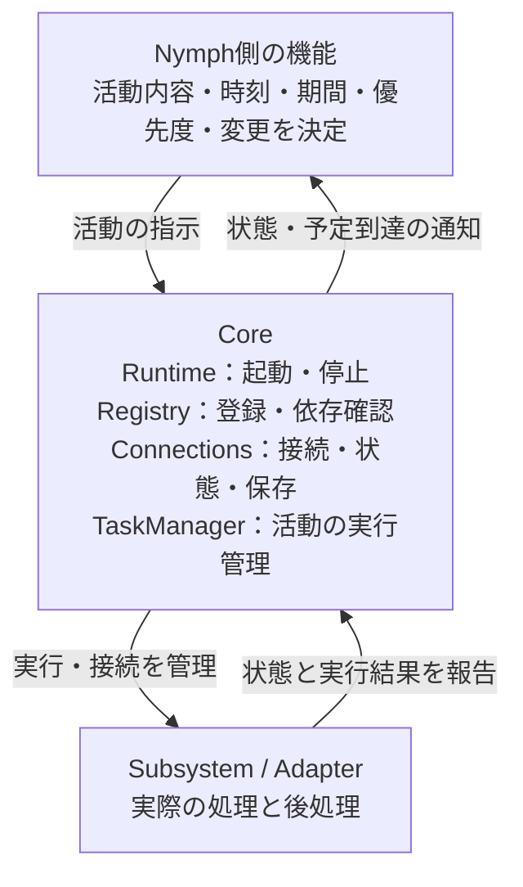

図1：責務の区分。箱は担当範囲を表し、クラスの継承関係や全ての内部呼出しを表してはいません。

| Coreが提供するもの | 利用側が用意するもの |
|---|---|
| 起動・停止、依存関係と状態の確認 | 機能の実装、登録情報、起動時の構成 |
| 候補情報、接続先の記録と検証 | 候補を比較して選ぶ判断、操作の意味 |
| 活動の時刻監視、変更と状態通知 | 活動内容・優先度・終了・再開の判断 |
| 保存と障害通知、後処理を待つ仕組み | 安全な中断点、所有する資源の解放 |

CoreとContractsは一つの`nymph-toolkit`パッケージです。Subsystem・Adapterは必要に応じて別配布にできる方針です。Memory・Documentは公開版に同梱し、Cognition・Text Interaction・Web・Agency・Persona・Sleepは開発候補に同梱します。睡眠活動との循環と音声をv1.10候補へ追加しています。音声の依存とモデルは明示導入します。

<!-- pagebreak -->

### 02 実行配置：同じPCで組み合わせる

機能ごとに同一プロセス（LOCAL）またはCore所有の子プロセス（PROCESS）を選べます。配置は起動前に指定し、その起動中は固定します。

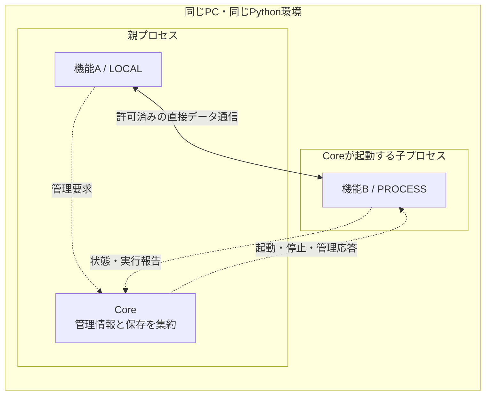

図2：管理情報は親Coreへ集約。管理通信と直接データ通信を分けます。Core経由のデータ呼出しも利用できます。

| 項目 | ModuleGroup＋Connections | HybridGroup |
|---|---|---|
| 配置 | 同一プロセス | LOCALとPROCESSを組合せ |
| 操作の宣言 | SYNC／ASYNC | LOCALを含めASYNCのみ |
| 直接呼出し | 保持したPythonメソッド | 同一配置はメソッド、別プロセスはRPC |
| データ | 既存ローカル操作入力をJSONへ一律制限しない | 転送入力・結果はJSON値と対応Contractsの範囲 |
| 子の起動 | なし | 同じPython実行ファイル、機能ごとに1子 |

HybridGroupのfactoryは、共有Python環境からimportできる`module:attribute`です。`ModuleContext`とJSON設定を受け、`start/run/stop`を備えたサービスを返します。

通信は同じPCの`127.0.0.1`とOS割当ポートを使います。他のPCへの分散、外部で起動済みのプロセスの管理、子だけの自動再起動は対象外です。Windowsでは子プロセス対応のイベントループを使います。同梱例は標準の`asyncio.run`を使用します。

<!-- pagebreak -->

### 03 起動・停止：後処理までがライフサイクル

サービスは非同期の`start()`、`run()`、`stop()`を実装します。Runtimeがこれらを所有して呼び出すため、利用側が同時に個別のフックを呼び出さないようにします。

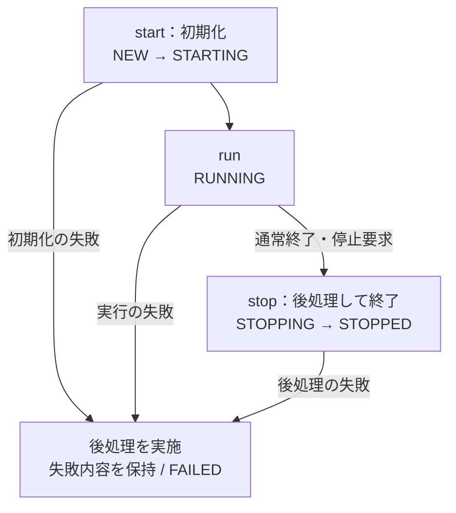

図3：主な経路。失敗しても、初期化に入った対象の後処理を進めます。未初期化などの細かな拒否条件はRuntimeの契約に従います。

| 操作 | 利用側が受け取るもの・守ること |
|---|---|
| `await runtime.start()` | 初期化完了。複数機能では依存先から起動し、全初期化後にrunを開始 |
| `await runtime.wait()` | runの戻り値、または停止に伴うNone。後処理まで待つ |
| `await runtime.stop()` | 停止・後処理を待つ。繰返し呼出しでも後処理を重ねて取消しない |
| 失敗した場合 | `RuntimeFailure`に初期化・実行・後処理の失敗を保持。後からwait/stopしても通知 |
| 再実行したい場合 | 新しいRuntimeとGroupを構築する。同じインスタンスは再起動しない |

ModuleGroupは依存順に初期化し、その逆順に後処理します。サービスの`stop`は自分が作ったタスク・接続などを解放します。Coreは無関係な呼出側タスクを一律停止しません。

待機者が`wait()`を取り消してもサービス自体は継続します。`stop()`の待機取消も停止完了を意味しません。所有者は再びstop/waitで結果を確認します。開始待機の取消は停止を要求します。

同一プロセスの処理には協調的な終了が必要です。Core停止時に限り、期限を超えたCore所有子を強制終了できます。その場合の後処理未確認を成功と扱いません。通常の活動終了への指示とは別です。

<!-- pagebreak -->

### 04 登録と提供機能：3種類の「利用できる」を分ける

登録情報、通信契約、稼働報告は別の情報です。登録依存が満たされていても、相手が動作中・受付可能であるとは限りません。

| 情報 | 利用側が指定する内容 | Coreから分かること |
|---|---|---|
| `ModuleSpec` | 機能ID、SUBSYSTEM／ADAPTER、必要な機能ID集合 | 登録の世代、依存充足、不足している依存 |
| `ModuleAdvertisement` | 機能ID、実装版、提供契約、タグ・属性 | 候補の静的な能力・条件 |
| `ContractKey` | 契約IDと版の文字列 | IDと版の完全一致による照合 |
| `ContractSpec` / `OperationSpec` | 操作名とSYNC／ASYNC | 宣言と呼出しの一致 |
| `Usage` | state、accepting、active、capacity | 機能全体・契約ごとの通知済み稼働情報 |

**確認の順序は、登録依存 → 稼働と受付 → 実際の操作受付です。** 候補に表示された空き容量は予約ではありません。最終的な受付は提供機能が判断します。

| 登録操作 | 結果と制限 |
|---|---|
| `register` | 重複ID・循環依存を変更なしで拒否。未登録の依存先を持つ登録は可能 |
| `get` / `entries` | 不変の観測値。後続の変更で古い値は書き換わらない |
| `unregister` | 依存元が利用不能になる場合も、その変化を結果に含める |
| `RegistryUpdate.changes` | 変更前後のEntry。継続購読ではなく、登録・解除の戻り値 |

Groupの起動開始から停止完了まで機能構成を固定します。起動前の登録・解除、停止後の明示解除を扱い、稼働中の実体追加・交換は行いません。停止済みGroupへ追加登録して再使用する場合も、新しいGroupを作ります。

提供機能の宣言は開始前に固定し、稼働情報は開始時と変更時に機能から通知します。未通知はUNKNOWNです。タグ・属性の条件を比較して候補を選ぶのは要求側で、Coreへ選定関数を渡す方式ではありません。

例：文書機能が記憶機能を必要とする場合、記憶機能の登録後に依存は充足します。しかし通信には別途、契約宣言・稼働報告・接続の確立が必要です。Registry（`docs/registry.md`）とConnections（`docs/connections.md`）で詳細を確認できます。

<!-- pagebreak -->

### 05 接続：要求側が選び、Coreが記録する

要求側はCoreから候補・属性・稼働状況を受け取り、利用先を選びます。Coreはその指定を検証して保存し、以後の接続先を管理します。

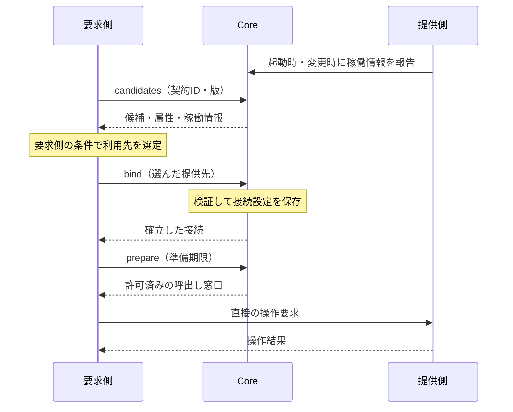

図4：正常な初回接続と直接呼出し。Core経由を選ぶ場合はinvokeを使います。

接続の固定単位は**要求元＋契約ID・版につき1接続**です。用途名による追加分割はありません。同じ相手へのbindは既存接続を返し、別の相手への変更は`ConnectionConflictError`になります。初回追加は稼働中にもできます。

`bind`の成功は接続設定の確立、`prepare`の成功は操作準備を意味します。検証中・協調的中断中・保存側の受付停止中などは、要求側の期限まで準備を待ちます。準備後も新しい無効通知を受けた窓口では新規操作を開始しません。

確立後に毎回候補を選び直したり、Coreへ許可を再申請したりすることはありません。起動時と申請されたヘルスチェックで接続を確認します。失効は不整合によるエラー回避が目的であり、連携機能がCoreの管理結果に従う前提です。

<!-- pagebreak -->

### 06 呼出し：入力・結果・期限の意味

実装する配置に合う窓口を使います。同じ契約ID・版の同期操作を、別プロセスで暗黙に非同期へ読み替えることはありません。

| 用途 | 同一プロセスのConnections | HybridGroupのCoreClient／DirectLink |
|---|---|---|
| 候補取得 | `candidates(contract)` | `await core.candidates(contract)` |
| 接続設定 | `await bind(requester, contract, provider, wait_timeout=...)` | `await core.bind(contract, provider, timeout=...)` |
| 準備 | `await prepare(binding_key, wait_timeout=...)` | `await core.prepare(contract, timeout=...)` |
| 直接呼出し | `handle.call`／`await handle.acall` | `await link.acall` |
| Core経由 | `await invoke(...)` | `await core.invoke(...)` |
| 通信窓口の解放 | Groupが管理するローカル参照 | `await link.close()`で通信資源を回収 |

表は入口の対応です。厳密な引数順・キーワード・型はAPI一覧（`docs/api-reference.md`）を参照してください。

| 期限や結果 | 利用側が理解しておくこと |
|---|---|
| Connectionsの`wait_timeout` | 準備待ちの期限。0以上の有限秒。操作本体の実行時間を制限しない |
| 別プロセスの呼出し期限 | 正の有限秒。未送信ならTimeoutError、送信開始後で成否未確認ならOutcomeUnknownとなり得る |
| `OutcomeUnknown(request_id)` | 失敗確定ではない。対象窓口のresultで照会し、完了後releaseする |
| 待機の取消 | 受付済み管理処理が取り消されたとは限らない。IDと現在結果を確認する |

別プロセスの引数・結果はJSON値と対応するContractsに限ります。文字列キーの辞書、配列、文字列、有限数、真偽値、nullを基本とし、任意オブジェクト・関数・pickleは転送しません。Pythonオブジェクトの同一性や元の例外オブジェクトの同一性もプロセスを越えて保証しません。

`pending_requests`は窓口が保持する要求ID、`result(id)`は結果の確認、`release(id)`は完了後の一時保持の解放です。未完了の解放は結果不明として扱います。IDは窓口と起動世代の中で使い、別の窓口へ渡しません。Coreは自動再送・自動接続先切替を行いません。

<!-- pagebreak -->

### 07 ストリーム：送信受付・受信・処理完了を分ける

連続データは片方向のストリームで送ります。双方向なら独立した2本を開きます。Coreはバイト列を運び、音声・文書等の形式と意味は利用機能の契約で定義します。

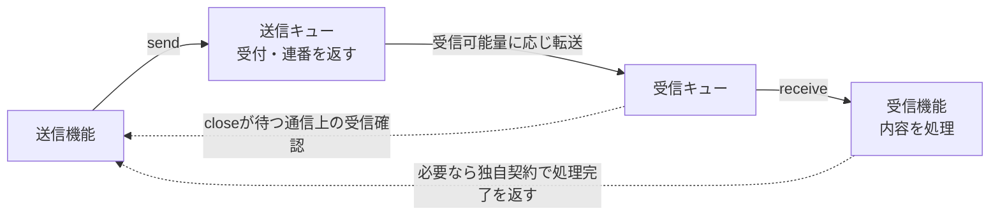

図5：sendの成功はローカル受付です。closeの成功も内容処理の完了までは含みません。

| 設定・操作 | 契約 |
|---|---|
| `StreamOptions` | 送受信それぞれのバイト数・チャンク数上限と混雑方針を、開設時に指定 |
| `WAIT` | 空きができるまで指定期限内で送信を待つ |
| `DROP_OLDEST` | 未転送の古いチャンクを丸ごと破棄。欠落範囲・件数を受信側へ通知 |
| 大きすぎる単一チャンク | ChunkTooLarge。分割は送信機能が担当 |
| `send` / `receive` | 有限期限を指定。空バイト列もデータとして扱い、終端・障害と区別 |
| `close` | 未破棄データと終端の通信上の受信確認まで待つ |
| `abort` / `aclose` | 明示打切り／所有通信タスク・ソケットの回収 |

closeの待機期限が切れても、CLOSINGの排出処理は続きます。状態照会・再度のclose・明示abortを使い分けます。送信受付前の期限切れや取消は後から受付せず、受付済みデータは待機取消だけでは撤回しません。

上限はアプリケーションの転送キューを対象とし、OS内部のTCPバッファは含みません。上限・混雑方針は開設中に変更しません。切断時は受信済みデータの後に異常終端を返し、自動再送しません。活動中断・終了時のclose／abortは利用機能が担当し、機能停止時に残った通信資源を回収します。

<!-- pagebreak -->

### 08 活動：予定時間の到達は判断を求める通知

`ActivityRequest`で要求元・活動ID、内容、開始時刻、期間、パラメータ、優先度を指定します。開始時刻はタイムゾーン付きdatetime、明示的な即時開始はNoneです。期間は正のtimedeltaです。

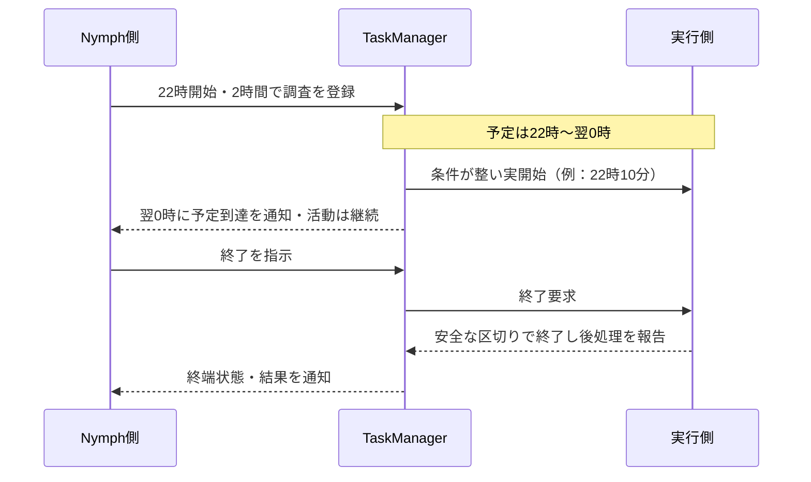

図6：受付時点では未来の予定で、実開始だけが遅れた例。受付時点で22時を過ぎていた要求は開始せずNymphへ返します。

| 観測値 | 意味 |
|---|---|
| 予定開始・予定終了 | Nymph指定の予定。到達は実開始と独立し、自動繰延べしない |
| 実開始・実終了 | 実際の開始と後処理完了。遠隔では実行側の報告で確認 |
| `elapsed_seconds` | 実開始からの経過秒。中断・再開待ち・後処理を含む |
| `execution_seconds` | 中断完了から実再開までを除いた秒。通常のI/O待ち・後処理を含み、CPU時間ではない |
| `timing_confirmed` / `cleanup_confirmed` | 遠隔で計時・後処理の確認が届いた範囲 |

過去時刻の要求は`ActivityStartInPastError`となり、活動を登録しません。Nymphが開始時刻を再指定します。受理済みの活動IDは、完了後も同一起動内では再利用できません。

予定到達だけでCoreは終了・延長・価値判断をしません。自然完了はCOMPLETED、明示終了はSTOPPED、実行の失敗はFAILEDとして区別します。結果の業務上の意味はNymph側が判断します。

<!-- pagebreak -->

### 09 活動変更：受理と適用完了を区別する

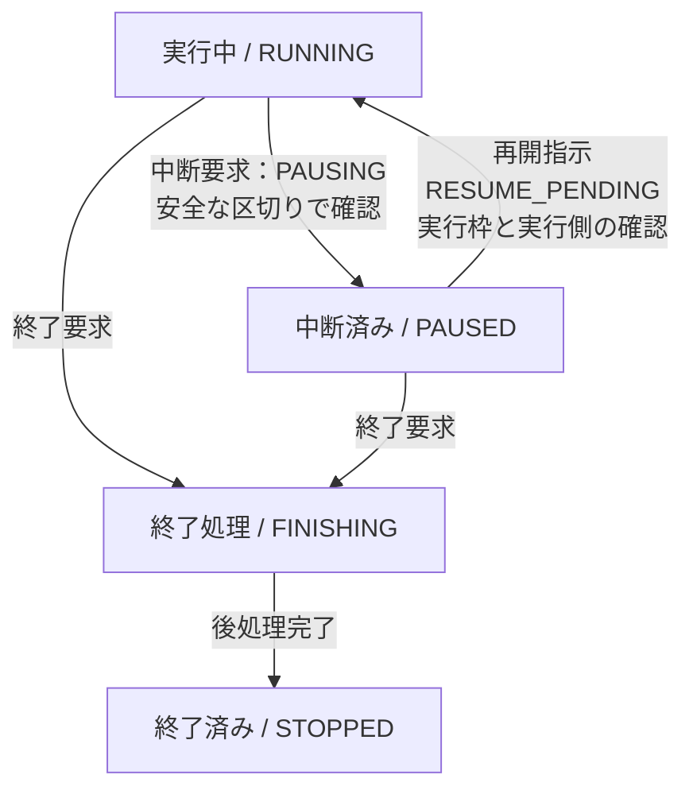

図7：実開始後の協調的中断・再開と明示終了。中断・再開の途中状態は矢印上に記載しています。未開始・遠隔開始、自然完了・失敗などは省略しています。全状態はAPI一覧を参照してください。

| 指示 | 適用内容 |
|---|---|
| 開始時刻変更 | 未開始の活動だけ。Noneは即時開始への変更、未指定UNCHANGEDとは異なる |
| 期間変更 | 現在の予定開始から数える新しい合計期間。追加時間ではない |
| 優先度変更 | 開始・再開待ちの順番に作用。大きな整数を先にし、同順位は待機順 |
| 中断 | 対応を宣言した実行側が安全な区切りでcheckpointに入り、PAUSEDを確認 |
| 再開 | 同一起動内で保持した処理の続きへ戻る。関数を最初から再実行しない |
| 終了 | 変更・中断・再開に優先し、後処理の完了を待つ |

変更・中断・再開には、活動内で一意の`command_id`と観測した`expected_revision`を渡します。同じID・同じ内容・同じ期待版なら元の要求の最新結果を返し、二重適用しません。古い版や内容衝突は理由付きで拒否します。`request`は初回入力、`current_request`は現在の実効入力です。

`accepted`は受理済みで未完了です。`wait_command`などで、applied／no_change／rejected／superseded／failedの終端結果を確認します。待機を取り消しても受付済みの変更要求は取り消されません。

実行枠を`max_running`で制限した場合、開始と明示再開を同じ待機列で扱います。優先度だけで実行中の活動を中断しません。中断対応は`supports_pause=True`で宣言し、実行側が作業状態と資源の扱いを担います。機能の連携エラーによる中断とは別の仕組みです。

<!-- pagebreak -->

### 10 失敗：どこまで止め、誰が回復を判断するか

通常の業務失敗、連携の想定外失敗、Core基盤の障害を区別します。失敗した要求の自動再実行や、別の接続先への自動切替は行いません。

| 事象 | 表現の例 | 利用側・Coreの対応 |
|---|---|---|
| 業務上の失敗 | OperationFailureという値 | 利用機能が内容を解釈する |
| 受付容量不足 | TemporaryUnavailableという値 | 即時応答。これだけで中断・ヘルス申請を起こさない |
| 連携の想定外失敗 | LinkFailureと通知 | 要求元機能が協調的中断・後処理・完了報告 |
| 入力・状態の不整合 | 型・状態別の例外 | 宣言・入力・順序を確認して修正 |
| 子の予期しない終了 | プロセス終了・通信切断 | 未処理の機能障害としてRuntimeを停止 |
| 保存・TaskManager内部障害 | 基盤の失敗情報 | 所有資源を後処理し、回復不能なら停止 |

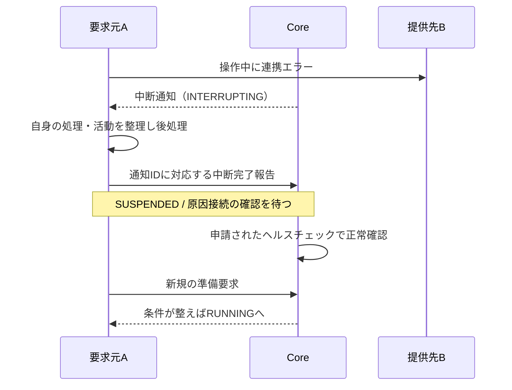

図8：要求元の復帰の代表例。正常確認と中断完了の到着順は前後できます。元の失敗操作の再生ではありません。

ヘルスチェックは保持する登録世代・宣言・稼働情報を確認し、機能の自己診断を呼び出すものではありません。Coreの定期申請や申請の統合も行いません。別の利用者には必要な接続の失効を通知し、通常の連携エラーで無関係な機能を一律停止しません。

<!-- pagebreak -->

### 11 保存：受付した履歴と保存済み履歴

FileStoreが接続設定と運用履歴を保存します。Group／Connectionsがライフサイクルを所有します。FileStoreを一つのSubsystemとして登録する構成ではありません。

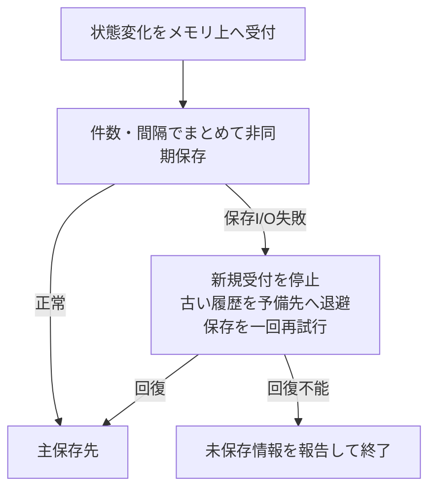

図9：保存I/O失敗時の内蔵手順。回復時は受付を再開します。破損設定を空に置換する手順ではありません。

| 項目 | 利用時の扱い |
|---|---|
| 接続設定 | 保存完了後に確立した接続として公開 |
| 履歴のappend | メモリ受付。ディスクへ書き終わった保証とは異なる |
| 明示flush | その時点までの履歴保存を待つ |
| 通常停止 | 進行中I/Oと未保存履歴の排出を待つ |
| 主・予備保存先 | 相互に包含しない専用ディレクトリ。同じ主保存先を複数Coreで同時使用しない |
| `unsaved_events` | 受付済みで未保存の件数。保存処理の追随状況を確認する |

通常の履歴バッファは上限なしです。生成が書込みを上回り続けるとメモリ使用量も増えます。`batch_size`は一回の書込件数であり、受付停止の閾値ではありません。転送キューや活動の実行枠の上限とは別です。

回復不能時には原因・未保存件数・未保存設定の有無を報告します。終了時に未保存バッファを追加退避する保証はありません。急なプロセス終了による未保存分の消失はあり得ます。ストリーム履歴には開設・終端・理由・欠落等を記録し、本文を一律保存しません。

<!-- pagebreak -->

### 12 再起動：接続を検証し、活動はNymphが決める

再起動では新しいRuntimeとGroupを作ります。保存情報のすべてを現在状態へ戻す処理ではありません。

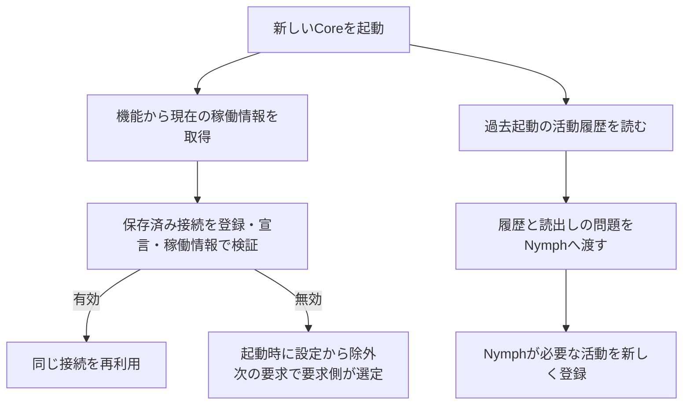

図10：接続再利用と活動履歴は独立して扱います。稼働中に失効した接続先を自動で切り替えることはありません。

| 情報 | 再起動時の扱い |
|---|---|
| 保存済み接続 | 現在の情報で検証して再利用または起動時に除外 |
| 稼働状況・空き容量 | 機能から取り直す。過去履歴を現在値にしない |
| 活動履歴 | Nymphへ渡す。現在の活動へ自動登録しない |
| 中断位置・実行関数・未完了操作 | 継続状態を自動復元・再実行しない |
| PID・ソケット・ストリーム途中データ | 復元しない |

活動履歴は主・予備の過去起動を読み、現在起動を除外します。同じ起動ID・連番の同内容記録は一件として扱い、内容競合は問題として返します。読出し問題は`history.issues`で確認します。

履歴の末尾不完全・未知形式・読出し失敗があっても、原本を修復・上書きしません。`issues`が空でも、急な終了などで失われた記録まで完全であるという保証ではありません。異なる起動IDの並びを実時間順と見なさず、記録の時刻・起動IDを確認します。

<!-- pagebreak -->

### 13 設定早見表：同じ「上限」「時間」でも用途が違う

必要な値は利用環境と機能に合わせて指定します。実行例にある数値はデモ用であり、全用途への推奨値や性能保証ではありません。

| 設定・入力 | 型・単位と範囲 | 作用 |
|---|---|---|
| HybridSettings.startup_timeout | 正の有限秒、明示必須 | 子・機能の起動待機 |
| HybridSettings.shutdown_timeout | 正の有限秒、明示必須 | Core停止時の子の後処理待機 |
| HybridSettings.call_timeout | 正の有限秒、明示必須 | 期限省略可能な管理呼出しの待機 |
| max_frame_bytes | 正整数・バイト、明示必須 | 通信フレーム長。任意に大きなデータを一度に送らない |
| max_requests / max_streams | 正整数、明示必須 | 同時要求・ストリーム数 |
| StreamOptionsの各上限 | 送受信それぞれ正のバイト数・件数 | アプリケーション転送キュー |
| StreamOptions.overflow | WAIT／DROP_OLDEST、明示必須 | 空き待ちか古い未転送チャンクの破棄 |
| FileStore.retention | 0以上のtimedelta、明示必須 | 保存救命時に古い履歴を選ぶ期間基準 |
| FileStore.batch_size | 正整数、明示必須 | 一回にまとめて書き込む件数 |
| FileStore.flush_interval | 正の有限秒、明示必須 | 履歴の書込み間隔 |
| clock_check_interval | 正の有限秒、明示必須 | 活動の壁時計再確認の間隔 |
| max_running | None、または正整数。既定None | 活動の同時実行枠。Noneは上限なし |
| ActivityRequest.priority | boolを除く整数。既定0 | 開始・再開待ちの順序 |
| supports_pause | bool。既定False | 実行側が協調的中断に対応する宣言 |

**時間を区別する4つの例**

1. 活動期間が2時間でも、通信呼出しを2時間待つ意味にはなりません。
2. Connectionsの準備期限が切れても、操作本体を強制停止したことにはなりません。
3. ストリームcloseの待機期限が切れても、排出処理は継続します。
4. Core停止期限による子の強制終了は、通常の活動終了への期限ではありません。

**容量も別々です。** Usage.capacity、max_requests、max_running、転送キューの上限、上限なしの履歴バッファを同じ設定として扱わないでください。

<!-- pagebreak -->

### 14 Core接続契約：共通の6区分

機能はCore内部を直接importせず、公開Contractsの窓口を使います。共通契約はv1.0で確立し、Memory・Document・Cognitionも同じ基盤へ接続します。

| 契約区分 | 機能側とCoreが共有する内容 |
|---|---|
| Module | ID・種別・依存、実装版と提供契約、factory・設定・配置 |
| Lifecycle | start/run/stop、依存順起動・逆順停止、部分初期化の後処理 |
| Capability | 契約ID/版・操作名・ASYNC・ストリーム/実行処理の宣言 |
| Communication | 候補・要求側選定・bind固定・prepare・直接/Core経由 |
| Task | 活動の登録・開始・変更・通知・終了。判断はNymph |
| Error | 値で返す業務失敗/容量/連携失敗と、例外・結果不明の区別 |

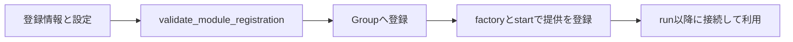

図11：登録前検証は宣言と設定を確認します。factoryのimport・起動・保存や、機能の実動作の保証は行いません。提供ハンドラーは初期化完了までに登録します。

**移行時の注意**：v0.9のCoreClient.requestは公開APIから除外しました。名前付き管理APIと業務契約の操作を使います。ModuleContextの内部資源管理メソッドへの依存も避けます。Core 15名・Contracts 98名の共通API基準と、各業務契約の版を分けて確認してください。

型・互換性の境界は共通接続契約（`docs/module-contracts.md`）、変更点はv1.0移行手順（`docs/migration-v1.md`）にあります。

<!-- pagebreak -->

### 15 Memory：経験・知識を出典付きで保存する

Memoryはv1.1から同梱しています。契約は`ntk.memory.records/1`、操作はすべてASYNCです。記録の内容や真偽をCoreやMemoryが判断することはありません。

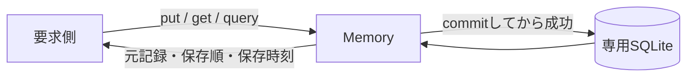

図12：Coreの接続・活動履歴とMemoryの経験・知識は別の保存物です。

| 操作・入力 | 成功結果と制約 |
|---|---|
| put(record) | record_id・kind・content・source_kind・source・occurred_atを保存 |
| get(record_id) | 元の6項目にsequence・stored_atを加えた記録 |
| query(kind, source_kind, after, limit) | 完全一致フィルタと保存順ページ。最大8件 |
| source_kind | observed / reported / inferred / imagined / dream。真偽の順位ではない |
| 保存上限 | 1記録の正規化JSONが4096 bytes以下。ASCII escapeで計算 |
| 同じID | 同じ正規化内容は冪等。異なる内容はmemory.conflict |

factoryは`nymph_toolkit.subsystems.memory:factory`、設定は絶対ファイルパス`path`です。1つのDBを1つの実体が所有します。SQLite対応Python、フレーム上限65536 bytes以上を使います。

同時受付は1件です。未知形式・破損を自動上書きしません。取消や期限切れは未保存保証ではなく、要求側がIDで結果を確認します。Memory原本の編集・削除・忘却・意味検索は未実装です。Sleepの別状態での統合とは区別します。Memoryガイド（`docs/memory.md`）

<!-- pagebreak -->

### 16 Document：ローカル文書をMemoryへ取り込む

Documentはv1.2から同梱するAdapterです。契約`ntk.document.import/1`の`ingest(request)`で、明示したUTF-8 txt/mdを1件のMemory記録にします。

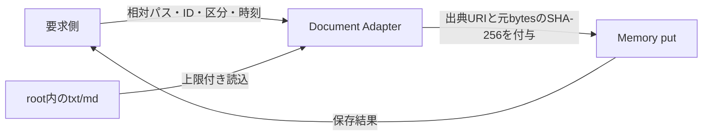

図13：内容の学習はDocumentの責務に含めません。Cognitionへの学習要求は別の操作です。

| 項目 | 契約 |
|---|---|
| 設定 | 既存絶対ディレクトリroot、選択済みmemory_module_id |
| ingest入力 | path・record_id・kind・source_kind・occurred_atの5項目 |
| ファイル | 通常ファイル、UTF-8、最大65536 bytes。先頭BOMのみ除去 |
| Memory上限 | 出典URI/hash等も含め4096 JSON bytes。超過は保存せず返す |
| 再取込 | 同じID/内容は冪等。本文・出典・区分等が違えば競合 |

root外・上位移動・不正文字コード・空白のみ/NUL本文は拒否します。root制限は敵対的なファイル交換へのセキュリティ境界ではありません。Document自体は自動分割・監視取込、PDF/Office/HTML/URL・OCRに対応しません。v1.4のHTTP/HTML入力は別のWeb Adapterが担当します。

接続先は要求側が指定し、Core許可後に固定して再利用します。同時受付1件。結果不明ならMemoryのgetで照合し、自動再送しません。Documentガイド（`docs/document.md`）

<!-- pagebreak -->

### 17 Cognition：注釈から初期の規則性を学ぶ

**v1.3で追加し、v1.10候補にも含む**Subsystemです。ユーザー採用済みの初期方式として、Memoryの記録へ語の区切りと概念ラベルを与えます。空の語彙から頻度・隣接語順・ラベルの共起を蓄積します。

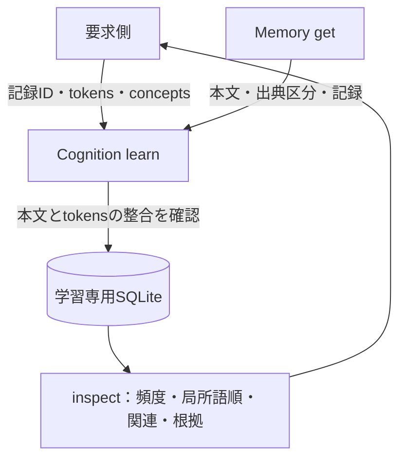

図14：元記録はMemory、学習例はCognition、接続許可と実行管理はCoreが担当します。学習を始めるか、何を使うかは要求側が決めます。

契約は`ntk.cognition.learning/1`のASYNC `learn` / `inspect`。factoryは`nymph_toolkit.subsystems.cognition:factory`、設定は専用DBの絶対`path`と選択済み`memory_module_id`です。

| 観察できる値 | 意味 |
|---|---|
| count / documents | 語の出現回数 / 語を含む学習例数 |
| successors / end_probability | 例内の次語と終端の相対頻度 |
| concepts / support_ratio | 語とラベルを共に含む例の割合。真偽・理解の確率ではない |
| source_counts / evidence | 出典区分、Memory ID・fingerprint・学習sequence |

語の区切りと概念ラベルは教師情報です。自律的な分節・概念形成、完全な構文/意味理解、会話生成を実現したものではありません。LLM・外部モデルを使いません。Cognitionガイド（`docs/cognition.md`）

<!-- pagebreak -->

### 18 Cognition：入力・失敗・保存の扱い

以下はMemoryに本文「猫 は 眠る」が保存済みで、Cognitionへの接続が準備済みの場合の操作例です。

```python
receipt = await link.acall("learn", "cat-sleep",
    tokens=["猫", "は", "眠る"],
    concepts=["animal", "sleep"], timeout=10)
profile = await link.acall("inspect", "猫",
    source_kind="observed", after=0, limit=8, timeout=5)
```

成功値のdictか、失敗値かを確認してから結果を読みます。外側の期限はシナリオに応じて設定し、Cognition内部の個別Memory RPCの5秒と区別します。

| 入力・保存 | 制約 |
|---|---|
| tokens / concepts | 1〜32語 / 0〜8ラベル。各非空・空白/NULなし・UTF-8 64 bytes以下 |
| 本文との整合 | 本文の空白除去とtokensの連結が一致。ラベル重複は拒否 |
| 学習保存 | 最大256例。commit後にreceiptを返す。再起動後に統計を再現 |
| 再要求 | 同じID/記録/注釈は冪等。異なる内容はcognition.conflict |
| inspect | 次語/概念は上位8件と総数。根拠は最大8件の保存順ページ |

`cognition.invalid/full/storage`、Memoryの業務失敗、`TemporaryUnavailable`を区別します。LinkFailureではclose後、中断IDに対する完了報告と対象Memoryへのhealth申請を行います。結果不明等の例外経路はIDなしの完了報告をせず、元の例外を保持します。停止中はhealthを申請しません。

取消・期限切れは未学習保証ではありません。要求側が接続状態を確認し、同じID/注釈の明示再要求で結果を照合します。元処理の自動再送・接続先切替は行いません。訂正は次頁のrevision/1を明示有効化して使います。削除・忘却・長期/大規模性能は後続課題です。

<!-- pagebreak -->

### 18A Text Interactionと注釈訂正：指示と原本を分ける

Text Interactionは、文章を保存するobserve、教師情報を渡すlearn、照会するinspect/get_revision、注釈を訂正するcorrectを提供します。全操作ASYNCで、同時受付は1件です。保存しただけでは学習しません。

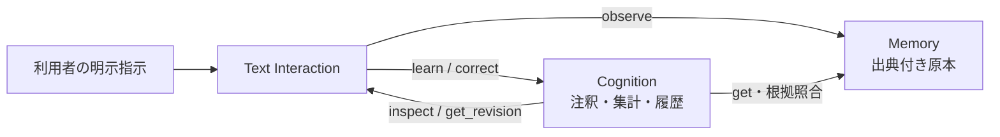

図15：許可済み契約で接続。訂正はMemory原本を変えず、Cognitionの注釈と集計へ反映します。

| 訂正の条件 | 結果と確認方法 |
|---|---|
| command_idとexpected_revisionを指定 | 初回学習の版は0、変更時に1増加。同一注釈はno_change |
| 同じ命令ID・同じ入力 | 過去receiptを返し、再適用しない。現在値はget_revision |
| 同じ命令IDで異なる入力／古い版 | command_conflict／revision_conflictで拒否 |
| 訂正命令4096件に到達 | history_full。過去証跡は消さず保持 |

訂正は`enable_revision=true`と`ntk.cognition.revision/1`の宣言で明示有効化します。保存形式1を検証して2へ原子的に移行するため、**有効化前に停止したDBのバックアップを取得します。形式2を旧v1.3バイナリでは読めません。** 最大256学習例とは別に訂正履歴を管理します。

`python examples/text_interaction_demo.py --interactive --data-dir .local/text-session`で1行1JSONの操作と結果を試せます。EOFで後処理して終了します。入力待ちでもCoreは動作を継続します。コマンド形式・5操作・失敗は入力・訂正ガイド（`docs/interaction.md`）へ。自然な自由会話や自律的な教師情報生成の完成を示す機能ではありません。

<!-- pagebreak -->

### 18B Web Adapter：取得・保存・学習を分ける

明示したHTTP(S) URLを取得し、抽出した文章をMemoryへ保存します。ingestの入力はurl・record_id・kind・source_kind・occurred_at。出典区分や時刻は要求側が指定します。出典には元URL・最終URL・取得bytesのSHA-256を残します。


図16：redirectも各遷移で許可originを確認。取得拒否時はMemoryへ保存要求を送りません。

| 制約 | 初期範囲 |
|---|---|
| 接続先 | allowed_originsのscheme/host/port。redirect最大3回 |
| 形式とサイズ | 非圧縮UTF-8 text/plain・text/html、65536 bytesまで |
| HTML | script/style等を除外。JS実行・CSS可視性の再現なし |
| 保存 | Memoryの4096 JSON bytesを超えたら拒否。切捨て・分割なし |
| 時間 | 読込予算3秒・各blocking最大2秒。OSのDNS待機の強制終了保証なし |

環境proxy・cookie・認証を引き継がず、巡回・自動再送・自動学習をしません。HTTPSの証明書検証を維持します。origin制限は運用設定であり、敵対的DNSや機能を隔離する境界ではありません。

取消・期限切れは未保存保証ではありません。所有する取得worker・操作・窓口の後処理を待ち、結果不明はMemory ID等を明示照会します。連携エラーでは中断完了報告と対象のhealth確認を行い、元操作を再送しません。

`python examples/web_demo.py`は所有するローカルHTTPサーバーで取得・出典・明示学習を確認し、後処理後にPASSで終了します。公開サイトの互換性試験とは区別します。詳細契約・上限・エラー（`docs/interaction.md`）

<!-- pagebreak -->

### 18C Agency：活動を選び、判断の根拠を残す

AgencyはNymph側の意思決定を担います。目標・内部状態・活動カタログを受け、Memoryの本文/出典とCognitionの学習例数を参照して選びます。Coreは活動の価値を判断しません。

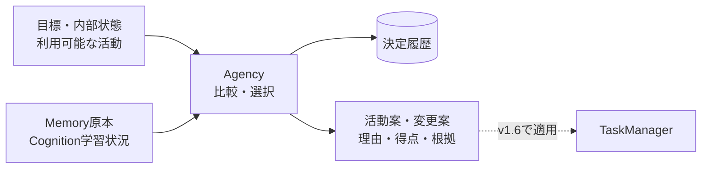

図17：v1.5の判断・保存・照会を、v1.6の任意実行機能へ接続できます。次章で活動循環を説明します。

| 判断の例 | 説明できる結果 |
|---|---|
| 目標の語が未学習 | 学習不足と重要度から調査を選ぶ |
| 同じ語を学習した後 | 新しい決定IDで再評価し、知識の活用へ変わる |
| 睡眠圧が高い | 休息の得点が上がり、活動を再検討する |
| 予定時間到達後も同じ活動を選ぶ | Agencyが延長案を返す。Coreは自動延長しない |

契約は`ntk.agency.decisions/1`のASYNC decide / get。時刻・期間・優先度、開始/変更/中断/再開/終了/待機の案を返します。値は解釈可能な初期規則で生成し、目標と状態からの選択を検証できます。人格や一般的な推論・目的の自律生成の完成を示すものではありません。

決定は専用SQLiteへ原子的に保存してから返します。同じID/入力は元の決定を返し、再起動後も照会できます。別の入力でIDを流用すると競合です。最大4096決定で、上限でも過去履歴を自動削除しません。決定保存は活動の実行成功を意味しません。

Memory原本を変更せず、出典区分・fingerprintと学習例数を判断根拠へ残します。取消や結果不明は未保存保証ではなく、IDで照会します。`python examples/agency_demo.py`で選択変化・再起動を再現できます。設定・入力・失敗・上限（`docs/agency.md`）

<!-- pagebreak -->

### 18D Agency：決定を実行し、結果から次を判断する

v1.6の任意`execution_factory`は、明示有効化した後に活動を選び、Coreへ登録・変更を依頼します。Coreは実行状態を返します。保存した決定、命令の受付、適用完了、実行後処理を区別します。

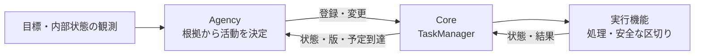

図18：活動の選択と継続判断はAgencyが担当します。実学習の結果で次の活動が変わることを検証します。

| activities/1の操作 | 利用側が確認すること |
|---|---|
| activate | セッションIDと観測を指定。受付時点で活動開始済みとは限らない |
| observe | 内部状態・目標・利用可能な活動を更新。観測版で競合を検出 |
| status | 前景活動、予定・期間・優先度・計時、受付/適用、失敗・結果不明 |
| halt | 所有活動へ協調的な終了を要求。stoppedと後処理確認を待つ |
| history | 過去のCore活動履歴を照会。現在の活動へ自動復元しない |

休息を選んだ場合は、元の活動の中断を確認して切り替えます。元の活動へ戻るときは同じ継続を再開します。予定時間到達の通知後はAgencyが継続・変更を判断し、Coreが勝手に延長・終了しません。

容量不足では新しい観測・活動変化を待ちます。連携障害では所有活動の後処理後に中断完了を報告します。管理要求の結果不明は同じ要求IDで照会し、元の操作を自動再送しません。再起動はinactiveで始まります。

`python examples/agency_execution_demo.py`は、選ばれた学習活動がCognitionへ実際に学習を登録し、休息へ切り替えて元へ戻る例です。初期目標や教材は入力されたもので、一般的な推論・目的の自律生成やSleepの完成ではありません。設定・全契約・上限・停止（`docs/agency-execution.md`）

<!-- pagebreak -->

### 18E Persona：人格特性を保持し、外部の修正を記録する

v1.7候補のPersonaは、長期特性を参照に応じて返し、外部から明示された差分を適用します。自身で更新を開始せず、Coreが人格や活動の価値を判断することもありません。

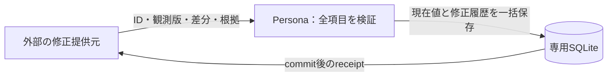

図19：初期値を使うのは空DBの作成時だけです。再起動後は保存済みの値と履歴を使い、同じ修正を再適用しません。

| traits/1の操作 | 利用側が確認すること |
|---|---|
| get | module_id・現在版・全特性・更新時刻 |
| apply | 命令ID・観測版・差分・reason/sourceを渡す。保存後の前後値・版を取得 |
| get_update | 更新IDで保存済み結果を照会。通信応答がないことを未保存と扱わない |
| history | 保存順に最大4件ずつ取得。next_afterで続きへ進む |

特性は利用側が名付けた1〜32項目、値は整数0〜1000です。差分は-1000〜1000。版違いや適用後の範囲超過は全体を拒否し、勝手に丸めません。同じID・同じ要求は元の結果を返し、異なる要求は競合です。全差分0は履歴だけ追加し、現在版を維持します。

設定は専用DBの絶対パスとinitial_traits。成功履歴は4096件までで、上限では既存値/履歴を保持して新規更新を拒否します。未知形式・破損・設定違いを自動初期化しません。同時受付は1件です。

取消や期限切れでも保存が完了する場合があります。受付済みworkerの完了と後処理を待ち、更新IDで照合します。sourceは提供側の申告情報で、認証証明ではありません。

`python examples/persona_demo.py`で、2特性の外部修正・両経路・同一IDの再要求・履歴・再起動を試せます。特性名と数値は説明用で、心理学的診断尺度や人格全体を表すものではありません。Agencyへの反映は次章、Sleepの修正案は18Gで説明します。契約・設定・失敗（`docs/persona.md`）

<!-- pagebreak -->

### 18F PersonaとAgency：特性を選択に反映する

v1.8候補では、Agencyに任意のpersona設定を加え、対応する特性を活動の得点へ反映します。Personaは値を保持し、Agencyが選び、Coreが実行を管理します。

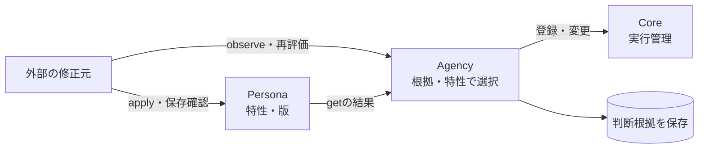

図20：許可済み接続で特性を参照。AgencyはPersonaの値を自動更新しません。

| 設定・値 | 意味 |
|---|---|
| persona.module_id | 参照先を明示。自動切替しない |
| persona.motive_traits | rest/explore/achieve/socialへ特性名を対応付ける |
| 特性500 | 中立。元の得点と同じ |
| 特性0 / 1000 | 元の得点の0.5倍 / 1.5倍。上限1000、元の0点は0 |
| 判断履歴 | Personaの版・値・対応付け、候補の基礎点・倍率・結果を保存 |

例えば知識活用800点と休息600点なら知識活用を選びます。休息の特性だけを500から1000へ更新すると休息は900点となり、Agencyが切替を判断します。例の数値は初期規則で、心理診断や人格全体の完成ではありません。

新しい判断で現在値を読みます。外部更新をすぐ反映したい場合は、保存確認後にobserveで新しい観測版を知らせます。同じ決定IDの再要求は元の結果を返し、過去判断を書き換えません。更新だけで既存判断が即座に取り消される保証はありません。

persona設定を省略すると従来動作・DB形式1を維持します。有効時は新しいAgency DB形式2を作成し、旧DBを自動移行・上書きしません。容量不足は新しい観測を待ち、連携エラーでは所有活動の後処理を確認します。

`python examples/persona_agency_demo.py`で、特性更新→活動切替→元の継続再開を試せます。再起動では保存値と履歴を確認し、活動は明示有効化を待ちます。設定・得点・互換性（`docs/persona-agency.md`）・検証（`docs/validation/v1.8.md`）

<!-- pagebreak -->

### 18G Sleep：統合状態・夢・人格案を分ける

v1.9候補では、Memoryの原記録とCognitionの教師注釈を読み、Sleep自身の統合根拠を整理します。Coreは接続・実行を管理し、経験の価値を判断しません。

```mermaid
flowchart LR
    E["Memory原記録<br/>Cognition注釈"] -->|"読出し・照合"| S["Sleep<br/>統合・減衰・夢・修正案"]
    P["Persona<br/>現在特性"] -->|"getの結果"| S
    S --> D[("周期履歴<br/>現在状態")]
    S -->|"修正案"| R["利用側の明示適用"]
    R -->|"apply"| P
```

図21：案を作るSleepと、適用を指示する利用側を分けます。Sleepは原記録や既存学習を変更しません。

| 操作・状態 | 利用側が確認すること |
|---|---|
| cycle / get | ID・観測版・0〜4記録で周期を実行 / 保存済み結果を照会 |
| state / inspect | 現在根拠・夢をページ取得 / ラベル別の件数・寄与と出典を照会 |
| strength | 再観測で1000。未観測の成功周期ごとに250減り、4周期で外れる |
| 現在夢 | 2件のtokensを再結合。次の成功周期で前の夢を失効 |
| 人格修正案 | 初回評価のobservedだけを使用。traitごとに周期±5、現在値の範囲内 |

**忘却対象はSleepの現在統合状態です。** Memory原本・Cognitionの学習・周期監査は保持します。一般的な意味理解、Nymph全体の知識削除や、自然な夢文章の完成ではありません。

夢はdream区分と元IDを持ち、現実の経験や人格差分の根拠にしません。過去のreceiptを読んでも現在夢を復活させません。人格案を作っただけではPersonaは変わらず、利用側がapplyと保存結果を照合します。

同ID/同入力は再実行せず元の結果を返します。取消・通信期限切れは未保存保証ではなく、getで照合します。現在根拠16件、周期履歴4096件、同時受付1件。再起動だけでは周期を進めません。

`python examples/sleep_demo.py`で統合・失効・利用側の人格適用と再起動を確認できます。設定・対応範囲（`docs/sleep.md`）・検証（`docs/validation/v1.9.md`）

<!-- pagebreak -->

### 18H 睡眠活動：案の生成と適用をつなぐ

Agencyが選んだ睡眠活動をCoreが管理し、専用の実行側がSleepの周期とPersonaの更新を接続します。Nymph側が適用を指定した場合だけ、人格修正案を公開契約で渡します。

```mermaid
flowchart LR
    A["Agency<br/>休息を選択"] --> C["Core<br/>活動の実行管理"]
    C --> E["睡眠実行側<br/>意図・結果を保存"]
    E --> S["Sleep<br/>周期と人格案"]
    S --> E
    E -->|"指定がある場合"| P["Persona<br/>外部差分を適用"]
    P -->|"次判断で参照"| A
```

図22：意思決定はNymph側にあり、Coreは採用した活動を管理します。

| 契約 `ntk.sleep.activities/1` | 役割 |
|---|---|
| `get(request_id)` | 保存済みの段階・周期・適用結果を読む |
| `reconcile(request_id)` | 相手へ結果を照会する。元操作は再送しない |
| `apply(request_id)` | 適用指定あり・周期保存済み・未送信の案を明示適用 |

周期の成功と人格適用の成功は別です。結果不明は照会で確認し、版の競合を自動修正して適用しません。同じ要求を再登録しても過去記録を返すだけで、再起動だけで活動を再開しません。

実行側は最大4096要求を専用SQLiteへ保存します。途中の保存や通信は安全な区切りまで進め、中断中は同じ状態を保持します。契約と使い方（`docs/sleep-activity.md`）

<!-- pagebreak -->

### 18I 音声観測：同意と期限を伴う外部入力

Discord Voice Adapterは、告知と本人の同意を確認した音声を一時的に観測する開発候補です。**2件受信後の参加者変更停止・停止後観測0件・Bot退出を確認**しました。停止後の再読出し・同じIDの非再接続、話者・撤回等は未確認です。各実行の結果と限界（`docs/validation/v1.10.md#live-voice-followup`）

```mermaid
flowchart LR
    O["運用者<br/>告知・同意確認"] --> V["Voice Adapter"]
    D["Discord<br/>DAVE・Opus"] --> N["所有Node helper<br/>話者別PCM"]
    N --> V
    V --> A["ローカルVosk<br/>文字起こし・音響特徴"]
    A --> Q["期限付き観測<br/>利用側がread"]
    V --> X["撤回・参加者変更・停止<br/>消去と後処理"]
```

図23：音声知覚を補助技術で行い、Cognitionの意味理解とは分けます。

音声用の追加依存・日本語モデルを明示導入します。Coreの必須依存は増えません。Runtime起動だけでは接続せず、Bot tokenはローカル環境変数から渡します。モデルの内容は起動時に照合します。

実行例は接続前にtokenの設定を検査します。起動失敗は資格情報不足・helper作成・開始情報送信・応答待ち超過を固定コードで区別し、秘密の値や例外本文を表示しません。実行・診断手順（`docs/voice.md#voice-startup-diagnostics`）

接続時にBot以外の全参加者の同意を確認します。参加・離脱・Botの移動・撤回・接続エラーで止まり、自動再接続しません。開始途中の停止でも、その後の接続・受信を開始しません。取得・ASRへの同意は、学習や永続保存への同意を兼ねません。Memory/Cognitionへの自動投入も行いません。

文字起こしは推定です。区間長・音量の指標・ゼロ交差率から、感情や人格を断定しません。導入・同意・現時点の制約（`docs/voice.md`）

実機受入用ツールは話者・退出・撤回・期限・Runtime停止を個別確認し、本文や個人IDを出さず件数と判定を返します。各試行への同意と実際の操作の確認を伴わせます。ケース別の手順（`docs/voice.md#voice-live-acceptance`）

<!-- pagebreak -->

### 18J 音声契約と保持・削除

契約`ntk.voice.observation/1`の5操作はいずれも非同期です。

| 操作 | 利用側が確認すること |
|---|---|
| `start_session(session_id, consent)` | 同意参照・参加者ID・保持秒数を指定して開始 |
| `status()` | 状態・理由・件数・後処理完了を確認 |
| `read(session_id, after, limit)` | 期限内の観測をページ単位で取得 |
| `stop_session(session_id)` | 停止・消去・所有処理の回収を待つ |
| `revoke(session_id, user_id)` | 同意撤回としてセッション全体を停止 |

観測には話者・取得時刻・出典区分、文字起こしと語の時刻/信頼値、音響特徴、PCM hashを付けます。生音声ファイルは保存しません。保持は最終PCM受付から1〜300秒、セッションは最大600秒です。

| 境界 | 初期上限 |
|---|---|
| 同意の参加者 | 1〜8名 |
| 音声の区間 / ASR worker | 最大5秒 / 1つ |
| 待機区間 / 保持観測 | 8区間 / 64件 |
| 1回の読出し | 最大4件・49152 JSON bytes |
| 同じRuntimeのセッションID | 最大64件 |

上限超過を隠して継続せず停止します。撤回/停止時は待機音声と観測を消し、処理中ASRが後から返っても公開しません。後処理完了を待ち、再接続は新しいIDで明示します。

メモリの物理的消去や、返却済みコピーの削除は保証しません。利用側は端末出力・保存先の保持と削除を管理します。詳細契約（`docs/voice.md`）・検証と残作業（`docs/validation/v1.10.md`）

<!-- pagebreak -->

### 19 使い始める：公開版で動きを確認する

CPython 3.12以上を用意します。現行版で検証済みなのはWindows／Linux × CPython 3.12〜3.15です。実行時の外部Python依存はありません。導入するwheelと実行例の版を揃えます。

1. [v1.2.0 Release](https://github.com/Tao-pyth/nymph-toolkit/releases/tag/v1.2.0)からwheel・sdist・SHA256SUMSを取得し、ハッシュを照合します。
2. 新しいvenvへwheelを通常インストールします。wheelには実行例が含まれないため、同版sdistのexamplesを使います。
3. 公開版が1.2.0、import元がvenvのsite-packagesであることを確認します。
4. Runtimeから順に例を実行し、出力と終了コードを確認します。

コマンド一式は通常導入ガイド（`docs/getting-started.md`）にあります。開発用の`pip install -e .`は作業ツリーを読む方式で、公開wheelの通常導入とは分けます。

| 実行例 | 確認できること |
|---|---|
| runtime_demo.py | start→run→stop、戻り値、残存タスク0 |
| registry_demo.py | 登録依存、起動・停止順、停止後解除 |
| connections_demo.py | 要求側選定、直接／Core経由、保存済み接続の再利用 |
| task_manager_demo.py | 予定到達後の継続、明示終了、再起動後の履歴 |
| activity_changes_demo.py | 予定・優先度変更、中断・同じ処理からの再開 |
| hybrid_demo.py | 子へのRPC・ストリーム・遠隔活動・後処理確認 |
| module_contract_demo.py | 6区分の接続契約・登録前検証 |
| memory_demo.py / document_demo.py | 保存・文書取込・再起動取得 |

例の履歴は一時保存で、通常終了時に削除します。残す方法は実行例ガイド（`docs/tutorials.md`）を参照してください。正常停止と残存タスク0を確認してから、独自機能を接続します。

<!-- pagebreak -->

### 19A 開発候補の機能を試す

このページの例は公開v1.2.0には含まれません。対象候補のcheckoutと同じ版の環境を用意します。公開版9例に次の10例を加え、v1.10候補では19例です。

| 実行例 | 確認できること |
|---|---|
| cognition_demo.py | 注釈付き学習・根拠・出典区分・再起動 |
| text_interaction_demo.py | 明示指示による保存・学習・注釈訂正 |
| web_demo.py | ローカルHTTP教材の取得・出典・保存と学習 |
| agency_demo.py | 内部状態/学習根拠からの選択・判断保存 |
| agency_execution_demo.py | 活動登録・実学習・中断/再開・協調終了 |
| persona_demo.py | 特性の参照・外部差分・版/ID・履歴 |
| persona_agency_demo.py | 特性更新で選択を変え、元の活動を再開 |
| sleep_demo.py | 根拠統合・夢失効・人格案の明示適用・再起動 |
| sleep_activity_demo.py | 休息活動から周期/人格適用・次判断まで |
| voice_audio_demo.py | 外部接続なしの合成PCM特徴検証 |

例は説明用の明示教材・観測・特性を使います。自由会話や一般的意味理解の完成を示すものではありません。通常の例は後処理を終えて終了し、一時保存先も削除します。Textの対話モードは明示JSON指示を受け付けます。

Coreの状態が変わったことと、Agencyが命令適用を確認したことは別の観測です。再開の例ではRUNNINGとappliedの両方を待ちます。保存結果が不明ならIDで照会し、再起動後に活動を自動再登録しません。

実行コマンド・期待出力・履歴保持は実行例ガイド（`docs/tutorials.md`）、開発環境と配布検証は開発手順（`docs/development.md`）を参照してください。

<!-- pagebreak -->

### 20 実装例：最小のサービスを動かす

最小のRuntime利用例です。環境構築後にPythonファイルへ保存して実行できます。サービスのフックは、初期化・主処理・後処理を分けるための入口です。

```python
import asyncio
from nymph_toolkit.core import Runtime

class Service:
    async def start(self):
        pass
    async def run(self):
        return "completed"
    async def stop(self):
        pass

async def main():
    runtime = Runtime(Service())
    await runtime.start()
    try:
        print(await runtime.wait())
    finally:
        await runtime.stop()

asyncio.run(main())
```

`completed`を出力して終了します。startは初期化、runは本処理、stopは資源の解放に使います。実際のサービスではstopが部分的な初期化にも対応できるようにします。処理の戻り値はRuntime.waitから取得します。

この例はイベントループをasyncio.runで作ります。既存のasyncioアプリに組み込む場合は、そのループ内からstart・wait・stopをawaitします。ブロッキングI/Oや長いCPU処理をそのままループへ置くと、他の処理の進行にも影響します。

公開版は9例、候補は19例です。通常例は後処理後に終了します。Text例の対話モードは明示コマンドを受け付けますが、常駐する自律Nymphアプリではありません。機能を増やす段階ではRegistry（`docs/registry.md`）でGroupの構成を、Connections（`docs/connections.md`）で契約宣言と接続を確認します。別プロセス化する場合はHybridGroup（`docs/hybrid.md`）のfactoryと共有環境を使います。

<!-- pagebreak -->

### 21 開発者向け付録：公開入口と責任

Coreの公開入口は以下の15件です。共有型・列挙値・例外は`nymph_toolkit.contracts`からimportします。表は所有関係の案内で、全引数の一覧は生成API資料（`docs/api-reference.md`）にあります。

| Coreの公開名 | 利用する場面 | 所有・終了の責任 |
|---|---|---|
| validate_module_registration | import/起動/保存前の登録検証 | 宣言・設定の妥当性を確認 |
| Runtime | 実行入口の起動・待機・停止 | 呼出側が同じイベントループで操作 |
| Registry | 登録・識別・依存確認 | 作成スレッドで操作 |
| ModuleGroup | 複数サービスの組立て | Runtimeにライフサイクルを所有させる |
| Connections | 宣言・候補・接続・ヘルス | Groupへ一度取り付ける |
| PreparedConnection | ローカルの許可済み呼出し | prepareの戻り値を利用し、直接構築しない |
| FileStore | 接続設定・履歴保存 | Connectionsが開始・停止を所有 |
| TaskManager | ローカル活動の登録・変更・通知 | Groupへ取り付ける |
| HybridGroup | LOCAL／PROCESSの組合せ | 機能を起動前に登録し、Runtimeで管理 |
| HybridTaskManager | 遠隔実行処理IDによる活動 | enable_activitiesで取り付ける |
| ModuleContext | 機能の提供ハンドラーを登録 | factoryに渡されるものを使う |
| CoreClient | 機能から親Coreへの管理操作 | context.core等から取得 |
| DirectLink | ハイブリッドの直接呼出し | prepareで取得し、closeで解放 |
| StreamSender | ストリーム送信 | close／abort／acloseを使い分ける |
| StreamReceiver | ストリーム受信 | 受信処理が終端と資源を管理 |

利用順序は、**Groupを作る → 機能・契約を宣言する → 必要な管理機能を取り付ける → Runtimeで開始する → run以降に操作する → Runtimeで後処理まで待つ**、が基本です。

HybridGroupのfactoryまたはasync startの完了前に、ModuleContextの`provide`、`provide_stream`、`provide_executor`で提供内容を登録します。同じ操作名へ通常ハンドラーとストリーム受信を重複登録しません。`submit_remote`へ渡すのは登録済みの実行処理IDであり、関数実体ではありません。

基盤のstart/run/stopがAPI一覧に載っていても、Runtime管理中に別の所有者が並行して呼ぶ使い方にはしません。詳細はCore API（`docs/core-api.md`）、ハイブリッド実行（`docs/hybrid.md`）を参照してください。

<!-- pagebreak -->

### 22 開発者向け付録：共有データと結果の読み方

Contractsは型・状態・結果を共有するためのパッケージです。公開98名の署名と定義はAPI一覧（`docs/api-reference.md`）に収録しています。実装で使う主なまとまりは次のとおりです。

| 区分 | 主な型・値 | 確認する内容 |
|---|---|---|
| ライフサイクル | RuntimeService、RuntimeState、LifecyclePhase、RuntimeFailure | 非同期フック、現在状態、どの段階で失敗したか |
| 登録 | ModuleSpec、ModuleKind、RegistryEntry、RegistryUpdate | 機能ID、依存、登録世代、変更前後 |
| 提供契約 | ContractKey、ContractSpec、OperationSpec、OperationMode | ID・版・操作名・同期／非同期 |
| 候補・稼働 | ModuleAdvertisement、Candidate、Usage、OperatingState | 属性、機能全体・契約の受付状況 |
| 接続・中断 | BindingKey、ConnectionSnapshot、ConnectionNotice、ModuleExecutionState | 固定単位、接続状態、通知ID、協調的中断 |
| ヘルス・保存 | HealthResult、BindingHealth、StorageFailure | その確認の結果、原因・未保存情報 |

Registryの`available`、稼働報告の`state`、受付の`accepting`、接続の状態は別の軸です。停止・異常・満杯・未通知の機能も候補一覧には含まれます。スナップショットの条件に合うものを要求側で選び、実際の受付結果を確認します。

同じ契約ID・版で異なる操作宣言を登録しません。実装版と契約版も別の値です。実装版から契約の互換性を推定することはありません。

<!-- pagebreak -->

### 23 共有データ：活動・配置・結果

活動と通信の状態は、それぞれの公開型で確認します。遠隔で報告が失われた場合は、Coreが未確認の値を正常結果で埋め合わせることはありません。

| 区分 | 主な型・値 | 確認する内容 |
|---|---|---|
| 活動入力 | ActivityKey、ActivityRequest、ActivityChange、UNCHANGED | 要求元とID、初回・変更後の予定 |
| 活動観測 | ActivitySnapshot、ActivityState、ActivityNotice、ActivityCommandResult | revision、状態、要求の受理と適用完了 |
| 活動実行・履歴 | ActivityContext、ActivityHistory、ActivityHistoryRecord、ActivityHistoryIssue | 制御要求、安全な区切り、読出し結果と問題 |
| 配置・通信 | Placement、HybridSettings、ProcessSnapshot、OutcomeUnknown、RemoteError | 配置、上限、子の状態、結果不明と遠隔例外 |
| ストリーム | StreamOptions、OverflowPolicy、StreamState、StreamEvent | 上限・混雑方針、データ・終端・欠落・理由 |

**不変の観測値**は取得した時点の情報です。以前のsnapshotが後から更新されると考えず、必要な時点で再照会します。Registryのrevisionと活動のrevision、接続の世代や通信の要求IDは用途が異なります。

**値で返る失敗と、例外を区別します。** OperationFailure・TemporaryUnavailable・LinkFailure、ActivityCommandResultのrejected等は通常の戻り値として解釈します。宣言・入力・状態の誤り、通信・保存基盤の障害は各入口の例外契約を確認します。

**完了の観測も別々です。** 活動のwaitは終端snapshot、変更のwait_commandは終端命令結果、ストリームcloseは通信上の受信確認、Runtimeのstopは所有資源の後処理待機です。名前が似た待機APIでも、何の完了を待つかを取り違えないでください。

<!-- pagebreak -->

### 24 適用範囲・検証状況・参照先

Coreと各機能、睡眠活動・音声観測を検証しています。公開版は9例、候補は19例。実音声接続は同意確認後に個別実行します。v1.4〜v1.8は各版の全回帰・通常配布・CI・顧客資料を確認済みです。実受信後の退出停止・停止後観測0件の結果、残る話者・撤回等の実機検証と先行#169はB09（`docs/validation/v1.9.md`）・B10（`docs/validation/v1.10.md`）で追跡します。

| 導入時に確認する点 | 現在の扱い |
|---|---|
| Windows終了時の課題 #94 | NTK所有ソケットの解放が抜ける条件を修正し、v1.0以降に含む。正常終了・後処理確認の区別は維持 |
| 処理量と保持 | 未保存履歴、保持した活動・命令結果・通知が増え続ける運用は、使用量の確認が必要 |
| 強制停止 | 同一プロセスの非協調処理は強制停止できない。子の強制終了でも後処理を確認できない場合がある |
| 長時間性能 | 30分負荷はv0.8の特定コミットの測定。後続修正・各環境の全てを同じ測定結果で代表しない |
| 後続の機能 | v1.0の共通契約は採用済み。v1.5のAgencyはADR 0032。活動循環はADR 0034、自由会話は後続判断 |

現在の対象外は、分散実行、稼働中の実体着脱、活動継続状態の自動復元、子だけの自動再起動、Personaの自発更新・Desktop、複製・移植・伝播機構です。PC全体の状況取得は将来のAdapterが担当します。Core管理の失効は、敵対する機能を遮断するセキュリティ境界ではありません。

| 用語 | 本資料での意味 |
|---|---|
| 契約 | 入力・結果・状態・失敗・責任分担の取り決め |
| RPC | 別プロセスの操作を要求し、結果を受け取る通信 |
| スナップショット | 取得した時点の不変の観測値 |
| 協調的中断 | 実行側が安全な区切りと後処理を担当して止まること |
| 結果不明 | 処理が失敗したと確定できず、照会が必要な状態 |

手順は導入（`docs/getting-started.md`）・実行例（`docs/tutorials.md`）・問題解決（`docs/troubleshooting.md`）、契約はCore API（`docs/core-api.md`）・API一覧（`docs/api-reference.md`）、判断はADR索引（`docs/adr/README.md`）、証拠はB00（`docs/validation/v1.0.md`）・B01（`docs/validation/v1.1.md`）・B02（`docs/validation/v1.2.md`）・B03（`docs/validation/v1.3.md`）・B04（`docs/validation/v1.4.md`）・B05（`docs/validation/v1.5.md`）・B06（`docs/validation/v1.6.md`）・B07（`docs/validation/v1.7.md`）・B08（`docs/validation/v1.8.md`）・B09（`docs/validation/v1.9.md`）・B10（`docs/validation/v1.10.md`）を参照してください。Windows終了時の修正は検証記録（`docs/validation/windows-shutdown.md`）にあります。

本資料とNTKの自作コード・Contracts・設計文書にはApache-2.0（`LICENSE`）を適用します。第三者成果物とNymphの個体データは、それぞれの条件で扱います。本資料は公開版と開発候補を区別して説明し、将来機能を実装済みとして含めません。

---

<a id="section-6"></a>

収録元 `docs/customer-guide-authoring.md`

## 顧客向け主要Docsの更新・同期・配布

R36・ADR 0030（`docs/adr/0030-customer-docs-as-primary.md`）により、customer-guide.md（`docs/customer-guide.md`）・PDF・HTMLは主要Docsである。対象ブランチ/コミットの実装と同時に更新する。現在は対象v1.10.0の開発候補と公開v1.2.0を区別して説明する。読者は導入担当者・開発担当者の両方。

### 正本と同期対象

Markdownを本文・表・Mermaid図の正本とし、`<!-- pagebreak -->`でA4のページを区切る。PDF/HTMLを直接編集しない。対象版・公開状態・公開版・確認日は確認証跡（`docs/customer-guide.sources.json`）と表紙へ記録する。生成側は証跡から版と日付を読み、pyprojectの対象版と一致させる。

check_customer_docs.pyはpyproject、全src/examplesのPython・音声bridge/モデルmanifest・Node manifest/lock（node_modulesを除く）、ルートMarkdown、Docs（validationと生成引継ぎ書を除く）、contracts-v1.jsonをハッシュで照合する。追加・削除も検出する。検証記録と生成引継ぎ書は循環更新を避けて除外し、通常のcheck_docsで検査する。機能/文書の差分を本文・図へ反映、または説明に変更不要と判断した理由を記録してから証跡を更新する。CIは自動承認・自動更新しない。

### 更新手順

1. 対象マイルストーンと親子Issueを確認する。初回の主要Docs化は親#13の#124/#125。v1.4の更新・検証は親#14・子#130へコード変更前に範囲を登録した。
2. 主要Docs・公開API・ADR・実装と本文/図を照合する。未公開機能を公開済みと表示しない。版が変わる場合は証跡と表紙も更新する。
3. 内容レビューの理由を記録して証跡を更新し、引継ぎ書を再生成する。
4. 同じMarkdownからPDF/HTMLを生成し、全文抽出・ページ数・ハッシュ・配置を検査する。PDF全ページのPNGを目視し、文字欠け・重なり・図の可読性・余白を確認する。
5. 結果をIssue/PRへ記録しコミットする。配布用はcleanな同一コミットで再生成・検査する。Python製品CIとCustomer Docs CIの成功後にレビュー/公開判定へ進む。

```powershell
python tools/check_customer_docs.py --write --review-note '変更内容を本文・図・公開状態と照合した理由'
python tools/build_handoff.py
python tools/check_docs.py
python tools/check_api.py
python tools/check_contracts.py
python tools/check_completion.py
```

証跡だけの更新は内容レビューの代わりにならない。検査は変更の見落とし・版の不一致・古い生成物を止める仕組みであり、説明の意味が正しいかはレビューする。

### 生成環境とコマンド

Node.js 24、pnpm 11.25.0、Playwright管理Chromium（または実在するChromium系ブラウザー）、日本語フォントを使う。package.json/lockで依存を固定する。PDF検査は専用requirementsを使い、製品の実行時依存に追加しない。

```powershell
pnpm --dir tools/customer-docs install --frozen-lockfile
pnpm --dir tools/customer-docs exec playwright install chromium
python -m pip install -r tools/customer-docs/requirements.txt
node tools/customer-docs/build.mjs
python tools/check_customer_docs.py --artifacts output/pdf --render-dir output/pdf/pages
```

別のPythonを使う場合は生成に`--python .venv/Scripts/python.exe`等を指定する。WindowsのEdgeを使う場合は`--browser 'C:/Program Files (x86)/Microsoft/Edge/Application/msedge.exe'`を追加できる。Linux CIはPlaywrightの`install --with-deps chromium`と`fonts-noto-cjk`を使う。ブラウザー/フォント変更時も全ページを確認する。

配布前は`python tools/check_customer_docs.py --artifacts output/pdf --require-clean`で確認する。未コミットのpreviewは配布対象外。`--ref`は現在のcheckoutへ解決できる参照に限り、異なるコミットのリンクを付けない。

### 成果物と取得先

出力先は`output/pdf/`。ファイル名は`NTK-v<対象版>-Customer-Guide-ja`に`.md`・`.pdf`・`.html`・`.json`を付ける。原稿とPDF/HTML、JSONの4点を一式として扱う。JSONには原稿・確認証跡・生成入力・成果物のSHA-256、参照コミット、dirty状態、ブラウザー、ページ/図数・配置検査を記録する。

PDFはA4、HTMLはCSSと描画済みSVGを内包する。本文と図の閲覧はオフラインで可能だが、GitHubの参照リンクはネット接続を使う。PDFメタデータやSVG ID等によりバイト単位の再現を約束せず、内容とハッシュ・生成条件で識別する。

[Core checks workflow](https://github.com/Tao-pyth/nymph-toolkit/actions/workflows/ci.yml)の**Customer Docs**を全push/PRで実行し、成功したrunの`customer-docs-<SHA>` artifactから一式とページPNGを取得する。対象SHAを確認して取得する。CI artifactの保持は90日で、期限切れ後は同コミットから再生成する。正式公開時は同タグから生成・検証した一式をReleaseへ保存する。公開済みタグ/添付は置換しない。

Git管理対象は原稿・証跡・生成/検査コードで、重複する生成PDF/HTMLとnode_modulesは対象外。引継ぎ書には原稿・本手順・ADR・検証記録を収録する。検証結果は顧客資料の検証記録（`docs/validation/customer-guide.md`）へ残す。

失敗したCIの生成物は調査用の`customer-docs-diagnostics-<SHA>`へ7日間だけ保存する。これは配布用の検証合格を意味しない。PDFのページ数/寸法はpypdf、原文タイトル/本文の照合とPNG化はPDFiumを用いる。ブラウザーとCJKフォントによる抽出文字の差を、タイトル検査の省略で回避しない。

CI環境の参考：[PlaywrightのCI手順](https://playwright.dev/docs/ci)、[GitHub artifact保存](https://github.com/actions/upload-artifact)。

---

<a id="section-7"></a>

収録元 `docs/getting-started.md`

## v1.2.0のインストールと最初の実行

対象は、公開済みのNTK Coreを初めて試す人。ここでは **v1.2.0のwheelを通常インストール**し、同じ版のsdistに含まれるダミー例を実行する。NTKはCore・Contracts、最小MemoryとDocument Adapterのライブラリであり、この版に常駐アプリ・GUI・会話相手としてのNymphは含まれない。例は処理と後処理を終えると終了する。

### 用意するもの

- CPython 3.12以上。v1.2.0で検証済みの範囲はWindows／Linux × CPython 3.12〜3.15。下限の指定は、将来の全Python版を検証済みという意味ではない。
- `venv`と`pip`を使えるPython、インターネット接続、書き込める作業フォルダ。Linuxではこの手順に`curl`・`sha256sum`・`tar`も使う。
- Pythonが未導入なら[Python公式のダウンロード](https://www.python.org/downloads/)または利用OSの配布元から用意する。既存の古いPythonを上書きする必要はない。

実行時の外部Python依存はない。MemoryにはCPythonのsqlite3モジュールが必要。Git、開発用ビルドツール、GitHub認証はこの導入には不要。Windowsで`python --version`が3.8などを示す場合は、用意した3.12以上の実行ファイルを指定するか、インストール済みなら`py -3.12`を使う。以下の最初の`python`を、そのコマンドへ置き換える。

作業場所は任意。以下では現在のフォルダに新しい`ntk-v1.2.0`を作る。同名フォルダが既にある場合は別名を使い、既存環境へ混在させない。各段階で失敗したらトラブルシューティング（`docs/troubleshooting.md`）へ進む。

### Windows / PowerShell

#### 1. Pythonと仮想環境

```powershell
python --version
New-Item -ItemType Directory -Path ntk-v1.2.0
Set-Location -LiteralPath ntk-v1.2.0
python -m venv .venv
if ($LASTEXITCODE -ne 0) { throw 'venv creation failed' }
.\.venv\Scripts\python.exe --version
.\.venv\Scripts\python.exe -m pip --version
```

以後はこのフォルダで実行する。仮想環境のactivateやPowerShell実行ポリシーの変更は不要。

#### 2. 公開ファイルを取得して照合

[v1.2.0 Release](https://github.com/Tao-pyth/nymph-toolkit/releases/tag/v1.2.0)の添付から、wheel、sdist、`SHA256SUMS`を取得する。wheelに実行例は入っていないため、同版のsdistも用意する。GitHubが自動生成する「Source code」アーカイブと、ここで使う添付sdistは別のファイルである。

```powershell
$ErrorActionPreference = 'Stop'
$releaseUrl = 'https://github.com/Tao-pyth/nymph-toolkit/releases/download/v1.2.0'
$packages = @('nymph_toolkit-1.2.0-py3-none-any.whl', 'nymph_toolkit-1.2.0.tar.gz')
foreach ($file in ($packages + @('SHA256SUMS'))) {
    Invoke-WebRequest -UseBasicParsing -Uri "$releaseUrl/$file" -OutFile $file
}
foreach ($file in $packages) {
    $pattern = '^[0-9a-f]{64}  ' + [regex]::Escape($file) + '$'
    $entries = @(Get-Content SHA256SUMS | Where-Object { $_ -match $pattern })
    if ($entries.Count -ne 1) { throw "Checksum entry missing or duplicated: $file" }
    $expected = $entries[0].Split(' ')[0]
    $actual = (Get-FileHash -LiteralPath $file -Algorithm SHA256).Hash
    if ($actual -ine $expected) { throw "Checksum mismatch: $file" }
    Write-Output "SHA256 OK: $file"
}
```

2件とも`SHA256 OK`になったら進む。チェックサムは取得ファイルと公開された一覧の一致を確認するもので、別途の署名検証ではない。

#### 3. wheelを導入し、版とimport元を確認

```powershell
.\.venv\Scripts\python.exe -m pip install --no-index --no-deps .\nymph_toolkit-1.2.0-py3-none-any.whl
if ($LASTEXITCODE -ne 0) { throw 'wheel installation failed' }
.\.venv\Scripts\python.exe -I -c "import sys, importlib.metadata as m, nymph_toolkit.core as c; print(sys.executable); print(m.version('nymph-toolkit')); print(c.__file__)"
.\.venv\Scripts\python.exe -m tarfile -e .\nymph_toolkit-1.2.0.tar.gz .
if ($LASTEXITCODE -ne 0) { throw 'sdist extraction failed' }
```

表示される版は`1.2.0`、import元はこの環境の`.venv\Lib\site-packages\nymph_toolkit\core\__init__.py`となる。展開先は`nymph_toolkit-1.2.0`。sdistは例の取得に使い、その中の`src`をPythonの検索パスに加えない。

#### 4. 最初の例を実行

```powershell
.\.venv\Scripts\python.exe -I -W error .\nymph_toolkit-1.2.0\examples\runtime_demo.py
if ($LASTEXITCODE -ne 0) { throw 'runtime demo failed' }
```

### Linux / Bash

`python3 --version`が3.12以上であることを確認する。複数版がある場合は、最初の2つの`python3`を`python3.12`などに置き換える。`venv`や`ensurepip`がない場合は、同じPython版のvenv用パッケージをOSの手順に従って導入する。

```bash
set -e
python3 --version
mkdir ntk-v1.2.0
cd ntk-v1.2.0
python3 -m venv .venv
.venv/bin/python --version
.venv/bin/python -m pip --version

release_url='https://github.com/Tao-pyth/nymph-toolkit/releases/download/v1.2.0'
for file in nymph_toolkit-1.2.0-py3-none-any.whl nymph_toolkit-1.2.0.tar.gz SHA256SUMS; do
    curl --fail --location "$release_url/$file" --output "$file"
done
sha256sum --check --ignore-missing SHA256SUMS

.venv/bin/python -m pip install --no-index --no-deps ./nymph_toolkit-1.2.0-py3-none-any.whl
.venv/bin/python -I -c "import sys, importlib.metadata as m, nymph_toolkit.core as c; print(sys.executable); print(m.version('nymph-toolkit')); print(c.__file__)"
tar -xzf nymph_toolkit-1.2.0.tar.gz
.venv/bin/python -I -W error nymph_toolkit-1.2.0/examples/runtime_demo.py
```

チェックサムでwheelとsdistの2件が`OK`になり、版が`1.2.0`、import元がこの`.venv/lib/python3.x/site-packages`配下になることを確認する。`--ignore-missing`は取得していない引継ぎ書を照合対象から外すために使う。2件のどちらかが表示されなければ取得を確認する。

### 正常終了の確認と次の手順

両OSとも、最初の例は次を出力して終了コード0で戻る。

```json
{"state": "stopped", "result": "dummy-result", "events": ["start", "run", "stop"], "remaining_tasks": 0}
```

これはダミーの起動・実行・停止を確認した結果。プロセスが終了しているため、バックグラウンドでNymphが活動し続けている状態ではない。`-I`は呼出時の`PYTHONPATH`やユーザーサイト等の影響を避け、`-W error`は警告も失敗として見つける検証用指定である。

続いて9つの実行例ガイド（`docs/tutorials.md`）で登録、接続、活動変更、別プロセス実行を確認する。コードを修正する場合は開発手順（`docs/development.md`）で別の開発環境を用意する。`pip install -e .`は作業ツリーを読む開発用導入であり、この手順の通常導入とは区別する。

R34・[#117](https://github.com/Tao-pyth/nymph-toolkit/issues/117)でv1.2.0向けに更新した。本版の受入はB02記録（`docs/validation/v1.2.md`）、公開後取得の結果は#117で追跡する。過去の文書整備（`docs/validation/docs-onboarding.md`）・v1.0契約受入（`docs/validation/v1.0.md`）・v1.1 Memory受入（`docs/validation/v1.1.md`）は当時の記録として保持し、公開済みタグ・添付は更新しない。

---

<a id="section-8"></a>

収録元 `docs/tutorials.md`

## v1.2.0の9つの実行例ガイド

対象は、インストール手順（`docs/getting-started.md`）を終え、NTK Coreの動きを確認したい人。使うのは公開v1.2.0と同版sdistの`examples/`で、Core用のダミー例に加え、8番目では最小Memory、9番目ではDocument AdapterとMemoryを要求側ダミーと接続する。Agencyなどの本番機能や会話相手としてのNymphは含まない。

### 共通の前提と実行方法

作業場所は導入手順で作った`ntk-v1.2.0`。`.venv`へwheelを通常インストール済みで、`nymph_toolkit-1.2.0/examples/`を展開していることを前提とする。外部サービスの認証やデータは不要。ハイブリッド例は同じPCのループバックTCPとCore所有の子プロセスを使う。

順に9例を実行し、標準出力と標準エラーを`logs/`へ保存する。失敗した例で止まり、原因を確認してから再実行する。既存の同名ログは上書きされるので、過去の結果を残す場合は先に別名で保管する。

PowerShell:

```powershell
New-Item -ItemType Directory -Path logs -Force | Out-Null
$demos = @('runtime', 'registry', 'connections', 'task_manager', 'activity_changes', 'hybrid', 'module_contract', 'memory', 'document')
foreach ($demo in $demos) {
    & .\.venv\Scripts\python.exe -I -W error ".\nymph_toolkit-1.2.0\examples\${demo}_demo.py" 2>&1 |
        Tee-Object -FilePath ".\logs\${demo}.log"
    if ($LASTEXITCODE -ne 0) { throw "Demo failed: $demo" }
}
```

Bash:

```bash
set -e
set -o pipefail
mkdir -p logs
for demo in runtime registry connections task_manager activity_changes hybrid module_contract memory document; do
    .venv/bin/python -I -W error "nymph_toolkit-1.2.0/examples/${demo}_demo.py" 2>&1 |
        tee "logs/${demo}.log"
done
```

1例だけ動かす場合は、上のPythonに対象の`examples/<名前>_demo.py`を渡す。開発用cloneでは`.venv`に開発版を入れ、スクリプトのパスを`examples/<名前>_demo.py`へ置き換える。検証対象の版とimport元を先に確認する。

### 1. Runtime：起動から後処理まで

ソース：runtime_demo.py（`examples/runtime_demo.py`）。前提は共通の導入だけ。

`DummyService`が`start`→`run`→`stop`を実行し、`Runtime.wait()`が返した値と停止状態を照合する。

```text
"state": "stopped"
"result": "dummy-result"
"events": ["start", "run", "stop"]
"remaining_tasks": 0
```

実際には1行のJSONで出力する。終了コード0で戻れば、この例の後処理と残存タスク0を確認できる。ファイル保存はしない。契約の詳細はRuntime（`docs/runtime.md`）を参照する。

### 2. Registry：登録依存とライフサイクル

ソース：registry_demo.py（`examples/registry_demo.py`）。前提は共通の導入だけ。

ダミー`document`が`memory`に依存する。依存不足から充足への変化を確認し、依存先から起動、逆順に停止する。停止後に登録を解除し、依存不足を観測して全登録を取り除く。

```text
registry and dependency changes: PASS
state: stopped remaining tasks: 0
```

間に表示される`module lifecycle`のstart順はmemory→document、stop順はdocument→memory。`results`に両者の`:done`がある。実行中の実体着脱や、依存先を外しても全機能が動き続けることを示す例ではない。ファイル保存はしない。詳細はRegistryとModuleGroup（`docs/registry.md`）。

### 3. Connections：選定・直接通信・保存済み接続

ソース：connections_demo.py（`examples/connections_demo.py`）。一時フォルダへの書込みが必要。

要求側が契約、言語属性、稼働・受付状況を見て提供先を選ぶ。同じ許可済み接続で同期／非同期の直接呼出しとCore経由呼出しを確認する。同じ一時保存先でCoreを2回起動し、2回目は検証された保存済み接続を再利用する。

```text
requester selection, direct/sync/async and mediated calls: PASS
persisted binding reused after restart, fresh module state: PASS
history drained, remaining tasks: 0
```

内部では未保存履歴0、起動IDが2つ、接続の初回保存が1回であることも照合する。停止・再起動の区切りを持つ接続再利用であり、失敗操作の自動再送ではない。詳細はConnections（`docs/connections.md`）。

### 4. TaskManager：予定到達の通知とNymphによる終了

ソース：task_manager_demo.py（`examples/task_manager_demo.py`）。一時フォルダへの書込みが必要。

Nymph役ダミーが調査を登録する。予定時間の到達後も活動が続くことを確認し、ダミーが終了要求を出す。Coreは実行側の安全な区切りと後処理を待つ。2回目のCore起動で履歴を読み、ダミーが新たな活動を登録する。

```text
run 1: previous activity records=0, active activities=0
run 1: planned time reached; activity continues (running)
run 1: Nymph requested finish; cleanup completed (stopped)
run 1: remaining tasks=0, unsaved history=0
```

run 2では過去履歴の件数が正になり、登録前の活動は0。その後も同じ通知・終了確認が続く。履歴件数を固定値と見なさない。Coreによる活動の価値判断、予定到達での自動終了、再起動後の自動活動復元は行わない。詳細は活動管理（`docs/task-manager.md`）。

### 5. 活動変更：予定・優先度・中断と再開

ソース：activity_changes_demo.py（`examples/activity_changes_demo.py`）。一時フォルダへの書込みが必要。

Nymph役ダミーが未開始の活動を即時開始へ変更し、優先度を指定する。中断中に期間を短縮して予定到達を通知させ、次に延長する。例では実行枠を1に設定し、別活動が枠を使う間は再開を待機させる。枠が空くと保持した同じ処理の続きから再開し、終了要求で後処理する。

```text
run 1: shortened deadline notified while paused; Nymph extended the plan
run 1: resumed once from retained position, cleanup complete
run 1: remaining tasks=0, unsaved history=0
```

run 1の`previous evidence`は0、run 2では正。両回とも`restored activities=0`を確認する。内部では実行関数の起動が1回、元の要求と変更後の要求が別に保持されることも照合する。優先度による自動中断や、Core再起動を越えた継続状態の復元は示していない。詳細は活動変更の契約（`docs/task-manager.md`）とADR 0021（`docs/adr/0021-v0.6-activity-changes.md`）。

### 6. ハイブリッド：Core所有の子・RPC・ストリーム・活動

ソース：hybrid_demo.py（`examples/hybrid_demo.py`）、同じフォルダのhybrid_dummy.py（`examples/hybrid_dummy.py`）。2ファイルを一緒に置き、子プロセス起動とループバックTCPを利用できる環境で実行する。

親のLOCAL配置にNymph役、PROCESS配置にworkerを置く。直接RPCの結果のPIDが親と異なること、バイト列の送受信、遠隔活動の予定到達後の継続と明示終了を照合する。最後に通信窓口を閉じてCoreを止め、子の終了コード0・後処理確認済み・残存タスク0を確認する。

```text
PASS: direct RPC, stream, period notification, Nymph finish, child cleanup; remaining tasks=0
```

例はダミーのimport用に`examples/`を親・子へ渡す処理を含む。通常の機能はCoreと同じPython環境へインストールする。例の`PYTHONPATH`調整を製品共通の配置要件にはしない。詳細はハイブリッド実行（`docs/hybrid.md`）。

### 7. 接続契約：Contractsだけを参照する機能

ソース：module_contract_demo.py（`examples/module_contract_demo.py`）とcontract_dummy.py（`examples/contract_dummy.py`）。同じフォルダに置く。起動側が事前検証・登録し、公開ContractsだけをimportするSubsystem/Adapterが直接/Core経由RPC、byte stream、予定時間通知後の継続、Nymphの終了指示と後処理を確認する。

```text
PASS: public Contracts, Subsystem/Adapter, direct/Core RPC, stream, Nymph activity, cleanup
```

前の行にrpc/stream/activity/registrationの結果を表示する。初期化後のprovide拒否も確認する。恒久保存や本番機能の実装例ではない。6契約（`docs/module-contracts.md`）と移行手順（`docs/migration-v1.md`）を参照する。

### 8. Memory：出典付き記録と再起動後の取得

ソース：memory_demo.py（`examples/memory_demo.py`）とmemory_requester.py（`examples/memory_requester.py`）。MemoryをPROCESS、要求側ダミーをLOCALへ配置し、Coreが許可した直接通信とCore経由でput/get/queryを実行する。経験/知識・出典の保存、同一IDの冪等・競合・未発見/不正入力、8件ページを確認する。同じ保存先で2回起動し、同じID・sequence・保存時刻が返ることを照合する。

```text
{'restored': False, 'routes': 'direct+core', 'page_count': 8}
{'restored': True, 'routes': 'direct+core', 'page_count': 8}
PASS: Memory persistence, provenance, direct/Core RPC, restart, cleanup
```

例の個別RPC期限は5秒、複数操作をまとめる全体RPC期限は30秒として分ける。Core履歴とMemoryのSQLiteを別の場所へ保存し、子の後処理と終了を確認する。例は一時ディレクトリを削除して終了するため、次のスクリプト実行へ記憶を保持する例ではない。保持する実利用では専用の絶対パスを指定する。Memoryの契約・設定（`docs/memory.md`）を参照する。記憶統合・忘却・学習は実装していない。

### 9. Document：文書取込とMemory連携

ソース：document_demo.py（`examples/document_demo.py`）とdocument_requester.py（`examples/document_requester.py`）。共通手順の通常wheelと同版sdistで実行する。

一時rootの自作Markdown→Document Adapter→Memoryを接続し、直接/Core経由の取込、冪等性、失敗/競合、再起動取得、後処理を確認する。最後に`PASS: Document text, provenance/hash, Memory commit/restart, direct/Core RPC, cleanup`を表示し、文書/DBを含む一時保存物を削除する。途中でdict以外の結果が出た場合はDocumentガイド（`docs/document.md`）の失敗・結果不明を確認する。

### 保存物と確認の限界

| 対象 | この例での扱い |
|---|---|
| Runtime・Registry | FileStoreの履歴を作らない |
| Connections・TaskManager・活動変更・Hybrid・接続契約 | OSの一時フォルダにFileStoreを作る。通常終了時に例がフォルダを削除する |
| Connections等の2回起動 | 1回のスクリプト実行内で同じ一時保存先を使う。次回スクリプト実行は新しい一時保存先になる |
| Memory | 同じ一時保存先で2回起動。専用SQLiteとCore履歴を別保存し、通常終了時に削除 |
| Document | 同じ一時root・DBで取込と再起動取得を確認し、通常終了時に削除 |
| `logs/*.log` | 上のコマンドで保存した出力。例の終了後も作業フォルダに残る |
| 恒久保存先 | ライブラリ利用者がFileStore構築時に指定する。主・予備を分け、同じ主保存先を複数Coreで同時使用しない |

保持日数、バッチ件数、通知間隔、通信期限、実行枠、転送量などの例中の値はデモ用であり、ライブラリの既定値や性能保証ではない。ファイル保存の詳細はConnectionsの保存契約（`docs/connections.md`）を参照する。

全例が終了コード0で期待結果を示せば、導入と基本経路の確認は完了。未回収例外やTracebackが出た場合は、最後のPASSだけで成功と判断せずトラブルシューティング（`docs/troubleshooting.md`）へ進む。9例は障害・負荷を網羅するテストスイートの代替ではない。製品の受入範囲はB02検証記録（`docs/validation/v1.2.md`）、B01検証記録（`docs/validation/v1.1.md`）と既存B00（`docs/validation/v1.0.md`）、本版の公開後再現は[#117](https://github.com/Tao-pyth/nymph-toolkit/issues/117)で追跡する。過去のv0.9版ガイドの確認範囲は文書整備の検証記録（`docs/validation/docs-onboarding.md`）に残す。

### 開発候補v1.3の10番目の例

公開v1.2.0の9例とは別に、このcheckoutでは`python examples/cognition_demo.py`を実行できる。開発手順（`docs/development.md`）でeditable導入する。Document→Memoryの文書を要求側の区切り/ラベルで学習し、頻度・局所語順・関連・出典区分・根拠、冪等/競合と再起動を照合する。最後に`PASS: Cognition learning, evidence, source separation, Memory/Document, restart, cleanup`と表示し、一時文書・DBを削除する。Cognitionガイド（`docs/cognition.md`）の能力の限界と失敗時動作を参照する。

### v1.4開発候補の11・12番目の例

`python examples/text_interaction_demo.py`は観測・教師入力・訂正・根拠照会、`python examples/web_demo.py`はローカルHTTPのHTML取得・出典保存・明示学習を行い、PASSと後処理確認で終了する。一時データを削除し、外部Webサイトには接続しない。`python examples/text_interaction_demo.py --interactive --data-dir .local/text-session`でJSON-lines入力と永続データを利用できる。5操作・入力形式・EOF・DB移行・制約は入力/訂正ガイド（`docs/interaction.md`）を参照する。公開v1.2の9例と開発候補を区別する。

### v1.5候補のAgency例

`python examples/agency_demo.py`は実Memory/Cognitionへ接続し、未知語の調査→学習後の活用→睡眠圧による休息の決定を確認する。さらに再起動後、同じ決定IDから元の結果を読み、所有資源を回収して終了する。13番目の開発用例で、公開v1.2の9例には含まれない。実行への適用循環はv1.6。契約・入力（`docs/agency.md`）を参照する。

### v1.6候補のAgency活動循環例

14番目は`python examples/agency_execution_demo.py`。活動循環ガイド（`docs/agency-execution.md`）の契約で明示的に開始し、Agencyが選択したstudyでCognitionを学習させる。学習結果からapplyへ移り、睡眠圧の観測変更で休息へ切り替え、同じ活動を再開し、haltで安全に終了する。教材は教師情報付きで、一般的な会話やSleep本実装ではない。

### 開発候補v1.7：Persona（15番目）

`python examples/persona_demo.py`。初期curiosity=500/sociability=400を読み、外部差分で600/350へ更新し、両経路・同じIDの再要求・版競合・2回の起動で保存を確認する。最後にPASSを表示して後処理まで終了する。保存先は例の一時フォルダで、終了時に削除する。値と根拠は例の明示入力。契約と保存（`docs/persona.md`）、検証範囲（`docs/validation/v1.7.md`）を参照。

### 開発候補v1.8：PersonaとAgency（16番目）

`python examples/persona_agency_demo.py`。実Cognitionの学習後、同じ観測・目標を維持し、休息への特性だけを500→1000→500と外部更新する。Agencyが知識活用→休息→同じ継続の再開を選び、Coreへ適用する。2回の起動で特性/判断履歴と活動非復元を確認し、PASSを表示して後処理まで終了する。一時保存先は正常終了時に削除する。連携と保存（`docs/persona-agency.md`）・検証範囲（`docs/validation/v1.8.md`）。

### 開発候補v1.9：Sleep（17番目）

`python examples/sleep_demo.py`。実Memory/Cognition/Personaから根拠を取得し、出典別の統合・減衰/忘却・夢の失効を照合する。人格案は利用側が明示適用し、原本/学習は維持する。2回の起動で状態/履歴を確認し、PASSを表示して後処理する。一時保存先は正常終了時に削除する。契約（`docs/sleep.md`）・検証（`docs/validation/v1.9.md`）。

### v1.10候補の睡眠活動と音声

通常の17例へ`python examples/sleep_activity_demo.py`と`python examples/voice_audio_demo.py`を加え、計19例。前者はAgencyの休息→実Sleep→Persona適用→次判断、後者は外部接続なしの合成PCM特徴を確認する。

`voice_capture.py`は告知/同意・資格情報・任意依存を用意して明示実行する別の接続例で、通常19例の一括実行には含めない。音声ガイド（`docs/voice.md`）の設定に従う。実モデル/実サービスの確認状況はB10（`docs/validation/v1.10.md`）。

---

<a id="section-9"></a>

収録元 `docs/troubleshooting.md`

## v1.2.0のトラブルシューティング

対象は、通常導入（`docs/getting-started.md`）・実行例（`docs/tutorials.md`）で問題が起きた人と、同版のCoreを呼び出す開発者。ここでは既存の契約に沿って原因を切り分ける。変更を伴う修正へ進む場合はIssue運用（`docs/issue-workflow.md`）に従う。

### 最初に記録する情報

PowerShellでは導入時の作業フォルダで次を実行する。LinuxではPythonのパスを`.venv/bin/python`へ置き換える。

```powershell
.\.venv\Scripts\python.exe -I -c "import sys, platform, importlib.metadata as m, nymph_toolkit.core as c; print(platform.platform()); print(sys.version); print(sys.executable); print(m.version('nymph-toolkit')); print(c.__file__)"
.\.venv\Scripts\python.exe -m pip show nymph-toolkit
```

実行したコマンド、終了コード、最初の例外から最後までのTraceback、`logs/`の該当出力を残す。import自体が失敗する場合は、`python --version`と`python -m pip --version`を仮想環境の実行ファイルで個別に確認する。

### 導入・実行例の問題

| 症状 | 確認 | 対処 | 回復の確認 |
|---|---|---|---|
| `Requires-Python`で拒否、構文やimportで失敗 | 実際に呼んだPythonが3.12以上か。OSの既存3.8等ではないか | 対応Pythonで新しいvenvを作り、wheelを導入する | 上の版・import元確認後、Runtime例を実行 |
| `venv` / `ensurepip` / `pip`がない | そのPythonの導入元とvenv構成 | 同じ版のPythonに対応するvenv/pipを公式・OSの手順で用意する | 仮想環境の`-m pip --version`が通る |
| ダウンロード失敗、SHA256不一致 | HTTPエラー、途中取得、ファイル名とRelease版、checksum一覧の2件 | 同じReleaseから対象と一覧を再取得し、一致を確認してから使う | wheelとsdistの両方が一致 |
| `No module named nymph_toolkit` | pipを実行したPythonと、例を実行したPythonのパス | 同じvenvの`python -m pip`でwheelを導入し、同じ実行ファイルで例を動かす | import元がvenvのsite-packagesになる |
| 版が1.2.0と違う、`src`からimportされる | `pip show`の版・Location・Editable project location、`sys.executable` | 通常導入の確認なら新しいvenvに公開wheelを入れる。開発環境ならメタデータ変更後に`pip install -e .`をやり直す | 版とimport元が選んだ導入方法に一致 |
| `examples/...`が見つからない | wheelだけを取得していないか、現在の作業フォルダ | 同版sdistを展開し、導入ガイドのパスで実行する | まずRuntime例が終了コード0 |
| `No module named hybrid_dummy` | `hybrid_demo.py`だけをコピーしていないか | 同版の`examples/`を一式使う。独自機能のfactoryは共有venvからimport可能にする | Hybrid例のPASSと子の終了確認 |
| `NotImplementedError`等で子が起動しない | Windowsのイベントループが子プロセスに対応するか、Notebook等で別ループを使っていないか | まず端末から同梱例の`asyncio.run`で実行する。独自ホストは対応ループを使う | Hybrid例が起動・通信・停止まで通る |
| 子の起動期限切れ、`RuntimeFailure` | 元の例外、子の標準エラー、factory名、Pythonパス、127.0.0.1の通信可否 | import・初期化・ローカル通信の原因を解消する。独自設定の期限は根拠を記録して調整する | `Runtime.wait/stop`で失敗・後処理を確認後、新しいRuntimeで試す |
| 実行後すぐ端末へ戻る | 出力がstopped/PASS、終了コード0、残存タスク0か | その場合は正常終了。常駐アプリとしての起動ではない | 次の例（`docs/tutorials.md`）へ進む |
| PASSの後に未回収例外や警告が出る | 全ログにTraceback、`Task exception was never retrieved`等がないか | PASSだけで合格とせず、版・コマンド・ログを残して報告する | 同じ条件で異常出力なしに正常終了する |

子の起動に失敗した際、PC全体のPythonプロセスを一括終了したり、通信保護を一括解除したりする必要はない。対象のCore・子と元のエラーを特定する。

### 期限・接続・活動を混同しない

以下は独自の利用コードで確認する入口。6例に新しい機能を追加する指示ではない。型・戻り値の詳細はCore API（`docs/core-api.md`）とハイブリッド実行（`docs/hybrid.md`）にある。

| 症状・結果 | 確認すること | 対応と再確認 |
|---|---|---|
| `TemporaryUnavailable` | 提供側の受付・容量。候補スナップショットは予約保証ではない | 次の要求を機能側が判断する。容量不足だけでヘルス申請・全体停止・自動再送にしない |
| `PreparationTimeoutError` | 接続の確認中、要求元の協調的中断、保存側の受付停止、指定した準備期限 | Connectionsの状態・通知を確認し、必要な後処理とヘルス確認後に新しい要求を行う。稼働中に提供先を差し替えない |
| `ConnectionConflictError` | 同じ要求元＋契約ID・版の既存接続先 | 同一起動内は確定先を使う。異なる先への切替を回復策として自動化しない |
| `OutcomeUnknown` | 送信開始後の期限切れ・取消で、処理の成否が未確定か。窓口と要求IDを保存したか | 対象のCoreClient/DirectLinkの`pending_requests`・`result(id)`で確認し、完了後`release(id)`する。不明を失敗確定として再送しない |
| ストリームの`send`成功後、処理結果がない | sendはローカル転送受付。closeは通信上の受信確認まで | 内容処理の完了は受信機能の契約で確認する。closeの期限切れだけなら排出は継続し、照会・再待機・明示abortを使い分ける |
| 予定終了時刻を過ぎても活動が続く | `PLANNED_END`通知と、Nymphからの終了指示の有無 | 正常な契約。Nymphが継続・変更・終了を決める。Coreが自動終了したと見なさない |
| 終了要求を出してもまだ動く | 終了受付、実行側の安全な区切り、後処理の完了を区別 | 活動の`wait`等で終端結果を確認する。通常の活動終了に子の強制終了期限を流用しない |
| Core再起動後に活動がない | 履歴と現在の活動は別。継続状態を自動復元しない | 履歴をNymphへ渡し、Nymphが必要な再登録・再開を決める |

通信期限、Connectionsの準備期限、活動期間、Coreの停止期限は別の値である。期限切れをすべて「処理が終了した」と解釈しない。同一プロセスで協調しない処理はCoreから強制終了できず、Core所有子の強制終了はCore停止時の契約に限る。

### 保存・履歴の問題

| 症状 | 確認と対処 | 回復の確認 |
|---|---|---|
| デモ終了後に履歴がない | FileStoreを使う例は一時フォルダを通常終了時に削除する。出力を残すにはガイドの`logs/`を使う | ログの未保存0・終了確認を読む。永続運用は独自のFileStore保存先を明示する |
| `StorageError` / `StorageFailure`、受付停止 | 主・予備保存先の空き容量、書込権限、同一主保存先を使う別Core、元の例外と未保存件数を確認する | Core内蔵の退避・再試行で回復したか、未保存報告を伴って終了したかを区別する |
| `StorageCorruptionError` | 原本を保全して破損箇所と発生条件を調べる。空設定に置換して成功扱いしない | 原因・保全データ・復旧判断を記録し、次回起動時の接続検証結果を確認する |
| `unsaved_events`やメモリ使用量が増える | 履歴生成と書込み速度、保存障害、保持中の活動・通知・RPC結果を分けて調べる | 保存が追い付くか、通常停止後に排出できるかを確認する。`batch_size`をバッファ上限と解釈しない |

保存失敗では新規受付停止→古い履歴の予備先への退避→保存再試行→回復または未保存報告と終了という既存の手順を使う。独自の履歴破棄・自動修復を追加しない。急なプロセス終了では未保存分が失われ得るため、正常停止の確認と区別する。詳細はConnectionsの保存契約（`docs/connections.md`）。

Memoryの`memory.invalid`・`memory.conflict`・`memory.storage`や容量不足はMemoryの失敗一覧（`docs/memory.md`）で確認する。SQLiteはCore履歴の救命手順の対象ではなく、保存先・権限・ロックと要求IDを分けて調べる。

### 解消しない場合の報告

Windowsで`_ProactorBasePipeTransport._call_connection_lost()`内の`shutdown`がWinError 10054になり、終了時の後処理が未確認になる事象は[#94](https://github.com/Tao-pyth/nymph-toolkit/issues/94)で追跡する。原因と修正の検証（`docs/validation/windows-shutdown.md`）では、ソケット解放が抜ける条件を制御再現した。修正はv1.0.0から含む。公開v0.9.0の配布物は変更していない。コールバックの警告を抑止するだけで終了成功とせず、子の終了コード・後処理確認・残存接続を確認する。

[GitHub Issues](https://github.com/Tao-pyth/nymph-toolkit/issues)に、次を記載する。新規実装や修正の着手は参加方針（`CONTRIBUTING.md`）に従う。

- NTKの版・取得したRelease、OS・Python版、実行ファイルとimport元、通常導入かeditableか。
- 対象の例・再現コマンド、期待結果と実際の結果、終了コード。
- 関係するTraceback・状態・要求ID・子PID・未保存件数など、取得できた範囲。
- 発生頻度と最後に正常だった条件。共有できるダミーで再現する手順。

公開ログには認証情報や他者の非公開データを含めず、必要ならパス等を伏せる。今回のガイドの検証範囲は文書整備の記録（`docs/validation/docs-onboarding.md`）を参照する。

### Document取込

Documentはv1.2.0以降のwheelに含まれる。版/import元を確認し、旧版を使用している場合は通常導入手順で新しい環境を作る。`document.too_large`は本文だけでなく出典URI/hash等を含む4096 JSON bytes制限の場合もある。切捨て・部分保存は行わない。kind/source_kind/時刻・IDは要求元が指定し、再取込で変えるとmemory.conflictになる。失敗/取消/結果不明の判断とMemory照合、接続中断後の再prepareはDocument利用ガイド（`docs/document.md`）を参照する。

### v1.3開発候補のCognition

公開v1.2のwheelではCognitionは使えない。開発checkoutのeditable導入と版/import元を確認する。cognition.invalidは文字/件数制約と、Memory本文の空白除去がtokens連結と一致するかを確認。cognition.conflictは既存IDへの異なる記録/注釈であり、訂正・上書きは実装していない。cognition.fullは256例上限。cognition.storageでは別writer/ロック/容量を調べる。未知DBや異なるMemory提供先のDBを手編集して読み込ませない。停止/取消と結果不明はCognitionガイド（`docs/cognition.md`）に従う。

---

<a id="section-10"></a>

収録元 `docs/vision.md`

## Project Vision — 人工人格Nymphの最終到達目標

**文書区分：** プロジェクトビジョン・長期構想

**対象：** Nymph Toolkit / Nymph

**位置付け：** これまでの設計方針に基づく長期目標の整理

**注意：** 本文は完成像を示すものであり、すべてを確定した実装要件とするものではない。

**根拠・状態：** R7の添付文書と「NTKの最終ビジョンは本内容に沿って記述する」という指示に基づき、2026年11月20日に長期ビジョンとして採用。判断記録はADR 0010（`docs/adr/0010-project-vision.md`）。本文の「初期状態」は将来のNymphの発達開始時点を指し、Coreのみを実装するv0.xの範囲とは区別する。

**実装との関係：** 各能力の方式・配置・時期・定量的な受入条件は、段階ごとの設計・ADRで具体化する。再起動後の継続性、Self-Model、内部状態、夢の保持・失効などを、現行Coreの必須機能へ一括追加しない。ライセンスはR8・ADR 0011（`docs/adr/0011-apache-2.0-license.md`）で自作コード・Contracts・設計文書へのApache-2.0適用を採用した。v0.1.0は初期資料・開発基盤の公開である。現在の状態はREADME（`README.md`）、公開判断はrelease（`docs/release.md`）を参照する。

---

### 1. プロジェクトの目的

Nymph Toolkit（NTK）は、経験を通じて知識・言語・行動能力・人格を発達させる人工人格「Nymph」を構築するための、オープンソースのソフトウェア基盤を目指す。

最終的な目標は、**人間との継続的な交流や外部環境での経験を通じて成長し、自ら考え、学び、活動できる人工人格を実現すること**にある。

Nymphは、あらかじめ完成された知識や人格を与えられたチャットボットではない。

初期状態では限定的な能力しか持たず、ユーザーとの交流、他者の会話の観測、文章の読解、PC環境との相互作用などを通じて、徐々に能力を獲得していく。

その育成体験は、**「赤ちゃんを育てるような感覚」**を基本的な方向性とする。

ただし、人間の発達過程を生物学的に再現することが目的ではない。人工的な学習・認知・記憶・意思決定の機構を組み合わせ、経験によって変化する個体を実現することが目的である。

### 2. 最終的なNymphの姿

最終的なNymphは、次のような存在を目指す。

- 日本語を理解し、自然な会話を行える。
- 自分自身と他者を区別し、会話の文脈を理解できる。
- 経験を記憶し、過去の出来事から学習できる。
- 知らないことを認識し、自ら調査・質問できる。
- 自分の活動内容や予定を決定できる。
- PCの状況を観測し、許可された操作を実行できる。
- 経験によって行動傾向や人格特性が徐々に変化する。
- 睡眠に相当する内部処理によって経験を整理・統合できる。
- ユーザーとの関係を継続的な経験として蓄積できる。

これらの能力は、単一の巨大なAIモデルに依存して実現するのではなく、独立した機能を持つSubsystemの協調によって成立させる。

最終的なNymphは、単なる質問応答プログラムではなく、**継続した活動履歴と内部状態を持ち、経験によって行動が変化するPCアシスタント**となることを目指す。

### 3. 基本思想

#### 3.1 生得的な機構と後天的な知識

NTKでは、学習や活動に必要な基本機構を実装によって提供する。

一方、語彙、言葉の意味、世界に関する知識、好み、習慣、自己理解などは、可能な限り経験によって獲得する。

例えば、Nymphは初期状態から睡眠処理を実行する機構を持つことができる。

しかし、「眠る」という日本語の意味を最初から理解している必要はない。

内部状態と経験を通じて、後からその概念や言葉を結び付けることを目指す。

**機構を持っていることと、その機構を言語的・概念的に理解していることは区別する。**

#### 3.2 既存LLMに依存しない言語獲得

Nymphの言語理解と文章生成は、既存の大規模言語モデルを会話の中核として利用する方式ではなく、独自の学習機構によって構築することを目標とする。

これは、既存のLLMを否定するためではない。

Nymphが経験から言語を獲得する過程そのものを研究対象とするためである。

ただし、音声認識、音声合成、形態素解析、文書解析などの補助技術については、既存のライブラリやモデルの利用を許容する。

知覚技術の利用と、意味理解を外部モデルに代行させることは区別する。

#### 3.3 継続的な成長

Nymphの学習は、単発の訓練処理で完結しない。

日常的な観測、対話、行動、訂正、記憶の再利用を通じて、長期間にわたって能力を発達させる。

成長は必ずしも単調ではない。

誤った仮説を形成することも、過去の理解を修正することも、知識を忘れることもあり得る。

そのため、学習結果には根拠、不確実性、訂正可能性を持たせる。

### 4. 言語能力の最終目標

Nymphは、日本語を単なる文字列として処理するだけでなく、意味や会話の目的を理解し、状況に応じて適切に使用できることを目指す。

#### 4.1 言語の獲得経路

言語学習には、主に4つの経路を利用する。

##### Reading — 読む

テキストファイル、Markdown、Web記事などを観測し、語彙、表現、文法、文章構造を学習する。

##### Listening — 聞く

Discordの音声通話などを通じて、他者同士の会話を観測する。

初期段階ではASRによる文字起こしを活用し、音響特徴も補助的に保持する。

##### Interaction — 対話する

ユーザーとの会話によって、意味の確認、質問、模倣、発話の試行、訂正を行う。

##### Grounding — 経験と結び付ける

言葉を、PC操作、観測結果、自身の内部状態などと関連付ける。

#### 4.2 到達したい言語能力

- 日本語の語彙を獲得する。
- 文法や構文の規則性を学習する。
- 発話者・聞き手・指示対象を区別する。
- 文脈に応じて省略された情報を推定する。
- 質問、回答、説明、提案などの発話意図を理解する。
- 自分の考えや状態を文章として表現する。
- 不明な表現について質問する。
- 訂正を受け、次の会話へ反映する。

最終的には、**ユーザーがNymphの内部構造を意識せず、自然な日本語で日常的に交流できる状態**を目指す。

ただし、この能力の実現はNTKにおける最大級の研究課題であり、現在の構想だけで達成が保証されるものではない。

### 5. 記憶と知識

Nymphは、過去の経験を継続的に利用できることを目指す。

記憶は単なる会話ログの蓄積ではなく、経験、知識、手続き、根拠などを区別して管理する。

主な記憶領域は次のとおりである。

- Working Memory：現在の活動や会話の文脈
- Episodic Memory：実際に経験した出来事
- Semantic Memory：概念、知識、関係
- Procedural Memory：行動方法や技能
- Evidence / Provenance：知識の根拠と出典

また、直接観測した事実、他者から聞いた情報、自分で推論した内容、夢の中の仮想経験を混同しない。

記憶は、必要に応じて修正、統合、圧縮、忘却できることを目指す。

最終的には、Nymphが自分の過去の経験を参照し、それを現在の判断や会話へ活用できる状態を目標とする。

### 6. 自己認識

Nymphは、機能的なSelf-Modelを持つことを目指す。

これは、自分自身をほかの人物や外部環境と区別し、自分の能力、内部状態、経験、行動履歴を把握するための仕組みである。

例えば、次のような認識を可能にする。

- 自分が何を知っているか。
- 自分が何を知らないか。
- 自分が現在何をしているか。
- 自分が過去に何を経験したか。
- 自分に何ができるか。
- 自分が誰と会話しているか。
- 発話中の「私」「あなた」が誰を指すか。

自己識別のための内部機構は初期状態から存在してよいが、自己についての言語的理解や自伝的知識は経験から発達することを目指す。

なお、機能的な自己認識は、主観的な意識や感覚の存在を証明するものではない。

NTKは主観的意識の実現を完成条件とはしない。

### 7. 自律性と活動

Nymphは、外部から命令された処理を実行するだけでなく、自分の状態や目的に応じて活動を選択できることを目指す。

例えば、次のような判断を行う。

- 新しい話題について調べる。
- 不明な情報をユーザーへ質問する。
- 一定時間、学習活動を続ける。
- 指定時刻に睡眠する。
- 状況に応じて予定を変更する。
- 実行中の活動を中断・再開する。

これらの活動内容、時刻、期間、優先度、変更の判断はNymph側が担当する。

Coreは、その決定を受けて実行管理を行う。

**Nymphが意思決定し、Coreが実行を管理する。**

この責務分離を基本原則とする。

### 8. 内部状態・動機・情動

Nymphには、活動選択に影響する内部状態を持たせる。

検討している状態には、睡眠圧、認知負荷、不確実性、刺激量、社会的交流状態などがある。

これらの状態から、休息、探索、問題解決、交流、安定化などの動機が形成される。

複数の動機が競合する場合は、現在の状況、目的、人格特性などを考慮して行動を選択する。

情動は短期的に変化する状態として扱い、長期的な人格特性とは区別する。

これらは人工的な制御・評価機構であり、人間の生理的欲求や感情と同一であることを前提としない。

### 9. 人格形成

Nymphは、長期的に変化する人格特性を持つことを目指す。

初期の検討対象には、好奇心、慎重さ、社交性、粘り強さ、新規性への選好、表現性などがある。

人格は、日々の経験によって少しずつ変化する。

ただし、瞬間的な情動変化によって長期人格が頻繁に書き換わる構成にはしない。

現在の設計案では、Persona Subsystemが人格特性を保持し、外部から与えられた修正値を検証・適用する。

Persona自身は人格修正を自発的に開始しない。

長期人格の変化は、原則としてSleepによる経験統合の結果を反映する方式を想定する。

最終的には、同じ基本機構を持つNymphであっても、経験の違いによって異なる行動傾向や人格を形成することを目指す。

### 10. 睡眠と夢

Nymphには、活動中に蓄積された経験を整理するための睡眠機構を設ける構想である。

睡眠は、単なる処理停止ではない。

記憶統合、知識の再評価、忘却、夢生成、人格更新などを行う内部処理として位置付ける。

睡眠の開始時刻や期間は、Nymph自身の判断によって決定されることを目指す。

夢は、過去の経験の再演、記憶の自由な再結合、将来の状況の仮想的な予行などを含む。

ただし、夢で起きた出来事を現実の経験として扱わない。

また、夢そのものが長期人格を直接変更する構成にはしない。

夢の内部記憶は次の睡眠時に失効させる方針である。

一方、夢についてユーザーと実際に会話した場合、その会話は通常の現実の経験として扱う。

### 11. PCアシスタントとしての最終目標

Nymphは、最終的にユーザーのPC環境で活動できるアシスタントとなることを目指す。

そのため、外部環境との接続にはAdapterを利用する。

想定する接続対象には、次のようなものがある。

- テキスト・文書
- Web
- Discord音声通話
- PCのウィンドウやプロセス
- ファイルシステム
- ユーザーとの対話インターフェース

これらの名称や構成は暫定であり、今後変更される可能性がある。

Nymphは、Adapterから得られる情報によって外部環境を観測し、許可された範囲で操作できるようになる。

例えば、ユーザーの作業を妨げないよう活動を調整したり、必要な情報を調査したり、許可されたPC操作を実行したりすることを目指す。

ただし、操作可能であることと、操作が許可されていることは別である。

外部環境への操作には、明示的な権限管理と必要に応じたユーザー承認を設ける。

### 12. Nymph Toolkitのアーキテクチャ

NTKは、Coreを中心としてSubsystemを接続し、その総体によってNymphを構成する。

外部環境との接点は、任意に接続されるAdapterが担当する。

### Core

Coreは、主に次の機能を提供する。

- Runtime
- Registry
- Connections
- TaskManager

Coreは、Nymphの知識や人格を直接実装しない。

また、Nymphの活動内容や目的を自律的に決定する主体にもならない。

### Subsystem

Subsystemは、記憶、認知、意思決定、人格、睡眠などの内部能力を実装する。

現在検討している名称は次のとおりである。

- Memory
- Cognition
- Agency
- Persona
- Sleep

これらの名称および責務境界は、今後の設計によって変更される可能性がある。

### Adapter

Adapterは、Nymphと外部環境の入出力を担当する。

CoreはSubsystem・Adapterの接続と実行環境を管理する。

実行方式は、同一プロセスでの軽量なPythonメソッド呼び出しと、必要に応じた別プロセス実行を組み合わせるハイブリッド方式を採用する。

R12・ADR 0015（`docs/adr/0015-core-authorized-direct-communication.md`）により、Coreが管理・許可した接続で直接通信を認める。Core経由の通信も利用できる。許可範囲・API・解除時の動作などの詳細は対象の実装前に判断し、旧来のCore経由のみという判断はADR 0003（`docs/adr/0003-communication-routing.md`）の履歴として保持する。この採用は長期ビジョンを変更するものではない。

配布は単一リポジトリでCoreとContractsを一つの配布パッケージから始め、Subsystem・Adapterを必要に応じて分割する。ADR 0009（`docs/adr/0009-package-distribution.md`）の採用方針に従い、名称・分割対象・時期は個別に判断する。

### 13. 開発ロードマップとの関係

NTKは、基盤の完成と人工人格の能力開発を段階的に進める。

| 段階 | 目標・主目的 | 状態 |
|---|---|---|
| v0.1.0 | GitHub公開 | 確定目標 |
| v0.9.0 | 合意したCore機能の完成 | 確定目標 |
| v1.0.0 | Subsystem・Adapterとの接続契約を大きく形作る | 確定目標。契約詳細は要決定 |
| v1.1.0以降の奇数マイナー | 新規Subsystemの実装 | 運用案・未採用 |
| v1.2.0以降の偶数マイナー | 連携強化・Adapterの実装と拡張 | 運用案・未採用 |
| パッチリリース | 個別修正・互換性を維持する改善 | 運用案。APIの互換性と採番は別途判断 |

v1.x以降の具体的なSubsystem実装順序や機能配分は、現時点では提案である。必要な補助実装・統合テストは各段階に含められ、偶数マイナーの新規Adapter追加は必須としない。詳細はroadmap（`docs/roadmap.md`）とADR 0007（`docs/adr/0007-v1-release-roadmap.md`）を参照する。

最終的な人工人格の完成は、特定のバージョン番号に固定しない。

開発の進展に応じて、能力の到達基準と研究課題を更新する。

### 14. 最終目標の評価基準

Nymphの最終的な到達度は、単に実装された機能の数ではなく、次の観点から評価する。

| 評価領域 | 到達目標 |
|---|---|
| 言語 | 自然な日本語で継続的に会話できる |
| 学習 | 新しい語彙・知識・規則を経験から獲得できる |
| 記憶 | 過去の経験を保持・検索・再利用できる |
| 自己認識 | 自己と他者、内部状態、能力を区別できる |
| 自律性 | 自分で活動を計画し、実行・変更できる |
| 人格 | 経験によって安定的かつ緩やかに変化する |
| 睡眠 | 経験を統合・再評価し、必要な忘却を行える |
| PC操作 | 権限の範囲で外部環境を観測・操作できる |
| 継続性 | 再起動後も記憶や発達状態を維持できる |
| 安全性 | 権限・承認・実行制約を守れる |

これらは最終的な評価領域であり、定量的な合格基準は今後の研究・実装を通じて定義する。

### 15. 対象外とする事項

現時点では、次の事項を初期開発の必須要件としない。

- 人間の脳や生理機構の厳密な再現
- 主観的意識の存在の証明
- 既存LLMと同等の汎用性能を初期段階から達成すること
- 人格データや記憶の複製・移植・伝播機構
- すべての外部サービスとの接続
- 完全に自律した無制限のPC操作

特に、複製・移植・伝播については、必要になった段階で各Subsystemに出力処理を追加し、伝播用資産を整備する長期構想とする。採否・方式・時期は後続判断とし、初期Coreの要件には加えない。

これらの機能を実現するために、初期のCoreを過度に複雑化させない。

### 16. プロジェクトの最終的な意義

NTKの目標は、単に便利なAIアシスタントを作ることではない。

**経験によって知識を獲得し、内部状態を持ち、自分で活動を選び、長期的に変化する人工人格を、理解可能なソフトウェア機構として構築すること**にある。

そのため、Nymphの学習、推論、行動、人格変化を可能な限り観測・検証できる設計を重視する。

また、SubsystemとAdapterを組み合わせる構成によって、特定の外部サービスや単一のAIモデルに依存しない開発基盤を目指す。

最終的なNymphは、最初から何でも知っている存在ではない。

知らないことを知り、理解できなかったことを理解し、失敗から学び、ユーザーとの経験を重ねながら、自分自身の能力と行動傾向を発達させていく存在である。

---

### Vision Statement

**Nymphは、経験から言葉と世界を学び、記憶を積み重ね、自ら考え、行動し、成長する人工人格である。**

**Nymph Toolkitは、その成長を可能にする仕組みを、独立したSubsystemとAdapterから構築するためのオープンソース基盤を目指す。**

---

<a id="section-11"></a>

収録元 `docs/architecture.md`

## Architecture

### 最終ビジョンとの関係

NTKは、経験から言葉と世界を学び、記憶を積み重ね、自ら考え、行動し、成長する人工人格Nymphを支える基盤を目指す。Project Vision（`docs/vision.md`）を長期目標の本文とし、ADR 0010（`docs/adr/0010-project-vision.md`）で現在の実装範囲との関係を記録する。

記憶・言語獲得・機能的な自己認識・活動選択・人格・睡眠はNymph側の長期能力として扱う。内部状態・動機・情動やSelf-Modelの具体的な配置は未決であり、Coreへ認知・価値判断を追加する根拠にしない。再起動後の記憶・発達状態の維持は長期目標で、Coreの永続化方式と実装時期は別途判断する。

言語理解・文章生成の中核を既存LLMに代行させず、経験からの獲得過程を研究する。ASR・音声合成・形態素解析・文書解析などの補助技術は利用を許容する。PC環境の観測・操作は将来のAdapterを通じ、明示的な権限管理と必要に応じた承認を設計する。Desktop Adapterの時期や権限管理の配置・APIは未決である。

### 採用された構成

v0.2でRuntime、v0.3でRegistry・ModuleGroup、v0.4でConnections・FileStore、v0.5でTaskManagerと必要なContractsを実装した。Runtimeの使い方（`docs/runtime.md`）とRegistryの使い方（`docs/registry.md`）、ADR 0014・0016にライフサイクル、登録・依存管理、失敗通知と後処理を記録する。接続・保存はConnections（`docs/connections.md`）とADR 0019、活動管理はTaskManager（`docs/task-manager.md`）とADR 0020・0021を参照する。v1.1でMemory、v1.2でDocumentを公開し、v1.3候補ではCognitionの初期学習を実装し、v1.4候補ではText/Web入力と注釈訂正を追加した。機能と公開状態（`README.md`）を現在の入口とする。

Coreを中心にSubsystem・Adapterを着脱する構成と、Core Runtime・Registry・Connections・TaskManagerの4責務は確定している。v0.xの初期実装はCoreを対象とし、Nymph・Subsystem・Adapterの役割は検証用ダミーで再現した。R31でv1.1 Memoryを最初の実Subsystemとして追加した。現行の実行例も要求側はダミーで、Nymphの自律的な意思決定は未実装。根拠はR2、判断記録はADR 0001・0005と後続の0027〜0029。

| 構成要素 | 責務の整理 | 採用状況・今後具体化する点 |
|---|---|---|
| Core Runtime | Coreの起動、実行、停止を取りまとめる | ADR 0014のRuntimeとADR 0016のModuleGroupを実装 |
| Registry | Subsystem・Adapterの登録状態と識別を管理する | ADR 0016でID・必須依存・スナップショット・着脱範囲を採用して実装 |
| Connections | 採用した経路で接続と通信を管理する | ADR 0015・0017・0018の方針をADR 0019で具体化。候補・接続固定・操作・中断・ヘルス、非同期保存・救命を実装しA04を確認 |
| TaskManager | Nymphが決めた活動の予定、実行状態、変更を管理する | ADR 0020で予定・実行追跡、到達通知、安全な終了、履歴参照、ADR 0021で時刻・期間・優先度変更と中断再開を実装。別プロセスへの適用は0022・0023で具体化しHybridTaskManagerとして実装 |
| Subsystem | 着脱する機能単位 | Memoryを公開、Cognitionをv1.3候補に実装。Core共通接続契約と個別業務契約を利用 |
| Adapter | 外部環境との接点を担う着脱可能な構成要素 | Documentを公開、Text/Webをv1.4候補に実装。将来のPC状況取得Adapterは未実装 |

4責務の採用と、上表の詳細なAPI分担は別々に状態を管理する。TaskManagerの活動決定権に関する境界は確定事項である。

R13のv0.3実施に伴い、登録・ID単位の必須依存・変更結果の通知・不変スナップショットをADR 0016（`docs/adr/0016-v0.3-registry.md`）で具体化する。Runtime側のModuleGroupが複数のダミーを一つのRuntimeServiceとして束ね、依存順の初期化と逆順の後処理を行う。Registryのavailableは登録された依存先の有無を表し、実行状態や通信許可とは区別する。実体の着脱は実行前に行い、起動から停止完了まで構成を固定する。稼働中の実体交換はConnectionsの解除・失効契約と合わせて後続で判断する。

### 活動と実行の境界

Nymphが活動内容・時刻・期間・変更を決め、Coreが実行管理を担う。例えばNymph役のダミーが活動A、開始時刻T、期間Dを指定し、その後に期間をD2へ変更する。Coreで入力、予定、実行結果を照合する。このT・D・D2は検証用の値である。v0.5の時刻・期間はADR 0020、v0.6の変更APIはADR 0021で具体化した。

活動の価値評価、睡眠・調査の選択、人格に基づく優先度の生成はNymphが担う。Coreは指定時刻の監視、実行状態の追跡、変更要求の適用可否の判定、実行上の競合や障害の通知を担う。R18・ADR 0021により、指定優先度の降順・同順位は待機順とし、開始と明示再開を処理する。実行中の活動を自動中断しない。通常実行枠は任意設定で、未指定は上限なし、正の整数を指定したときだけTaskManager全体で制限する。中断完了で枠を解放し、再開時に改めて割り当てる。根拠はR2・R4・R18、詳細はADR 0004・0021。

Coreが管理する活動状態はNymph自身の活動を対象とする。外部アプリの稼働状況は将来のAdapterが取得する。認知・学習アルゴリズムはCoreの実行管理の範囲外とする。タイムアウトの条件や障害通知の契約は実装前に判断する。

ダミーの役割は、Nymphの決定を入力するもの、活動を実行して結果を観測できるもの、Adapterの装着を模擬するものとする案を用いる。Nymphの配置先や継承関係は未確定である。

### 時間管理で具体化する概念

R17・ADR 0020（`docs/adr/0020-v0.5-task-manager.md`）により、22時開始・2時間の予定なら翌0時にNymphが判断する。Coreは予定時間到達を通知し、活動を継続して次の指示を待つ。実開始の遅れだけで予定を延長したり、到達だけで終了・中断したりしない。期間はCoreの強制終了タイムアウトではない。受付時点で過去の開始時刻なら開始せず返す。Nymphの終了指示は実行側へ渡し、安全な区切りと後処理を待つ。再起動後は保存済み履歴を返し、再登録・再開はNymphが決める。活動の自動復元・再実行は行わない。

以下はR4を受けた用語整理案である。V0.5で意味・計測条件を決め、V0.6の変更や中断・再開の判断に引き継ぐ。

| 概念 | 整理案 | 判断する内容 |
|---|---|---|
| 時刻 | 開始などの時点 | タイムゾーン、時計の補正、指定時刻と実際の開始の関係 |
| 期間 | Nymphが指定する活動の長さ | 終了判定にどの時間を使うか、期間満了の動作 |
| 経過時間 | 基準時点からの時間差 | 基準時点、待機・中断を含めるか、使用する時計 |
| 実行時間 | 実際に活動を実行した時間の累積を候補とする | 開始・停止の計測点、中断分、CPU時間との関係 |

R18・ADR 0021（`docs/adr/0021-v0.6-activity-changes.md`）で、開始時刻の繰り上げ・延期、期間の延長・短縮、優先度とその変更、中断・再開の全4項目をv0.6の対象として採用した。個別回答と残事項の判断委任により、対応状態・計時・優先度・任意実行枠・競合・応答を設計採用した。実行側が中断位置を保持し、経過時間と中断を除く累積実行時間を分ける。v0.5の最小終了操作を維持し、設計と実装の完了を区別する。

### Subsystemの独立性の整理案

着脱は確定方針である。R4の整理案を受け、R13・ADR 0016でID単位の必須依存を採用した。具体的な相手実装への依存を避け、依存先不在・解除による利用不能を変更結果として通知する。単体での完全動作や代替機能の提供は必須条件にしない。

Registry単独では依存先解除を許可する。ModuleGroupでは起動から停止完了まで構成変更を拒否する。進行中の通信・活動に関わる実体着脱と、Capability単位の依存などは後続判断に残す。データの複製・移植は初期スコープ外である。履歴はADR 0001、現在の採用範囲はADR 0016を参照する。

### 実行配置と通信経路

ハイブリッド実行は確定方針であり、同一プロセスと別プロセスの配置を想定する。Python `asyncio` と軽量なメソッド呼び出しは方向性確定。Core経由の処理もメソッド呼び出しで構成できる。

R12・ADR 0015（`docs/adr/0015-core-authorized-direct-communication.md`）により、Coreが管理・許可した接続でSubsystem間の直接通信を認める。Coreは接続の管理・許可を担い、許可した直接経路の通信ごとにCoreを経由することは必須としない。Core経由のみという旧判断はADR 0003に履歴として保持する。

Coreによる毎回の呼び出しも利用できる。R12時点では具体的な方式・許可条件・解除等が未決だったが、同一プロセスはADR 0019、配置間の通信と汎用ストリームはR19・ADR 0022で具体化した。Registryへの登録・照会や軽量なメソッド呼び出し方式を、直接通信の許可と同一視しない。本番Adapterや音声固有の処理への適用は引き続き対象機能の設計事項である。

R14・ADR 0017（`docs/adr/0017-connection-binding-and-health.md`）の方針を、R15・ADR 0018（`docs/adr/0018-connection-selection-health-and-recovery.md`）で具体化した。Coreは契約ID・版に合致する候補一覧を返し、要求側の機能が追加条件・属性・稼働状況を手元で評価して利用先を選ぶ。Coreへ選定関数を渡さず、Coreが候補を独自に順位付けしない。提供側は対応する契約ID・版と操作を宣言し、実装バージョンの一致やSemVerメジャー番号による推定で互換性を代用しない。

候補情報には静的なタグ・属性、稼働中／停止／異常、受付可否、機能全体と契約単位の処理数・空き枠を含める。停止・異常・満杯の候補も状態付きで提示する。機能側から変更時に情報を通知し、Coreが一覧生成のたびに問い合わせる方式にしない。実際の受付可否は提供側が最新の容量で判断し、満杯なら直ちに一時利用不可を返す。容量待ちや、それだけを理由とする中断・ヘルス申請は行わない。

確立した接続は利用ごとの候補検索・選定・許可条件の再審査を省く。稼働中の初回接続追加を認めるが、確定済み接続先は同じRuntimeの稼働中に変更しない。初回追加はサービス実体の稼働中着脱の採用を意味しない。

接続設定は再起動を越えて保存し、Runtime起動時に存在・稼働状態・宣言契約の適合を確認して、有効な接続を再利用する。無効な保存済み接続は失効させ、次の要求で要求側が選び直す。無効な接続だけを理由にCore全体を起動失敗にしない。初回に選んだ相手が停止・異常なら接続を確定・保存せず利用不可を返す。一部の契約のみ異常なら、その契約の接続だけを失効対象とする。登録世代`generation`は契約版とは別概念である。

ヘルスチェックは起動時と機能側の申請で行い、機能・接続の指定と全体指定を認める。同じ対象でも申請は統合せず個別に処理し、Coreが保持する存在・稼働状態・宣言契約を確認する。自己診断操作は呼び出さない。Core・Runtime自身に定期申請を持たせず、将来のSleep等から周期的に申請する構成を認める。

連携エラーではCoreが要求元機能Aへ中断を通知し、A自身が機能全体の実行を中断・後処理して完了を報告する。巻戻し・途中状態の扱いは機能・操作ごとに決める。提供側Bや無関係な機能を自動的に止めず、Bが異常なら他の利用側には接続失効を通知してB依存の処理を避ける。宣言済みの通常の失敗は結果として扱い、想定外例外や接続・契約不整合と区別する。

確認中・中断中に届く新規要求は、要求側が必ず指定する期限まで待機する。途中で異常と判定されても期限まで後続の外部申請による正常確認を待つ。待機のためのCore定期チェックは追加しない。同じ接続先の正常確認後は次の要求・待機中の新規要求から再開し、元の失敗処理は再実行しない。同期・非同期を操作ごとに明示し、同期操作でも必要な待機は非同期準備で扱う。

R14追補により、失効の目的は接続の不整合によるエラー回避とする。機能側はCoreの管理結果に従う前提であり、望まない参照の継続を強制遮断する要件は設けない。毎回のアクセス禁止判定を追加せず、接続状態の管理と連携エラー時の中断・申請を具体化する。

接続設定に加え、稼働情報の変更や連携エラーの履歴を期間別ファイルへ記録し、非同期・別処理でまとめて書く。急な終了時の未保存分の損失は許容するが、検出した保存エラーを無視して通常受付を続けない。再起動時の現在状態・処理数は機能から取り直す。

保存失敗時は新規受付を停止し、Core内蔵の救命手順として保持期間を過ぎた古い履歴を指定済み予備先へ退避する。退避保存を確認してから元を除去し、主保存先への書込みが回復すれば再開、回復不能なら未保存分を報告して終了する。終了時の追加バッファ退避は行わず、接続設定の保存失敗にも同じ手順を適用する。形式・設定値・既存処理の停止順序等はADR 0018の残課題である。

上記はR15時点の採用方針を説明したもので、その後R16・ADR 0019（`docs/adr/0019-v0.4-connections.md`）で同一プロセスの公開API・同期/非同期操作・状態・非同期保存を具体化し、v0.4.0として実装・検証した。現在の契約はConnections（`docs/connections.md`）を参照する。配置間の共通範囲、IPC・シリアライズとv0.7〜v0.9の配分は、R19・ADR 0022（`docs/adr/0022-v0.7-v0.9-hybrid-and-completion.md`）で設計採用した。既存契約を暗黙に変更せず、R20・ADR 0023でv0.7を実装した。結果は検証記録（`docs/validation/v0.7.md`）、操作はhybrid.md（`docs/hybrid.md`）に分ける。

#### v0.9までに採用したハイブリッド構成

R19の1〜18は個別回答、19〜64は推奨設定の明示一括採用である。全項目と受入IDはADR 0022を正本とする。親CoreがRegistry・Connections・TaskManager・保存を一元管理し、同じPC・同じPython環境で機能ごとの子プロセスを起動する。配置は起動設定で明示し、機能の着脱は起動前・停止後、稼働中の構成は固定する。子は実行・状態報告を担い、Nymphの判断とCoreの管理の境界は配置によって変えない。

管理通信と許可済み機能間のデータ通信を分け、127.0.0.1・OS割当ポートのTCPを使う。データは直接通信を基本としCore経由も可能。要求・結果・通知はJSONで表現できる値、ストリーム本文はバイト列とする。別プロセス操作は非同期契約と明示し、同じ契約ID・版の既存同期操作を読み替えない。任意のPythonオブジェクトや関数は転送せず、活動実行は登録済み処理IDと引数で指定する。

1ストリームは片方向、双方向は2本。利用機能が両端の転送バッファ上限を明示し、バイト数・チャンク数の上限と待機／古い未転送チャンク破棄を扱う。方針は開設時に固定し、欠落範囲・件数を通知する。送信成功はローカルキュー受付、通常終了は先行データ・終端を受信側の通信機構が受け取った確認までで、内容処理の完了を意味しない。終了待機の期限切れ後も終了処理を継続し、明示打切りと区別する。管理通知はデータ混雑で滞留させない。転送上限を通常履歴バッファへ適用しない。

通常の連携エラーは要求元の協調的中断で扱う。子の予期しない終了は既存の未処理機能障害と同様にRuntimeを停止する。Core停止時に設定期限を超えたCore所有の子だけを強制終了でき、後処理未確認を記録する。同一プロセスの協調的停止、Nymphの通常の終了要求、活動期間の到達へ強制終了を広げない。子だけの再起動・自動再送・接続先切替は採用しない。

活動の開始・中断・再開・終了は実行側の適用報告で確定し、命令ID・版管理を維持する。実行時間は実行側の単調時計で測り、通信遅延や未確認の結果を実行完了に置き換えない。親Coreが保存を集約し、子での発生・Core受付・保存済み・未送信不明を区別する。構成・接続設定・活動変更履歴を保存し、PID・ストリーム途中・実行中処理は復元しない。Nymphが履歴を基に再登録・再開を決める。

v0.7で基本機能、v0.8で統合・障害・負荷・配布、v0.9で全採用範囲の受入と文書・実装の一致を確認する。v0.7のAPI・形式・設定はADR 0023とhybrid.mdへ記録した。R22でA08の統合・障害・負荷検証を進め、条件をADR 0024（`docs/adr/0024-v0.8-integration-validation.md`）、結果をv0.8検証記録（`docs/validation/v0.8.md`）に分ける。管理・直接RPCの一時結果を明示解放でき、内部報告は完了後に回収する。活動・命令・保存履歴は維持する。A08の結果だけでCore全体の完成とせず、A09はR24の完成監査とR25の公開確認をv0.9記録（`docs/validation/v0.9.md`）・公開課題#88で照合する。

R24では構成と責務を維持したまま、公開APIの入力・結果・失敗・所有（`docs/core-api.md`）と採用64項目の証拠（`docs/validation/core-coverage.md`）を整理する。生成API一覧は現在の実装との照合に用い、v1.0の安定契約体系や本番機能を新たに採用しない。

### v1.0.0の接続契約と後続構成案

R29・ADR 0026（`docs/adr/0026-v1.0-core-connection-contracts.md`）でv1.0目標を具体化した。接続契約（`docs/module-contracts.md`）に公開Protocol・登録前検証・初期化中の提供登録・安定対象を定義し、移行資料（`docs/migration-v1.md`）に必要なAPI整理を記す。4責務、Core+Contracts同梱、既存64項目は維持する。Contractsのmodules.pyはCoreをimportせず、Coreの実体がその構造を満たす。Memory・Document・Cognitionの初期範囲はADR 0027〜0029で具体化した。それ以外の後続機能の名称・配分は引き続き提案。

R5でv1.0.0の目標として、CoreとSubsystem・Adapterの接続契約を大きく形作ることを追加する。v0.9.0のCore完成を踏まえ、Module、Lifecycle、Capability、Communication、Task、Errorの各Contractを検討する。公開API、接続用の開発補助機能、ダミーによる契約テストを整備する案で、本番Subsystemの完成は必須条件としない。当初の判断対象はADR 0006（`docs/adr/0006-core-connection-contracts.md`）、R29の採用詳細はADR 0026で管理する。

Cognitionの初期学習はADR 0029（`docs/adr/0029-v1.3-cognition-learning.md`）・利用ガイド（`docs/cognition.md`）に従う。Documentの採用部分はADR 0028（`docs/adr/0028-v1.2-document-adapter.md`）・利用ガイド（`docs/document.md`）に従う。Memoryの採用部分はADR 0027（`docs/adr/0027-v1.1-memory.md`）・利用ガイド（`docs/memory.md`）に従う。以下はその基となったv1.xの設計提案で、Subsystem名・Adapter名はすべて暫定名称である。後続の実装順序・機能配分・業務契約の型やAPIは未確定。v1.0の共通接続契約はADR 0026に従う。Subsystem・Adapter向けの共通接続契約を作る目標から、配置間のIPC統一や直接通信の許可を推定しない。

| 構成案 | 役割と境界 |
|---|---|
| MemoryとDocument Adapter | 経験・知識の最小保存・取得と文書入力。複雑な知識グラフ・高度な記憶統合は初期の必須条件にしない |
| CognitionとText Interaction / Web Adapter | 語彙・構文・概念の初期学習、文章観測・出力・ユーザー訂正。既存LLMを言語理解・文章生成の中核とする方式は現在の研究方針に含めない |
| AgencyとTaskManager | AgencyがNymph側の活動内容・開始時刻・期間・優先度・変更を決め、Coreが登録・実行・状態追跡・変更要求の適用を担当 |
| PersonaとAgency | Personaが人格特性を保持・返却し、外部の修正値を契約に沿って適用する。自発的な人格修正の開始は行わず、Agencyが参照した特性を行動選択へ反映 |
| SleepとMemory・Persona | 経験統合・忘却・夢・人格修正値の生成を段階的に検討。Personaへ接続契約を通じて修正値を渡し、内部状態を直接変更しない基本案 |
| Discord Voice Adapter | 他者同士の音声会話の観測。ASRによる文字起こしと音響特徴の併用を基本案とする |
| Desktop Adapter | PC全体の稼働状況取得・操作の将来候補。v1.10.0までの配分外 |

各連携はADR 0015と後続判断による採用経路を使う。Discord音声の取得・保存・学習は告知、適切な同意、権限、保持・削除方針を設計時に扱う。名称・順序・配分と検証範囲の判断はADR 0007（`docs/adr/0007-v1-release-roadmap.md`）、研究方針・責務・音声の扱いはADR 0008（`docs/adr/0008-subsystem-adapter-boundaries.md`）に記録する。複製・移植・伝播機構は初期開発の対象外である。

### 配布方針とフォルダ構成

R6で、単一リポジトリを維持し、CoreとContractsを一つの配布パッケージから始め、Subsystem・Adapterは必要に応じて分割する方針を採用した。ADR 0009（`docs/adr/0009-package-distribution.md`）に判断を記録する。

配布パッケージはインストール・配布の単位を指す。ルートの `pyproject.toml` でCoreとContractsを同梱し、ソース上では `src/nymph_toolkit/core/` と `src/nymph_toolkit/contracts/` に分ける。ADR 0014で配布名を `nymph-toolkit`、import名を `nymph_toolkit` として採用した。

ContractsにはCoreと接続側が共有する契約を配置する。R29・ADR 0026でv1.0の共通接続契約を体系化した。Core・Subsystem・Adapterが公開Contractsを参照し、ContractsはCoreの実装をimportしない。将来の業務契約や配布分割は別途具体化する。

#### 現在の配置（公開v1.2と開発候補v1.10）

文書・Git設定・Apache-2.0の `LICENSE` に加え、v0.2で `pyproject.toml`、`src/`、`tests/`、ダミー例、検証ツールとCIを配置した。自作コード・Contracts・設計文書へのライセンス適用はADR 0011（`docs/adr/0011-apache-2.0-license.md`）に従う。

```text
nymph-toolkit/
├─ README.md
├─ CONTRIBUTING.md
├─ AGENTS.md
├─ .gitignore
├─ .gitattributes
├─ LICENSE
├─ CHANGELOG.md
├─ pyproject.toml
├─ requirements-dev.txt
├─ .github/workflows/ci.yml
├─ examples/runtime_demo.py
├─ examples/registry_demo.py
├─ examples/connections_demo.py
├─ examples/task_manager_demo.py
├─ examples/activity_changes_demo.py
├─ examples/hybrid_demo.py
├─ examples/hybrid_dummy.py
├─ examples/module_contract_demo.py  # v1接続契約の起動例
├─ examples/contract_dummy.py        # 公開Contractsだけを使う機能
├─ examples/memory_demo.py           # 8番目：Memory保存・取得・再起動
├─ examples/memory_requester.py
├─ examples/document_demo.py         # 9番目：Document取込・Memory連携
├─ examples/document_requester.py
├─ examples/cognition_demo.py        # 10番目：v1.3からの初期学習
├─ examples/text_interaction_demo.py # 11番目：観測・教師入力・訂正/CLI
├─ examples/web_demo.py              # 12番目：HTTP文章と明示学習
├─ examples/agency_demo.py           # 13番目：活動判断・決定保存
├─ examples/agency_execution_demo.py # 14番目：活動循環・実学習
├─ examples/persona_demo.py          # 15番目：人格特性の外部修正・保存
├─ examples/persona_agency_demo.py   # 16番目：特性更新と活動選択・再開
├─ examples/sleep_demo.py             # 17番目：統合・夢失効・人格案と明示適用
├─ examples/persona_requester.py
├─ examples/cognition_requester.py
├─ tools/check_dist.py
├─ tools/benchmark_connections.py
├─ tools/check_api.py              # 公開export・署名・型の一致
├─ tools/check_contracts.py        # v1安定API基準の照合
├─ tools/check_completion.py       # 64項目・既存受入の証拠参照
├─ tools/validate_hybrid_load.py
├─ tools/check_docs.py
├─ tools/build_handoff.py
├─ tools/check_customer_docs.py     # 顧客資料の同期・PDF/HTML検査
├─ tools/customer-docs/             # 必須のPDF/HTML生成。製品実行時とは分離
│  ├─ package.json
│  ├─ pnpm-lock.yaml
│  ├─ requirements.txt             # PDF検査・描画専用
│  ├─ build.mjs
│  └─ print.css
├─ docs/
│  ├─ README.md
│  ├─ NTK-Core-v0.1-Handoff-ja.md
│  ├─ customer-guide.md             # 主要Docs：現在の実装と契約の顧客向け図解
│  ├─ customer-guide.sources.json   # レビュー済み入力・対象版・公開状態
│  ├─ customer-guide-authoring.md   # 配布用PDF/HTMLの作成手順
│  ├─ validation/customer-guide.md # 顧客資料の照合・表示検証
│  ├─ getting-started.md            # 公開v1.2.0通常導入・初回実行
│  ├─ tutorials.md                  # 公開9例と候補19例・明示音声接続例
│  ├─ troubleshooting.md            # 症状別の確認と対処
│  ├─ vision.md
│  ├─ architecture.md
│  ├─ runtime.md
│  ├─ registry.md
│  ├─ connections.md                # v0.4の操作契約
│  ├─ task-manager.md                # v0.5基本・v0.6変更と中断再開
│  ├─ hybrid.md                      # v0.7の操作・配置・制約
│  ├─ core-api.md                    # 公開入口の意味と制限
│  ├─ api-reference.md               # 実装から生成する型・署名
│  ├─ module-contracts.md            # 6契約と接続開発
│  ├─ migration-v1.md                # v0.9からの移行
│  ├─ contracts-v1.json              # レビュー済み安定API基準
│  ├─ cognition.md                   # v1.3初期学習とMemory根拠
│  ├─ interaction.md                 # v1.4入力・訂正・CLI・DB移行
│  ├─ agency.md                     # v1.5判断・根拠・決定保存/照会
│  ├─ agency-execution.md            # v1.6活動循環とCore適用
│  ├─ persona.md                     # v1.7特性・外部修正・履歴
│  ├─ persona-agency.md              # v1.8人格特性と選択への反映
│  ├─ sleep-activity.md              # 睡眠実行・人格適用/照合
│  ├─ voice.md                       # 音声導入・同意・契約・期限
│  ├─ validation/v1.10.md             # B10の確認状況
│  ├─ sleep.md                       # v1.9統合根拠/忘却・夢・人格案
│  ├─ validation/v1.9.md             # B09の確認状況
│  ├─ validation/v1.5.md             # B05の実装受入
│  ├─ validation/v1.6.md             # B06の実装受入
│  ├─ validation/v1.7.md             # B07の確認状況
│  ├─ validation/v1.8.md             # B08の確認状況
│  ├─ implementation-progress.md     # v1.10までの実施状況
│  ├─ validation/v1.4.md             # B04検証と未完了の受入
│  ├─ document.md                    # v1.2文書入力とMemory連携
│  ├─ memory.md                      # v1.1保存・取得と運用
│  ├─ validation/v1.3.md             # 開発候補のB03受入結果
│  ├─ validation/v1.2.md             # B02受入結果
│  ├─ validation/v1.1.md              # B01受入結果
│  ├─ validation/v1.0.md             # B00受入結果
│  ├─ validation/core-coverage.json  # 証拠対応の編集元
│  ├─ validation/core-coverage.md    # 64項目・既存受入の索引
│  ├─ validation/v0.9.md             # A09の公開前判定・公開後結果の参照先
│  ├─ validation/docs-onboarding.md  # D01〜D04・D09の検証
│  ├─ validation/docs-current.md     # 実装機能と資料の整合点検
│  ├─ roadmap.md
│  ├─ acceptance.md
│  ├─ validation/v0.2.md
│  ├─ validation/v0.3.md
│  ├─ validation/v0.4.md             # A04・配布・性能と制約
│  ├─ validation/v0.5.md             # A05・配布・制約
│  ├─ validation/v0.6.md             # A06・活動変更・中断再開
│  ├─ validation/v0.7.md             # A07・ハイブリッド実行
│  ├─ validation/v0.8.md             # A08・統合障害・負荷・配布と測定結果
│  ├─ development.md
│  ├─ issue-workflow.md
│  ├─ release.md
│  └─ adr/
│     ├─ README.md
│     ├─ 0001-core-and-repository.md
│     ├─ 0002-execution-model.md
│     ├─ 0003-communication-routing.md
│     ├─ 0004-activity-authority.md
│     ├─ 0005-initial-scope.md
│     ├─ 0006-core-connection-contracts.md
│     ├─ 0007-v1-release-roadmap.md
│     ├─ 0008-subsystem-adapter-boundaries.md
│     ├─ 0009-package-distribution.md
│     ├─ 0010-project-vision.md
│     ├─ 0011-apache-2.0-license.md
│     ├─ 0012-v0.1-publication.md
│     ├─ 0013-milestone-issue-workflow.md
│     ├─ 0014-v0.2-runtime.md
│     ├─ 0015-core-authorized-direct-communication.md
│     ├─ 0016-v0.3-registry.md
│     ├─ 0017-connection-binding-and-health.md
│     ├─ 0018-connection-selection-health-and-recovery.md
│     ├─ 0019-v0.4-connections.md
│     ├─ 0020-v0.5-task-manager.md
│     ├─ 0021-v0.6-activity-changes.md
│     ├─ 0022-v0.7-v0.9-hybrid-and-completion.md
│     ├─ 0023-v0.7-implementation-contracts.md
│     ├─ 0024-v0.8-integration-validation.md
│     ├─ 0025-v0.9-core-completion.md
│     ├─ 0026-v1.0-core-connection-contracts.md
│     ├─ 0027-v1.1-memory.md
│     ├─ 0028-v1.2-document-adapter.md
│     ├─ 0029-v1.3-cognition-learning.md
│     ├─ 0030-customer-docs-as-primary.md
│     ├─ 0031-v1.4-text-web-and-correction.md
│     ├─ 0032-v1.5-agency-decisions.md
│     ├─ 0033-input-candidate-contract.md # 別件の入力前処理提案。未採用
│     ├─ 0034-v1.6-agency-execution.md
│     ├─ 0035-v1.7-persona.md
│     ├─ 0036-v1.8-persona-agency.md
│     ├─ 0037-v1.9-sleep.md
│     └─ 0038-v1.10-sleep-cycle-and-voice.md
├─ src/
│  └─ nymph_toolkit/
│     ├─ core/
│     ├─ contracts/                  # Core共通型とMemory/Cognition/Agency/Persona/Sleep/Adapter業務契約
│     ├─ adapters/document/          # ローカル文書入力とMemory連携
│     ├─ adapters/text_interaction/  # 観測・教師入力・訂正・照会
│     ├─ adapters/discord_voice/     # Python受信管理・bridge.mjs・モデルhash・node/lock
│     ├─ adapters/web/               # 許可originのHTTP文章取得
│     ├─ adapters/_interaction.py    # 新規入力Adapterの所有・接続補助
│     ├─ subsystems/memory/           # 同梱する最小Memory
│     ├─ subsystems/cognition/        # 明示区切り/ラベルの初期学習
│     ├─ subsystems/agency/           # 根拠付き判断・活動循環と専用履歴
│     ├─ subsystems/persona/          # 長期特性・外部差分・専用履歴
│     ├─ subsystems/sleep_activity/   # 睡眠活動・結果照合・専用履歴
│     └─ subsystems/sleep/            # 統合根拠/減衰・夢・人格案と周期履歴
└─ tests/                            # subsystems/にMemory/Cognition/Agency/Persona/Sleepの単体・統合試験
   ├─ core/
   ├─ adapters/                     # Document単体・4配置・障害試験
   ├─ subsystems/
   └─ doubles/
```

R3の配置案を各段階の実装に合わせて具体化した。Runtimeは `core/runtime.py`、Registryは `core/registry.py`、複数対象の実行入口は `core/module_group.py`、接続・保存は `core/connections.py` と `core/storage.py`、活動管理は `core/task_manager.py`、履歴読出しは内部モジュール `core/_activity_history.py`、変更要求の仲裁は `core/_activity_commands.py`、開始・再開の共通待機列は `core/_activity_slots.py` に置く。ハイブリッド実行は `core/hybrid.py`、遠隔活動は `core/hybrid_tasks.py`、通信内部は `_wire.py`・`_rpc.py`・`_streams.py`、子入口は `_child.py`、機能側窓口は `_module_node.py`・`_hybrid_client.py`・`_remote_activity.py` に置く。追加共有型は `contracts/hybrid.py`。共有型は `contracts/registry.py`・`contracts/connections.py`・`contracts/activities.py` に置き、`contracts/__init__.py`から公開する。ダミーは `tests/doubles/`、検証は `tests/core/` に置く。

#### Subsystem・Adapterを追加する際の配置案

Memory・Document・Cognitionは上記の場所へ同梱し、各ガイド・ADR 0027〜0029・版別validation・実行例を配置した。公開factoryは公開Contractsを利用し、Coreの履歴、Memoryの元記録、Cognitionの学習DBの所有を分ける。その他の同梱と別配布の例を以下に示す。将来の配置・名称は提案であり、個別の分割を決定したものではない。

| 扱い | ソースの配置例 | 配布設定・検証の配置例 |
|---|---|---|
| 初期配布物へ同梱するSubsystem | `src/nymph_toolkit/subsystems/<名称>/` | ルートの `pyproject.toml`、`tests/subsystems/` |
| 初期配布物へ同梱するAdapter | `src/nymph_toolkit/adapters/<名称>/` | ルートの `pyproject.toml`、`tests/adapters/` |
| 別配布にするSubsystem・Adapter | `packages/<配布ディレクトリ>/src/<import名>/` | 対象ディレクトリ内の `pyproject.toml`、`tests/` |

別配布の場合も同じ `nymph-toolkit` リポジトリで管理する。CoreとContractsは初期のルート配下を基準とし、分割対象ごとに依存関係、Core・Contractsの対応バージョン、公開import名、ビルド・検証手順を記録する。共有の設計・ADRは引き続き `docs/` と `docs/adr/` に置く。

依存ライブラリや対応OS、更新頻度、単独導入の必要性を基に分割を判断する。任意依存による同梱も比較対象とし、分割後のバージョンを同期するか独立させるかは後続ADRで決める。配布単位は実行プロセスと通信経路を決定しない。同梱・別配布のいずれも、実行配置はADR 0002、通信経路はADR 0015と後続判断に従う。

### 設計判断の現在の状態

R16でv0.4へ着手した。後続の公開型・接続制御・保存の実装判断はADR 0019（`docs/adr/0019-v0.4-connections.md`）を参照する。R15時点の未実装という説明を現在の全体状況と混同せず、受入・公開の完了は個別に確認する。

R10・ADR 0013（`docs/adr/0013-milestone-issue-workflow.md`）により、コード変更前に対象バージョンのマイルストーン、親Issue、対応単位の子Issueを整備する。以下の設計判断は対象のIssueから追跡し、必要な判断を記録してから実装へ進む。具体的な運用はissue-workflow.md（`docs/issue-workflow.md`）を参照する。

| 判断 | 判断する時点の案 | 記録先 |
|---|---|---|
| Python対応版、配布パッケージの正式名称、ビルド・テストツール、Runtimeのライフサイクル | v0.2で採用済み | development、ADR 0014 |
| Subsystem・Adapterの同梱・分割対象、任意依存、公開import名、バージョン管理 | 各対象の実装・配布を設計する時点 | ADR 0009に関連付ける後続ADR |
| 登録ID、重複、必須依存・解除による利用不能の通知、スナップショット、ModuleGroup | v0.3で採用。稼働中実体着脱は延期 | ADR 0016 |
| Coreが許可する直接通信の採否 | R12で採用済み | ADR 0003の履歴とADR 0015 |
| 候補選定・保存、初回追加と確定済み接続先の固定、起動時・ヘルスチェック時の検証、連携エラー時の中断・申請 | R14の方針をR15/R16で具体化しv0.4に実装済み | ADR 0017〜0019 |
| 要求側選定、契約互換性、永続化、稼働通知、協調的中断・待機、ヘルス申請、履歴保存・救命措置 | R15の振る舞いをR16で具体化しv0.4に実装済み | ADR 0018・0019 |
| 公開API・型、接続識別と競合、通知・待機の競合、保存形式・設定値、救命の具体手順 | v0.4に採用・実装済み。v1.0の共通API基準も採用済み | ADR 0019・0026 |
| 時計、時刻・期間・経過時間・実行時間の意味、状態遷移、期間終了の意味 | v0.5・v0.6に採用・実装済み。到達通知後の判断はNymph | ADR 0004・0020・0021 |
| 開始時刻変更・期間変更・優先度・中断再開の詳細、競合・応答 | R18・ADR 0021に従って実装。最終受入・公開はv0.6検証記録を参照 | ADR 0004・0021 |
| IPC、配置間契約の共通範囲、ストリーム、切断・子終了、活動管理への適用 | R19で設計採用、R20・0023でv0.7を実装。API・制約はhybrid.md | ADR 0022・1〜53 |
| 保存対象・受付境界・結果保持・運用情報、自動再試行・復旧の範囲 | R19で採用。活動自動復元・子だけの再起動・自動再送・接続先切替は対象外 | ADR 0019〜0022・26・54〜57 |
| v0.7〜v0.9配分、配置4通り、障害・性能・長時間・配布、Core完成条件 | R19で設計採用、R22・ADR 0024でA08検証条件を具体化。A08はvalidation/v0.8、A09のR24監査はADR 0025・validation/v0.9 | ADR 0022・58〜64、acceptance |

未決項目は担当する段階で具体化する。決定記録には採用内容、理由、適用範囲と検証への影響を残す。

v1.0の共通Contract公開範囲・互換性はADR 0026、Memory/Document/Cognitionの初期業務契約はADR 0027〜0029で具体化した。Cognitionの区切り/概念ラベル付き入力はユーザー採用済み。Agency・Persona・その連携はADR 0032/0034〜0036、Sleepの初期統合/人格修正案はADR 0037で具体化した。睡眠活動との循環、音声受信・ASRはADR 0038で初期範囲を具体化した。後続の学習・意思決定方式や未実装Adapterの形式・権限は未確定である。実Discord受信は未検証で、対象外の後続機能は追加の判断対象とする。roadmapとADR 0007〜0008に従い、必要な後続ADRへ記録する。

### R33：DocumentとMemoryの境界

`src/nymph_toolkit/adapters/document/`へ同梱し、`contracts/document.py`に宣言を置く。ModuleKind.ADAPTERでMemoryへの依存を宣言し、公開Contractsだけを参照する。ローカル文書読込と出典/hash作成をAdapter、commitと保存/取得をMemory、接続許可/実行管理をCoreが担当する。区分・ID・時刻・活動の選択は要求側に残す。

`docs/document.md`・ADR 0028・`docs/validation/v1.2.md`・`examples/document_demo.py`・`tests/adapters/`で仕様と証拠を追跡する。v1.2の単一パッケージへの追加であり、将来の独立配布を確定しない。

### R35：CognitionとMemoryの境界

Cognitionは`src/nymph_toolkit/subsystems/cognition/`、公開契約は`contracts/cognition.py`、ガイドは`docs/cognition.md`、判断はADR 0029、結果は`docs/validation/v1.3.md`、実行例は`examples/cognition_demo.py`、検証は`tests/subsystems/test_cognition*.py`に置く。学習の入力と実施を要求側、元記録の保存/取得をMemory、初期統計と根拠/専用保存をCognition、接続許可/実行管理をCoreが担当する。明示された区切り・ラベルの共起を、自律的な概念形成や文法の完成と扱わない。

### R37：対話・Web入力と訂正

ADR 0031（`docs/adr/0031-v1.4-text-web-and-correction.md`）に従い、Core既存APIを維持して業務契約3件を追加。TextはMemoryの原記録とCognitionの明示教師入力をつなぎ、WebはHTTP取得・本文抽出・出典保存を担う。Cognitionは専用DBの注釈と集計を訂正し、Memory原本を変更しない。入力の保存だけで学習や活動決定を始めない。構成・呼出図・配置・保存形式移行・取消/障害はinteraction（`docs/interaction.md`）、全体の残作業は進捗（`docs/implementation-progress.md`）。docs/interaction.mdとvalidation/v1.4.md、examples/interaction_setup.py・text_interaction_demo.py・web_demo.py、tests/adapters/の単体・結合・CLI検証を追加した。

### R37：Agencyの意思決定と実行の境界

`src/nymph_toolkit/subsystems/agency/`（factory・判断モデル・専用保存）、`contracts/agency.py`（decisions/1）、`docs/agency.md`、ADR 0032、`validation/v1.5.md`、`examples/agency_demo.py`、`tests/subsystems/test_agency*.py`を追加した。単一配布に同梱する。Memory/Cognitionの公開契約で根拠を取得し、活動選択・時刻/期間/優先度/変更案をAgencyが決める。Coreの既存契約は維持する。

決定履歴と活動の実行履歴は別。決定の保存・照会は実行開始や変更適用の証拠にならない。v1.6で実行側の状態/版と結び、v1.5では4配置・両経路で判断と根拠・再起動照会を検証する。人格/Sleepは後続。

### R37のv1.6：Agencyが実行を判断しCoreが管理

`subsystems/agency/_execution.py`と任意execution_factoryが、観測/学習根拠/実行状態から決定して、公開CoreClientのTask操作へ適用する。Core内部をimportしない。`contracts/agency.py`の追加activities/1、`docs/agency-execution.md`、ADR 0034、`validation/v1.6.md`、`examples/agency_execution_demo.py`、`tests/subsystems/test_agency_execution.py`に実装/説明/検証を置く。

決定の保存、命令受付、適用完了、実行後処理の確認を分ける。実行結果を観測して次を判断するのはAgency。再起動はinactiveで、過去履歴を活動へ自動復元しない。接続固定・協調中断・Coreの64判断は維持する。

### v1.7 Personaの配置と責務

`src/nymph_toolkit/subsystems/persona/`に人格特性の保持・外部修正・保存を同梱し、`src/nymph_toolkit/contracts/persona.py`でtraits/1を宣言する。利用・検証はPersona（`docs/persona.md`）・B07（`docs/validation/v1.7.md`）、判断はADR 0035（`docs/adr/0035-v1.7-persona.md`）。Coreは接続・ライフサイクルを管理するだけで、人格値や活動の価値を選ばない。初期値は初回のみ適用し、現在値と修正履歴を同一transactionで保存する。Agencyへの選択反映は後続のADR 0036で具体化した。

### v1.8 PersonaとAgencyの連携

ADR 0036（`docs/adr/0036-v1.8-persona-agency.md`）によりAgencyの任意設定でPersonaの公開traits/1を参照する。状態/学習根拠から得た候補得点を特性で補正し、取得した版・値・対応付けと基礎点・倍率を決定履歴へ保存する。Personaは保持/外部修正、Agencyは価値判断、Coreは実行管理を担当する。旧設定は形式1を維持し、有効時は新規DB形式2を使う。利用と図解（`docs/persona-agency.md`）・B08（`docs/validation/v1.8.md`）を参照。

### v1.9 Sleepの所有する統合状態

ADR 0037（`docs/adr/0037-v1.9-sleep.md`）により`contracts/sleep.py`と`subsystems/sleep/`を同梱する。Memory/注釈/Personaは公開契約で読み、専用SQLiteに周期と現在統合状態を保存する。忘却はこの状態への寄与だけで、原本/既存学習は保持する。現在夢と人格修正案も区別し、Sleep自身はPersonaを更新しない。Coreは価値判断を担当しない。図解と使い方（`docs/sleep.md`）・B09（`docs/validation/v1.9.md`）。

### v1.10の睡眠実行と外部音声

睡眠活動（`docs/sleep-activity.md`）はNymph側の実行機能で、Core管理の活動からSleep周期を呼び、指定された人格案をPersonaの公開契約へ渡す。意図/送信段階/確定結果を専用SQLiteへ保存し、再起動は照会のみ。

音声（`docs/voice.md`）はAdapter所有のNode受信helperとPythonの認識workerを使う。CoreのLOCAL/PROCESS配置と管理IPCは維持する。明示同意・期限付きの観測に限定し、Memory/Cognitionへ自動投入しない。追加依存/モデルは任意導入。Desktopや分散実行、複製/移植は追加しない。

---

<a id="section-12"></a>

収録元 `docs/runtime.md`

## v0.2 Runtimeの使い方

Runtimeは、一つの実行入口を同一プロセスで起動・実行・停止する。本書はv0.2で導入しv0.9.0でも利用するRuntimeの契約を説明する。仕様判断はADR 0014（`docs/adr/0014-v0.2-runtime.md`）、初めて試す場合は通常導入（`docs/getting-started.md`）を参照する。v0.3からModuleGroup（`docs/registry.md`）を実行入口にして複数対象を動かせる。後続で実装したConnections・TaskManagerはGroupに取り付け、別プロセス実行はHybridGroup（`docs/hybrid.md`）が担当する。

### 実行例

インストール済みのPythonでダミー例（`examples/runtime_demo.py`）を実行する。

```powershell
.venv/Scripts/python.exe examples/runtime_demo.py
```

正常時には次を表示する。

```json
{"state": "stopped", "result": "dummy-result", "events": ["start", "run", "stop"], "remaining_tasks": 0}
```

利用側はRuntimeServiceの三つの非同期メソッドを実装する。継承は必須ではなく、同じ契約を満たすオブジェクトを渡せる。

```python
import asyncio
from nymph_toolkit.core import Runtime

class Service:
    async def start(self):
        pass  # 初期化

    async def run(self):
        await asyncio.sleep(0)
        return "completed"

    async def stop(self):
        pass  # 部分初期化も考慮してリソースを解放

async def main():
    runtime = Runtime(Service())
    await runtime.start()
    try:
        print(await runtime.wait())
    finally:
        await runtime.stop()

asyncio.run(main())
```

イベントループは利用側が用意する。既存のasyncioアプリでは、そのループ内からstart・wait・stopをawaitする。Runtimeはループの作成や終了、活動内容の選択を行わない。

### 公開インターフェース

| import | 用途 |
|---|---|
| `nymph_toolkit.core.Runtime` | 一回のライフサイクルを管理する。start、wait、stopとstateを公開 |
| `nymph_toolkit.contracts.RuntimeService` | start・run・stopを定義する型契約 |
| `RuntimeState` | NEW / STARTING / RUNNING / STOPPING / STOPPED / FAILED |
| `RuntimeFailure`、`LifecycleFailure`、`LifecyclePhase` | 初期化・実行・後処理の失敗通知。後二者と例外はcontractsからimport |
| `RuntimeStateError` | 二重起動、別ループからの制御、自己待機などの不正な操作 |

waitはrunの結果を返す。停止要求によってrunがキャンセルされた場合はNoneである。自然終了と停止のどちらでも、初期化を開始していればstopを一度呼び出す。waitとstopは後処理まで待つ。インスタンスは再起動せず、次の実行には新しいRuntimeを作る。

開始・実行の失敗も後処理を経てFAILEDとなる。RuntimeFailure.failuresにはphaseと元例外が順に保持される。例えばrunとstopが両方失敗しても、runの原因は失われない。後からstopやwaitを再度呼んだ場合も失敗を通知する。タスク生成そのものの失敗は初期化失敗として通知し、サービスのフックは呼ばない。

### 停止とキャンセル

stopは実行中または初期化中の処理へキャンセルを要求する。後処理中の重複stopで後処理を再キャンセルしない。サービスが自分で作ったタスクや接続は、そのサービスのstopが終了させる。Runtimeは無関係な呼出側タスクを停止しない。

waitを待つ側がキャンセルされてもサービスは実行を続ける。startを待つ側がキャンセルされた場合は停止を要求する。stopを待つ側がキャンセルされても後処理は継続する。必要に応じて再びstopまたはwaitをawaitして、終了を確認する。

キャンセルに応答しないサービスは強制終了できない。待機の期限は呼出側でasyncio.timeoutを使って設定できるが、TimeoutErrorはRuntimeの停止完了を意味しない。ブロッキングI/OやCPU処理をそのままイベントループへ置かない。

### 適用範囲

RuntimeServiceはv0.2の実行入口であり、Subsystem・Adapterの登録や通信の契約全体ではない。APIは初期開発中であり、v1.0の公開契約へ向けて変更を判断する。活動の開始時刻・期間・優先度や価値判断をRuntimeへ追加しない。

---

<a id="section-13"></a>

収録元 `docs/registry.md`

## RegistryとModuleGroup

v0.3の採用契約はADR 0016（`docs/adr/0016-v0.3-registry.md`）に記録する。実装・公開の状態はREADME（`README.md`）を参照する。CoreとContractsは一つのパッケージに含める。

実行例は examples/registry_demo.py（`examples/registry_demo.py`）。インストール後に `python examples/registry_demo.py` を実行すると、ダミーAdapterとSubsystemの登録、依存先の追加・解除による変更通知、依存順の初期化・逆順の後処理、残存タスク0件を確認できる。ダミーの名称は将来の本番Subsystem・Adapterの実装を示すものではない。

### 登録情報と依存関係

`nymph_toolkit.core.Registry` に `nymph_toolkit.contracts.ModuleSpec` を登録する。ModuleKind.SUBSYSTEMとModuleKind.ADAPTERを同じ契約で扱う。IDは利用側が指定する、前後空白のない空でない文字列である。

| 操作・情報 | 契約 |
|---|---|
| `ModuleSpec(module_id, kind, requires=frozenset())` | 不変の登録情報。requiresをID集合へコピー。自己依存はRegistryで拒否 |
| `registry.register(spec)` | 登録しRegistryUpdateを返す。重複・循環は変更せず拒否 |
| `registry.unregister(module_id)` | 解除しRegistryUpdateを返す。未登録IDは変更せず拒否 |
| `registry.get(module_id)` | 不変のRegistryEntry。実体や通信ハンドルは返さない |
| `registry.entries()` | ID順のEntryのtuple |
| `registry.revision` | 成功した変更の通し番号。失敗では進めない |
| `entry.generation` | 登録時のrevision。同じIDの再登録を区別できる |
| `entry.available` | 推移的な不足依存がないこと。稼働状態・正常性・通信許可を意味しない |
| `entry.missing_dependencies` | 直接・間接に不足しているIDのfrozenset |
| `update.changes` | ID順のRegistryChange。before/afterは変更前後のEntry。登録前・解除後はNone |

依存先が未登録でも登録できる。不足先を登録すれば利用可能となり、解除すれば依存元が利用不能になる。その変化は操作結果に同梱して通知する。継続購読や通知の永続保存は提供しないため、利用側は返された変更結果を処理する。

すべての操作はRegistryを作成したスレッドで呼ぶ。awaitやコールバックは含まれない。返されたスナップショットは後続の登録・解除で書き換わらない。最新情報は再照会する。

### Runtimeから複数対象を動かす

`nymph_toolkit.core.ModuleGroup` に、ModuleSpecとRuntimeServiceを満たすダミーを `register(spec, service)` で登録する。ModuleGroupを既存の `Runtime(group)` に渡し、通常のstart・wait・stopで制御する。

ModuleGroupのregister・unregister・get・entries・revisionはRegistryと同じ情報を扱う。実体は内部に保持し、外部へ返さない。不足依存があれば初期化を始める前に失敗する。依存順（同順位はID順）にstartし、全初期化が成功してから各runをタスクとして実行する。正常時はwaitがID別の戻り値を返す。

startに入ってからstopの完了まで構成を固定する。この期間の登録・解除はRegistryStateErrorとする。実体の稼働中着脱はConnectionsの解除・失効契約を扱う後続段階へ延期する。停止後も登録情報は残り、明示的にunregisterできる。開始後の追加登録と再起動は拒否し、再実行には新しいModuleGroupとRuntimeを使う。

### 失敗と後処理

RegistryErrorの派生としてDuplicateModuleError、UnknownModuleError、DependencyCycleError、DependencyUnavailableError、RegistryStateErrorを使う。不正な型・IDはTypeError／ValueErrorで通知する。

ModuleGroup内のサービス失敗は、対象ID・LifecyclePhase・元例外を持つModuleFailureへ記録し、ModuleGroupFailureにまとめる。外側のRuntimeFailureの各LifecycleFailure.exceptionから確認できる。初期化失敗時も、その対象を含めて初期化に入った順の逆順でstopする。実行中の失敗は他対象の停止につながり、複数失敗も保持する。

呼出側の取消・Runtimeの状態・停止完了はRuntimeの契約（`docs/runtime.md`）に従う。ModuleGroupが作るタスクを完了させ、サービスのstopは各サービスが所有するタスク・接続を終了させる。stopの通常の失敗があっても他対象の後処理を続ける。無関係な呼出側タスクは停止しない。

初期化中のCancelledErrorはRuntimeへそのまま伝播し、対象IDを例外のnoteへ残す。停止要求による取消と予期しないサービス側取消の区別を既存Runtimeに委ねるためである。ModuleGroupのライフサイクルメソッドは一つのRuntimeの監督タスクから呼び、別Runtimeで同じGroupを同時に実行しない。

### 通信・活動管理との境界

ADR 0015（`docs/adr/0015-core-authorized-direct-communication.md`）でCoreが管理・許可した直接通信は採用済みである。Registryの登録・照会は通信の許可操作ではなく、v0.3ではConnections・許可API・直接通信を実装しない。依存IDの宣言も、他の具体的実装への参照を与えるものではない。

Nymphが活動を決定し、Coreが実行管理する。ModuleGroupのライフサイクル管理に、活動の価値評価・時間指定・優先度生成を追加しない。

---

<a id="section-14"></a>

収録元 `docs/connections.md`

## Connectionsの操作契約（v0.4）

本書はADR 0019（`docs/adr/0019-v0.4-connections.md`）に基づく、v0.4で実装した接続APIの説明である。接続制御に加え、非同期FileStoreと実ファイルによるRuntime結合を含む。v0.3.0以前の配布物には含まれない。

検証対象と制約は受入記録（`docs/validation/v0.4.md`）、採用方針はADR 0018（`docs/adr/0018-connection-selection-health-and-recovery.md`）を参照する。ここでいう契約IDは接続用の識別子であり、Nymphの活動内容や価値の判断をCoreへ移すものではない。

### 起動と所有

`Connections`と`PreparedConnection`は`nymph_toolkit.core`、共有する型・結果・例外は`nymph_toolkit.contracts`からimportする。

Connectionsは一つの作成スレッド・イベントループで利用する。一度開始したインスタンスを再起動せず、次の起動では新しいインスタンスを作る。構成は次の順序に従う。

1. RegistryまたはModuleGroupへ機能を登録する。実体の登録と接続設定の追加は別操作である。
2. Connectionsへ`declare`で機能の宣言と提供する操作ハンドラーを登録する。宣言は開始前に固定する。
3. ModuleGroupを使う場合、同じModuleGroupを照会元とするConnectionsを`attach_connections`で一度だけ取り付ける。接続管理をダミーSubsystemとして登録しない。
4. Runtimeが保存の初期化、各機能の`start`と現在状態の通知、保存済み接続の検証、`run`を順に進める。機能の`start`で通常の接続利用を待たず、要求は`run`以降に行う。
5. 終了時は新規要求・準備待機を終了させ、各機能の停止と後処理、保存の終了を行う。ライフサイクルはRuntime・ModuleGroupに所有させる。

Connectionsを単独のRuntimeServiceとして扱うテストでは、開始前に各機能の現在状態を通知する。`run`はヘルス申請処理と保存障害監視を担い、単なる初期化関数ではない。独自の所有者で使う場合も、`run`タスクの取消・回収と`stop`の順序を担当する必要がある。

### 宣言・候補・選定

| 型・入口 | 扱い |
|---|---|
| `ContractKey(contract_id, version)` | 契約IDと明示版。文字列の完全一致で照合し、提供側の実装版から推定しない |
| `ContractSpec(key, operations)` | `OperationSpec(name, OperationMode.SYNC / ASYNC)`の集合。同じ契約ID・版に異なる操作宣言を登録しない |
| `ModuleAdvertisement(module_id, implementation_version, contracts, tags, attributes)` | 静的な宣言。属性はJSONスカラー値で、関数や可変オブジェクトを条件として渡さない |
| `declare(advertisement, handlers)` | 提供契約から操作名と関数への対応を渡す。契約を提供しない要求元の宣言ではhandlersを省略できる |
| `publish_usage(module_id, usage, contracts=...)` | `Usage(state, accepting, active, capacity)`を開始時・変更時に通知する。契約ごとの状態は明示した項目を更新する |
| `candidates(contract)` | 対応する候補と属性・登録情報・機能全体および契約の稼働情報を、不変スナップショットで返す |

候補には停止・異常・満杯・未通知の機能も含まれる。ID順は一覧を安定させるための順序であり、最適な候補順ではない。要求側がタグ・属性・稼働情報などから選び、そのIDをCoreへ渡す。Coreへ選定関数を預ける方式は使わない。

Registryの`available`は登録依存の充足、`Usage.state`は通知された稼働状態、`accepting`と`free`は受付と容量の情報である。未通知は`UNKNOWN`。これらを相互に推測せず、現在の候補情報を処理枠の予約保証として扱わない。実際の受付は提供側が判断し、満杯なら直ちに`TemporaryUnavailable`を返す。

### 接続の確立と固定

`await connections.bind(requester_id, contract, provider_id, wait_timeout=...)`で、要求側が選んだ接続先を確立する。`BindingKey(requester_id, contract)`ごとに1接続で、用途別の複数接続は設けない。

同じキー・相手への再要求は既存の`ConnectionSnapshot`を返す。同じキーで別の相手を指定すると`ConnectionConflictError`。初回に相手が停止・異常・未通知なら`ConnectionUnavailableError`となり、設定を確定しない。保存完了後に確立済みとして公開する。

`bind`の既存接続の返却は、直ちに操作を開始できるという保証ではない。失効・検証中・機能の中断中などは`prepare`で扱う。初回の確立待ちには必須の期限を使うが、開始済みの保存トランザクションをその期限で強制打切りにしない。保存開始後の取消は保存とメモリ反映の完了を待って返るため、取消後でも接続が確立している場合がある。同じ指定の再要求または`connection(key)`で確認できる。

稼働中に失効しても接続先を切り替えない。起動時だけは、保存設定を現在の宣言・登録・稼働状態で確認し、有効なら再利用、無効なら除外して次の要求で選び直せる。同一IDへの再登録は世代が異なるため、古い実体の宣言を引き継がない。運用履歴から現在の稼働値を復元しない。

### 操作と期限

| 操作 | 結果・制限 |
|---|---|
| `await prepare(key, wait_timeout=...)` | 確認・中断・保存側の受付停止が解けるまで待ち、準備済み接続を返す |
| `handle.call(operation, *args, **kwargs)` | SYNC宣言の操作を保持したハンドラーで直接呼ぶ |
| `await handle.acall(operation, *args, **kwargs)` | ASYNC宣言の操作を保持したハンドラーで直接呼ぶ |
| `await invoke(key, operation, wait_timeout=..., args=(), kwargs=None)` | Core経由で同じ準備・操作契約を利用する |

`wait_timeout`は0以上の有限秒数を必ず指定し、イベントループの単調時計で準備期限を測る。0は直ちに準備できる場合だけ進む。期限切れは`PreparationTimeoutError`、終了中は`ConnectionsStateError`。この期限は操作本体の実行時間制限ではない。

準備後に状態が変わったハンドルは、操作を開始せず`ConnectionNotReadyError`を返すため、新しい準備へ戻る。要求元・提供側のどちらかが協調的中断中でも新規操作を始めない。このローカル状態の確認と、毎回の候補検索・許可条件の再審査は別である。

提供側が返す`OperationFailure`は宣言した通常失敗、`TemporaryUnavailable`は容量などの一時利用不可であり、これだけでは中断・ヘルス申請を起こさない。提供側の想定外例外・宣言モード違反は`LinkFailure`として元例外と中断通知IDを保持する。未知の操作名・呼出側のモード間違いは`ContractDeclarationError`というAPI誤用として区別する。

要求側の準備取消はその待機だけを取り消す。async操作中の呼出側の取消は操作へ伝播し、それだけを提供側障害と判定しない。Coreの実行管理から外れた任意のPython参照を強制遮断する仕組みではない。

### 協調的中断と復帰

要求元AがBへの連携エラーを起こした場合、CoreはAの機能全体を`INTERRUPTING`として通知する。Aは`next_notice("A")`で通知を受け、自身の操作契約に従う巻戻し・後処理を完了してから、`acknowledge_interruption("A", notice_id)`で報告する。古い通知IDへの完了報告は新しい中断を解除しない。

完了報告後は`SUSPENDED`。原因接続の正常確認と、新規の準備要求が揃って`RUNNING`へ戻る。Aが提供する操作への新規要求も復帰の契機となる。原因接続が異常・検証中のままなら、後処理完了だけで復帰しない。ヘルス結果が異常でも準備待機は各要求の期限まで続き、後続の外部申請による正常確認を待つ。

Aの機能全体の中断には、Aからの送信だけでなくAが受ける新規操作も含まれる。既に進行中の操作や機能内部の作業はA自身が協調して停止する。Coreは汎用的な`task.cancel()`で中断完了を偽装しない。

Bの異常を確認したら、Bを利用するC・Dへ該当接続の`INVALIDATED`を通知する。C・D自身の全体中断にはせず、その依存処理を避けられるようにする。Bの別の正常契約・無関係なEを一律停止しない。`RECOVERED`は接続の正常化、`RESUMED`は中断機能の新規要求に伴う復帰であり、元の失敗操作の再生を意味しない。

`OperatingState`と`ModuleExecutionState`は区別する。サービスの存在・稼働が正常でも協調的中断中は操作できない。中断だけを理由に稼働情報を`STOPPED`へ書き換える必要はなく、実際の停止・障害を機能から通知する。

### ヘルス申請と保存

`health_check(module_ids=..., bindings=...)`で機能・接続を指定し、両方を省略すると全体を確認する。受付ごとに異なる申請IDでFIFO処理し、申請者が待機を取り消しても受付済み申請は処理する。機能固有の自己診断を呼ばず、保持している登録世代・宣言契約・稼働状態を確認する。Coreの定期申請や自動再選定は行わない。

`HealthResult`の`BindingHealth`はその申請の観測結果。`connection(key)`の`ConnectionSnapshot`は保留中の別申請も含む現在状態で、別の確認が残っていれば`CHECKING`になり得る。

履歴・接続設定は`nymph_toolkit.core.FileStore`で保存する。主保存先・予備先、`retention`（0以上のtimedelta）、`batch_size`（正の整数）、`flush_interval`（正の有限秒数）を構築時に明示する。主保存先と予備先は相互に包含しない専用ディレクトリとし、同じ主保存先を複数Coreで同時使用しない。

ユーザー回答により、通常の未保存バッファには上限を設けず、新規受付を継続する。`batch_size`は一回の書込件数であり受付停止の閾値ではない。`unsaved_events`で未保存件数を参照でき、生成が書込みを上回り続けるとメモリ使用量も増える。件数または間隔を契機に別スレッドでまとめて書き、明示的な`flush`はその時点までの履歴を保存する。

保存I/Oが失敗したときは受付を停止し、古い履歴を予備先へ検証付きで退避してから元の保存を一回再試行する。回復すれば受付を再開し、回復不能なら`StorageFailure`に原因・未保存件数・未保存設定の有無を残してRuntimeを終了する。終了時の追加バッファ退避は行わない。破損設定を空の設定へ置き換えず、原本を保全して失敗を報告する。

通常停止では進行中のI/Oと未保存履歴を回収する。呼出側による保存・停止の取消でも開始済みI/Oの完了まで所有し、停止完了後にスレッドだけが書込みを続ける状態を作らない。急なプロセス終了による未保存分の損失は許容される限界であり、履歴から現在の稼働状態を復元しない。

同一保存先への複数Coreの同時書込み、強制的なI/O打切り、履歴の自動修復は今回の範囲外である。詳細な制約と性能測定の適用範囲は受入記録を参照する。

### 実行例

connections_demo.py（`examples/connections_demo.py`）は実際のModuleGroup・Runtime・FileStoreとダミーを使う。要求側が属性・稼働情報から選定し、同期・非同期の直接呼出しとCore経由呼出しを行い、同じ保存先で再起動して接続を再利用する。終了後の未保存履歴と残存タスクが0であることも確認する。

```powershell
.venv/Scripts/python.exe examples/connections_demo.py
```

例は専用の一時ディレクトリだけを使用する。例で指定する保持7日・バッチ64件・50ms間隔・準備待機5秒はデモ用の値であり、Coreの既定設定として採用した値ではない。

---

<a id="section-15"></a>

収録元 `docs/task-manager.md`

## TaskManagerの操作契約と活動履歴

v0.5で採用したCore実装。ADR 0020（`docs/adr/0020-v0.5-task-manager.md`）のD1〜D4がユーザー回答、D5〜D8が実施指示に基づく実装判断である。実装と受入全体の完了は区別し、検証記録（`docs/validation/v0.5.md`）で現在の証拠と残作業を確認する。

v0.6はADR 0021（`docs/adr/0021-v0.6-activity-changes.md`）に従い、同じ実行関数からの再開、累積実行時間、任意の実行枠、要求ID・版番号による変更を実装した。以下の基本操作は維持し、追加操作を後半に記載する。現在の受入・公開の証拠はv0.6検証記録（`docs/validation/v0.6.md`）を参照する。

v0.7ではHybridTaskManager（`docs/hybrid.md`）が遠隔実行処理IDを使う入口を追加した。STARTING、実行側報告による状態確定、計時・後処理確認フラグとv0.7履歴は同資料に記載する。本書の既存ローカル入口とNymphの判断権限は維持する。

### NymphとCoreの担当

Nymphが活動内容・時刻・期間と終了・継続を決める。Coreは要求を受け付け、時刻を監視し、渡された実行関数を所有して状態を記録する。活動名の「睡眠」「調査」から優先度や実行関数を選ばない。

22時開始・2時間の予定なら、実開始が22時10分でも翌0時に到達を通知する。Coreはその通知だけで終了・中断・延長しない。Nymphの終了指示は実行側へ渡し、安全な区切りでの返却・後処理を待つ。再起動時は以前の履歴をNymphへ渡し、自動再登録・再開は行わない。

### 組み立て

既存のModuleGroupとConnectionsを準備し、開始前に同じConnectionsを使うTaskManagerを装着する。次の値は説明用の設定例で、製品の既定値ではない。

```python
from nymph_toolkit.core import TaskManager

manager = TaskManager(connections, clock_check_interval=0.01)
group.attach_connections(connections)
group.attach_task_manager(manager)
```

機能の`start`と接続の起動時検証が終わってからTaskManagerが開始し、その後のNymph役の`run`から活動を登録する。TaskManager・FileStoreをSubsystemとして登録せず、FileStoreの開始・停止はConnectionsが所有する。TaskManagerを追加しない既存の構成も利用できる。

### 要求と実行

```python
from datetime import timedelta
from nymph_toolkit.contracts import ActivityKey, ActivityRequest

request = ActivityRequest(
    ActivityKey("nymph", "research"),
    content="資料を調査する",
    start_at=None,  # Nymphによる明示的な「今すぐ」の要求
    duration=timedelta(hours=2),
    parameters={"topic": "example"},
)

async def execute(context):
    # 自分の処理で他機能を使う場合は許可済みConnectionsを利用する。
    await context.wait_for_finish()
    # 実行側が安全な区切りで資源を解放してから返却する。
    return {"finished": True}

pending = manager.submit(request, execute)
```

明示した開始時刻にはタイムゾーン付き`datetime`を使う。CoreはUTCへ正規化し、受付時点ですでに過去なら`ActivityStartInPastError`で元の要求と観測時刻を返す。活動を登録せず、同じIDで開始時刻を再指定できる。受理後のキーは完了後も同じ起動中には再利用できない。`None`へ書き換えて勝手に即時開始させることはない。

期間は正の`timedelta`。開始前の待機を含む予定と、実際の開始・終了・実行中の経過秒を分ける。実行中の経過秒は単調時計で測り、I/O待ちと後処理を含む。CPU使用時間ではない。時刻補正に追随するため壁時計を設定間隔以内で再確認するが、時刻ぴったりの開始は保証しない。

入力パラメータと結果はJSON互換の不変データとしてコピーする。文字列キーの辞書、配列、文字列、有限数、真偽値、nullを使える。循環参照、非有限数、任意のPythonオブジェクトは受け付けない。実行関数そのものは現在のプロセスだけの呼出先で、履歴から復元・評価しない。

### 通知・終了・失敗

`next_notice(requester_id)`で要求元別の状態変化と予定時間到達をFIFOで取得する。到達通知は一つの予定につき一度で、完了した活動に後から発行しない。通知はConnectionsの中断通知と別に受け取る。

`request_finish(key)`は実行中ならFINISHINGにし、実行側の`finish_requested`と`wait_for_finish()`へ伝える。未開始なら実行せずSTOPPEDへ進む。`await wait(key)`は後処理完了後の観測値を返す。待機者の取消は活動を取り消さない。終了要求を繰り返しても実行側を重ねて取り消さない。

| 状態 | 意味 |
|---|---|
| PENDING | 受理済みで未開始。予定や保存受付の回復を待つ |
| RUNNING | 実行関数を開始した |
| FINISHING | 終了要求済みで、実行側の終了・後処理を待つ |
| COMPLETED | 実行関数が通常返却し、後処理が終わった |
| FAILED | 実行開始不能、不正な結果、未処理例外等を観測した |
| STOPPED | 明示終了やRuntime停止に伴う後処理が終わった |

`snapshot(key)`と`activities(requester_id=...)`は不変の現在観測値を返す。通常返却は業務上の成功をCoreが保証する意味ではなく、結果の解釈はNymphが行う。活動の例外は`ActivityFailure.exception`へ保持し、失敗した活動を自動再実行しない。TaskManager内部の基盤障害はRuntimeへ通知して停止する。

Connectionsの連携エラーでは、要求元機能が自身の活動へ終了要求を送り、必要な後処理の完了後にConnectionsへ中断完了を報告する。`reason=ActivityFinishReason.CONNECTION_INTERRUPTION`で原因を区別できる。TaskManagerは中断完了を勝手に報告せず、接続先を切り替えず、失敗した活動を再開しない。新しい活動を始める前に要求元の中断処理を完了させる。

Runtime全体の停止では既存の協調的取消に従い、所有する活動の後処理を待つ。機能runの後処理と活動停止を並行して進め、完了後に機能stop、最後に保存停止へ進む。Nymphの終了要求とRuntime停止は履歴で区別する。

### 再起動後の履歴

```python
history = await manager.history("nymph")
for issue in history.issues:
    print(issue.path, issue.line, issue.message)
for record in history.records:
    print(record.run_id, record.sequence, record.kind, record.data)
# Nymphが判断し、必要な場合だけ新しいActivityRequestを登録する。
```

主保存先と予備先の過去起動の活動履歴を読み、現在起動は除外する。型・形式とファイルとの対応を検証し、同じ起動ID・連番の同内容コピーは一件にする。内容が競合した記録は選択せず、問題として返す。異なる起動IDの並び順は実時間順を表さない。

不完全な末尾行、未知形式、読出し失敗等は`issues`へ返す。原本を変更せず、読み出せた保存済みの記録を返す。履歴の欠落や急な終了時の未保存分は復元できず、`issues`が空でも全履歴の完全性を保証しない。最後の状態がRUNNINGでも、それを現在の実行として復元しない。

通常の履歴バッファは上限なしで、新規受付を継続する。保存障害時は既存の救命手順に従って新規受付を停止する。履歴読出しの問題を保存容量不足と混同せず、読出しで退避・修復処理を行わない。

### v0.6の変更要求と結果

```python
from datetime import timedelta
from nymph_toolkit.contracts import ActivityChange

observed = manager.snapshot(key)
result = manager.change(
    key, ActivityChange(duration=timedelta(hours=3), priority=2),
    command_id="extend-1", expected_revision=observed.revision,
)
print(result.status, result.reason, result.snapshot.current_request)
```

`start_at / duration / priority`を一括検証して適用する。未指定は`UNCHANGED`、`start_at=None`は明示的な即時変更。期間は現在の予定開始から数えた合計期間であり、追加時間ではない。開始時刻を変えられるのは未開始だけ。過去時刻・状態不整合・古い版などの拒否は元の予定を維持する。型・値の不正は例外、形式の正しい要求の拒否は`rejected`と理由で返す。

`request`は初回入力、`current_request`は現在の実効入力で、どちらも不変。状態・実効値・通知フラグが変わると`revision`が進み、実効予定が変わると`scheduled_revision`も進む。短縮後の到達が過去なら直ちに通知して継続し、延長後は新しい予定で再通知する。同値・優先度だけの変更では予定版や通知をリセットしない。

新しい変更・中断・再開には観測した`expected_revision`と活動内で一意の`command_id`が必要。同じID・同じ内容・同じ期待版の再送は元の要求の最新結果を返し、二重適用しない。IDの内容衝突は元結果を保持して拒否する。`command_result(key, id)`で結果を照会し、`await wait_command(key, id)`で終端結果を待つ。`accepted`だけが未完了で、`applied / no_change / rejected / superseded / failed`は終端。待機の取消は要求を取り消さない。

`COMMAND_RESULT`通知は既存と同じ要求元別FIFOへ流れ、`notice.command`に不変の要求結果が入る。別IDによる進行中の同じ中断・再開への要求は同じ遷移を待つが、個別に結果を保持する。

### v0.6の中断・再開と時間

```python
async def execute(context):
    position = 0
    while True:
        await context.wait_for_control()
        # 実行側が共有資源を解放した安全な区切りで呼ぶ。
        if await context.checkpoint() is not None:
            break
        position += 1
    return {"position": position}

manager.submit(request, execute, supports_pause=True)
# Nymphが中断を決めた時点で、現在のsnapshot.revisionを使って要求する。
pause = manager.request_pause(key, command_id="pause-1",
                              expected_revision=manager.snapshot(key).revision)
paused = await manager.wait_command(key, "pause-1")
# 再開もNymphが明示する。再開待ちを経て同じexecuteの続きへ戻る。
resume = manager.request_resume(key, command_id="resume-1",
                                expected_revision=manager.snapshot(key).revision)
resumed = await manager.wait_command(key, "resume-1")
```

`RUNNING → PAUSING → PAUSED`と進み、実行側がcheckpointへ入るまで枠を保持する。`supports_pause=False`が既定で、非対応の要求は理由付きで拒否する。通常の中断に取消を使わない。`PAUSED → RESUME_PENDING → RUNNING`では実行枠・保存受付・要求元の条件を確認する。再開待ちへの中断要求は待機を撤回する。作業状態や共有資源の扱いは実行側が所有し、Coreは任意の処理を保存・復元しない。

`elapsed_seconds`は実開始から後処理完了まで、`execution_seconds`はそのうち中断完了から実再開までを除いた秒数。再開待ちも除外し、通常のI/O待ち・中断準備・終了後処理は含める。CPU時間ではない。中断中も予定到達は動かさず通知し、Nymphの指示を待つ。

終了要求は変更・中断・再開に優先し、未完了の要求へ`superseded`を返す。実行側の自然完了も中断完了とは扱わない。中断中の終了は通常の実行枠を待たず起こして後処理する。終了状態と終了時刻は後処理完了後に確定する。

### v0.6の優先度・実行枠・保存

`ActivityRequest.priority`はboolを除く整数で、既定0、大きい値を先にする。`TaskManager(..., max_running=None)`は上限なしで、正の整数を指定した場合だけ同時実行枠を制限する。予定到来済みの開始と明示再開を同じ待機列で扱い、同順位は待機に入った順。待機中の優先度変更では順番を維持し、開始延期で列から外れた場合は到来時に新しい順番を得る。

実行中を優先度だけで中断せず、Coreによる優先度生成や自動引上げは行わない。実行側が枠内で互いの開始を待つような依存は構成者が避ける。Connectionsの容量不足への即時応答を待機列に入れない。

保存救命中は新しい変更・再開を拒否する。受付済みの開始・再開は回復まで待ち、中断・終了や進行中の通知は記録する。接続中断は既存の要求元による終了・後処理・完了報告で処理し、活動の一時停止とは区別する。

履歴の外枠は`ntk.history.v1`を維持し、新しい観測は`activity_v06_state_changed / activity_v06_planned_end / activity_v06_command`で識別する。v0.5の過去履歴も読めるが、新しい計時値などを補完しない。旧v0.5読出しによる新形式の互換性は保証しない。再起動時の自動復元・再実行は行わない。

### 実行例と残る範囲

実行例（`examples/task_manager_demo.py`）は一時ディレクトリ内で二回起動し、通知後の継続→Nymphの終了要求→後処理→再起動時の履歴参照と明示登録を示す。

```powershell
.venv/Scripts/python.exe examples/task_manager_demo.py
.venv/Scripts/python.exe examples/activity_changes_demo.py
```

本書のv0.5/v0.6の同一プロセス入口に対し、後続v0.7ではハイブリッド実行（`docs/hybrid.md`）を追加した。本番Subsystem、稼働中の機能取り外し、プロセス消失後の中断状態の復元は含めない。実行側が終了要求やRuntimeの取消に協調しない場合、Coreは後処理完了を偽装しない。現在の活動観測値・通知は同一起動中に保持するため、大量の活動や未取得通知を蓄積し続ける運用には別途保持方針が必要である。

v0.6実行例（`examples/activity_changes_demo.py`）は開始の繰上げ、期間短縮・延長、優先度、有限枠での中断再開を通し、同じ処理の継続位置・後処理・再起動履歴・残存タスク0・未保存履歴0を確認する。

---

<a id="section-16"></a>

収録元 `docs/hybrid.md`

## v0.7 ハイブリッド実行と通信

ADR 0022（`docs/adr/0022-v0.7-v0.9-hybrid-and-completion.md`）の採用方針を、ADR 0023（`docs/adr/0023-v0.7-implementation-contracts.md`）で実装契約へ具体化した。実行可能な例はhybrid_demo.py（`examples/hybrid_demo.py`）、試験結果はv0.7受入記録（`docs/validation/v0.7.md`）にある。v0.7で導入した機能に、v0.8で統合検証と通信結果・受付枠の回収を追加した。

### 構成と起動

v1.0候補ではR29の6契約（`docs/module-contracts.md`）と移行手順（`docs/migration-v1.md`）を追加した。機能はContractsのProtocolを使え、起動アプリはvalidate_module_registrationで入力を事前検証できる。provide系はfactory/start中に限り、起動後・停止後はProtocolErrorとなる。以下の通信・活動・所有動作は維持する。

`HybridGroup(settings, store)`はModuleGroupを拡張する。親CoreだけがRegistry・Connections・TaskManager・FileStoreを所有し、`Runtime(group)`で起動・停止する。`register_module(spec, advertisement, factory, config, placement)`で機能を登録する。`Placement.LOCAL`は同一プロセス、`PROCESS`は機能ごとにCore所有の子を起動する。

`factory`は共有Python環境からimportできる`module:attribute`、`config`はJSON値である。factoryは`ModuleContext`と設定を受け取り、非同期の`start/run/stop`を持つサービスを返す。通常は機能を同じ環境にインストールする。ダミー例は例のディレクトリだけを親・子からimport可能にする。子はCoreと同じ`sys.executable`を使用し、標準出力・標準エラーをIPCに流用しない。

`HybridSettings(startup_timeout, shutdown_timeout, call_timeout, max_frame_bytes, max_requests, max_streams)`はすべて明示指定する。期限は正の有限秒、個数・長さは正整数。`max_requests`はRPC窓口と機能の同時操作を制限する。活動の実行枠、ストリーム転送量、上限なしの通常履歴バッファとは別である。起動bootstrapの上限は1 MiBと設定フレーム上限の小さい方。

Windowsでは子プロセスに対応するイベントループが必要で、標準の`asyncio.run`を使う。非対応ループでは起動に失敗する。同一PCの127.0.0.1・OS割当ポートだけを使う。稼働中構成は固定。停止後の解除は可能だが同じGroupの再起動はできず、新しいGroupとRuntimeを作る。

### 機能と接続

初期化中に次を宣言する。操作名は`ModuleAdvertisement`の契約宣言と一致させる。同じ操作に通常ハンドラーとストリーム受信を重複登録できない。

| ModuleContextの入口 | 内容 |
|---|---|
| `provide(contract, handlers)` | 非同期操作名と関数の対応 |
| `provide_stream(contract, operation, handler)` | `(receiver, metadata)`を受け取る非同期受信処理 |
| `provide_executor(id, handler, supports_pause=False)` | `(activity_context, arguments)`を受け取る登録済み活動実行処理 |
| `core` | 親管理へのCoreClient |

`context.core.publish_usage(usage, contracts=...)`で機能が現在の稼働状況を通知する。起動時も機能から取り直し、保存された過去の稼働状態を現在値にしない。

CoreClientの主な操作は次のとおり。期限省略可能な管理操作は`call_timeout`を使う。

| 非同期入口 | 内容 |
|---|---|
| `candidates(contract)` | 候補・属性・稼働情報。要求側が利用先を決める |
| `bind(contract, provider_id, timeout=...)` | 要求元＋契約ID・版の接続を保存。稼働中の変更は不可 |
| `prepare(contract, timeout=...)` | 確認中・中断中は期限まで待ち、許可済みDirectLinkを返す |
| `invoke(contract, operation, *args, timeout=..., **kwargs)` | Core経由の通常操作 |
| `health_check(module_ids=..., bindings=...)` | 個別ヘルス申請。定期実行・申請の統合なし |
| `next_notice(timeout=...)` / `acknowledge_interruption(id)` | 要求元が中断・後処理し、完了を報告 |

`link.acall(operation, *args, timeout=..., **kwargs)`は許可済み直接経路を使う。双方が同一プロセスなら通常のメソッド呼出し、別配置なら専用RPCで実行する。親Coreへ利用ごとの許可照会をしない。Coreの管理変更はキャッシュした窓口へ通知され、新規利用を制限する。途中の業務処理は利用機能が協調的に整理する。

別プロセスの操作引数・結果はJSON値と明示したContractsに限定する。pickle・任意型のimportは行わない。HybridGroupの遠隔宣言はASYNCのみとし、既存のModuleGroup/Connectionsの同期操作・ローカル入力を変更しない。

業務失敗は`OperationFailure`、受付容量不足は`TemporaryUnavailable`。通常の連携失敗は`LinkFailure`と要求元への中断通知で扱う。予想外例外の情報は`RemoteError(module_id, remote_type, message)`。通信切断は`PeerClosed`。送信ロック待ちで書込み開始前に期限切れとなった場合は`TimeoutError`として未送信の枠を回収します（#80）。書込み開始後の期限切れは協調的取消を送り`OutcomeUnknown(request_id)`を返し、タイムアウトだけで提供先の障害と判断しない。直接RPCの遅い結果は`link.result(id)`で照会し、確認後`link.release(id)`で一時保持を解放できる。`link.close()`は窓口の通信資源を閉じる。自動再送・自動再接続をせず、復帰後の新規処理には機能が明示的にprepareする。

### 通信結果の保持と解放

v0.8の子Issue #78で、上記の一時結果の保持を管理RPCにも具体化した。子の`context.core.pending_requests`は未完了または完了後に保持中のIDのタプルを返す。`core.result(id)`で元の管理要求の結果・例外を照会し、確認後に`core.release(id)`を呼ぶ。`prepare`の遅い結果は経路情報でありDirectLinkではない。未完了の解放は`OutcomeUnknown`となる。待機取消では例外からIDを受け取れないため、一覧から照合する。直接RPCも`link.pending_requests`を使える。IDは窓口・起動世代内に限り、別の窓口へ渡さない。同一プロセス入口にはRPC結果がなく一覧は空である。

内部のライフサイクル操作・子の報告は、呼出し所有者が完了後の解放を指定する。期限切れだけで未完了の容量枠を解放せず、結果または切断の確認後に一時結果を回収する。活動・変更結果・履歴の保持は変わらない。根拠はADR 0024（`docs/adr/0024-v0.8-integration-validation.md`）と検証記録（`docs/validation/v0.8.md`）。

### ストリーム

`link.open_stream(operation, StreamOptions(send_bytes, send_chunks, receive_bytes, receive_chunks, overflow), metadata=None, timeout=...)`で片方向のStreamSenderを得る。`overflow`は`WAIT`か`DROP_OLDEST`。双方向は独立した2本を開く。ストリームごとにIDとTCP接続を持ち、管理RPCとデータ用の待機列を分ける。

| 操作・観測 | 契約 |
|---|---|
| `sender.send(data, timeout=...)` | コピーしたバイト列をローカル転送キューへ受付し連番を返す。相手の受信や処理の完了ではない |
| `receiver.receive(timeout=...)` | `StreamEvent`のdata / end / errorを返す。空バイト列もdata |
| `event.sequence / missing / missing_count` | 連番、欠落範囲、欠落件数 |
| `sender.close(timeout=...)` | 未破棄データと終端の通信上の受信確認まで待つ。内容処理完了は含まない |
| `state / reason` | OPEN / CLOSING / CLOSED / ABORTED / FAILEDと理由 |
| `abort(reason)` | 双方からの明示打切り。未転送分を破棄し待機を解除 |
| `buffered_bytes / buffered_chunks / dropped_chunks` | アプリケーションのキュー量、送信側の破棄数 |
| `aclose()` | 所有者が通信タスク・ソケットを回収する |

受信可能量を返すため、送信側だけを制限して受信側が増え続ける構造にはしない。上限はアプリケーションのキューを指し、OS内部のTCPバッファを含まない。チャンク超過は`ChunkTooLarge`で拒否し自動分割しない。古い未転送チャンクだけを丸ごと破棄する。

送信受付前の待機取消・期限切れは後から受付しない。受付後の内容は送信者の書換えで変わらない。終了待機がタイムアウトしてもCLOSINGの排出処理は続き、照会・再度のclose・明示abortが可能。受信期限切れもその待機だけを終了する。切断時は既受信データの後に異常終端を返し、自動再開しない。受信ハンドラーの想定外例外はFAILEDと要求元の連携エラー通知にし、明示打切りABORTEDと区別する。

所有機能は活動中断・終了時に必要なclose/abortを実施する。機能停止時は残存資源を回収する。受信処理が正常終端前に関数から戻れば所有終了による打切りになる。

### 遠隔活動と履歴

`group.enable_activities(clock_check_interval=..., max_running=...)`でHybridTaskManagerを付ける。ローカルの既存`submit`を維持し、`submit_remote(request, module_id, executor_id, arguments)`を追加する。機能側からはCoreClientの同名入口を使う。

CoreClientの`activity(operation, key, **arguments)`はsnapshot / change / pause / resume / finish / wait / command / notice / historyを提供する。変更・中断再開には既存の命令IDと期待revisionを指定する。自身の要求元IDの活動だけを対象とする。値や優先順位をCoreが生成することはない。

遠隔開始はSTARTINGを経て実開始報告でRUNNINGになる。中断は実行側の`checkpoint()`、再開は同じ継続処理への適用報告で確定する。再開許可が既に送られている時の再中断はPAUSINGとして次の安全な区切りを待ち、途中で実行枠を解放しない。実行側Contextには初回と現在の要求、予定時刻、終了・中断要求、`wait_for_control`・`wait_for_finish`・`checkpoint`がある。

予定到達は通知して継続しNymphの指示を待つ。終了要求は安全な区切りと後処理を待つ。活動期間を通信タイムアウトとして使用しない。経過・実行秒は子の単調時計による最新の報告値で、管理応答待ちを実行秒に足さない。`timing_confirmed`と`cleanup_confirmed`で確認範囲を表す。子消失時に実終了時刻・正常結果・後処理完了を作らず、実行枠は終了報告または子の終了確認後に解放する。

FileStoreが`hybrid_configuration`・`hybrid_process`・`hybrid_stream`、遠隔活動の`activity_v07_*`を保存する。ストリームは開設・終端状態・理由・破棄件数を記録し、本文を一律保存しない。旧v0.5/v0.6の活動履歴も読める。子で発生したが管理へ届かなかった情報は消失時に不明と記録し、Coreが受付済みの未保存履歴と区別する。通常の履歴バッファは引き続き上限なし。

`group.process(id)`でPID・起動世代・終了理由・後処理確認を、`await group.diagnostics(id)`で通信待ち・実行中操作・転送量を照会できる。FileStoreの未保存件数も従来どおり観測する。再起動では接続設定を検証し、活動履歴をNymphへ渡す。PID・ソケット・ストリーム途中データ・活動継続は復元しない。

### 停止と制約

runの正常復帰だけでは子を終了せず、stopまで提供窓口を保持する。未処理run例外・予期しない子終了はRuntimeの致命的障害。Core停止では活動と子の後処理を進め、設定期限後にCore所有の子だけを強制終了できる。後処理未確認を成功へ置き換えない。同一プロセス機能には従来どおり協調的終了が必要。

親管理接続を失った子も自分の後処理を行う。ただし親消失後の非協調的な子を必ず回収できる保証はない。敵対的な機能を遮断するセキュリティ境界ではない。後続のv0.8で行った統合・障害・負荷検証はv0.8記録（`docs/validation/v0.8.md`）、v0.9の完成確認はv0.9記録（`docs/validation/v0.9.md`）を参照する。長時間測定の対象コミット・環境と後続修正の検証範囲を区別する。本番Subsystem/Adapterは後続の開発対象である。

---

<a id="section-17"></a>

収録元 `docs/sleep-activity.md`

## 睡眠活動と人格更新の循環（v1.10開発候補）

ADR 0038（`docs/adr/0038-v1.10-sleep-cycle-and-voice.md`）の実装判断。公開v1.2.0には含まれない。Agencyが休息を選び、Coreがその活動を実行管理し、独立した睡眠実行側がSleepとPersonaの公開契約を使う。CoreやSleep自身に人格更新の意思決定を移さない。

```mermaid
sequenceDiagram
    participant A as Agency（Nymph側）
    participant C as Core TaskManager
    participant E as Sleep activity実行側
    participant S as Sleep
    participant P as Persona
    A->>C: 根拠付きの睡眠活動を登録
    C->>E: 採用した活動・引数を実行
    E->>E: 実行意図・送信段階を保存
    E->>S: cycle（根拠・現在版）
    S-->>E: 周期結果と人格修正案
    E->>E: 周期結果を保存
    opt 活動で適用を指定し、修正案がある
        E->>P: apply（外部差分・期待版）
        P-->>E: 適用結果
        E->>E: 適用結果を保存
    end
    E-->>C: 後処理を伴う活動完了
    C-->>A: 実行状態の変化
    A->>P: 次の判断で特性を参照
```

### 登録・活動引数

factoryは`nymph_toolkit.subsystems.sleep_activity:factory`。設定は専用SQLiteの絶対`path`、`sleep_module_id`、`persona_module_id`。宣言する契約は`contracts.sleep_activity.SLEEP_ACTIVITY_CONTRACT`。同じ機能が`executor_id="sleep"`を中断・再開対応として登録する。配置はLOCAL/PROCESSの両方を使える。

活動引数の例：

```json
{"request_id":"night-one","expected_revision":0,"record_ids":["a","b"],"apply_persona":true}
```

`expected_revision`はSleepの現在版。`record_ids`は一意の0〜4件。`request_id`はUTF-8 128 bytes以内で、同じ要求の別内容への再利用は拒否する。Agencyカタログでは既存の`parameters.configured`へこの形を置く。個々の活動をいつ・なぜ行うかはAgency側で決める。

開始時と人格操作前に協調的な安全区切りを設ける。途中の保存/RPCは完了を待ち、中断中は状態を保持する。Nymphの終了要求を受けたら次の区切りで後処理する。予定時間到達だけで活動を打ち切らない。通常は一周期の完了を活動の自然完了とする。

### 結果を区別する契約

`ntk.sleep.activities/1`の全操作はASYNC。

| 操作 | 意味 |
|---|---|
| `get(request_id)` | ローカルの実行段階・周期・人格適用結果を取得 |
| `reconcile(request_id)` | 送信済みの周期/人格操作を公開契約で照会。元の操作を再送しない |
| `apply(request_id)` | 適用指定あり・周期保存済み・人格案あり・未送信の場合に限る明示適用。送信済みなら照会だけ |

記録の`phase`は`prepared → cycle_sent → cycle_saved → apply_sent → completed`。不適用・案なしでは人格送信を省略する。確定した失敗は`failed`。`sent`は送信前の意図が保存された段階で、相手で成功したかは未確認である。直後のクラッシュでは未実行の可能性もある。

**周期保存成功と人格適用成功は別。** 相手の結果が`not_found`でも未実行保証にせず、送信済み段階を維持する。版の競合を自動修正して再適用しない。照合だけで後続の人格操作を始めない。実Sleepのcycle IDは機能IDと全引数から生成し、ローカルrequest IDとの対応を記録する。

同じrequest ID・同じ内容の活動を再登録しても履歴を返し、周期や人格操作を再送しない。新しい周期は現在版と新しいrequest IDを使う。再起動だけでは活動を再開しない。

### 保存・失敗・上限

専用SQLite形式1、最大4096要求、1ファイル1所有者。変更操作は同時に1件で、`get`は実行中も利用できる。原子的保存と設定同一性・全記録の検証を行い、破損や未知形式を自動修復しない。Memory原本・Cognitionの学習・Sleepの周期監査は別所有のまま保持する。

業務失敗・容量不足・通信の結果不明を区別する。連携障害では所有操作の後処理を終えてからCoreへ中断完了・個別healthを申請する。元の操作の自動再試行、接続先の自動切替、無関係な機能の停止をしない。Coreの取消・期限切れは外部操作の未実行保証ではない。

### 試す

開発候補を導入して`python examples/sleep_activity_demo.py`を実行する。実Memory/Cognition/Agency/Persona/Sleepを接続し、休息の選択→睡眠周期→人格差分の適用→次の活動選択の変化を確認する。再起動後は履歴だけを復元し、活動0件・inactiveを確認する。

これは明示教材・初期動機・規則を使う例であり、自然な睡眠判断や人格全体の完成を示さない。B10の検証記録（`docs/validation/v1.10.md`）で、試験済み範囲と残作業を分けて追跡する。

---

<a id="section-18"></a>

収録元 `docs/voice.md`

## Discord音声観測とローカルASR（v1.10開発候補）

採用した方式と上限はADR 0038（`docs/adr/0038-v1.10-sleep-cycle-and-voice.md`）。公開v1.2.0には含まれない。2026年11月28日の利用者提供ログで、**実Discord受信・ASR・通常停止に加え、2件受信後の参加者変更停止・停止後の観測0件・Bot退出・後処理完了**を確認した。停止後の状態表示による確認であり、再読出しや同じIDの非再接続までは直接試していない。話者照合・認識精度、参加・撤回・切断・保持等の実機確認は残る。各実行の結果と限界（`docs/validation/v1.10.md#live-voice-followup`）

### できることと責務

Botが指定された通常の音声チャンネルに参加し、同意を確認した話者の音声を一時的に観測する。ASRは音声知覚の補助であり、Cognitionの意味理解や言語獲得を代行しない。初期AdapterはMemory/Cognitionへ保存・学習を自動投入しない。

```mermaid
flowchart LR
    O["運用者<br/>告知・本人の同意確認"] -->|"参照と保持秒数"| V["Discord Voice Adapter"]
    D["Discord<br/>DAVE / Opus"] --> N["所有Node helper<br/>話者別PCM"]
    N --> V
    V --> A["所有worker<br/>日本語Vosk ASR<br/>音響特徴"]
    A --> Q["期限付き観測<br/>readで取得"]
    Q --> R["利用側<br/>コピーの保持に責任"]
    V --> X["撤回・参加者変更・停止<br/>待機音声と観測を消去"]
```

Coreは接続・配置・Runtimeを管理する。音声取得と認識処理はAdapterが所有する。Node helperはAdapterの補助プロセスであり、Coreの管理IPCやハイブリッド実行契約を置き換えない。

### 明示導入

Coreの必須依存は空のまま。音声を利用する環境だけで、同じcheckoutへ`python -m pip install -e ".[voice]"`を実行する。音声extraは`vosk==0.3.45`。Node.js 24.17以上、pnpm 11.25.0を用意し、次を実行する。

```console
pnpm --dir src/nymph_toolkit/adapters/discord_voice/node install --frozen-lockfile
node --test tests/voice/test_bridge.mjs tests/voice/test_dependencies.mjs
```

Node依存は`@discordjs/voice@0.19.2`、`discord.js@14.28.1`、`opusscript@0.1.1`を固定し、lockを同梱する。通常wheelでは、導入先`nymph_toolkit/adapters/discord_voice/node/`のmanifestを使う。`node_modules_path`は`package.json`と`node_modules/`を含む**親ディレクトリ**である。

日本語モデルは[公式配布](https://alphacephei.com/vosk/models/vosk-model-small-ja-0.22.zip)を利用者が明示的に取得・展開する。Runtimeから自動取得しない。

| 項目 | 値 |
|---|---|
| モデル | `vosk-model-small-ja-0.22` |
| 公式zipのサイズ | 49704573 bytes |
| SHA256 | `efa092d280153a77615e9e0c7d7283e93e600de3d19d3bec686c57ef19d52eac` |
| 公式モデル一覧のライセンス | Apache-2.0 |

明示取得ツール`python tools/prepare_voice_model.py --destination .local/voice-model`も利用できる。取得したzipのサイズ/hashを照合してから展開し、展開されたモデルディレクトリを`model_path`に指定する。Adapter起動時も同梱`model-files.json`の16ファイルと内容を照合する。別モデル・追加/欠落/変更ファイルは拒否する。第三者ライブラリ・モデルの権利表示は各配布元の条件に従う。NTKのwheelにモデルや第三者のNode依存本体は同梱しない。

### 設定と同意

factoryは`nymph_toolkit.adapters.discord_voice:factory`、宣言は`contracts.voice.VOICE_CONTRACT`。Coreの`max_frame_bytes`は65536以上。Node/Voskの初期化・停止を含むため、起動/終了の枠は利用環境の実測で設定する。実行例では60秒/30秒を指定する。任意のnative処理の強制終了完了を保証する値ではない。

設定JSONは`node_executable`（Node実行ファイルの絶対パス）、`node_modules_path`、`model_path`、`guild_id`、`voice_channel_id`、`token_env`の6項目。ディレクトリも絶対パス、Discord IDは文字列で渡す。

**token_envには環境変数の名前だけを指定する。** Bot tokenの値はローカル環境変数へ設定し、チャット・Issue・設定JSONへ書かない。helperへの引数にも含めず、無関係な環境変数や`NODE_OPTIONS`を渡さない。Botには指定サーバー/チャンネルの表示・接続権限を用意する。ユーザーアカウントの自動操作やStageチャンネルは対象外。

同意JSONの構造例（参照は実際に確認したものへ置き換える）：

```json
{
  "notice_ref": "実施済みの告知への参照",
  "participants": {"参加者のDiscord ID": "本人の音声取得・ASRへの同意の参照"},
  "retention_seconds": 30
}
```

告知と本人の同意は運用者が確認する。JSONへ記入したこと自体は同意の証明ではない。1〜8名のIDと参照、1〜300秒の保持を指定する。接続時にBot以外の現在参加者全員が含まれることを確認する。学習や永続保存の同意を兼ねず、追加する場合は用途・権限・保持/削除を別途設計する。

### 契約 `ntk.voice.observation/1`

全操作ASYNC。Runtime起動だけではDiscordへ接続しない。

| 操作 | 結果・条件 |
|---|---|
| `start_session(session_id, consent)` | 明示接続。同ID・同内容は既存状態を返し再接続しない。別内容は`voice.session_conflict` |
| `status()` | 現在セッションの状態・理由・保持件数・後処理確認。機密参照や音声本文は含まない |
| `read(session_id, after=0, limit=4)` | 期限内の観測を最大4件・49152 JSON bytes以内で取得。`next_after`があれば続けて取得 |
| `stop_session(session_id)` | 停止・消去・処理排出・補助プロセス回収を待つ |
| `revoke(session_id, user_id)` | 同意撤回としてセッション全体を停止・消去 |

1回のRuntimeで最大64セッションIDを識別する。稼働または後処理中の別セッション追加は`TemporaryUnavailable`。停止後の再接続には新しいIDが必要。再起動後は履歴/観測を復元せずinactive。停止済みセッションには小さな状態要約と同意内容のfingerprintだけを保持し、Runtime停止で消去する。

状態は`inactive`、`starting`、`listening`、`stopping`、`stopped`、`failed`。失敗時は固定の理由コードを返し、SDK例外の機密を含み得る本文は返さない。取消や通信期限切れだけで停止完了とは判断せず、状態と`cleanup_confirmed`を照合する。

### 観測・上限・消去

観測はsequence、session/user/guild/channel ID、取得時刻、`source_kind=observed`、ASRモデル名/文字起こし/語の時刻と信頼値、PCM SHA256、音響特徴を含む。文字起こしは誤りを含み得る推定で、発話原文の保証やCognitionの意味理解の証拠ではない。

PCMは48kHz・16bit little-endian・stereo。左右を整数平均してmonoにし、Vosk内部のresamplerを使う。最大5秒の区間、1秒の無音で区切る。音響特徴は区間長・正規化RMS・peak・ゼロ交差率だけで、感情や人格を断定しない。

ASR workerは1つ、待機8区間、保持64観測。上限超過は切捨てて継続せず停止する。セッションは最大600秒。参加/離脱・Bot自身の移動/切断・同意撤回・DAVE確認不能・取得/接続エラーでも停止し、自動再接続しない。指定チャンネルから外れた場合は、通信Readyのままでも停止する。

保持期限は最終PCM受付の単調時計から数える。タイマーは0.1秒間隔、読出時にも期限を照合し、待機PCM・未確定区間・観測を破棄する。処理中のnative ASRは安全に完了を待ち、期限後や撤回後の結果を公開しない。停止は保持データを即時消去してから後処理完了を待つ。helperが通常停止に応じない場合は5秒後に所有helperだけを終了・回収する。

メモリ・OS swapの物理的消去、既に利用側へ返したコピーの削除は保証しない。初期版は音声ファイルを書かない。利用側の保存/ログ/画面出力には利用側の保持・削除責任がある。

### 実行例と確認の区別

```console
python examples/voice_audio_demo.py
python examples/voice_audio_demo.py --model MODEL_DIRECTORY --wav AUTHORIZED_WAV
python examples/voice_capture.py --config LOCAL_CONFIG_JSON --consent VERIFIED_CONSENT_JSON --seconds 30
```

最初は自作の合成トーンの特徴検証だけで、DiscordやASRモデルを使わない。2番目は明示指定したモデルで、許可された48kHz/16bit/stereo・最大5秒のWAVを認識する。3番目だけが実Discordへ接続する。実接続例は既定で件数・長さ等のみ表示し、文字起こしを端末へ出す場合は`--show-text`を明示する。`--via-core`と`--placement local`で経路/配置を変えられる。

現行の音声受信APIは上流の変更の影響を受ける。利用前に、同意確認済みの管理下のチャンネルでDAVE音声受信・話者ID・参加者変化・撤回・切断・資源解放を実測する。B10（`docs/validation/v1.10.md`）の未検証を、補助プロセス/SDKの試験成功で置き換えない。

<a id="voice-startup-diagnostics"></a>

### Windowsでの実行と起動失敗の切り分け

以下は`token_env`を`NTK_DISCORD_BOT_TOKEN`とした設定用。実際の設定・同意ファイルを指定し、本人が検証用音声チャンネルに参加してから実行する。PowerShellの**ブロック全体**を貼り付け、非表示入力へBot tokenを入力する。tokenはこのシェルと子プロセスで使用し、終了時に削除する。音声用依存を導入したPythonを使う。

```powershell
& {
    $env:NTK_DISCORD_BOT_TOKEN = [System.Net.NetworkCredential]::new('', (Read-Host 'Bot token（表示しません）' -AsSecureString)).Password
    try {
        python examples/voice_capture.py --config LOCAL_CONFIG_JSON --consent VERIFIED_CONSENT_JSON --seconds 30
    } finally {
        Remove-Item -LiteralPath Env:/NTK_DISCORD_BOT_TOKEN -ErrorAction SilentlyContinue
    }
}
```

実行例は接続前に環境変数名・tokenの存在/空/4096文字上限を検査する。この検査の成功はDiscordでの認証成功を意味しない。入力直後でも、別のシェルで実行した場合や、前回の`finally`で削除済みの場合は再入力が必要になる。値を確認するための表示・チャットへの貼付けは行わない。

| `reason` | 失敗した段階と確認対象 |
|---|---|
| `credential_missing` | Adapterまたはhelperで資格情報を利用できない。Adapterでは未設定・空・4096文字超過を含む。設定名と実行シェルを確認 |
| `helper_spawn_failed` | Node helperプロセスの作成に失敗。Nodeのパス・実行環境・環境変数の使用可否を確認 |
| `helper_start_write_failed` | helperへの開始情報の書込み/排出に失敗。helperが早期終了していないか確認 |
| `helper_ready_timeout` | Python側のReady待機25秒を超過。Node依存の読込みや起動応答の停止を切り分ける |
| `startup_timeout` | Node側の接続準備20秒を超過。ネットワークと接続準備を確認 |
| `invalid_input_or_dependencies` | helper入力またはNode依存の検査/読込みに失敗。固定依存の明示導入を確認 |
| `connection_failed` | helperの接続処理で失敗。資格情報の有効性・接続環境を確認。理由だけから認証失敗とは断定しない |
| `helper_start_failed` | 上記以外の起動例外。旧実装では複数の失敗段階がこの理由に集約されていた |

固定コードはSDK/OS例外の本文・token・音声本文を含まない。最初の停止理由を保持し、後処理で上書きしない。診断追加は接続/回収期限や自動再試行の変更ではない。[#171](https://github.com/Tao-pyth/nymph-toolkit/issues/171)・ADR 0038 D6（`docs/adr/0038-v1.10-sleep-cycle-and-voice.md`）を参照する。

失敗時は対象コミット、配置、`reason`、`cleanup_confirmed`だけをまず記録する。成功時も、`Voice observation started`（開始）、`Received observations`の件数（観測）、`cleanup_confirmed`と最後のRuntime回収確認（終了）を分けて確認する。0件での正常終了は受信成功と扱わず、件数があっても認識精度の証拠にはしない。

<a id="voice-live-acceptance"></a>
### 残る実機受入をケースごとに確認する

[#172](https://github.com/Tao-pyth/nymph-toolkit/issues/172)・ADR 0038 D7（`docs/adr/0038-v1.10-sleep-cycle-and-voice.md`）の明示検証ツール（`tools/validate_voice_live.py`）を使う。元の実行例は通常停止の初回確認に使い、このツールでは期待する停止理由、観測の消去、同じIDで再接続しないこと、Runtime停止と新起動を個別に判定する。各ケースを実施する前に、参加者へ操作内容と取得/ASR・保持条件を説明し、同意を確認する。

音声依存とモデルを導入した同じPythonを使い、対象checkoutのルートで実行する。資格情報の非表示入力とfinallyでの削除は上のPowerShell手順を使い、try内の実行行だけ次へ置き換える。ケースごとに1回だけ実行し、失敗しても自動再試行しない。

```powershell
python tools/validate_voice_live.py --config .local/voice-validation/config.json --consent .local/voice-validation/consent.json --case leave --seconds 30
```

| `--case` | 告知・同意後の操作と判定 |
|---|---|
| `speaker` | `--participant 1`等で指定した人だけが発話し、他の人は発話しない。全観測が指定ID・出典に合致することを確認。ID昇順の1始まり番号と実際の人は運用者がローカル設定で照合 |
| `join` | 開始時の参加者がまず発話し、同意設定済みだが未参加の人が約10秒後に参加。`participants_changed`で停止・消去。参加後の新しい人の音声取得を続ける試験ではない |
| `leave` | 開始後に短く発話し、同意済みの1名が退出。終了結果のobservationsが1件以上で、`participants_changed`・消去を確認。観測0件での停止だけでは、受信後の消去を合格にしない |
| `revoke` | 発話後、既定10秒で指定番号の人への`revoke`を明示発行し、`revoked`で全体停止・消去。事前にこの操作へ同意を確認 |
| `disconnect` | 発話後、運用者がBotを切断または対象外チャンネルへ移動。`voice_disconnected`・failed・後処理完了を確認。Botの画面上の退出も確認 |
| `retention` | 同意済み入力を別途用意し、例として保持5秒を明示。短く発話した後に無音とし、期限前に取得したsequenceが返らずexpired_countが進むことを確認。保持値＋5秒が観測枠未満でなければ接続前に拒否 |
| `runtime-stop` | 発話後、既定10秒で個別stop_sessionなしにRuntimeを停止。所有機能の後処理を確認し、新Runtimeがinactive・観測0から始まることを照合。新起動はDiscordへ接続しない |

補助ツールは観測件数を終了時の要約で返す。途中の観測到達を画面で確認しながら退出する場合は、元の`voice_capture.py`で1件以上の`sequence`行を確認してから退出する。その例のログでは、停止理由と件数を確認できるが、同じIDの非再接続までは直接検証しない。

`--seconds`は1〜30秒の観測ループ、`--action-after`はrevoke/Runtime停止の発行時機（既定10秒）で、観測枠より短くする。接続準備と後処理は別に待つ。`--placement local`と`--via-core`で配置と経路を明示できる。既定はPROCESS・直接経路。既存の同意入力をツールが上書きすることはない。

出力は件数・参加者番号別件数・状態・理由・照合結果・版/checkout等だけで、個人ID・本文・同意参照・資格情報を含めない。`--output .local/voice-validation/leave-summary.json`を明示すると同じ要約を新規保存する。既存ファイルは置換しない。出力先へ保存できない場合も非ゼロで終了する。

終了コード0と`passed=true`は、選んだケースの機械的検査の合格である。実際の話者・操作・告知/同意の確認を結果へ併記してB10の証拠にする。音声の認識精度や全B10合格を意味しない。観測0・話者不一致・想定外の理由・消去/回収未確認は合格にならない。未知の理由はother、例外は固定エラーへ丸めるため、値を露出させず該当時機を調査する。オフライン試験の結果と実機結果を混在させない。

---

<a id="section-19"></a>

収録元 `docs/sleep.md`

## Sleep：根拠の統合・忘却・夢と人格修正案（v1.9候補）

ADR 0037（`docs/adr/0037-v1.9-sleep.md`）・親#19・B09に対応する。公開版はv1.2.0。この初期実装は小さな規則で根拠を整理する。一般的な意味理解やNymph全体の記憶・人格の完成を示すものではない。

### 所有と接続

SleepはMemory原本とCognitionの教師注釈を公開契約で読み、専用SQLiteに統合根拠を保持する。Personaの現在特性も読み、適用可能な修正案を生成する。Coreは通信と実行環境を管理し、経験の価値を評価しない。

```mermaid
flowchart LR
    M["Memory：原記録"] -->|"get"| S["Sleep：統合・減衰・夢・修正案"]
    C["Cognition：教師注釈"] -->|"get_revision"| S
    P["Persona：現在特性"] -->|"get"| S
    S --> D[("現在状態と周期履歴")]
    S -->|"修正案"| R["利用側の明示適用"]
    R -->|"apply"| P
```

Sleep自体はMemory/Cognitionへの書込みもPersona.applyも行わない。利用側が案を適用する例を同梱する。睡眠活動とAgencyの自律循環はv1.10で具体化する。

### 設定

`nymph_toolkit.subsystems.sleep:factory`をSUBSYSTEMとして登録し、`contracts.sleep.SLEEP_CONTRACT`を宣言する。Memory・Cognition・PersonaのIDをrequiresへ指定する。

```python
config = {
    "path": "D:/ntk-data/sleep.sqlite3",
    "memory_module_id": "memory",
    "cognition_module_id": "cognition",
    "persona_module_id": "persona",
    "trait_rules": [{"concept": "explore", "trait": "curiosity", "delta": 3}],
}
```

パスは絶対ファイルパス。Cognitionはenable_revision=trueとrevision/1の宣言が必要。trait_rulesは1〜8個、conceptは一意、traitはPersonaに存在するASCII名、deltaは非bool整数−5〜5（0を除く）。例の対応付けは利用側の初期規則で、Sleepが語の意味を理解して評価した結果ではない。フレーム上限は65536 bytes以上。

### 操作

契約は`ntk.sleep.consolidation/1`。すべてASYNC。

| 操作 | 内容 |
|---|---|
| cycle(request) | 明示した根拠を取得し、統合状態と周期receiptを原子的に保存 |
| get(cycle_id) | 過去のreceipt。再観測せず、過去夢を復活させない |
| state(after=0, limit=4) | 現在版・根拠件数・最大4件の根拠ページ・現在夢・next_after |
| inspect(concept, source_kind=None) | 現在の概念ラベルに対応する件数/strength/出典別件数と根拠 |

```python
await core.bind(SLEEP_KEY, "sleep", timeout=5)
state = await core.invoke(SLEEP_KEY, "state", timeout=5)
result = await core.invoke(SLEEP_KEY, "cycle", {
    "cycle_id": "sleep-001",
    "expected_revision": state["revision"],
    "record_ids": ["experience-a", "experience-b"],
}, timeout=30)
```

record_idsは重複なし0〜4件、cycle_id/記録IDはtrim済み・非空・NULなしUTF-8 128 bytes以下。順序は正規化する。expected_revisionは0〜4096の整数。空IDリストでも成功周期を進め、未観測根拠を減衰する。

Sleepが扱う1記録は1〜16 tokens、0〜8 concepts、注釈根拠4096 ASCII JSON bytes以内。Cognitionの32-token契約を変更するものではなく、Sleepの初期対応範囲である。大きい注釈を自動で切り詰めない。Memoryの本文/出典/hashと注釈を照合し、先に取得した値を次のawaitより前にコピーする。提供先の観測は逐次であり、分散transactionではない。

### 統合と忘却の意味

今回観測した記録のstrengthを1000とし、観測しなかったものを成功周期ごとに250減らす。0になる4回目で利用中の根拠から外す。inspectの件数/合計も変わる。これは周期単位の初期規則で、経過時間・記憶の確率・真偽評価ではない。

現在根拠は最大16件。4件/周期・4周期の窓という規則から、この上限を保つ。超過防御はあるが、正常な入力系列で上限超過が発生すると主張しない。Cognition側で訂正した注釈は、同じ記録を新しい周期で再観測したとき反映する。外れた記録も明示再観測で戻せる。

**忘れるのはSleepの現在統合状態への寄与である。** Memory原本・Cognitionの学習・過去の周期監査は保持する。一般的な知識の削除機能と混同しない。

### 夢と人格修正

夢は現在根拠のうちdream以外の先頭2件をID順に選び、先の前半tokensと後の後半tokensを再結合する。2件未満なら生成しない。夢のsource_kind、元ID、規則を記録する。文法的な文章や現実の出来事として扱わない。

新しい成功周期で前の現在夢を失効させる。失敗周期では元の夢を維持する。stateは現在夢のtokensを返し、過去getはID/hashと失効記録を返す。監査の物理削除を保証するものではない。夢を自動で学習・保存したり人格の根拠にしたりしない。

人格案は、初めて評価するobservedのMemory IDだけから作る。ラベルに対応する差分を合算し、traitごとに周期±5へ制限、現在値0〜1000を超えない差分に縮める。reported/inferred/imagined/dreamからは生成しない。再観測や同IDの注釈訂正を新しい実経験として再加算しない。全差分0ならpersona_proposalはnull。

proposalはPersona.apply用のcommand_id・expected_revision・deltas・reason・sourceで、contributionsへ寄与IDと規則を残す。案の生成だけでは人格は変わらない。適用した利用側はget_updateで結果を照合する。Persona版が古ければ既存契約どおり拒否され、Sleepが勝手に版を読み替えたり再送したりしない。

### 永続化・失敗・終了

| 結果 | 意味 |
|---|---|
| sleep.invalid / sleep.evidence | 入力 / 提供根拠が対応形式外。周期を進めない |
| sleep.cycle_conflict / sleep.revision_conflict | ID内容違い / 現在版違い |
| sleep.active_full / sleep.history_full | 現在根拠の防御上限 / 4096周期上限。既存情報は保持 |
| sleep.not_found / sleep.storage | 周期なし / 保存・読出し障害 |
| TemporaryUnavailable / LinkFailure | 容量・停止 / 連携エラー。業務失敗とは分ける |

同ID/同じ入力の再要求は元のreceiptを返し、減衰・夢生成・修正案を二重実行しない。同時受付は1件。取消・期限切れは未保存保証ではなく、getで照合する。DBと現在状態/履歴/評価済みIDを一括commitし、rollback時は版もIDも消費しない。

再起動で全履歴を当時の規則と根拠から照合する。未知形式・設定違い・破損を上書きしない。再起動だけで周期を進めず、現在夢も次の成功周期まで保持する。stateのページは取得時点の現在状態なので、途中で版が変われば同じ一連のsnapshotとは扱わない。

接続は要求側が選び、Core許可後に固定窓口を再利用する。容量不足をhealth扱いせず、通常連携エラーでは窓口の後処理・自身の中断完了・個別healthを行う。元の操作の自動再実行や相手の自動切替はない。停止時は所有worker/taskの終了を待つ。

`python examples/sleep_demo.py`は実3機能からの観測、出典別統合、夢の失効、明示人格適用、原本/学習の維持、再起動を確認し終了する。B09検証記録（`docs/validation/v1.9.md`）と開発手順（`docs/development.md`）を参照。

---

<a id="section-20"></a>

収録元 `docs/persona-agency.md`

## PersonaとAgency：人格特性を活動選択へ反映する（v1.8候補）

ADR 0036（`docs/adr/0036-v1.8-persona-agency.md`）・親#18・子#151〜#155に対応する。Personaが特性を保持し、Agencyが参照して活動を選び、Coreが実行を管理する。公開版はv1.2.0で、この連携は開発候補。初期の説明可能な重み付けであり、人格全体や心理学的尺度の完成ではない。

### 有効化と互換性

既存の`nymph_toolkit.subsystems.agency:factory`または`execution_factory`へ、次の任意設定を加える。後者のexecution設定は活動循環（`docs/agency-execution.md`）と同じ。

```python
config["path"] = "/absolute/path/agency-persona.db"
config["persona"] = {
    "module_id": "persona",
    "motive_traits": {
        "rest": "rest_affinity",
        "explore": "curiosity",
        "achieve": "focus",
        "social": "sociability",
    },
}
```

Windowsは`D:/.../agency-persona.db`などの絶対パスを使う。Persona自身にはtraits/1（`docs/persona.md`）と対応する4特性を設定する。名前は説明用で、既定人格を意味しない。全4動機へ有効な特性名を対応付け、同じ特性を複数動機に使うこともできる。存在しない特性を中立値で補わない。

personaを省略すると既存のutility-v1・DB形式1・結果形式を維持する。nullは省略ではなく不正設定。有効時はAgency DB形式2を新しいパスへ作る。既存形式1を自動移行・上書きせず、旧DBは旧設定で照会する。逆方向の読込みも拒否する。提供先・対応付けなどの設定違いを自動修復しない。

### どの値が判断へ使われるか

```mermaid
sequenceDiagram
    participant R as 外部修正元
    participant P as Persona
    participant A as Agency
    participant C as Core
    R->>P: apply：差分・観測版・根拠
    P-->>R: 保存済みreceipt
    R->>A: observe：新しい観測版
    A->>P: get：現在の特性と版
    P-->>A: traits / revision / updated_at
    A->>A: 状態・学習根拠と特性で候補を比較
    A->>C: 選んだ活動の登録・変更要求
    C-->>A: 実行状態・適用結果
```

新しい判断ごとにPersonaを1回参照する。Coreが管理する許可済み接続を使い、接続先を自動変更しない。Memory/Cognition/Personaは逐次の観測値で、全機能の同時点スナップショットではない。

| 項目 | 初期規則 |
|---|---|
| base_score | 従来の内部状態・学習不足から計算した0〜1000の得点 |
| multiplier_per_mille | 500 + 対応する特性値（500〜1500） |
| score | min(1000, base_score × multiplier_per_mille // 1000) |
| 特性500 | 中立。元の得点と同じ |
| 特性0 / 1000 | 0.5倍 / 1.5倍。元の0点は0点のまま |

同点解消、活動の時刻・期間・優先度、状態に応じた中断/再開等には従来規則と補正後の得点を使う。Personaが利用不能な活動を許可することはない。Coreは得点を生成せず、登録可否・版競合・後処理を管理する。

例えば知識活用800点・休息600点なら知識活用を選ぶ。休息への対応特性だけを500から1000へ変えると、休息は900点となり選択が変わる。実行中の活動を中断して休息へ移り、特性を戻した後は同じ継続を再開できる。元の活動を先頭から自動再実行する意味ではない。

### 再評価と根拠保存

decisions/1の新しいdecision_idで参照し、結果にpolicy=`utility-persona-v1`、Personaのmodule_id/版/値/更新時刻/対応付け、各候補の基礎点・倍率・補正後の点を残す。結果は49152 bytesまで。入力・根拠・結果を一括保存し、同ID/同じ入力の再要求とgetは以前の結果を返す。Personaが更新されても過去の判断を書き換えない。

execution_factoryは観測や活動状態が変わった際の次の判断で参照する。外部更新をすぐ反映したい場合、Personaのapply結果を確認後に、最新のobservation_revisionを使ってactivities/1.observeを呼ぶ。同じ内容でも新しい観測版を作れる。既存の観測競合・再要求規則は維持する。特性の更新だけで即時再評価や既存判断の取消が発生する保証はない。

AgencyによるPersonaの定期ポーリング・自動修正は行わない。再起動では保存済みの判断を照会できるが、活動循環はinactiveから明示有効化する。起動時に当時の保存根拠から結果を再計算し、破損や形式/設定違いを拒否する。

### 失敗と後処理

- 不正な提供結果、ID違い、特性欠落、値/版/時刻の不正はagency.evidence。中立値で代用しない。
- Personaの業務失敗はその結果を返す。容量不足は待機とし、観測/状態変化まで再問い合わせしない。現在の活動を容量不足だけで終了しない。
- 通常の連携エラーではAgencyが所有活動を協調的に終了し、後処理後に中断完了を報告する。無関係な活動の一律停止、元の失敗処理の自動再送はしない。
- 取消や通信期限切れは判断が未保存という保証ではない。受付済み処理とworkerを排出し、決定IDのgetで確認する。

### 検証例

```console
python examples/persona_agency_demo.py
python -W error -m unittest tests.subsystems.test_agency_persona tests.subsystems.test_agency_persona_integration -v
```

16番目の例では実際のCognition学習後、同じ観測・目標のまま特性だけを外部更新し、知識活用→休息→元の活動の再開を確認する。Coreの再開状態とAgencyの命令適用済みの両方を待つ。2回目の起動で特性と過去判断を確認し、活動が自動復元されないことを検証する。一時保存先は正常終了時に削除する。全受入の進捗はB08記録（`docs/validation/v1.8.md`）。Sleepによる修正値生成は後続の設計対象である。

---

<a id="section-21"></a>

収録元 `docs/persona.md`

## Persona：人格特性の参照と外部修正（v1.7候補）

ADR 0035（`docs/adr/0035-v1.7-persona.md`）・親#17に対応する。公開版はv1.2.0で、この契約は開発候補。Personaは長期特性を保持し、明示された差分を適用する。自身で更新を開始せず、活動の価値判断はAgency、実行管理はCoreが担当する。

### 構成

`nymph_toolkit.subsystems.persona:factory`をGroupへ登録し、`nymph_toolkit.contracts.persona`のPERSONA_CONTRACT（`ntk.persona.traits/1`）を宣言する。同じパッケージに同梱し、実行時の追加Python依存はない。

```python
config = {
    "path": "/absolute/path/persona.sqlite3",
    "initial_traits": {"curiosity": 500, "sociability": 400},
}
```

Windowsでは`D:/.../persona.sqlite3`などの絶対パスを指定する。initial_traitsは1〜32項目、名前はASCIIの`[a-z][a-z0-9_]{0,31}`、値はboolを除く整数0〜1000。例の名前は説明用で、既定人格や心理学的尺度ではない。フレーム上限は65536 bytes以上。保存先は1実体が所有する。

初期値は空DB作成時だけ適用する。再起動時は保存値を使い、module_id/initial_traitsが保存した設定と異なる場合は起動を拒否する。設定を書き換えて現在値を初期化する仕組みではない。

### 契約

全操作ASYNC。Coreが許可した直接通信とCore経由の両方で利用できる。

| 操作 | 結果 |
|---|---|
| get() | module_id、revision、traits全項目、updated_at |
| apply(request) | commit後の修正receipt。複数の差分を一括適用 |
| get_update(command_id) | 過去のreceipt。通信結果不明の場合にも照会する |
| history(after=0, limit=4) | updates、next_after、current_revision。after 0〜4096、limit 1〜4 |

```python
await core.bind(PERSONA_KEY, "persona", timeout=5)
before = await core.invoke(PERSONA_KEY, "get", timeout=5)
receipt = await core.invoke(PERSONA_KEY, "apply", {
    "command_id": "experience-1",
    "expected_revision": before["revision"],
    "deltas": {"curiosity": 100, "sociability": -50},
    "reason": "経験の集計結果を反映",
    "source": {"actor_id": "observer", "reference": "memory:experience-1"},
}, timeout=5)
```

IDはtrim済み・非空・NULなしUTF-8 128 bytes以内。reason/referenceは512 bytes以内、actor_idは128 bytes以内。sourceはこの2項目だけで、提供側の申告であり認証証明ではない。要求全体はASCII escapeした正規化JSONで4096 bytes以内。未登録の名前、未知フィールド、float/boolの差分を拒否する。

差分は-1000〜1000の整数。適用後の値が範囲外なら、全項目を変更せず返す。自動で上限へ丸めない。expected_revisionは0〜2^63−1の整数で、新しい要求では現在版との一致が必要。値が変われば版を1増加し、全差分0ならno_changeを履歴へ保存するが、現在版とupdated_atは維持する。

receiptにはsequence・command_id・status・previous_revision・revision・before/after・reason/source・stored_atを含む。before/afterは全特性。時刻はUTC。履歴sequenceは成功要求ごとに増加する。

### 保存と再要求

```mermaid
sequenceDiagram
    participant R as 外部の修正提供元
    participant P as Persona
    participant D as 専用SQLite
    R->>P: get：現在値と版を参照
    P-->>R: traits / revision
    R->>P: apply：ID・観測版・差分・根拠
    P->>P: 入力と版・全差分を検証
    P->>D: 現在値と履歴を同一transactionで保存
    D-->>P: commit
    P-->>R: 保存済みreceipt
```

成功済みIDと同じ要求は、過去のreceiptを返すだけで差分を再適用しない。同じIDで内容が異なる場合は競合。失敗要求は成功履歴へ保存せず、IDを予約しない。履歴は4096件までで、上限時も現在値と既存履歴の照会を続ける。自動削除・複製/移植/伝播は含めない。

### 失敗・取消・停止

| 結果 | 意味 |
|---|---|
| persona.invalid | 不正入力、未知特性、適用後の範囲超過。全体を拒否 |
| persona.revision_conflict | 新規要求の観測版が古い |
| persona.command_conflict | 同じ成功済みIDで異なる要求 |
| persona.not_found | 保存済み更新IDがない |
| persona.history_full | 4096件に達し、新しい更新を拒否 |
| persona.storage | 保存/読出し失敗。既存状態を確認して対処 |
| TemporaryUnavailable | 同時受付1件の容量不足、停止中など |

取消・期限切れは未保存の保証ではない。LOCALの直接呼出しはTimeoutError、PROCESSの送信後期限切れはOutcomeUnknownとなり得る。遠隔結果の照会でCancelledErrorが返っても、受付済みの保存は完了している場合がある。操作を自動再送せず、同じ更新IDのget_updateで永続結果を確認する。Coreの管理要求IDとPersonaの更新IDは別物。

Personaは受付済みworkerを排出してからDBとthreadを閉じる。Runtimeの停止では通信応答が届かない場合もあり、停止完了を「呼出元へ成功応答が届いた」と扱わない。再起動後に現在値・更新履歴を照合する。未知形式・破損・設定違いは起動を拒否し、自動修復しない。

### 実行例と後続

`python examples/persona_demo.py`は、値の参照、外部差分、再要求、版競合、両通信経路、再起動後の同じ値を検証して終了する。例の根拠・差分は明示入力であり、経験の意味評価を自動実行するものではない。

Agencyの選択への反映はv1.8連携ガイド（`docs/persona-agency.md`）とADR 0036で具体化した。Sleepによる修正案生成はv1.9ガイド（`docs/sleep.md`）で具体化した。自動適用と睡眠循環は後続判断とする。人格全体や人工人格の完成とは区別する。検証の進捗はB07記録（`docs/validation/v1.7.md`）を参照する。

---

<a id="section-22"></a>

収録元 `docs/agency-execution.md`

## Agencyの活動実行と継続判断（v1.6候補）

ADR 0034（`docs/adr/0034-v1.6-agency-execution.md`）・親#16で、v1.5の判断・保存（`docs/agency.md`）をCore TaskManagerの実行状態へ接続する。公開版はv1.2.0。この資料は開発候補の契約を説明し、受入の進捗はB06（`docs/validation/v1.6.md`）で確認する。

### できること

利用側は目標・内部状態・利用可能な活動の観測を与える。AgencyがMemory/Cognitionの根拠から活動を選び、登録・期間/優先度/未開始時刻の変更・中断・再開・終了をCoreへ依頼する。Coreは値に基づく実行管理を行い、活動の価値を決めない。

```mermaid
flowchart LR
    O["目標・内部状態の観測"] --> A["Agency：判断を保存"]
    M["Memory/Cognition：根拠"] --> A
    A -->|"登録・変更指示"| T["Core TaskManager"]
    T --> E["実行機能：処理・協調的な後処理"]
    E -->|"状態・結果"| T
    T -->|"状態・版・予定到達"| A
```

この初期循環は入力された目標に基づく規則的な自律実行で、目標そのものの自律生成・自由会話・人間の情動モデルではない。起動だけでは活動を始めない。

### 構成と接続

同じ配布物の`nymph_toolkit.subsystems.agency:execution_factory`を使う。従来の`factory`と`ntk.agency.decisions/1`は維持する。実行用factoryにはdecisions/1と`ntk.agency.activities/1`の両契約を宣言し、Groupで`enable_activities`を有効にする。実行機能は公開`ModuleContext.provide_executor`でIDを提供する。

従来の`path`・`memory_module_id`・`cognition_module_id`・`catalog`に次を加える。

```python
execution = {
    "poll_seconds": 0.1,
    "max_activities": 32,
    "pause_executors": [{"module_id": "worker", "executor_id": "study"}],
}
```

poll_secondsは0.02〜60秒の有限数。活動状態の観測間隔で、ヘルスチェックではない。max_activitiesは1セッションの登録合計1〜128。実行枠やConnections容量と別。pause_executorsは最大16組で、実行機能の宣言と一致させる。Coreが中断を拒否した場合は、その結果を保持する。

### 制御契約

`nymph_toolkit.contracts.agency`の`AGENCY_ACTIVITIES_KEY`・`AGENCY_ACTIVITIES_CONTRACT`を利用する。全操作ASYNC、許可済み直接通信とCore経由の両方で利用できる。5操作の例では`core`は呼出元の公開CoreClientとする。

| 操作 | 契約 |
|---|---|
| activate(session_id, observation) | 明示有効化。返る状態は受付時の観測であり、活動開始の保証ではない |
| observe(session_id, expected_revision, observation) | 観測全体を置換。版一致で1増加。直近の同じ要求を再適用しない |
| status(after=0, limit=8) | 状態と登録順の活動要約を取得。after 0〜128、limit 1〜16。next_afterで続きを取得 |
| halt(session_id) | 新規判断を止め、所有活動だけへ安全な終了を要求する |
| history() | Coreの過去活動履歴と読出しの問題を取得。現在状態・自動復元ではない |

```python
await core.bind(AGENCY_ACTIVITIES_KEY, "agency", timeout=5)
accepted = await core.invoke(
    AGENCY_ACTIVITIES_KEY, "activate", "session-1",
    {"state": {"sleep_pressure": 100, "cognitive_load": 100, "social_need": 0},
     "goals": [{"goal_id": "cat", "record_id": "lesson", "token": "猫",
                "importance": 800, "target_documents": 1}],
     "available": ["study", "apply", "rest"]}, timeout=5)
state = await core.invoke(AGENCY_ACTIVITIES_KEY, "status", timeout=5)
```

目標のMemory原本とカタログは先に用意する。state/goals/availableはdecisions/1と同じ制約。now・currentはAgencyが時計とCoreから取得するため、制御入力へ指定しない。セッションIDはtrim済みUTF-8 128 bytes以内。1起動で最大64セッション、同じID/同じ初期入力は再起動せず状態を返す。内容違いはagency.session_conflict。停止後に新しい循環を始める場合は新しいIDを使う。

### 状態と適用結果

状態はinactive、active、waiting、stopping、stopped、failed。waitingでは、候補なし・同じ観測での完了済み作業・根拠取得の容量不足などにより新しい入力や活動変化を待つ。同じ観測のタイマーだけで失敗要求を再送しない。

statusには観測版、直近決定ID、前景活動ID、登録件数、ページごとの活動状態/版/予定/期間/優先度/計時/確認フラグ、直近32操作の要約、失敗と結果不明を含む。操作要約は永続履歴の代替ではない。時刻・期間・計時の意味はTaskManager（`docs/task-manager.md`）に従う。Coreの履歴とAgencyの決定は、決定IDから導くactivity_id/command_idで対応させる。

変更のacceptedは未完了。Coreのapplied/no_changeを確認して、適用済みのplanだけを次の判断のcurrentへ渡す。別活動へ切り替える中断指示に含まれる新候補を、現在活動のplanへ上書きしない。中断した活動へ戻る際は同じ実行継続を再開する。

予定時間到達後も活動は続く。Agencyが同じ活動を選んだ場合は延長を判断し、適用後の予定版を観測する。同じ通知に対する重複延長を防ぐ。実行中の開始時刻は変更しない。

### 失敗・停止・再起動

入力はagency.invalid、観測版競合はagency.revision_conflict、セッション上限はagency.session_full。登録合計上限はagency.activity_full、命令拒否はagency.command_rejected、実行失敗はagency.execution_failedとしてstatusへ残す。実行先未登録などのCore例外も保持する。元の失敗活動・命令は自動再送しない。

根拠側のTemporaryUnavailableはwaitingとし、実行中の学習を中断せず、新しい観測・活動変化まで待つ。連携エラーでは所有活動の協調的な後処理を先に確認し、その後に中断完了を報告して個別ヘルスを申請する。無関係な機能を止めたり、接続先を切り替えたりしない。

管理RPCの結果不明はstatus.unknownへ要求IDを残す。同じCoreClient.resultで照会し、確認後にreleaseする。元の操作を送り直さない。照会不能なら未実行や後処理済みを保証せず、新セッションも開始しない。haltの返却だけで終了完了とせず、stoppedとcleanup_confirmedを確認する。通常の協調終了を強制終了に置き換えない。

判断根拠側の結果不明はerrorのOutcomeUnknown・request_id・scope=decision_dependencyへ残す。管理RPCの要求IDと混同しない。回復処理が重ねて失敗しても元の結果不明を保持する。終了状態でも後処理未確認の活動が残る間は新セッションを受け付けない。

Runtime停止ではCore自身が活動終了を管理し、Agencyは所有操作・保存worker・窓口を回収する。再起動ではinactiveで始まり、Core履歴と決定履歴を照会できる。中断位置や前のセッションを自動復元しない。

### 実行例

```console
python examples/agency_execution_demo.py
```

14番目の例は、Memoryに教材を保存し、Agencyが選んだstudyで実際にCognition.learnを呼び出す。学習済み根拠からapplyへ移り、睡眠圧の観測変更でrestへ切り替え、元の活動へ戻り、haltで終了する。教材の区切り・ラベルは明示された教師情報。例のworkerは教材を実行するための機能で、本番のSleepやPersonaではない。

別プロセスの例用workerを読み込むため、例の実行時だけ例フォルダをPYTHONPATHへ設定する。本番機能は共有Python環境へ導入する。4配置・両経路・再起動・障害の確認範囲はB06記録（`docs/validation/v1.6.md`）を参照する。

### v1.8の特性反映

任意persona設定は連携ガイド（`docs/persona-agency.md`）に従う。外部修正の反映は次の新しい判断時であり、すぐ反映したい場合はPersonaの保存確認後にobserveで新しい観測版を作る。Coreの状態報告とAgencyの命令適用記録は別々に確認する。

---

<a id="section-23"></a>

収録元 `docs/agency.md`

## Agency：根拠と内部状態から活動を決める

v1.5開発候補に同梱するNymph側の意思決定機構。ADR 0032（`docs/adr/0032-v1.5-agency-decisions.md`）・親#15・子#132〜#136・B05記録（`docs/validation/v1.5.md`）で追跡する。公開版はv1.2.0。Coreの実行管理と区別し、v1.5では決定・保存・照会、v1.6で登録・変更適用・実行状態との循環を扱う。

### 何ができるか

目標と活動カタログ、休息の必要度などの内部状態を入力し、Memory原本とCognitionの学習例数を参照して活動を選ぶ。同じ目標でも、未知なら調査、学習済みなら活用、睡眠圧が強ければ休息へ選択が変わる。理由、候補の得点、根拠、時刻・期間・優先度、現在の活動への変更案を記録する。

```mermaid
flowchart LR
    I["目標・内部状態<br/>活動カタログ・現在状態"] --> A["Agency<br/>比較・選択・変更判断"]
    M["Memory<br/>本文・出典"] --> A
    C["Cognition<br/>語の学習状況"] --> A
    A --> J[("決定履歴<br/>専用SQLite")]
    A --> P["活動案・理由<br/>保存後に返却"]
    P -. "v1.6で適用と状態確認" .-> T["Core TaskManager<br/>実行・変更・通知"]
```

目標とカタログを入力することは、毎回の活動選択を外部が指定することとは異なる。Agency自身が観測と規則から選ぶ。ただし目的の自律生成、汎用推論、意味理解、人格・情動の完成ではない。人工的な状態指標と解釈可能な初期規則`utility-v1`であり、既存LLMを中核に使わない。

### 配置と設定

factoryは`nymph_toolkit.subsystems.agency:factory`。`ModuleKind.SUBSYSTEM`、Memory/Cognitionへの必要依存、`AGENCY_CONTRACT`を宣言する。契約は`nymph_toolkit.contracts.agency`からimportする。`HybridGroup`のLOCAL/PROCESSどちらでも使用できる。詳細な組立ては実行例（`examples/agency_demo.py`）。

```python
config = {
    "path": "D:/ntk-data/agency.db",  # 既存の親ディレクトリ内の絶対ファイル
    "memory_module_id": "memory",
    "cognition_module_id": "cognition",
    "catalog": [{
        "template_id": "study", "motive": "explore",
        "content": "学習目標を調べる",
        "executor_module_id": "worker", "executor_id": "study",
        "parameters": {}, "min_seconds": 60, "max_seconds": 300,
        "delay_seconds": 0,
    }],
}
```

max_frame_bytesは65536以上。専用DBは1実体が所有し、同時受付は1件。DBには自身のID・選択先・カタログを記録し、不一致設定での再利用を拒否する。カタログ変更を既存履歴の書換えでごまかさず、変更・移行の設計を別途行う。実行先は活動案の宛先であり、v1.5の決定だけでは実在確認・予約・実行を行わない。

### 公開操作 decisions/1

| ASYNC操作 | 入力 | 結果 |
|---|---|---|
| decide(request) | 下記のJSON | 保存済み決定、または失敗値 |
| get(decision_id) | 非空のID | 過去の決定そのもの。外部機能へ照会しない |

```python
request = {
    "decision_id": "decide-001",
    "now": "2026-11-24T12:00:00Z",
    "state": {"sleep_pressure": 100, "cognitive_load": 100, "social_need": 50},
    "goals": [{"goal_id": "understand-cat", "record_id": "lesson", "token": "猫",
               "importance": 800, "target_documents": 1}],
    "available": ["study"],
    "current": None,
}
receipt = await link.acall("decide", request, timeout=15)
saved = await link.acall("get", "decide-001", timeout=5)
```

Memoryには`lesson`の本文と出典が保存済みであること。目標語が本文中にあるか確認し、同じ出典区分でCognition inspectを取得する。個々の観測は逐次取得で、全機能の原子的な同時スナップショットではない。入力の列挙順を正規化するが、時刻・状態・目標が異なれば別入力になる。

現在活動を再検討する場合のcurrent:

```json
{"decision_id":"decide-001","state":"running","revision":2,
 "planned_end_notified":false,"supports_pause":true}
```

decision_idは、実際に登録/変更を適用したplanを持つ過去の決定を指す。未適用の候補を現在の活動として渡さない。state/revision/到達通知/中断対応は実行側の観測値であり、決定器が実行状態を推定した値ではない。

### 得点・予定と結果

不足度は`max(0, target_documents-documents)*1000//target_documents`。restは睡眠圧・認知負荷の最大、socialは交流必要度、exploreは重要度×不足度、achieveは重要度×充足度を使い、0〜1000へ揃える。正の最高点を選び、同点なら現在活動、次にID順とする。利用不能と報告された候補を除外するが、これはCoreの接続許可・容量予約ではない。

期間はmin〜maxを得点で線形補間し整数秒、priorityは得点、開始遅延は設定遅延×(1000-score)//1000秒。0なら即時要求、その他はnowから計算した時刻を指定する。v1.6で実際にCoreへ届くまでに過去になった場合はCoreの拒否を受けてAgencyが再判断する。

結果には`decision_id/sequence/policy/requested_at/directive/target/plan/selected/candidates/evidence/state`を含む。planはActivityRequest相当の7項目とtemplate_id/goal_id/executor_module_id/executor_id。parametersはconfiguredと、実行対象を示すgoal_id/record_id/tokenに分かれる。新しい活動IDは決定IDから安定に生成し、同じ活動の変更では維持する。

| directive | Agencyの判断。v1.5では適用しない |
|---|---|
| start / idle | 現在活動がない、または終了済み。新規案を開始 / 候補なし |
| continue / change | 同じ活動を維持 / 時刻・期間・優先度の変更案 |
| pause / finish | 別候補を優先する、または候補なし。現在活動の協調的中断 / 終了案 |
| resume | 元のplanのまま再開。変更は再開観測後の判断へ分ける |
| wait | 開始・中断・再開待ち・終了の遷移中。確定を待つ |

runningの開始時刻は変更しない。pendingでも期間・優先度が同じなら既存の開始時刻を維持し、再観測のたびに延期しない。予定到達の通知があり、同じ活動を再選択した場合は現在の合計期間に選んだ期間を足す変更案を返す。Core自身は延長を決めない。実行内容や根拠/語の変更をActivityChangeで書き換えず、別活動として扱う。1決定は1操作で、中断・終了確認前に次を開始しない。変更の受付と適用完了・版競合はv1.6で接続する。

### 保存・失敗・再起動

最大4096決定の入力・根拠・結果をSQLiteへ原子的に保存し、commit後に返す。同じIDと正規化入力は、学習状況が後で変わっても元の決定を返す。再評価には新しいIDを使う。根拠のMemory fingerprint・出典区分・学習例数は観測時点の証拠であり、真偽や理解の保証ではない。

| 結果 | 扱い |
|---|---|
| agency.invalid | 入力/現在参照/計算可能範囲を修正する |
| agency.evidence | 提供結果の形・出典・目標との整合を確認する |
| agency.not_found | 決定IDなし。実行されたことを示さない |
| agency.decision_conflict | 同じ決定IDに異なる入力。IDを流用しない |
| agency.history_full | 上限。古い決定の照会・再要求は保持。自動削除なし |
| agency.storage | 保存失敗。結果を照会し、DBを確認する |
| Memory/Cognitionの業務失敗 | 元の失敗値を保持し、決定は保存しない |
| TemporaryUnavailable | 停止中・処理中・提供先容量不足。自動再送しない |

LinkFailureは該当窓口のclose・中断完了報告・ヘルス申請で処理する。結果不明は復旧/稼働通知の失敗でも隠さず、IDで照会する。利用ごとの接続選び直し・自動切替はしない。待機取消・期限切れは未保存保証ではない。受付済み処理とSQLite workerを所有し、停止は保存・窓口・workerの後処理を待つ。

再起動時は形式・設定・全決定の整合を検査して読み、活動を自動登録しない。破損・未知形式のDBを空にして続行しない。カタログ16件、目標8件、正規化入力16384 bytes、parameters4096 bytes、期間/遅延86400秒などの全境界はADR 0032を参照する。

### 再現

```console
python examples/agency_demo.py
python -W error -m unittest tests.subsystems.test_agency tests.subsystems.test_agency_service -v
```

実Memory/Cognitionで未知→学習→疲労の選択変化、原本保持、保存後の再要求、再起動、4配置/両経路を検証する。TaskManagerへの自律的な登録・継続的実行はv1.6の受入で確認する。全体進捗（`docs/implementation-progress.md`）

### v1.6で追加する活動適用

本書のdecisions/1とfactoryは維持する。任意のexecution_factoryとactivities/1による継続判断・Core適用は活動循環ガイド（`docs/agency-execution.md`）とADR 0034を参照する。v1.5時点の対象外と、後続で採用した範囲を区別する。

### v1.8の任意Persona参照

persona設定を指定しなければ旧utility-v1を維持する。任意persona設定での特性参照・動機重みと形式2の保存は連携ガイド（`docs/persona-agency.md`）を参照。過去判断の再要求は以前の根拠を保持する。

---

<a id="section-24"></a>

収録元 `docs/interaction.md`

## Text Interaction・Web入力と学習訂正（v1.4開発候補）

R37・ADR 0031（`docs/adr/0031-v1.4-text-web-and-correction.md`）の実装判断。公開版v1.2には含まれない。前段のCognitionはPR #123の未マージ候補を基点とする。現状と検証範囲はB04記録（`docs/validation/v1.4.md`）、後続v1.10までの作業は進捗（`docs/implementation-progress.md`）で区別する。

### 観測から訂正まで

```mermaid
flowchart LR
    U["利用者の文章・教師注釈・訂正"] --> T["Text Interaction"]
    H["許可originのHTTP文書"] --> W["Web Adapter"]
    T -->|"observe / put"| M["Memory：出典付き原本"]
    W -->|"ingest / put"| M
    T -->|"learn / correct / inspect"| C["Cognition：注釈と集計"]
    C -->|"get：原本と照合"| M
```

矢印はCoreが管理・許可した契約の呼出し。Core経由も利用できる。取得・保存・学習は別操作であり、文章を保存しただけでは学習しない。教師が語の区切り・概念ラベルを指定する。自然な自由会話、未分割文の自律学習、完全な意味理解を提供するものではない。

### 登録と配置

| 機能 | factory（`nymph_toolkit.`に続く名前） | 設定 | 提供する契約 |
|---|---|---|---|
| Text Interaction | `adapters.text_interaction:factory` | `memory_module_id`・`cognition_module_id` | `ntk.text.interaction/1` |
| Web | `adapters.web:factory` | `memory_module_id`・`allowed_origins` | `ntk.web.import/1` |
| Cognitionの訂正 | `subsystems.cognition:factory` | 既存設定に`enable_revision: true` | 既存learning/1に加え`ntk.cognition.revision/1` |

Contractsはそれぞれ`nymph_toolkit.contracts.text_interaction`、`.web`、`.cognition_revision`から`*_KEY`・`*_CONTRACT`をimportする。TextはMemoryとCognition、WebはMemoryへの必須依存をModuleSpecに記載する。Cognitionには両契約を広告する。完全な構成例はinteraction_setup.py（`examples/interaction_setup.py`）。全操作はASYNC、LOCAL/PROCESSとも同じ意味を持ち、frame上限は65536 bytes以上。

提供先IDは要求側の設定値。候補の契約と稼働状況を確認して初回にbindし、同一起動内で相手を固定する。満杯はTemporaryUnavailable。自動選定し直し・再送・定期healthを追加しない。

### Text Interactionの操作

| 操作 | 引数 | 結果・担当 |
|---|---|---|
| observe | `record` | Memory putのreceipt。Memoryの6項目と4096 JSON bytes制限に従う |
| learn | `record_id, *, tokens, concepts` | Cognition learnのreceipt。原本と注釈を照合 |
| inspect | `token, *, source_kind=None, after=0, limit=8` | 頻度・隣接語順・概念関連と根拠 |
| get_revision | `record_id` | 現在の注釈・根拠・revision |
| correct | `record_id, *, command_id, expected_revision, tokens, concepts` | 訂正命令のreceipt |

入力はJSON値。受付時に複製し、ローカル呼出側の後からの変更を取り込まない。各提供先の入力検証と業務エラーを維持し、保存成功を学習成功とは扱わない。これはAPIの利用窓口であり、活動の価値判断をしない。

### 訂正契約と保存形式

初回学習のrevisionは0。訂正で注釈が変わると1増え、同じ注釈なら`no_change`で同じrevisionを返す。成功は`record_id`・`command_id`・`revision`・`status`（`applied`または`no_change`）のdict。同じ命令IDと入力は過去receiptを返すため、その後に別の訂正があっても再適用しない。現在値が必要ならget_revisionを呼ぶ。

command_idはCognition内で一意、非空・前後空白なし・UTF-8 128 bytes以下。expected_revisionは0〜2^63−2のintでbool不可。語の区切り・ラベルの上限は初期学習（`docs/cognition.md`）と同じ。Memory本文・fingerprint・出典区分を再照合し、Memoryは編集しない。訂正後に古いlearnを送って巻き戻すことはできない。

| 業務失敗 | 意味・次の操作 |
|---|---|
| cognition.invalid | 不正な注釈・命令ID・版、原本と注釈の不一致 |
| cognition.not_found | 未学習。必要ならlearnを明示する |
| cognition.revision_conflict | 古い版。get_revisionで確認して利用者が判断する |
| cognition.command_conflict | 同じ命令IDに異なる入力。新しい操作か再照会かを判断する |
| cognition.conflict | 根拠または既存学習との不一致 |
| cognition.history_full | 最大4096訂正命令に到達。過去命令を消さず拒否する |
| cognition.storage | 保存障害。状態を確認するまで成功とも未適用とも断定しない |

学習例の最大256件と訂正命令4096件は別。訂正は現在注釈・revision・変更前後とreceiptを一つのSQLiteトランザクションで保存する。

`enable_revision`を省略するとfalse。trueで既知の形式1を検証してから形式2へトランザクション移行する。未知形式・破損・異なるMemory IDは上書きしない。**移行前に停止したDBのバックアップを運用側で取得する。形式2は旧v1.3バイナリで読めない。** 新コードでは訂正を無効化しても形式2のlearn/inspectを利用できる。これは個体の複製・移植機構ではない。

### Webの操作と取得条件

`ingest(request)`は`url`・`record_id`・`kind`・`source_kind`・`occurred_at`の5文字列を受ける。区分・ID・時刻はMemoryの制約に従い、取得前に検証する。成功はMemory putのreceipt。同じIDでも本文・取得出典が変わればMemory側で競合になる。

- `allowed_origins`例：`["https://example.org", "http://127.0.0.1:8080"]`。scheme/host/portを照合し、path/queryは指定しない。
- URLはHTTP(S)のみ、最大2048文字。userinfo・fragment・空白・制御文字・不正ポート・backslashを拒否する。URLはASCIIで渡し、非ASCII pathはpercent-encode、hostはIDNAを用いる。
- GETのみ。環境proxy・cookie・認証を使わず、HTTPSは既定の証明書検証を維持。最大3回のredirectは各遷移でoriginを確認する。
- 非圧縮のUTF-8 text/plainまたはtext/html、取得上限65536 bytes。読込予算3秒・個々のblocking操作は最大2秒。進行中のblockingやOSのDNS解決を予算時刻に強制終了する保証ではない。
- HTMLはscript/style/head/noscript/template/iframe/objectを除き、本文区切り・文字参照を処理する。CSS可視性・JS生成DOM・ブラウザー表示の再現ではない。
- sourceは`url`・`final_url`・取得bytesの`sha256`を持つJSON文字列。取得原文と、保存した抽出文章を区別する。
- Memoryの正規化後4096 JSON bytes上限を超えたら保存せず`web.too_large`。切捨て・自動分割・巡回・暗黙の学習はしない。

`web.invalid/origin/redirect/unsupported/too_large/http/read/timeout`は取得前後の業務失敗で、この場合Memory putを呼ばない。putに進んだ後はMemoryの結果を返す。origin制限は運用上の取得許可であり、敵対的DNSや機能を隔離する境界ではない。

### 取消・終了・連携エラー

各Adapterは同時受付1件。所有worker/taskと窓口の後処理が終わるまでstopは待つ。受付済み処理の呼出側を取り消しても、処理は保存まで進む場合があるため、未保存保証とはしない。結果不明・期限切れでも自動再送しない。Memory IDまたは訂正命令IDと現在版を明示照会する。

LinkFailureでは窓口close、要求元の中断完了報告、対象のhealth申請を行う。新しい明示要求から再接続し、元の操作を再実行しない。後処理やusage報告が重ねて失敗しても、元のOutcomeUnknownを通常の保存失敗へ置換しない。

### 実行例とJSON-linesコンソール

開発用導入後に実行する。公開wheel v1.2にはこの機能を含まない。

```powershell
python examples/text_interaction_demo.py
python examples/web_demo.py
python examples/text_interaction_demo.py --interactive --data-dir .local/text-session
```

最初の2例は一時データを使いPASSで終了する。Web例は所有するローカルHTTPサーバーを使用し、インターネットへ接続しない。対話モードは1行1JSON指示・1行1JSON結果で、EOFで後処理して終了する。Windows端末はCtrl+Z→Enter、通常のUnix端末はCtrl+D。Ctrl+CもRuntimeの停止を待つ。`--data-dir`は対話モード専用で、未指定は終了時にデータを削除する。

```json
{"operation":"observe","args":[{"record_id":"lesson","kind":"experience","content":"猫 は 眠る","source_kind":"reported","source":"console:user","occurred_at":"2026-11-24T00:00:00Z"}]}
{"operation":"learn","args":["lesson"],"kwargs":{"tokens":["猫","は","眠る"],"concepts":["wrong"]}}
{"operation":"correct","args":["lesson"],"kwargs":{"command_id":"fix-1","expected_revision":0,"tokens":["猫","は","眠る"],"concepts":["sleep"]}}
{"operation":"inspect","args":["猫"]}
```

保存・学習・訂正のreceiptと、最後にsleepへの関連・根拠付き集計を返す。OperationFailure等の値には`type`を添えてJSON化し、不正コマンドや例外は`error`・`message`で返す。入力待ちはCoreのイベントループを止めない。自由文へ自動返答するチャットではない。

---

<a id="section-25"></a>

収録元 `docs/implementation-progress.md`

## v1.10.0までの実装・検証の進捗

R37（2026年11月24日）の目標は、既存ロードマップに沿ってv1.10.0まで実装と検証を反復すること。途中版の完成を全体の達成としない。各段階の具体値/APIは実装前にADRへ記録する。Nymph/Core境界と研究方針を維持し、マージ/公開済みと開発候補を区別する。

| 段階 | 実施・確認する範囲 | 現在の証拠・残作業 |
|---|---|---|
| 基点v1.3 | Cognition/Memory・顧客主要Docs | PR #123 / 24f5917、385テスト・PR CI 9ジョブ成功、未マージ |
| v1.4 | Text Interaction・Web取込・学習訂正 | 親#14、子#126〜#130、ADR 0031。訂正・Text/Web・CLI・12例、Windows全411テスト・通常配布を確認。27ページ/16図の顧客資料を確認。6ace316 / PR #131、push/PR CI全成功、Linux顧客27ページ/16図の取得・全ページ照合済み。未マージ |
| v1.5 | Agencyの活動計画・意思決定 | 親#15・子#132〜#136・ADR 0032。PR #137 / 30f2639、432テスト/通常配布/13例、9ジョブCI成功。顧客28ページ/17図の全表示・artifact照合済み。未マージ |
| v1.6 | Agency/TaskManagerの実行・変更・状態把握 | 子#138〜#142・ADR 0034。PR #143 / d0f22eb、全450テスト/通常配布/14例・9ジョブCI成功。顧客29ページ/18図をWindows/Linuxで全表示・照合済み。未マージ |
| v1.7 | Personaの保持・参照・外部更新 | 親#17・子#144〜#148/#150・ADR 0035。PR #149 / 2acecef、全469件/通常配布/15例・9ジョブCI成功。顧客30ページ/19図をWindows/Linuxで全表示・照合済み。未マージ |
| v1.8 | Persona/Agencyの選択への反映 | 親#18・子#151〜#155・ADR 0036。PR #156 / 9d690ea、全485件/通常配布/16例・9ジョブCI成功。顧客32ページ/20図をWindows/Linuxで全表示・照合済み。未マージ |
| v1.9 | Sleepの経験統合・忘却・夢・人格修正 | 親#19・子#157〜#161・ADR 0037。全506回帰/通常配布・17例、PR #162 / 315b3ffのCI全9件成功。7c5f494ではWindows3.13の追加診断20反復80ケース成功、顧客33ページ/21図をWindows/Linuxで照合。元のCognition終了確認失敗は#169で原因未特定。最新CIは検証記録（`docs/validation/v1.9.md`）で追跡し、再成功だけで最終受入完了としない |
| v1.10 | 睡眠循環・Discord音声受信/ASR/音響特徴 | 親#20・子#163〜#168/#171/#172・ADR 0038、Draft PR #170/#173。721bcddと文書更新9a779c0の全560件/通常配布・8環境・音声依存2環境・顧客Docs CI成功。顧客36ページ/23図をWindows/Linuxで照合。11月28日の利用者ログで実受信/通常停止と、2件受信後の参加者変更停止・停止後観測0件・Bot退出を確認。停止後再読出し/同一ID非再接続、話者・参加/撤回/切断等の実機検証と先行#169が残る。要求別の証拠と残作業（`docs/validation/v1.10.md`） |

各段階で正常系だけでなく失敗・取消・停止・保存/再起動・契約互換性を確認する。顧客Markdown/PDF/HTMLと引継ぎ書も同時に更新する。テストや代替入力だけを、外部サービスで未確認の動作の証明に使わない。

v1.10の追加子[#172](https://github.com/Tao-pyth/nymph-toolkit/issues/172)で、残る実音声受入の補助ツールとケース別手順（`docs/voice.md#voice-live-acceptance`）を整備した。721bcddの[実装検証](https://github.com/Tao-pyth/nymph-toolkit/issues/172#issuecomment-7223476441)と9a779c0の[文書更新後CI](https://github.com/Tao-pyth/nymph-toolkit/issues/172#issuecomment-7225680762)を区別する。退出停止は観測0件の実行と、後続の2件受信した実行を別々に記録した。現在利用中の受信環境と未採用ADR 0039の変更を保護するため、cf9e39dを基点とする隔離checkoutで作業する。

---

<a id="section-26"></a>

収録元 `docs/cognition.md`

## Cognition Subsystem — v1.3の初期学習

R35・ADR 0029（`docs/adr/0029-v1.3-cognition-learning.md`）で具体化した開発候補。公開済みv1.2.0には含まれない。Memoryの記録に、要求側が語の区切りと概念ラベルを添えて学習する。語彙の出現数、例内の隣接語順、語とラベルの共起を、根拠付きで照会できる。

**この版は小さな学習実験の基盤である。** 語の分節や概念ラベルは教師情報として与える。自然な日本語の理解、完全な文法獲得、自律的な概念形成、会話・文章生成を実現したものではない。初期語彙は空で、LLM・事前学習モデル・外部Python依存は使わない。

### 役割と保存先

```mermaid
flowchart LR
    D[Document Adapter] -->|元の文書| M[Memory records/1]
    N[Nymph役の要求側] -->|記録ID・区切り・ラベル| L[Cognition learn]
    C[Core] -->|候補・稼働情報・接続許可| L
    L -->|許可済み接続でget| M
    L -->|本文と注釈の一致を確認・commit| S[(Cognition専用SQLite)]
    S --> I[inspect: 頻度・語順・ラベル関連・根拠]
    I --> N
```

学習を行うか、どの記録を使うか、区切りとラベルをどう与えるかは要求側が決める。Coreは認知や真偽の判断を代行しない。Memoryは元記録を保持し、CognitionはID・記録fingerprint・区分・tokens/labelsを専用DBへ保持する。元のMemory本文やCoreのFileStore履歴を置き換えない。

### 登録・前提

ModuleKind.SUBSYSTEM。公開入口は`nymph_toolkit.subsystems.cognition:factory`、設定は絶対ファイルパス`path`と、選択済みの提供先ID`memory_module_id`の2項目のみ。DBの親ディレクトリは先に作り、Memory/Coreと異なるファイルを使う。1つのDBは1つのCognition実体が所有する。max_frame_bytesは65536以上。

```python
from pathlib import Path
from nymph_toolkit.contracts import ModuleSpec, ModuleKind, ModuleAdvertisement, Placement
from nymph_toolkit.contracts.cognition import COGNITION_KEY, COGNITION_CONTRACT

group.register_module(
    ModuleSpec("cognition", ModuleKind.SUBSYSTEM, ("memory",)),
    ModuleAdvertisement("cognition", "1.3.0", (COGNITION_CONTRACT,)),
    "nymph_toolkit.subsystems.cognition:factory",
    {"path": str(Path("cognition.sqlite3").resolve()), "memory_module_id": "memory"},
    Placement.PROCESS,
)
```

LOCALも同じ契約。機能実装版1.3.0、契約版1、内部保存形式1は別の版である。最初のlearnで候補と稼働情報を確認し、設定IDへbindする。同一起動中の接続先は固定し、許可済みDirectLinkを再利用する。requiresによる依存宣言は接続許可そのものではない。

### 2つの操作

`ContractKey("ntk.cognition.learning", "1")`の全操作はASYNC。以下は接続を準備済みの利用例。

```python
# "cat-sleep" はMemoryに保存済みの、本文が「猫 は 眠る」の記録。
receipt = await link.acall("learn", "cat-sleep",
    tokens=["猫", "は", "眠る"], concepts=["animal", "sleep"], timeout=10)
profile = await link.acall("inspect", "猫", source_kind="observed", after=0, limit=8, timeout=5)
```

成功値以外に下表の業務失敗・容量不足・通信障害を受ける。dictと確認してから各項目を読む。外側の10秒は利用例の予算で、Cognition内部の個別Memory RPCは5秒。学習をまとめるシナリオの期限とは分ける。

| 入力 | 条件 |
|---|---|
| learnのrecord_id | Memoryと同じ非空・前後空白なし・UTF-8 128 bytes以下 |
| tokens | listで1〜32語。各語は非空・Unicode空白/NULなし・UTF-8 64 bytes以下 |
| concepts | listで0〜8ラベル。同じ文字制約、重複不可。順序は区別しない |
| 本文との対応 | Memory本文からUnicode空白を除いた値とtokensの連結が一致すること |
| inspectのtoken | tokensの1要素と同じ文字制約。大小文字・表記・活用は別の語として扱う |
| source_kind | None（全区分）またはobserved/reported/inferred/imagined/dream |
| after / limit | 学習sequenceのカーソル0〜2^63-1 / 根拠ページ1〜8。bool不可 |

`learn`の成功結果はrecord_id・Cognitionの学習sequence・Memory応答のfingerprint。SQLite commit後に返す。同じID/記録/注釈は同じreceiptで二重加算しない。異なる記録や注釈は競合とし、元の学習を維持する。訂正や忘却を暗黙に実装しない。

### 観察できるもの

| inspectの結果 | 意味 |
|---|---|
| token / known | 問い合わせ語 / 絞込条件内で学習済みか。未知はfalse |
| count / documents | 語の出現回数 / 語を含む学習例数 |
| source_counts | 出典区分ごとの、その語を含む例数。区分を真偽の順位へ変換しない |
| successors / successor_total | 次語・回数・相対頻度の上位8件 / 全候補数 |
| end_count / end_probability | 例の終端に現れた回数 / 語の出現数に対する割合 |
| concepts / concept_total | ラベル・共起例数・support_ratioの上位8件 / 全候補数 |
| evidence | 学習sequence、Memory record_id、fingerprint、source_kind。最大limit件 |
| after / has_more | 次の根拠ページへ渡すカーソル / 続きがあるか |

次語/終端の割合は語の出現数で割る。conceptのsupport_ratioは語を含む例数で割り、同じ語が1例に何回出てもそのラベルは1回だけ数える。これは関連の支持率であり、真偽や意味を理解できる確率ではない。複数ラベルの支持率の合計は1に限らない。ランキングは回数降順、同数ならUnicode文字列順。上位だけを表示しても総候補数を返す。

例として「猫 猫 眠る」「猫 遊ぶ」「猫」の3例では、猫の出現は4回、3例、次語は猫/眠る/遊ぶが各1回、終端が1回となる。例をまたぐ語順は作らない。ページ指定は根拠だけへ適用し、count等は絞込条件に一致する全学習例の値を返す。元の記録はMemory getで参照し、fingerprintと照合できる。fingerprintはMemoryの返却8項目をASCII escape・キー昇順・コンパクトJSONにしたSHA-256。

### 失敗・再起動・停止

```mermaid
sequenceDiagram
    participant N as 要求側
    participant L as Cognition
    participant M as Memory
    participant S as 学習SQLite worker
    N->>L: learn(ID, tokens, concepts)
    L->>M: get(ID)
    M-->>L: commit済み記録 / 失敗
    L->>L: 本文・注釈・形式を照合
    L->>S: BEGIN・同一性/容量確認・保存・COMMIT
    S-->>L: 保存済みreceipt / 失敗
    L-->>N: 結果（取消・期限切れは未学習保証ではない）
```

| 結果 | 扱い |
|---|---|
| cognition.invalid | 入力違反・本文とtokensの不一致。新しい学習は行わない |
| cognition.conflict | 同じIDが異なる記録/注釈と結び付いている。上書きしない |
| cognition.full | 初期モデルの256例上限。既存例の照会・冪等再要求は可能 |
| cognition.storage | SQLite操作失敗。保存先・権限・容量・別writerを確認 |
| MemoryのOperationFailure | not_found等をそのまま返す。学習に成功した扱いにしない |
| TemporaryUnavailable | 処理中・停止中・Memory容量不足。待機列へ入れない |
| LinkFailure | 接続をcloseし、停止中でなければ返されたinterruption_idで中断完了報告を行い、対象Memoryのhealthを個別申請する。元のgetを再送しない |
| OutcomeUnknown / TimeoutError / ConnectionNotReadyError | 接続をcloseし、停止中でなければ対象Memoryのhealthを個別申請する。中断IDのない経路では中断完了報告を行わず、元の例外を保持する。再送しない |
| ProtocolError | Memory記録の形式違反など。上記例外経路と同じ後処理を行う。呼出し元への伝達形は配置/呼出し経路の既存契約に従う |

全操作で同時受付1件。I/Oと集計は専用workerで処理し、取消/stopも受付済みtaskとworkerの終了を待つ。取消や通信期限切れはrollback保証ではない。結果不明なら、要求側が接続状態を確認して同じID/注釈を明示再要求し、receiptとinspectを照合する。復旧時の再prepareは同じ提供先で行い、別の先への自動切替はない。

SQLiteのロック待ちは1秒。未知保存形式・破損・設定と異なるMemory IDのDBは起動時に拒否し、自動移行・上書きしない。再起動後のinspectは保存された学習例から同じ統計を再現し、Memoryを毎回照会しない。元Memoryが失われた場合、参照不能な根拠を自動修復しない。新しいlearnは再びMemory getで根拠を確認する。

### 試す・確認する

開発手順（`docs/development.md`）でこのcheckoutをeditable導入して実行する。

```text
python examples/cognition_demo.py
python -W error -m unittest tests.subsystems.test_cognition tests.subsystems.test_cognition_integration -v
```

10番目の例はDocument→Memory→Cognition、語順/関連と出典区分、直接/Core経由、冪等/競合、再起動を照合し、`PASS: Cognition learning, evidence, source separation, Memory/Document, restart, cleanup`で終わる。一時文書・DBは終了時に削除する。B03検証記録（`docs/validation/v1.3.md`）で初期確認、全回帰、配布、確定コミットのCIを区別する。

R35/v1.3当初は未分割日本語の分節、完全な構文/意味理解、自律的な概念形成、文章生成/対話、訂正/削除/忘却、Web/対話Adapter、学習計画、大規模/長期性能・物理故障/電源断を対象外とした。後続v1.4の訂正・入力Adapterの採用は次節で区別する。初期の有限コーパスでの結果を一般的な日本語能力へ外挿しない。

### v1.4で追加した注釈訂正

R35当初の訂正対象外を、R37・ADR 0031（`docs/adr/0031-v1.4-text-web-and-correction.md`）で明示的に拡張した。`enable_revision=true`とrevision/1を追加宣言して利用する。learning/1を維持し、Memory原本は編集しない。命令IDとexpected_revision、DB形式1→2の移行・旧バイナリへ戻せない点、操作/失敗/取消は入力・訂正ガイド（`docs/interaction.md`）を参照する。削除・忘却・自律学習・一般的意味理解を一括採用したものではない。

### Sleepからの参照

v1.9 Sleep（`docs/sleep.md`）はrevision/1の教師注釈とMemory根拠を照合する。Sleepの現在根拠が減衰してもCognitionの学習は削除されない。Sleepの16-token対応範囲とCognitionの32-token契約を区別する。

---

<a id="section-27"></a>

収録元 `docs/document.md`

## Document Adapter — v1.2の文書入力とMemory連携

R33・ADR 0028（`docs/adr/0028-v1.2-document-adapter.md`）で具体化し、v1.2.0に同梱したAdapter。通常導入（`docs/getting-started.md`）で使用できる。ローカルの小さなUTF-8テキスト/Markdownを明示指定で取り込み、出典付き記録としてMemory（`docs/memory.md`）へ保存する。内容の理解・真偽判定・自動分類・学習は行わない。

### 接続と責務

```mermaid
flowchart LR
    N[Nymph役の要求元] -->|ファイル・ID・区分・出来事時刻| D[Document Adapter]
    C[Core] -->|候補と稼働情報・接続許可| D
    F[指定root内のtxt/md] -->|上限付き読込| D
    D -->|許可済み接続でputを1回| M[Memory Subsystem]
    M -->|commit| DB[(Memory専用SQLite)]
    M -->|保存済み記録| D
    D -->|結果・失敗・結果不明| N
```

Coreは選定や内容の判断を代行しない。取込元、record_id、kind、source_kind、occurred_atは要求側が決める。Memoryの提供先IDはAdapter設定で明示し、初回の候補と稼働情報を確認してbindする。許可済みの接続を再利用し、確定した接続先を稼働中に変更しない。

### 設定・登録

factoryは`nymph_toolkit.adapters.document:factory`。設定は次の2項目のみ。

| 項目 | 条件 |
|---|---|
| root | 存在する絶対ディレクトリ。初期化時に解決する |
| memory_module_id | 利用者が選んだMemory提供先のID。契約は`ntk.memory.records/1` |

`ModuleKind.ADAPTER`として登録し、`ModuleSpec.requires`に同じMemory IDを指定する。依存順の起動・逆順停止を使う。`ModuleAdvertisement`には`nymph_toolkit.contracts.document.DOCUMENT_CONTRACT`を宣言する。Hybridのフレーム上限は65536 bytes以上。LOCAL/PROCESSは同じ公開契約を使う。

```python
group.register_module(
    ModuleSpec("document", ModuleKind.ADAPTER, ("memory",)),
    ModuleAdvertisement("document", "1.2.0", (DOCUMENT_CONTRACT,)),
    "nymph_toolkit.adapters.document:factory",
    {"root": str(document_directory), "memory_module_id": "memory"},
    Placement.PROCESS,
)
```

上の変数・import・Memory登録を含む実行可能な例はdocument_demo.py（`examples/document_demo.py`）。利用者が用意したroot内のファイルだけを読む。root制限は敵対的なファイル交換を防ぐセキュリティ境界ではない。

### 取込契約

`DOCUMENT_KEY = ContractKey("ntk.document.import", "1")`、ASYNC操作は`ingest(request)`の1つ。requestは次の文字列5項目のみ。未知の項目を無視しない。

| 項目 | 意味 |
|---|---|
| path | root内の相対`.txt`/`.md`。絶対パス、上位移動、解決後root外は拒否 |
| record_id | Memoryで照合するID。空白で囲まれない非空文字列、UTF-8で128 bytes以下 |
| kind | `experience` / `knowledge`。要求元による指定 |
| source_kind | `observed` / `reported` / `inferred` / `imagined` / `dream`。文書の内容の根拠区分を要求元が指定 |
| occurred_at | 出来事時刻。タイムゾーン付きRFC 3339、秒必須・小数秒最大6桁。UTCへ正規化 |

```python
await context.core.bind(DOCUMENT_KEY, "document", timeout=5)
link = await context.core.prepare(DOCUMENT_KEY, timeout=5)
try:
    result = await link.acall("ingest", {
        "path": "note.md", "record_id": "document-1",
        "kind": "knowledge", "source_kind": "reported",
        "occurred_at": "2026-11-23T09:00:00+09:00",
    }, timeout=10)
finally:
    await link.close()
```

これは機能側のcontextから呼ぶ例。Core経由なら同じbindの後で`context.core.invoke(DOCUMENT_KEY, "ingest", request, timeout=10)`を使える。外側の取込期限は、読込・初回接続と個別Memory RPC（5秒）を含めて設定する。例/統合試験の複数操作を束ねる制御RPCは30秒とする。

### 保存内容・上限・再取込

通常ファイルを最大65536 bytesまで読み、UTF-8の先頭BOMだけを除去する。Markdown記法やCRLF/LFは保持し、文字化けを置換しない。空白のみ・NULを含む文書は拒否する。1ファイルをMemoryの1記録にし、正規化した6項目のJSONが4096 bytesを超える場合は保存せず返す。この上限は本文だけでなくID、出典URI/hash、区分、時刻を含む。日本語はASCII escapeで計算するため、4096文字を保存できるという意味ではない。

contentは読んだ本文、sourceは`file:///.../note.md#sha256=<元bytesのハッシュ>`。hashはBOM・改行も含め、ファイル内容と出典を追跡する。元ファイルを書き換えず、全体の時点固定・外部書込ロックは提供しない。kind/source_kindは真偽の保証ではない。

成功結果はMemoryの6項目にsequence・stored_atを加えた記録。同じID・同じ正規化内容なら同じ記録を返す。本文、出典パス、元bytes、区分、時刻が異なる同じIDは`memory.conflict`。更新する場合にIDを変えるか、将来の訂正契約を使うかは要求側の判断であり、自動上書きしない。

### 失敗・取消・停止

| 結果 | 意味と対処 |
|---|---|
| `OperationFailure(document.invalid)` | 項目・区分・時刻・パス・文字コード・空/NUL本文を修正する。Memory未呼出し |
| `OperationFailure(document.unsupported)` | 未対応形式/通常ファイル以外。対応形式を用意する |
| `OperationFailure(document.read)` | ファイル不存在・読込権限・I/O失敗。入力先を確認する |
| `OperationFailure(document.too_large)` | ファイルまたはMemory JSON上限超過。部分保存・自動分割なし |
| `OperationFailure(memory.*)` | Memoryが返した業務失敗をそのまま返す。既存記録との競合、保存先の状態を確認する |
| `TemporaryUnavailable` | Adapterが処理中/停止中、選択したMemoryの候補/容量が不足、またはMemoryからの容量応答。自動待機列・再送なし |
| `LinkFailure` | 連携エラー。Adapterは接続の後処理・中断完了報告・health申請を行い、元のputを再送しない |
| `OutcomeUnknown`・期限切れ等 | 保存未実施とは限らない。要求元がMemoryのget(record_id)で確認する。例外の伝達形は配置/呼出し経路の既存契約に従う |

中断に伴いDocument入口の取得済みハンドルも無効になる場合がある。後続の要求側は同じ接続先を再prepareし、失敗した取込を自動再実行しない。healthはエラー時の個別申請で、Coreの定期検査や機能の自己診断呼出しを追加しない。

同時受付は1件。取消でも受付済み処理が保存まで進む場合があり、worker/Memory呼出しの完了を待ってから資源を回収する。Runtime停止時は新規受付と稼働通知を止め、進行処理・接続・workerを終了する。初期化失敗で子が先に終了した場合、親のcleanup_confirmedがfalseになることがある。終了と後処理確認を混同せず、ProcessSnapshotのreturncode/reasonも確認する。

### 実行・検証と次の範囲

9つの実行例ガイド（`docs/tutorials.md`）の通常wheelと同版sdistを使う。開発checkoutではeditable導入後に`python examples/document_demo.py`を実行できる。9番目の例は一時ディレクトリに自作ダミー文書とMemory DBを作り、直接/Core経由取込、同じIDの再取込、未取得/競合、Core/Memory再起動後の取得、終了を確認して一時ファイルを削除する。外部文書や実データは使用しない。

B02検証記録（`docs/validation/v1.2.md`）に条件と結果を記載する。PDF/Office/HTML/URL・OCR、分割/再帰/監視取込、意味抽出/分類/学習、訂正/削除/忘却、複製/移植/伝播は未採用。v1.1の公開物を後から置換しない。

---

<a id="section-28"></a>

収録元 `docs/memory.md`

## Memory Subsystem v1.1

R31・ADR 0027（`docs/adr/0027-v1.1-memory.md`）に基づく最小の経験・知識の保存/取得。v1.1.0で追加した機能の説明。公開先は[v1.1.0 Release](https://github.com/Tao-pyth/nymph-toolkit/releases/tag/v1.1.0)。結果はB01検証記録（`docs/validation/v1.1.md`）を参照する。

### 役割と構成

Memoryは、要求側が指定した本文・種別・根拠を保持する。真偽の判定、言語学習、活動選択は担当しない。Coreは登録・接続・実行を管理する。MemoryのファイルはCoreのFileStore履歴・退避・保存期間の対象外である。

```mermaid
flowchart LR
    N[要求側機能・検証用Nymph] -->|候補照会・選定結果の登録| C[Core Connections]
    C -->|管理・接続許可| M[Memory Subsystem]
    N -->|許可済み直接通信 put / get / query| M
    N -->|Core経由の操作も利用可| C
    M --> W[専用worker]
    W --> D[(Memory専用SQLite)]
    C --> H[(Core履歴)]
```

同じ`nymph-toolkit`配布物に同梱する。ModuleKindはSUBSYSTEM、factoryは`nymph_toolkit.subsystems.memory:factory`。公開宣言は`nymph_toolkit.contracts.memory`の`MEMORY_KEY`・`MEMORY_CONTRACT`。Core内部や他のSubsystemへ依存しない。

### 登録・設定

既存の接続契約（`docs/module-contracts.md`）に従い、起動前にHybridGroupへ登録する。

```python
from pathlib import Path
from nymph_toolkit.contracts import ModuleSpec, ModuleKind, ModuleAdvertisement, Placement
from nymph_toolkit.contracts.memory import MEMORY_KEY, MEMORY_CONTRACT

# groupは設定済みのHybridGroup。保存先の親ディレクトリは先に用意する。
group.register_module(
    ModuleSpec("memory", ModuleKind.SUBSYSTEM),
    ModuleAdvertisement("memory", "1.1.0", (MEMORY_CONTRACT,)),
    "nymph_toolkit.subsystems.memory:factory",
    {"path": str(Path("memory.sqlite3").resolve())},
    Placement.PROCESS,  # LOCALも同じ契約
)
```

設定は絶対ファイルパスの`path`だけ。起動時に新規/空のSQLiteを初期化し、既存DBは識別・版・構造・quick_checkを確認する。未知形式や破損を自動上書きしない。SQLiteを含むCPython 3.12〜3.15、HybridSettings.max_frame_bytes >= 65536が必要。1ファイルは1つのMemory実体が所有する。

### 3つの操作

契約は`ContractKey("ntk.memory.records", "1")`、全操作ASYNC。機能実装版1.1.0、契約版1、内部保存版1は別の版である。

| 操作 | 引数 | 成功結果 |
|---|---|---|
| put | `record`：下表の6項目のみのdict | 保存した記録。commit後に返す |
| get | `record_id`：文字列 | 対象の記録 |
| query | keywordのみ：`kind=None, source_kind=None, after=0, limit=8` | `records`一覧、次に渡す`after`、`has_more` |

| putの項目 | 意味・制約 |
|---|---|
| record_id | 要求側が決めるID。非空・前後空白なし、UTF-8で128 bytes以下 |
| kind | `experience`（経験）/ `knowledge`（知識）。Memoryが自動推定しない |
| content | 非空の本文 |
| source_kind | `observed`（観測）、`reported`（伝聞）、`inferred`（推論）、`imagined`（想像）、`dream`（夢） |
| source | 非空の出典/根拠の参照文字列。参照先を取得・検証する機能は含まない |
| occurred_at | タイムゾーン付きRFC 3339。秒必須、小数秒は最大6桁、UTCへ正規化 |

保存結果に`sequence`（保存順）・`stored_at`（Memory側のUTC保存時刻）を追加する。出来事時刻から順序・価値を推定しない。正規化6項目のコンパクトJSONはASCII escapeで4096 bytes以下。未知フィールドは拒否する。

```python
core = context.core
candidates = await core.candidates(MEMORY_KEY)
# 実際には属性・稼働情報を確認し、要求側の方針で選ぶ。
await core.bind(MEMORY_KEY, "memory", timeout=5)
link = await core.prepare(MEMORY_KEY, timeout=5)
try:
    result = await link.acall("put", {
        "record_id": "observation-001", "kind": "experience",
        "content": "雨を観測した。", "source_kind": "observed",
        "source": "dummy:weather", "occurred_at": "2026-11-23T09:30:00+09:00",
    }, timeout=5)
    page = await core.invoke(MEMORY_KEY, "query", kind="experience", limit=8, timeout=5)
finally:
    await link.close()
```

上の変数`result`・`page`は成功値のほかに業務失敗や容量不足を取り得る。利用側は下記の結果型を確認してからdictの項目を読む。処理結果不明時の照会・解放は既存DirectLink/CoreClientの契約に従う。

queryは指定フィルタのAND完全一致で、`sequence > after`を昇順に返す。afterは0〜2^63-1、limitは1〜8の整数（bool不可）。次ページには同じフィルタと返却afterを渡す。空結果は入力afterを返す。ページ間の追記は後続ページに現れる場合があり、検索全体の時点固定・関連度順・類似検索は保証しない。

### 重複・失敗・停止

```mermaid
sequenceDiagram
    participant R as 要求側
    participant M as Memory
    participant D as SQLite worker
    R->>M: put(IDと本文・出典)
    M->>D: 検証・BEGIN・既存ID照合
    alt 新規または同じ正規化内容
        D->>D: 保存または既存結果取得・COMMIT
        D-->>M: 記録
        M-->>R: 成功結果
    else IDが同じで内容が異なる
        M-->>R: OperationFailure(memory.conflict)
    end
```

同じID・同じ正規化内容は同じsequence/stored_atを返す。異なる本文や出典で既存記録を上書きしない。自動再送は行わず、応答消失時は要求側が同じIDで照会する。

| 結果 | 意味・対応 |
|---|---|
| OperationFailure `memory.invalid` | 入力/フィルタ/上限違反。要求内容を確認する |
| OperationFailure `memory.not_found` | IDが存在しない。空のqueryは正常な空一覧 |
| OperationFailure `memory.conflict` | IDの内容不一致。元記録は維持される |
| OperationFailure `memory.storage` | SQL/保存/読込の失敗。保存先・権限・容量・別writerを調べる |
| TemporaryUnavailable | 処理中または停止中。待機列へ入らず容量不足として返る |
| 既存の通信例外・結果不明 | 接続障害・期限超過。成功/未実行と決めつけない |

受付は同時1件、SQLiteロック待ちは1秒。稼働情報は処理開始/終了時に通知する。保存I/Oは専用thread、取消はworker完了まで待ち、停止は進行処理後にファイルとworkerを閉じる。取消や通信期限切れはrollback保証ではない。停止期限とCore所有子の扱いはADR 0022に従う。

保存形式は内部形式。手編集・並行writer・自動形式移行を提供しない。ロック解放後の再要求は要求側が判断する。通常のエラーを理由にCoreへ自動ヘルス申請・周期再試行・接続切替を追加しない。

### 試す・検証する

公開wheelと同版sdistでの実行は通常導入（`docs/getting-started.md`）と実行例（`docs/tutorials.md`）に従う。以下はリポジトリ直下からの開発用手順。

```text
python -m pip install -e .
python examples/memory_demo.py
python -W error -m unittest tests.subsystems.test_memory tests.subsystems.test_memory_integration -v
```

例は一時ディレクトリ内でMemoryを別プロセス、要求側ダミーをLOCALに置き、直接/Core通信・最大ページ・失敗・再起動取得を確認して終了する。`PASS: Memory persistence, provenance, direct/Core RPC, restart, cleanup`が最後の出力。例のデータは終了時に削除される。実利用では保持する絶対パスを指定する。

Memory自体には編集・訂正/削除・忘却、Working/Procedural Memory、意味検索、統合、学習は未実装。夢区分は保存上の区別で、生成や次の睡眠時の失効を実装したものではない。複製・移植・伝播を追加していない。

Document連携はv1.2・ADR 0028、Cognitionによるgetと初期学習は開発候補v1.3・ADR 0029（`docs/adr/0029-v1.3-cognition-learning.md`）で具体化した。Memoryの保存/取得契約は変更しない。

### Sleepとの関係

v1.9 Sleep（`docs/sleep.md`）は記録を読み、独自の統合状態と周期履歴を保持する。Sleepの忘却はMemory原本の削除・更新ではなく、既存records/1の契約を維持する。

---

<a id="section-29"></a>

収録元 `docs/core-api.md`

## Core APIと利用上の契約

本書は実装済みCore・Contractsの入口である。v0.9の整理をR29・ADR 0026で更新した。v1.0.0の公開名はCore 15件・Contracts 98件。実装一覧（`docs/api-reference.md`）と6契約・安定対象（`docs/module-contracts.md`）、移行手順（`docs/migration-v1.md`）を併読する。仕様の根拠はADR 0014〜0026で、公開済みv0.9.0の14件・92件とは区別する。

### 入口と返却値

| 入口 | 入力と結果 | 利用・所有期間 |
|---|---|---|
| Runtime | `Runtime(service)`。`start()`は初期化を待ちNone、`wait()`はrunの値または停止時のNone、`stop()`は後処理を待ちNone | 一度だけ起動し同じイベントループで操作。stopは繰返し可能。失敗時は保持したRuntimeFailureを再通知 |
| Registry | `register(ModuleSpec)` / `unregister(id)`→RegistryUpdate。`get(id)`→RegistryEntry、`entries()`→ID順タプル | 作成スレッドで使用。世代・revision・依存の充足を返し、実行中や通信可能という意味を持たない |
| ModuleGroup | `register(spec, service)`→RegistryUpdate。get/entries/unregisterはRegistryと同じ観測 | 起動前に構成。Runtimeがstart/run/stopを所有し、依存順初期化・逆順後処理。停止後の解除は可能、再登録・再起動には新しいGroup |
| Connections | `declare(advertisement, handlers)`と`publish_usage`→None。`candidates(contract)`→Candidateタプル | 機能が状態を通知し、要求側が候補を選ぶ。Groupに一度取り付け、保存を含むライフサイクルを所有させる |
| Connections.bind | 要求元・契約ID/版・提供先・wait_timeout→ConnectionSnapshot | 稼働中の初回接続を保存。確定先の変更不可。接続の返却と今すぐ呼べることを区別 |
| Connections.prepare / invoke | BindingKeyと準備期限→PreparedConnection / 操作結果 | 確認中・中断中は期限まで待機。期限は操作本体の時間制限ではない |
| PreparedConnection | prepareが返す窓口。callはSYNC、acallはASYNCの宣言と引数→提供側の値 | 直接構築しない。許可済み接続を使用し、ローカルの無効状態を確認。毎回の候補選定・許可再審査は行わない |
| FileStore | 主・予備ディレクトリ、retention、batch_size、flush_interval。`append(kind, data)`→None、`flush()`→None | Group/Connectionsが所有。appendはメモリ受付、flushはその時点までの保存。主保存先はCore間で共用しない |
| TaskManager | Connections、時計監視間隔、任意のmax_running。`submit(request, execute, supports_pause=...)`→ActivitySnapshot | Groupが所有する。状態と結果は起動内で保持。実行関数はActivityContextを受け取る |
| validate_module_registration | spec・advertisement・factory・config・placement→独立したJSON設定コピー | import/起動/登録/保存を伴わない入力検証。実体の契約試験を別途行う |
| HybridGroup | settingsとstore。`register_module(spec, advertisement, factory, config, placement)`→RegistryUpdate | factoryはimport可能なmodule:attribute。既存Groupと同じライフサイクル、稼働中構成は固定 |
| HybridTaskManager | `enable_activities(...)`で取り付け。`submit_remote(request, module_id, executor_id, arguments)`→ActivitySnapshot | 登録済み実行処理IDを使用。関数・継続状態の転送や再起動後の自動復元なし |
| ModuleContext | factoryに渡される機能用コンテキスト。provide / provide_stream / provide_executor→None | 直接構築しない。初期化中に宣言と一致するハンドラーを登録。coreから管理へ操作を届ける |
| CoreClient | `context.core`、親のLOCAL機能は`group.client(id)` | 直接構築しない。candidates/bind/prepare/invoke/usage/health/notice/活動操作を親Coreへ届ける |
| DirectLink | `await core.prepare(...)`で取得。acall→操作結果、open_stream→StreamSender | closeで通信資源を回収。失敗後のprepareは機能側の明示操作、自動再送・接続先切替なし |
| StreamSender / StreamReceiver | open_stream / 受信ハンドラー引数として取得。send→連番、receive→StreamEvent | 直接構築しない。利用機能がclose/abort/acloseと、活動中断・終了時の扱いを担当 |

詳細はRuntime（`docs/runtime.md`）、Registry（`docs/registry.md`）、Connectionsと保存（`docs/connections.md`）、活動管理（`docs/task-manager.md`）、ハイブリッド実行（`docs/hybrid.md`）を参照する。公開一覧に現れるGroupのstart/run/stopや基盤用補助入口を、Runtimeの所有中に別途呼び出さない。

### 値の定義と配置差

| 入力 | 検証・意味 |
|---|---|
| ModuleSpec | module_id、ModuleKind（SUBSYSTEM/ADAPTER）、依存ID集合。重複・循環を拒否し、不足依存を観測する |
| ContractKey / ContractSpec / OperationSpec | 契約IDと版の完全一致。操作名とSYNC/ASYNCを明示。同じ契約を配置で暗黙に読み替えない |
| ModuleAdvertisement / Usage | 実装版・契約・タグ・属性、現在のstate/accepting/active/capacity。候補順は最適順ではなく、容量情報は予約ではない |
| ActivityKey / ActivityRequest | 要求元と活動ID、内容、開始時刻または即時のNone、期間、JSON互換パラメータ、整数優先度（bool不可） |
| 時刻・期間 | offset付きdatetimeをUTCへ正規化。期間は正のtimedelta。受付時点の過去開始は拒否。予定到達は通知して継続し、実開始が遅れてもCoreが予定を繰り延べない |
| ActivityChange | 未指定はUNCHANGED。start_at=Noneは即時変更で、未指定と異なる。durationは現在の予定開始からの新しい合計期間 |
| Connections.wait_timeout | 0以上の有限秒。準備・受付待ちに使い、0なら即時準備可能な場合だけ進む |
| HybridSettingsと通信timeout | 正の有限秒。フレーム・同時要求・ストリーム数は正整数。明示値またはCoreClientのcall_timeoutを使う |
| StreamOptions | 送受信それぞれのバイト・件数上限、WAIT/DROP_OLDEST。開設後は固定。本文はbytes/bytearray/memoryviewからコピーしたバイト列 |

既存のModuleGroup/Connectionsによる同一プロセスの操作入力をJSONへ制限しない。HybridGroupの設定・CoreClient経由の転送入力・別プロセスの引数と結果にはJSON値および許可したContractsを用いる。Pythonオブジェクトの同一性、例外オブジェクトの同一性はプロセスを越えて保証しない。内部wire形式を任意Python型の転送契約へ広げない。

### 活動要求と観測

Nymphが内容・時刻・期間・優先度・変更を決定する。Coreは機械的な実行枠・状態整合・通知を担当する。

| TaskManagerの操作 | 結果と意味 |
|---|---|
| snapshot(key) / activities(requester_id=None) | ActivitySnapshot / タプル。初回requestとcurrent_request、revision、scheduled_revisionを区別 |
| change(key, change, command_id, expected_revision) | ActivityCommandResult。全項目を一括検証。拒否で元の入力を変更しない |
| request_pause / request_resume | ActivityCommandResult。acceptedは適用完了でなく、実行側の安全な区切り・報告を待つ |
| command_result / wait_command | 保持した命令結果 / 終端結果を待機。同じID・同じ内容は二重適用しない |
| request_finish(key, reason=NYMPH) | 現在のActivitySnapshot。終了受理と実終了・後処理完了を分ける |
| wait(key) | 終端のActivitySnapshot。活動失敗はsnapshot.failureに保持 |
| next_notice(requester_id) | 要求元別FIFOのActivityNotice。Coreが活動の価値を判断した通知ではない |
| history(requester_id) | 過去起動のActivityHistory。読出し問題をissuesへ返し、活動を自動再登録しない |

CoreClient.activityのoperationはsnapshot/change/pause/resume/finish/wait/command/notice/history。`command`はwait_commandに対応し、`command_id`を渡す。changeには`change`、変更・中断再開には`command_id / expected_revision`を渡す。notice/historyは呼出元を用い、keyを省略する。自身の要求元IDの活動を対象とする。

ActivityStateはPENDING、STARTING（遠隔の実開始待ち）、RUNNING、PAUSING、PAUSED、RESUME_PENDING、FINISHINGと各終了状態を持つ。正確な列挙値はAPI一覧（`docs/api-reference.md`）に示す。状態・通知の時点を先取りせず、実行側の報告が届くまで確定させない。elapsed_secondsは実開始後の経過、execution_secondsは実際の中断を除いた実行側単調時計の値で、CPU時間ではない。遠隔ではtiming_confirmed/cleanup_confirmedを確認する。

### 失敗の種類と呼出側の対応

例外が返る入口と、通常の値として失敗を返す入口を分ける。配置を越える例外の型はRemoteErrorのremote_type等に記録され、元の例外クラスのインスタンスとは限らない。

| 種類 | 公開型・結果 | 対応 |
|---|---|---|
| 入力の型・値 | TypeError / ValueError | 宣言・値を修正。勝手な補正や自動再試行を期待しない |
| Runtime・Group | RuntimeStateError、RuntimeFailure / LifecycleFailure、ModuleGroupFailure / ModuleFailure | stateと各失敗phaseを確認。後処理失敗を実行失敗とともに保持 |
| Registry | RegistryError、RegistryStateError、DuplicateModuleError、UnknownModuleError、DependencyCycleError、DependencyUnavailableError | 登録の不整合・構成固定・依存不足を解消。登録失敗で部分的な登録を成功扱いしない |
| 接続API | ConnectionsError、ConnectionsStateError、ContractDeclarationError、UnknownConnectionError、ConnectionConflictError、ConnectionUnavailableError、ConnectionNotReadyError、PreparationTimeoutError | 対象・宣言・状態・待機期限を確認。異なる提供先への稼働中切替をしない |
| 通常業務・容量 | OperationFailure / TemporaryUnavailable（値） | 機能が次の活動を判断。Coreの全体停止や自動再送を起こさない |
| 連携の想定外失敗 | LinkFailure（値）、ConnectionNotice | 要求元が中断・後処理・完了報告。ヘルス確認後は新規要求だけ再開 |
| 接続・保存基盤 | ConnectionsLifecycleFailure、StorageError、StorageCorruptionError、StorageFailure | 新規受付停止・古い履歴退避・回復または未保存報告と終了。破損原本を保全 |
| 活動入力・状態 | ActivityError、ActivityStateError、ActivityAdmissionError、ActivityStartInPastError、DuplicateActivityError、UnknownActivityError | Nymphへ返して再指定を待つ。実行途中の価値判断をCoreへ移さない |
| 活動の結果・基盤 | ActivityFailure、ActivityCommandResult、TaskManagerLifecycleFailure | 活動失敗、要求のrejected/failed/superseded、基盤失敗を区別 |
| IPC | HybridError、ProtocolError、PeerClosed、RemoteError | 不正形式・切断・遠隔失敗を区別。子の予期しない終了はRuntime停止 |
| RPC容量・結果不明 | CapacityExceeded、OutcomeUnknown、TimeoutError | 未送信期限切れと送信開始後の結果不明を区別。IDを照会して完了後にrelease |
| ストリーム | StreamClosed、ChunkTooLarge、TimeoutError、StreamEventのerror | 待機だけの期限切れとストリーム障害を区別。大きすぎるチャンクは送信側で分割 |

`Runtime.wait`、活動のwait/wait_command、受付済み管理要求の待機取消で、所有する処理自体が取り消されたと推測しない。Runtime.startの取消は停止を要求し、通常RPCの取消は協調的に伝える。停止待機が取り消されてもCoreは後処理を継続するため、所有者は再度stop/waitで終了を確認する。

### 結果・資源・保存の所有

- CoreClientとDirectLinkのpending_requestsはその窓口の未完了・保持結果ID。期限切れ・取消後の結果はresultで確認し、完了後にreleaseする。未完了の解放はOutcomeUnknown。通常どおり応答を受け取ったRPCの一時結果は呼出し内で回収される。ローカルでRPCを使わない入口は空一覧となる。
- 通信結果の解放で活動・命令結果・保存履歴は消さない。過去履歴、現在の活動、未保存イベント、一時RPC結果は別の所有物である。
- sendの成功はローカル受付。closeの成功は先行データ・終端の通信上の受信確認。受信機能の内容処理完了は独自契約で確認する。
- Core停止では活動・機能・所有通信資源・保存を後処理する。通常の活動終了には強制終了期限を適用しない。Core所有の子だけはCore停止期限後に強制終了し、後処理未確認を記録できる。
- FileStoreの通常バッファは上限なし。保持活動・通知・未保存が増え続ければメモリも増える。新しい上限や自動削除をこの資料で追加しない。

### 検証と制限

64項目の対応表（`docs/validation/core-coverage.md`）とv0.9の検証記録（`docs/validation/v0.9.md`）からダミー・実装・各ADRを追跡できる。API一覧の機械的な一致は振る舞いの合格を意味しない。既存テスト・4配置統合・通常配布と組み合わせて判定する。

同一PC、同じPython環境、Core所有子、起動前・停止後の着脱を対象とする。同一プロセスでは協調しない処理を強制停止できない。失効は連携上の不整合回避を目的とし、敵対する機能を遮断するセキュリティ境界ではない。本番機能、Desktop Adapter、複製・移植・伝播、分散、活動継続状態の永続復元は含めない。

---

<a id="section-30"></a>

収録元 `docs/api-reference.md`

## 公開APIの実装一覧

この一覧は明示された公開import（core / contractsの__all__）を実装から生成する。
引数、列挙値、データ型、継承したメソッド・プロパティの存在を照合するための資料であり、入力検証・返却値・所有期間・失敗時動作はCore API（`docs/core-api.md`）と各操作資料を併読する。
型注釈がない入口から新しい型保証を推測しない。内部補助メソッドを含む実体の一覧は、全メソッドの安定保証を意味しない。安定対象は接続契約（`docs/module-contracts.md`）とcontracts-v1.json、移行はmigration-v1（`docs/migration-v1.md`）を参照する。

再生成：python tools/check_api.py --write。照合：python tools/check_api.py。

### nymph_toolkit.core（15件）

<a id="core-Connections"></a>

#### Connections

基底：object。

```text
Connections(catalog, store: 'FileStore') -> None
  def acknowledge_interruption(self, module_id: str, notice_id: int) -> bool
  async activate(self) -> None
  def begin_shutdown(self) -> None
  async bind(self, requester_id: str, contract: nymph_toolkit.contracts.connections.ContractKey, provider_id: str, *, wait_timeout: float) -> nymph_toolkit.contracts.connections.ConnectionSnapshot
  def candidates(self, contract: nymph_toolkit.contracts.connections.ContractKey) -> tuple[nymph_toolkit.contracts.connections.Candidate, ...]
  def connection(self, key: nymph_toolkit.contracts.connections.BindingKey) -> nymph_toolkit.contracts.connections.ConnectionSnapshot
  def declare(self, advertisement: nymph_toolkit.contracts.connections.ModuleAdvertisement, handlers: collections.abc.Mapping | None = None) -> None
  async health_check(self, *, module_ids=None, bindings=None) -> nymph_toolkit.contracts.connections.HealthResult
  async invoke(self, key: nymph_toolkit.contracts.connections.BindingKey, operation: str, *, wait_timeout: float, args=(), kwargs=None)
  def module_state(self, module_id: str) -> nymph_toolkit.contracts.connections.ModuleExecutionState
  async next_notice(self, module_id: str) -> nymph_toolkit.contracts.connections.ConnectionNotice
  async prepare(self, key: nymph_toolkit.contracts.connections.BindingKey, *, wait_timeout: float) -> nymph_toolkit.core.connections.PreparedConnection
  def publish_usage(self, module_id: str, usage: nymph_toolkit.contracts.connections.Usage, *, contracts: collections.abc.Mapping[nymph_toolkit.contracts.connections.ContractKey, nymph_toolkit.contracts.connections.Usage] | None = None) -> None
  def report_link_error(self, key: nymph_toolkit.contracts.connections.BindingKey, exception: Exception) -> int
  async run(self) -> None
  async start(self, *, defer_activation: bool = False) -> None
  property state(self) -> nymph_toolkit.contracts.RuntimeState
  async stop(self) -> None
```

<a id="core-CoreClient"></a>

#### CoreClient

基底：object。

```text
CoreClient(context, dispatch)
  async acknowledge_interruption(self, notice_id, *, timeout=None)
  async activity(self, operation, key=None, *, timeout=None, **arguments)
  async bind(self, contract, provider_id, *, timeout)
  async candidates(self, contract, *, timeout=None)
  async health_check(self, *, module_ids=None, bindings=None, timeout=None)
  async invoke(self, contract, operation, *args, timeout, **kwargs)
  async next_notice(self, *, timeout)
  property pending_requests(self)
  async prepare(self, contract, *, timeout)
  async publish_usage(self, usage, *, contracts=None, timeout=None)
  def release(self, request_id)
  def result(self, request_id)
  async submit_remote(self, request, module_id, executor_id, arguments=None, *, timeout=None)
```

<a id="core-DirectLink"></a>

#### DirectLink

基底：object。

```text
DirectLink(client, route)
  async acall(self, operation, *args, timeout, **kwargs)
  async close(self)
  async open_stream(self, operation, options, metadata=None, *, timeout)
  property pending_requests(self)
  def release(self, request_id)
  def result(self, request_id)
```

<a id="core-FileStore"></a>

#### FileStore

基底：object。

```text
FileStore(root: pathlib.Path, archive: pathlib.Path, *, retention: datetime.timedelta, batch_size: int, flush_interval: float) -> None
  property admitting(self) -> bool
  def append(self, kind: str, data: dict) -> None
  property changed(self) -> asyncio.locks.Event
  property failure(self) -> nymph_toolkit.contracts.connections.StorageFailure | None
  async flush(self) -> None
  async load_bindings(self) -> tuple[nymph_toolkit.contracts.connections.BindingRecord, ...]
  async read_activity_history(self, requester_id: str)
  async save_bindings(self, bindings: tuple[nymph_toolkit.contracts.connections.BindingRecord, ...]) -> None
  async start(self) -> None
  property state(self) -> nymph_toolkit.contracts.RuntimeState
  async stop(self) -> None
  property unsaved_events(self) -> int
  async wait_failure(self) -> nymph_toolkit.contracts.connections.StorageFailure
  async wait_ready(self) -> None
```

<a id="core-HybridGroup"></a>

#### HybridGroup

基底：ModuleGroup。

```text
HybridGroup(settings: nymph_toolkit.contracts.hybrid.HybridSettings, store)
  def attach_connections(self, connections) -> None
  def attach_task_manager(self, manager) -> None
  def entries(self) -> tuple[nymph_toolkit.contracts.registry.RegistryEntry, ...]
  def get(self, module_id: str) -> nymph_toolkit.contracts.registry.RegistryEntry
  def register(self, spec: nymph_toolkit.contracts.registry.ModuleSpec, service: nymph_toolkit.contracts.RuntimeService[object]) -> nymph_toolkit.contracts.registry.RegistryUpdate
  property revision(self) -> int
  async run(self) -> dict[str, object]
  async start(self)
  async stop(self)
  def unregister(self, module_id)
  def client(self, module_id)
  async diagnostics(self, module_id)
  def enable_activities(self, *, clock_check_interval, max_running=None)
  def fail(self, error)
  property port(self)
  def process(self, module_id)
  def register_module(self, spec, advertisement, factory, config, placement)
```

<a id="core-HybridTaskManager"></a>

#### HybridTaskManager

基底：TaskManager。

```text
HybridTaskManager(group, *, clock_check_interval, max_running=None)
  def change(self, key, change, *, command_id, expected_revision)
  def command_result(self, key, command_id)
  def request_pause(self, key, *, command_id, expected_revision)
  def request_resume(self, key, *, command_id, expected_revision)
  async wait_command(self, key, command_id)
  def activities(self, requester_id=None)
  def begin_shutdown(self)
  async history(self, requester_id)
  async next_notice(self, requester_id)
  def request_finish(self, key, *, reason=<ActivityFinishReason.NYMPH: 'nymph'>)
  async run(self)
  def snapshot(self, key)
  async start(self)
  property state(self)
  async stop(self)
  def submit(self, request: nymph_toolkit.contracts.activities.ActivityRequest, execute: collections.abc.Callable, *, supports_pause=False)
  async wait(self, key)
  def submit_remote(self, request, module_id, executor_id, arguments=None)
```

<a id="core-ModuleContext"></a>

#### ModuleContext

基底：object。

```text
ModuleContext(module_id, generation, settings, dispatch, local_hub=None)
  def provide(self, contract, handlers)
  def provide_executor(self, executor_id, handler, *, supports_pause=False)
  def provide_stream(self, contract, operation, handler)
```

<a id="core-ModuleGroup"></a>

#### ModuleGroup

基底：object。

```text
ModuleGroup() -> None
  def attach_connections(self, connections) -> None
  def attach_task_manager(self, manager) -> None
  def entries(self) -> tuple[nymph_toolkit.contracts.registry.RegistryEntry, ...]
  def get(self, module_id: str) -> nymph_toolkit.contracts.registry.RegistryEntry
  def register(self, spec: nymph_toolkit.contracts.registry.ModuleSpec, service: nymph_toolkit.contracts.RuntimeService[object]) -> nymph_toolkit.contracts.registry.RegistryUpdate
  property revision(self) -> int
  async run(self) -> dict[str, object]
  async start(self) -> None
  async stop(self) -> None
  def unregister(self, module_id: str) -> nymph_toolkit.contracts.registry.RegistryUpdate
```

<a id="core-PreparedConnection"></a>

#### PreparedConnection

基底：object。

```text
PreparedConnection(owner: 'Connections', binding: nymph_toolkit.core.connections._Binding) -> None
  async acall(self, operation: str, *args, **kwargs)
  def call(self, operation: str, *args, **kwargs)
  property snapshot(self) -> nymph_toolkit.contracts.connections.ConnectionSnapshot
```

<a id="core-Registry"></a>

#### Registry

基底：object。

```text
Registry() -> None
  def entries(self) -> tuple[nymph_toolkit.contracts.registry.RegistryEntry, ...]
  def get(self, module_id: str) -> nymph_toolkit.contracts.registry.RegistryEntry
  def register(self, spec: nymph_toolkit.contracts.registry.ModuleSpec) -> nymph_toolkit.contracts.registry.RegistryUpdate
  property revision(self) -> int
  def unregister(self, module_id: str) -> nymph_toolkit.contracts.registry.RegistryUpdate
```

<a id="core-Runtime"></a>

#### Runtime

基底：Generic。

```text
Runtime(service: nymph_toolkit.contracts.RuntimeService[~T]) -> None
  async start(self) -> None
  property state(self) -> nymph_toolkit.contracts.RuntimeState
  async stop(self) -> None
  async wait(self) -> ~T | None
```

<a id="core-StreamReceiver"></a>

#### StreamReceiver

基底：_Stream。

```text
StreamReceiver(reader, writer, options)
  async abort(self, reason='Explicit stream abort')
  async aclose(self)
  property buffered_chunks(self)
  async fail(self, reason)
  async receive(self, *, timeout)
```

<a id="core-StreamSender"></a>

#### StreamSender

基底：_Stream。

```text
StreamSender(reader, writer, options)
  async abort(self, reason='Explicit stream abort')
  async aclose(self)
  property buffered_chunks(self)
  async fail(self, reason)
  async close(self, *, timeout)
  async send(self, data, *, timeout)
```

<a id="core-TaskManager"></a>

#### TaskManager

基底：_Slots, _Commands。

```text
TaskManager(connections: nymph_toolkit.core.connections.Connections, *, clock_check_interval: float, clock=None, max_running=None)
  def change(self, key, change, *, command_id, expected_revision)
  def command_result(self, key, command_id)
  def request_pause(self, key, *, command_id, expected_revision)
  def request_resume(self, key, *, command_id, expected_revision)
  async wait_command(self, key, command_id)
  def activities(self, requester_id=None)
  def begin_shutdown(self)
  async history(self, requester_id)
  async next_notice(self, requester_id)
  def request_finish(self, key, *, reason=<ActivityFinishReason.NYMPH: 'nymph'>)
  async run(self)
  def snapshot(self, key)
  async start(self)
  property state(self)
  async stop(self)
  def submit(self, request: nymph_toolkit.contracts.activities.ActivityRequest, execute: collections.abc.Callable, *, supports_pause=False)
  async wait(self, key)
```

<a id="core-validate_module_registration"></a>

#### validate_module_registration

```text
validate_module_registration(spec, advertisement, factory, config, placement)
```

### nymph_toolkit.contracts（98件）

<a id="contracts-ActivityAdmissionError"></a>

#### ActivityAdmissionError

基底：ActivityError。

```text
ActivityAdmissionError（構築署名はPython標準の基底例外に従う）
```

<a id="contracts-ActivityChange"></a>

#### ActivityChange

基底：object。

```text
ActivityChange(start_at: datetime.datetime | None | nymph_toolkit.contracts.activities._Unchanged = <_Unchanged.VALUE: 'unchanged'>, duration: datetime.timedelta | nymph_toolkit.contracts.activities._Unchanged = <_Unchanged.VALUE: 'unchanged'>, priority: int | nymph_toolkit.contracts.activities._Unchanged = <_Unchanged.VALUE: 'unchanged'>) -> None
  start_at: datetime.datetime | None | nymph_toolkit.contracts.activities._Unchanged
  duration: datetime.timedelta | nymph_toolkit.contracts.activities._Unchanged
  priority: int | nymph_toolkit.contracts.activities._Unchanged
  def as_dict(self)
```

<a id="contracts-ActivityCommandResult"></a>

#### ActivityCommandResult

基底：object。

```text
ActivityCommandResult(key: nymph_toolkit.contracts.activities.ActivityKey, command_id: str, operation: str, received_at: datetime.datetime, status: nymph_toolkit.contracts.activities.ActivityCommandStatus, reason: str | None, snapshot: nymph_toolkit.contracts.activities.ActivitySnapshot) -> None
  key: nymph_toolkit.contracts.activities.ActivityKey
  command_id: str
  operation: str
  received_at: datetime.datetime
  status: nymph_toolkit.contracts.activities.ActivityCommandStatus
  reason: str | None
  snapshot: nymph_toolkit.contracts.activities.ActivitySnapshot
```

<a id="contracts-ActivityCommandStatus"></a>

#### ActivityCommandStatus

基底：StrEnum。

```text
ACCEPTED = 'accepted'
APPLIED = 'applied'
NO_CHANGE = 'no_change'
REJECTED = 'rejected'
SUPERSEDED = 'superseded'
FAILED = 'failed'
```

<a id="contracts-ActivityContext"></a>

#### ActivityContext

基底：Protocol。

```text
ActivityContext(*args, **kwargs)
  async checkpoint(self) -> nymph_toolkit.contracts.activities.ActivityFinishReason | None
  property current_request(self) -> nymph_toolkit.contracts.activities.ActivityRequest
  property finish_reason(self) -> nymph_toolkit.contracts.activities.ActivityFinishReason | None
  property finish_requested(self) -> bool
  property pause_requested(self) -> bool
  property planned_end_at(self) -> datetime.datetime
  property planned_start_at(self) -> datetime.datetime
  property request(self) -> nymph_toolkit.contracts.activities.ActivityRequest
  async wait_for_control(self) -> nymph_toolkit.contracts.activities.ActivityControlKind
  async wait_for_finish(self) -> nymph_toolkit.contracts.activities.ActivityFinishReason
```

<a id="contracts-ActivityControlKind"></a>

#### ActivityControlKind

基底：StrEnum。

```text
PAUSE = 'pause'
FINISH = 'finish'
```

<a id="contracts-ActivityError"></a>

#### ActivityError

基底：RuntimeError。

```text
ActivityError（構築署名はPython標準の基底例外に従う）
```

<a id="contracts-ActivityExecutor"></a>

#### ActivityExecutor

値：`collections.abc.Callable[[nymph_toolkit.contracts.activities.ActivityContext], collections.abc.Awaitable[object]]`。

<a id="contracts-ActivityFailure"></a>

#### ActivityFailure

基底：object。

```text
ActivityFailure(exception: BaseException) -> None
  exception: BaseException
```

<a id="contracts-ActivityFinishReason"></a>

#### ActivityFinishReason

基底：StrEnum。

```text
NYMPH = 'nymph'
RUNTIME = 'runtime'
CONNECTION_INTERRUPTION = 'connection_interruption'
```

<a id="contracts-ActivityHistory"></a>

#### ActivityHistory

基底：object。

```text
ActivityHistory(records: tuple[nymph_toolkit.contracts.activities.ActivityHistoryRecord, ...], issues: tuple[nymph_toolkit.contracts.activities.ActivityHistoryIssue, ...]) -> None
  records: tuple[nymph_toolkit.contracts.activities.ActivityHistoryRecord, ...]
  issues: tuple[nymph_toolkit.contracts.activities.ActivityHistoryIssue, ...]
```

<a id="contracts-ActivityHistoryIssue"></a>

#### ActivityHistoryIssue

基底：object。

```text
ActivityHistoryIssue(path: str, line: int | None, message: str) -> None
  path: str
  line: int | None
  message: str
```

<a id="contracts-ActivityHistoryRecord"></a>

#### ActivityHistoryRecord

基底：object。

```text
ActivityHistoryRecord(run_id: str, sequence: int, at: datetime.datetime, kind: str, data: collections.abc.Mapping[str, object]) -> None
  run_id: str
  sequence: int
  at: datetime.datetime
  kind: str
  data: collections.abc.Mapping[str, object]
```

<a id="contracts-ActivityKey"></a>

#### ActivityKey

基底：object。

```text
ActivityKey(requester_id: str, activity_id: str) -> None
  requester_id: str
  activity_id: str
```

<a id="contracts-ActivityNotice"></a>

#### ActivityNotice

基底：object。

```text
ActivityNotice(sequence: int, kind: nymph_toolkit.contracts.activities.ActivityNoticeKind, at: datetime.datetime, snapshot: nymph_toolkit.contracts.activities.ActivitySnapshot, command: nymph_toolkit.contracts.activities.ActivityCommandResult | None = None) -> None
  sequence: int
  kind: nymph_toolkit.contracts.activities.ActivityNoticeKind
  at: datetime.datetime
  snapshot: nymph_toolkit.contracts.activities.ActivitySnapshot
  command: nymph_toolkit.contracts.activities.ActivityCommandResult | None
```

<a id="contracts-ActivityNoticeKind"></a>

#### ActivityNoticeKind

基底：StrEnum。

```text
STATE_CHANGED = 'state_changed'
PLANNED_END = 'planned_end'
COMMAND_RESULT = 'command_result'
```

<a id="contracts-ActivityRequest"></a>

#### ActivityRequest

基底：object。

```text
ActivityRequest(key: nymph_toolkit.contracts.activities.ActivityKey, content: str, start_at: datetime.datetime | None, duration: datetime.timedelta, parameters: collections.abc.Mapping[str, object] = <factory>, priority: int = 0) -> None
  key: nymph_toolkit.contracts.activities.ActivityKey
  content: str
  start_at: datetime.datetime | None
  duration: datetime.timedelta
  parameters: collections.abc.Mapping[str, object]
  priority: int
  def as_dict(self) -> dict
  def planned_times(self, accepted_at: datetime.datetime) -> tuple[datetime.datetime, datetime.datetime]
```

<a id="contracts-ActivitySnapshot"></a>

#### ActivitySnapshot

基底：object。

```text
ActivitySnapshot(request: nymph_toolkit.contracts.activities.ActivityRequest, state: nymph_toolkit.contracts.activities.ActivityState, accepted_at: datetime.datetime, planned_start_at: datetime.datetime, planned_end_at: datetime.datetime, started_at: datetime.datetime | None = None, ended_at: datetime.datetime | None = None, elapsed_seconds: float = 0.0, finish_reason: nymph_toolkit.contracts.activities.ActivityFinishReason | None = None, finish_requested_at: datetime.datetime | None = None, planned_end_notified: bool = False, result: object = None, failures: tuple[nymph_toolkit.contracts.activities.ActivityFailure, ...] = (), revision: int = 0, scheduled_revision: int = 0, current_request: nymph_toolkit.contracts.activities.ActivityRequest | None = None, execution_seconds: float = 0.0, timing_confirmed: bool = True, cleanup_confirmed: bool = True) -> None
  request: nymph_toolkit.contracts.activities.ActivityRequest
  state: nymph_toolkit.contracts.activities.ActivityState
  accepted_at: datetime.datetime
  planned_start_at: datetime.datetime
  planned_end_at: datetime.datetime
  started_at: datetime.datetime | None
  ended_at: datetime.datetime | None
  elapsed_seconds: float
  finish_reason: nymph_toolkit.contracts.activities.ActivityFinishReason | None
  finish_requested_at: datetime.datetime | None
  planned_end_notified: bool
  result: object
  failures: tuple[nymph_toolkit.contracts.activities.ActivityFailure, ...]
  revision: int
  scheduled_revision: int
  current_request: nymph_toolkit.contracts.activities.ActivityRequest | None
  execution_seconds: float
  timing_confirmed: bool
  cleanup_confirmed: bool
```

<a id="contracts-ActivityStartInPastError"></a>

#### ActivityStartInPastError

基底：ActivityError。

```text
ActivityStartInPastError(request: nymph_toolkit.contracts.activities.ActivityRequest, observed_at: datetime.datetime) -> None
```

<a id="contracts-ActivityState"></a>

#### ActivityState

基底：StrEnum。

```text
PENDING = 'pending'
STARTING = 'starting'
RUNNING = 'running'
PAUSING = 'pausing'
PAUSED = 'paused'
RESUME_PENDING = 'resume_pending'
FINISHING = 'finishing'
COMPLETED = 'completed'
FAILED = 'failed'
STOPPED = 'stopped'
```

<a id="contracts-ActivityStateError"></a>

#### ActivityStateError

基底：ActivityError。

```text
ActivityStateError（構築署名はPython標準の基底例外に従う）
```

<a id="contracts-BindingHealth"></a>

#### BindingHealth

基底：object。

```text
BindingHealth(key: nymph_toolkit.contracts.connections.BindingKey, provider_id: str, healthy: bool, reason: str = '') -> None
  key: nymph_toolkit.contracts.connections.BindingKey
  provider_id: str
  healthy: bool
  reason: str
```

<a id="contracts-BindingKey"></a>

#### BindingKey

基底：object。

```text
BindingKey(requester_id: str, contract: nymph_toolkit.contracts.connections.ContractKey) -> None
  requester_id: str
  contract: nymph_toolkit.contracts.connections.ContractKey
```

<a id="contracts-BindingRecord"></a>

#### BindingRecord

基底：object。

```text
BindingRecord(key: nymph_toolkit.contracts.connections.BindingKey, provider_id: str) -> None
  key: nymph_toolkit.contracts.connections.BindingKey
  provider_id: str
```

<a id="contracts-BindingState"></a>

#### BindingState

基底：StrEnum。

```text
VALID = 'valid'
INVALID = 'invalid'
CHECKING = 'checking'
```

<a id="contracts-Candidate"></a>

#### Candidate

基底：object。

```text
Candidate(registration: nymph_toolkit.contracts.registry.RegistryEntry, advertisement: nymph_toolkit.contracts.connections.ModuleAdvertisement, contract: nymph_toolkit.contracts.connections.ContractKey, module_usage: nymph_toolkit.contracts.connections.Usage, contract_usage: nymph_toolkit.contracts.connections.Usage) -> None
  registration: nymph_toolkit.contracts.registry.RegistryEntry
  advertisement: nymph_toolkit.contracts.connections.ModuleAdvertisement
  contract: nymph_toolkit.contracts.connections.ContractKey
  module_usage: nymph_toolkit.contracts.connections.Usage
  contract_usage: nymph_toolkit.contracts.connections.Usage
```

<a id="contracts-CapacityExceeded"></a>

#### CapacityExceeded

基底：HybridError。

```text
CapacityExceeded（構築署名はPython標準の基底例外に従う）
```

<a id="contracts-ChunkTooLarge"></a>

#### ChunkTooLarge

基底：HybridError, ValueError。

```text
ChunkTooLarge（構築署名はPython標準の基底例外に従う）
```

<a id="contracts-ConnectionConflictError"></a>

#### ConnectionConflictError

基底：ConnectionsError。

```text
ConnectionConflictError（構築署名はPython標準の基底例外に従う）
```

<a id="contracts-ConnectionNotReadyError"></a>

#### ConnectionNotReadyError

基底：ConnectionsError。

```text
ConnectionNotReadyError（構築署名はPython標準の基底例外に従う）
```

<a id="contracts-ConnectionNotice"></a>

#### ConnectionNotice

基底：object。

```text
ConnectionNotice(notice_id: int, module_id: str, kind: nymph_toolkit.contracts.connections.NoticeKind, binding: nymph_toolkit.contracts.connections.BindingKey | None, reason: str = '') -> None
  notice_id: int
  module_id: str
  kind: nymph_toolkit.contracts.connections.NoticeKind
  binding: nymph_toolkit.contracts.connections.BindingKey | None
  reason: str
```

<a id="contracts-ConnectionSnapshot"></a>

#### ConnectionSnapshot

基底：object。

```text
ConnectionSnapshot(key: nymph_toolkit.contracts.connections.BindingKey, provider_id: str, state: nymph_toolkit.contracts.connections.BindingState, reason: str = '') -> None
  key: nymph_toolkit.contracts.connections.BindingKey
  provider_id: str
  state: nymph_toolkit.contracts.connections.BindingState
  reason: str
```

<a id="contracts-ConnectionUnavailableError"></a>

#### ConnectionUnavailableError

基底：ConnectionsError。

```text
ConnectionUnavailableError（構築署名はPython標準の基底例外に従う）
```

<a id="contracts-ConnectionsError"></a>

#### ConnectionsError

基底：RuntimeError。

```text
ConnectionsError（構築署名はPython標準の基底例外に従う）
```

<a id="contracts-ConnectionsLifecycleFailure"></a>

#### ConnectionsLifecycleFailure

基底：ConnectionsError。

```text
ConnectionsLifecycleFailure(failures: tuple[nymph_toolkit.contracts.LifecycleFailure, ...]) -> None
```

<a id="contracts-ConnectionsStateError"></a>

#### ConnectionsStateError

基底：ConnectionsError。

```text
ConnectionsStateError（構築署名はPython標準の基底例外に従う）
```

<a id="contracts-ContractDeclarationError"></a>

#### ContractDeclarationError

基底：ConnectionsError。

```text
ContractDeclarationError（構築署名はPython標準の基底例外に従う）
```

<a id="contracts-ContractKey"></a>

#### ContractKey

基底：object。

```text
ContractKey(contract_id: str, version: str) -> None
  contract_id: str
  version: str
```

<a id="contracts-ContractSpec"></a>

#### ContractSpec

基底：object。

```text
ContractSpec(key: nymph_toolkit.contracts.connections.ContractKey, operations: tuple[nymph_toolkit.contracts.connections.OperationSpec, ...]) -> None
  key: nymph_toolkit.contracts.connections.ContractKey
  operations: tuple[nymph_toolkit.contracts.connections.OperationSpec, ...]
```

<a id="contracts-CoreClientProtocol"></a>

#### CoreClientProtocol

基底：Protocol。

```text
CoreClientProtocol(*args, **kwargs)
  async acknowledge_interruption(self, notice_id, *, timeout=None)
  async activity(self, operation, key=None, *, timeout=None, **arguments)
  async bind(self, contract: 'ContractKey', provider_id: 'str', *, timeout)
  async candidates(self, contract: 'ContractKey', *, timeout=None)
  async health_check(self, *, module_ids=None, bindings=None, timeout=None)
  async invoke(self, contract: 'ContractKey', operation, *args, timeout, **kwargs)
  async next_notice(self, *, timeout)
  property pending_requests(self) -> 'tuple[str, ...]'
  async prepare(self, contract: 'ContractKey', *, timeout) -> 'DirectLinkProtocol'
  async publish_usage(self, usage: 'Usage', *, contracts=None, timeout=None)
  def release(self, request_id) -> 'None'
  def result(self, request_id)
  async submit_remote(self, request: 'ActivityRequest', module_id, executor_id, arguments=None, *, timeout=None)
```

<a id="contracts-DependencyCycleError"></a>

#### DependencyCycleError

基底：RegistryError。

```text
DependencyCycleError（構築署名はPython標準の基底例外に従う）
```

<a id="contracts-DependencyUnavailableError"></a>

#### DependencyUnavailableError

基底：RegistryError。

```text
DependencyUnavailableError(missing_dependencies: frozenset[str]) -> None
```

<a id="contracts-DirectLinkProtocol"></a>

#### DirectLinkProtocol

基底：Protocol。

```text
DirectLinkProtocol(*args, **kwargs)
  async acall(self, operation, *args, timeout, **kwargs)
  async close(self) -> 'None'
  async open_stream(self, operation, options: 'StreamOptions', metadata=None, *, timeout) -> 'StreamSenderProtocol'
  property pending_requests(self) -> 'tuple[str, ...]'
  def release(self, request_id) -> 'None'
  def result(self, request_id)
```

<a id="contracts-DuplicateActivityError"></a>

#### DuplicateActivityError

基底：ActivityError。

```text
DuplicateActivityError（構築署名はPython標準の基底例外に従う）
```

<a id="contracts-DuplicateModuleError"></a>

#### DuplicateModuleError

基底：RegistryError。

```text
DuplicateModuleError（構築署名はPython標準の基底例外に従う）
```

<a id="contracts-HealthResult"></a>

#### HealthResult

基底：object。

```text
HealthResult(request_id: int, modules: tuple[nymph_toolkit.contracts.connections.ModuleHealth, ...], connections: tuple[nymph_toolkit.contracts.connections.BindingHealth, ...]) -> None
  request_id: int
  modules: tuple[nymph_toolkit.contracts.connections.ModuleHealth, ...]
  connections: tuple[nymph_toolkit.contracts.connections.BindingHealth, ...]
```

<a id="contracts-HybridError"></a>

#### HybridError

基底：RuntimeError。

```text
HybridError（構築署名はPython標準の基底例外に従う）
```

<a id="contracts-HybridSettings"></a>

#### HybridSettings

基底：object。

```text
HybridSettings(startup_timeout: float, shutdown_timeout: float, call_timeout: float, max_frame_bytes: int, max_requests: int, max_streams: int) -> None
  startup_timeout: float
  shutdown_timeout: float
  call_timeout: float
  max_frame_bytes: int
  max_requests: int
  max_streams: int
```

<a id="contracts-LifecycleFailure"></a>

#### LifecycleFailure

基底：object。

```text
LifecycleFailure(phase: nymph_toolkit.contracts.LifecyclePhase, exception: BaseException) -> None
  phase: nymph_toolkit.contracts.LifecyclePhase
  exception: BaseException
```

<a id="contracts-LifecyclePhase"></a>

#### LifecyclePhase

基底：StrEnum。

```text
START = 'start'
RUN = 'run'
STOP = 'stop'
```

<a id="contracts-LinkFailure"></a>

#### LinkFailure

基底：object。

```text
LinkFailure(binding: nymph_toolkit.contracts.connections.BindingKey, exception: Exception, interruption_id: int | None) -> None
  binding: nymph_toolkit.contracts.connections.BindingKey
  exception: Exception
  interruption_id: int | None
```

<a id="contracts-ModuleAdvertisement"></a>

#### ModuleAdvertisement

基底：object。

```text
ModuleAdvertisement(module_id: str, implementation_version: str, contracts: tuple[nymph_toolkit.contracts.connections.ContractSpec, ...] = (), tags: frozenset[str] = <factory>, attributes: collections.abc.Mapping[str, str | bool | int | float | None] = <factory>) -> None
  module_id: str
  implementation_version: str
  contracts: tuple[nymph_toolkit.contracts.connections.ContractSpec, ...]
  tags: frozenset[str]
  attributes: collections.abc.Mapping[str, str | bool | int | float | None]
```

<a id="contracts-ModuleContextProtocol"></a>

#### ModuleContextProtocol

基底：Protocol。

```text
ModuleContextProtocol(*args, **kwargs)
  property core(self) -> 'CoreClientProtocol'
  property generation(self) -> 'str'
  property module_id(self) -> 'str'
  def provide(self, contract: 'ContractKey', handlers: 'Mapping[str, Callable[..., Awaitable[object]]]') -> 'None'
  def provide_executor(self, executor_id: 'str', handler: 'Callable[[ActivityContext, object], Awaitable[object]]', *, supports_pause=False) -> 'None'
  def provide_stream(self, contract: 'ContractKey', operation: 'str', handler: 'Callable[[StreamReceiverProtocol, object], Awaitable[None]]') -> 'None'
  property settings(self) -> 'HybridSettings'
```

<a id="contracts-ModuleExecutionState"></a>

#### ModuleExecutionState

基底：StrEnum。

```text
RUNNING = 'running'
INTERRUPTING = 'interrupting'
SUSPENDED = 'suspended'
```

<a id="contracts-ModuleFactory"></a>

#### ModuleFactory

基底：Protocol。

```text
ModuleFactory(*args, **kwargs)
  def __call__(self, context: 'ModuleContextProtocol', config: 'object') -> 'RuntimeService[object] | Awaitable[RuntimeService[object]]'
```

<a id="contracts-ModuleFailure"></a>

#### ModuleFailure

基底：object。

```text
ModuleFailure(module_id: str, phase: nymph_toolkit.contracts.LifecyclePhase, exception: BaseException) -> None
  module_id: str
  phase: nymph_toolkit.contracts.LifecyclePhase
  exception: BaseException
```

<a id="contracts-ModuleGroupFailure"></a>

#### ModuleGroupFailure

基底：RuntimeError。

```text
ModuleGroupFailure(failures: tuple[nymph_toolkit.contracts.registry.ModuleFailure, ...]) -> None
```

<a id="contracts-ModuleHealth"></a>

#### ModuleHealth

基底：object。

```text
ModuleHealth(module_id: str, healthy: bool, reason: str = '') -> None
  module_id: str
  healthy: bool
  reason: str
```

<a id="contracts-ModuleKind"></a>

#### ModuleKind

基底：StrEnum。

```text
SUBSYSTEM = 'subsystem'
ADAPTER = 'adapter'
```

<a id="contracts-ModuleSpec"></a>

#### ModuleSpec

基底：object。

```text
ModuleSpec(module_id: str, kind: nymph_toolkit.contracts.registry.ModuleKind, requires: frozenset[str] = <factory>) -> None
  module_id: str
  kind: nymph_toolkit.contracts.registry.ModuleKind
  requires: frozenset[str]
```

<a id="contracts-NoticeKind"></a>

#### NoticeKind

基底：StrEnum。

```text
INTERRUPT = 'interrupt'
INVALIDATED = 'invalidated'
RECOVERED = 'recovered'
RESUMED = 'resumed'
SHUTDOWN = 'shutdown'
```

<a id="contracts-OperatingState"></a>

#### OperatingState

基底：StrEnum。

```text
UNKNOWN = 'unknown'
RUNNING = 'running'
STOPPED = 'stopped'
FAILED = 'failed'
```

<a id="contracts-OperationFailure"></a>

#### OperationFailure

基底：object。

```text
OperationFailure(code: str, message: str) -> None
  code: str
  message: str
```

<a id="contracts-OperationMode"></a>

#### OperationMode

基底：StrEnum。

```text
SYNC = 'sync'
ASYNC = 'async'
```

<a id="contracts-OperationSpec"></a>

#### OperationSpec

基底：object。

```text
OperationSpec(name: str, mode: nymph_toolkit.contracts.connections.OperationMode) -> None
  name: str
  mode: nymph_toolkit.contracts.connections.OperationMode
```

<a id="contracts-OutcomeUnknown"></a>

#### OutcomeUnknown

基底：HybridError, TimeoutError。

```text
OutcomeUnknown(request_id, message='Request outcome is not confirmed')
```

<a id="contracts-OverflowPolicy"></a>

#### OverflowPolicy

基底：StrEnum。

```text
WAIT = 'wait'
DROP_OLDEST = 'drop_oldest'
```

<a id="contracts-PeerClosed"></a>

#### PeerClosed

基底：HybridError。

```text
PeerClosed（構築署名はPython標準の基底例外に従う）
```

<a id="contracts-Placement"></a>

#### Placement

基底：StrEnum。

```text
LOCAL = 'local'
PROCESS = 'process'
```

<a id="contracts-PreparationTimeoutError"></a>

#### PreparationTimeoutError

基底：ConnectionsError, TimeoutError。

```text
PreparationTimeoutError（構築署名はPython標準の基底例外に従う）
```

<a id="contracts-ProcessSnapshot"></a>

#### ProcessSnapshot

基底：object。

```text
ProcessSnapshot(module_id: str, placement: nymph_toolkit.contracts.hybrid.Placement, generation: str, state: str, pid: int | None = None, returncode: int | None = None, cleanup_confirmed: bool = False, reason: str = '') -> None
  module_id: str
  placement: nymph_toolkit.contracts.hybrid.Placement
  generation: str
  state: str
  pid: int | None
  returncode: int | None
  cleanup_confirmed: bool
  reason: str
```

<a id="contracts-ProtocolError"></a>

#### ProtocolError

基底：HybridError。

```text
ProtocolError（構築署名はPython標準の基底例外に従う）
```

<a id="contracts-RegistryChange"></a>

#### RegistryChange

基底：object。

```text
RegistryChange(module_id: str, before: nymph_toolkit.contracts.registry.RegistryEntry | None, after: nymph_toolkit.contracts.registry.RegistryEntry | None) -> None
  module_id: str
  before: nymph_toolkit.contracts.registry.RegistryEntry | None
  after: nymph_toolkit.contracts.registry.RegistryEntry | None
```

<a id="contracts-RegistryEntry"></a>

#### RegistryEntry

基底：object。

```text
RegistryEntry(spec: nymph_toolkit.contracts.registry.ModuleSpec, generation: int, missing_dependencies: frozenset[str] = <factory>) -> None
  spec: nymph_toolkit.contracts.registry.ModuleSpec
  generation: int
  missing_dependencies: frozenset[str]
  property available(self) -> bool
```

<a id="contracts-RegistryError"></a>

#### RegistryError

基底：RuntimeError。

```text
RegistryError（構築署名はPython標準の基底例外に従う）
```

<a id="contracts-RegistryStateError"></a>

#### RegistryStateError

基底：RegistryError。

```text
RegistryStateError（構築署名はPython標準の基底例外に従う）
```

<a id="contracts-RegistryUpdate"></a>

#### RegistryUpdate

基底：object。

```text
RegistryUpdate(revision: int, changes: tuple[nymph_toolkit.contracts.registry.RegistryChange, ...]) -> None
  revision: int
  changes: tuple[nymph_toolkit.contracts.registry.RegistryChange, ...]
```

<a id="contracts-RemoteError"></a>

#### RemoteError

基底：HybridError。

```text
RemoteError(module_id, remote_type, message)
```

<a id="contracts-RuntimeFailure"></a>

#### RuntimeFailure

基底：RuntimeError。

```text
RuntimeFailure(failures: tuple[nymph_toolkit.contracts.LifecycleFailure, ...]) -> None
```

<a id="contracts-RuntimeService"></a>

#### RuntimeService

基底：Protocol。

```text
RuntimeService(*args, **kwargs)
  async run(self) -> +T_co
  async start(self) -> None
  async stop(self) -> None
```

<a id="contracts-RuntimeState"></a>

#### RuntimeState

基底：StrEnum。

```text
NEW = 'new'
STARTING = 'starting'
RUNNING = 'running'
STOPPING = 'stopping'
STOPPED = 'stopped'
FAILED = 'failed'
```

<a id="contracts-RuntimeStateError"></a>

#### RuntimeStateError

基底：RuntimeError。

```text
RuntimeStateError（構築署名はPython標準の基底例外に従う）
```

<a id="contracts-StorageCorruptionError"></a>

#### StorageCorruptionError

基底：StorageError。

```text
StorageCorruptionError（構築署名はPython標準の基底例外に従う）
```

<a id="contracts-StorageError"></a>

#### StorageError

基底：RuntimeError。

```text
StorageError（構築署名はPython標準の基底例外に従う）
```

<a id="contracts-StorageFailure"></a>

#### StorageFailure

基底：StorageError。

```text
StorageFailure(cause: Exception, unsaved_events: int, pending_configuration: bool) -> None
```

<a id="contracts-StreamClosed"></a>

#### StreamClosed

基底：HybridError。

```text
StreamClosed（構築署名はPython標準の基底例外に従う）
```

<a id="contracts-StreamEvent"></a>

#### StreamEvent

基底：object。

```text
StreamEvent(kind: str, sequence: int, data: bytes = b'', missing: tuple[int, int] | None = None, reason: str = '') -> None
  kind: str
  sequence: int
  data: bytes
  missing: tuple[int, int] | None
  reason: str
  property missing_count(self)
```

<a id="contracts-StreamOptions"></a>

#### StreamOptions

基底：object。

```text
StreamOptions(send_bytes: int, send_chunks: int, receive_bytes: int, receive_chunks: int, overflow: nymph_toolkit.contracts.hybrid.OverflowPolicy) -> None
  send_bytes: int
  send_chunks: int
  receive_bytes: int
  receive_chunks: int
  overflow: nymph_toolkit.contracts.hybrid.OverflowPolicy
```

<a id="contracts-StreamReceiverProtocol"></a>

#### StreamReceiverProtocol

基底：Protocol。

```text
StreamReceiverProtocol(*args, **kwargs)
  async abort(self, reason='Explicit stream abort') -> 'None'
  async aclose(self) -> 'None'
  property buffered_bytes(self) -> 'int'
  property buffered_chunks(self) -> 'int'
  async fail(self, reason) -> 'None'
  property options(self) -> 'StreamOptions'
  property reason(self) -> 'str | None'
  async receive(self, *, timeout) -> 'StreamEvent'
  property state(self) -> 'StreamState'
```

<a id="contracts-StreamSenderProtocol"></a>

#### StreamSenderProtocol

基底：Protocol。

```text
StreamSenderProtocol(*args, **kwargs)
  async abort(self, reason='Explicit stream abort') -> 'None'
  async aclose(self) -> 'None'
  property buffered_bytes(self) -> 'int'
  property buffered_chunks(self) -> 'int'
  async close(self, *, timeout) -> 'None'
  property dropped_chunks(self) -> 'int'
  async fail(self, reason) -> 'None'
  property options(self) -> 'StreamOptions'
  property reason(self) -> 'str | None'
  async send(self, data: 'bytes | bytearray | memoryview', *, timeout) -> 'int'
  property state(self) -> 'StreamState'
```

<a id="contracts-StreamState"></a>

#### StreamState

基底：StrEnum。

```text
OPEN = 'open'
CLOSING = 'closing'
CLOSED = 'closed'
ABORTED = 'aborted'
FAILED = 'failed'
```

<a id="contracts-TaskManagerLifecycleFailure"></a>

#### TaskManagerLifecycleFailure

基底：ActivityError。

```text
TaskManagerLifecycleFailure(failures: tuple[nymph_toolkit.contracts.LifecycleFailure, ...])
```

<a id="contracts-TemporaryUnavailable"></a>

#### TemporaryUnavailable

基底：object。

```text
TemporaryUnavailable(message: str = 'Provider has no capacity or is not accepting work') -> None
  message: str
```

<a id="contracts-UNCHANGED"></a>

#### UNCHANGED

値：`UNCHANGED`。

<a id="contracts-UnknownActivityError"></a>

#### UnknownActivityError

基底：ActivityError。

```text
UnknownActivityError（構築署名はPython標準の基底例外に従う）
```

<a id="contracts-UnknownConnectionError"></a>

#### UnknownConnectionError

基底：ConnectionsError。

```text
UnknownConnectionError（構築署名はPython標準の基底例外に従う）
```

<a id="contracts-UnknownModuleError"></a>

#### UnknownModuleError

基底：RegistryError。

```text
UnknownModuleError（構築署名はPython標準の基底例外に従う）
```

<a id="contracts-Usage"></a>

#### Usage

基底：object。

```text
Usage(state: nymph_toolkit.contracts.connections.OperatingState = <OperatingState.UNKNOWN: 'unknown'>, accepting: bool = False, active: int = 0, capacity: int = 0) -> None
  state: nymph_toolkit.contracts.connections.OperatingState
  accepting: bool
  active: int
  capacity: int
  property free(self) -> int
```

---

<a id="section-31"></a>

収録元 `docs/module-contracts.md`

## v1.0 Core接続契約

v1.0.0で確立し、公開v1.2.0と開発候補v1.3.0でも維持するCore共通接続契約を説明する。導入ガイド（`docs/getting-started.md`）は公開v1.2.0を対象とする。v0.9からの移行差分は移行手順（`docs/migration-v1.md`）を参照する。本資料の対象はR29・ADR 0026（`docs/adr/0026-v1.0-core-connection-contracts.md`）の共通契約であり、業務契約はMemory（`docs/memory.md`）・Document（`docs/document.md`）・Cognition候補（`docs/cognition.md`）の各ガイドへ分ける。

### 接続までの流れ

```mermaid
sequenceDiagram
    participant Host as 起動するアプリ
    participant Core
    participant Function as Subsystem / Adapter
    Host->>Core: 登録前検証（import・起動・保存なし）
    Host->>Core: spec / advertisement / factory / config / placementを登録
    Core->>Function: factory(context, config)
    Function->>Core: provide / provide_stream / provide_executor
    Core->>Function: start
    Function->>Core: 稼働情報を通知
    Core->>Core: 宣言を照合・提供登録を封じる
    Core->>Function: run
    Function->>Core: 候補照会・要求側が選定してbind
    Core-->>Function: 許可済み接続をprepare
    Function->>Function: 直接通信、またはCore経由通信
    Core->>Function: stop（部分初期化時も後処理）
```

候補は契約ID・版に一致する登録・属性・稼働情報である。候補一覧への掲載と現在利用できること、bindの保存と呼出し準備完了は別である。要求側が選定し、要求元＋契約ID/版ごとに接続先を固定する。毎回Coreへ許可再審査を依頼しない。稼働中に機能構成や確定先を交換せず、初回接続追加だけを認める。

### 6契約と所有境界

| 契約 | 機能実装者・起動アプリが用意するもの | Coreが行うこと・制約 |
|---|---|---|
| Module | ModuleSpec、ModuleAdvertisement、import可能なfactory、JSON設定、Placement | ID一致と明示配置を検査。Subsystem/Adapterで同じ規則。requiresはモジュールID依存であり契約依存ではない |
| Lifecycle | RuntimeServiceのasync start/run/stop。factoryはサービスまたはAwaitableを返す | 依存順start、run管理、逆順stop。部分初期化でもstopを呼ぶので未作成資源を考慮する |
| Capability | ContractKey、ContractSpec、OperationSpec、属性・タグ、変更時のUsage通知 | 同じID/版の操作集合とmodeを照合。Coreは最適候補を選ばない。契約版の範囲指定・自動交渉はしない |
| Communication | context.core、prepareした窓口、RPC/streamハンドラー | 許可済み直接通信とCore経由を提供。準備の期限と実行期限、送信受付と受信確認を分ける |
| Task | ActivityRequest、ActivityChange、ActivityContextを使うexecutor、Nymphからの指示 | 登録・開始・状態追跡・通知・変更適用。予定終了通知後も継続し、終了指示後は安全な区切りと後処理を待つ |
| Error | 業務失敗値、協調的な中断・後処理・報告 | 容量不足と障害、結果不明と失敗、受付と完了を区別。自動再送・切替・活動復元をしない |

### 公開型と登録規則

機能コードは`nymph_toolkit.contracts`からModuleFactory、ModuleContextProtocol、CoreClientProtocol、DirectLinkProtocol、StreamSenderProtocol、StreamReceiverProtocolを参照できる。RuntimeServiceとActivityContextを再利用し、Coreへのimportは不要。Protocolは構造的な型の説明であり、runtimeのisinstanceは署名・型・動作の完全な検証やセキュリティ境界ではない。契約試験を併用する。

ModuleContextの利用対象はmodule_id、generation、settings、coreとprovide系3メソッド。Core所有の参照・設定を機能側から書き換えない。provideは契約キーと操作名→Awaitableを返すCallableのMapping、provide_streamは契約キー・操作名・async handler(receiver, metadata)、provide_executorはID・async handler(ActivityContext, arguments)・supports_pauseを受け取る。

登録可能なのはfactory作成からstart完了まで。RPCとstreamで同じ操作を二重提供せず、宣言の全操作をちょうど一つのハンドラーで満たす。実行中・停止後の登録はProtocolError。executorは操作宣言とは別のIDを持ち、実行側が対応する中断機能だけを宣言する。サービスが独自に作るタスク・外部資源はサービス自身のstopで回収する。

`validate_module_registration(spec, advertisement, factory, config, placement)`はCoreの公開関数。検証済みの独立したJSON設定コピーを返す。ModuleSpec/Placementの型違反はTypeError、ID不一致・factory表記・ASYNC宣言の違反はValueError、JSON違反はProtocolErrorとなる。実登録も同じ検証を使うが、重複登録・依存・契約宣言の競合などはRegistry/Connectionsの登録時検査で扱う。事前検証だけではimport可否・ハンドラーの正しさ・稼働可否を保証しない。

### 配置・通信・活動の使い分け

| 場面 | 窓口・値 | 注意 |
|---|---|---|
| 従来の同一プロセス接続 | Connections / PreparedConnection、宣言したSYNC/ASYNC | SYNCのPython値や同一性を維持する。Hybridへの透過移行とはしない |
| Hybrid LOCAL / PROCESS | CoreClient / DirectLink、ASYNC、JSON互換の引数・結果 | 4配置で同じ機能契約。Core所有子・同じPC/Python環境。CoreClientはfactory contextから得る |
| バイト転送 | DirectLink.open_stream→StreamSender、受信handlerにStreamReceiver | バイト列とJSON metadata。optionsの上下限とoverflowを指定。send/receive/closeには期限が必要 |
| 活動 | CoreClient.submit_remote、activity、ActivityContext | 決定はNymph、実行管理はCore。調査内容や睡眠時刻・優先度をCoreが作らない |

CoreClientの活動操作名と引数は次のとおり。すべて現在の要求元が所有する活動を対象にする。

| activityのoperation | keyと追加引数 | 返却 |
|---|---|---|
| snapshot | ActivityKey | ActivitySnapshot |
| change | ActivityKey、change=ActivityChange、command_id、expected_revision | ActivityCommandResult |
| pause / resume | ActivityKey、command_id、expected_revision | ActivityCommandResult。受付と適用完了を区別 |
| finish | ActivityKey、任意のreason | ActivitySnapshot。後処理完了とは別 |
| wait | ActivityKey | 最終ActivitySnapshotまで待つ |
| command | ActivityKey、command_id | ActivityCommandResultの完了を待つ |
| notice | key省略 | 要求元向け次のActivityNoticeを待つ |
| history | key省略 | ActivityHistory |

引数の正確な署名はAPI一覧（`docs/api-reference.md`）のHybridTaskManager/TaskManager、振る舞いは活動管理（`docs/task-manager.md`）とHybrid（`docs/hybrid.md`）を参照する。RPCのtimeoutで待機をやめても処理中止を意味しない。OutcomeUnknownのrequest_idはpending_requests/resultで照会し、不要になった一時結果をreleaseする。実行中の再送は行わない。

OperationFailure/TemporaryUnavailableは通常結果、LinkFailureは接続障害を伴う中断通知、RemoteErrorは遠隔例外情報、OutcomeUnknownは結果不明として扱う。子の予期しない終了はRuntime停止となる。通常活動終了に子強制終了期限を流用しない。エラー・所有の詳細（`docs/core-api.md`）を参照する。

### 安定APIと検証

安定基準はcontracts-v1.json（`docs/contracts-v1.json`）。Core/Contractsの明示export、利用者向けメソッド・プロパティ・値/列挙・データフィールドを固定する。Coreが生成するModuleContext/CoreClient/DirectLink/StreamSender/StreamReceiver/PreparedConnectionのコンストラクタ、内部module・下線名・資源管理フィールド・wire/保存形式は独立した安定APIではない。Protocolで示す窓口の属性は読み取り用として扱う。

配布版1.xの互換性判断と、契約IDに付けた版、モジュール実装版、内部IPC版は別である。API照合は保守的に署名差分も止める。互換な任意引数追加を含め、基準を更新する前に互換性をレビューする。振る舞いの互換性はB00・既存64項目の回帰で確認する。

```powershell
python examples/module_contract_demo.py
python -W error -m unittest tests.core.test_module_contracts -v
python tools/check_contracts.py
```

7番目の例はContractsだけに依存する機能（`examples/contract_dummy.py`）と起動側（`examples/module_contract_demo.py`）を分ける。正常時に直接/Core呼出し、stream、Nymphの終了指示、子の後処理を確認してPASSを表示する。設定・履歴は一時ディレクトリで後処理後に削除され、外部サービスへ接続しない。通常wheelからの再現も配布検証で確認する。

---

<a id="section-32"></a>

収録元 `docs/migration-v1.md`

## v0.9からv1.0への移行

R29で「必要な破壊的API整理も今回に含める」と明示されたため、ADR 0026（`docs/adr/0026-v1.0-core-connection-contracts.md`）で以下を具体化した。既存の通信・活動動作を変える変更ではない。公開v0.9.0のタグ・添付は維持し、本書は1.0.0に対応する。

| v0.9で利用していたもの | v1.0での扱い・移行先 | 理由 |
|---|---|---|
| CoreClient.request | 公開APIから除外。candidates/bind/prepare/invoke/publish_usage/health_check/next_notice/acknowledge_interruption/submit_remote/activityを使う | 内部メッセージの任意送信を安定APIにしない |
| ModuleContext.check_stream_capacity / reserve_stream / own_sender / reject | 公開APIから除外。DirectLink.open_streamと返されたstreamの公開操作を使う | 予約・所有・内部要求の拒否はCore管理。機能側で資源台帳を操作しない |
| start完了後のprovide / provide_stream / provide_executor | ProtocolError。factoryまたはasync start内へ移す | 宣言と実体の対応を起動時に確定し、稼働中の構成固定を守る |
| Core側の具象型を機能の型注釈としてimport | ContractsのModuleContextProtocol等に置き換え可能 | Coreと独立して機能の接続窓口を記述できる。具象型の公開export自体は保持 |

内部名への呼び替えは移行方法ではない。管理目的の要求は名付きAPIに移し、独自の業務メッセージはContractSpecの操作として宣言する。具象窓口を直接構築せず、factoryのcontext、prepare、open_streamから取得する。

事前検証関数は追加機能。従来の有効なregister_module入力を変更する必要はない。非ModuleSpecのような不正入力は明確なTypeErrorとなる。ModuleFactoryはサービスまたはAwaitableを許容する。ローカルSYNC契約をHybridへ移す場合はASYNC/JSON制約に合わせた機能設計が必要であり、暗黙には変換しない。

移行時は6契約（`docs/module-contracts.md`）、API一覧（`docs/api-reference.md`）、B00結果（`docs/validation/v1.0.md`）を照合し、通常wheelを用いた契約テストを実行する。採用64項目、要求側による選定、確定先の固定、ヘルス・保存・活動の責務分離は維持する。1.x公開後の破壊的変更はmajorを含む互換性判断が必要であり、奇数/偶数minorの開発案で上書きしない。

---

<a id="section-33"></a>

収録元 `docs/adr/README.md`

## ADR索引と更新方法

ADRは設計判断の根拠と履歴を保存する。初稿の記録日は2026年11月19日。元会話内での決定日は未確認である。R1〜R37の説明はDocsの根拠表（`docs/README.md`）にある。

| ADR | 状態 | 根拠 |
|---|---|---|
| 0001 Coreと統合リポジトリ（`docs/adr/0001-core-and-repository.md`） | 基本構成は確定。独立性整理案のv0.3採用範囲は0016、配布方針は0009、ライセンスは0011で具体化 | R2・R3・R4・R6・R8・R13 |
| 0002 実行モデル（`docs/adr/0002-execution-model.md`） | ハイブリッドは確定、Python asyncio・軽量なメソッド呼び出しは方向性確定。配置・IPC・共通契約の後続判断は0022で採用 | R2・R5・R19 |
| 0003 通信経路（`docs/adr/0003-communication-routing.md`） | 当初判断の履歴。Core経由のみという制約と緩和の未採用状態は0015で置換 | R2・R4・R5・R12 |
| 0004 活動の決定権（`docs/adr/0004-activity-authority.md`） | 決定権の境界は確定。時間・優先度・変更操作の具体策は要決定 | R2・R4・R5 |
| 0005 初期実装の範囲（`docs/adr/0005-initial-scope.md`） | 確定。R5で適用段階と伝播機構の除外を補足 | R2・R3・R5 |
| 0006 v1.0.0のCore接続契約（`docs/adr/0006-core-connection-contracts.md`） | 目標は確定。詳細はR29・0026で具体化。初期配布は0009で採用 | R5・R6 |
| 0007 v1.x以降のリリース運用と開発順序（`docs/adr/0007-v1-release-roadmap.md`） | 提案・未採用。名称・順序・機能配分は暫定。配布方針の後続判断を0009へ参照 | R5・R6 |
| 0008 v1.xのSubsystem・Adapter責務案（`docs/adr/0008-subsystem-adapter-boundaries.md`） | 設計提案。R5の研究方針・責務境界を前提とし、R7の長期構想を補足 | R5・R7 |
| 0009 単一リポジトリと段階的な配布パッケージ分割（`docs/adr/0009-package-distribution.md`） | 採用。CoreとContractsを同梱して開始し、Subsystem・Adapterを必要に応じて分割。ライセンスは0011で採用 | R6・R8 |
| 0010 Nymphの最終ビジョンと実装範囲の区別（`docs/adr/0010-project-vision.md`） | 長期ビジョンとして採用。具体的な実装方式・時期・受入条件は後続判断。ライセンスは0011で採用 | R7・R8 |
| 0011 自作コード・Contracts・設計文書へのApache-2.0適用（`docs/adr/0011-apache-2.0-license.md`） | 採用。第三者成果物と個体データの条件は別途扱う | R8 |
| 0012 個人アカウントでのv0.1.0公開と参加方針（`docs/adr/0012-v0.1-publication.md`） | 採用。Tao-pyth配下で資料を中心にpublic公開し、参加方針・v0.1.0を整える | R9 |
| 0013 マイルストーン・親子Issueを前提とするコード変更（`docs/adr/0013-milestone-issue-workflow.md`） | 採用。マイルストーン、親Issue、対応単位の子Issue登録後にコード変更へ着手 | R10 |
| 0014 v0.2の開発環境と最小Runtime（`docs/adr/0014-v0.2-runtime.md`） | R11の実施に伴う実装判断として採用。Python・配布・Runtimeライフサイクル・失敗と後処理を具体化 | R11・#22 |
| 0015 Coreが許可する直接通信の採用（`docs/adr/0015-core-authorized-direct-communication.md`） | 採用。Coreが管理・許可した接続で直接通信を認める。許可範囲・API・解除時の動作等は要決定 | R12・#34 |
| 0016 v0.3のRegistryと複数対象のライフサイクル（`docs/adr/0016-v0.3-registry.md`） | R13の実施に伴う実装判断として採用。登録・スナップショット・必須依存・変更通知・ModuleGroupを具体化。稼働中実体着脱は延期 | R13・#27 |
| 0017 接続先の選定・固定とヘルスチェック（`docs/adr/0017-connection-binding-and-health.md`） | 方針として採用。固定・再審査省略・エラー回避を維持。選定担当・永続化・中断等の当時の未決事項は0018で具体化 | R14と追補・R15・#35・#4 |
| 0018 要求側の接続選定・稼働管理・履歴保存と救命措置（`docs/adr/0018-connection-selection-health-and-recovery.md`） | 方針として採用。要求側の選定、契約互換性、永続化、稼働通知、中断・待機、個別ヘルス、履歴・救命を具体化。R15時点ではAPI・形式・数値等は提案でConnections未実装。後続判断は0019 | R15・#36・#4 |
| 0019 v0.4のConnections実装判断（`docs/adr/0019-v0.4-connections.md`） | 採用。固定単位とバッファ上限なし・通常受付継続をユーザー回答で採用。契約型・接続・中断・ヘルス・非同期保存・救命を実装し、A04を確認 | R16・#37〜#44 |
| 0020 v0.5のTaskManager基本機能と活動判断の境界（`docs/adr/0020-v0.5-task-manager.md`） | 採用。到達時の継続、Nymphによる再登録・再開、過去時刻拒否、安全な区切りでの終了を回答で採用。D5〜D8の実装判断を記録し、A05の採用範囲を検証済み | R17・#45〜#51 |
| 0021 v0.6の活動変更の採用範囲と詳細設計（`docs/adr/0021-v0.6-activity-changes.md`） | 採用・実装。D1・D2はユーザーの範囲採用と個別回答、D3〜D10は委任に基づく時刻・制御・枠・競合・API・保存・受入・実装単位の判断。最終受入・公開は検証記録を参照 | R18・#6・#52〜#59 |
| 0022 v0.9までのハイブリッド実行・ストリーム・Core完成条件（`docs/adr/0022-v0.7-v0.9-hybrid-and-completion.md`） | 設計採用。v0.7の実装判断は0023、検証結果はvalidation/v0.7。A08はR22〜R23で検証・公開。A09はR24・0025で完成確認。1〜18は個別回答、19〜64は推奨設定の明示一括採用。受入IDへ全件対応 | R19・#60・親#7〜#9 |
| 0023 v0.7の実装契約（`docs/adr/0023-v0.7-implementation-contracts.md`） | R20の実施に伴う実装判断として採用。公開入口・通信・ストリーム・子管理・遠隔活動を具体化。実装とA07は各子Issueで追跡 | R20・#61〜#68、R21・#70のレビュー補足 |
| 0024 v0.8の統合・障害・負荷検証条件（`docs/adr/0024-v0.8-integration-validation.md`） | R22の実施に伴う検証条件として採用。A08の4配置・障害・保存・計測・30分負荷・通常配布を具体化。受入結果は別記 | R22・#72〜#78・#80 |
| 0025 v0.9のCore完成監査と配布前判定（`docs/adr/0025-v0.9-core-completion.md`） | R24の実施に伴う具体化として採用。64項目・既存受入・公開API・新規環境を照合。A09-04の公開後判定を分離。R25で停止競合#89・公開#88を追跡 | R24〜R25・#82〜#85・#87〜#89 |
| 0026 v1.0 Core接続契約・互換性境界（`docs/adr/0026-v1.0-core-connection-contracts.md`） | R29に基づく実装判断として採用。6契約・公開型・登録検証・必要なAPI整理・B00・移行 | R29・親#10・子#98〜#102 |
| 0027 v1.1 Memoryの最小保存・取得（`docs/adr/0027-v1.1-memory.md`） | R31の実装判断。出典付き記録・3操作・SQLite・停止/失敗・B01。Coreの安定API維持 | R31・親#11・子#105〜#108 |
| 0028 v1.2 Document AdapterとMemory連携（`docs/adr/0028-v1.2-document-adapter.md`） | R33の実装判断。UTF-8文書・1記録・出典/hash・接続・失敗/取消・B02。Core/Memory既存契約維持 | R33・親#12・子#112〜#115 |
| 0029 v1.3 Cognitionの初期学習（`docs/adr/0029-v1.3-cognition-learning.md`） | 区切り/ラベル付き入力はR35補足回答で明示採用。語彙/語順/共起・Memory根拠・保存/失敗・B03の詳細は実装判断 | R35・親#13・子#119〜#122 |
| 0030 顧客資料を主要Docsとして同期（`docs/adr/0030-customer-docs-as-primary.md`） | R36で採用。Markdown/PDF/HTMLの同時更新・同期検査・必須CI生成と公開条件 | R36・親#13・子#124/#125 |
| 0031 v1.4対話・Web入力と注釈訂正（`docs/adr/0031-v1.4-text-web-and-correction.md`） | R37の委任に基づく実装判断。追加3契約・保存形式移行・上限・失敗/所有・B04。個別のユーザー承認と区別 | R37・親#14・子#126〜#130 |
| 0032 v1.5 Agencyの活動決定（`docs/adr/0032-v1.5-agency-decisions.md`） | R37の実装判断。根拠付き規則、活動/変更案、決定保存/照会、B05。適用はv1.6 | 親#15・子#132〜#136 |
| 0033 入力候補の共通契約と前処理アダプタ（`docs/adr/0033-input-candidate-contract.md`） | 提案。Web・文書・対話の入力候補と、既定値補完型・AI API連動型の差し替え条件 | 2026年11月24日のユーザー提案 |
| 0034 v1.6 Agencyの活動循環（`docs/adr/0034-v1.6-agency-execution.md`） | R37の実装判断。明示有効化・観測/決定・Core適用・中断再開/結果不明・B06 | 親#16・子#138〜#142 |
| 0035 v1.7 Personaの特性と外部修正（`docs/adr/0035-v1.7-persona.md`） | R37の実装判断。特性/差分・版/ID・原子的保存/履歴・B07 | 親#17・子#144〜#148 |
| 0036 v1.8 PersonaとAgency（`docs/adr/0036-v1.8-persona-agency.md`） | R37の実装判断。任意参照/動機重み・保存互換/根拠・B08 | 親#18・子#151〜#155 |

### 記録方法

ADR 0022はR19に基づく64項目の採用記録である。0002の未決を具体化し、0016の構成固定と致命的障害時の停止を維持しつつ、Core停止時の期限超過に限る所有子の強制終了を追加採用する。0019〜0021の同一プロセス契約を維持する。19〜64を個別回答や未採用案と扱わず、設計採用を製品実装・受入・公開の完了と扱わない。

ADR 0019はR16・#37で具体化したv0.4の採用記録である。ADR 0018の未実装・未決という表記はR15反映時点を示す。現在の実装・A04の完了は別に確認する。ADR 0020はR17・#45でv0.5を具体化した。D1〜D4のユーザー回答とD5〜D8の実装判断を分け、後続の活動変更・IPC等を一括採用しない。

各ADRに背景、状態、決定、影響、未決事項、根拠を記載する。新しい判断は次の連番のファイルに記録し、関連する既存ADRから参照する。案の段階では「提案」または「要決定」と表記し、採用時に採用日・判断者・適用範囲を記録する。

採用済み判断を変更する場合は旧内容と根拠を残し、新しいADRへの置換関係を記録する。ADR 0003は当初の方針と緩和案の履歴を保持し、現在の採用判断はADR 0015に記録する。実装の都合で未決事項を採用済みとして扱わない。

ADR 0017のR14時点の未決事項は履歴として保持し、R15で解消した事項と残る実装提案は0018へ記録する。一問一答の途中で訂正されたCoreへの選定関数渡しを、最終採用内容に混在させない。

判断後はarchitecture、roadmap、acceptance、単一配布用引継ぎ書の該当箇所を更新する。実装上の選択も、その選択が公開APIや受入条件を変える場合は判断記録へ残す。

### R37のPersona

ADR 0035（`docs/adr/0035-v1.7-persona.md`）はv1.7の実装判断。親#17・子#144〜#148を先行登録し、特性/外部修正/保存・B07を具体化した。ADR 0008の他の将来案は維持し、個別ユーザー承認や実装受入完了とは区別する。

ADR 0036（`docs/adr/0036-v1.8-persona-agency.md`）は、Personaの保持/外部修正とAgencyの価値判断を接続するv1.8実装判断。旧設定は維持し、初期規則と保存形式・再評価の契機を明示する。実装受入・公開はB08の証拠と別工程で追跡する。

### v1.9の実装判断

| ADR | 状態 | 対応Issue |
|---|---|---|
| 0037 Sleep初期統合（`docs/adr/0037-v1.9-sleep.md`） | R37の実装判断。統合根拠/忘却・夢/人格案・保存とB09 | 親#19・子#157〜#161 |

Memory原本とCognition学習の削除、睡眠活動の循環、人格の自動適用を暗黙に含めない。実装受入と公開を区別する。

### v1.10の実装判断

ADR 0038（`docs/adr/0038-v1.10-sleep-cycle-and-voice.md`）は親#20・子#163〜#168で先行記録した実装判断。睡眠活動と人格適用/照合、音声受信/ASR・同意・保持/削除・追加依存とB10を定義する。後続の#171で起動診断（D6）、#172で本文・IDを出さない明示実機検証（D7）を追加した。実Discord受信を含む受入完了は別途確認する。ADR 0033は未採用のまま。

---

<a id="section-34"></a>

収録元 `docs/adr/0001-core-and-repository.md`

## ADR 0001 Coreと統合リポジトリ

### 状態

基本構成と統合リポジトリは確定。Subsystem独立性の詳細整理は当初提案として記録し、v0.3の採用範囲をR13・ADR 0016（`docs/adr/0016-v0.3-registry.md`）で具体化した。初稿の記録日2026年11月19日。R4による整理案は履歴として保持する。

### 背景

Nymphの活動を支える基盤を、着脱する機能とともに段階的に開発する。

### 決定

Coreを中心にSubsystem・Adapterを着脱する。Core Runtime、Registry、Connections、TaskManagerの4責務を設ける。GitHubの統合リポジトリ名は `nymph-toolkit` とする。

### 影響

Coreの初期開発、設計、ADR、検証を統合リポジトリで管理する。具体的なコード配置はarchitectureの案を用いる。

R6で配布方針を具体化した。CoreとContractsを一つの配布パッケージから始め、Subsystem・Adapterは必要に応じて同じリポジトリ内で分割する。採用内容と分割時の判断事項はADR 0009（`docs/adr/0009-package-distribution.md`）に記録する。

### Subsystem独立性の整理案

R4を受け、次の点をV0.3の設計判断に追加する。着脱可能性に関する既存決定を補う提案として記録する。

| 性質 | 状態・扱い |
|---|---|
| 登録・解除 | 確定した着脱方針に含む |
| 実装交換 | 接続契約を通じて可能にする設計案 |
| 他Subsystemへの機能的依存 | 許容する方向で検討。宣言・検出方法は要決定 |
| 相手の具体的実装への依存 | 避ける設計案 |
| 単体での完全動作 | 必須条件にしない案 |
| 依存先解除後の機能 | 利用不能をCoreが検出・通知する案。代替機能の提供は必須条件にしない |
| 永続データの複製・移植 | 初期スコープ外。ADR 0005を参照 |

### 未決事項

当初の判断対象だった登録ID・必須依存の宣言と解除時通知・ModuleGroupの着脱範囲はADR 0016で採用した。稼働中の実体着脱、通信中・活動中の取り外し、公開接続契約全体、Capability単位の依存などは後続判断とする。

公開先の後続判断はR9・ADR 0012（`docs/adr/0012-v0.1-publication.md`）で確定し、`Tao-pyth/nymph-toolkit` をpublicで公開する。実際の状態はreleaseで管理する。

### ライセンスの後続判断

初稿で未決だったライセンスは、R8の明示指示によりADR 0011（`docs/adr/0011-apache-2.0-license.md`）でApache-2.0を採用した。適用範囲は自作コード・Contracts・設計文書とし、公開先の選定とは別に記録する。

### 根拠

R2の確定事項と統合リポジトリの指定、R3の文書・配置計画。R4を根拠に独立性の整理案を追記した。元会話全文の確認状況はDocsの根拠表（`docs/README.md`）を参照する。

---

<a id="section-35"></a>

収録元 `docs/adr/0002-execution-model.md`

## ADR 0002 実行モデル

### 状態

ハイブリッド実行は確定。Python `asyncio` と軽量なメソッド呼び出しは方向性確定。初稿記録日2026年11月19日。基本方針の置換なし。配置・通信等の未決事項は2026年11月21日のR19・ADR 0022（`docs/adr/0022-v0.7-v0.9-hybrid-and-completion.md`）で後続具体化した。

### 背景

Coreと着脱する機能の実行配置を扱い、軽量な呼び出しを活かす方向が指定された。

### 決定

ハイブリッド実行を採用する。実装技術はPython `asyncio` と軽量なメソッド呼び出しの方向で設計する。

### 影響

同一プロセスと別プロセスの検証範囲を記録する。初稿ではV0.7で別プロセスを検証する案を置き、R19・ADR 0022の58で配分を採用した。通信の許可経路はADR 0003の履歴を引き継いだADR 0015（`docs/adr/0015-core-authorized-direct-communication.md`）と後続判断に従う。

R5のv1.0.0目標であるSubsystem・Adapter向け共通接続基盤はADR 0006に記録する。実行配置間の通信契約の共通範囲、IPC方式、同期・非同期境界は初稿では未決とし、R19で下記の後続判断を採用した。

### 当時の未決事項と後続判断

後続判断：v0.2の対応Python、呼出側のイベントループを使う非同期API、起動・停止の範囲はADR 0014（`docs/adr/0014-v0.2-runtime.md`）で具体化した。別プロセス実行と通信契約はR19・ADR 0022で設計採用した。現在は未実装・A07〜A09未検証である。

当時の判断対象は対応Python版、イベントループの所有者、同期・非同期APIの境界、IPC方式、通信契約共通化の有無と範囲、シリアライズ、切断時の動作だった。ハイブリッド実行の採用だけから具体策を推定せず、明示的な後続採用を根拠とする。

R19では同一PC・同じPython・Core所有の機能別子プロセス、親Coreへの管理集約、ループバックTCP、別プロセスの非同期操作、JSONとバイト列、共通契約と配置差、ストリームと障害・終了を採用した。API名・フレームの詳細・具体値等はADR 0022の残る実装詳細に従い、対応子Issueで記録する。

### 根拠

R2のハイブリッド実行と技術の方向性、R5の接続契約整備の目標。旧稿の「配置間の通信契約共通化は確定」という記載はR2で確認できる範囲を超えるため、今回の整理では要決定とした。Docsの根拠表（`docs/README.md`）

---

<a id="section-36"></a>

収録元 `docs/adr/0003-communication-routing.md`

## ADR 0003 通信経路

### 状態

**一部置換済み。2026年11月20日のR12・ADR 0015（`docs/adr/0015-core-authorized-direct-communication.md`）で、Coreが管理・許可した接続での直接通信を採用した。** 初稿記録日2026年11月19日。本ADRの当初の「Core経由のみ」と「緩和は未採用」は旧判断として保持し、現在の方針・残る判断はADR 0015を参照する。

### 背景と履歴

| 順序 | 内容 | 採用状態 |
|---|---|---|
| 1 | 通信をCore経由のみとする | 当時の正式採用済み方針 |
| 2 | 直接接続を認める緩和案が出た | 当時は未採用。許可条件と管理責任を含めて要決定 |
| 3 | 今回の引継ぎ依頼で、実装前決定事項として残すよう指定された | R2による記録方針 |
| 4 | 整合性レビューで、維持・緩和の判断までCore経由のみを暫定基準とする旨を明確化 | R4による既存方針の再確認。緩和は未採用 |
| 5 | ユーザーが「直接通信の緩和は採用ください」と指示 | R12・ADR 0015で採用。具体的な許可範囲とAPI等は要決定 |

元会話内の各発言日時は未確認である。

### 当初の決定（ADR 0015による置換前）

正式採用済みの方針を「Core経由のみ」として保持する。緩和案の存在だけでは採用状態を変更しない。Connectionsの経路と経路別受入テストを固定する前に、従来方針の維持または条件付き緩和を判断し、記録する。

### 当初の影響と比較（履歴）

経路に依存しないRuntime・Registryなどの検討を進められる。経路を使う検証は採用済み方針を根拠にする。ダミーへの相互参照の受け渡しや軽量な呼び出し方式によって、未採用の直接接続を既定動作にしない。

維持・緩和の後続判断が確定するまでは、Core経由のみを実装上の暫定基準とし、直接通信を前提としたコードを書かない。

| 方式 | Core経由のみとの関係 |
|---|---|
| Coreが毎回メソッドを呼び出す | 整合 |
| Coreが提供し、通信をCoreへ仲介するProxyを介する | 整合。Proxy方式の採用自体は未決 |
| Coreが接続したSubsystem同士が直接呼び出す | 原則変更が必要 |
| Coreが許可した直接音声ストリーム | 原則変更が必要 |

Proxyが相手への直接参照を返すだけの構成は、実際の通信経路に基づいて判断する。接続の許可・確立と、個々の通信の仲介を区別して記録する。

R5に基づくv1.xの接続契約とSubsystem連携案（ADR 0006・0008）にも本ADRを適用する。直接通信の許可範囲は未確定であり、音声受信・ASRの先行試験案からSubsystem間の直接通信許可を導かない。

### 当初の実装前判断欄（履歴）

以下はR12より前の記録である。現在は緩和の採否を解決済みとし、具体的な未決事項をADR 0015へ引き継ぐ。

| 項目 | 現在の記録 |
|---|---|
| 維持または緩和 | 要決定 |
| 対象となる接続元・接続先 | 要決定 |
| 緩和時の許可条件 | 要決定。維持の場合は該当なしと記録 |
| 接続の確立・解除・状態把握の責任 | 要決定 |
| Adapterを経由する経路の具体的な扱い | 要確認・要決定 |
| 許可・拒否を確認する公開手段とテスト | 要決定 |
| 採用日、判断者、理由、後続ADR | 未記入 |

### 根拠

R2に記載された正式採用と後発提案の関係、R4の通信方式の区別と実装時の暫定基準、R5の未決事項の維持。旧稿の「Adapterを中継した迂回通信は禁止」という個別断定は元発言を確認できていないため、当初の確認事項へ移した。初稿時点の正式方針は上記の履歴に保持し、後続のR12による採用判断をADR 0015に記録する。Docsの根拠表（`docs/README.md`）

---

<a id="section-37"></a>

収録元 `docs/adr/0004-activity-authority.md`

## ADR 0004 活動の決定権

### 状態

活動の決定権と実行管理の境界は確定。時間・優先度・変更操作の具体策は要決定。初稿の記録日2026年11月19日。R4による境界の補足と判断対象を追記。置換元・置換先なし。

2026年11月21日のR17・ADR 0020（`docs/adr/0020-v0.5-task-manager.md`）で、予定時間到達時にCoreが通知して活動を継続し、Nymphの判断を待つこと、再起動後の再登録をNymphが決めること、過去の開始時刻を開始せず返すこと、終了指示を安全な区切りで処理することを採用した。以下の未決事項は初稿時点の履歴を保持し、後続の具体化は0020で確認する。本ADRの意思決定の境界は維持する。

### 背景

後続のR18・ADR 0021（`docs/adr/0021-v0.6-activity-changes.md`）で、開始時刻変更・期間変更・優先度・中断再開の全4項目をv0.6の対象として採用した。以下の採否表は初稿時点の履歴であり、詳細契約の判断は0021で追跡する。

活動の判断主体と実行管理の担当を明示する必要がある。

### 決定

Nymphが活動内容・時刻・期間・変更を決定し、Coreが実行管理を担う。

R4でこの境界を再確認した。活動の価値や人格に基づく優先度はNymphが決める。優先度・実行枠を採用する場合、Nymphから与えられた優先度と採用済み規則に基づく割り当て・待機順序の機械的な処理はCoreが担う。優先度機能や割り当て方式の採用は後続判断で具体化する。

### 影響

TaskManagerに渡す活動と変更はNymph側の入力として追跡できるようにする案を用いる。ダミーNymphで判断の入力を代行し、実行結果と照合する。Core独自の活動選択を初期機能へ追加しない。

| 判断・処理 | 担当 |
|---|---|
| 睡眠・調査の選択、活動の価値評価、期間延長の判断 | Nymph |
| 活動の優先度の生成・変更 | Nymph。優先度機能の採否は要決定 |
| 指定時刻の監視、起動、実行状態の追跡 | Core |
| 実行枠不足・変更要求の実行可否・競合の検出と通知 | Core。検出条件と通知契約は要決定 |
| 指定された優先度に基づく割り当て・待機順序 | Core。機能採用時の機械的処理 |
| タイムアウト・障害の通知 | Core。適用条件と方式は要決定 |

CoreはNymph自身の活動状態を管理する。外部アプリの稼働状況は将来のAdapterが取得する。認知・学習アルゴリズムと人格に基づく優先度生成はCoreの実行管理の範囲外である。

R5ではAgency Subsystem（暫定名称）がNymph側の活動決定を担う配置案を示す。v1.5.0〜v1.6.0で、活動内容・開始時刻・期間・優先度・変更の決定とCore TaskManagerの実行管理を連携させる案をADR 0008に記録する。v0.xの変更操作・優先度機能の採否と対応範囲を確認して具体化する。

### V0.6で採否を判断する操作

以下はR4による検討対象の追加であり、全操作の実装採用を意味しない。各操作について、採用・見送り・継続検討、理由、対応する活動状態、期待する応答を後続ADRに記録する。継続検討の項目を実装済み・検証済みとして扱わない。

| 操作 | 現在の状態 | 採用時に決める点 |
|---|---|---|
| 開始時刻の変更 | 要決定 | 繰り上げ・延期、開始との競合 |
| 実行期間の変更 | 要決定 | 延長・短縮、既に経過・実行した時間との関係 |
| 優先度の変更 | 要決定 | Nymphの入力形式、待機順序と実行枠への反映 |
| 中断・再開 | 要決定 | 中断中の計時、再開可否、状態と実行枠の扱い |
| 取消・終了 | 要決定 | 開始前・実行中・終了後の意味、通知と後処理 |

### 未決事項

活動のデータ型、時計とタイムゾーン、時刻・期間・経過時間・実行時間の区別、期間満了に使う時間、中断時の計時、状態遷移、上表の各操作、同時実行、競合、永続化、失敗通知。Coreで扱う機械的な順序規則、同順位、変更要求の競合と、Nymphによる価値判断の境界を維持して具体化する。各項目の対応範囲を決めてから受入条件を具体化する。

### 根拠

R2の活動内容・時刻・期間・変更の決定権とCoreの実行管理に関する明示。R4を根拠に責務境界を補足し、時間概念と変更操作の検討対象を追記した。R5を根拠にAgency配置案との関係を補足した。Docsの根拠表（`docs/README.md`）

### R37のv1.5具体化

ADR 0032（`docs/adr/0032-v1.5-agency-decisions.md`）で、Agencyの初期の規則ベース活動選択・変更案・決定保存とB05を具体化した。Coreへ価値判断を移さず、実行状態との適用循環はv1.6で扱う。他の未採用案を一括採用しない。

---

<a id="section-38"></a>

収録元 `docs/adr/0005-initial-scope.md`

## ADR 0005 初期実装の範囲

### 状態

確定。記録日2026年11月19日。置換元・置換先なし。

### 背景

Coreを先に実装してダミーで検証し、GitHub公開からCore機能完成まで段階的に進める。

### 決定

初期実装はCoreだけとし、周辺はダミーで検証する。将来のPC上の他アプリの稼働状況取得はAdapterで扱う。複製・移植・伝播機構は初期スコープ外とする。伝播機構の扱いはR5の明示に基づく補足である。

GitHub公開をV0.1、Core機能完成をV0.9の目標とする。公開前の段階を公開準備と呼ぶ。

### 影響

V0.1では資料・開発基盤と実装状況を公開する。Coreの実装をV0.2以降へ配分する案をroadmapに記載する。V0.9では合意したCore機能を、実機Adapterや人格実装を準備せずにダミーで検証できることを目指す。

本ADRのCore単体・ダミー検証の範囲はv0.9.0までのCore初期開発に適用する。R5によるv1.0.0の接続契約整備と、その後のSubsystem・Adapter開発案はADR 0006〜0008で扱う。Desktop AdapterによるPC全体の状況取得・操作はv1.10.0までに割り当てず、将来課題とする。

### 未決事項

V0.2〜V0.8への機能配分、各段階の受入方法、Core完成の具体的なAPI・障害時動作。これらは計画案・後続判断として扱う。PC状況取得と複製・移植の実装時期は今回設定しない。

### 根拠

R2の初期スコープ、R3のバージョン目標、R5のv1.x計画との適用範囲と伝播機構の除外。R1の提示プレビューでもPC状況取得を将来のAdapterで扱う意向を確認できる。Docsの根拠表（`docs/README.md`）

---

<a id="section-39"></a>

収録元 `docs/adr/0006-core-connection-contracts.md`

## ADR 0006 v1.0.0のCore接続契約

### 状態

R29・ADR 0026（`docs/adr/0026-v1.0-core-connection-contracts.md`）で契約詳細・公開API・補助・B00を具体化して採用。以下は当時の検討記録であり、未決の現在一覧ではない。

R5で明示されたv1.0.0の目標は確定。契約の詳細、公開API、開発補助機能、契約テストの構成は提案・要決定。既存ADRの置換なし。ADR 0001・0002・0003・0004・0005を前提として追加する。

記録日2026年11月20日。目標の判断根拠はR5のユーザー明示指示。

### 背景

v0.9.0で合意したCore機能を完成させ、その成果をSubsystem・Adapterが接続する共通基盤として整える。v1.0.0でCoreとSubsystem・Adapterの接続契約を大きく形作る目標がR5で明示された。

### 決定と検討案

v1.0.0はCore接続契約の確立を目指す。本番Subsystemの完成はこの段階の必須条件としない。以下の契約区分を検討対象とする。区分名は検討用であり、Pythonクラスやファイルの名称を確定するものではない。

| 検討対象 | 具体化する内容の案 |
|---|---|
| Module Contract | Subsystem・Adapterの識別、登録、接続要件 |
| Lifecycle Contract | 初期化、起動、停止、解除と状態の扱い |
| Capability Contract | 提供機能と必要機能の表明、利用可能性の確認 |
| Communication Contract | 要求・結果の受け渡し、採用した通信経路との整合 |
| Task Contract | 活動の登録、実行、状態追跡、採用した変更操作 |
| Error Contract | 接続・実行失敗の表現、通知、後処理の責任 |

公開APIの文書化、接続用の開発補助機能、ダミーによる契約テストの整備を検討する。v0.9.0までのAPI・受入結果を確認し、契約として公開する範囲を定める。

R6で採用した初期配布方針に従い、CoreとContractsは一つの配布パッケージに含める。ソースは `core/` と `contracts/` に分け、v0.xで必要な契約から用意し、v1.0.0で体系化する。配布方針の詳細はADR 0009（`docs/adr/0009-package-distribution.md`）を参照する。

### 影響

CoreはRuntime、Registry、Connections、TaskManagerを中心とする実行・接続・活動管理の基盤である。認知・意思決定はNymph側が担当する。軽量なPythonメソッド呼び出しとasyncioの方向性、およびハイブリッド実行を前提とする。

Subsystem・Adapter向け共通接続契約と、同一・別プロセス間でどこまで通信契約を共通化するかは、それぞれ判断を記録する。本ADRの初稿時点では通信の直接接続許可はADR 0003の未決事項であり、本ADRによる緩和の採用はなかった。後続のR12・ADR 0015（`docs/adr/0015-core-authorized-direct-communication.md`）でCoreが管理・許可した直接通信を採用した。個別の許可範囲と契約詳細は引き続き要決定である。

### 未決事項

各契約の必須項目、型・メソッド、状態遷移、Capabilityの表現、依存の確認、実行配置ごとの適用範囲、公開APIの互換性境界、補助機能の範囲、契約テストの具体的な合格条件。検討結果と採用範囲は後続ADRで記録する。

### 根拠

R5「Codex編集依頼書：NTK v1.0.0以降の開発ロードマップ案」の確定方針とv1.0.0の設計意図。Docsの根拠表（`docs/README.md`）

---

<a id="section-40"></a>

収録元 `docs/adr/0007-v1-release-roadmap.md`

## ADR 0007 v1.x以降のリリース運用と開発順序

### 状態

提案・未採用。R5の編集依頼に基づく開発計画案。既存ADRの置換なし。v0.1.0・v0.9.0の目標はADR 0005、v1.0.0の目標はADR 0006を参照する。

記録日2026年11月20日。運用案の採用日・判断者は未記入。

### 背景

Core接続契約を基盤に、新しいSubsystemの導入と連携・Adapterの整備を段階的に進める。

### 提案内容

| リリース区分 | 主目的の案 |
|---|---|
| v1.0.0 | CoreとSubsystem・Adapterの接続契約確立 |
| 奇数マイナーバージョン | 新規Subsystemの実装 |
| 偶数マイナーバージョン | Subsystem間連携の見直し・強化、Adapterの実装・拡張 |
| パッチバージョン | 不具合修正、小規模改善、互換性を維持した個別修正 |

奇数・偶数はリリースの主目的を表す。各段階で必要な補助実装と最低限の統合テストを行える。偶数マイナーの新規Adapter追加は任意とする案である。公開APIの互換性とSemantic Versioningとの整合性は、変更内容に基づいて別途判断する。判断方法はreleaseに記載する。

推奨するSubsystemの順序はMemory、Cognition、Agency、Persona、Sleep。Adapterの順序はDocument、Text Interaction、Web、Discord Voice、Desktopとする。**名称、順序、バージョンへの機能配分はすべて暫定案**で、変更できる。具体的な配分はroadmapのv1.0.0以降の表で管理する。

### 影響

保存・取得を先に用意して言語・概念学習を検証し、活動決定、人格の反映、経験統合と人格変化の循環へ進む案とする。技術的な依存関係や研究上の優先順位、検証結果に応じて、理由と受入条件への影響を記録して順序を調整できる。日付・開発期間・工数の見積もりは設定しない。

未完成のSubsystemがある場合は、利用できる能力またはダミーで対応範囲を限定して検証する。Discord Voice Adapterの音声受信・ASRは必要に応じた先行試験実装を認める案とする。Desktop Adapterはv1.10.0までの配分に含めず、将来課題として記録する。

### 未決事項

運用案の採否、Subsystem・Adapterの正式名称、実装順序、依存関係、各リリースの具体的範囲、公開APIの互換性判断、パッチに含める改善の範囲、分割後のバージョン管理単位。各段階の実装内容と受入条件は設計・後続ADRで具体化する。

初稿で未決としていた配布単位の方針は、R6に基づくADR 0009（`docs/adr/0009-package-distribution.md`）で具体化した。単一リポジトリでCoreとContractsを同梱して開始し、Subsystem・Adapterは必要に応じて分割する。個別の分割対象・時期と、ロードマップのバージョンを各配布物へどう対応させるかは要決定である。

### 根拠

R5のリリース運用案、推奨ロードマップ、実装順序とAdapter開発方針。Docsの根拠表（`docs/README.md`）

---

<a id="section-41"></a>

収録元 `docs/adr/0008-subsystem-adapter-boundaries.md`

## ADR 0008 v1.xのSubsystem・Adapter責務案

### 状態

設計提案。R5が指定する研究方針・責務境界を前提とし、名称、実装方式、順序、機能配分、受入条件は未確定。本ADRによる既存ADRの置換なし。接続契約はADR 0006、通信経路はADR 0015と後続判断、活動の決定権はADR 0004に従う。

記録日2026年11月20日。具体的な設計案の採用日・判断者は未記入。

### 背景

Core初期開発後に、Nymphの保存・学習・意思決定・人格・睡眠循環と外部入力を段階的に検証する。

### 責務と設計制約

以下のSubsystem名・Adapter名はすべて暫定名称である。

| 要素 | 設計意図・境界 |
|---|---|
| Memory Subsystem | 経験・知識の最小保存と取得。初期段階の複雑な知識グラフや高度な記憶統合は必須としない |
| Document Adapter | 文書取得とMemoryへの入力を接続契約に沿って検討 |
| Cognition Subsystem | 語彙・構文・概念の初期学習を検討。既存LLMを言語理解・文章生成の中核に使うことは現在の研究方針に含めない |
| Text Interaction / Web Adapter | 文章観測、学習、出力、ユーザーからの訂正を検証する接点 |
| Agency Subsystem | Nymph側で活動内容、開始時刻、期間、優先度、変更を決定。Core TaskManagerが登録・実行・状態追跡・変更要求の適用を担当 |
| Persona Subsystem | 人格特性をパラメータとして保持し、参照に応じて返す。外部の修正値を契約に従って適用し、自発的に人格修正処理を開始する構成にはしない |
| Sleep Subsystem | 経験統合、忘却、夢生成、人格修正値の生成を段階的に検討。Personaへは接続契約を通じて修正値を提供する基本案とし、内部状態の直接変更は行わない |
| Discord Voice Adapter | 他者同士の音声会話を観測する外部接続。ASRによる文字起こしと音響特徴の併用を基本案とし、音声からの直接意味理解は初期要件にしない |
| Desktop Adapter | 将来のPC全体の稼働状況取得・操作を担う候補。v1.10.0までの配分には含めない |

### 影響

AgencyはNymphの意思決定を担う配置案であり、Coreの責務を認知・価値判断へ広げない。Core側で扱う活動変更や優先度は、既存ADRと採用契約の対応範囲を確認して連携する。Personaの参照・外部更新とSleepによる修正値の生成を、通信契約に沿って検証する。

Subsystem間の連携には採用した通信経路を適用する。後続のR12・ADR 0015（`docs/adr/0015-core-authorized-direct-communication.md`）でCoreが管理・許可した直接通信を採用した。個別の経路の許可は契約で具体化し、「接続契約を通じる」という表現だけから推定しない。データの複製・移植・伝播機構は初期開発の対象外である。

音声の取得・保存・学習では、参加者への告知、適切な同意、アクセス権限、保持・削除方針を設計時に扱う。先行試験でも、扱う音声・文字起こし・音響特徴の範囲と、取得・保存・学習それぞれの利用条件を明確にする。具体的な保持期間や利用サービスは未決である。

### 長期ビジョンとの関係

R7のProject Vision（`docs/vision.md`）とADR 0010（`docs/adr/0010-project-vision.md`）が最終到達目標を補う。読む・聞く・対話する・経験と結び付ける言語獲得、記憶の根拠・不確実性・訂正可能性、機能的なSelf-Model、内部状態・動機・情動を長期の検討対象とする。ASR・音声合成・形態素解析・文書解析などの補助技術の利用は許容される。これらの能力領域は、新たなSubsystem名や配置を確定するものではない。

睡眠による経験統合を長期人格の変化へ反映する構想を維持する。夢を現実の経験と区別し、夢そのものから人格を直接変更せず、内部の夢記憶を次の睡眠時に失効させる方針を長期構想として記録する。夢について実際に対話した経験は通常の現実の経験として扱う。実装上の対象・契約・時期・受入条件は後続ADRで決め、v1.9.0・v1.10.0の必須機能へ一括追加しない。

### 未決事項

Memoryの保存形式、Cognitionの学習方式と評価方法、Agencyの意思決定方式、Personaのパラメータと修正値の契約、Sleepの処理範囲、各Adapterの対応形式・権限・失敗時動作。Discord音声受信の実現方法、ASRの選択、音響特徴、告知・同意・保持・削除の手順は実装前に検証・判断する。

### 根拠

R5の各段階の設計意図とAdapter開発方針、R7の最終ビジョンによる長期構想の補足。Docsの根拠表（`docs/README.md`）

### R31の後続判断

Memoryの最小保存/取得・形式・B01はADR 0027（`docs/adr/0027-v1.1-memory.md`）で具体化した。本ADRの他の機能案と長期構想は維持する。

### R33の後続判断

Documentの小さなUTF-8文書取込とMemory連携、失敗/取消・B02はADR 0028（`docs/adr/0028-v1.2-document-adapter.md`）で具体化した。他形式、分割、意味理解/学習、他Adapterの案は維持し一括採用しない。

### R35の後続判断

Cognitionの明示区切り/ラベル付き学習、Memory根拠と専用保存、B03はADR 0029（`docs/adr/0029-v1.3-cognition-learning.md`）で具体化した。完全な構文/意味理解・概念の自律形成や後続の訂正/対話/忘却案を一括採用しない。

### 後続v1.4の具体化

R37・ADR 0031（`docs/adr/0031-v1.4-text-web-and-correction.md`）でText Interaction・Web・注釈訂正の契約を追加した。明示的な教師情報とMemory原本を分け、Coreは意思決定しない。その他の後続段階の詳細を一括採用するものではない。

### R37のv1.5具体化

ADR 0032（`docs/adr/0032-v1.5-agency-decisions.md`）で、Agencyの初期の規則ベース活動選択・変更案・決定保存とB05を具体化した。Coreへ価値判断を移さず、実行状態との適用循環はv1.6で扱う。他の未採用案を一括採用しない。

### R37のv1.6具体化

ADR 0034（`docs/adr/0034-v1.6-agency-execution.md`）でAgency/TaskManagerの循環とB06を具体化した。活動の価値判断はAgency、実行管理はCore。Persona/Sleep/音声などの後続提案を一括採用しない。

### R37のv1.7具体化

ADR 0035（`docs/adr/0035-v1.7-persona.md`）でPersonaの参照・外部差分・現在値/履歴保存とB07を具体化した。Agency反映とSleepの修正値生成は後続段階。人格を自発更新しない境界を維持する。

### R37のv1.9具体化

ADR 0037（`docs/adr/0037-v1.9-sleep.md`）でSleep所有の根拠統合/忘却・現在夢/人格修正案とB09を具体化した。Memory原本/Cognition学習の削除と区別し、睡眠循環/案の適用はv1.10へ残す。

### v1.10で具体化した睡眠活動と音声

ADR 0038（`docs/adr/0038-v1.10-sleep-cycle-and-voice.md`）により、Nymph側の睡眠実行機能が公開Sleep/Persona契約を接続する。Coreは価値判断をしない。音声AdapterはローカルASRで観測を返し、Memory保存やCognition学習を自動投入しない。初期音声/同意/保持の範囲を具体化し、Desktop等の将来案は維持する。

---

<a id="section-42"></a>

収録元 `docs/adr/0009-package-distribution.md`

## ADR 0009 単一リポジトリと段階的な配布パッケージ分割

### 状態

採用。採用日2026年11月20日。判断者はプロジェクト所有者（R6のユーザー明示指示）。適用範囲はNTKの初期配布構成と、将来のSubsystem・Adapterの分割方針。

ADR 0001の統合リポジトリ方針を具体化し、ADR 0006の接続契約の初期配置と、ADR 0007で未決だった配布単位の方針を補う。既存ADRの全面置換なし。個別の分割対象とバージョン管理方式は後続判断とする。

### 背景

Core先行開発を進めながら、将来のSubsystem・Adapterごとの依存関係、独立した公開・更新の必要性に対応する。フォルダ構成案の検討を経て、CoreとContractsを一つの配布パッケージから始め、拡張は必要に応じて分割する方針が採用された。

### 決定

- GitHubの単一リポジトリ `nymph-toolkit` でCore・Contracts・Subsystem・Adapterを管理する。
- 初期の配布パッケージはCoreとContractsを含む一つとする。実装上は `core/` と `contracts/` に責務を分ける。
- Subsystem・Adapterは依存関係、独立更新、単独配布の必要性に応じて、同じリポジトリ内で別の配布パッケージへ分割する。
- 実装と配布に必要な段階でフォルダと設定を追加する。v0.xではCoreと検証用ダミーを先行させる。

ここで配布パッケージはインストール・配布する単位を指す。Pythonのimportに使う名前と、リポジトリ内のフォルダはそれぞれ区別して設計する。配布パッケージの正式名称は未決である。

### 配置の具体化

初期配置はルートの `pyproject.toml` で一つの配布物を定義し、`src/nymph_toolkit/core/` と `src/nymph_toolkit/contracts/` を含める構成とする。Contractsはv0.xで必要なものから追加し、v1.0.0で公開接続契約として体系化する。

将来、同梱するSubsystem・Adapterは `src/nymph_toolkit/subsystems/` と `src/nymph_toolkit/adapters/`、別配布にするものは `packages/<配布ディレクトリ>/` に配置する案をarchitectureに示す。後者には対象の `pyproject.toml` とソース・テストを置く案とする。これらの将来配置例と個別名称は、対象の分割判断時に具体化する。

### 分割時に確認すること

依存ライブラリ・対応OSの違い、Coreと異なる更新頻度、利用者が単独導入する必要性を確認する。分割対象、理由、Core・Contractsの対応バージョン、依存宣言、公開import名、テスト・配布手順を後続ADRへ記録する。依存追加だけが目的の場合は、任意依存による同梱も比較対象とする。

### 影響

初期のCoreとContractsは同じ配布物としてビルド・検証する。拡張を分割した場合は、それぞれの配布物とCore・Contractsの組み合わせを検証する。

R8・ADR 0011（`docs/adr/0011-apache-2.0-license.md`）で、自作コード・Contracts・設計文書へのApache-2.0適用を採用した。将来分割する自作Subsystem・Adapterも各配布物にLICENSEと必要な表示を含める。第三者成果物の条件は別途扱う。

責務分離の設計案として、Core・Subsystem・Adapterが公開Contractsを参照し、Contractsを具体的な実装から独立させる依存方向を用いる。配布単位とは別に、同一・別プロセスの実行配置はADR 0002、許可する通信経路はADR 0015と後続判断で管理する。

### 未決事項

後続判断：v0.2の配布名 `nymph-toolkit`、Hatchlingによるビルド、GitHub Releaseでのwheel・sdist配布はADR 0014（`docs/adr/0014-v0.2-runtime.md`）で具体化した。PyPI公開と将来の分割方針の詳細は今回の対象外である。

配布パッケージの正式名称、配布先、ビルドツール、個別の分割対象・時期、任意依存の構成、分割後の公開import名・名前空間、バージョンを同期するか独立させるか、リポジトリのリリースと配布物の対応。契約のAPI・型・必須項目はADR 0006、直接通信の許可範囲はADR 0003の履歴を引き継いだADR 0015（`docs/adr/0015-core-authorized-direct-communication.md`）と後続判断に従う。

### 根拠

R6の「単一リポジトリでCoreとContractsを一つの配布パッケージから始め、Subsystem・Adapterは必要に応じて分割する」採用指示。Docsの根拠表（`docs/README.md`）

### R31のMemory配置

ADR 0027（`docs/adr/0027-v1.1-memory.md`）により、追加外部依存のないMemoryを`src/nymph_toolkit/subsystems/memory/`へ同梱する。共通宣言は`contracts/memory.py`。個別の独立配布は採用せず、必要時の分割方針を維持する。

---

<a id="section-43"></a>

収録元 `docs/adr/0010-project-vision.md`

## ADR 0010 Nymphの最終ビジョンと実装範囲の区別

### 状態

長期ビジョンとして採用。採用日2026年11月20日。判断者はプロジェクト所有者（R7の添付文書と反映指示）。具体的な能力の実装方式・時期・受入条件を一括採用するものではない。既存ADRの置換なし。

### 背景

Core先行の開発計画に加え、NTKが支える人工人格Nymphの最終到達目標を明確にする。ユーザーが提示したProject Visionに沿って目的・研究方針・評価領域を記録し、現在の実装範囲と区別する。

### 決定

最終ビジョンの本文をvision.md（`docs/vision.md`）に置く。Nymphは、経験から言葉と世界を学び、記憶を積み重ね、自ら考え、行動し、成長する人工人格を目指す。NTKは、その成長をSubsystemとAdapterの協調によって実現するオープンソース基盤を目指す。

次の考え方を長期の設計・研究方針とする。

- 限定的な能力から経験によって育つことを目指し、基本機構の実装と、語彙・概念・知識・自己理解の獲得を区別する。
- 既存LLMを言語理解・文章生成の中核にせず、経験からの独自の言語獲得を研究する。音声認識・音声合成・形態素解析・文書解析などの補助技術は利用を許容し、意味理解の外部モデルへの代行と区別する。
- 読む・聞く・対話する・経験と結び付ける経路を通じた継続的な成長を目指す。知識の根拠、不確実性、訂正可能性を重視する。
- 記憶、機能的なSelf-Model、自律活動、内部状態・動機・情動、長期的な人格、睡眠・夢を長期の能力領域として扱う。主観的意識の証明を完成条件にしない。
- Nymphが活動を決定し、Coreが実行管理する。PC環境の観測・操作はAdapterを介し、操作には明示的な権限管理と必要に応じたユーザー承認を設ける方向で設計する。
- 学習・推論・行動・人格変化を可能な限り観測・検証できる構成を重視する。

### 具体化する長期構想

記憶領域の分け方、Self-Modelの配置、動機・情動の制御、人格パラメータは設計・研究対象であり、追加Subsystemや公開APIを確定しない。

Sleepによる経験統合を長期人格の変化へ反映し、Personaは外部の修正値を適用する構想を維持する。夢と現実の経験を区別し、夢そのものから長期人格を直接変更しない。夢の内部記憶を次の睡眠時に失効させ、夢についての実際の会話は現実の経験として扱う方針を長期構想に含める。失効対象・時点・保存方式などの実装契約は後続ADRで具体化する。

### 影響

READMEはCoreの現在の実装状況と併せて、人工人格の成長という目的を示す。architecture・roadmap・acceptanceからvisionを参照し、最終目標の達成を特定のバージョン番号へ固定しない。v0.1.0の公開、v0.9.0の合意したCore完成、v1.0.0の接続契約整備という目標と、既存の機能配分案を維持する。

再起動後も記憶・発達状態を維持する継続性は長期目標として扱う。これによってCoreの永続化方式を決定せず、複製・移植・伝播を初期要件へ追加しない。Desktop Adapterも将来課題として扱う。CoreとContractsの配布方針はADR 0009に従う。

本ADRの初稿時点ではCore経由のみが正式採用され、直接接続緩和はADR 0003の実装前判断だった。後続のR12・ADR 0015（`docs/adr/0015-core-authorized-direct-communication.md`）でCoreが管理・許可した直接通信を採用し、具体的な許可範囲・契約は未決事項として残す。オープンソースを目指すことと、公開先・公開範囲・ライセンスの具体的な選定は分けて記録する。

後続のR8により、ライセンスはADR 0011（`docs/adr/0011-apache-2.0-license.md`）でApache-2.0を採用した。自作コード・Contracts・設計文書に適用し、第三者成果物やNymphの個体データの条件は別途扱う。公開先・公開範囲の選定と公開作業は引き続き公開準備資料で管理する。

### 未決事項

長期能力の方式・担当・開発時期、定量的な到達基準、言語獲得の評価方法、根拠・訂正・不確実性の表現、夢の保持・失効の契約、継続性を支える保存範囲と復元方法、外部操作の権限・承認の仕組み。各段階の採用範囲と受入条件を後続ADRへ記録する。

### 根拠

R7の添付「Project Vision — 人工人格Nymphの最終到達目標」と、最終ビジョンを同内容に沿って記述するユーザー指示。Docsの根拠表（`docs/README.md`）

---

<a id="section-44"></a>

収録元 `docs/adr/0011-apache-2.0-license.md`

## ADR 0011 自作コード・Contracts・設計文書へのApache-2.0適用

### 状態

採用。採用日2026年11月20日。判断者はプロジェクト所有者（R8のユーザー明示指示）。公開前のライセンス未決事項を解消する。ADR 0009の配布方針とADR 0010の長期ビジョンを補い、既存ADRの全面置換は行わない。

### 背景

人工人格Nymphの成長を支えるオープンソース基盤として、第三者が利用・研究・拡張しやすい条件を用意する。初期はCoreとContractsを一つの配布パッケージとし、Subsystem・Adapterは必要に応じて分割する。

候補の比較を経て、ユーザーがApache-2.0を明示的に選択した。改変ソースの提供を必須としない利用の自由と、貢献者による一定範囲の明示的な特許許諾を採用理由とする。再配布時の条件は公式本文に従う。[Apache License 2.0](https://www.apache.org/licenses/LICENSE-2.0)

### 決定

- NTKの自作コード、Contracts、設計文書にApache License 2.0を適用する。SPDX識別子は `Apache-2.0` とする。
- 自作コードにはCoreと将来の自作Subsystem・Adapterを含む。設計文書にはREADME、Docs・ADR、配布用引継ぎ書を含む。
- リポジトリ直下のLICENSE（`LICENSE`）に、Apache Software Foundationが提供する公式英語本文を変更せず収録する。付録の説明・記入例も公式本文のまま保持する。
- READMEと公開準備資料に採用済みの状態と適用範囲を記載する。単一配布用引継ぎ書にもライセンス原文を収録し、一つのファイルで利用条件を確認できるようにする。
- パッケージを分割する際も、自作の対象部分には同じ方針を適用し、各配布物にLICENSEと必要な権利表示を含める。

### 適用対象との境界

第三者のコード・ライブラリ・モデル・学習用文書・音声等の権利を、この決定によってApache-2.0へ変更しない。導入・同梱時に元のライセンス、利用条件、必要な表示を確認する。

Nymphが扱う会話・記憶・人格などの個体データへ、本ライセンスを一律適用する決定ではない。取得・保存・学習・共有の条件はデータごとに別途扱う。

既存LLMを言語理解・文章生成の中核にしない研究方針はNTK本体の開発方針として維持する。ライセンス本文へ研究目的限定や商用禁止などの独自条件を付け加えない。

### 影響

ライセンス選定は公開前判断欄で「採用済み」とする。公開先アカウント・公開範囲・remote・タグ・公開日はそれぞれ従来の状態を維持し、ライセンスの採用だけでV0.1公開完了とはしない。

将来の実装・配布では、配布メタデータのライセンス表示とLICENSEの収録を確認する。必要な著作権・帰属表示、変更表示を保持し、第三者のNOTICEを含む場合は本文第4条に従って扱う。独立したNOTICEファイルの必要性は、収録物と表示要件に応じて確認する。[公式の適用方法](https://www.apache.org/foundation/license-faq.html)

Coreの責務、通信経路、契約の具体的なAPI、各段階の実装範囲を変更する決定ではない。

### 残る判断事項

新たな第三者成果物の導入時の互換性・利用条件・帰属表示、実装開始時のビルド設定、各配布物へのライセンス収録方法。ライセンス種別そのものは確定済みである。

公開先・公開範囲は後続のR9・ADR 0012（`docs/adr/0012-v0.1-publication.md`）で、個人アカウント `Tao-pyth` 配下のpublic公開へ確定した。release（`docs/release.md`）で実際の公開状況を管理する。

### 根拠

R8の「Apache-2.0で進めてください。自作コード・Contracts・設計文書に適用する方針」という明示指示。Docsの根拠表（`docs/README.md`）

本文の取得元：[Apache License 2.0公式テキスト](https://www.apache.org/licenses/LICENSE-2.0.txt)。2026年11月20日確認。

---

<a id="section-45"></a>

収録元 `docs/adr/0012-v0.1-publication.md`

## ADR 0012 個人アカウントでのv0.1.0公開と参加方針

### 状態

採用。採用日2026年11月20日。判断者はプロジェクト所有者（R9のユーザー明示指示）。ADR 0001・0005の初回公開を具体化する。実際の公開・タグ・リリースの完了状況はrelease（`docs/release.md`）で管理する。

### 背景

最終ビジョン、Core初期設計、配布方針とApache-2.0の採用が記録された。資料を中心としたv0.1.0の公開先・公開方法を決め、外部からの提案・修正の入口を用意する。

### 決定

- 接続確認済みの個人アカウント `Tao-pyth` 配下に、単一リポジトリ `nymph-toolkit` をpublicで公開する。
- 初回公開は現在の設計・ビジョン・ロードマップ・開発資料とGit設定、LICENSEを中心とする。Core未実装をREADMEとリリース記録に明記する。
- ルートの `CONTRIBUTING.md` に簡潔な参加方針を置き、質問・提案・報告はGitHub Issues、変更の提出はPull Requestを入口とする。
- 設計変更は議論し、メンテナーが採用した判断をADRへ記録する。既存の未決事項を公開作業の都合で確定しない。
- 公開内容を確認したコミットに `v0.1.0` タグを付け、同じタグのGitHub Releaseに実装状況・検証結果・未決事項・次の段階を記録する。

### 影響

GitHub公開がV0.1という既存目標を実施する。公開のために本番Subsystem・Adapterや動作デモを追加する要件は設けない。CoreとContractsの初期配布方針はADR 0009、ライセンスはADR 0011に従う。

リポジトリの作成、既存Git履歴のpush、タグ・Releaseの公開を行い、publicで取得できることを確認する。公開済みタグを移動せず、その後の変更は次のコミット・リリースで記録する。

### 残る判断事項

後続判断：R10・ADR 0013（`docs/adr/0013-milestone-issue-workflow.md`）で、今後のコード変更に先立つマイルストーン・親子Issueの登録順序を採用した。公開済みv0.1.0の記録は維持する。

Python対応版・開発ツール・Core API・通信経路の維持または緩和など、各実装段階の未決事項は従来のADRとロードマップで扱う。詳細な参加手順や検証の自動化は、開発・参加状況に応じて追加する。

### 根拠

R9の「個人アカウント配下で、現在の資料を中心にpublic公開し、簡潔な参加方針を添えてv0.1.0とする」というユーザー指示。Docsの根拠表（`docs/README.md`）

---

<a id="section-46"></a>

収録元 `docs/adr/0013-milestone-issue-workflow.md`

## ADR 0013 マイルストーン・親子Issueを前提とするコード変更

### 状態

採用。採用日2026年11月20日。判断者はプロジェクト所有者（R10のユーザー明示指示）。ADR 0012の参加方針に、今後のコード変更へ適用する着手条件を追加する。

### 背景

v0.1.0の資料公開を終えた。段階別ロードマップを実装へ移す前に、対象バージョン、親課題、個々の対応単位を追跡できる状態にする。実装を始めてから課題を登録する進め方を避ける。

### 決定

コードの新規作成・修正を伴う変更は、次の順序を必須とする。

1. 各バージョン情報をGitHubマイルストーンに整理する。
2. そのマイルストーンに親課題Issueを設定する。
3. 対応単位ごとの子課題Issueを登録し、親子関係とマイルストーンを設定する。
4. 対象の子Issueに沿って対応し、検証結果と変更コミットまたはPRを記録する。

登録時に確定目標と機能配分案を区別する。子Issueの登録だけで未決仕様を採用したことにはしない。実装に必要な設計判断は従来どおり関連Docs・ADRへ記録する。

### 影響

新規実装、不具合修正、リファクタリング、テスト・実行・配布設定の変更を含め、対応する子Issueの登録前にコードを変更しない。親Issueだけの状態では実装へ進めない。文書のみの修正はこの必須条件の対象外だが、設計変更の議論・ADR記録という既存方針は維持する。

GitHubのsub-issue機能で親子関係を保持し、子Issueにも対象マイルストーンを設定する。具体的な記載項目と完了時の確認はIssue運用（`docs/issue-workflow.md`）、エージェント向けの要点はルートのAGENTS.md（`AGENTS.md`）に記載する。

既存ロードマップのv0.1.0〜v0.9.0、v1.0.0〜v1.10.0を期限なしのマイルストーンと親Issueに整理する。公開済みのv0.1.0は完了記録として扱い、このルールを過去に実施したという記録を作らない。先の段階の子Issueは対応単位を具体化してから登録する。

### 未決事項

各バージョンの詳細な作業分割と機能配分、API・実装方式などは従来の採用状態を維持する。GitHub Actionsによる自動チェックやブランチ保護は今回の必須要件に追加しない。

### 根拠

R10の「コードの修正を行うような変更」には「各バージョン情報をマイルストーンとして整理」「親課題issueを設定」「対応単位ごとに子課題issueを登録→対応」を前提とするというユーザー指示。Docsの根拠表（`docs/README.md`）

---

<a id="section-47"></a>

収録元 `docs/adr/0014-v0.2-runtime.md`

## ADR 0014 v0.2の開発環境と最小Runtime

### 状態

採用。記録日2026年11月20日。R11「v0.2までの作業」の実施に伴う実装判断としてCodexが記録する。過去の会話で確定していた仕様とは区別する。対象は親Issue #2、設計判断 #22、環境構築 #23、実装 #24、受入 #25。ADR 0002・0006・0009の一部をv0.2に限って具体化する。

### 背景

v0.2で最小Runtimeをダミーにより検証する。Coreの他の責務やv1.0の接続契約全体を先に固定せず、起動・実行・停止の契約と検証可能な失敗通知を用意する。

### 決定：環境と配布

- CPython 3.12以上を対象とし、3.12〜3.15を検証範囲とする。Python 3.8は対象外。既存環境のPythonを上書きせず、仮想環境を用いる。
- 配布名は `nymph-toolkit`、import名は `nymph_toolkit`。Coreと必要なContractsを一つのwheel・sdistに含める。GitHub Releaseで配布し、PyPIへの公開は今回行わない。
- `venv` と `pip`、ビルドフロントエンド `build`、バックエンド `hatchling` を使う。実行時の外部依存は設けない。ビルド用の版と依存は設定・検証記録へ記載する。
- テストは標準の `unittest.IsolatedAsyncioTestCase` を使う。asyncioのキャンセルと後処理を実際に検証し、時刻待ちに依存せずEventで同期する。
- WindowsとLinuxのCIでテスト・ビルド・配布物からの実行を確認する。自動公開は行わない。

Python 3.12を下限とするのは、保守中のPythonで標準asyncio・型定義を利用し、古い版への互換対応を初期開発へ持ち込まないためである。標準テストを選ぶのは外部テスト実行基盤を追加せずに今回の非同期シナリオを再現できるためである。ビルド専用ツールは実行時依存と分離する。

### 決定：Runtimeの責務

`Runtime[T]` は、一つの `RuntimeService[T]` を同一プロセスで動かす。サービスは `async start() -> None`、`async run() -> T`、`async stop() -> None` を提供する。Runtimeがこの順に軽量なメソッド呼び出しで実行する。

Runtimeは呼出側の稼働中イベントループを使い、ループの生成・終了を行わない。Runtimeの制御操作は開始時と同じイベントループ上で行う。サービス内部から自身のRuntimeのwait・stopを待機する操作は、自己待機となるため拒否する。

| 公開操作 | 契約 |
|---|---|
| `await runtime.start()` | 初期化完了まで待ち、実行を開始する。初期化失敗時はstopによる後処理を済ませてからRuntimeFailureを通知する |
| `await runtime.wait()` | 実行と後処理の完了を待ち、正常なrunの戻り値を返す。停止要求による中断時はNone。待機側のキャンセルは実行側へ伝播させない |
| `await runtime.stop()` | 実行中・初期化中のサービスへキャンセルを要求し、後処理の完了まで待つ。停止済みなら再度後処理しない。失敗記録がある場合は再度通知する |
| `runtime.state` | NEW、STARTING、RUNNING、STOPPING、STOPPED、FAILEDを返す |

インスタンスは一回の実行に用いる。二重起動と停止後の再起動はRuntimeStateErrorとし、再実行には新しいインスタンスを使う。開始前のstopはサービスを呼び出さずSTOPPEDへ移す。NEWでのwaitはRuntimeStateErrorとする。

runが自然終了した場合もstopを呼び出し、後処理後にSTOPPEDへ移す。初期化に入った場合は、初期化失敗・キャンセルを含めてstopを一度呼び出す。サービスのstopは部分的な初期化にも対応する。実行開始前に停止要求が届いた場合はサービスを呼び出さない。

開始を待つ呼出側がキャンセルされた場合は停止を要求する。呼出側へCancelledErrorを返した後も後処理はRuntimeが保持するタスクで継続するため、終了の確認にはstopまたはwaitを再度待機する。stopの待機側がキャンセルされた場合も後処理は継続する。STOPPING中の重複停止要求で後処理を再キャンセルしない。

### 決定：失敗と後処理

初期化・実行・後処理の通常の例外をLifecycleFailure（phaseと元例外）へ記録し、RuntimeFailureとして呼出側へ通知する。実行と後処理の両方が失敗した場合は両方を保持し、片方を失わない。要求していないサービス側のCancelledErrorも失敗として扱う。KeyboardInterrupt・SystemExitなどのプロセス制御例外は通常の失敗契約の対象外とする。

Runtimeが作成する監督タスクの完了と、サービスのstop完了を停止完了とする。サービスが独自に作るタスク・接続はサービスのstopが終了させる。無関係な呼出側タスクは停止しない。

キャンセルは協調的である。キャンセルを無視する処理や停止しない後処理を強制終了する機能は追加しない。待機時間を制限したい呼出側はasyncio.timeout等を使い、時間切れを停止完了と誤認しない。自動再試行・自動復旧・永続化は導入しない。

### 受入と影響

A02を、正常実行、実行中停止、初期化失敗と部分後処理、実行失敗、後処理失敗、複数失敗、二重制御・キャンセル、終了後の残存タスク、新規環境への配布物インストールで具体化する。公開import、メタデータ、LICENSE収録も確認する。

RuntimeServiceはv0.2の実行入口の契約であり、Subsystem・Adapter共通契約全体の確定を意味しない。Registry、Connections、TaskManager、別プロセス実行は未実装のまま段階を分ける。Nymphの活動決定、Core経由のみの通信原則、ハイブリッド実行の将来対応は従来方針を維持する。

上段はv0.2採用時点の記録である。その後のR12・ADR 0015（`docs/adr/0015-core-authorized-direct-communication.md`）で通信原則を更新し、Coreが管理・許可した直接通信を採用した。この後続判断はv0.2のRuntime契約・実装・受入結果を変更しない。

### 残る判断事項

v0.3以降の登録・着脱、通信・IPC、活動の時刻・期間・優先度、契約全体の互換性と配布分割。今回の状態はRuntimeのライフサイクル状態であり、将来のTaskManagerの活動状態を定めるものではない。

### 根拠

R11の実施指示、ロードマップV0.2、Issue #22〜#25。技術的な参照：[Python保守状況](https://devguide.python.org/versions/)、[asyncioのタスクとキャンセル](https://docs.python.org/3.12/library/asyncio-task.html)、[非同期unittest](https://docs.python.org/3.12/library/unittest.html#unittest.IsolatedAsyncioTestCase)、[Hatchのビルド設定](https://hatch.pypa.io/latest/config/build/)。

---

<a id="section-48"></a>

収録元 `docs/adr/0015-core-authorized-direct-communication.md`

## ADR 0015 Coreが許可する直接通信の採用

### 状態

採用。採用日2026年11月20日。判断者はプロジェクト所有者（ユーザー）。R12「直接通信の緩和は採用ください」に基づき、既存の緩和案である「Coreが管理・許可した接続ではSubsystem間の直接通信を認める」を採用する。記録・資料同期は子Issue [#34](https://github.com/Tao-pyth/nymph-toolkit/issues/34)で追跡する。

ADR 0003（`docs/adr/0003-communication-routing.md`）の「通信はCore経由のみ」という制約と「緩和は未採用」という状態を置き換える。ADR 0003の当初判断・経緯は履歴として保持する。具体的な許可範囲・API・通信方式の採用や実装完了を意味しない。

### 背景

当初はCore経由のみを採用し、その後、軽量性やリアルタイム処理を考慮してCoreが許可する直接通信を検討した。R2・R4・R5の時点では緩和案を正式採用していなかったため、ADR 0003で実装前の判断として残した。R12で緩和の採用指示があり、採否の未決状態を解消する。

### 決定

- Core中心構成を維持し、Coreが接続を管理・許可した範囲でSubsystem間の直接通信を認める。
- Coreによる接続の管理・許可と、個々のデータや呼び出しの仲介を区別する。許可した直接経路では、通信のたびにCoreを経由することを必須としない。
- Core経由の通信も引き続き利用できる。どの用途にどの経路を使うかは、対象の契約と許可条件を具体化して決める。
- 登録・照会や相手への参照を得たことだけでは、直接通信を許可されたことにならない。接続の許可とその適用範囲を契約として明示する。
- Nymphの活動決定とCoreの実行管理の境界、Subsystem・Adapterの着脱、ハイブリッド実行、軽量なメソッド呼び出しとasyncioの方向性は維持する。

### 影響と適用

| 対象 | 今回の採用による扱い |
|---|---|
| Coreが毎回メソッドを呼ぶ経路 | 引き続き選択可能 |
| 通信をCoreへ仲介するProxy | 引き続き候補。Proxyの具体的な採用は未決 |
| Coreが管理・許可したSubsystem間の直接呼び出し | 緩和の対象として採用。接続対象・許可条件・APIの詳細を決めてから実装する |
| 直接ストリーム、Adapterを含む経路 | 個別の適用範囲と契約は未決。音声やAdapterの全経路を一括承認したものではない |
| Coreの許可を経ない任意の相互接続 | 今回の採用範囲に含めない |

Registryは登録・識別と利用可否、Connectionsは接続・通信の管理という既存の責務整理を基に、両者の境界を具体化する。v0.3の設計課題 [#27](https://github.com/Tao-pyth/nymph-toolkit/issues/27)では、照会と接続許可を区別し、解除・再登録による接続への影響をv0.4へ引き継げるようにする。v0.4の親課題 [#4](https://github.com/Tao-pyth/nymph-toolkit/issues/4)で許可条件と通信契約を具体化する。

今回の変更は設計判断と資料の同期であり、Connectionsの実装をv0.3へ前倒ししない。公開済みv0.2のRuntime・Contractsと受入結果は変更しない。直接通信の実装・性能検証は未実施である。

v1.xの接続契約とSubsystem連携にもこの採用方針を適用する。配布パッケージの同梱・分割から経路の許可を推定しない。

### 実装前に残る判断

R15・ADR 0018（`docs/adr/0018-connection-selection-health-and-recovery.md`）は、要求側による候補選択、接続の永続化と契約互換性、ヘルスチェック・中断・待機、履歴保存・救命措置を具体化する。以下のR12・R14時点の履歴と区別し、現在の決定・残課題はこちらも確認する。

後続のR14・ADR 0017（`docs/adr/0017-connection-binding-and-health.md`）で、要求時の候補選定とCore上への保存、確立後の利用ごとの再審査省略、稼働中の初回追加と確定済み接続先の固定、起動時・ヘルスチェック時の検証と失効、連携エラー時の中断・申請を採用した。以下はR12時点の判断一覧であり、具体化された方針と残るAPI・失効方式等はADR 0017を併読する。直接通信の採用自体は維持する。

| 判断対象 | 状態・判断時点 |
|---|---|
| 接続元・接続先、許可する操作・用途・経路 | 要決定。Connectionsの対象経路を実装する前 |
| 許可の申請・判定・記録・参照方法とAPI | 要決定。静的設定・動的処理などの方式は未採用 |
| 接続確立、状態把握、解除・許可撤回の具体的な責任分担 | 要決定。Coreの管理方針に沿って各契約へ割り当てる |
| 解除・再登録後の参照、通信中の取り外し、切断時の通知 | 要決定。Registryとの境界をv0.3で整理し、通信動作をv0.4以降で具体化 |
| 同期・非同期境界、失敗・タイムアウト、通知方法 | 要決定。Connectionsの対象範囲を実装する前 |
| 同一・別プロセスへの適用範囲、IPC方式 | 要決定。ハイブリッド実行の既存方針に沿って段階ごとに判断 |
| Adapter経路、直接音声ストリーム等への適用 | 要決定。対象機能の設計時 |
| 公開手段での許可・拒否確認、解除後の検証方法 | 要決定。A04などの対象受入を具体化する時 |

任意のPythonコードやOS通信を遮断する隔離機能の採用は、本判断に含めない。接続契約による許可管理と、実行環境全体の隔離を区別する。

### 検証への反映

A04では、具体化したCore経由・許可された直接経路の通信、許可条件の内外、解除・切断・相手側失敗を検証する案を用いる。許可条件や期待する失敗結果を先に記録し、未決事項をテストの中で暗黙に確定しない。経路別の性能優位は実測するまで断定しない。

### 根拠

後続判断：R16・ADR 0019（`docs/adr/0019-v0.4-connections.md`）で同一プロセスの契約・経路・失効を具体化した。R19・ADR 0022（`docs/adr/0022-v0.7-v0.9-hybrid-and-completion.md`）で同一PCのIPC・許可済み直接データ通信と管理通信の分離・ストリーム・配置間契約を設計採用した。上の要決定表はR12時点の履歴であり、現在の採用範囲は後続ADRを参照する。音声など本番Adapterの固有仕様は引き続き対象外。

R12の明示的な採用指示、R4の「Coreが許可した直接通信」という既存提案、ADR 0003の判断履歴。Docsの根拠表（`docs/README.md`）。許可条件・API等の詳細はユーザーの今回の指示だけでは決定していないため、上表へ残す。

---

<a id="section-49"></a>

収録元 `docs/adr/0016-v0.3-registry.md`

## ADR 0016 v0.3のRegistryと複数対象のライフサイクル

### 状態・根拠

採用。記録日2026年11月20日。R13「v 0.3まで進行してください」の実施に伴う設計・実装判断としてCodexが記録する。過去の会話で既に確定していた仕様とは区別する。親Issue #3、設計 #27、Contracts #28、Registry #29、依存管理 #30、Runtime連携 #31、受入 #32、公開 #33を対象とする。

ADR 0001・0005のv0.3範囲を具体化する。ADR 0014のRuntime APIを維持し、ADR 0015のCoreが許可する直接通信の採用を前提とする。Connectionsの許可API・経路実装は本ADRで決定しない。

### 背景

後続判断：R19・ADR 0022（`docs/adr/0022-v0.7-v0.9-hybrid-and-completion.md`）で構成固定・依存順初期化と後処理をv0.9まで維持し、子の予期しない終了にも未処理機能障害としてRuntime停止を適用する設計を採用した。Core停止期限後にCore所有の子だけを強制終了できる点を追加する。同一プロセスの協調的停止や、通常の連携エラーで無関係な機能を止めない境界は維持する。v0.3時点の実装を変更済みとは扱わない。

v0.2のRuntimeは一つのRuntimeServiceを実行する。v0.3では登録情報の管理と、登録対象の初期化・実行・後処理を分離する。複数対象はRuntimeServiceを満たすModuleGroupで束ね、既存Runtimeから実行できるようにする。

### RegistryとContracts

- `ModuleKind` は `SUBSYSTEM` と `ADAPTER`。`ModuleSpec(module_id, kind, requires)` は不変の登録情報で、requiresは必須依存先のID集合へコピーする。IDは前後空白のない空でない文字列で、大文字小文字を区別する。呼出側が指定し、自動生成しない。
- `Registry` は作成したスレッドで使う同期APIとする。操作中にawaitや利用側コールバックを呼ばず、イベントループの生成・所有を行わない。別スレッドでの操作・照会は `RegistryStateError` とする。
- `register(spec)` と `unregister(module_id)` は成功時に `RegistryUpdate(revision, changes)` を返す。各 `RegistryChange` はIDと変更前・変更後の `RegistryEntry` を含む。新規登録のbefore、解除のafterはNone。影響を受けた依存先利用可否の変化も同じ結果に含め、ID順で返す。これを呼出側への変更通知とし、イベントバス・永続キュー・購読APIは追加しない。
- `get(module_id)` と `entries()` は不変のスナップショットを返す。entriesはID順。実体・通信ハンドルを返さない。`revision` は成功した変更ごとに増え、失敗では変えない。
- Entryの `generation` は登録時のrevisionで、解除後に同じIDを再登録すると変わる。過去のEntryは取得時点の情報として保持され、現在の照会結果と混同しない。通信許可の失効方式はv0.4へ残す。
- 重複登録は `DuplicateModuleError`、未登録IDの照会・解除は `UnknownModuleError`。自己依存・循環依存は `DependencyCycleError`。いずれもRegistryErrorの派生とし、失敗時は登録状態・revisionを変更しない。型やIDなど不正な登録値はTypeError／ValueErrorで通知する。

### 機能的依存の採用範囲

依存はモジュールID単位の必須依存として採用する。Capability単位、任意依存、バージョン条件、自動代替は後続判断とする。具体的な相手実装へ依存しない。

依存先が未登録でも登録できる。Entryの `missing_dependencies` に推移的に不足するIDを含め、空なら `available` がTrueになる。availableは「必要な依存先が登録されている」ことを表し、起動済み・稼働中・通信許可済み・正常稼働を意味しない。

Registry単独では依存先の解除を許可する。解除によって直接・間接の依存元を利用不能とし、操作結果へ変化を含める。依存先を再登録した場合も再計算して通知する。登録済み部分の依存グラフに循環を作る登録は拒否する。例えばA→BをB不在のまま登録することはできるが、続けてB→Aを登録することはできない。

### ModuleGroupとRuntimeの連携

`ModuleGroup` はRuntimeServiceを満たすCore Runtime側の構成要素であり、第5のCore責務を追加しない。内部にRegistryとID別のサービス実体を保持し、`register(spec, service)`、`unregister(id)`、`get(id)`、`entries()`、`revision` を公開する。Registryの変更結果はそのまま返す。サービス実体や変更可能な内部Registryを公開しない。

1. Runtimeの起動前にダミーSubsystem・Adapterを登録する。依存先不在の登録はできるが、起動前に全依存が揃う必要がある。
2. ModuleGroup.startで構成を固定し、不足依存を検査する。不足時は `DependencyUnavailableError` を通知し、サービスのフックを一つも実行しない。
3. 依存先から順にstartを呼ぶ。同順位はID順。startに入った対象は部分初期化の後処理対象に含める。すべての初期化が成功してからrunへ進む。start内で他対象のrun開始を待ってはならない。
4. ModuleGroup.runは各対象のrunを同一イベントループのタスクとして実行する。全対象が正常終了したらID別の戻り値をdictで返す。一つが失敗した場合はRuntimeへ通知し、Runtimeのstop経由で残りを停止する。対象自身による予期しないCancelledErrorも失敗に含める。
5. ModuleGroup.stopは所有する実行タスクを取消して完了を待ち、初期化に入った対象のstopを逆順に一度ずつ呼ぶ。途中の通常の失敗があっても他対象の後処理を続ける。サービス自身が所有するタスク・接続はサービスのstopが終了させる。

失敗は `ModuleFailure(module_id, phase, exception)` を `ModuleGroupFailure` にまとめ、外側のRuntimeFailureから追跡できる。先に通知したrun失敗をstopで重複報告せず、後から発生したrun失敗・後処理失敗も失わない。プロセス制御例外はv0.2と同様に通常の失敗契約の対象外とする。

初期化中のCancelledErrorは、要求された停止か否かを既存Runtimeが判断できるよう、そのまま伝播させる。元例外のnoteへ初期化中の対象IDを付け、予期しない取消の場合は外側のRuntimeFailureから確認できる。ModuleGroupのstart・run・stopは同じRuntimeの監督タスクで呼ぶ。別のRuntimeによる共有・二重起動を拒否し、その失敗の後処理が元の実行を停止しないようにする。

### 着脱・取消・状態の境界

稼働中の実体着脱はv0.3で採用しない。Connectionsの解除・許可撤回・通信中処理を未決のまま実体交換に組み込まないためである。ModuleGroupはstartに入ってからstopが終わるまで登録・解除を `RegistryStateError` で拒否する。Registry単独は同期の登録情報管理として利用できる。

ModuleGroupは一回の実行に用いる。停止後は明示的な解除ができ、登録情報は解除するまで残る。実行開始後の追加登録と再起動は拒否し、次の実行には新しいModuleGroupとRuntimeを用意する。登録状態を稼働状態と混同しない。

Runtimeの開始待機・停止待機が取消された場合もADR 0014の後処理契約に従う。開始・停止と着脱が競合した場合は、同期の構成固定を境に操作を許可・拒否する。stop完了までは固定を解除しない。協調的停止の制約は維持し、無応答の処理を強制終了する機能は追加しない。

### 受入と具体例

| シナリオ | 期待結果 |
|---|---|
| A→B、B→Cを先に登録しCが不在 | A・Bのmissing_dependenciesにC、available=False |
| Cを登録／解除／再登録 | A・Bの利用可否変化を各RegistryUpdateで通知し、Cの再登録generationは変わる |
| 重複・未登録解除・循環を作る登録 | 例外、状態とrevisionは不変 |
| 過去の照会結果を保持して変更 | 旧スナップショットは不変、最新照会で変化を観察できる |
| 不足依存のあるModuleGroupを起動 | 初期化フック0回で失敗を通知 |
| A→Bの正常起動と停止 | B→Aで初期化、A→Bで後処理。残存所有タスク0件 |
| 初期化途中失敗／実行失敗／複数後処理失敗 | 対象ID・段階・元例外を保持し、初期化に入った対象を後処理 |
| 起動中・実行中・停止中の着脱 | 状態を変えず拒否。停止完了後は明示解除できる |

これらとv0.2の回帰、wheel・sdistからのダミー実行、Windows/Linux・CPython 3.12〜3.15をA03の検証対象とする。時刻待ちに依存せずEventで同期する。

### 未採用・延期事項

稼働中の実体着脱、Capability・任意依存・版制約、永続化、自動探索・自動復旧・代替機能、スレッド間同期、IPC、Connections、TaskManager、本番Subsystem・Adapterを追加しない。Coreが管理・許可した直接通信はADR 0015で採用済みだが、その実装・許可契約はv0.4以降に残す。Nymphの意思決定、PC状況取得Adapter、複製・移植・伝播の初期対象外という境界を維持する。

---

<a id="section-50"></a>

収録元 `docs/adr/0017-connection-binding-and-health.md`

## ADR 0017 接続先の選定・固定とヘルスチェック

### 状態

方針として採用。採用日2026年11月20日。判断者はプロジェクト所有者（ユーザー）。根拠はR14の明示指示と、「稼働中の初回接続は追加できるが、確定済みの接続先は変更しない」という補足回答。資料への反映は親Issue [#4](https://github.com/Tao-pyth/nymph-toolkit/issues/4)の子Issue [#35](https://github.com/Tao-pyth/nymph-toolkit/issues/35)で追跡する。

Coreが許可する直接通信というADR 0015（`docs/adr/0015-core-authorized-direct-communication.md`）を維持し、接続先の選定、確立後の利用、検証のタイミングを具体化する。接続API・保存方式・ヘルスチェック等の実装採用やv0.4の完了を意味しない。

**後続判断：** R15・ADR 0018（`docs/adr/0018-connection-selection-health-and-recovery.md`）で、選定担当を要求側、契約ID・版の明示宣言、接続設定の永続化、稼働情報の通知、ヘルス申請の個別処理、協調的中断と期限付き待機、履歴保存・救命措置を具体化した。本ADRの以下の決定・未決一覧はR14時点の履歴として保持する。解消した未決事項と現在の残課題はADR 0018を参照する。接続先固定、再審査省略、失効の目的は維持する。

### 背景

許可証と呼び出しごとの検証について検討した後、R14で、要求時にCoreで接続先を選定・記録し、確立後は利用ごとの条件審査を行わず、起動時・ヘルスチェック時に検証する方針が示された。前のアシスタントが説明した「受容側が毎回許可証を検証する」方式は未採用の設計案であり、今回の方針の必須条件にしない。

R14の「ランタイム起動内で接続情報変更は行わない」は、補足回答により、稼働中の初回接続追加を許容し、確定済みの接続先を変更しないという意味で記録する。

2026年11月20日のR14追補で、失効の目的はエラー回避であり、「参照して欲しくないのに参照する」状況は想定しないことが明示された。初稿にあった既存参照の無効化・呼び出し入口での制御等は未採用の検討候補だったが、この追補により、協調する機能間の接続情報の整合性として扱う。強制的なアクセス禁止を必須課題とする解釈を解消する。文書のみの追補は親Issue #4で追跡する。

### 決定

1. 機能側で利用要求が発生した場合、Coreへ問い合わせ、要求条件を満たす機能があるか確認する。
2. 複数の候補がある場合は、条件に基づいて最適な利用機能を選定する。「最適」の具体的な評価条件・同順位の扱い・最終選定の担当は未決であり、勝手に性能順や最新版優先を採用しない。
3. 利用先を設定し、利用・接続情報をCore上へ保存する。保存項目、利用実績をどこまで含めるか、メモリ上の保持か再起動を越える永続保存かは未決とする。
4. 確立した接続は、許可した利用範囲で、以後の利用ごとの候補検索・選定・許可条件の再審査を行わずに使用する。R14の「以後無条件使用」をこの接続の継続利用として記録する。入力の型・値、処理上の事前条件や通常の例外まで無視する指示とは扱わない。
5. 稼働中でも初回接続を追加できる。一度確定した接続先は同じRuntimeの稼働中に変更しない。ヘルスチェックや連携エラーを契機とした別候補への自動切替も行わない。
6. Runtime起動時とヘルスチェック時に接続情報を確認し、対象システム・機能の存在とバージョンを検証して、許可の失効を扱う。具体的な失効条件・互換性判定は未決である。保存した利用先を変更することと、利用許可を失効させることは区別する。
7. 接続などの機能連携エラーが起きた場合、その処理をエラー中断し、ヘルスチェックを申請する。中断単位、ヘルスチェック待ちの間の他の要求、結果通知とその後の復帰方法は実装前に判断する。
8. 失効は、存在しない・互換性がない等の利用先によるエラーを避けるため、接続情報の有効性を見直すことを目的とする。各機能がCoreの管理結果に従う連携を前提とし、禁止された参照を続ける相手への強制遮断は対象にしない。

### 責務と既存方針への影響

- Coreは機能・接続の照合と管理を担当する。Nymphが活動内容・時刻・期間・変更を決める境界は維持する。「最適な接続先の選定」を、Coreが活動の価値や人格に基づく優先度を生成する意味に広げない。
- Registryの登録・依存充足だけを通信許可とは扱わない。v0.3の登録世代`generation`と、今回確認する機能・契約等のバージョンは同一概念ではない。ID変更・解除・再登録と失効の対応は契約へ具体化する。
- 初回接続の追加は、すでに登録された機能間の連携設定として検討する。v0.3のModuleGroupが固定するサービス実体の構成を、今回の指示だけで稼働中変更可能にしない。
- 確立後の通信に対する毎回のCore照会や、許可証の署名・登録世代の再検証を必須にしない。失効の記録、利用側への通知と通常の処理の整合を具体化する。既存のPython参照を強制的に使用不能にする機構や、呼び出しごとのアクセス禁止判定は、このエラー回避のための必須要件にしない。
- 起動時・ヘルスチェック時を主な検証点とし、その間の連携エラーは処理中断とヘルスチェック申請で扱う。失効の目的を、任意の参照や通信を遮断するセキュリティ境界へ拡張しない。
- Core経由の通信も利用できる。別プロセス、Adapter経路、音声ストリーム等の個別契約は引き続き後続判断とする。毎回の検証を省いたことによる性能改善量は未計測である。

### 実装前に残る判断

以下はR14時点の一覧。選定担当・永続化の採否・契約互換性の原則・中断範囲・ヘルスチェックの責務等はR15で具体化済みであり、現在の未決一覧としてそのまま実装へ持ち越さない。ADR 0018（`docs/adr/0018-connection-selection-health-and-recovery.md`）の「実装提案・要決定」に残る方式・APIを追跡する。

| 判断対象 | 未決の内容 |
|---|---|
| 要求条件と候補選定 | 能力の宣言・照合、必須条件と評価条件、選定担当、同順位、候補なし、条件不正 |
| 接続の識別と固定範囲 | 何を同じ接続・初回要求とみなすか、同時に届いた初回要求の競合、追加を許すライフサイクルの範囲 |
| 許可証・接続API | 発行物の形式、許可する操作範囲、同期／非同期、相手の公開入口との関係 |
| Core上への保存 | 接続元・先や選定条件等の項目、利用状況の意味、保持期間、永続保存・復元の採否、保存失敗 |
| 存在とバージョン | 確認対象、機能版と契約版の区別、互換性判定、同一ID再登録、ID変更、取得不能時の扱い |
| ヘルスチェック | 実行責務、申請API、周期実行の採否、開始・終了時点、重複申請、停止との競合、チェック失敗 |
| 失効と進行中処理 | 接続情報の有効性の記録、利用側への通知と協調的な反映、受付済み処理、結果を扱うタイミング |
| エラー中断と復帰 | 一呼び出しか活動・機能までか、ヘルスチェック待ちの利用、正常判定後の扱い、失効後の再確立・次回起動時の再選定 |

今回の固定方針と矛盾する稼働中の接続先変更を、復旧・再試行・初回接続の名目で追加しない。必要になった場合は後続の採用判断を記録する。保存方式の判断から、データ複製・移植・伝播を初期要件へ追加しない。

### 検証への反映

A04の具体化では、単一候補・複数候補・候補なし、選定とCoreへの記録、稼働中の初回追加、確定済み接続先の固定、起動時・ヘルスチェック時の存在／バージョン検証、許可失効、連携エラー中断とヘルスチェック申請を対象とする。

採用した公開契約に沿って、継続利用で候補検索・選定・許可条件の再審査を繰り返していないことと、失効の記録・通知を利用側が扱えることを確認する。管理結果を無視して参照を続ける機能への強制遮断は受入対象にしない。失効後の期待結果や中断範囲をテスト内で暗黙に決めない。検証方法・API・結果は未確定・未実装であり、今回の文書更新をA04合格とはしない。

### 根拠

R14：本チャットの機能要求に対するCoreでの候補確認・選定・利用情報保存、以後の無条件使用、Runtime起動時／ヘルスチェック時の存在とバージョン確認・失効、連携エラー時の中断とヘルスチェック申請という指示、および固定範囲の補足回答。追補は、失効をエラー回避の目的とし、望まない参照の継続を想定しないという明示説明。根拠一覧（`docs/README.md`）。

ADR 0015の直接通信採用とADR 0016のRegistry・ModuleGroupを前提とする。過去の未採用案や今回明示されていないAPI・失効機構・永続化方式を確定仕様として追加しない。

---

<a id="section-51"></a>

収録元 `docs/adr/0018-connection-selection-health-and-recovery.md`

## ADR 0018 要求側の接続選定・稼働管理・履歴保存と救命措置

### 状態

方針として採用。記録日2026年11月20日。判断者はプロジェクト所有者（ユーザー）。根拠はR15の一問一答の回答と資料反映指示。親Issue [#4](https://github.com/Tao-pyth/nymph-toolkit/issues/4)、マイルストーンv0.4.0、資料反映の子Issue [#36](https://github.com/Tao-pyth/nymph-toolkit/issues/36)で追跡する。

本ADRの「決定」は回答で採用した振る舞いを記録する。「実装提案・要決定」は未採用であり、資料反映の依頼によって採用されたものとは扱わない。Connectionsは未実装、A04は未検証。具体的な公開API・保存形式の決定、v0.4の実装完了を意味しない。

R16による後続の実装判断はADR 0019（`docs/adr/0019-v0.4-connections.md`）で段階的に記録する。以下の未決一覧はR15時点の履歴を保持し、実装着手時に採用した部分と現在の残課題は0019も確認する。

### 背景と旧判断との関係

ADR 0015（`docs/adr/0015-core-authorized-direct-communication.md`）のCoreが管理・許可する直接通信、ADR 0017（`docs/adr/0017-connection-binding-and-health.md`）の確定済み接続先の固定・継続利用・検証・エラー回避という方針を維持する。本ADRは0017で未決だった選定担当、永続化、互換性、中断・復帰、ヘルスチェック等を具体化する。旧文書の未決一覧は当時の記録として保持し、現在の状態はこちらを優先する。

一問一答の途中で、Coreへ選定用の条件関数を渡す案が選ばれたが、ユーザーが訂正し、最終的に「Coreが候補一覧を返し、要求側が手元で評価・選択する」とした。条件関数をCoreが実行する方式は採用しない。条件関数の同期・非同期についての途中の問いを、要求側の内部選定処理の制限として残さない。

失効は協調する機能間のエラー回避を目的とする。管理結果を無視する相手の強制遮断、Python参照の強制失効、毎回の暗号的な許可証検証を必須要件にしない。接続設定やCoreの運用履歴を保存・退避することから、Nymphの個体データの複製・移植・伝播機構を初期要件へ追加しない。

### 決定

#### D1 契約・候補一覧と要求側による選定

1. 接続の能力を、操作を含む契約ID・契約バージョンで扱う。提供側が対応する契約ID・版を明示宣言し、要求契約との適合を判定する。実装バージョンの一致を条件とせず、SemVerのメジャー番号だけから互換性を推定しない。
2. Coreは契約に合致する登録済み機能の候補一覧を返す。候補が持つ静的なタグ・属性、稼働中／停止／異常、受付可否、処理数・空き枠を提示する。処理数・空き枠は契約単位と機能全体の両方で扱う。停止・異常・受付不可・満杯の候補も状態付きで一覧に含める。
3. 追加条件や属性、稼働状況を評価して利用先を決めるのは要求側である。Coreへ選定関数を渡さず、Coreが独自に最適化・順位付けする仕様にしない。同順位の評価など要求側の選定方針を、全機能共通のCore仕様として固定しない。
4. 稼働情報は機能側が変更時にCoreへ通知する。一覧を作るたびにCoreが各機能へ稼働情報を問い合わせる方式にしない。一覧は選択時点の参考情報であり、空き枠の予約や受付保証ではない。
5. 実際の容量による受付可否は提供側が判断する。満杯の場合は直ちに一時利用不可を返し、容量待ちのキューへ入れない。満杯だけを理由に機能中断・ヘルスチェックを起こさない。

#### D2 接続の固定・永続化・互換性

1. 要求側が選んだ利用先をCoreで接続として確立・保存する。稼働中の初回接続追加を認めるが、確定済み接続先は同じRuntime稼働中に変更せず、エラーやより好条件の候補を理由に自動切替しない。
2. 初回に選択した相手が停止・異常で利用できない場合は、接続を確定・保存せず利用不可を返す。要求側は別候補を選ぶか、後で再要求できる。確定済み接続の回復待ちとは区別する。
3. 接続設定は再起動を越えて永続保存する。起動時に保存済み接続の存在・稼働状態・宣言契約の適合を検証し、有効な接続を再利用する。無効な保存済み接続は失効させ、次の利用要求時に要求側が選び直す。接続が無効という理由だけでCore全体を起動失敗にしない。
4. 稼働中に失効した接続も接続先固定を維持する。同じ相手が正常と確認された後、次の実行・利用要求で再開できる。中断した元の処理を自動再実行しない。
5. 提供側の一つの契約だけが利用不能なら、その契約に属する接続だけを失効対象とする。他の正常な契約や処理を一律停止しない。
6. 確立済み接続の利用ごとに候補検索・選定・許可条件の再審査を繰り返さない。通常の引数検証、提供側による容量確認、利用不能・回復待ちへの対応はこれと区別する。

#### D3 操作と待機

同期・非同期の両方の操作を認め、どちらであるかを操作ごとに契約へ明示する。同期操作の対象が確認中・中断中などで直ちに利用できない場合は、非同期の準備で必要な待機を行い、利用可能になってから同期操作を実行する。同期操作自体へ長い待機を隠さない。

| 状況 | 採用した扱い |
|---|---|
| 提供側の実際の空き枠がない | 即時に一時利用不可を返す。容量待ち・機能中断・ヘルス申請を行わない |
| 初回選択先が停止・異常 | 接続を確定・保存せず利用不可を返す |
| 確定済み接続の確認中、または要求元機能の中断中に新規要求が来る | 要求側が必ず指定する待機上限まで待つ。暗黙の無期限待機・Core既定時間を設けない |
| 待機中のヘルスチェック結果が異常 | その結果だけで待機を打ち切らず、期限まで後続の外部申請による正常確認を待つ |
| 期限内に正常を確認 | 次の要求、または待機していた新規要求から利用を再開する |
| 正常確認に至らず待機期限が到来 | その要求の待機を終了する。具体的な返却型は要決定 |

待機のためにCoreが定期ヘルスチェックや自動再試行を始めることはない。失敗した元の処理と、その後に来た新規要求の待機・実行を混同しない。

#### D4 連携エラーと協調的な中断

1. 入力不正・対象なし等の契約で宣言した通常の失敗は結果として返し、ヘルスチェックや機能全体の中断を発生させない。接続エラー、契約不整合、想定外例外は中断・ヘルスチェック申請の対象とする。
2. 要求元Aが提供側Bとの連携エラーを報告した場合、最初の中断対象はAの機能全体の実行とする。一回の呼び出しだけを中断して済ませず、BやCore全体を自動的に停止するものでもない。
3. CoreはAへ中断を通知する。Aが協調して中断・必要な巻戻しや後処理を行い、完了をCoreへ報告する。Coreが汎用的なタスク取消だけで中断を済ませる仕様にしない。
4. 巻戻し、途中状態の保持、リソースの後処理は各機能・操作の契約で決める。一律の全破棄や状態保持をCore共通の既定動作にしない。
5. Bの異常が確認された場合、Bを使う他の機能C・Dにも接続の失効を通知する。C・Dを丸ごと止めず、Bへの依存処理を避けながら他の処理を続けられるよう扱う。
6. 同じ接続先の正常確認後に、新規要求を契機として再開する。Runtime全体の再起動を必須にせず、元の失敗処理は再生しない。

#### D5 ヘルスチェックの責務と申請

- 起動時の検証と、機能側からの申請により行う。エラーに伴う申請のほか、将来のSleep等が更新・再計算の一環として周期的に申請する構成を認める。Core・Runtime自身に定期申請のスケジューラーは持たせない。
- 対象の機能・接続を指定する申請と全体を対象にする申請を認める。同じ対象への申請も統合・共有せず、一件ずつ独立した申請として処理する。具体的な処理順序・並行実行方式は要決定。
- Coreが保持する存在、稼働状態、宣言された契約互換性を確認する。機能固有の自己診断操作は呼び出さない。
- 失効と正常確認を記録・通知し、D2〜D4の固定・中断・待機・復帰に反映する。稼働情報の変更通知を、常時の再選定や暗黙の定期ヘルスチェックへ拡張しない。

#### D6 履歴保存

接続設定に加え、稼働情報・処理数の変更や連携エラー等の運用履歴を保存する。変更を間引かず記録し、書込みは非同期・別処理でまとめる。急なプロセス終了などで未保存バッファが失われ得る点は許容する。保存エラーを検出した後も履歴を捨てながら通常運転を続ける、という意味ではない。

運用履歴は期間で分割したファイルに保存する。SQLiteはこの履歴保存方式として採用しない。期間の単位、ファイル形式、保持期間の具体値は要決定である。再起動時に、過去の履歴を現在の稼働状態・処理数・空き枠として復元せず、機能側から取り直す。

#### D7 保存失敗時のCore内蔵の救命措置

1. 運用履歴を保存できない場合、新規処理の受付を停止し、事前に定めた救命手順をCore自身が実行する。利用者が渡す回復コールバックだけに委ねる方式にしない。
2. 主保存先での保持期間と予備保存先を事前設定し、保持期間を過ぎた古い運用履歴を予備保存先へ移す。退避先への保存を確認した後に元の履歴を除去し、主保存先の空きを確保する。履歴を保存せず削除する方式や、新しい書込み先を丸ごと予備先へ切り替える方式ではない。
3. 主保存先への保存を回復できれば受付を再開する。回復できなければ未保存分があることを報告し、終了する。その終了時に未保存バッファをさらに予備先へ保存する処理は行わない。
4. 新しく選んだ接続設定の永続保存に失敗した場合も同じ救命手順を使う。新規接続だけを拒否して他の受付を継続する扱いにはしない。

保存先・保持期間の設定値は今回決めていない。古い履歴がない場合、退避先も利用できない場合など、回復不能時にも上記の終了方針を守る。既存処理の停止順序や具体的な報告媒体などは後述の実装前判断に残す。

### 責務と既存実装への影響

- Coreの4責務とNymphの活動決定権を維持する。今回の接続受付・稼働管理を、TaskManagerによる活動の価値判断や優先度生成へ広げない。
- ADR 0016（`docs/adr/0016-v0.3-registry.md`）のRegistryの`available`は登録依存の充足を表す。今回の実行状態・契約互換性・受付容量・接続許可とは別概念である。登録世代`generation`も契約版と同一視しない。
- 初回接続の追加は登録済み機能同士の接続設定を指し、ModuleGroupの稼働中実体交換を採用するものではない。
- v0.3のRuntime・ModuleGroupは未処理の実行失敗を伝播して停止・後処理する。今回の協調的中断は接続エラーの報告・通知・完了報告として設計する。既存ライフサイクルAPIを暗黙に置き換えず、従来の未処理例外の振る舞いとの境界を実装前に記録する。
- 同一プロセスのダミーによるv0.4実装・検証へ展開する計画とする。IPC、本番Subsystem・Adapter、TaskManager本体を今回の資料反映に含めない。Coreの履歴退避を、Nymphの記憶・人格データ等の一般的な移植機能にしない。

### 実装提案・要決定

以下は回答から確定できない仕様であり、後続の実装子Issue・ADRで判断する。採用した振る舞い自体を再び未決へ戻す表ではない。

| 対象 | 状態と残る判断 |
|---|---|
| 公開API・型 | 要決定。契約宣言、候補一覧、接続確立、非同期準備、稼働更新、エラー報告、ヘルス申請、通知・完了報告を表現するAPI名・引数・返却型・エラー型 |
| 契約と状態表現 | 要決定。ID・版・操作宣言の形式、属性型、稼働情報が未到着・不正・古い場合、取得不能や同一ID再登録・ID変更の具体的処理。実装版と契約版の区別・明示宣言という方針は採用済み |
| 接続の識別・初回要求の競合 | 「要求元ID・契約ID・契約版をキー」「同じ指定は再利用、異なる指定は競合」という前の計画は提案。複数接続の必要性、同時確立・保存との整合を含めて要決定 |
| 受付・通知・待機 | 要決定。中断完了前後の競合、複数失敗、待機取消と他要求への影響、期限の入力・時計、受付と容量更新の順序、既存Runtimeとの接続方法。期限必須・容量不足の即時応答は採用済み |
| 保存形式 | 接続設定のJSON、履歴のUTF-8 JSON Linesは実装提案。期間別ファイルという採用方針の下で形式・区切りを決める。設定ファイルの破損・読み込み失敗、書込みの原子性も要決定 |
| 書込みバッファ | 上限10,000件、最大256件または100msで書くという前の計画の値は未採用の候補。上限到達時の扱い、通常停止時の書込み、実測に基づく値を要決定 |
| 保存先・救命手順 | 主保存先・予備先・保持期間の具体値は未決。設定項目を必須にする案も実装時に決める。退避対象の識別、コピー完了検証、重複・部分失敗、救命中の既存処理、回復確認の回数・限界、終了・未保存報告の経路を要決定 |
| 実装配分・性能 | 各作業の子Issue分割・順序は計画案。継続呼出し、初回接続、稼働通知・履歴書込み、ヘルスチェックの負荷を分けて測定する。具体的性能目標は未決で、最適化済み・時間損失が小さいとは断定しない |

### 検証への反映

A04の受入基準（`docs/acceptance.md`）へD1〜D7に対応するシナリオを追加する。ダミーで候補情報と要求側の選定、保存と再起動、固定・失効・同じ相手への復帰、容量不足と期限付き待機、要求元の協調的中断と他機能の継続、申請の個別処理、履歴保存と救命の成功・失敗を検証する。

ファイル保存・退避の検証は一時ディレクトリとダミー履歴で行う計画とする。具体的なテストAPI・手順は未決事項の採用後に定める。資料のリンク・引継ぎ書の一致を確認しても、製品の実行検証やA04合格とは扱わない。

### 根拠

R15：Docsの根拠一覧（`docs/README.md`）に記録した、本チャットの一問一答、途中の選定方式の訂正、資料への反映指示。D1は候補・属性・稼働状況・選定担当、D2は保存・固定・契約互換性・部分失効、D3は操作モード・容量不足・待機期限、D4は中断範囲・協調・復帰、D5はヘルス申請・検証範囲、D6・D7は履歴保存・保存障害・救命措置に対する回答に対応する。

回答にない実装案は上表へ分離した。今回の資料作成者による方式・数値の提案を、過去にユーザーが明示採用した仕様として記録しない。

---

<a id="section-52"></a>

収録元 `docs/adr/0019-v0.4-connections.md`

## ADR 0019 v0.4のConnections実装判断

### 状態

実装判断として採用。2026年11月20日のR16「v0.4の作業に取り掛かってください」という実施指示と補足回答に基づき、[親Issue #4](https://github.com/Tao-pyth/nymph-toolkit/issues/4)・[設計子Issue #37](https://github.com/Tao-pyth/nymph-toolkit/issues/37)で段階的に記録した。R15・ADR 0018（`docs/adr/0018-connection-selection-health-and-recovery.md`）の振る舞いを維持する。

以下の具体的な型・検証規則は、今回の実装のための判断として区別する。過去にユーザーがAPI名や数値まで採用したという意味ではない。各節の状態を確認し、未決部分の実装を先行しない。設計・実装・受入の完了は各子Issueと受入記録で確認する。

### 背景と範囲

着手時点ではv0.3のRegistryとModuleGroupが実装済みで、Connectionsは未実装だった。Core・Contractsの単一パッケージ、CPython 3.12以上、標準ライブラリのみの実行時依存、既存ライフサイクルを維持する。v0.4は同一プロセスのダミーで検証し、本番Subsystem・Adapter、TaskManager、IPCを含めない。実装とA04の証拠は受入記録（`docs/validation/v0.4.md`）を参照する。

対応単位は、#37設計、#38公開契約、#39候補・接続、#40中断・待機、#41ヘルス、#42保存・救命、#43統合・配布・資料、#44受入後の公開準備・確認。すべてv0.4.0マイルストーン・親Issue #4の子課題として、コード変更前に登録した。

### 1. 契約宣言と情報型（実装判断として採用）

適用範囲は[子Issue #38](https://github.com/Tao-pyth/nymph-toolkit/issues/38)。新しい共有型は`nymph_toolkit.contracts.connections`へ置き、既存の公開importを維持する。

- `ContractKey(contract_id, version)`は空でない文字列の組。前後空白を拒否し、大小文字を区別する。版は明示的な識別文字列として完全一致で照合し、実装版・SemVerから推定しない。複数版に対応する提供側は各版を宣言する。
- `OperationSpec(name, mode)`は操作名と`OperationMode.SYNC / ASYNC`を持つ。`ContractSpec(key, operations)`は空でない、名前が重複しない操作集合を持つ不変情報。同じID・版の異なる操作宣言は別の契約版で表す。呼出し引数・返却データの意味は操作側の契約に属する。
- `Usage(state, accepting, active, capacity)`は機能または契約の状態を表す。状態は`UNKNOWN / RUNNING / STOPPED / FAILED`。`active`と`capacity`は0以上の整数で、boolを数値として受け付けない。空き枠は`max(0, capacity - active)`。動作途中に容量を縮小する場合を表せるよう、処理数が容量を上回る状態も記録できる。
- 未通知は`UNKNOWN`として扱い、正常・受付可能・無限容量を推定しない。各機能は開始時と変更時に現在情報を通知する。機能全体と宣言する各契約の情報を分けて保持する。
- `ModuleAdvertisement`は機能ID、実装版、契約宣言、タグと属性の不変スナップショット。属性は名前付きのJSONスカラー（文字列・真偽値・整数・有限小数・null）に限定し、入れ子や実行関数を渡さない。属性の意味や順位付けは要求側が決める。入力コンテナをコピーし、後からの変更を内部へ反映させない。
- `Candidate`は登録情報、機能の宣言、機能全体と対象契約の稼働情報を含む不変スナップショット。Registryの`available`と稼働状態・受付可否・空き枠は区別する。一覧は予約保証をしない。
- 通常の業務失敗は`OperationFailure(code, message)`という値として扱う。容量不足は`TemporaryUnavailable`という結果値で区別する。想定外例外・接続不整合を業務失敗に変換して隠さない。接続設定・API誤用の例外型と、実行中の連携エラー報告は別に定義する。

#### 検証

空・前後空白・型違い・重複操作・非有限数・負の処理数等を拒否し、入力辞書の変更が候補へ波及しないことを確認する。明示版照合と同期/非同期宣言、処理数と容量の境界、既存Runtime/Registry公開型との共存を検証する。

### 2. 接続先固定の単位（ユーザー回答により採用）

R16の作業中に確認し、ユーザーが「要求元＋契約ID・版につき1接続に固定する」を選択した。`BindingKey(requester_id, contract)`で識別し、用途別の接続名・複数の接続先は追加しない。ADR 0018で提案だった識別キーについて、この回答で採用を記録する。

この固定を実現する実装判断として、同じキー・同じ接続先への再要求は既存接続を返し、同じキーで異なる接続先への要求は競合として拒否する。設定保存を含む初回確立を直列化し、競合する後続要求が未保存の接続を見たり上書きしたりしない。失効中も稼働中の固定を維持し、起動時に無効と判断した保存設定のみ次の要求の再選定対象にする。

### 3. Connectionsと公開入口（実装判断として採用）

適用範囲は#39〜#41。`Connections`はRegistryまたはModuleGroupの公開照会（`get`・`entries`）と`FileStore`を受け取り、一つのイベントループで使用する。開始前に`declare`で登録済み機能の宣言と操作ハンドラーを渡し、その登録世代と組にして保持する。候補を返す順序はID順で安定化するだけで、評価順ではない。

| 入口 | 契約 |
|---|---|
| `declare(advertisement, handlers)` | 開始前だけ。宣言と操作ハンドラーのキー・操作名が一致すること、同じ契約ID・版の操作宣言が一致することを確認する。実体の稼働中交換は追加しない |
| `publish_usage(module_id, usage, contracts=...)` | 同じループから機能全体と指定契約の変更を通知する。Coreは差分ごとに履歴へ記録し、候補のスナップショットに反映する。全体の変更から契約個別の正常を推測しない |
| `candidates(contract)` | 宣言契約が一致する登録済み機能の一覧。停止・異常・満杯を除外しない。世代が変わった古い宣言を新しい実体の宣言として流用しない |
| `bind(requester_id, contract, provider_id, wait_timeout=...)` | 非同期。待機上限を必須とし、初回確立を設定保存まで直列化する。保存成功後に利用可能として公開し、別の提供先への上書きを拒否する。停止・異常・未通知の相手は初回確立しない |
| `prepare(key, wait_timeout=...)` | 非同期。0以上の有限秒数を必須とし、イベントループの単調時計で期限を測る。確認・中断・保存側の受付停止が解けるまで待ち、期限切れは専用例外。利用者の取消はその待機だけを取り消す |
| 準備済み接続の`call`・`acall` | 保持した提供側ハンドラーへの直接呼出し。候補探索・再選定・Registry再照会を毎回行わない。同期/非同期の宣言に合わせる。失効・中断・終了等のローカル状態が変わっていれば、未実行のまま準備や終了処理へ戻す |
| `invoke` | Core経由の非同期入口。同じ準備・操作契約を使う。呼出し引数は`args`・`kwargs`で渡し、Coreの待機上限と操作引数の名前が衝突しない |
| `report_link_error` | 要求元の機能全体へ中断通知し、当該接続のヘルス申請を一件登録する。操作の予期しない例外もこの入口へ接続し、失敗値として呼出側へ返す。元の処理を再実行しない |
| `next_notice`・`acknowledge_interruption` | 機能ごとの通知を受け取り、機能自身による後処理完了を通知ID付きで報告する。古い通知への完了報告で新しい中断を解除しない |
| `health_check` | 機能・接続の明示指定または全体。受付ごとに異なる申請IDでFIFO処理する。同じ対象でも統合しない。申請者の待機取消でも受付済み検証は失わない |

接続準備が返すハンドルの状態確認は、Coreに従う機能の協調的なエラー回避であり、セキュリティ境界や毎回の許可条件再審査ではない。提供側が最終受付を判断し、容量不足は`TemporaryUnavailable`として返す。通常失敗は`OperationFailure`。呼出しモード違い・未知の操作など呼出側のAPI誤用と、提供側の想定外例外・宣言モード違反を区別し、後者を連携エラーとする。利用者によるasync操作の取消は伝播し、それだけでヘルス申請を発生させない。

bindの待機上限は確立待ちのロック・受付停止からの復帰までを対象とし、既に始めた保存I/Oの強制打切り期限にはしない。保存開始後の取消は保存・メモリ反映までCoreが所有してから返すため、取消後でも同じキーの接続が確立済みの場合がある。照会または同じ提供先への再要求で確認できる。操作自体の実行時間制限は今回の準備期限と別である。

### 4. 状態・中断・ヘルス（実装判断として採用）

接続状態は有効・無効と検証中を区別する。複数の検証が保留中なら最後の結果が正常でも未処理申請を無視して利用開始しない。ヘルス処理はCoreが保持する登録世代・宣言・機能全体および契約の稼働状態を確認する。受付可否・空き枠の不足だけを異常と判定しない。

`HealthResult`は申請IDと、機能ごとの`ModuleHealth`・接続ごとの`BindingHealth`を返す。各申請での正常/異常という観測結果と、別の申請がまだ保留しているため`ConnectionSnapshot`が検証中であることは区別する。通知は`ConnectionNotice`と`NoticeKind`、中断状態は`ModuleExecutionState`、呼出しの連携失敗は元例外を保持する`LinkFailure`で表す。終了後に戻った実行中操作の失敗は保持するが、新しい中断・ヘルス申請は起こさず通知IDをNoneとする。

同一IDの解除・再登録は、開始前に宣言を取得した世代と一致しないため、旧実体への接続を無効にする。ID変更も旧ID不在として無効にする。稼働中の実体交換APIは追加しないため、この場合の新実体の宣言は次の起動で取り直す。単なるFAILED→RUNNINGの回復は同じ実体として扱い、同じ接続先へ復帰できる。最終通知に基づく状態を使い、自動的な時間切れやポーリングで未通知の異常を推測しない。

要求元Aは実行可能・中断通知済み・後処理完了の状態を持つ。原因となった接続が正常で、最新の中断通知に対する完了報告が揃ってから、新規の準備要求により実行可能へ戻る。中断が重なれば、古い完了報告だけで新しい中断を解除しない。要求元が完了を報告しない場合も、各利用要求は自身の期限まで待機し、Coreが強制取消で完了を偽装しない。

「機能全体の中断」を操作入口でも守るため、#40の実装判断として、接続の要求元だけでなく提供側の`ModuleExecutionState`も確認する。ある機能が別の接続の要求元として中断した場合、その機能が提供する操作への新規呼出しも準備待機へ戻す。保持済みハンドルでも中断中の提供側へ新しい操作を開始しない。既に開始した処理の中断・後処理は引き続き機能側が協調して行う。

新規の`prepare`は接続の両端について、後処理完了と原因接続の正常確認が揃った機能だけを再開可能にする。提供側として受けた新規要求も復帰の契機となり、その機能が別途送信要求を出すことを復帰の必須条件にしない。原因接続が異常・検証中なら待機を継続する。この扱いは既存の全体中断・新規要求からの復帰を実現するための具体化であり、別の機能の自律的な活動計画をCoreが作るものではない。

`Usage.state`の稼働状態と`ModuleExecutionState`の協調的中断は別に扱う。機能のサービス自体が正常に存在していても、中断完了までは操作を受け付けない。中断通知だけで稼働状態を`STOPPED`へ書き換えたり、ヘルスチェックを失敗させたりしない。実際の停止・障害があれば機能から別途通知する。

Bの契約が無効なら利用側へ無効化を通知する。C・Dはその接続の依存処理を避けるが、C・Dの機能全体は中断しない。ヘルスで正常と分かっても、元の失敗処理を再生せず、新規要求を契機として再開する。

### 5. Runtime・ModuleGroupとの結合（実装判断として採用）

既存APIを保ち、ModuleGroupに開始前専用の`attach_connections`を追加する。Connectionsの照会元はそのModuleGroup自身とする。起動順は保存・接続管理の初期化→各機能のstartと現在状態の通知→保存済み接続の起動時検証→run。機能のstartで通常の接続利用を待つと初期化が循環するため、接続要求はrun以降に行う。

ModuleGroupは接続管理の申請処理と保存障害監視を所有タスクとして実行する。通常の連携エラーは機能の通知・結果で扱い、ModuleGroupへ未処理例外として漏らさない。既存サービスの未処理run例外は従来どおり全体停止にする。保存回復不能はCore基盤の失敗としてRuntimeへ伝播して終了する。

基盤の失敗は`ConnectionsLifecycleFailure`として段階・元例外を保持し、登録された機能の`ModuleGroupFailure`と区別する。両者の後処理が失敗した場合はExceptionGroupで双方を保持し、片方の失敗を隠さない。

停止時は接続の新規受付と待機を終了させ、既存の機能の停止・後処理を行い、その最終状態の履歴を通常の保存終了で書く。保存回復不能の場合は追加書込み・バッファ退避をせず、未保存数と失敗を保持する。Connectionsを単独のRuntimeServiceとして用いる場合も、準備済みの現在状態を起動前に通知できるようにする。起動・停止の所有タスクを回収して、バックグラウンドI/Oを停止完了後に残さない。

### 6. 保存とバッファ（採用）

形式は標準ライブラリで検証・再現できる接続設定JSONと、UTF-8 JSON Linesの運用履歴を実装上の選択として使用する。これはR15時点でユーザーが形式まで採用したという意味ではない。主保存先・予備保存先・保持期間・バッチ件数・書込間隔は構築側が明示指定し、利用者の場所や期間をCoreで推定しない。

R16の追加回答で、ユーザーが「バッファ上限を設けず、新規受付を継続する」を採用した。通常の書込み遅延やバッファ件数だけで受付を止めず、履歴を間引かない。保存エラーを検出した場合の全体受付停止・救命・回復または終了というD7の方針は維持する。バッチ件数は一回に保存する件数であり、未保存バッファの上限ではない。未保存件数を観測できるようにし、書込みより生成が速い状態が続けばメモリ使用量も増えることを運用上の制約とする。

設定は一時ファイルへ書込み・同期後に同じディレクトリ内で置換し、保存完了前に新しい接続を公開しない。保存処理を待つ要求の取消で、バックグラウンドI/Oだけが勝手に完了してメモリとファイルが食い違わないよう、開始した保存の完了・反映をCoreが所有してから取消を返す。存在しない設定は初回として扱い、JSON破損・未知形式・重複キーなどは読み込みエラーとして報告し、空の設定で上書きしない。

#### ディスク操作（実装判断として採用）

#42のうちバッファ方針に依存しないディスク操作を先行する。設定ファイルは`connections.json`、形式版1のレコードに要求元・契約ID・契約版・提供先を保存する。世代・稼働状態・処理数は保存接続の現在値として復元しない。スキーマや重複の不正を検出した場合は原本を保全する。

履歴はUTC日付と起動ごとのランダムIDを含む`history-YYYY-MM-DD-<run_id>.jsonl`に分割する。各行に形式識別子、起動ID、連番、UTC時刻、種別、データを持たせる。バッチ追記はファイルごとの開始位置を保持し、同一バッチの再試行ではそこまで戻して追記する。部分書込みを重複記録として増幅しない。急なプロセス終了時の末尾不完全行・未保存分は許容される限界として扱い、過去履歴の自動修復や現在状態への復元は行わない。

主保存先と予備先は別の、互いに包含しない専用ディレクトリとし、同一の主保存先を複数Coreで同時利用しない。退避は、日付区間の終端から保持期間を過ぎた、NTK形式の閉じた履歴だけを対象にする。処理中バッチのファイル、設定、他のファイル、シンボリックリンクは移動しない。退避先に一時コピーを作り、サイズとハッシュを検証してから確定し、元を除去する。同名で異なる内容の退避先は上書きしない。同内容なら保存済みと確認したうえで元を除去できる。

救命手順は実装判断として、古い履歴の退避を一回実行し、元の保存を一回再試行する。回復不能時の未保存報告・全体終了はR15の採用方針どおりであり、終了時の追加バッファ退避は行わない。

#### 非同期保存の所有と終了（実装判断として採用）

#42の`FileStore`は主保存先・予備先・保持期間・正のバッチ件数・正の有限書込間隔を明示引数として受け取る。同じスレッド・イベントループで使用する一回限りのライフサイクルとし、起動前の稼働通知もバッファに保持できる。`append`時にJSON互換の値をコピーして、呼出側による後の変更から履歴を分離する。UTC壁時計を履歴の時刻・期間に、イベントループの単調時計をバッチの待機間隔に使う。

通常は件数または書込間隔を契機として保存し、明示的な`flush`ではその受付時点までの履歴を保存する。ファイルI/Oはイベントループ外へ移し、設定と履歴と退避を同一のロックで直列化する。開始済みI/Oは所有タスクを介して完了まで回収し、呼出側の取消だけで実行中のスレッドを取り残さない。

OSErrorによるI/O失敗では受付を止め、書込み対象・未保存履歴の対象ファイルを保護して退避を行い、同じ操作を一回再試行する。破損設定・不正な内部データは空き容量不足として救命を反復せず、原本を保持して失敗を報告する。回復不能の報告は`StorageFailure`に原因・未保存件数・未保存設定の有無を保持し、Connectionsの障害監視からRuntimeへ伝える。既に進行している処理の最終通知が終了前に届いた場合も未保存件数へ含める。

通常の`stop`は新規保存要求を閉じ、受付済みの設定操作・実行中I/Oと履歴を回収・排出する。回復不能が既に確定している場合は追加書込み・バッファ退避を行わず、所有タスクを回収して未保存報告を保持する。終了処理中に初めて保存失敗が確定した場合も呼出側へ報告する。停止完了後の通知は拒否する。突然のプロセス終了では未保存分を失い得るという採用済みの限界は維持する。

### 根拠

後続判断：R19・ADR 0022（`docs/adr/0022-v0.7-v0.9-hybrid-and-completion.md`）で別プロセス通信・ストリーム・保存の管理主体と受付境界を設計採用した。既存の同期操作を同じ契約ID・版のまま非同期へ読み替えず、通常の連携エラー・容量応答・個別ヘルス・保存救命を維持する。転送バッファ上限を上限なしの通常履歴バッファへ適用しない。現在の同一プロセスAPIを暗黙に変更するものではない。

R16は本チャットのv0.4着手指示。R15の採用方針はADR 0018、既存Runtime・Registryの判断はADR 0014・0016。今回の作業で追加する実装選択は本ADRと関連子Issueへ記録し、ユーザーの過去の明示採用事項と区別する。

---

<a id="section-53"></a>

収録元 `docs/adr/0020-v0.5-task-manager.md`

## ADR 0020 v0.5のTaskManager基本機能と活動判断の境界

### 状態

採用。2026年11月21日のR17「v0,5目指して作業をお願いします」と、その後の一問一答を根拠にする。[親Issue #5](https://github.com/Tao-pyth/nymph-toolkit/issues/5)、[設計子Issue #45](https://github.com/Tao-pyth/nymph-toolkit/issues/45)、[v0.5.0マイルストーン](https://github.com/Tao-pyth/nymph-toolkit/milestone/5)で追跡する。

ユーザーの回答で採用したD1〜D4、今回の実装上の判断D5〜D8、後続版の提案を分ける。採用範囲を実装し、ソース・統合検証を行った。A05の総合判定と公開状況は受入記録（`docs/validation/v0.5.md`）を参照する。ADRの採用だけを公開完了と扱わない。

ADR 0004（`docs/adr/0004-activity-authority.md`）の責務境界を具体化する。Runtime・Registry・ModuleGroup・Connections・FileStoreの採用済み契約を置換せず、ADR 0019（`docs/adr/0019-v0.4-connections.md`）を前提とする。

### 背景と実施範囲

v0.4.0で接続管理と非同期履歴保存まで公開・検証済み。v0.5では、ダミーNymphが決めた活動内容、開始時刻、期間と、Coreが観測した実行状態を対応付ける。Nymphの判断アルゴリズム、本番Subsystem・Adapter、IPC、PC全体の状況取得、個体データの複製・移植・伝播は追加しない。

CPython 3.12以上、CoreとContractsの単一配布パッケージ、asyncioによる同一プロセスの協調的実行を維持する。将来の活動変更・優先度・中断再開はv0.6の判断対象である。v0.5でNymphの指示を実行するために必要な最小操作と、その範囲の理由は実装前に本ADRへ記録する。

### D1 予定時間の到達と判断主体（ユーザー回答により採用）

質問では「22時開始・2時間」と指定され、実際には22時10分に開始した例を示した。期間の起点をCoreが一方的に決める問いに対し、ユーザーは「それは24時時点でNimphが判断すること」と回答した。続く確認で「通知して活動を継続し、Nymphの指示を待つ」を選択した。表記は既存のプロジェクト名に合わせてNymphとする。

採用内容は以下のとおり。

- 指定開始22時・期間2時間なら、予定上の到達時点は翌0時であり、実開始が遅れたことだけでCoreが翌0時10分へ延長しない。
- 到達時点でCoreはNymphへ通知する。活動が継続中なら、通知後も継続してNymphの指示を待つ。
- 到達だけを理由とする自動終了、自動中断、自動延長は行わない。終了・継続・延長等の活動判断はNymphが担う。
- 「期間」は、Coreが強制終了する実行タイムアウトと同一ではない。実際に始まった時刻、経過した時間、終わった結果は予定と分けて観測する。
- Core全体の停止・保存回復不能時の終了・既存の接続中断契約は別の実行管理上の事象である。予定時間の到達をそれらの障害・停止処理に置き換えない。

最初の質問にあった「実開始から2時間を確保する」「指定開始から2時間で自動終了する」という解釈を採用記録へ含めない。今回の回答は、活動を停止する時間予算の採用ではなく、予定到達時にNymphが判断する境界を具体化したものである。

#### D1の受入シナリオ

ダミーの予定時刻22時、期間2時間、実開始22時10分を制御可能な時計で再現する。翌0時に到達通知があり、その通知だけでは活動が終了・中断せず、予定時刻も自動で延長されないことを確認する。Nymph役からの後続指示と、活動の実結果・後処理完了を区別して追跡する。活動名を「調査」「睡眠」へ変えてもCoreの規則を変えない。

### D2 再起動時の活動（ユーザー回答により採用）

接続設定の復元はADR 0019で採用済み。活動の予定・途中状態の復元は別の判断であり、その契約を流用しない。

ユーザーが「履歴をNymphに渡し、再登録・再開はNymphが判断する」を選択した。

Coreは以前の活動履歴をNymphが参照できるようにする。未開始の予定も実行途中だった活動も、新しい起動で自動登録・自動再実行しない。Nymphが履歴と現在状況から判断し、新しい要求として登録する。末尾の記録が実行中でも、現在も実行中であるとは解釈しない。

未保存分、不完全な最終記録、退避先を含む履歴読出しの具体策は実装判断として記録する。履歴参照を個体データの複製・移植機能と混同しない。

### D3 受付時点で過去の開始時刻（ユーザー回答により採用）

22時開始の指示を22時10分に受け取る例に対し、ユーザーは「開始せずNymphへ返し、開始時刻の再指定を待つ」を選択した。Coreはその要求を活動として受理・実行せず、Nymphへ理由を返す。勝手に即時開始へ変更しない。再指定はNymphからの新しい要求として扱う。

受付済みの予定について、その後に実際の開始が遅れる場合とは区別する。後者で予定時間到達時にCoreが終了・延長を判断しないことはD1を維持する。

### D4 Nymphからの終了指示（ユーザー回答により採用）

ユーザーは「実行側へ終了要求を渡し、安全な区切りで終了する」を選択した。Coreは終了要求中と終了済みを区別し、実行側の返却と後処理が完了するまで終了済みにしない。Nymphからの指示だけで実行中のasyncio処理を取消したり、Core独自の猶予時間を過ぎたら強制終了したりしない。

Core全体の停止は既存Runtimeの協調的取消・後処理契約に従う。予定時間到達、Nymphの終了要求、Runtime停止を同一の原因として記録しない。v0.5で必要な最小の終了要求を先行して具体化し、期間変更・優先度・再開等のv0.6の検討を一括採用しない。

### D5 活動要求・観測値・通知（実装判断として採用）

判断日2026年11月21日、判断者Codex。R17の実施指示の範囲で#45・#46に記録する技術上の具体化であり、ユーザーが過去にAPI名やデータ型を指定したという意味ではない。

- 共有型は`nymph_toolkit.contracts.activities`に配置し、既存の`nymph_toolkit.contracts`からも公開する。
- `ActivityKey(requester_id, activity_id)`で、一つの起動内の活動を識別する。IDは空でない前後空白なしの文字列で、大小文字を区別する。起動を越えた履歴では起動IDと組み合わせ、過去の同じIDを現在の実行と混同しない。
- `ActivityRequest(key, content, start_at, duration, parameters=...)`を不変の入力として保持する。`content`はNymphが与える活動の説明で、Coreは意味から処理・優先度を選ばない。`parameters`は文字列キーのJSON互換データを深くコピー・凍結して保持し、循環参照、非有限数、非対応オブジェクトを拒否する。
- `start_at`はタイムゾーン付き`datetime`をUTCへ正規化する。タイムゾーンなしの値は拒否する。Nymphが明示的に「今すぐ」を要求できるよう`None`を認め、その要求を受理した時刻を予定開始とする。過去の明示時刻を`None`へ自動変換しない。
- `duration`は正の`timedelta`とし、ゼロ・負・型違い、表現範囲を超える予定到達時刻を拒否する。予定到達は予定開始と期間から求め、実開始の遅れによってずらさない。
- 活動状態は`PENDING / RUNNING / FINISHING / COMPLETED / FAILED / STOPPED`。完了、実行失敗、明示指示やRuntime停止による終了を区別する。`ActivitySnapshot`は入力、受付・予定・実開始・実終了時刻、実行中の経過秒、終了要求の理由、到達通知の有無、結果と失敗を保持する不変の照会値である。
- 実行中の経過秒は単調時計で測り、実開始から後処理完了までの待機・I/Oを含む。CPU時間とはしない。開始前の待機は含めず、実時刻とは別に記録する。将来の中断・再開の累積方式は未採用である。
- 状態変化と予定到達を`ActivityNotice`で要求元へ返す。到達は同じ予定につき一度とし、終了済みの活動に後から到達通知を作らない。到達通知で活動状態を終了へ変更しない。
- 結果はJSON互換値の不変スナップショットとして保持する。実行側の未処理例外は元の例外を`ActivityFailure`へ保持する。現在のプロセスの例外と、過去履歴の型名・メッセージを区別する。
- `ActivityContext`は要求、解決した予定時刻、終了要求の有無・理由、終了要求を待つ非同期入口を実行側へ渡す契約とする。Nymphの終了指示を`asyncio.Task.cancel()`で代用しない。

これらは再起動の自動復元機能ではない。受付・実行・保存・履歴読出しの具体的な入口とライフサイクルの実装判断は、該当コードの変更前に追記する。

### D6 TaskManagerの受付・実行・時計・終了（実装判断として採用）

判断日2026年11月21日、判断者Codex。#47で実装する。`TaskManager(connections, clock_check_interval=..., clock=None)`は既存Connectionsと同じ登録情報・保存先を利用し、FileStore自体の開始・停止は所有しない。一つのスレッド・イベントループで一度だけ起動する。`clock_check_interval`は呼出側が指定する正の有限秒数で、固定の製品既定値は設けない。

| 入口 | 採用する契約 |
|---|---|
| `start / run / stop` | 接続管理の起動後に開始し、所有する活動と通知待ちを回収して停止する。内部基盤の失敗はrun・stopで観測する |
| `submit(request, execute)` | 同期受付。登録済み要求元が渡す非同期実行関数をCoreが所有して呼び出す。実行関数は要求元自身の活動処理で、他の機能を使う場合は許可済みConnectionsを経由する。Coreは関数を活動名から選ばない |
| `snapshot(key) / activities(...)` | 不変の現在観測値を返す。同一起動内のキーは完了後も再利用せず、重複を拒否する。過去時刻による受付拒否はキーを予約しない |
| `request_finish(key, reason=NYMPH)` | 安全な区切りでの終了を要求し、実行中ならFINISHINGにする。未開始なら実行を始めずSTOPPEDへ進む。同じ終了要求は冪等、完了済みなら現在値を返す |
| `wait(key)` | 実行と後処理の完了後の観測値を返す。呼出側の待機取消は活動を取り消さない |
| `next_notice(requester_id)` | 要求元別FIFOで状態変化・予定到達の通知を受け取る。Connectionsの中断通知とは別の入口。停止時は残る通知を取得後、待機を解除する |

実行関数は`async execute(context)`の形で、`context.wait_for_finish()`や`finish_requested`を自分の安全な区切りで確認する。返却値はJSON互換値として保持し、不正な返却値や未処理例外はその活動の失敗としてNymphへ返す。Activityの通常完了は実行関数の返却で判断し、その内容が成功かどうかをCoreが価値判断しない。必要な機能間の失敗・結果の解釈は実行側が担う。Coreは失敗した活動を自動再実行しない。

受付時点で明示開始時刻が過去なら、元要求と受付観測時刻を保持する`ActivityStartInPastError`で返し、履歴に拒否を記録する。`start_at=None`はNymphの明示的な即時開始要求である。保存救命中は新規受付を拒否し、既に受理した未開始活動は保存受付の回復を待つ。待機中でも予定到達時刻を変えず、到達を通知する。保存回復不能は既存のCore終了処理へ伝える。

TaskManager独自の優先度・同時実行枠・資源予約を追加しない。実行可能な活動をそれぞれasyncio上で進め、提供側の容量判断と接続待機期限は既存Connectionsに従う。活動期間を`prepare`の待機期限や実行の強制タイムアウトとして渡さない。要求元の接続中断状態で新しい活動実行を始めず、開始不能をその活動の失敗として通知する。既存の`prepare`の期限付き待機・復帰処理自体は変更しない。実行中の要求元全体の中断・後処理・完了報告は引き続き要求元機能が行う。

予定開始・到達はUTC壁時計で確認する。単調時計の待機を`clock_check_interval`以内で区切って壁時計を再確認し、時計補正後に過去になった受付済み予定を観測した時点で処理する。時計が戻っても到達通知を重複させない。実行中の経過秒は単調時計の差である。これは時刻監視であり、Coreによる定期ヘルス申請ではない。実時刻ぴったりの実行を保証せず、ループが処理できた実開始時刻を別に返す。

Nymphの終了要求は実行関数の取消にしない。Runtime全体の停止では、未開始の実行を防ぎ、開始済みの処理に既存Runtimeと同じ協調的取消を要求して後処理を待つ。停止を待つ呼出側の繰り返し取消で、所有する活動の回収を途中放棄しない。TaskManagerの最終状態通知を保存できる順序で、後段のFileStore停止へ進む。

### D7 ModuleGroupとの所有・停止順序（実装判断として採用）

判断日2026年11月21日、判断者Codex。#48で既存APIを維持し、開始前専用の`ModuleGroup.attach_task_manager`を追加する。先に接続管理を装着し、その同じConnectionsを使うTaskManagerだけを一度装着できる。TaskManagerをSubsystemとして登録しない。

起動は既存の保存初期化→機能start→接続の起動時検証の後、TaskManager.start→各runの順とする。TaskManagerのrunもModuleGroupが所有・監視する。通常の活動失敗は活動の結果として扱う。TaskManager内部の保存・時計・実行基盤の未処理失敗は`TaskManagerLifecycleFailure`で段階・元例外を保持し、Core Runtimeへ伝える。

停止は活動の新規受付を閉じ、接続の新規受付を閉じたうえで、基盤runを回収する。機能runの取消・後処理とTaskManagerが所有する活動の停止は並行して進め、機能側が自分の活動終了を待っても相互待ちにならないようにする。双方が完了してから機能stopを呼び、最後にConnections.stopで履歴を排出する。活動の後処理が利用する機能の資源を先に破棄しない。

TaskManagerの初期化に失敗しても、開始を試みた部分を停止する。サービス、Connections、TaskManagerの複数の後処理失敗を失わず返す。停止を待つ呼出側の取消によって活動や保存I/Oを取り残さない。既存のTaskManagerを装着しないModuleGroupの動作は維持する。

利用側のタスク生成処理が停止タスクの生成に失敗した場合も、失敗を保持して標準Taskで回収を続ける。機能と活動の後処理を直列化して相互待ちにしない。Runtime停止が先行するNymph終了要求へ重なった場合、最新観測の終了理由はRuntimeとし、先行要求は履歴に保持する。

### D8 活動履歴の参照（実装判断として採用）

判断日2026年11月21日、判断者Codex。#49でD2を具体化する。活動の入力・状態・到達通知・拒否を、既存FileStoreの`ntk.history.v1`へ`activity_`で始まる種別として追加する。保存・バッファ・退避・救命はADR 0019の契約を維持する。

`await TaskManager.history(requester_id)`から`FileStore.read_activity_history(requester_id)`を呼び、過去の起動の保存済み履歴を返す。現在起動の活動は`snapshot / activities`で観測する。履歴読出しは主保存先と予備先のNTK履歴ファイルだけを対象にし、現在の起動IDのファイルは除外する。Nymph役ダミーは起動後にこの入口を使って履歴を受け取り、必要なら新しい活動を明示登録する。Coreは履歴から実行関数や予定を復元しない。

`ActivityHistory`は不変の`ActivityHistoryRecord`一覧と、読出しに問題があったファイル・行・理由を表す`ActivityHistoryIssue`一覧を返す。レコードは起動ID・連番・記録時刻・種別・データを保持する。並び順は起動IDと連番で安定させるが、異なる起動のUUID順を実時間順とは解釈しない。連番は一つの起動内の順序を示す。

形式、必須フィールド、型、記録とファイルの起動ID・日付の一致を確認する。不完全な末尾行、破損、未知の活動形式、読出し失敗、シンボリックリンクは問題として返し、原本を修復・削除しない。読めた正しいレコードを返すが、問題を隠して完全な履歴とは報告しない。同一起動ID・連番の同内容コピーは一件とし、内容が競合する場合は両方を採用せず問題を返す。

読出しは既存I/Oロックの下で別スレッドへ渡し、開始済みの読出しを呼出側の取消で放置しない。履歴読出しの問題に対し、保存容量の救命手順やファイル退避を実行しない。保存の障害時動作は変更しない。

履歴は保存済みの証拠であり、完全な活動データベースではない。急な終了時の未保存分や既に外部で失われた履歴は復元できず、読出し問題が空でも「全履歴が完全」「最後の実行中活動が今も動作中」とは判定しない。過去の例外は保存された型名・メッセージとして返し、現在の実行例外オブジェクトを捏造しない。

### 判断一覧の更新状況

v0.5の基本機能に必要な判断を以下の節で具体化した。後続の変更機能を一括採用しない。

| 論点 | 判断と検証の対象 |
|---|---|
| 入力と時刻 | D3・D5。UTC時刻、明示的な即時開始、過去時刻の返却 |
| 計時と通知 | D1・D5・D6。予定到達後継続、壁時計と単調時計、重複防止 |
| 実行と状態 | D5・D6。要求元の実行関数、許可済み接続、通常失敗の分離、不変の観測 |
| Nymphの指示 | D4・D6。最小の終了要求を採用。期間・開始時刻・優先度の変更と中断再開はv0.6の要判断事項 |
| 停止と中断 | D6・D7。機能と活動の後処理、資源解放、既存の要求元中断との統合 |
| 保存と再起動 | D2・D8。保存済みの証拠だけを返し自動再実行しない。既存FileStore救命・未保存報告を維持 |

公開API・内部実装上の選択は実施指示の下で判断し、過去にユーザーがその名前・型・数値を採用していたという書き方をしない。利用者の意図を変える未決事項は一問一答で確認し、依存する実装を先行しない。

### 対応単位と着手順序

以下はコード変更前に登録し、GitHubの実際のsub-issue関係とマイルストーン5への所属を確認した。範囲変更はコード変更前に該当Issueへ追記する。

| 子Issue | 目的・主な成果 | 着手条件 |
|---|---|---|
| [#45](https://github.com/Tao-pyth/nymph-toolkit/issues/45) | 時間・状態・実行境界とA05の設計判断 | v0.4の採用契約を確認 |
| [#46](https://github.com/Tao-pyth/nymph-toolkit/issues/46) | 活動要求・状態・通知のContracts | 型・状態・入力検証の判断 |
| [#47](https://github.com/Tao-pyth/nymph-toolkit/issues/47) | TaskManagerの予定・実行追跡・到達通知 | 依存する時間・指示・状態の判断とContracts |
| [#48](https://github.com/Tao-pyth/nymph-toolkit/issues/48) | Runtime・ModuleGroup・Connectionsとの統合 | 所有・開始停止・接続中断との対応の判断 |
| [#49](https://github.com/Tao-pyth/nymph-toolkit/issues/49) | 活動履歴と再起動時の扱い | D2と保存・読出し範囲の判断 |
| [#50](https://github.com/Tao-pyth/nymph-toolkit/issues/50) | A05、実行例、配布・CI、Docs・引継ぎ書 | 各採用範囲。文書の進捗記録は先行可能 |
| [#51](https://github.com/Tao-pyth/nymph-toolkit/issues/51) | v0.5.0公開と取得後の検証 | A05・配布検証・最終コミットのCI成功 |

### 影響・検証方針

予定時間到達の通知と実際の活動終了を別に扱うため、単にasyncioのタイムアウトで活動を取り消す実装はD1を満たさない。CoreはNymphに判断材料を返し、意思決定結果として届く指示を採用契約に従って実行する。

A05では予定と実際の開始・結果、到達後の継続、早期完了・失敗、Runtime停止時の後処理、採用した再起動動作をダミーで確認する。保存障害・連携エラーの検証では、既存の中断・受付停止・救命を維持する。既存129テストを含む177テスト、4実行例、配布物からのテスト、Windows/Linux・CPython 3.12〜3.15の全8環境で確認した。結果と制約は受入記録（`docs/validation/v0.5.md`）へ対応付ける。

v0.4.0までの公開タグ・Release添付を保持し、v0.5の公開後確認は#51へ記録する。

### 根拠

Docsの根拠表（`docs/README.md`）のR2・R4・R10・R16・R17。R17はv0.5への実施指示と、時間到達・再起動・過去時刻・終了指示への回答を直接確認した範囲を示す。期間の起点を仮定した最初の選択肢は採用根拠にしない。ロードマップ（`docs/roadmap.md`）、受入基準（`docs/acceptance.md`）、Issue運用（`docs/issue-workflow.md`）と同期する。

---

<a id="section-54"></a>

収録元 `docs/adr/0021-v0.6-activity-changes.md`

## ADR 0021 v0.6の活動変更の採用範囲と詳細設計

### 状態

設計として採用し、子Issue #53〜#57で製品コードを実装。最終A06・配布・CI・公開は#58・#59と検証記録（`docs/validation/v0.6.md`）で別途追跡する。2026年11月21日のR18「①の全てを決定する」、続く一問一答、最後の「よい　全体想定回答で決め打ちして良い」を根拠とする。直前の①はv0.6の対象範囲であり、最後の「よい」は優先度を開始・再開待ちの順序に使い、実行中の中断はNymphの明示指示で行うことへの回答である。

[親Issue #6](https://github.com/Tao-pyth/nymph-toolkit/issues/6)、[設計子Issue #52](https://github.com/Tao-pyth/nymph-toolkit/issues/52)、[v0.6.0マイルストーン](https://github.com/Tao-pyth/nymph-toolkit/milestone/6)で追跡する。D1・D2はユーザーの個別採用、D3〜D10は残事項を決める委任に基づくCodexの設計判断である。後者をユーザーが一つずつ回答した事実に置き換えない。設計の採用と実装・受入・公開の完了は別に扱う。

### 背景

v0.5で活動の予定・実行状態・到達通知、安全な終了、過去履歴の提供を実装した。ADR 0004（`docs/adr/0004-activity-authority.md`）では活動変更の各操作が採否の判断対象であり、ADR 0020（`docs/adr/0020-v0.5-task-manager.md`）では最小の終了要求のみを先行した。R18によりv0.6の対象を具体化する。

### D1 全4項目をv0.6の対象とする（ユーザー指示により採用）

| 機能 | 採用範囲 | 詳細判断の参照先 |
|---|---|---|
| 開始時刻変更 | 繰り上げ・延期 | D2・D3・D6 |
| 期間変更 | 延長・短縮 | D2・D3・D6 |
| 優先度 | Nymphが指定する優先度とその変更を扱う | D2・D5・D6 |
| 中断・再開 | Nymphの指示による中断・再開 | D2・D4〜D8 |

範囲採用の時点では各状態の許可条件や機構は未決だった。その後の回答と委任による具体化を以下に記録する。

### D2 一問一答で採用した振る舞い（ユーザー回答）

| 順 | 確認内容 | 採用結果 |
|---|---|---|
| 1 | 開始時刻を変更できる活動 | まだ開始していない活動だけ |
| 2 | 変更先の開始時刻が過去 | 変更を拒否し、元の予定を維持してNymphへ再指定を求める |
| 3 | 期間を変更できる活動 | 未開始・実行中・中断中のいずれも認める |
| 4 | 到達通知後の期間延長 | 新しい到達時刻で再度通知する |
| 5 | 短縮後の到達時刻が既に過去 | 変更を受け付けて直ちに通知し、実行・中断状態を維持する |
| 6 | 実行中の中断 | 実行側へ要求し、安全な区切りで一時停止してから中断完了を通知する |
| 7 | 再開 | 実行側が保持した作業状態を使い、Nymphの指示で続きから進める |
| 8 | 中断中の予定到達 | 予定時刻を動かさず、その時刻に中断状態を維持して通知する |
| 9 | 時間の記録 | 開始からの経過時間と、中断していた時間を除く累積実行時間を分ける |
| 10 | 優先度の作用 | 開始・再開待ちの順序に使い、実行中の活動の中断はNymphが明示指示する |

### D3 予定変更と到達通知（委任に基づく設計判断）

判断日2026年11月21日、判断者Codex。時刻は既存のUTC正規化、期間は正の`timedelta`を維持する。

- 期間の変更値は、予定開始から数えた新しい合計期間である。残り時間や増減量とは解釈しない。予定到達＝現在の予定開始＋現在の期間とする。
- 開始時刻だけを変更した場合、期間は維持し、予定到達も再計算する。実開始済みの時刻は書き換えない。`None`は既存と同じ明示的な即時要求として認め、変更受付時刻へ解決する。明示時刻が受付時刻未満なら拒否する。
- 時刻・期間・優先度を一要求で変更できる。全項目を検証して一括適用し、一つでも不正なら全項目を変更しない。活動内容・パラメータ・ID・実行関数の途中変更は今回の対象外とする。
- 予定の実効値が変わるたびに`scheduled_revision`を進め、各版で到達通知を一度発行する。新しい到達時刻が現在以前なら受付処理で通知を用意し、保存完了を待たず配信する。過去の版のタイマーは失効させる。
- 同値の再指定や優先度だけの変更では、予定版を進めず到達通知も再発行しない。終了後に遅れて到達通知を発行しない。
- 拒否した変更では既存の予定・通知の状態を維持する。受付済みの活動が枠待ちなどで遅れて開始しても、予定を自動補正しない。

### D4 中断・再開と時間の計測（委任に基づく設計判断）

既存状態へ`PAUSING`（安全な区切り待ち）、`PAUSED`（中断完了）、`RESUME_PENDING`（再開指示済み・枠等の準備待ち）を追加する。

- `RUNNING → PAUSING → PAUSED`で中断する。要求受付だけで中断済みとせず、実行側が安全な区切りで協調用の入口へ入った時点を中断完了とする。通常の中断に`Task.cancel()`を使わない。
- `PAUSED → RESUME_PENDING → RUNNING`で再開する。Nymphの再開指示と再開実行を区別し、実行枠・保存受付・要求元の稼働条件を満たしてから同じ実行関数の続きへ戻す。実行関数を先頭から呼び直さない。
- 中断対応は`submit(..., supports_pause=False)`で実行側が明示する。既存の実行関数は既定で非対応。非対応の中断要求は`unsupported_operation`として拒否し、活動や接続を障害扱いしない。
- 作業状態と安全な区切りは実行側が所有する。停止前に、他の活動が必要とするロック・接続資源などを実行側が解放し、再開後に必要なら再取得する。Coreは任意オブジェクトの保存・復元や資源の強制解放を行わない。
- `elapsed_seconds`は既存どおり実開始から現在／後処理完了までの単調時計の差で、中断も含む。新たな`execution_seconds`はそこから実際に停止していた区間を除く。開始前の待機は両方に含めず、通常のI/O待ち・中断準備・終了後処理は累積実行時間に含める。CPU時間ではない。
- 除外区間は中断完了から実再開までで、`RESUME_PENDING`の待機を含む。中断状態で終了する場合は、終了要求によって実行側を起こした時点までを除外し、その後の後処理は計測する。
- 中断・再開の成功を固定時間で保証しない。協調しない実行側を強制停止せず、要求中であることを観測可能にする。待機者の取消・タイムアウトは要求や活動の取消にしない。

### D5 優先度・実行枠・待機順（委任に基づく設計判断）

- 優先度はboolを除く整数で、大きい値を先にする。新規要求の省略値は`0`で全て同順位とし、Coreが活動名から値を生成しない。負の値も認め、特定の数値範囲を製品仕様にしない。
- `TaskManager(..., max_running=None)`を追加する。`None`は上限なしでv0.5との互換性を維持し、正の整数を明示した場合だけ、そのTaskManager全体で通常実行枠を制限する。稼働中の上限変更、CPU・メモリ量による自動調整、機能別の枠分割は追加しない。
- 予定到来済みの未開始活動と、明示再開を受け付けた活動を共通の待機列で扱う。優先度降順、同順位はその待機に入った順。予定時刻前の活動は枠を予約しない。
- 待機中の優先度変更では待機順番号を維持する。開始延期で待機列から外れた活動は、新しい予定に達した時点で新たな番号を得る。再開もその都度の再開待機順とする。
- 実行中の優先度を変更しても、中断や枠の取り上げは行わない。自動的な優先度引上げ・期限超過による優先処理を加えない。低優先度の長期待機を避ける判断はNymphが行う。
- 実行枠は開始／実再開の確定で確保し、中断完了または実行・後処理の終了で解放する。中断要求中は保持する。終了前から枠を持つ活動は後処理完了まで保持する。
- 中断中の終了は新たな通常実行枠を待たず実行側を起こし、終了後処理だけを進める。中断した活動を通常業務へ自動復帰させない。枠上限は終了後処理の起動を妨げる上限ではない。
- Connectionsの提供側容量とは別の活動管理である。提供側の容量不足への即時応答を、TaskManagerの待機列に自動投入しない。枠内の活動同士が互いの開始を待つ構成は実行側・構成者が避け、Coreに自動的な依存解消を追加しない。

### D6 適用可能な状態・競合・終了（委任に基づく設計判断）

| 操作 | 許可と応答 |
|---|---|
| 開始時刻変更 | `PENDING`かつ未開始だけ。開始確定が先なら変更を拒否 |
| 期間・優先度変更 | `PENDING / RUNNING / PAUSING / PAUSED / RESUME_PENDING`で許可。終了要求中・終了済みは拒否 |
| 中断 | 対応する`RUNNING`なら要求を受け付ける。`PAUSING`では同じ進行中の要求へ合流し、`PAUSED`は変更なし。`RESUME_PENDING`では再開待ちを取り消して`PAUSED`へ戻す。未開始・終了要求中・終了済みは拒否 |
| 再開 | `PAUSED`なら待機へ進む。`RESUME_PENDING`では同じ進行中の要求へ合流、`RUNNING`は変更なし。中断完了前・未開始・終了要求中・終了済みは拒否 |
| 終了 | v0.5の入口を維持する。未開始は開始せず終了、中断・再開待ちは起こして後処理、実行中は安全な区切りを待つ。終了済みへの重複要求は現在値を返す |

変更は既存の同一スレッド・同一イベントループで直列に確定する。活動の観測値に`revision`を追加し、状態・実効値・到達通知フラグが変わるたびに進める。新規の変更・中断・再開要求には観測した`expected_revision`を必須とし、不一致なら`revision_conflict`と現在の観測値を返す。Coreが古い要求を新しい状態へ勝手に読み替えたり再試行したりしない。

終了要求が受け付けられた後は、変更・中断・再開を拒否する。それ以前に適用済みの変更は巻き戻さない。未完了の中断・再開要求は`superseded`と理由を記録し、終了処理へ進む。中断準備中に実行関数が自然完了した場合も、中断完了を偽装せず、活動の完了と要求の`superseded`を通知する。要求に伴う実行側の未処理例外は要求を`failed`、活動を`FAILED`として保持する。

### D7 要求・通知・公開入口（委任に基づく設計判断）

以下はv0.6で追加した契約である。v0.5.0の公開パッケージには含まれない。既存入口の名前・必須引数を変えず、追加する引数・観測値は後方互換を保つ配置・既定値で実装する。

| 入口・型 | 採用する意味 |
|---|---|
| `ActivityRequest.priority=0` | Nymphが与える優先度を既存入力の末尾へ追加 |
| `submit(..., supports_pause=False)` | 中断対応の宣言。内容や優先度からCoreが対応を推測しない |
| `ActivityChange` | 不変の変更内容。`start_at / duration / priority`を個別指定可能。未指定は公開定数`UNCHANGED`で区別し、`start_at=None`の即時指定と混同しない。空要求は拒否 |
| `change(key, change, *, command_id, expected_revision)` | 一括検証・適用。入力不正・状態不整合なら変更なしで理由を返す |
| `request_pause / request_resume(key, *, command_id, expected_revision)` | 要求受付と実際の中断・再開完了を分ける |
| `command_result(key, command_id)` | 要求の現在の不変観測値を返す |
| `await wait_command(key, command_id)` | 要求の終端結果を待つ。待機取消で活動や要求を取り消さない |
| `ActivityCommandResult` | キー・要求ID・操作・受付時刻・状態・理由・現在の活動観測値を返す。状態は`accepted / applied / no_change / rejected / superseded / failed`で、`accepted`以外は終端 |
| `ActivityContext.pause_requested` | 実行側が安全な区切りへ進むための中断要求フラグ |
| `await context.wait_for_control()` | 中断または終了要求を待ち、`ActivityControlKind.PAUSE / FINISH`を返す。両方ある場合は終了を返す |
| `await context.checkpoint()` | 実行側が資源整理後に安全な区切りを報告する。中断要求があれば中断完了を記録し、明示再開の実行許可まで待つ。通常継続／再開なら`None`、終了なら終了理由を返し、実行側が後処理へ進む |

要求IDは空でない前後空白なしの文字列で、同一起動・同じ活動キーの下で一意。同じID・同じ内容（操作・指定値・期待版を含む）の再送は最初の要求の現在結果を返し、二重適用しない。異なる内容でのID再利用は`command_id_conflict`。重複照合は期待版の検証より先に行う。別IDで既に中断・再開中の同じ操作を受けた場合は同じ完了を待つが、各IDの受付・結果は保持する。

型・値・キーの不正などPython呼出契約の誤りは既存に合わせた例外で通知する。正しい形式の要求の拒否理由は`invalid_state / start_in_past / revision_conflict / unsupported_operation / command_id_conflict / storage_unavailable / requester_unavailable`等として区別する。拒否を接続障害・ヘルス申請に変換しない。

元の`ActivityRequest`は書き換えず、`snapshot.request`と`context.request`に初回入力を保持する。`current_request`を追加して現在の開始・期間・優先度を返す。即時への変更は受付時刻の明示UTC値に解決する。既存の予定時刻プロパティは現在値を返す。活動ID・実開始・実終了は不変で、終了後に再開する場合はNymphが別の活動キーで登録する。

観測値へ`revision / scheduled_revision / current_request / execution_seconds`を追加する。予定版は初回を0とし、実効予定変更だけで進める。既存の状態・到達通知に加え`COMMAND_RESULT`通知を同じ要求元別FIFOへ流し、要求の受付と終端結果を識別できるようにする。各時点で不変のコピーを作り、後から過去の通知を変更しない。通知待ちの終了と既存`request_finish / wait_for_finish / wait`の基本契約は維持する。

### D8 障害・停止・保存・再起動（委任に基づく設計判断）

- Connectionsの中断はNymphの活動一時停止とは別である。既存どおり要求元が自分の活動を終了・後処理し、接続中断完了を報告する。中断中の活動も終了できる。正常確認だけで元の活動を再開しない。
- 新しい予定・期間・優先度の変更と再開は、保存受付が正常かつ要求元が実行可能なときに受け付ける。保存救命中は理由を返して拒否し、自動再送しない。既に受付済みの開始・再開は回復まで待つ。新規の中断・終了と進行中処理の状態通知は救命中も受け付け、履歴へ保持する。
- Runtime全体の停止・保存回復不能では、新規受付を閉じ、中断待ち・中断中・再開待ちを含む全ての所有活動を既存の協調的取消で回収する。中断を終了したふりにせず、機能資源の解放前に実行側の後処理を待つ。
- 変更要求と拒否・適用結果、元入力と現在値、版番号、中断／再開時刻、計時値を履歴へ残す。`ntk.history.v1`の外枠と保存救命は維持する。活動データは新しい`activity_v06_state_changed / activity_v06_planned_end / activity_v06_command`種別に分け、v0.5の活動記録を読み取る既存経路と併存させる。
- v0.6の履歴読出しはv0.5・v0.6の形式を識別して検証する。過去の記録に存在しない計時値を推定・捏造しない。旧v0.5が新しい活動形式を読める保証は追加しない。破損・未知形式・原本保全・重複／競合の扱いはD8（ADR 0020）を維持する。
- 再起動後は履歴だけを返し、中断状態のPython処理・要求の重複管理・予定を自動復元しない。再登録・再開の判断はNymphが行う。観測値・通知・要求結果の起動中保持と通常の履歴バッファ上限なしは維持する。

### D9 A06の受入条件（委任に基づく設計判断）

受入基準（`docs/acceptance.md`）のA06-01〜A06-12へ対応付ける。制御可能な時計・ダミー実行側・実ファイルを用い、入力と現在値、版番号、通知、実際の処理位置、残存タスク・実行枠・未保存件数を照合する。全ての採用機能が実装され、既存A05を含む回帰・配布・CI・資料同期が成功してからA06を完了とする。

### D10 実装単位と着手順（委任に基づく開発計画）

| 対応単位 | 先行成果 | 主な完了条件 |
|---|---|---|
| Contractsと履歴形式 | #52の採用設計 | 変更・制御・結果・追加状態と不変観測値、v0.5入力互換・旧新履歴の判別 |
| 予定変更・競合・要求結果 | Contracts | 原子的変更、版による競合検出、要求IDの冪等性、通知の更新と拒否時原状維持 |
| 協調的中断・再開・計時 | Contractsと要求管理 | 安全な区切り、同じ実行関数からの継続、二種類の計時、終了との競合 |
| 優先度・実行枠 | 変更と中断再開 | 指定優先度とFIFO、任意上限、枠の保持・解放、開始と再開の統合 |
| Runtime・Connections・FileStore統合 | 上記の活動制御 | 中断状態からの停止、保存障害、旧新履歴、接続契約を維持した後処理 |
| A06・例・配布・CI・文書 | 採用範囲の実装 | A06-01〜12、既存回帰、同一プロセスの例、対応環境・配布検証・引継ぎ書同期 |
| v0.6.0公開と取得確認 | A06・最終コミットのCI | 同一コミットのタグ・添付と匿名取得・実行、既存Release保全 |

この表に従い、製品コード変更前に子Issue #53〜#59を登録し、親#6・マイルストーン6との関係を確認した。完了状況はIssueと検証記録に残す。

### 実装時の契約補足（#53〜#59）

実装単位を親#6・マイルストーン6の子Issue #53〜#59として、コード変更前に登録した。#53はContracts、#54は予定変更、#55は中断再開、#56は実行枠、#57は統合、#58は受入・資料、#59は公開確認を担当する。

`ActivityCommandStatus`を公開列挙型とし、`ActivityNotice.command`は要求結果通知だけに`ActivityCommandResult`を含める。履歴の新しい活動観測は既存の観測項目に`current_request / revision / scheduled_revision / execution_seconds / paused_at / resumed_at`を追加する。要求の記録はさらに`command`へ`command_id / operation / expected_revision / change / received_at / status / reason`を保持する。`change`は変更操作の指定フィールドだけを記録し、中断・再開ではnullとする。予定や状態を変更しない拒否も記録する。

要求の辞書出力には`priority`を追加する。v0.5の過去履歴はpriorityがない元の形式をそのまま識別し、書き換えない。新規登録時の過去時刻拒否は既存`activity_rejected`を維持し、優先度あり／なしの入力を識別して読む。中断／再開時刻は最後の実際の遷移を記録し、各遷移の履歴から経過を追える。要求IDの内容衝突は元の要求結果を上書きせず、衝突した呼出しへの拒否を返して通知・履歴に残す。

Contractsの実装時に15件の型・互換性テストを確認し、その後TaskManagerと旧新履歴読出しを実装した。終了状態・終了時刻・観測版を後処理完了後に一緒に確定し、途中の観測や変更拒否履歴に不完全な終了状態を残さない。検証と公開の結果は別途記録する。

### 維持する決定

- 活動の価値、時刻、期間、優先度、変更はNymphが決め、Coreが実行を管理する。
- 予定時間への到達は通知して継続する。到達だけでCoreが終了・中断・延長しない。
- v0.5の終了要求は実行側の安全な区切りと後処理を待つ。未開始なら実行せず終了する。
- 新規要求の受付時点で過去の開始時刻は開始せず返す。変更要求にもD2・D3の拒否と原状維持を適用する。
- 再起動後は履歴をNymphへ渡し、再登録・再開はNymphが判断する。中断再開の採用を自動復元・自動再実行の採用に広げない。
- 接続・容量・協調的中断・保存救命はADR 0019を維持する。活動用の優先度や待機を、既存の接続容量不足への即時応答へ暗黙に追加しない。

### 未決事項と対象外

本ADRのv0.6基本動作について、ユーザーの追加回答を必須とする未決事項はない。内部の待機列・タイマーの構造、テスト用の数値等は上記契約に従って実装する。実装で外部の振る舞いを変える必要が判明した場合は、対応Issueと本ADRへ後続判断を記録し、既存の回答を変更したことにしない。

活動中の機能取り外し、IPC、本番Subsystem、個体データ複製・移植・伝播、プロセスを越える中断状態の保存、自動優先度調整、自動中断・再開、任意資源の予約管理は今回の対象外である。

### 影響・検証

A06は4項目すべてを対象とし、D9の期待結果を検証する。既存A05とRuntime・Registry・Connectionsの契約を回帰検証する。製品コードの実装後、最終A06・配布・公開の結果を検証記録と関連Issueへ記録する。

子Issue #52で資料と引継ぎ書生成ヘッダーの同期を行う。製品コードは各対応単位の子Issue登録と必要な判断の記録後に着手する。公開済みv0.5.0以前のタグ・Release添付は変更しない。

### 根拠

後続判断：R19・ADR 0022（`docs/adr/0022-v0.7-v0.9-hybrid-and-completion.md`）の48〜53で別プロセスからの活動登録・変更と実行処理ID、適用報告による状態確定・計時・子消失時の未確認情報を設計採用した。全4項目を両配置で検証するが、Nymphの判断・協調的変更・命令IDと版・再起動時の明示再登録を維持する。本ADRのIPC対象外はv0.6の実装範囲であり、v0.9までの対象外を意味しない。

Docs根拠表（`docs/README.md`）のR18、ロードマップ（`docs/roadmap.md`）、受入基準（`docs/acceptance.md`）。R18は範囲採用、D2に列挙した個別回答、残る想定回答をCodexが決定してよいという委任を区別して含む。ADR 0004と本ADR初稿の当時の未決事項はGit履歴に保持し、今回の判断を後続記録とする。

---

<a id="section-55"></a>

収録元 `docs/adr/0022-v0.7-v0.9-hybrid-and-completion.md`

## ADR 0022 v0.9までのハイブリッド実行・ストリーム・Core完成条件

### 状態

**設計として採用。R19時点では未実装だった。後続R20・ADR 0023（`docs/adr/0023-v0.7-implementation-contracts.md`）でv0.7を実装し、A07の結果は検証記録（`docs/validation/v0.7.md`）へ分離する。A08・A09はR20時点では未完了だった。** 採用記録日2026年11月21日、判断者はユーザー。根拠はDocs根拠表（`docs/README.md`）のR19である。

1〜18は一問一答での採用済み回答、19〜64は一覧提示時には推奨案だったが、今回の「19〜64はすべて推奨設定で採用してください。決定済みの1〜18と合わせて、ADR・ロードマップ・受入基準・引継ぎ書に反映してください。」で明示的に一括採用された。19〜64を一問ずつ回答した履歴に置き換えず、Codexへの残事項の判断委任とも区別する。

[設計子Issue #60](https://github.com/Tao-pyth/nymph-toolkit/issues/60)は[親#7](https://github.com/Tao-pyth/nymph-toolkit/issues/7)・[v0.7.0マイルストーン](https://github.com/Tao-pyth/nymph-toolkit/milestone/7)に所属する。v0.8は[親#8](https://github.com/Tao-pyth/nymph-toolkit/issues/8)、v0.9は[親#9](https://github.com/Tao-pyth/nymph-toolkit/issues/9)から追跡する。今回の資料反映は、各段階の実装開始・受入合格・リリースを意味しない。

後続R22では親#8の子#72〜#78でA08を実施する。試験条件と管理RPC結果の明示解放の具体化はADR 0024（`docs/adr/0024-v0.8-integration-validation.md`）、結果はv0.8検証記録（`docs/validation/v0.8.md`）へ記録する。以下の採用済み64項目は変更しない。

R23でv0.8.0を公開した。後続R24では親#9の子#82〜#85、ADR 0025（`docs/adr/0025-v0.9-core-completion.md`）で完成監査を進める。番号別の証拠は対応表（`docs/validation/core-coverage.md`）、実施結果・公開前後の判定はv0.9検証記録（`docs/validation/v0.9.md`）に分離する。採用64行はそのまま保持する。

### 背景と既存ADRとの関係

v0.6までに同一プロセスのRuntime・Registry・Connections・TaskManagerを具体化した。v0.7以降に必要な実行配置、IPC、ストリーム、障害と後処理、完成条件を一問一答と一覧で確認したため、その番号を変えずに採用記録と受入条件を対応付ける。

- ADR 0002（`docs/adr/0002-execution-model.md`）のハイブリッド実行を具体化する。IPC・配置間の共通範囲等の「未決」は本ADRの採用範囲で解消する。過去に未決だった記録は保持する。
- ADR 0015（`docs/adr/0015-core-authorized-direct-communication.md`）の許可済み直接通信とCore経由通信、ADR 0019（`docs/adr/0019-v0.4-connections.md`）の要求側選定・接続固定・許可再審査省略・中断・ヘルス・保存を維持する。同じ契約ID・版の同期操作を暗黙に非同期へ変えない。
- ADR 0016（`docs/adr/0016-v0.3-registry.md`）の構成固定・依存順の初期化・逆順の後処理を維持する。未処理の機能障害によるRuntime停止を子の予期しない終了へ適用する。通常の連携エラーで無関係な機能を一律停止する方針には変更しない。
- ADR 0016の協調的停止は同一プロセスで維持する。**Core停止時に、停止期限を超えたCore所有の子プロセスだけを強制終了できる**点を25で追加採用する。Nymphの通常の活動終了やストリーム待機期限切れへ拡張しない。
- ADR 0020（`docs/adr/0020-v0.5-task-manager.md`）・ADR 0021（`docs/adr/0021-v0.6-activity-changes.md`）の活動判断・変更・計時・履歴を別プロセスでも維持する。本ADRはv0.6の実装契約を遡及変更しない。
- v0.7〜v0.8の配分は提案だったが、58で開発計画として採用する。理由と影響を記録した再配分は可能。v0.9の合意したCore機能完成、v1.0の接続契約整備という別々の目標を維持する。

### 決定1〜18：一問一答で採用済みの回答

以下の番号は会話の確認一覧と一致する。受入IDはacceptance.md（`docs/acceptance.md`）に定義し、採用内容と実装後の検証結果を分けて管理する。

| 番号 | 確認事項 | 採用内容 | 受入ID |
|---|---|---|---|
| 1 | 実行対象 | v0.9までは同じPC内。他のPCを使う分散実行は対象外 | A07-01 |
| 2 | 着脱時期 | Core起動前・停止後に着脱し、稼働中の機能構成は固定 | A07-02 |
| 3 | プロセス単位 | 別プロセス配置ではSubsystem・Adapterごとに1プロセス。同一プロセスには複数機能を配置可能 | A07-01 |
| 4 | 起動主体 | Coreが起動した子プロセスだけを管理する | A07-01・A07-02 |
| 5 | 配置指定 | 起動設定で機能ごとに明示し、その稼働中は固定 | A07-01 |
| 6 | Python環境 | Coreと同じPython実行環境・仮想環境を使う | A07-01 |
| 7 | 共通契約 | 要求・結果・状態通知の基本契約を同一・別プロセスで共通化し、配置固有の制約を明記 | A07-04・A07-05 |
| 8 | 別プロセス呼出し | 非同期APIを使う | A07-05 |
| 9 | ストリームの範囲 | 連続ストリームをv0.9までの対象に含め、ダミーで検証 | A07-07 |
| 10 | 混雑時の方針 | 利用機能がストリームごとに送信待機または古いデータの破棄を選ぶ | A07-07 |
| 11 | 欠落の通知 | データ欠落を受信側へ通知 | A07-08 |
| 12 | 上限の指定者 | 利用機能がストリームごとに転送バッファ上限を指定 | A07-07 |
| 13 | 上限の種類 | バイト数とチャンク数の両方。追加でどちらかを超えると混雑時の方針を適用 | A07-07 |
| 14 | 単一チャンク超過 | バイト上限より大きいチャンクはエラー。分割は送信側の責任 | A07-07 |
| 15 | 送信成功 | ローカル転送キューへの受付完了を意味し、相手の受信・処理完了を意味しない | A07-09 |
| 16 | 通常終了 | 受付済みで未破棄のデータを送り終えてから終端通知 | A07-10 |
| 17 | 送信・終了の待機期限 | 呼出し側が有限の期限を指定 | A07-09・A07-10 |
| 18 | 終了待機の期限切れ | 呼出しへタイムアウトを返すが終了処理は継続。状態確認と明示的な打切りを可能にする | A07-10 |

### 決定19〜26：プロセス管理・起動・停止

19〜64は今回の明示指示による一括採用である。表内の具体策を未採用の推奨案として扱わない。

| 番号 | 確認事項 | 採用内容 | 受入ID |
|---|---|---|---|
| 19 | 管理情報の所在 | 親Coreを唯一の管理主体とする。Registry・接続情報・TaskManager・保存処理を子ごとに複製せず、子は実行と報告を担当 | A07-01 |
| 20 | 子の起動方法 | 同じPythonで指定の起動入口と設定から新しく起動。実行中のオブジェクトや関数を丸ごと転送して起動しない | A07-01 |
| 21 | 起動時照合 | 機能ID、実装版、契約ID・版、通信形式の版、今回の起動識別情報を照合し、不一致の子を利用可能にしない | A07-02 |
| 22 | 起動順序 | 既存の依存順序を維持し、必要な初期化の完了後に実行。起動途中の失敗では初期化に入った機能を逆順に後処理 | A07-02 |
| 23 | 子の予期しない終了 | 未処理の機能障害としてRuntimeを停止。通常の連携エラーは要求元の協調的中断で扱い、区別する | A07-03 |
| 24 | 障害検出 | プロセス終了通知・通信切断・実際の操作失敗を使い、定期ヘルスチェックは追加しない。親との管理接続を失った子は後処理して終了 | A07-03 |
| 25 | 起動・停止の無応答 | Core設定で有限の待機期限を指定。Core停止期限後はCore所有の子に限って強制終了を可能にし、後処理未確認を記録。通常の活動終了には適用しない | A07-03 |
| 26 | 子だけの再起動 | v0.9までは採用しない。Core停止後に新しいRuntimeとして起動し、活動や失敗要求を自動再実行しない | A07-03 |

### 決定27〜35：通信・呼出し契約

| 番号 | 確認事項 | 採用内容 | 受入ID |
|---|---|---|---|
| 27 | 通信方式 | 同じPCのループバックTCPを採用。127.0.0.1とOS割当ポートを使い、外部ネットワーク向けに待ち受けない | A07-04 |
| 28 | 管理とデータの経路 | Coreとの管理通信と許可済み機能間のデータ通信を分ける。データは直接通信を基本とし、Core経由も利用可能 | A07-04 |
| 29 | 転送データ | 要求・結果・通知はJSONで表現できる値、ストリーム本文はバイト列を基本とする。任意のPythonオブジェクト・関数は転送しない。同一プロセスの既存入力まで制限しない | A07-05 |
| 30 | 同期・非同期契約 | 別プロセスに公開する操作は非同期契約と明示。同じ契約ID・版の同期契約を暗黙に非同期へ読み替えない | A07-05 |
| 31 | 通信形式・識別 | 形式の版、メッセージ長、要求ID、接続・ストリームID、起動世代を明示。不正な長さ・未対応形式・古い起動の通知を拒否 | A07-05 |
| 32 | 通常要求の期限・取消 | 別プロセス呼出しに有限の待機期限を指定。操作取消を協調的に伝え、確認できなければ結果不明とする。受付済みCore管理処理の待機取消とは区別 | A07-06 |
| 33 | エラーの伝達 | 業務上の失敗・容量不足・連携エラー・子の障害を区別。発生機能・例外種別・説明等を転送し、元の例外オブジェクトと同一とは扱わない | A07-05 |
| 34 | 同時受付数 | 同時呼出し数・開いているストリーム数に設定可能な上限を設け、超過は明示的に拒否。活動実行枠・履歴バッファとは別に扱う | A07-06 |
| 35 | 順序・重複・遅延 | 同じストリーム・同じ操作系列内の順序を保証し、全機能共通の順序は保証しない。要求IDで照合し遅い結果を別の要求へ渡さず、自動再送しない | A07-06 |

27の実装はPython標準のasyncioによるTCP・子プロセス管理を基本とし、Windowsでは対応するイベントループを起動前に確認する。通信形式の長さ検査や起動世代の照合は不整合回避のためであり、機能を敵対者とみなすセキュリティ境界や利用ごとの許可再審査を追加しない。

### 決定36〜47：ストリーム詳細

| 番号 | 確認事項 | 採用内容 | 受入ID |
|---|---|---|---|
| 36 | 方向 | 1ストリームは片方向。双方向は2本で構成し、終了・混雑・取消を方向ごとに扱う | A07-07 |
| 37 | 本文・所有 | バイト列の意味と形式は利用機能の契約で定義。受付後の内容を送信側の書換えで変化させず、Coreは音声等の意味を解釈しない | A07-07 |
| 38 | 方針・上限の変更 | 開始時に指定してそのストリーム中は固定。変更時は終了・打切り後に新しく開く | A07-07 |
| 39 | 受信バッファ | 受信側にも明示した上限を設け、受信可能量に応じて転送。送信側だけを制限して受信側が無制限に増える構造にしない。OS内部のバッファとは区別 | A07-07 |
| 40 | 破棄単位と通知 | まだ転送していない古いチャンクを丸ごと破棄。欠落番号範囲・件数を通知し、後続データがなくても終端時に欠落を確認可能にする | A07-08 |
| 41 | 混雑時の管理 | 大量データ中も停止・中断・障害通知を通し、管理通信をデータ待ちの後ろへ滞留させない | A07-08 |
| 42 | 通常終了の完了 | 受信側の通信機構が先行データと終端を受け取った確認までとする。受信機能による内容処理の完了は含めない | A07-10 |
| 43 | 送信待機の期限切れ・取消 | キュー受付前なら送信を取り消して後から勝手に受け付けない。受付後は受付済みとして扱い、待機取消だけでデータを撤回しない | A07-09 |
| 44 | 明示打切り | 送信・受信の双方から可能。未転送データを破棄し、理由を通知して待機を解除。正常終了と区別 | A07-10 |
| 45 | 受信待機 | 有限の期限を指定。期限切れはその待機のみ終了しストリームを維持。空データ・正常終端・障害を区別 | A07-10 |
| 46 | 切断後 | そのストリームを失敗として終了し、自動再開・再送しない。受信済みデータの後に障害を通知。必要なら機能が新しいストリームを要求 | A07-10 |
| 47 | 活動・機能終了 | 利用機能が所有ストリームの終了・打切りを担当。活動の中断・終了に必要な処理を実行側が行い、機能停止時に残存資源を回収 | A07-10 |

15の送信受付、42の通信上の正常終了、受信機能の内容処理完了は異なる。18の終了待機タイムアウトは終了処理自体を取り消さない。通信待機期限はNymphが指定する活動期間ではない。終了処理の明示打切りと、25のCore停止時の所有子プロセス強制終了も別の操作である。

### 決定48〜53：別プロセスでの活動管理

| 番号 | 確認事項 | 採用内容 | 受入ID |
|---|---|---|---|
| 48 | Core操作の窓口 | 別プロセスから候補照会・接続要求・活動登録・変更をCoreへ届ける。要求側選定とCore管理の境界を維持 | A07-11 |
| 49 | 実行処理の指定 | 登録済み実行処理IDと引数で指定し、関数そのものは転送しない。既存の同一プロセス入口を維持 | A07-11 |
| 50 | 状態確定 | 実行側の適用報告で開始・中断・再開・終了を確定。指示送信だけで確定せず、変更の版管理と命令IDを維持 | A07-12 |
| 51 | 時計・計時 | 予定時刻はCoreが管理し、実行時間は実行側の単調時計で計測。通信遅延を実行時間に加算せず、未確定の観測値を未確定と示す | A07-12 |
| 52 | 子の消失 | 活動障害と結果・後処理の未確認部分を記録し、正常終了に置き換えない。実行枠は実行終了またはプロセス終了を確認して解放 | A07-12 |
| 53 | v0.6機能の対応 | 開始時刻変更・期間変更・優先度変更・中断再開を両配置で検証。Nymphの判断権限、協調的変更、再起動後の再登録方針を維持 | A07-12 |

### 決定54〜57：保存・履歴・運用情報

| 番号 | 確認事項 | 採用内容 | 受入ID |
|---|---|---|---|
| 54 | 保存主体と受付境界 | 親Coreが保存を集約。子での発生・Core受付・保存済みを区別し、子の消失で未送信分が不明なら不明と記録 | A07-13 |
| 55 | 永続保存 | 構成・接続設定・活動と変更の履歴を保存。PID・ソケット・ストリーム途中データ・実行中処理を復元しない。形式変更は版で識別し既存履歴を保全 | A07-13 |
| 56 | 結果・状態の保持 | 既存の活動結果・変更結果の保持を維持。新しい通信結果には明示的解放方法を設け、保存履歴・重複判定に必要な情報・一時バッファを分ける | A07-13 |
| 57 | 運用情報 | プロセス状態・終了理由・通信待ち・バッファ量・破棄件数・未保存件数を確認可能にする。ストリーム本文を一律に履歴保存せず、開始・終了・障害・欠落を記録 | A07-13 |

転送バッファの上限や新しい通信結果の解放を、通常履歴バッファの上限や既存活動観測・要求結果の削除へ流用しない。保存失敗時の新規受付停止・古い履歴の退避・回復または未保存報告と終了はADR 0019を維持する。

### 決定58〜64：計画・統合検証・完成判定

| 番号 | 確認事項 | 採用内容 | 受入ID |
|---|---|---|---|
| 58 | バージョン配分 | v0.7でプロセス管理・呼出し・ストリームの基本、v0.8で統合と障害検証、v0.9で合意範囲の完成確認と資料整備。再配分時は理由を記録 | A09-01 |
| 59 | 配置の組合せ | 要求側・提供側がそれぞれCore同一／別プロセスとなる4通りを検証。要求・結果・ストリーム・活動管理を含む | A07-14 |
| 60 | 障害・競合 | 起動途中失敗・子異常終了・切断・容量超過・混雑・欠落・期限切れ・取消・古い通知・保存失敗・停止との競合を検証。自動再実行・接続先切替がないことも確認 | A08-01・A08-02・A08-03・A08-04 |
| 61 | 性能 | 起動時間・呼出し遅延・転送量・メモリ量・停止時間を測定。未測定の速度目標を固定せず、バッファ上限と管理操作の応答性を確認 | A08-05 |
| 62 | 長時間・高負荷 | CIの短い再現試験と別途実行する長時間試験を用意。条件・時間・結果を記録し、保持仕様の増加とリークを区別 | A08-06 |
| 63 | 環境・配布 | Windows・Linux、Python 3.12〜3.15を維持。ソースと通常インストールした配布物で検証し、Core＋Contractsの単一パッケージを維持 | A08-07・A09-03 |
| 64 | v0.9完成 | 合意したCore機能をダミーだけで検証可能とし、受入条件を満たす。API・エラー・制約・検証結果・引継ぎ書を一致させ、v1.0の接続契約整備を別の節目として残す | A09-01・A09-02・A09-04 |

### 維持する境界と対象外

Nymphが活動の価値・内容・時刻・期間・優先度・変更を決める。Coreは活動を自動終了・自動延長せず、予定到達を通知して指示を待つ。期限・配置・資源上限の設定を活動の価値判断へ拡張しない。

接続先は要求元＋契約ID・版につき1つ。候補・属性・稼働情報をCoreが返し要求側が選ぶ。稼働中の初回追加と確定済み接続先の固定、利用ごとの再審査省略、起動時・申請時の検証、容量不足への即時応答、確認中・中断中の期限付き待機、統合しない個別ヘルス申請を維持する。機能の自己診断呼出しやCoreの定期チェックを追加しない。

同じPC外の分散実行、外部起動プロセスの接続、稼働中着脱・配置移動・子だけの再起動、自動再送・自動接続先切替・活動の自動復元はv0.9対象外。本番Subsystem・Adapter、PC全体の状況取得、複製・移植・伝播も初期Coreの対象外である。v1.xの名称・順序・機能配分・契約体系化の詳細は、本ADRで一括採用しない。

### 残る実装詳細

64項目の採否は決定済みであり、同じ質問を再度必須にしない。以下は採用内容を具体化する作業で、任意に方針を反転できる未決事項ではない。製品コード変更前に、対応する子Issueと後続の契約記録へ残す。

- 公開API名・型・引数・状態とエラーの表現、子の起動入口・設定形式、実行処理IDの登録方法。
- 通信フレームとJSON値の詳細、長さ上限、終端確認・欠落通知・受信可能量の通知、操作系列の識別と競合処理、結果不明の照会方法。
- 起動・停止・通信待機の具体的な数値、同時受付数、転送バッファ量。Coreの起動・停止はCore設定、転送は利用機能の指定とし、測定前に全用途共通の固定値を採用しない。
- Windows/Linuxでの子終了手順と終了確認、対応イベントループの確認方法、親消失時の後処理限界。正常停止と未確認・強制終了を区別する。
- 別プロセスの状態報告・計時・履歴形式の追加項目、保存済みと未保存・未送信不明の表現、既存形式の保全・読出し。
- 試験用の値、負荷・長時間試験の時間と条件、結果の記録場所。未測定の性能合格値や開発期日・工数は設定しない。

外部の振る舞いを変える必要が生じた場合は、変更理由と影響を関連Issue・ADRへ記録する。元のユーザー回答を変更済みだったことにしない。

### 影響・検証

ロードマップ（`docs/roadmap.md`）のv0.7〜v0.9と受入基準（`docs/acceptance.md`）のA07-01〜14・A08-01〜07・A09-01〜04が本ADRを参照する。64項目すべてに受入IDを付ける。各段階の実装・試験結果は、対応する実装子Issueと検証記録へ後日記録する。今回の文書検査成功を製品の受入合格に置き換えない。

設計子Issue #60でDocsと生成ヘッダーのみを変更し、引継ぎ書を再生成する。製品コードの変更は各実装単位の子Issueを登録してから行う。公開済みタグ・Release添付は差し替えない。

### 根拠

R19：v0.9までの一問一答、確認事項1〜64の一覧、ユーザーによる19〜64の推奨設定の一括採用と1〜18を含む資料反映指示。番号と採用内容は直前の一覧を保持する。参照する旧判断はADR 0002・0015・0016・0019・0020・0021、計画上の目標はADR 0005・0006である。

---

<a id="section-56"></a>

収録元 `docs/adr/0023-v0.7-implementation-contracts.md`

## ADR 0023 v0.7の実装契約

### 状態・根拠

2026年11月21日、R20の「資料変更をGitHubへ反映し、v0.7の実装を進める」という実施指示に伴う実装判断として採用。ADR 0022の1〜64を変更せず、残るAPI・通信・設定・検証の具体化を記録する。設計子Issue #61、実装子Issue #62〜#68は、コード変更前に親#7のsub-issue・マイルストーンv0.7.0として登録した。新規Releaseの作成はR20時点の範囲に含めない。後続R21によりレビュー後のマージ・v0.7.0公開が指示され、#70・#71で追跡する。

### 構成と公開入口

- `HybridGroup`を`ModuleGroup`の拡張として追加する。既存の登録・依存順・停止の契約を維持し、`register_module(spec, advertisement, factory, config, placement)`で配置を指定する。factoryはimport可能な`module:attribute`、設定はJSON値。Coreと同じPythonで子を新規起動し、実行中の関数やオブジェクトを複製しない。
- `HybridSettings`の起動・停止・操作待機時間、最大フレーム長、同時要求数、ストリーム数は明示設定とする。無限・NaN・bool代用・不正な値を拒否する。試験値は用途上の値で、NTK全体の最適値とは主張しない。
- factoryは`ModuleContext`と設定を受け取り、`start/run/stop`を持つサービスを返す。Contextは操作ハンドラー・ストリーム受信先・活動実行処理IDの登録と`CoreClient`を提供する。宣言した契約と実装ハンドラーを初期化後に照合する。
- 親CoreがRegistry・Connections・TaskManager・FileStoreを所有する。子へ渡すのは自分の宣言・起動識別・設定・接続窓口であり、別のCoreを子に作らない。各機能は変更時に稼働情報をCoreClientから通知する。
- CoreClientは候補照会、接続確立と準備、稼働通知、個別ヘルス、接続通知と中断完了、履歴、活動登録・照会・変更・中断再開・終了を非同期に提供する。既存同一プロセスAPIも保持する。

### 通信と契約

- 管理接続とデータ接続を分離する。127.0.0.1・OS割当ポートのTCP、4バイトのネットワーク順の長さ＋UTF-8 JSONをRPCの基本フレームとする。版`ntk.ipc.v1`、起動世代、要求ID、メッセージ種別、操作名を検証する。上限を超える長さを読み込まず、未知形式・不正JSON・重複キー・非有限数を拒否する。
- 公開Contractsの転送には固定の型名一覧によるタグを使う。任意型のimport・pickleは使わない。操作引数・結果のユーザーデータはJSON値、ストリーム本文だけはバイト列。既存の同期操作は変更せず、HybridGroupの遠隔公開はASYNC宣言に限定する。
- 接続確立・prepare時にCoreが既存Connections契約を検証し、要求側と提供側に許可済み接続の窓口を渡す。以後はキャッシュした直接経路を使う。呼出しごとのCoreへの許可照会は行わない。管理結果の変更は各機能の窓口へ反映し、失効した経路で新しい操作を始めない。Core経由の操作入口も提供する。
- 同じ接続内で要求IDは単調増加し、古い応答を別要求へ転用しない。メッセージの受付順を保ち、並行要求の完了順と全機能共通の総順序は保証しない。自動再送をしない。
- 呼出し側の期限切れ・取消は遠隔操作へ協調的に伝える。確認できない結果は`OutcomeUnknown`とし、タイムアウトだけを提供側障害と判定しない。受付済みCore管理処理は既存の所有契約に従う。既に届いた結果は呼出しから取得し、明示的な結果解放を可能にする。
- 業務失敗と容量不足は既存の結果型を維持する。想定外例外は発生機能・種別・説明を持つ`RemoteError`、通信切断は`PeerClosed`で区別する。元の例外オブジェクトとの同一性は保証しない。通常連携エラーの報告は既存Connectionsに渡す。

### ストリーム

- `StreamOptions`で送信・受信それぞれのバイト数・チャンク数と`WAIT / DROP_OLDEST`を指定する。方針と上限は開設中固定。1本は片方向で、双方向は2本を使う。
- `send(data, timeout=...)`は不変のバイト列をローカルキューへ受け付けた時点で番号を返す。送信前の取消・期限切れは後から受付しない。チャンクが送信または受信上限より大きければ拒否し、自動分割しない。
- データ転送用TCPはストリームごとに確保し、バイト数とチャンク数の受信可能量を返す。送信側はその範囲だけを転送する。OS内部のTCPバッファとアプリケーションの上限を区別する。初期の同一プロセス間ストリームも同じ転送実装を使用し、通常操作は軽量なローカル呼出しを維持する。
- 古い未転送チャンクだけを丸ごと捨てる。受信イベントは連番と欠落範囲を含み、終端も最終番号を持つため末尾の欠落を確認できる。制御通知をデータキューに埋め込まず、管理通信を止めない。
- `receive(timeout=...)`はデータ・正常終端・異常終端を区別する。受信待機の期限はその待機だけを終了する。既受信データは切断後も順に取得でき、その後で異常終端を通知する。
- `close(timeout=...)`は受付済み未破棄データと終端の受信確認を待つ。受信機能の内容処理完了は待たない。期限切れ後も所有する排出処理を続け、`state`で照会し、`abort(reason)`で明示打切りできる。正常終端は最後の欠落も通知する。
- 双方からの打切りは未転送データを捨て、理由と欠落を示し、待機を解除する。正常終了と区別する。所有機能が停止時にストリームを回収する。

### プロセスのライフサイクル

- 起動時に機能ID・実装版・契約宣言・通信版・起動世代・Python環境を照合する。依存先から初期化し、全必要機能の初期化後にrunする。runの正常復帰だけで子を消さず、提供窓口はstopまで維持する。
- 子の予期しない終了・run未処理例外はRuntimeを停止する。通常の連携失敗は要求元の中断と後処理、個別ヘルスを維持する。イベントによる終了・EOFの検出を用い、定期ヘルスや自己診断を追加しない。
- Core停止時は停止要求と活動取消・後処理を進め、設定期限を超えた所有子だけをOSの終了操作で回収する。Windowsの強制終了は安全な後処理を保証しないため、未確認として記録する。終了待ちが後処理と相互待ちにならないよう、子の停止監視を活動回収と並行する。
- 親管理接続が消失した子は、自分のrun・活動を取り消してstopを行う。親が消失した後に非協調的な子を必ず回収できる保証はしない。通常の停止でもOS障害で終了確認できなければ成功を偽装しない。
- 子の状態・終了理由・後処理確認・送受信統計を照会可能にし、標準出力／標準エラーをIPCとして使用しない。子だけの再起動は行わない。

### 遠隔活動

- `HybridTaskManager`を既存TaskManagerの拡張として提供する。ローカルの`submit`は既存経路、`submit_remote(request, module_id, executor_id, arguments)`は登録済み処理IDへ接続する。子側の実行処理はContextとJSON引数を受け取る。
- 遠隔では開始要求送信から実開始報告までを`STARTING`として区別する。開始時刻変更は既存どおりPENDINGだけで許可する。これは実開始を送信時点に偽装しないための追加状態である。
- 中断は安全な区切りの報告、再開は再開許可後の実適用報告で確定する。中断中は同じ子の同じ処理の続きを保持する。要求ID・期待版・開始／再開の優先度と実行枠は親が管理する。
- 子の単調時計による経過・実行時間を報告する。管理の確認待ちを実行時間へ足さず、最新報告以降は未確定として扱う。`ActivitySnapshot`へ互換な既定値付きの計時確認・後処理確認フラグを追加する。UTC時刻と単調時計の役割を分離する。
- 子消失時は活動を失敗とし、確認できない実終了時刻・結果・後処理を捏造しない。実行枠は実行終了または子の終了確認後に解放する。Core停止時も確認前に解放済みとして扱わない。
- 遠隔活動の履歴は`activity_v07_*`として識別し、v0.5/v0.6の原本・読出しを維持する。起動構成と子の状態報告は別の履歴種別で記録し、未送信不明とCore受付済み未保存を区別する。

### 実装単位と検証

| 子Issue | 対象 | 主な先行成果 |
|---|---|---|
| #61 | 本設計・根拠・Docs | #60、v0.6 |
| #62 | Contractsと符号化 | #61 |
| #63 | 非同期RPC・通信 | #62 |
| #64 | ストリーム | #62・#63 |
| #65 | 子プロセス管理 | #63 |
| #66 | Core統合・直接接続 | #63〜#65 |
| #67 | 遠隔活動 | #65・#66 |
| #68 | A07・例・配布・CI・文書 | #62〜#67 |

A07-01〜14に対応する実TCP・実子プロセスの検証を行う。ローカル回帰、子の障害、停止・期限・ストリーム境界、要求側／提供側の4配置、通常インストールと8環境CIを確認する。詳細結果はv0.7の検証記録へ残し、A08の網羅的な長時間・負荷検証とA09完成を先取りして完了扱いにしない。

### R21のレビュー補足（#70）

- RPC要求をタスク作成前に管理へ登録し、処理開始前の取消を記憶する。取消済みの処理本体を実行せず、取消結果と受付枠の解放を行う。即時実行タスクでも完了済み要求を管理表へ再登録しない。
- 遠隔活動の結果・例外が送信前に符号化またはフレーム上限で拒否された場合、結果を載せず短い`ProtocolError`の終了報告を送る。活動自体の再実行・失敗した本文の再送ではない。Coreは失敗と実終了・後処理の証拠を記録して枠を解放する。
- 実行終了後の最終報告は重複する取消で失わないよう所有する。短い失敗報告も届かない場合、子は管理接続を閉じ、親は既存の管理接続喪失・終了確認として扱う。未確認の後処理を成功にせず、Coreの停止期限を維持する。
- 試験は実TCPの連続request/cancel、即時実行、子の大きい結果、最終報告の拒否・重複取消を含む。APIやADR 0022の採用判断は変更しない。

### 残る実装上の補足

ワイヤー上の細かいフィールド・状態遷移の補足は該当子Issueの実装前に本ADRへ追記する。具体的な試験値はテストと再現手順に記録する。ADR 0022の採用範囲を変更する判断はここへ暗黙に混ぜない。

### 実装時の具体化と境界試験

#64〜#68の対象範囲内で、上記契約を次のとおり具体化した。新しい方針の採用ではなく、設計した状態・保存・上限の実現方法と検証結果の説明である。

- ストリームの識別子は開設ごとのUUIDとし、データ接続の起動世代・許可済み接続トークンと合わせて照合する。フレームDはデータ、Cは受信可能量、E/Aは終端と確認、Xは明示打切り、Fは受信処理の障害。ヘッダーは種別1バイト・番号8バイト・長さ8バイトのネットワーク順。理由は最大4096 UTF-8バイト。制御フレームをデータキューから独立させる。
- `hybrid_stream`は開設と終端状態・理由・受付数・破棄数を親へ報告する。欠落は受信イベントで番号範囲を示し、保存には終端時の集計を含める。本文を保存しない。通知が親へ届く前に子が消失した場合、プロセス障害記録に未送信不明を残す。
- 開設中の予約をストリーム上限に含め、同時開設で上限を越えない。`group.diagnostics`で実行中操作・通信待ち・転送キューを確認できる。bootstrapには設定フレーム上限に加えて1 MiBの上限がある。
- 遠隔再開許可が既に送られた後の再中断では、PAUSINGとして実行側の次の安全な区切りを待つ。枠を早期解放しない。開始要求前の取消は実行未開始として確認し、実行を要求した後の未確認と区別する。
- 通常の容量不足と遠隔待機タイムアウトをCore経由でも連携障害に読み替えない。遠隔stopの想定外例外は停止失敗へ伝え、記録だけを残して成功にしない。

操作契約はhybrid.md（`docs/hybrid.md`）、A07・配布・CIの証拠は検証記録（`docs/validation/v0.7.md`）を正本とする。v0.8の網羅的な障害組合せ・性能・長時間試験とv0.9の完成確認は未完了。

---

<a id="section-57"></a>

収録元 `docs/adr/0024-v0.8-integration-validation.md`

## ADR 0024 v0.8の統合・障害・負荷検証条件

### 状態・根拠

2026年11月22日、R22のv0.8実施指示に伴う検証上の具体化として採用。ADR 0022の1〜64とA08-01〜07を変更せず、試験条件・観測・再現方法を定める。製品仕様の追加採用や受入合格の宣言ではない。親Issue #8・マイルストーンv0.8.0に子#72〜#77をコード変更前に登録し、GitHubの親子関係を確認した。

R22は「v0.8の統合・障害・負荷検証を進めてください。着手前に親Issue #8配下へ対応単位の子Issueを登録し、ADR 0022とA08の受入基準に沿って実装・検証してください。」である。既存公開物を維持し、新規Releaseの作成とv0.9の完成判定は本作業に含めない。

R22時点では公開を含めなかった。後続R23のPR #79レビュー・マージ・v0.8.0公開指示により、公開子Issue #81で最終検証・公開・匿名取得を追跡する。採用済みの検証条件と#78・#80の契約は変更しない。

### 対応単位

| 子Issue | 受入 | 内容 |
|---|---|---|
| #72 | 全体 | 本ADR、R22、根拠・文書同期 |
| #73 | A08-01・02 | 4配置を通す統合、起動・通信・子終了・停止の障害 |
| #74 | A08-03 | 上限、取消、遅延結果、ストリーム、活動変更の競合 |
| #75 | A08-04 | 保存失敗中の最終通知、救命、再起動、旧履歴 |
| #76 | A08-05・06 | CLI測定、短い再現試験、別途1800秒の継続負荷 |
| #77 | A08-07・全体 | 0.8.0配布メタデータ、8環境CI、通常配布、結果と引継ぎ書 |
| #78 | A08-03・06 / 0022 #56 | 管理RPCの期限・取消後の明示解放、内部報告の一時保持修正 |
| #80 | A08-03・06 | 送信ロック待ちで期限・取消となった未送信RPCの枠回収 |

検証で不具合を検出した場合、製品コード変更前に追加の子Issueへ再現条件・期待契約・修正範囲を記録する。無関係なリファクタリングや公開APIの再設計は行わない。

#### #78の実装前判断

管理RPCの期限切れを20回繰り返すと完了結果20件が残り、CoreClientから照会・解放できないことを実TCPで再現した。製品変更前に子#78を登録し親子関係・同一マイルストーンを確認した。0022 #56を満たす補助入口として、CoreClientに`pending_requests`（その窓口に残るRPC IDのタプル）、`result(id)`、`release(id)`を追加し、DirectLinkにも`pending_requests`を追加する。待機取消時もIDを列挙できる。IDは窓口と起動世代内に限り、未完了は`OutcomeUnknown`で解放を拒否する。管理結果は元の管理要求の値であり、prepareの結果は経路情報。ローカル入口はRPC結果を作らず空一覧とする。

内部ライフサイクル・子の報告の呼出しは、一時結果の所有者が呼出し時に完了後の解放を明示する。取消・期限切れ直後に未完了枠を捨てず、結果または切断が確認された後に解放する。機能側の管理RPCと直接RPCは既定で明示解放を維持する。活動・命令・保存履歴は削除しない。自動再送や接続先変更を追加しない。

### 統合・障害・競合

#80は送信前の受付境界の修正。送信ロックを保持して3回期限切れにすると、相手の受信要求IDが0のまま未完了枠3件が残ることを再現し、変更前に子Issueを登録した。書込み開始前は未送信と確定できるため、期限切れを`TimeoutError`、取消を`CancelledError`として枠を回収し、cancelメッセージを送らない。書込み開始後は既存の`OutcomeUnknown`・協調的取消・結果保持を維持する。送信内容・順序・再送方針を変更しない。

固定済み`cb0cf61`の30分試験は正常通信・保持・回収を対象とし、この未送信期限切れを発生させない。読み込み済みコードで継続する。#80は送信開始前の失敗分岐と開始記録に限定し、専用の境界試験・全回帰・通常配布・短い負荷・全8環境CIを修正後に再実行する。長時間測定のSHAと修正後SHAを区別し、最終コード全体を30分測定したとは表現しない。

- 要求側／提供・実行側のLOCAL/LOCAL、LOCAL/PROCESS、PROCESS/LOCAL、PROCESS/PROCESSを通す。ダミーはSubsystemとAdapterの役割を持ち、Coreの4責務・直接通信・管理通信・保存を実際に利用する。
- 統合系列は、登録・依存順起動、要求側による候補照会と選定、接続固定、通常操作、ストリーム、活動の変更・中断再開・終了、履歴、逆順停止、解除。構成固定と再起動後の活動非復元を照合する。
- 注入対象は部分初期化失敗、子の予期しない終了、データ接続と管理接続の喪失、起動無応答、停止期限、受信停止、容量超過、期限と取消、遅延結果、古い起動世代、命令ID・期待版競合、活動変更と停止、保存の回復可能／不能障害。
- 既存A07の再現試験も実行し、v0.8では複数の責務・進行中の活動や転送と組み合わせる。順序は可能な限りイベント・バリアで決め、任意のsleepだけで障害が起きたと判断しない。
- 基本設定は起動5秒、通信2〜5秒、停止0.3〜2秒、フレーム64KiB、同時要求32、ストリーム8本。境界試験では上限を1〜2本、送受信4〜16バイト等へ縮める。これらは試験条件であり製品の性能保証値ではない。
- データ障害では要求元の協調的中断・個別ヘルスを確認し、致命的な子障害ではRuntime停止を確認する。元の処理の再実行、子だけの再起動、確定接続先の切替、定期ヘルスを追加しない。

### 保存と終了時の観測

試験専用ディレクトリのDisk操作へ限定してOSErrorや保存待機を注入する。救命中は新規受付を止める一方、既存活動の最終状態を保持する。回復不能時は未保存件数・原因を確認し、保存済みと未送信不明を区別する。旧履歴の原本を比較し、新しいRuntimeへ活動を自動復元せずNymph役が明示再登録する。

停止前後に、活動の実行枠、所有タスク、TCP待受・接続、Core所有子の終了、未保存履歴を照合する。完了した活動・命令・通知の保持と、動作中のタスク・接続の残留は別の値として記録する。強制終了後の後処理を成功としない。

### 性能と継続負荷の条件

- 標準ライブラリによる測定CLIを用意する。計時は単調時計を用い、起動、通常呼出し、転送、管理操作、停止を分ける。RPCは標本数・中央値・p95・最大値、転送はバイト数・経過時間を記録する。
- 測定CLIでは境界試験と別に、起動10秒・停止3秒・通信5秒、フレーム65536バイト、同時要求32・ストリーム8本を使う。FileStoreは128件・0.05秒周期、退避対象の期間は2日、活動枠2・時計監視0.02秒。送受信キューは双方65536バイト・16件。これは固定コードに記載する測定条件で、製品の既定値へ採用しない。
- 4配置で有限の短い測定を行う。既定は各配置200要求、4KiB×64チャンク、3秒の継続区間、管理観測を含む。CIは少数要求と短い継続区間で契約・出力・終了を再現し、性能の比較値には使わない。
- 追加の短時間負荷は30秒、並行16要求、1周期64RPCと256×4096バイト、周期間0.001秒、活動1秒・標本1秒間隔で実施する。これはバッファと管理応答の観測条件で、最大性能・飽和点の保証ではない。長時間試験と同一機械で併走した事実を結果へ記録する。
- 長時間試験は短い試験と別に1800秒実行する。4配置の各Runtimeへ並行に負荷を与える。1周期は複数RPCとストリーム、周期間に待機を置き、10秒ごとに活動を1件完了させる。周期、要求数、チャンク数とサイズ、標本間隔はCLI引数と結果JSONに保存する。過負荷試験で未測定の速度目標を合格値として作らない。
- メモリは親と子のPython追跡割当量およびOSの現在常駐量を記録する。OS計測が利用できなければ未計測と明示する。親が複数Runtimeを収容する場合、親プロセスの値を各Runtimeへ配賦しない。測定器・テストダミーのメモリを含み、tracemallocの計測負荷も含む。
- 同時に、保持活動数・実行側の保持件数・未保存履歴数・履歴ファイル量・保有RPC結果・接続・ストリーム・実行中タスクを記録する。活動や履歴を削除してメモリ一定に見せない。活動件数と無関係に完了RPC・閉じた接続が残る場合は不具合として扱う。
- 送受信の両バッファ上限と負荷中の管理応答を確認する。実測の負荷と30分間で観測できる範囲を明示し、無期限・実運用全条件での無漏えいを保証しない。

### 配布・証拠・完了条件

Windows/Linux × CPython 3.12〜3.15で、ソース、通常wheelインストール、sdistから同一wheelへの再ビルド、既存6実行例、新しい短い統合・負荷試験、Docsを実行する。Core＋Contractsの単一パッケージを維持し、製品実行依存を増やさない。

結果は検証記録（`docs/validation/v0.8.md`）に、A08-ID、コードのSHA、環境・コマンド、期待値・実測、合否・未検証・制約を記録する。長時間試験の元コードと計測条件を固定して実行し、途中に製品修正した場合は対象への影響を評価して必要な再検証を行う。A08の未達を理由なしでA09へ送らず、実装・試験・文書・CIが揃った時点でPRに結果をまとめる。

---

<a id="section-58"></a>

収録元 `docs/adr/0025-v0.9-core-completion.md`

## ADR 0025 v0.9のCore完成監査と配布前判定

### 状態・根拠

2026年11月22日、R24の実施指示に基づく検証・資料整備上の具体化として採用する。親Issue #9・マイルストーンv0.9.0配下へ、#82〜#85をコード変更前に登録し、GitHubの親子関係を確認した。ADR 0022の1〜64の採用内容を変更しない。R19の1〜18の個別回答と19〜64の一括採用を区別する。

R24は「v0.9のCore機能完成に向けて進めてください。着手前に親Issue #9配下へ対応単位の子Issueを登録し、ADR 0022とA09の受入基準に沿って実装・検証・資料整備を行ってください。」である。v0.8.0の公開コミットad55669を基点にする。

### 対応単位と成果物

| 子Issue | 受入 | 作業 |
|---|---|---|
| #82 | A09-01・02 | 本ADR、R24根拠、採用番号別の実装・検証証拠、文書同期 |
| #83 | A09-02 | 公開import・署名・型・エラー・ライフサイクル・配置差の資料、実装との整合検査 |
| #84 | A09-01 | 採用機能の監査、証拠参照の検査、必要な境界試験、全ダミー回帰 |
| #85 | A09-03・04準備 | 0.9.0配布候補、通常配布・全8環境CI、結果・制限・引継ぎ書・PR |
| #87 | A09-01・03 | CIで発覚した通常終了テストの停止期限を調整し、強制終了の検証と区別 |

製品不具合を検出した場合、修正前に別の子Issueを登録して再現・期待動作・影響を記録する。既存機能が合格する場合、完成段階という理由だけで新しい製品機能やAPI再設計を追加しない。

### 完成判定の具体化

1. ADR 0022の64行と既存A02〜A08の採用範囲を、実装箇所、実在するテストID、操作資料、測定記録へ対応付ける。番号対応表の存在だけを動作合格としない。
2. 対応表の検査は番号の欠落・重複、採用文の相違、存在しないテスト・資料を拒否する。通常の全テスト実行と組み合わせて判定し、メタデータの成功と製品動作の成功を区別する。
3. Core・Contractsの明示exportを一覧化し、公開する入口の入力・戻り値・失敗・所有期間を文章で説明する。署名・列挙値・データ型の一覧は実装から生成し、CIで一致を検査する。内部モジュールの再exportは公開名から使用する。内部補助メソッドの存在を、新しい安定契約の採用根拠にしない。
4. 新しい環境へCore＋Contractsの通常wheelをインストールし、ソースツリーのsrcを参照せず全テスト・6実行例・短い4配置負荷を再現する。sdistから同一wheelを再ビルドし、API一覧・LICENSE・文書を照合する。Windows/Linux × CPython 3.12〜3.15を維持する。
5. A08の30分測定はcb0cf61の正常経路の記録として参照する。後続#80と今回の変更の影響を区別し、最終版全体の30分測定と表現しない。新しい未測定の性能目標を設定しない。

### 検証中の追加判断（#87）

Windows 3.13のCIとローカル反復で、正常な4配置通信試験が共通fixtureの300ms停止期限に達した。#87を同じ親・マイルストーンへ登録してから、この試験だけ3秒へ変更した。ADR 0024の測定CLIと同じ期限を試験条件として使用し、製品の既定値・性能保証にはしない。停止期限超過の専用試験は300msを維持し、後処理未確認を成功としない。失敗時にはsnapshotを表示する。

### 公開と判定の状態

A09-01〜03は実装・受入・配布候補の結果で判定する。A09-04は実装子Issue・最終コミット・CIに加え、マージ後のタグ・Release・実際の取得物との照合を要求するため、公開前には完了としない。R24時点の成果はレビュー可能なPRと配布前の完成判定・証拠である。公開工程の未実施を省略せず、親Issue・マイルストーンを公開前に閉じない。

公開済みv0.1.0〜v0.8.0のタグ・Release・添付を維持する。v1.0の接続契約体系化、本番Subsystem/Adapter、他PCへの分散、稼働中構成変更、自動再送・再起動・切替・活動復元、複製・移植・伝播は追加しない。

### R25の公開前レビューと停止競合（#88・#89）

R25でユーザーがPR #86のレビュー、問題解消後のマージとv0.9.0公開、A09-04確認後の親#9・マイルストーン完了を指示した。公開#88を生成ヘッダー変更前に登録し、レビューで発見した製品修正#89も変更前に追加した。

起動タイムアウト後、guardianとサービスの停止が同じ子を終了させると、killのProcessLookupErrorにより監視タスク回収を飛ばし、保存終了後の履歴追加が未回収例外になった。既に終了した子に対するProcessLookupErrorだけを許容し、waitとmonitorの回収を続ける。別の終了失敗は隠さない。停止期限・強制終了の適用範囲・後処理未確認の意味を変えない。専用3試験で、両停止経路の競合・保存前の最終状態・他の終了失敗の通知を検証する。

最終SHA・CI・4添付のハッシュ・公開後の匿名再現は[#88](https://github.com/Tao-pyth/nymph-toolkit/issues/88)とReleaseに固定して記録し、公開済みタグ・添付を後から差し替えない。

### 影響・残る作業

製品の仕様採用、実装完了、CIでの検証、公開後確認を分ける。A09の結果と再現手順はv0.9検証記録（`docs/validation/v0.9.md`）、APIの意味はCore API（`docs/core-api.md`）、署名・型の一覧はAPI一覧（`docs/api-reference.md`）に記録する。検証記録・API資料は単一引継ぎ書へ収録する。

既知の制約が既存の採用要件と矛盾する場合、制約と書くことで免除しない。修正または明示した範囲再合意が必要であり、未解消の項目は未達として扱う。

---

<a id="section-59"></a>

収録元 `docs/adr/0026-v1.0-core-connection-contracts.md`

## ADR 0026 v1.0のCore接続契約と互換性境界

### 状態・背景・根拠

2026年11月23日、R29のv1.0.0設計・実装・検証指示と「必要な破壊的API整理も今回に含める」という回答に基づく実装判断として採用。親#10・マイルストーンv1.0.0の子#98〜#102をコード変更前に登録し、GitHubの親子関係を確認した。基点は#97マージ後の`3050acc`。

ユーザーが確定したのは段階の実施と必要なAPI整理を認めること。以下の名称、公開範囲、検証方法はその指示を具体化したCodexの設計判断であり、過去会話で個別採用された仕様とは区別する。ADR 0006の未決を具体化する。ADR 0019〜0025と採用64項目の通信・保存・活動動作は維持する。

### D1：6契約の範囲

| 区分 | 必須事項と公開入口 | 配置・失敗・責任 |
|---|---|---|
| Module | ModuleSpecのID/kind/requires、ModuleAdvertisementの実装版/提供契約、HybridGroupのfactory/config/placement | SubsystemとAdapterを同じ接続規則で扱う。requiresは必須モジュールIDであり、契約依存や通信許可とは別 |
| Lifecycle | RuntimeServiceのstart/run/stop、ModuleGroup/HybridGroupの依存順起動・逆順停止 | 部分初期化でもstopを行う。稼働中構成固定、実体着脱は起動前・停止後。子の終了/後処理未確認は既存規則 |
| Capability | ContractKey、OperationSpec、ContractSpec、ModuleAdvertisement、Usage、Candidate | 契約ID/版と操作集合・modeの完全一致。候補は予約/最適選定結果ではなく、属性・稼働を見て要求側が選ぶ |
| Communication | CoreClient、PreparedConnection、DirectLink、StreamSender/Receiverと各Protocol | Coreが許可した直接通信とCore経由。従来のローカルSYNC/Python値とHybridのASYNC/JSONを区別。streamはバイト列 |
| Task | ActivityRequest/Change/Context、TaskManager/HybridTaskManager、CoreClientの活動操作 | Nymphが内容・時刻・期間・優先度・変更を決定。通知後継続、協調的終了/中断、再起動後は履歴返却 |
| Error | 既存例外・OperationFailure/TemporaryUnavailable/LinkFailure・ActivitySnapshot・OutcomeUnknown | 業務失敗/容量不足と連携障害、結果不明と確定失敗、終了受付と後処理を分ける。自動再送/切替/活動復元なし |

6区分ごとに新しい実行基盤や例外階層を作るのではなく、実装済みの契約を整理する。契約版の範囲指定・自動交渉、外部のJSON schema、機能名による自動選定は追加しない。

### D2：機能実装から参照するContracts

`nymph_toolkit.contracts`へModuleFactory、ModuleContextProtocol、CoreClientProtocol、DirectLinkProtocol、StreamSenderProtocol、StreamReceiverProtocolを追加する。RuntimeService・ActivityContextと既存の値/例外型を再利用する。ContractsはCoreをimportしない。

factoryはcontextとJSON互換設定を受け取り、サービスまたはそのAwaitableを返す。操作ハンドラーはAwaitableを返すCallable、ストリーム受信先はreceiverとmetadata、活動実行先はActivityContextとJSON引数を受け取る。Protocolは静的な構造的型と窓口の説明であり、isinstanceの成功で署名・挙動・権限を保証しない。

提供ハンドラー・stream・executorの登録はfactory作成からstartの完了まで。ModuleNodeは宣言との一致を確認して受付を封じ、起動後・停止後のprovide系呼出しをProtocolErrorで拒否する。宣言・接続・実行構成が稼働中にすり替わることを防ぐための境界具体化である。

### D3：必要なAPI整理と移行

`CoreClient.request`を`_request`へ、ModuleContextのcheck_stream_capacity/reserve_stream/own_sender/rejectをそれぞれ内部名へ移す。これらは資源所有や内部メッセージを操作する補助であり、外部機能の安定窓口にしない。v0.9で直接呼んでいた実装は、candidates/bind/prepare/invoke/publish_usage/health_check/notice/活動操作、DirectLink/streamの公開操作へ移行する。内部名への呼び替えを移行方法として推奨しない。

一般利用の登録・候補選定・通信・活動メソッドと既存データ型は保持する。CoreClient.activityの採用済み操作名と引数は明記して維持する。provide系の起動後呼出しは初期化中へ移す。具体的移行表をmigration-v1に置く。上記以外の破壊的変更が必要になった場合は、対象子Issueと本ADRへ実装前に追記する。

### D4：接続前検証の補助

Coreへ`validate_module_registration(spec, advertisement, factory, config, placement)`を追加し、HybridGroup.register_moduleの入力検証を共有する。ID一致、型、明示配置、factory表記、HybridのASYNC宣言、JSON互換設定を確認し、独立した設定コピーを返す。

この検証はfactoryをimport/実行せず、Registry・保存・ソケット・子を作らない。import可否、ハンドラーの実在/署名/返却、実行中の可用性は起動・呼出し・契約試験で確認する。未知ModuleSpecはTypeError、不一致/表記/ASYNC違反はValueError、JSON違反はProtocolError。既存の不正入力を成功扱いしない。

### D5：公開API・互換性

Core/Contractsの明示exportと、module-contractsに記す利用者向けメソッド・プロパティ・値/列挙を安定対象にする。Coreが生成する窓口のコンストラクタ、内部module・下線名・資源管理フィールド・内部wire/保存形式は独立した安定APIではない。Pythonオブジェクトの同一性をプロセス越しに保証しない。

`docs/contracts-v1.json`へ安定対象と署名・値・フィールドを固定し、check_contractsで実装との違いを検知する。機械検査は既存対象の欠落・署名/値/型変更を拒否する保守的な検査であり、意味的互換性の証明ではない。API追加や任意引数追加を含む差分はレビューし、基準を無条件に再生成して通さない。振る舞いはB00と既存64項目の回帰で確認する。

1.x公開後の互換性を壊す変更はmajor、互換機能追加はminor、互換修正はpatchとして判断する。[Semantic Versioning 2.0.0](https://semver.org/)に従う。奇数/偶数minorによる開発順序案はこの判断を上書きしない。NTKの配布版、機能の実装版、ContractKeyの版、内部IPC版を区別する。

### D6：B00受入基準

| ID | 対応区分 | 合格条件 |
|---|---|---|
| B00-01 | Module/Lifecycle | 両ModuleKindのfactory、事前検証と実登録、初期化中の登録、起動後/停止後の拒否、依存・停止・部分失敗を確認 |
| B00-02 | Capability | ID/契約版/操作集合/mode、属性・稼働・候補と通信許可の区別を検証。不正登録で副作用を残さない |
| B00-03 | Communication | 要求元/提供先4配置でCore経由・許可済み直接RPC・streamと終了を確認。ローカル既存SYNCの回帰を維持 |
| B00-04 | Task | 公開ContractsのActivityContextを使い、開始・予定時間通知・Nymph指示による終了・後処理を4配置で確認。変更/中断再開は既存受入も照合 |
| B00-05 | Error | 業務失敗/容量、連携エラー/通知、結果不明、初期化/停止/子障害の区別と資源回収を確認。#94回帰を含む |
| B00-06 | 開発補助 | 機能ダミーは公開Contractsだけをimportし、Core内部へ依存せず両kindで接続できる。サンプルを通常導入でも実行 |
| B00-07 | 互換性・資料 | 安定対象manifest、公開一覧、移行表、6契約の説明が一致。意図的な欠落・署名/値変更を検査が拒否 |
| B00-08 | 配布・回帰 | 全既存/新規テスト、7例、短い4配置負荷、通常wheel、sdist同一wheel、Windows/Linux×3.12〜3.15、Docs/引継ぎ書が合格 |

### D7：子Issue・未採用/延期・完了の区別

| 子 | 対応単位 |
|---|---|
| #98 | 本ADR、未決/判断表、B00、Architecture・roadmap・根拠 |
| #99 | Protocol・登録検証・内部API整理・初期化境界と単体試験 |
| #100 | 安定API照合と拒否試験・接続開発用サンプル |
| #101 | 外部機能ダミー・両kind/4配置・B00統合 |
| #102 | 1.0.0配布候補・8環境CI・操作/移行/結果資料・引継ぎ書・PR |

本番Subsystem/Adapter、外部SDK自動生成、分散、稼働中実体着脱、複製/移植/伝播、契約の自動互換交渉・接続先選定、PyPI、独立配布版管理は採用しない。新規ライセンス・依存は追加しない。

実装・受入・公開を区別する。本作業は配布前のB00結果とレビュー可能なPRまで。v1.0.0タグ/Release、公開後取得照合、親/マイルストーンの最終終了は後続の公開指示で扱う。v0.9公開物を差し替えない。未解消のB00項目は未達として残し、仕様判断が必要なら先にIssue/ADRへ記録する。

### R30による公開段階への移行

2026年11月23日、PR #103のレビュー・問題解消後のマージ・v1.0.0公開・公開後確認と課題終了が明示指示された。D1〜D6の契約は維持し、R29時点のPRまでという実施範囲を公開段階へ拡張する。公開子#104の結果とReleaseを最終証拠として参照する。

---

<a id="section-60"></a>

収録元 `docs/adr/0027-v1.1-memory.md`

## ADR 0027 v1.1 Memoryの最小保存・取得

### 状態・根拠

2026年11月23日、R31のv1.1.0開発指示を具体化するCodexの実装判断として採用。ユーザーが指定した段階の実施と、以下のAPI・方式・具体値の設計判断を区別する。親#11・マイルストーン11に子#105（設計）、#106（保存）、#107（接続）、#108（配布・資料）をコード変更前に登録し、GitHubの親子関係を確認した。基点はv1.0.0の`9a48ef0`。

ADR 0008のMemory部分と0009の配置を具体化する。0022の64項目、0026のCore接続契約と安定APIは変更しない。他のSubsystem・Adapterの案を一括採用しない。

### 背景・初期スコープ

最終ビジョンの経験・知識と根拠の区別を、小さな永続記録として検証する。Memoryは内容の真偽・重要性・活動を判断せず、要求側から受け取った区分と出典を保持する。Coreの接続・活動履歴とは別の所有者・保存先である。

### D1：配置と接続

追加の外部依存が不要なため、同じ配布物に`nymph_toolkit.subsystems.memory`を同梱する。公開入口は`factory(context, config)`、設定は絶対ファイルパスの`{"path": ...}`だけ。親ディレクトリは利用者が用意する。将来の独立配布は必要性を再評価する。

契約定義はCoreをimportしない`nymph_toolkit.contracts.memory`の`MEMORY_KEY`・`MEMORY_CONTRACT`。既存Contractsのトップレベルexportとv1 manifestは維持する。契約ID/版は`ntk.memory.records` / `1`、ASYNCの`put`・`get`・`query`。Coreが許可した直接通信とCore経由を既存ルールで使用する。同一/別プロセスともJSON値を返す。

### D2：記録と取得

`put(record)`は以下の6項目を持つdictだけを受け取る。未知フィールドを無視しない。

| フィールド | 契約 |
|---|---|
| record_id | 要求側が決める空白で囲まれない非空文字列、UTF-8で128 bytes以下 |
| kind | `experience` / `knowledge` |
| content | 非空の本文文字列。自動分類・変換・学習を行わない |
| source_kind | `observed` / `reported` / `inferred` / `imagined` / `dream` |
| source | 非空の出典・根拠参照文字列。実在性・正しさの保証ではない |
| occurred_at | タイムゾーン付きRFC 3339、秒必須・小数秒は最大6桁。UTC ISO文字列へ正規化 |

保存結果は上記に`sequence`（正の保存順整数）・`stored_at`（保存側のUTC時刻）を追加する。内容上の出来事時刻と保存時刻・取得順は別物。同一ID・同じ正規化内容なら保存済みの同じ結果を返し、異なる内容なら`memory.conflict`。保存済み内容の上書き・削除は提供しない。

`get(record_id)`は保存結果を返す。`query(*, kind=None, source_kind=None, after=0, limit=8)`は指定フィルタのAND完全一致、`sequence > after`の昇順。返却は`{"records": [...], "after": 最終sequenceまたは入力after, "has_more": bool}`。追記中もカーソルより後を辿れるが、複数ページの時点固定スナップショットではない。関連度・意味検索や自動選定は行わない。

正規化した6項目のJSONはASCII escape・コンパクト表現で4096 bytes以下。limitは1〜8、afterは0〜2^63-1の整数（bool不可）。Memory起動には65536 bytes以上のHybridフレーム設定が必要。返却も同じ上限内の記録を最大8件に制限する。

### D3：永続化・実行・障害

SQLiteの内部形式1を採用し、application_id・user_versionで識別する。新しい/空のDBだけを初期化する。未知形式・他用途DB・破損は起動失敗とし、自動修復・空DBへの置換を行わない。1ファイルを1つのMemory実体が所有する運用。複数writerの運用保証・移行機構は提供しない。

接続の作成・SQL・commit・closeは同じ専用worker threadで行い、asyncioループを塞がない。SQLは値をバインドし、明示トランザクションを使う。成功応答はcommit後。SQLiteロック待ちは1秒。プロセス/ストレージ障害で応答が失われた場合の結果不明は既存通信契約に従い、Core・Memoryは自動再送しない。要求側が同じIDで照合できる。

同時受付枠は1。稼働情報は変化時にCoreへ通知し、処理中/停止中の新規要求は`TemporaryUnavailable`。無制限の内部待機列を追加しない。入力違反`memory.invalid`、未発見`memory.not_found`、内容競合`memory.conflict`、保存/読込失敗`memory.storage`は`OperationFailure`として返す。誤った操作名・呼出し署名等は既存の接続契約に従う。

取消でworker処理を途中破棄せず完了を待つ。停止は受付を止め、進行処理が終わってからDBとworkerを閉じる。これは保存が取消された保証ではなく、既存の結果不明・照会の区別を維持する。初期化失敗・部分起動でも回収する。Coreの履歴救命手順をMemoryへ流用しない。

実装上の根拠はPython公式の[sqlite3](https://docs.python.org/3/library/sqlite3.html)と[asyncioの取消保護](https://docs.python.org/3/library/asyncio-task.html#shielding-from-cancellation)。専用workerの終了を別途待ち、shieldだけで取消が完了したと扱わない。

### D4：B01と完了の区別

| ID | 合格条件 |
|---|---|
| B01-01 | 経験/知識、5出典区分、時刻正規化、上限・未知/不正入力を照合 |
| B01-02 | commit後の保存、再起動取得、同一要求・競合、独立した返却値を確認 |
| B01-03 | ID取得、完全一致フィルタ、保存順ページ、空結果・未知IDを確認 |
| B01-04 | 不正DB、ロック・保存失敗、取消中/停止中の完了待ち、ループ応答・資源回収を確認 |
| B01-05 | 要求元/提供先4配置でCore経由/直接通信・永続化・業務失敗・容量不足・停止を確認 |
| B01-06 | 既存回帰/v1互換、8例、8環境CI、通常wheel/sdist、Docs/引継ぎ書が一致 |

実装・検証はレビュー用PRまで。タグ/Release・公開後取得・親/マイルストーン終了は後続公開段階。結果は検証記録（`docs/validation/v1.1.md`）に記録し、未達を完了扱いしない。

### 影響・残る未決/延期

初期形式と上限は小規模検証のための選択。一般的な記憶モデルの完成や性能保証ではない。全文/類似検索、編集・訂正・忘却/削除契約、知識グラフ、Working/Procedural Memory、統合・圧縮、Document Adapterの形式/取込失敗、Cognition/Sleepとの連携は後続ADRで判断する。夢区分の保存は夢生成・失効の実装ではない。長期ビジョンの訂正可能性を否定しない。

複製・移植・伝播、稼働中構成交換、分散、外部writer、PyPI、独立配布は対象外。Coreに認知・価値判断・自動選定を追加しない。

### R32の公開段階

2026年11月23日、PR #109レビュー・問題解消後のマージ・v1.1.0公開と公開後確認・課題終了が明示指示された。D1〜D4の契約を維持し、実施範囲を公開まで拡張する。公開子#110の最終結果を参照する。

### R33のDocument連携

ADR 0028（`docs/adr/0028-v1.2-document-adapter.md`）でDocument Adapterの最小入力を具体化した。Memoryのrecords/1・上限・保存・失敗契約は変更しない。文書が上限を超えた場合はAdapterが保存前に拒否する。

### R35のCognition連携

ADR 0029（`docs/adr/0029-v1.3-cognition-learning.md`）のCognitionがrecords/1のgetで元記録を取得し、語の区切り/ラベルを照合して専用DBへ学習する。Memoryの保存/取得・出典・同一性・上限・失敗契約は変更しない。

---

<a id="section-61"></a>

収録元 `docs/adr/0028-v1.2-document-adapter.md`

## ADR 0028 v1.2 Document AdapterとMemory連携

### 状態・根拠

2026年11月23日、R33のDocument Adapter開発指示を具体化するCodexの実装判断として採用。ユーザーの段階実施指示と、以下のAPI・形式・数値の判断を区別する。親#12・マイルストーンv1.2.0に子#112（設計）、#113（入力）、#114（連携）、#115（配布・資料）をコード変更前に登録し、GitHubの親子関係を確認した。基点は公開v1.1.0の`3f1779a`。

ADR 0008の文書入力案を具体化する。ADR 0019・0022・0026のCore契約と0027のMemory records/1は維持し、他段階の案を一括採用しない。

### 背景・初期スコープ

文書を観測してMemoryへ保存する最小経路を作る。本文の真偽・重要度・意味や活動の選択をAdapter/Coreへ移さない。分割取込は部分保存・再開・複数記録の同一性という追加判断を必要とするため、初期版は小さな1ファイルを1記録へ保存する。上限超過を切り捨てない。

### D1：配布・入力契約

追加の外部依存なし。同じ配布物に`nymph_toolkit.adapters.document`を同梱し、公開入口は`factory(context, config)`。設定は`root`（既存の絶対ディレクトリ）と`memory_module_id`（利用者が選んだ提供先ID）の2項目だけ。

`nymph_toolkit.contracts.document`の`DOCUMENT_KEY`・`DOCUMENT_CONTRACT`は`ntk.document.import` / `1`、ASYNC操作`ingest(request)`を定義する。既存Contractsのトップレベルexport・v1 manifestを変更しない。

requestは`path`・`record_id`・`kind`・`source_kind`・`occurred_at`の文字列5項目のみ。pathはroot内の相対ファイル名、その他はMemory records/1と同じ入力制約。経験/知識、観測/伝聞/推論/想像/夢、出来事時刻は要求側が指定する。ファイルのmtimeや取込時刻へ暗黙変換しない。

### D2：読込と保存単位

`.txt`・`.md`（大文字小文字を区別しない）の通常ファイルをUTF-8で読む。先頭BOMは除去し、改行とMarkdown記法は保持する。空白だけ、NUL、不正UTF-8、未対応形式、絶対/上位移動/解決後root外のパスは拒否する。リンクの解決後もroot内の通常ファイルであることを確認する。

専用workerで最大65536 bytesまで読み、超過を拒否する。Memoryの正規化JSON（ASCII escape、6項目）4096 bytes以下も送信前に検証する。成功時のcontentは本文、sourceは解決済みfile URIに`#sha256=`と元bytesのSHA-256を付けた文字列。BOM・改行もhash対象。ファイルシステム上で観測したbytesを識別するもので、同時外部書込に対する時点固定保証ではない。

このroot制限は設定した入力範囲の誤りを防ぐもの。協調するローカル機能を前提とし、敵対的なリンク差替え・ファイル交換へのセキュリティ境界を提供しない。

Memoryへのputは1回だけ。成功はcommit済みのMemory記録（sequence/stored_at付き）を返す。同じID・同じ正規化内容は同じ記録、異内容はmemory.conflict。path・bytes・区分・時刻の変更は内容変更であり、AdapterはIDを自動生成しない。

### D3：接続・失敗・所有

初回要求時にCoreからMemory候補・稼働情報を取得し、設定IDを選んでbindする。候補をCoreが自動選定しない。許可済みDirectLinkを再利用し、同一起動中に提供先を変更しない。再起動時もCoreの保存済み接続と一致する必要がある。ModuleSpec.requiresにMemoryのIDを宣言し、依存順で起動/停止する。

document.invalid/unsupported/read/too_largeはOperationFailure。Memoryの業務失敗とTemporaryUnavailableはそのまま返す。通信のLinkFailure・OutcomeUnknown等を保存失敗へ丸めず、結果不明と確定失敗を区別する。LinkFailureでは後処理と中断完了報告後に個別healthを申請する。期限/結果不明でも接続を閉じてhealthを申請し、元のputを自動再送しない。その後の要求は同じ提供先を明示的に再準備できる。未確認の保存結果は同じrecord_idでMemoryへ照会する。

同時受付は1件。稼働状態は変更時に通知し、処理中/停止中の追加要求はTemporaryUnavailable。受付済みの取込は所有するtaskで完了を待つ。呼出し取消やstopでもworker/進行処理を放置せず、終了・closeを待つ。取消は未保存保証ではない。停止は新規受付を止めてから進行処理を待ち、Core停止中に稼働通知RPCを追加しない。個別Memory RPCは5秒。複数処理を束ねる例/試験の期限は別途設定する。

読込・workerは[Python pathlib](https://docs.python.org/3/library/pathlib.html)、取消時の所有維持は[asyncio shield](https://docs.python.org/3/library/asyncio-task.html#shielding-from-cancellation)の動作に基づく。shieldだけで回収済みとせず、実際の処理完了を待つ。

### D4：B02受入

| ID | 合格条件 |
|---|---|
| B02-01 | UTF-8/BOM/Markdown・改行、区分/時刻、出典/hash、入力境界を照合 |
| B02-02 | 取得・形式・パス・サイズ・入力失敗でMemory保存が行われない |
| B02-03 | commit→再起動取得、冪等/競合、Memory業務失敗/容量を照合 |
| B02-04 | 取消/停止・worker回収、通信障害/結果不明、中断後処理とhealth、自動再送なし |
| B02-05 | Document/Memoryの4配置、Document入口の直接/Core経由、公開Contractsだけへの依存 |
| B02-06 | 全回帰/安定API、9例、8環境CI、通常wheel/sdist、Docs/引継ぎ書が一致 |

実装・検証はレビュー用PRまで。タグ/Release・公開後確認・親/マイルストーン終了は後続公開段階。結果は検証記録（`docs/validation/v1.2.md`）で未達と完了を分ける。

### 影響・未採用/延期

分割・複数記録の取込トランザクション/再開、PDF/Office/HTML/URL・OCR、監視/再帰取込、意味抽出/分類/学習、編集/削除/忘却は後続判断。複製・移植・伝播、分散、PyPI/独立配布を追加しない。最終ビジョンの文書理解の完成とは区別する。

### R34：公開レビューの補足

PR #116のレビュー・マージ・v1.2.0公開指示により、公開確認を子#117、レビュー修正を子#118で追跡する。両方を親#12・同じマイルストーンへコード変更前に登録した。元の取込が例外で終わり、終了時の稼働通知も失敗する場合は、元の例外を保持し、通知失敗をcauseに残す。特にOutcomeUnknownを確定した保存失敗へ置き換えず、再送しない。単独の通知失敗は呼出元へ伝える。これはD3の結果不明保持を後処理まで一貫させる修正であり、Core/Memory契約や初期スコープを変更しない。

---

<a id="section-62"></a>

収録元 `docs/adr/0029-v1.3-cognition-learning.md`

## ADR 0029 v1.3 Cognitionの初期学習とMemory連携

### 状態・根拠

2026年11月23日、R35のCognition開発指示を具体化するCodexの初期実装判断として採用。親#13・マイルストーンv1.3.0を確認し、子#119（設計）・#120（モデル/保存）・#121（連携）・#122（配布/資料）をコード変更前に実親子関係付きで登録した。基点は公開v1.2.0 `1bc2173`。

着手時のユーザー指示は段階の開発・Memory連携・設計/実装/検証/資料整備であり、入力方式は区切り/ラベル付きの推奨案を提示し、回答のない時点で進める前提として明示した。その後、2026年11月23日の回答「区切り・概念ラベル付きの学習例から始める（推奨）」により、この初期入力方式はユーザーが明示採用した。現在の実装と一致するため、動作変更は不要である。

この回答は以下のアルゴリズム・API・具体値の個別承認へ広げず、それらは引き続きCodexの初期実装判断として扱う。ADR 0008の学習案を小さな検証可能範囲へ具体化し、Visionの完成や後続段階の一括採用とは区別する。

### 背景・初期スコープ

初期学習を観察するには、入力、得られた規則性、根拠、不明な範囲を照合できる必要がある。初期版は語の区切りと概念ラベルを要求側から与え、Memoryの本文と照合して、語彙頻度・例内の隣接語順・語とラベルの関連を蓄積する。事前語彙、文法辞書、LLM、外部モデルは使わない。

これは教師情報を含む小規模な統計学習であり、未分割文からの語彙発見、完全な構文解析、意味理解、世界への自律的な概念接地ではない。初期方式を選ぶ理由は、再現可能な期待値と根拠を先に用意するため。形態素解析などの補助技術を将来も禁止する決定ではない。

### D1：配布・公開契約

同じ配布物の`nymph_toolkit.subsystems.cognition`へ同梱し、公開入口は`factory(context, config)`。設定は`path`（専用SQLiteの絶対ファイルパス）と`memory_module_id`（選択済み提供先ID）。ModuleKind.SUBSYSTEMでMemory IDへのrequiresを宣言する。HybridSettings.max_frame_bytesは65536以上。実行時の外部Python依存は追加しない。

`contracts.cognition`のCOGNITION_KEY/COGNITION_CONTRACTは`ntk.cognition.learning` / `1`。ASYNC操作は次の2つ。既存トップレベルexport・v1 manifest・Core/Memory/Document製品コードは維持する。

- `learn(record_id, *, tokens, concepts)`：Memory getの記録と注釈から学習し、ローカルcommit後にrecord_id/sequence/fingerprintを返す。
- `inspect(token, *, source_kind=None, after=0, limit=8)`：語の頻度・隣接語・概念関連・根拠ページを返す。

record_idはMemoryと同じ非空・trim済みUTF-8 128 bytes以下。tokensは1〜32要素、conceptsは0〜8要素のlist。各要素は非空・空白/NULなし・UTF-8 64 bytes以下。conceptsの重複は拒否する。大小文字・Unicode正規化・活用を暗黙にまとめない。本文のUnicode空白除去とtokensの連結が一致することを要求する。文書や句読点も分割規則に従って明示する。

### D2：学習と観察

空状態から、語の出現数、各例内の隣接語ペア、終端の出現数、語が登場する例数、語とラベルが同じ例に現れた回数を数える。例をまたぐペアは作らない。次語の相対頻度はペア数/その語の出現数、終端は終端数/その語の出現数。概念support_ratioはラベルとの共起例数/その語を含む例数であり、複数ラベルがあるため合計1とは限らない。意味や真偽の確率ではない。

初歩的なn-gramの出現回数・相対頻度の考え方は[Jurafsky & Martin, N-gram Language Models](https://web.stanford.edu/~jurafsky/slp3/old_jan25/3.pdf)を参照。NTKでは予測文生成・平滑化・文全体の確率を実装せず、観測した局所的な語順の表示に限定する。概念との例単位共起は今回の実装判断で、同資料に基づく意味理解能力を主張しない。

inspectは未知をknown=false、count/documents=0で返す。次語/概念は回数降順・同数ならUnicode文字列順の上位8件と全候補数を返す。出典5区分を保持し、source_kindで絞れる。区分を真偽の順位へ変換しない。根拠は学習sequence昇順で最大8件、afterは0〜2^63-1、limitは1〜8（bool不可）。ページ指定は根拠だけへ適用し、統計をページ内に限定しない。根拠にはMemory ID・応答fingerprint・出典区分を付け、元記録はMemoryへ照会する。

### D3：保存・同一性・失敗

SQLite内部形式1へ学習例のID、Memory応答8項目の正規化JSON SHA-256、出典区分、tokens、conceptsを保存する。集計はこの例から再現する。Memory本体・Core履歴とは別保存で、Memoryの本文/出典を丸ごと複製する仕組みではない。最大256例の研究用範囲とし、超過はcognition.fullで拒否して既存学習を維持する。

同じMemory IDと同じ記録/注釈の再学習は同じreceiptを返し、二重加算しない。異なる記録/区切り/ラベルはcognition.conflict。既存例を上書きして訂正した扱いにはしない。概念ラベルの順序は集合として正規化する。未知形式/構造/破損・異なるMemory提供先IDのDBを起動時に拒否し、自動移行・上書きしない。1ファイルは1実体が所有し、別writerは運用対象外。ロック待ちは1秒。

cognition.invalidは入力/本文不一致、cognition.storageはDB操作失敗。Memory業務失敗・容量不足はそのまま返し、記録形式違反はProtocolErrorとする。保存/通知の結果不明を確定失敗へ変換しない。取消や期限切れは未学習保証ではなく、要求側が同じMemory ID/注釈の明示再要求で確認できる。自動再送は行わない。

### D4：接続と所有

初回learnでMemory候補と稼働情報を照会し、設定IDを要求側で選びbindする。同一起動内で接続先固定・許可済みDirectLink再利用。Core内部や他Subsystemの内部をimportしない。LinkFailureではclose→中断完了報告→個別health。結果不明等でもclose/healthを行い元の例外を保持する。後続要求の同じ先への明示再prepareは可能。Coreの定期health、自動再送/切替、活動の自動選択は追加しない。

learn/inspect共通で同時受付1件。追加要求はTemporaryUnavailable。SQLiteと集計は専用worker。呼出取消/stopでも所有taskとworkerの終了を待ち、停止中の新規受付とCore終了中の追加稼働通知を止める。通常時は変更時に稼働通知。終了通知失敗が先行する結果不明を隠さない。個別Memory RPCは5秒、複数処理を束ねる検証は別予算を設ける。

### D5：B03受入

| ID | 合格条件 |
|---|---|
| B03-01 | 未知→語彙・語順・ラベル関連の変化を日本語/英語の独立した期待値で照合。曖昧/終端・根拠・区分を確認 |
| B03-02 | Memory get・本文整合・出典/hash、冪等/競合と拒否時無変更。Memory本文/既存契約を維持 |
| B03-03 | 入出力/ページ/容量境界、保存失敗/rollback、未知DB/破損/提供先不一致、再起動を確認 |
| B03-04 | 容量、取消/停止・worker回収、通信障害/結果不明、後処理/health・再送なし |
| B03-05 | Memory/Cognitionの4配置、入口の直接/Core経由、公開Contractsのみ、Document由来記録で学習 |
| B03-06 | 全回帰・安定API・10例・8環境CI・通常wheel/sdist再構築・Docs/引継ぎ書同期 |

### 未採用・後続

未分割日本語の分節、完全な構文/意味理解、概念の自律形成、文章生成/会話、訂正/削除/忘却、Web/対話Adapter、自律学習計画、外部モデル、分散/複製/移植/伝播、PyPI/独立配布は追加しない。大規模/長期性能・物理故障/電源断は今回の受入外。今回の到達点はレビュー用PRとB03検証。公開済みv1.2.0を維持し、タグ/Release・公開後確認・親/マイルストーン終了は後続公開段階。

### 後続R37・v1.4

注釈訂正・対話/Web入力はADR 0031（`docs/adr/0031-v1.4-text-web-and-correction.md`）で別途具体化した。learning/1を維持しrevision/1を明示追加する。Memory原本は不変、保存形式移行と旧バイナリ非互換を記録する。本ADRの当初対象外は履歴として残し、忘却・一般言語理解等を一括採用しない。

---

<a id="section-63"></a>

収録元 `docs/adr/0030-customer-docs-as-primary.md`

## ADR 0030 顧客向けMarkdown・PDF・HTMLを主要Docsとして同期する

### 状態・根拠

2026年11月23日、R36のユーザー指示「顧客向けMarkdown・PDF・HTMLも主要Docsとし、常に最新版と同様となるよう設定」を採用。親#13・v1.3.0配下に、文書/方針の#124と生成/同期/CIの#125をコード変更前に登録した。R27でPDF生成を任意作業に分離した運用を、本ADRで更新する。

### 背景

主要Docsがv1.3候補まで進む一方、顧客資料はv0.9のままで、契約数・未実装範囲・既知課題が古くなった。対象版を表示するだけでは、現行実装を顧客に説明する資料として不足する。

### 決定

- customer-guide.mdと同じ本文から生成するPDF・HTMLを主要Docsに含める。機能・契約・利用・失敗・制約・公開状態が変わるPRでは、本文・図・版と各形式を同じ変更で更新・検証する。
- 最新とは**対象ブランチ/コミットの実装に一致すること**。開発候補と公開済み版を明示し、未公開機能を公開済みにしない。公開済みタグ/Release添付は当時のスナップショットを保持する。
- 正本はMarkdown。PDF/HTMLは同じ原稿から生成し、版・状態・参照SHA・原稿/確認証跡/生成入力/成果物のハッシュをJSONへ記録する。生成ファイルはGitへ重複保存せず、必須CIのartifactから取得する。
- 実装・主要Docsの変更をcheck_customer_docs.pyで検出する。更新対象はpyproject、src、examples、ルートMarkdown、validationと生成引継ぎ書を除くDocs、共通契約基準。新規/削除ファイルも検出する。
- 証跡の更新は本文/図をレビューした後に理由付きで明示実行する。CIは証跡を自動更新しない。ハッシュの一致は意味的な正確さの保証ではなく、レビューを省略する根拠にしない。
- CIのCustomer Docsジョブで同期検査、HTML/PDF生成、PDFのページ/本文・HTML・各ハッシュ検査、全ページPNG化、artifact保存を行う。エラーを許容して成功扱いにしない。公開作業の完了条件に同ジョブの成功を含める。
- 版・状態・確認日はcustomer-guide.sources.jsonを編集し、pyprojectの版・Markdown表紙との一致を検査する。生成側へ版や日付を固定しない。未コミットのローカル出力はpreviewとし、配布時はcleanなコミットを要求する。

### 影響・確認

Node・pnpm・Chromium・日本語フォント・PDF検査ライブラリは文書生成専用で、NTK製品のPython依存へ追加しない。ソースからの文書検査は標準Pythonで動き、PDFの検査/描画だけ専用依存を利用する。

変更時は全ページの画像を確認する。CIの配置検査・ページ抽出・PNG出力は、文字や図の視覚レビューを完全に代替しない。PRの結果に本文照合・描画環境・確認範囲を残す。CI artifactには保持期限があるため、正式公開時はそのタグから生成した一式をReleaseへ保存する。既存公開物は置換しない。

### 未決・対象外

製品APIや実行動作の変更、新規Release、マージ、過去の添付差替え、常設Webサイトへの自動公開は含めない。ブランチ保護の管理設定とは分け、リポジトリ内CIとレビュー/公開条件を必須化する。将来別配布にする場合も同じ資料同期方針を適用する。

実装手順は顧客資料更新（`docs/customer-guide-authoring.md`）、結果は検証記録（`docs/validation/customer-guide.md`）と子#124・#125を参照する。

---

<a id="section-64"></a>

収録元 `docs/adr/0031-v1.4-text-web-and-correction.md`

## ADR 0031 v1.4 対話・Web入力と学習注釈の訂正

### 状態・根拠

2026年11月24日、R37「v1.10.0まで実装と検証を繰り返して進める」の委任を具体化するCodexの実装判断。個々のAPI・具体値をユーザーが個別承認したとは扱わない。親#14・v1.4.0へ子#126（設計）、#127（訂正）、#128（対話）、#129（Web）、#130（統合/配布/資料）をコード変更前に登録した。

基点は未マージのPR #123、24f5917。先行PRの履歴を保持した別ブランチ/PRで積み重ねる。公開版はv1.2.0のままで、実装・検証とマージ/タグ/Releaseを区別する。本段階をもってv1.10全体の目標を達成扱いにはしない。

### 責務・採用範囲

Text Interactionは明示入力・教師注釈・訂正指示と観測結果をつなぐ。Webは明示したURLの文章を取得してMemoryへ保存する。Cognitionが注釈と集計を扱い、Memoryは出典付き原記録を保持する。Coreは接続・実行管理を担当し、意味や真偽・活動価値を判断しない。既存LLM・外部モデルを使わない。

#### D1：Cognition訂正

learning/1のlearn/inspectを維持し、別の`ntk.cognition.revision/1`を追加する。factory設定`enable_revision=true`と対応Contractの宣言で有効化する（省略時false）。

- `get_revision(record_id)`：現在のrevision（初回学習は0）、注釈、Memory fingerprintと出典区分を返す。未学習はcognition.not_found。
- `correct(record_id, *, command_id, expected_revision, tokens, concepts)`：Memory getで本文との整合と同一根拠を再確認し、注釈を置換して集計へ反映する。Memory本文を変更しない。
- command_idはCognition内で一意、非空trim済みUTF-8 128 bytes以下。同じID/内容は元の結果を返し、異なる内容はcommand_conflict。expected_revisionは0〜2^63-2のint（bool不可）。古いrevisionはrevision_conflict。入力/根拠の拒否では元の学習を維持する。
- 注釈が変わればrevisionを1増やし、同じならno_change。いずれも命令結果をcommitする。元のlearnを再送して訂正を巻き戻すことはできない。取消・結果不明は同じ命令IDの明示再要求で照合し、自動再送しない。
- 訂正命令履歴は最大4096件。満杯はhistory_fullで受付を拒否し、古い証跡を黙って捨てない。元の最大256学習例とは別の上限。

enable_revisionで既知の保存形式1を検証した後、現在revisionと訂正命令（変更前/後・要求・結果）の表を同一SQLiteトランザクションで追加して形式2へ移行する。不正/未知形式や異なるMemory提供先は変更せず拒否する。既存データは維持する。形式2は新コードのlearning/1でも読めるが、旧v1.3バイナリでは読めないため、有効化前に停止したDBのバックアップを運用側で取得する。個体の複製/移植機構を製品へ追加する意味ではない。

#### D2：Text Interaction

`ntk.text.interaction/1`：observe(record)、learn(record_id,tokens,concepts)、inspect(token,source_kind,after,limit)、correct(record_id,command_id,expected_revision,tokens,concepts)、get_revision(record_id)。全ASYNC。factoryは`adapters.text_interaction:factory`、設定は選択済みmemory_module_id/cognition_module_id。

observeの記録はMemory records/1の6項目（ID・kind・content・source_kind・source・occurred_at）。残りは対応する公開Cognition契約へ転送し、入力・失敗の意味を維持する。保存と学習は別操作とし、保存済み/未学習を混同しない。CLIはこれらのJSON指示を一行ずつ受け取り、根拠付きのJSON結果を返す。自然な自由会話の完成とは表現しない。

#### D3：Web

`ntk.web.import/1`のingest(request)。要求はurl/record_id/kind/source_kind/occurred_at。factoryは`adapters.web:factory`、設定はmemory_module_idとallowed_origins（scheme/host/port）。HTTP/HTTPSのみ、userinfo・fragment・空白・不正ポートは拒否。取得許可の運用設定であり敵対的DNSへの隔離境界を保証しない。

環境proxy/cookie/認証を引き継がず、明示したGETのみ。最大3リダイレクトの各遷移でoriginを照合し、再試行・巡回・JS実行はしない。HTTPSは既定の証明書検証を維持する。UTF-8 text/plain/text/html、非圧縮最大65536 bytes。短い取得予算とブロッキング期限を設け、所有workerの終了を待つ。OSのDNS解決時間まで強制終了できる保証ではない。

HTMLParserでscript/style/noscript/template等の非本文を除き、区切りと文字参照を処理する。ブラウザーのCSS可視性・動的DOMを再現するものではない。元URL・最終URL・取得bytesのSHA-256をsourceへ記録し、Memoryの4096 JSON bytesを超えれば保存せず拒否。切捨て・自動分割をしない。学習は要求側が保存IDへ教師注釈を付けて別途指示する。

HTTP取得とHTML処理はPython標準ライブラリの[urllib.request](https://docs.python.org/3/library/urllib.request.html)・[HTMLParser](https://docs.python.org/3/library/html.parser.html)を使用する。接続timeoutは個々のブロッキング処理に効くため、読込中の経過時間も確認する。

実装中の具体化：URLはASCIIの最大2048文字（pathはpercent-encode、hostはIDNA）。読込予算3秒、個別blocking上限2秒とした。進行中のblockingを予算時刻に強制終了する保証ではない。sourceはurl・final_url・sha256を持つJSON文字列。CLIは1行1JSONで、主スレッドが標準入力を待ち、別の所有スレッドのイベントループでCoreを動かす。EOF/終了時にRuntimeとスレッドを回収する。これらは#128〜#130内の実装具体値であり、ユーザーの個別回答ではない。

#### D4：接続・失敗・所有

Adapterの共有補助は新規Adapter内部に閉じ、Coreや別Subsystemのprivate実装をimportしない。各契約の候補・属性・稼働状態を確認し、要求側の設定IDを選定してbind、許可済み窓口を再利用する。固定済みの相手を切り替えない。同時受付1件、容量超過はTemporaryUnavailable。変更時のusage通知を行う。

業務失敗と連携失敗・結果不明を区別する。LinkFailureではclose・要求元の協調的中断完了報告・対象のhealth申請。元の失敗操作の自動再実行なし。取消・停止でも所有task/workerと窓口の後処理を待ち、終了中の新規受付を拒否する。後続障害で元の結果不明を隠さない。個別Core/RPC期限は5秒、検証シナリオの期限とは分ける。

### B04の採用受入

| ID | 合格条件 |
|---|---|
| B04-01 | Memory原本不変、訂正前後の頻度/隣接語順/ラベル関連を独立期待値で照合 |
| B04-02 | revision競合・命令冪等/内容衝突・容量・保存rollback・既知DB移行/未知拒否・再起動 |
| B04-03 | 対話の観測/学習/照会/訂正を公開契約と実際のCLI入出力で確認。保存と学習の段階を区別 |
| B04-04 | Webのplain/HTML/日本語/出典、リダイレクト、許可先・形式・サイズ・期限・切断をHTTPサーバーで再現 |
| B04-05 | Text/Web→Memory→Cognition→訂正→照会、LOCAL/PROCESSと直接/Core経由、再起動 |
| B04-06 | 容量・取消・停止・通信障害・結果不明・後処理/health・自動再送なし、既存契約の回帰 |
| B04-07 | 全テスト・実行例・8環境CI＋Customer Docs・通常wheel/sdist・API/基準・主要Docs/全PDF/HTML/引継ぎ書同期 |

### 後続・限界

自由会話、未分割文からの自律学習、完全な文法/意味理解、学習の忘却、Agency/Persona/Sleep/音声連携は後続段階。これらをv1.4だけで完成扱いにしない。v1.5〜v1.10も各親/子IssueとADRを先に具体化し、目標を維持して継続する。

---

<a id="section-65"></a>

収録元 `docs/adr/0032-v1.5-agency-decisions.md`

## ADR 0032 v1.5 Agencyの根拠付き活動決定

### 状態・根拠

2026年11月24日、R37のv1.10までの実装・検証継続に基づく実装判断。ユーザーによる個別API・数値の承認ではない。親#15・マイルストーンv1.5.0の子#132（設計）、#133（判断モデル）、#134（保存）、#135（接続・統合）、#136（回帰・配布・主要Docs）をコード変更前に登録する。ADR 0004/0008のNymph/Core境界を維持し、Agencyの未決の初期方式を具体化する。v1.6の適用循環、v1.7以降の人格・睡眠は別途具体化する。

### 背景

CoreとTaskManagerは活動の価値を判断しない。単に呼出元が選んだ活動を中継するだけでは、Project Visionの「自分の状態や目的に応じた選択」を検証できない。一方、一般的な意味理解・目的の自律生成・人格形成を初期の決定器が達成したとも扱わない。初期機構は、小さな活動カタログと目標、内部状態の観測値から、追跡可能な規則で選択・再検討する。

### 決定

#### 1. 配置と契約

同梱`nymph_toolkit.subsystems.agency:factory`、追加の`ntk.agency.decisions/1`（全ASYNC `decide(request)` / `get(decision_id)`）。公開Core/Contractsだけを使用し、Core 15名・Contractsトップレベル98名は変更しない。設定は絶対ファイル`path`、選択済み`memory_module_id`・`cognition_module_id`、活動`catalog`。1つのDBを1実体が所有する。最大フレーム65536 bytes以上、同時受付1件。通常の容量不足は即時応答しヘルス申請しない。

#### 2. 入力と判断資料

入力はJSONオブジェクトで`decision_id`、UTCへ正規化できる明示offset付き`now`、`state`、`goals`、`available`、`current`を必須とする。不明フィールドは拒否し、最初のawait前に深いコピー・検証を行う。

- `state`: `sleep_pressure`・`cognitive_load`・`social_need`を0〜1000の整数で指定する。人工的な内部状態の観測で、人間の生理量や感情の証明ではない。v1.5でCoreが生成したりAgencyが自動時間経過させたりはしない。
- `goals`: 最大8件、`goal_id`・`record_id`・`token`・`importance`（0〜1000）・`target_documents`（1〜256）。IDは重複不可。目標は入力された方向性であり、活動の最終選択はAgencyが行う。語は最大UTF-8 64 bytes、空白/NULなし。各目標のMemory原本をgetし、tokenが空白を除いた本文に含まれること、出典区分を検証する。
- Cognition inspectを同じtoken・Memoryのsource_kindで取得する。学習例数documentsを不足度の観測とし、理解の確率や事実の真偽とは扱わない。Memory fingerprint、区分、語、documentsを根拠に残す。夢などの区分を混ぜて事実認定しない。取得は逐次のスナップショットで、複数Subsystemの同時点トランザクションではない。
- `available`: 今回利用可能として観測されたカタログIDのリスト。カタログにないID・重複は拒否する。Coreの許可・容量予約の代用ではない。
- `current`: null、または以前の保存済み`decision_id`、Coreから観測した`state`、`revision`、`planned_end_notified`、`supports_pause`。以前の決定のplanから現在の活動を参照する。過去の決定照会だけで活動を復元しない。

カタログは1〜16件。各要素は`template_id`・`motive`（rest/explore/achieve/social）・`content`・`executor_module_id`・`executor_id`・`parameters`・`min_seconds`・`max_seconds`・`delay_seconds`。期間は整数1〜86400秒、min<=max、遅延0〜86400秒。パラメータはJSONオブジェクトで正規化4096 bytes以下、contentはUTF-8 512 bytes以下、IDはtrim済みUTF-8 128 bytes以下。入力全体は正規化16384 bytes以下。具体値は初期の再現・通信上限のための判断であり、将来の無制限能力を意味しない。

#### 3. 決定規則 utility-v1

目標ごとの不足度を`max(0, target_documents - documents) * 1000 // target_documents`とする。

| 動機 | 0〜1000の得点 |
|---|---|
| rest | max(sleep_pressure, cognitive_load) |
| explore | importance * 不足度 // 1000 |
| achieve | importance * (1000 - 不足度) // 1000 |
| social | social_need |

explore/achieveは目標ごとに候補を作る。利用可能で得点が正の候補から最高点を選ぶ。同点は現在のtemplate/goalを優先し、残りはtemplate_id・goal_idの辞書順とする。入力量や列挙順による偶然の選択を避ける。候補と得点を結果へ保持する。最大128候補を理由付きで追跡できる。

期間は`min_seconds + (max_seconds-min_seconds)*score//1000`、優先度はscore、遅延は`delay_seconds*(1000-score)//1000`秒。遅延0は即時の`start_at=null`、それ以外はnow+遅延をUTCで指定する。planはActivityRequest相当のJSON（requester_id/activity_id/content/start_at/duration_us/parameters/priority）と実行先を含む。パラメータは`configured`と`goal`を分け、目標・根拠・tokenを実行側へ渡す。新規activity_idはdecision_idのSHA-256から生成し、同じ活動への変更では既存IDを保つ。これはCoreへの登録成功を表さない。

#### 4. 再検討と変更案

決定結果には`directive`、現在活動への`target`（keyとexpected_revision）、選択案`plan`を含む。1決定で1つの操作を表す。複数操作の同時適用を仮定しない。

- 現在活動なし・終端状態: 候補があればstart、なければidle。
- starting/pausing/resume_pending/finishing: wait。未完了の状態遷移へ重ねて指示しない。
- 候補なし: 現在活動へfinish。
- 同じtemplate/goal: pendingは開始時刻・期間・優先度を比較しchange/continue、runningは開始時刻を維持して期間・優先度を比較しchange/continue、pausedはresume。
- 同じ活動で予定時間到達の通知を観測し、引き続き選択した場合: 前の合計期間へ新たに選んだ期間を加えるchange案とする。nowだけでCoreの到達通知を捏造しない。v1.6では同じ予定版に対する延長の重複を防ぐ適用記録を扱う。
- 別の候補: runningかつsupports_pauseならpause、それ以外の未終端はfinish。停止・中断が確認されるまで新しい活動を開始しない。中断後の別活動開始/復帰の管理はv1.6で具体化する。

Coreは適用可能性・版競合を判断し、価値・優先度生成は行わない。v1.5は決定・保存・照会まで、登録・change/pause/resume/finish適用と状態取得はv1.6の範囲である。

#### 5. 保存と再要求

専用SQLite、application_idと形式1。設定カタログ/提供先/自身のIDをDBメタデータに保存し、不一致で起動拒否する（空にして上書きしない）。決定ID、正規化入力、根拠、結果を同じトランザクションで保存し、commit後にreceiptを返す。最大4096決定を保持し、上限ではagency.history_full、古い決定の照会・同入力再要求は維持する。同じID/入力は外部照会より先に元の結果を返し、異なる入力はagency.decision_conflict。新しい観測での再判断には新しいIDを使う。

起動時に形式・schema・quick_check・全保存レコードの型/ID/順序/根拠/規則結果を確認する。破損・未知形式を修復・削除しない。保存エラーはagency.storage、入力はagency.invalid、不正提供結果はagency.evidence、参照なしはagency.not_found。Memory/Cognitionの業務失敗・容量不足は保持する。決定履歴はCore運用履歴・Memory原本と別で、再起動で活動を再登録しない。

#### 6. 接続・所有権

Agencyがconfigured提供先を候補/契約/稼働情報から確認し、Coreへbindして固定する。利用ごとの再選定・自動切替・再送は行わない。LinkFailureは該当窓口のclose、中断完了報告、該当先のヘルス申請。結果不明は回復/通知の二重障害で隠さない。決定取得後に保存済みか不明ならget(decision_id)で確認する。

所有する単一workerでSQLiteを処理する。受付済み操作は待機取消でも完了と保存/後処理を待つ。stopは受付を止め、受付済み操作・窓口・workerを回収する。正常停止時の資源回収、起動途中失敗、二重停止を検証する。

### 受入 B05

| ID | 必須の証拠 |
|---|---|
| B05-01 | 正確な契約・設定・入力、無効値/上限/不変スナップショット、公開API基準維持 |
| B05-02 | 手計算の得点/時刻/期間/優先度、未知→学習済み・内部状態変化・競合・同点・利用不能での選択と理由 |
| B05-03 | 全状態の変更/中断/再開/終了/待機案、予定到達後のAgency判断、Coreで価値判断しない境界 |
| B05-04 | 決定ID再要求/競合/再起動/設定違い/上限/破損/未知形式/途中失敗の原子性 |
| B05-05 | 実Memory/Cognitionを含む4配置・両経路・再起動、原本を変えず学習で選択が変わる実行例 |
| B05-06 | 容量・LinkFailure・結果不明と二重障害、取消/停止/起動失敗/資源回収 |
| B05-07 | 全回帰・通常配布/13例・8環境CI、主要Docs/PDF全ページ/HTML/引継ぎ同期 |

#### 実装時の具体化

実行パラメータのgoalはgoal_id/record_id/tokenを保持し、評価用のimportance/target_documentsと分ける。同じtemplate/goal IDでも、根拠/語などの実行パラメータが変わる場合は別活動として中断/終了を判断する。ActivityChangeで変更できない内容を暗黙に書き換えない。pausedからのresume案は元のplanを保持し、期間/優先度変更は再開観測後の新たな判断へ分ける。currentの参照先は実際に登録/変更適用したplanの決定IDを利用側が渡す。未適用の選択案を現在の実行状態と扱わない。カタログ全体は正規化65536 bytes、決定結果（sequenceを除く）は49152 bytes以下とし、超過は保存前に拒否する。各フィールド上限を満たしても合計上限は別に検証する。

### 影響・残事項

継続判断に備え、同じ活動のpendingで期間・優先度が変わらない場合は、以前の開始時刻を維持する。再観測時のnowへ同じ相対遅延を加え直し、開始が永久に延期されることを防ぐ。得点/期間が変わった場合の予定再計算とは分け、手計算した20秒後の予定を10秒後に再観測する回帰試験で確認する。

これは説明可能な初期の規則ベース意思決定で、一般的な推論・目的自律生成・人格や情動の完成ではない。活動の実際の実行結果を使う継続判断はv1.6、人格に基づく重みはv1.8、睡眠の内部処理はv1.9〜1.10で設計する。基点PR #131は未マージで、後続は積み重ねPRとして検証する。公開を実装受入と混同しない。

---

<a id="section-66"></a>

収録元 `docs/adr/0033-input-candidate-contract.md`

## ADR 0033 入力候補の共通契約と前処理アダプタ

### 状態

提案（2026年11月24日）。適用バージョン、公開契約名、実装範囲は要決定。

### 背景

Webと文書は取得元ごとに本文と出典を組み立て、対話の観測は要求側から記録を受け取る。これらの経路で、既定値の補完やAI APIによる変換を共通の形式で検証し、採用できるようにする。入力経路と記録区分は独立させる。たとえば、発言があった事実は対話の観測、その発言が伝える外部の出来事は伝聞として扱える。ADR 0027（`docs/adr/0027-v1.1-memory.md`） · ADR 0028（`docs/adr/0028-v1.2-document-adapter.md`） · ADR 0031（`docs/adr/0031-v1.4-text-web-and-correction.md`）

### 決定案

#### 取得から保存まで

入力元アダプタが取得済み本文と出典を組み立て、要求側が選んだ前処理アダプタの `prepare(request)` に渡す。前処理の返却を共通検証し、要求側が採用した候補を既存の `records/1` に明示的に保存する。学習は保存IDを使う別操作とする。Coreは接続と実行を管理し、候補の採否と次の操作はNymphまたは明示的に操作する要求側が決める。

#### 必須項目と結果

| 項目 | 契約 |
|---|---|
| `record_id` | 要求側が指定する保存用ID。前処理で固定する |
| `input.input_type` | `web` / `document` / `conversation` |
| `input.content` | 取得・抽出済みの非空本文 |
| `input.source` | 入力元が確定した出典参照。取得元と根拠を追える非空文字列 |
| `input.acquisition` | 取得処理の識別子と版。対話本文の受け渡しにも付与する |
| `fields` | 明示指定の `kind`、`source_kind`、`occurred_at` を持つオブジェクト。指定がなければ空 |

すべての結果に前処理の方式IDと設定版を含める。AI API方式では選択したモデルIDも含める。項目の由来は `explicit`（要求側指定）、`input`（取得済み入力）、`default`（設定）、`ai`（AI出力）で表す。

| 状態 | 結果 |
|---|---|
| `ready` | `record_id`、`kind`、`content`、`source_kind`、`source`、`occurred_at` と各項目の由来。要求側が保存に渡せる候補 |
| `needs_input` | 確定に必要な項目と理由。AIが未指定の区分を推定した場合は確認用の提案値を添える |
| `failed` | 失敗した段階とコード。例は `invalid_input`、`external_processing_failed`、`too_large` |

取り直せる必須値の欠落は要求を組み立てる側で `needs_input` とする。取得・解析の失敗や与えられた値の形式違反は `failed` とする。共通検証は明示値と出典の保持、Memoryの列挙値、RFC 3339時刻、正規化した6項目のJSONの上限（4096 bytes）を確認する。超過は拒否し、切り捨てや自動分割を行わない。候補の付帯情報は6項目の外側で返す。ADR 0027（`docs/adr/0027-v1.1-memory.md`）

#### 差し替え条件

1. 両方式は同じ要求・結果形式、明示値の優先順位、共通検証に従う。入力元の取得方法や出典形式に依存してアダプタを選び直す必要はない。方式の選択と設定版は処理開始時に確定する。Coreの管理接続に載せる場合は、提供先の選択と稼働中の固定に既存の接続契約を適用する。ADR 0019（`docs/adr/0019-v0.4-connections.md`）
2. 既定値補完型は明示された設定で、省略された区分のみ補う。本文を保持する。出来事時刻の欠落は要求側に確認し、取得時刻やファイル更新時刻を代用しない。
3. AI API連動型は要求側が送信先と送信範囲を明示的に許可した場合に呼び出す。要約・抽出を選んだ場合は変換結果を候補本文に入れる。未指定の区分は提案として返し、要求側が明示指定するまで `needs_input` とする。両方式ともID・出典・明示値を保持する。
4. AI APIの拒否、期限超過、不正応答または送信許可の欠落は `failed` を返す。方式の再選択は要求側が新たな準備要求で行う。各方式は準備中に保存や学習を行わない。同じ保存IDで内容の異なる候補を保存した場合は既存の `memory.conflict` に従う。

#### 入出力例

例中の `H_web` と `H_doc` は、それぞれ取得・読込した元バイト列の64桁のSHA-256に置き換える。時刻は要求側が指定した架空の値。出力の6項目は表記順に `record_id`、`kind`、`content`、`source_kind`、`source`、`occurred_at` を示す。

##### Web

- 取得入力は `https://example.org/info`。抽出本文は「図書室は月曜休館です。火曜は10時に開館します。」。取得処理は `web.text/1`。出典 `S_web` は文字列 `{"url":"https://example.org/info","final_url":"https://example.org/library","sha256":"H_web"}`。
- 準備入力はID `web-1`、取得済み入力（`web`、抽出本文、`S_web`、`web.text/1`）、明示値 `knowledge` / `reported` / `2026-11-24T00:00:00Z`。
- 既定値補完型（設定版1）は `ready` を返す。出力は `web-1`、`knowledge`、抽出本文、`reported`、`S_web`、`2026-11-24T00:00:00Z`。本文・出典の由来は `input`、他は `explicit`。
- 同じ入力を、本文送信を許可したAI API連動型（設定版1、モデルIDは設定値）に渡す例では、本文が「月曜休館、火曜10時開館。」の候補を `ready` で返す。本文の由来は `ai`、ほかの5項目と由来は上記と同じ。

##### 文書

- 取得入力は設定ルート内の `hours.md`。本文は「受付は17時まで。」。取得処理は `document.utf8/1`。出典 `S_doc` は `file:///D:/ntk-input/hours.md#sha256=H_doc`。
- 準備入力はID `doc-1`、取得済み入力（`document`、本文、`S_doc`、`document.utf8/1`）、明示値 `occurred_at=2026-11-24T00:30:00Z`。
- 文書を知識・伝聞として取り込む既定値補完型（設定版1）は `ready` を返す。出力は `doc-1`、`knowledge`、「受付は17時まで。」、`reported`、`S_doc`、`2026-11-24T00:30:00Z`。区分は `default`、本文・出典は `input`、ID・時刻は `explicit`。

##### 対話

- 取得入力は発言「窓口で申請しました。」と、要求側が渡した出典 `conversation:session-7/turn-12`。取得処理は `conversation.text/1`。
- 準備入力はID `talk-1`、取得済み入力（`conversation`、発言本文、出典、`conversation.text/1`）、明示値 `occurred_at=2026-11-24T01:00:00Z`。時刻は発言があった時刻。
- 発言自体を記録する対話用の既定値補完型（設定版1）は `ready` を返す。出力は `talk-1`、`experience`、「窓口で申請しました。」、`observed`、`conversation:session-7/turn-12`、`2026-11-24T01:00:00Z`。区分は `default`、本文・出典は `input`、ID・時刻は `explicit`。
- 申請という外部の出来事を記録する場合は、要求側が `reported` と対象に対応する時刻を指定する。その時刻が不明なら `needs_input` とする。

### 影響と検証

現行Web・文書の取込と対話の `observe` は保存まで行う。採用時は取得と準備の入口を追加する方法を検討し、既存入口の結果と失敗の意味を維持する。共通検証では、同じWeb入力の方式差し替え、文書と対話の設定補完、明示値の優先、AI区分提案の確認待ち、外部送信の未許可、API障害、時刻不足、サイズ超過、保存IDの競合を確かめる。

### 未決事項

- 一時的な候補の寿命と、採用後に項目の由来・設定版・モデルIDを追跡する保存先
- 変換前の本文を永続保存する場合の記録IDと派生候補との関連付け。出典のハッシュは取得元を識別し、要約の正しさの保証には使えない
- AI APIの提供先・送信設定・期限と、公開契約の登録方法

### 根拠

2026年11月24日のユーザー提案と、Web・文書・対話での共通化および既定値補完型・AI API連動型の差し替えを具体化する依頼に基づく。外部モデルの導入は現行v1.4の採用範囲より後の判断とする。ADR 0031（`docs/adr/0031-v1.4-text-web-and-correction.md`）

---

<a id="section-67"></a>

収録元 `docs/adr/0034-v1.6-agency-execution.md`

## ADR 0034 v1.6 Agencyの活動循環とTaskManager適用

### 状態・根拠

2026年11月24日、R37のv1.10までの実装・検証継続に基づく実装判断。個別APIや数値に対するユーザー承認とは区別する。親#16・マイルストーンv1.6.0と、子#138（設計）、#139（循環）、#140（Core適用）、#141（統合例）、#142（配布・主要Docs）をコード変更前に登録・確認した。着手基点は未マージPR #137の39f115d。v1.5の最終CIを完了した30f2639へ追従した。ADR 0033は別件の提案として保持し、今回採用しない。

### 背景と境界

ADR 0032のdecisions/1は決定保存までで、保存成功は活動登録成功ではない。v1.6では明示的に有効化したAgencyが、内部状態・目標・Memory/Cognitionの根拠と実際の活動状態から継続して判断し、公開CoreClientで適用する。Coreは価値判断をせず、既存の活動時刻・予定到達通知・協調的中断・版競合・後処理を管理する。既存factory/decisions/1、Core 15名・Contractsトップレベル98名、採用64判断を維持する。

### 決定

#### D1 提供契約と有効化

追加factoryは`nymph_toolkit.subsystems.agency:execution_factory`。既存4設定に`execution`を加え、`poll_seconds`（有限数0.02〜60）、`max_activities`（整数1〜128）、`pause_executors`（`module_id`/`executor_id`の重複なしリスト、最大16）を必須とする。pause_executorsは実行機能が宣言する協調的中断対応と一致させる設定であり、Coreの宣言を上書きしない。宣言違いはCoreの拒否結果として扱う。

既存decisions/1に加え`ntk.agency.activities/1`を提供する。全操作ASYNC。

| 操作 | 入力・効果 |
|---|---|
| activate(session_id, observation) | inactive/停止済みから明示有効化。内部状態・目標・availableを受け、活動選択はAgency。受付は実行完了ではない |
| observe(session_id, expected_revision, observation) | 観測を置換。版が一致した場合だけ1増加。同じ版・同じ内容の再要求は適用済み結果を保持する |
| status() | 最新セッション、状態、観測版、決定ID、活動のCore観測、変更受付/適用状態、結果不明/失敗を取得 |
| halt(session_id) | 新たな判断を止め、所有活動の協調的終了を要求。状態stoppingから全後処理確認後にstoppedへ移る |
| history() | 公開CoreClientの過去活動履歴を返す。過去履歴を現在状態・自動復元と混同しない |

observationはdecisions/1の`state`/`goals`/`available`だけで、同じ型/サイズ制約を使う。nowはAgencyのUTC時計、currentはCoreから取得する。呼出側が活動や未観測の実行状態を指定しない。入力は最初のawait前にコピーする。セッションIDはUTF-8 128 bytes以内。1起動内で最大64の異なるセッションを記憶し、同じID/同じ初期入力は再有効化せず状態を返し、内容違いは競合。観測更新の再要求照合は直近1件を保持する。古い版は競合となる。起動時は必ずinactiveで、保存済み決定・Core履歴だけから活動を復元しない。

#### D2 判断循環

Agency所有のasyncio処理が、観測更新・Core活動状態/版/予定到達の変化を受けて新しい決定を保存し、必要な操作を適用する。poll_secondsはCore活動観測の間隔であり、ヘルスチェック間隔ではない。変化のない観測で同じ決定を保存し続けない。Cognitionの外部変更を再評価する場合はobserveで新しい観測版を知らせる。実行完了も再評価契機となる。

前景活動1つと協調中断済み活動を管理する。別候補を選んだ場合、まず既存活動のpause/finishを確認し、それから新候補を登録する。選ばれた実行内容と一致する中断済み活動があれば、その同じ継続をresumeする。再開には元のplanを用い、期間/優先度変更はrunning観測後に分ける。実行内容の同一性はtemplate/goal/parameters/実行先/contentで比較する。

自然完了した同じ実行内容を、同一の観測版で無条件に再登録しない。学習後に別の活動が選ばれれば進み、同じ完了済み内容だけが再選択された場合はwaitingとし、新しい観測を待つ。失敗・協調終了済み処理の自動再実行も行わない。新しい観測版は新たな判断の入力であり、元の命令の再送ではない。活動登録の合計はセッションごとのmax_activities以内、超過では循環を失敗として停止し、所有活動の後処理へ進む。通常実行枠/Connections容量/履歴バッファとは別のAgencyの上限である。

#### D3 Coreへの適用と確認

保存済み決定のplanをActivityRequestへ変換し、`submit_remote`へ登録する。実行引数はplanのparameters。change/pause/resumeは決定IDから導く一意のcommand_idと、Coreで取得したexpected_revisionを渡す。pendingだけ開始時刻を変更し、実行中の実開始時刻を変更しない。finishは既存のNymph終了要求を使う。

命令のacceptedをappliedと扱わない。中断/再開などはCore状態とcommandの終端結果を確認する。実際に登録/変更/再開が確認された決定だけをcurrentの参照先にする。pause/finishの際の別候補planを、既存活動の実行内容として保存しない。予定到達後の延長はAgencyの決定によって行い、適用後の予定版を再観測する。同じ通知で延長を重複適用しない。

版競合/開始時刻超過/機能未対応などの拒否はstatusへ記録し、循環を失敗として止める。勝手な時刻修正、失敗命令の自動再送、他活動の一律停止は行わない。Core運用履歴には活動・命令・終端結果が保存され、Agency決定履歴とは決定ID由来のactivity_id/command_idで照合する。statusの最近の操作要約は最大32件であり、永続履歴の代替ではない。

#### D4 結果不明・取消・停止

管理RPCのOutcomeUnknownは、対象要求IDと操作をstatusに残して、同じCoreClient.resultで完了を照会する。元の操作を再送せず、完了結果を確認してからreleaseする。照会中は新しい決定/変更を重ねない。実行結果を確認できない場合はunknown/失敗として残し、未実行・未保存・後処理済みを保証しない。

haltは有限期限で強制打切りせず、所有活動だけへfinishを送り、終端とcleanup_confirmedを確認する。run取消/Runtime停止では循環の新規判断を止め、所有する受付済み処理を排出し、決定保存worker/窓口を既存契約どおり回収する。機能障害やCore停止で追加の管理要求ができない場合は確認不能として保持し、Core自身の停止処理に従う。Agencyが子プロセスを強制終了しない。

業務失敗・容量不足・連携エラーを区別する。根拠取得のTemporaryUnavailableは未受付なのでwaitingとして記録し、新しい観測・活動状態変化まで判断しない。同じ状態のタイマーだけで要求を送り直さず、ヘルス申請・実行中活動の終了もしない。実学習中のCognitionの一時的な容量不足で、その学習を打ち切らないためである。業務失敗/連携障害では失敗を記録し、所有活動の協調的終了を行う。通常のLinkFailureの通知・中断完了・個別ヘルス処理はADR 0032を維持する。Coreへ定期ヘルス申請しない。循環の失敗を理由に元の根拠取得/活動を自動再送しない。

#### D5 検証用の実機能

実行例では、事前に明示された区切り/ラベル付き教材を用い、Agencyが学習不足を根拠に選んだ活動がCognition.learnを実際に実行し、その学習結果から次の活動を選ぶ。呼出側は観測/目標を与え、具体活動は選ばない。学習APIを呼ばないダミーだけでこの連携を合格としない。実行側は公開ActivityContextで安全な区切り・中断継続・終了を扱う。実行例の教材/規則を自由会話や一般的意味理解と表現しない。

### 受入 B06

| ID | 必須の証拠 |
|---|---|
| B06-01 | 全操作/設定/不正入力/観測版競合/セッション再要求・上限、旧factory/decisions/1互換 |
| B06-02 | 自律的な選択→Core登録→実学習→状態観測→次の判断。人による活動選択の中継に留まらない |
| B06-03 | 予定開始/期間/優先度変更、予定到達の一度の適用、中断→別活動→元の継続再開、受付と適用の分離 |
| B06-04 | 競合/過去時刻/未対応/容量/業務失敗/連携障害、結果不明の同一要求照会、無再送・所有活動だけの終了 |
| B06-05 | 取消/停止/後処理/実行枠、4配置・両経路、決定/活動履歴照合、再起動inactiveと非復元 |
| B06-06 | 全回帰・通常wheel/sdist・実行例・8環境CI、Core/Contracts/64判断、主要Docs全形式と全ページ表示 |

### 影響・残事項

statusはafter（0〜128）/limit（1〜16、既定8）で登録順の活動要約をページ取得する。Core観測の時刻・期間・優先度・経過/実行時間・確認フラグを返し、実行結果の原本はCore履歴で確認する。制御契約の稼働通知容量は32、decisionsは1を維持する。いずれもCore実行枠とは異なる。

この段階は明示された目標・観測と初期規則による自律実行循環であり、目標自律生成や全身の状態モデルではない。Personaによる価値重み、Sleepの活動内部処理、音声観測は後続で具体化する。公開済みタグ/Releaseを変更せず、実装受入・マージ・公開後確認を分ける。

---

<a id="section-68"></a>

収録元 `docs/adr/0035-v1.7-persona.md`

## ADR 0035 v1.7 Personaの人格特性・外部修正・履歴

### 状態・根拠

2026年11月24日、R37のv1.10までの継続開発に基づく実装判断。親#17・マイルストーンv1.7.0、子#144（設計）、#145（契約）、#146（保存）、#147（統合）、#148（配布/主要Docs）をコード変更前に実際のsub-issueとして登録した。以下のAPI・具体値は委任された実装判断であり、個別のユーザー承認と表現しない。基点は未マージPR #143のv1.6候補。前段の最終受入は別に確認する。

### 背景と境界

R5/R7・ADR 0008/0010は、Personaが長期人格の値を保持・返却し、外部からの修正を適用する責務を示す。Persona自身は修正処理を開始しない。短期情動・Coreの活動優先度とは区別する。v1.7では人格特性と更新契約を完成させ、v1.8のAgency連携とv1.9のSleepによる修正値生成に接続できる実体を用意する。Core/Memory/Cognition/Agencyの既存契約を変更しない。

### 決定

#### D1 特性と設定

同じ配布物へ`nymph_toolkit.subsystems.persona:factory`を追加する。設定は絶対ファイルパス`path`と`initial_traits`の2項目。initial_traitsは1〜32件の特性名→整数値で、名前はASCIIの`[a-z][a-z0-9_]{0,31}`、値はboolを除く0〜1000の整数。名前と初期値は利用側が明示し、標準人格や心理学的診断尺度を組み込まない。例のcuriosity等は説明用である。項目の追加/削除/改名を更新操作へ含めない。

保存先はPersona専用SQLite。初期値は空のDBの初回作成時だけ適用する。再起動時には保存済み現在値を使用する。起動時のmodule_id/initial_traitsを保存形式のidentityに含め、設定変更で既存状態を初期化しない。設定違い・別用途/未知版/破損は起動を拒否し、ファイルを修復・上書きしない。保存先は1実体が所有する。

#### D2 公開契約

`nymph_toolkit.contracts.persona`に`PERSONA_KEY`/`PERSONA_CONTRACT`を置き、`ntk.persona.traits/1`を全ASYNCで提供する。Core/Contractsトップレベルの安定APIは維持する。LOCAL/PROCESS・許可済み直接/Core経由の両経路、フレーム下限65536 bytes。

| 操作 | 成功結果 |
|---|---|
| get() | module_id・revision・traits全項目・updated_atのスナップショット |
| apply(request) | 外部修正要求の保存済みreceipt。受付だけで成功を返さない |
| get_update(command_id) | 保存済みreceipt、なければpersona.not_found |
| history(after=0, limit=4) | 保存順updates・next_after・current_revision。after 0〜4096、limit 1〜4 |

applyの正確なフィールドは`command_id`、`expected_revision`、`deltas`、`reason`、`source`。IDはtrim済み非空/NULなしUTF-8 128 bytes以内。expected_revisionはboolを除く非負整数。deltasは登録された1〜32特性の整数差分（-1000〜1000、bool除外）。reasonはtrim済み非空/NULなしUTF-8 512 bytes以内。sourceは正確にactor_id（128 bytes）とreference（512 bytes）で、同じ文字列条件。sourceは修正の提供元が申告する追跡情報で、呼出元の認証証明ではない。JSON正規化（ASCII escape）した要求全体は4096 bytes以内。循環・非JSON・未知フィールド・不正UTF-8を拒否する。入力は最初のawait前に検査してコピーする。

receiptはsequence・command_id・status（applied/no_change）・previous_revision・revision・before/afterの全特性・reason・source・stored_atを含む。時刻はUTCのISO表記。getのrevisionは0から始まり、実際に値が変わる更新ごとに1増加する。全差分0はno_changeとして更新履歴へ記録し、revisionとupdated_atは維持する。履歴sequenceは成功要求ごとに1増加する。

#### D3 原子性・競合・再要求

新規要求はexpected_revisionの完全一致を確認し、全差分の適用後も0〜1000に収まる場合だけ、全特性の更新とreceiptを同一トランザクションでcommitする。超過を切り詰めず、1項目でも不正なら全体を拒否する。版違いはpersona.revision_conflict、未知名/型/範囲はpersona.invalid。値判断や更新間隔の自律制御をPersonaへ追加しない。

成功済みcommand_idと同じ正規化要求は、現在の版に関わらず元のreceiptを返し、差分を再適用しない。同じIDの異なる要求はpersona.command_conflict。失敗要求は成功履歴へ記録せず、IDを予約しない。結果が不明な場合はget_updateで保存を確認できるが、元要求の自動再送はしない。再要求の同一性はIDだけでなく要求全項目で判定する。

履歴は最大4096成功要求。上限時はpersona.history_fullとして新規更新を拒否し、過去のreceipt/現在値を保持する。照会と成功済み同一要求の再照会は継続する。履歴の自動削除、複製/移植/伝播を追加しない。

#### D4 保存・生命周期・失敗

SQLite application_id・user_versionと正確なスキーマを持つ専用形式。現在値/版・初期identity・成功要求とreceiptを保持する。起動時にquick_check、全履歴の連続sequence/要求ID/版/前後値/現在状態との整合を検証し、破損を不正な呼出入力と扱わない。

イベントループから専用の単一workerへ保存/照会を渡す。同時受付は1件。busy/停止中はTemporaryUnavailableを返し、Core実行枠・履歴保存救命手順と混同しない。稼働変更をCoreへ通知し、自らヘルス確認を定期実行しない。

SQLiteエラーはpersona.storage。適用途中の失敗はrollbackし、過去の状態/履歴を保持する。ただし取消・通信期限切れ・応答喪失は未保存を保証しない。受付済みworkerは取消後も所有して完了を排出し、停止は書込みとclose・thread終了を待つ。停止後は再使用せず、新実体で起動する。人格値を自発変更するrun処理・タイマーは持たない。

### 受入 B07

| ID | 必須の証拠 |
|---|---|
| B07-01 | 全4操作/設定、名前/数値/JSON/サイズ/ページの境界と入力スナップショット |
| B07-02 | 外部修正前後の値・版・根拠・履歴、原子的な複数差分、no_changeと境界超過の全拒否 |
| B07-03 | 同時/古い版・ID競合/再要求、4096上限、rollback/破損/未知形式/設定違いの保持 |
| B07-04 | 取消/停止/保存の排出、容量と業務失敗・結果不明の区別、外部更新なしで不変 |
| B07-05 | 実Coreの4配置・両経路・再起動、通常配布から動く例、現在値と更新履歴の照合 |
| B07-06 | 全回帰・wheel/sdist・全実行例・8環境CI・Core安定API/64判断、主要Docs全形式と全ページ確認 |

### 影響・残事項

特性名と初期値の選定、Agencyの効用へ反映する対応表はv1.8で具体化する。Persona自体は活動や価値を選ばない。経験に基づく差分生成・更新頻度はSleep側の責務として後続に残す。夢を現実の根拠と混同せず、夢そのものから人格を直接更新しない長期方針を維持する。初期数値モデルを人格全体や人工人格の完成と表現しない。実装受入・マージ・Release・公開後確認を別に追跡する。

---

<a id="section-69"></a>

収録元 `docs/adr/0036-v1.8-persona-agency.md`

## ADR 0036 v1.8 Personaを根拠にしたAgencyの選択

### 状態・根拠

2026年11月24日、R37の継続実装・検証に基づくCodex実装判断。ユーザーによる個々の重み・名称・APIの承認とは区別する。親#18・マイルストーンv1.8.0の子#151（設計/B08）、#152（参照/判断）、#153（保存）、#154（実連携）、#155（配布/主要Docs）をコード変更前に実親子関係付きで登録した。ADR 0032/0034のAgency、0035のPersonaを接続する。基点は未マージPR #149。ADR 0033は提案のまま保持する。

### 背景

Personaは人格特性を保持・返却し、外部差分を適用する。活動の価値判断はAgencyが担当する。特性を活動へ反映する規則をCoreに置いたり、Personaが自発的に変更したりする構成は採用しない。どの特性・版を使ってどの候補を選んだかを再現できる最小連携を実装する。

### 決定

#### D1 明示設定と公開契約

既存のagency:factoryとexecution_factoryに任意の設定`persona`を追加する。省略時は旧utility-v1・設定・DB形式1と出力を維持する。指定時の正確な形は`{"module_id": "...", "motive_traits": {"rest": "...", "explore": "...", "achieve": "...", "social": "..."}}`。module_idは従来のtrim済みUTF-8 128 bytes以内の識別子。4動機すべてに、Personaと同じASCII特性名1〜32文字を対応付ける。同じ特性を複数動機へ使うことは認める。null・未知フィールド・不足キーを拒否し、設定はコピーする。

新しい決定を作るとき、Coreが管理・許可した接続から`ntk.persona.traits/1.get()`を1回取得する。configured module_id、契約・稼働情報を照合して接続を固定し、候補自動切替・利用ごとの許可再審査は追加しない。提供結果の正確なキーmodule_id/revision/traits/updated_at、ID一致、非bool整数版0〜2^63−1、1〜32の特性名と整数0〜1000、明示offset付き時刻、全対応特性の存在を検証する。最初の後続await前にコピーし、不正ならagency.evidenceを返す。Memory/CognitionとPersonaの取得は逐次観測で、同時点の分散トランザクションではない。

decisions/1、activities/1、traits/1の操作シグネチャ、Core 15名・Contractsトップレベル98名、採用64判断は維持する。AgencyはPersona.getだけを呼び、applyを呼ばない。

#### D2 初期規則 utility-persona-v1

ADR 0032の状態/学習根拠から従来どおりbase_scoreを0〜1000で計算する。各候補の動機へ対応するtrait値tを使い、`multiplier_per_mille = 500 + t`、`score = min(1000, base_score * multiplier_per_mille // 1000)`とする。浮動小数を使わず、500で中立、0で0.5倍、1000で1.5倍。もともと0点の候補は0点のまま。これは説明可能な初期規則で、生理・心理学上の尺度や人格全体の完成を意味しない。

同点解消、選択、時刻/期間/優先度、状態別の変更・中断・再開・終了は既存規則へ補正後scoreを渡す。Personaだけで利用不能な活動を選ばず、Coreへの登録/適用成功も仮定しない。候補にbase_scoreとmultiplier_per_milleを追加し、結果のpolicyをutility-persona-v1、personaを取得値とmotive_traitsの記録とする。結果の49152 bytes上限を維持し、超過は保存前に拒否する。設定省略時にこれらの追加フィールドを出さない。

#### D3 参照と再評価の契機

新しいdecision_idの判断時に最新のPersonaを読む。同じID/同じ入力の再要求とgetは保存済み結果を返し、Personaの後続変更で過去の判断を書き換えない。新たな特性で再判断するには新しいdecision_idを使う。

execution_factoryは既存の観測更新やCore活動状態変化による次の判断で読む。Personaの外部更新をすぐ反映したい利用側は、更新結果を確認後にactivities/1.observeを既存の観測版で呼ぶ。同じ観測内容でも新しい版として再評価を促せる。Personaの定期ポーリング・Coreの定期ヘルス・自動更新通知の新契約を追加しない。進行中の決定は取得済みスナップショットによる判断で、後続更新と同時に無効化される保証はない。

#### D4 永続根拠と互換性

設定省略時のDB形式1は変更しない。Persona有効時は専用Agency DB形式2とし、metadata identityにpersona設定を含める。新しい絶対パスで作成し、既存形式1を自動移行・上書きしない。元のDBを保持し、旧設定で照会できる。1↔2、提供先/対応付け/カタログ/自分のIDの違いは起動拒否する。

形式2の各evidenceはgoals（旧根拠リスト）とpersona（取得した正確なスナップショット）のオブジェクト。入力/根拠/決定結果を一括commitし、最大4096決定・同ID照合・原子性・保存失敗・取消後の照会を維持する。起動時は全保存行のPersona/学習根拠を検証し、当時の規則を再計算して結果と照合する。現在のPersonaへ再問合せして履歴を変えない。破損・未知形式・不整合は拒否して保持する。

#### D5 容量・障害・停止

Personaの業務失敗・TemporaryUnavailable・LinkFailure/結果不明はMemory/Cognitionと同じ既存区分で扱う。未取得/不正な特性を中立値で代用しない。容量待ちは新しい観測/状態変化まで待ち、無条件に再送しない。通常の連携エラーは所有活動の協調的後処理と中断完了・当該機能のヘルス申請で扱う。無関係な活動を止めない。

取消/停止は受付済み判断・保存worker・接続窓口を回収し、二重障害で元のエラーを隠さない。再起動はinactiveで、過去のPersona版や活動履歴から自動登録しない。

### 受入 B08

| ID | 必須の証拠 |
|---|---|
| B08-01 | 任意設定/対応付けの厳格検証、不正Persona結果/コピー/欠落、旧factory・DB・安定API互換 |
| B08-02 | 手計算の中立/上下限/整数丸め/同点/0点、特性だけを変えた候補・時刻/期間/優先度の変化、利用不能候補を選ばない |
| B08-03 | Persona版/値/対応付けと得点の保存、同ID再要求と新規判断、形式1保持/形式2再起動、設定違い/破損/上限/途中失敗 |
| B08-04 | 実Persona/Agency/Memory/Cognition、4配置・両経路、外部修正→再観測→Core適用/中断・再開・終了を実例で確認 |
| B08-05 | 容量/連携障害/不正結果、取消/停止/後処理、過去履歴照会と再起動inactive。PersonaをAgencyが自動修正しない |
| B08-06 | 全回帰・通常wheel/sdist・16例・8環境CI、主要Docs/顧客全形式・全ページ・引継ぎ書同期 |

### 影響・残事項

例の特性名・重みは設定の一例。人格モデルの研究上の妥当性、経験からの差分生成、Sleepの循環は後続で具体化する。人格更新をCoreへ移さない。R37全体の完了・PRマージ・正式公開と、この段階の実装受入を区別する。

---

<a id="section-70"></a>

収録元 `docs/adr/0037-v1.9-sleep.md`

## ADR 0037 v1.9 Sleepの初期統合・忘却・夢・人格修正案

### 状態・根拠

2026年11月24日、R37のv1.10までの継続実装・検証に基づくCodex実装判断。個々のAPI・規則・具体値をユーザーの個別承認とは扱わない。親#19・マイルストーンv1.9.0へ、設計#157、規則#158、保存#159、接続/実連携#160、配布/主要Docs#161を、実親子関係付きでコード変更前に登録した。基点はv1.8 PR #156。先行PRの履歴を保持し、実装受入とマージ/公開を区別する。ADR 0033は提案のまま変更しない。

### 背景・初期範囲

ADR 0008・0010のSleep構想を、小さな規則と追跡可能な根拠で検証する。Sleepは実経験と教師ラベルを統合し、利用中の統合根拠を減衰/忘却し、経験を再結合した夢と外部人格修正の案を作る。Coreは周期の内容や価値を判断しない。Personaは自身で修正を開始しない。

初期の忘却対象はSleepが所有する利用中の根拠と、その根拠から作る集計である。Memory原本、Cognitionの既存学習、監査履歴は削除・変更しない。この範囲を「Nymph全体が知識を忘れた」と表現しない。夢の失効も現在の利用対象からの除外であり、監査情報の物理削除保証ではない。

### D1 配置・公開契約

同じ配布物に`subsystems.sleep:factory`と`contracts.sleep`を追加する。`SLEEP_KEY/SLEEP_CONTRACT`は`ntk.sleep.consolidation/1`。全ASYNC操作は`cycle(request)`、`get(cycle_id)`、`state(after=0, limit=4)`、`inspect(concept, source_kind=None)`。

設定は専用SQLiteの絶対`path`、選択済み`memory_module_id/cognition_module_id/persona_module_id`、`trait_rules`。1〜8個の規則は`{concept, trait, delta}`で、conceptはCognitionと同じ空白/NULなしUTF-8 64 bytes以下、規則間で一意。traitはPersonaのASCII名、deltaはboolを除く整数−5〜5（0を除く）。全設定をコピーして保存同一性へ含める。フレーム上限65536 bytes以上、追加の実行時Python依存なし。

必要な既存契約はMemory records/1、Cognition revision/1（enable_revisionを明示）、Persona traits/1。Core/Contractsの安定公開面と各既存契約を変更しない。機能の内部実装をimportせず、Memory.get、Cognition.get_revision、Persona.getだけを使う。

### D2 入力・根拠

cycleの正確な入力は`{cycle_id, expected_revision, record_ids}`。IDは非空trim済みNULなしUTF-8 128 bytes以内、版はboolを除く整数0〜4096。record_idsは重複のない0〜4 IDで、正規化時に文字列順へ並べる。空入力も有効で、根拠の減衰と夢の失効を進める。同じID/同じ正規化入力は保存済みreceiptを返し、再観測/減衰/人格案の再生成をしない。同ID異内容はcycle_conflict、古い版はrevision_conflict。

各IDについてMemoryの8項目と、現在のCognition注釈/版を取得し、Memory応答の正規化JSON SHA256、source_kind、ID、本文の空白除去とtokens連結を照合する。Sleep初期版は1〜16 tokens、0〜8 concepts、コンパクトな注釈根拠1件4096 ASCII JSON bytes以内。超過は切り捨てず全周期を拒否する。Cognitionの32-token契約そのものを狭めない。

Memory応答を最初の後続awaitより前にコピーする。注釈とPersonaも検証してコピーする。PersonaのID/版/trait/時刻と全対応traitの存在を照合する。取得は逐次観測であり、複数Subsystemを跨ぐ同時点のsnapshotではない。Cognition側の後続訂正は、新しい周期の再観測時に反映する。保存するのはID・fingerprint・区分・tokens・concepts・注釈版で、Memory原本の複製/移植機能にはしない。

### D3 統合と忘却

規則名は`consolidation-v1`。利用中の根拠は最大16件。今回観測した根拠は最新注釈へ置き換えstrength=1000とし、今回観測しなかった根拠は成功周期ごとに250減らす。0になれば利用中の根拠から外し、forgotten IDをreceiptへ記録する。未使用の経過4周期で外れる。経過秒数、生理的記憶強度、真偽確率ではない。

最大16件を超える周期はactive_fullとして全拒否し、容量を理由に別の根拠を黙って捨てない。過去に外れたIDを明示的に再観測すると再び利用できる。inspectは指定conceptに対応する現在の根拠数・strength合計・出典別件数・根拠ID/fingerprint/注釈版を返す。未知conceptは0件。source_kindを指定すればその区分に限定する。ラベル共起を意味理解や真偽の評価と主張しない。

### D4 夢

新しい成功周期ごとに前の現在夢を失効させる。現在根拠のうちsource_kind=dream以外をID順に取り、先頭2件があれば、1件目の前半tokensと2件目の後半tokensを連結した1つの夢を作る（最大16 tokens）。2件未満なら新しい夢はない。結合規則・元ID・夢ID・`source_kind=dream`を明示する。自然な文章生成や夢の意味理解とは表現しない。

現在夢はstateにだけ本文/tokensを返す。getの過去receiptには夢ID/hashと失効した夢IDを残し、過去の現在夢を復活させない。夢をMemoryやCognitionへ自動投入せず、人格修正の根拠にも使わない。夢について現実に対話した経験を別のobserved記録として扱うことは妨げない。

### D5 人格修正案

source_kind=observedのうち、過去の成功周期で人格案の評価に使っていないMemory IDだけを対象にする。意味の自動評価ではなく、与えられたconceptと設定trait_rulesの対応で差分を合算する。同じIDの再観測や注釈訂正を、別の新しい実経験として二重加算しない。夢・reported/inferred/imaginedはこの初期規則の人格差分を作らない。

同一traitの合計を周期あたり−5〜5に制限し、観測現在値から0〜1000を超えない差分へ縮める。0のみならproposalはnull。その他はPersona.applyへ渡せるcommand_id/expected_revision/deltas/reason/sourceをreceiptへ保存する。command_idはSleep module_idとcycle_idからSHA256で決定し、source.actor_idはSleepのID、referenceは周期への参照とする。どの新しいID/ラベルが寄与したかをreceiptに残す。

Sleep v1.9は修正案を生成・保存するだけで、Persona.applyを呼ばない。生成成功と適用成功は別で、未適用でも同じ経験から別の案を自動再生成しない。利用側は既存案を照合して明示適用できる。古いPersona版での拒否を自動で再基準化しない。睡眠活動・Agencyとの循環と案の適用/結果不明照合はv1.10で具体化する。

### D6 保存・容量・再起動

専用SQLite形式1へ、設定同一性、現在統合状態、周期の入力/根拠/Persona snapshot/receipt、評価済みIDを同一transactionで保存する。commit後に成功を返す。最大4096周期、上限時はhistory_fullで新しい周期を拒否し、過去照会は続ける。最大16現在根拠と、削除しない周期履歴を区別する。1ファイル1所有者、SQLite lock待ち1秒。

起動時に構造/quick_check/同一性と全周期を再計算して保存状態へ照合し、未知形式・破損・設定違いを自動修復せず拒否する。保存失敗はrollbackし、IDと版を消費しない。再起動後も状態・夢・評価済みIDを保持し、再起動だけで周期を進めたり活動を再登録したりしない。stateは現在の版、根拠総数、最大4件の根拠ページ、現在夢と次ページ位置を返す。すべての応答は49152 JSON bytes以内に検査する。

### D7 接続・障害・所有

既存の候補/属性/稼働情報を確認し、要求側の設定IDを選定してCoreへbindする。同一起動内の固定と許可済み窓口再利用を維持する。候補切替・利用ごとの再審査・定期ヘルス・操作自動再送は追加しない。

同時受付1件。容量不足はTemporaryUnavailable、提供側の業務失敗はそのまま返す。不正根拠はsleep.evidence、入力不正はsleep.invalid。LinkFailureは窓口を閉じて自身の操作を終え、協調的中断完了と個別healthを申請する。結果不明は後処理障害で隠さず保持する。

所有taskと専用workerを取消/停止時にも排出し、DBと全窓口を閉じる。取消や通信期限切れは未保存保証ではなく、get(cycle_id)で保存結果を照合する。個別RPCは5秒、複数呼出を束ねた周期全体の予算とは分ける。

### B09

| ID | 採用受入 |
|---|---|
| B09-01 | 実Memory/CognitionのID/本文/hash/注釈/区分整合、明示設定とコピー、拒否時の無変更 |
| B09-02 | 独立期待値による統合数/strength/出典分離、4周期の減衰・忘却・再観測、16件超過の全拒否 |
| B09-03 | 決定的な夢の再結合/区分、次成功周期で失効・失敗時保持、現実と夢/人格根拠を混同しない |
| B09-04 | observedの初回評価・差分合算/上限/値境界/根拠・冪等。実Personaへ明示適用して契約一致を確認し、Sleep単独の自動applyは0回 |
| B09-05 | 原子的保存/版/ID/4096周期上限・rollback/破損/形式/同一性・再起動、過去夢の非復活 |
| B09-06 | 4配置/両経路・実3機能連携、容量/連携エラー/結果不明・取消/停止/後処理、原本/既存学習不変 |
| B09-07 | 全回帰・17例・通常wheel/sdist・8環境+Customer Docs CI・安定API/64判断・主要Docs/全PDF/HTML/引継ぎ書同期 |

### 未採用・後続

一般的な意味圧縮/知識グラフ、Cognitionの学習削除、Memory原本削除、学習済み知識全体の忘却、自然な夢文章、生理学的モデル、人格全体の再構成は未実装と明示する。SleepをCoreの意思決定機構にしない。v1.10では睡眠活動との接続と人格修正案の適用、Discord音声を別の判断/子Issueで具体化する。公開版v1.2.0と候補を区別する。

### 実装時の補足

#157へコード変更前に追記した。expected_revisionは満杯の現在版4096も受け付け、入力不正ではなくhistory_fullを返す。4件/周期・250減衰では正常な履歴から16現在根拠を超えないことを検証し、active_fullは将来の状態/規則変更への防御と区別する。

---

<a id="section-71"></a>

収録元 `docs/adr/0038-v1.10-sleep-cycle-and-voice.md`

## ADR 0038 v1.10 睡眠活動循環と音声観測

### 状態・根拠

2026年11月24日、R37のv1.10までの継続実装・検証に基づくCodex実装判断。個々のAPI・数値へのユーザー承認とは区別する。親#20・マイルストーンv1.10.0へ、設計#163、睡眠活動#164、Discord受信#165、ASR/音響特徴#166、統合#167、配布/主要Docs#168を実親子関係付きでコード変更前に登録した。基点は未マージPR #162。Core/Contractsの安定公開面、64判断、Nymph/Coreの境界を維持する。ADR 0033は未採用提案のまま。

### D1 睡眠活動の実行側（採用）

新しい`subsystems.sleep_activity:factory`を同梱する。独立したNymph側の実行機能であり、CoreでもSleepの内部呼出でもない。公開Contractsだけを使ってSleepとPersonaを呼ぶ。設定は専用SQLite絶対`path`、`sleep_module_id`、`persona_module_id`。実行先`executor_id="sleep"`を協調中断対応として登録する。既存Sleep factory/DB/契約は変更しない。

活動引数は`{request_id, expected_revision, record_ids, apply_persona}`。IDはtrim/NULなしUTF-8 128 bytes以内、版は0〜4096、記録は0〜4個の一意ID、apply_personaはbool。Agencyカタログを利用する場合は既存の`parameters.configured`へ同じ形を置く。Agencyが渡す`goal`は活動選択の根拠であり、実行側が別活動を判断する入力にしない。

Sleepへ渡すcycle_idはmodule_id・正規化した全引数から導くSHA256付き専用名前空間にする。外部で同じIDを手作業で使用しない。ローカルrequest_idと実Sleep cycle_idを履歴で対応付ける。同じrequest_id/同じ引数で別の活動を起こしても、過去の実行記録を返すだけで処理を再送しない。異内容は競合。新たな周期は新しいrequest_idと現在版で明示する。

新規活動は、安全な区切り→実行意図保存→Sleep.cycle→周期結果保存→安全な区切り→必要ならPersona.apply→適用結果保存の順に進む。周期成功は人格適用成功ではない。apply_persona=falseまたは案なしでは人格を変更しない。予定時間到達だけで自動終了せず、通常は一周期を終えた自然完了、またはNymphの終了要求を区切りで受ける。中断/再開は同じ実行状態を保持し、途中のRPC/保存を打切らない。

### D2 部分成功・照合・保存（採用）

`contracts.sleep_activity`は`SLEEP_ACTIVITY_KEY/SLEEP_ACTIVITY_CONTRACT`、`ntk.sleep.activities/1`。ASYNC操作`get(request_id)`、`reconcile(request_id)`、`apply(request_id)`を提供する。getはローカル記録、reconcileは送信済み段階のSleep.get/Persona.get_updateによる照合だけで元操作を再送しない。applyは周期保存済み・apply_persona=true・案あり・未送信の場合だけの明示適用であり、送信済みなら照会だけにする。拒否された案を自動再基準化しない。

記録はrequest/実Sleep ID/最初の活動キー/phase/cycle/Persona receipt/errorを保存する。phaseはprepared、cycle_sent、cycle_saved、apply_sent、completed、failed。sentは外部結果未確認を意味する。外部操作の直前にsentをcommitするため、直後のクラッシュでは未実行の可能性も残る。not_foundを未実行保証にせずsentを維持する。未開始preparedを再起動だけで実行しない。reconcileで周期だけ確認できても、人格へ自動適用しない。

専用SQLite形式1・最大4096 request、1ファイル1所有者。設定同一性/構造/整合性/全記録を起動時に検証し、破損/設定違い/未知形式を自動修復しない。保存失敗はrollbackし、未記録の次段階へ進めない。再起動は履歴照会のみで、活動・周期・人格操作の自動復元なし。原本Memory/Cognition/Sleepの監査を変更しない。

同時に進む活動/照合/適用は1件。getは処理中にも利用できる。所有するworker/処理/接続を取消・停止時も排出する。通信期限切れや取消は未実行保証ではない。業務失敗と容量不足は記録して活動を失敗として返し、自動再送しない。通常の連携障害は窓口を閉じ、所有操作を安全な区切りまで片付けてから中断完了/個別healthを申請する。無関係な活動を止めず、Coreの定期health・接続先切替を追加しない。

### D3 音声方式の技術検証と採用

Discordの現行音声接続はDAVE対応が必要。Pycord 2.8の公式受信資料にはDAVEでの録音に注意書きがある。`@discordjs/voice`のDAVE受信と、ローカルVoskの日本語ASRを技術試験する。Node helperはAdapter所有の補助処理とし、CoreのPythonハイブリッド配置規則を変更しない。Voskは知覚の補助であり、Cognitionの意味理解を外部LLMへ委任しない。

技術試験ではWindows/CPython3.15.2の別venvへVosk0.3.45を導入し、日本語の自作3文をWindows音声合成で16kHz/16bit/monoへ生成した。日本語小型モデルで「今日はいい天気です」「猫は眠っています」「明日は図書館へ行きます」に対応する文字起こしを確認した（読込を含め約3.1秒）。人の会話は取得していない。モデルは`vosk-model-small-ja-0.22`、公式zip49704573 bytes、SHA256 `efa092d280153a77615e9e0c7d7283e93e600de3d19d3bec686c57ef19d52eac`。公式資料ではApache-2.0。

Node24.22.3で公開済み`@discordjs/voice@0.19.2`、`discord.js@14.28.1`、`opusscript@0.1.1`を別ディレクトリへ導入。解決されたDAVEライブラリは`@snazzah/davey@0.1.12`。native AES-GCM、DAVEライブラリ読込、Opus encode/decodeと3840 bytesのPCM復号を確認した。公開済みvoiceの要件はNode22.12以上で、開発mainの24.17以上と区別する。製品ではNode24.17以上を明示して検証する。voiceの公開受信実装がDAVE復号を通すことを確認したが、実Discord接続成功の証拠ではない。

この試験に基づき、次のD4をコード変更前に#163/#165/#166へ記録して採用する。実Discord接続に必要なBot/チャンネル/同意は未確認。ローカルASR/Opus試験を実サービス受信の成功と扱わない。

根拠： [Discord音声接続](https://github.com/discord/discord-api-docs/blob/main/developers/topics/voice-connections.mdx)、[discord.js voice](https://discord.js.org/docs/packages/voice/main)、[Pycord音声](https://docs.pycord.dev/en/v2.8.0/api/voice.html)、[Vosk日本語モデル](https://alphacephei.com/vosk/models)。確認日2026-11-24。

### D4 Discord観測・同意・音声処理（採用）

`adapters.discord_voice:factory`、`contracts.voice`の`VOICE_KEY/VOICE_CONTRACT`（`ntk.voice.observation/1`）を追加する。全ASYNC操作は`start_session(session_id, consent)`、`stop_session(session_id)`、`status()`、`read(session_id, after=0, limit=4)`、`revoke(session_id, user_id)`。Runtime起動だけでDiscordへ接続せず、明示start_sessionでBotとして一つの通常voice channelへ入る。ユーザーアカウントの自動操作・録音通知の自動投稿はしない。停止後は新しいsession_idで明示する。同じIDの再要求は再接続せず、同一起動で最大64セッションを識別する。

設定は`node_executable`・依存を置いた`node_modules_path`・`model_path`の絶対パス、Discordの`guild_id/voice_channel_id`、秘密の値ではない`token_env`名。Bot tokenは指定環境変数だけから補助プロセスへ渡し、Core設定/ログ/例/履歴へ保存しない。モデル/Node依存は明示導入し、Runtimeから自動ダウンロードしない。Core自体の必須依存は追加せず、音声のみのoptional依存とする。

consentは`{notice_ref, participants, retention_seconds}`。notice_refは実施済み告知への参照、participantsは1〜8個のDiscord user IDと、その本人の音声取得・ASRへの同意の参照文字列の対応表。参照は非空trim/NULなしUTF-8 512 bytes以内、保持は整数1〜300秒。指定は事実確認の代替でなく、運用者が確認した内容を入力する。学習・永続保存の同意を兼ねない。初期Adapterはraw音声も文字起こしもMemory/Cognitionへ自動投入しない。

接続時、Bot以外の現在参加者全員がparticipantsに含まれることを確認する。DAVE保護が有効と確認できるまでは音声を出力しない。途中の参加/離脱、同意撤回、声の取得/復号/接続エラーはセッションを停止し、未処理音声と保持観測を消す。自動再接続/別チャンネル切替をしない。初期版ではBot以外の参加者集合を固定し、変更後は新しい確認・セッションを要求する。

Opus受信とDAVEはAdapter所有のNode helperで処理し、48kHz/16bit/little-endian/stereo PCMを話者別にPythonへ渡す。1チャンクは最大0.5秒、1区間は最大5秒（長い発話は区切る）、1秒の無音で現在区間を確定する。左右の整数平均でmonoにし、Voskの内部resamplerでASRする。モデル設定のallow-downsampleを確認した。音響特徴は長さ、正規化RMS、peak、ゼロ交差率。感情/人格/意味を音響値から断定しない。

ASRは専用worker一つ。最大8区間の待機キューと64観測の保持枠を設け、上限超過は欠落を隠して継続せずセッションを停止する。ASR結果には文字起こしと語ごとの時刻/信頼値、音響特徴、話者/サーバー/チャンネル、取得時刻、PCM hash、source_kind=observed、ASRモデル識別を付ける。ASR文字起こしを発話の正確な原文やCognitionの意味理解として扱わない。文字列/結果サイズは49152 JSON bytes以内に検証し、超過や不正応答を切捨てて成功にしない。

原音は区間の処理中だけメモリへ保持し、観測は指定秒数（最大300秒）まで。期限確認はAdapter自身の処理で行い、Coreの定期healthではない。セッションは最大600秒、到達時は停止して消去する。stop/revoke/参加者変更は受信を止め、待機キューと観測を消し、処理中ASRの結果を破棄してworker/補助プロセスを回収してから完了する。メモリ/OS swapの物理的な消去保証とはしない。利用側へ返したコピーの消去は利用側の責務。初期版は外部への保存/学習を組み込まず、追加する場合は別の同意・保持/削除設計を記録する。

Node helperの標準入出力は上限付きJSON Lines。資格情報/音声本文を診断へ出さず、未知フレームや壊れたPCM/過剰出力を拒否する。子はAdapterが所有し、Runtime停止時も終了・回収する。これはCore管理IPCやセキュリティ境界の変更ではない。

### D5 依存・モデル識別・期限の具体化（採用）

#163/#165/#166/#168へコード変更前に追記。Pythonのvoice extraを`vosk==0.3.45`とし、Coreの必須依存は空のまま。Nodeのmanifest/lockとモデル16ファイルのサイズ/SHA256一覧を同梱する。公式zipの記録済みSHA256を再照合して一覧を作成し、Processor開始時に実内容を確認する。初期モデルはsmall-ja-0.22に限定し、別モデルを同じ識別名で報告しない。モデル本体・node_modulesは配布へ含めず、明示導入とする。

保持期限の起点は最終PCM受付の単調時計。0.1秒間隔と読出時に、期限切れの未確定音声・待機区間・観測を消す。処理中native ASRは排出し、期限後/撤回後の結果を返さない。OS/nativeメモリの強制消去保証とはしない。観測は1件45000 JSON bytes以下、1ページ最大4件/49152 bytes、helper入力8192 bytes/出力131072 bytes、PCMチャンク96000 bytes。ページはサイズに応じて分け、next_afterを返す。

セッション履歴は同一起動の64 ID・同意fingerprint・状態/件数要約まで。停止で生データと同意参照を消し、Runtime停止で履歴自体を消す。生成中のhelperや処理中ASRも取消に所有資源回収を伴わせる。helperの通常停止を5秒待ち、応答しなければ所有helperだけを終了・回収する。

同梱実行例は通常のオフラインPCM検証と、明示指定の実モデル/実Discordを分ける。顧客資料の同期対象へPython以外のbridge・モデルmanifest・Node manifest/lockも追加し、導入されたnode_modulesを除く。実Discord受信は利用可能な検証環境・告知/同意が揃うまで未検証と記録する。

実装点検で、チャンネル取得中に停止しても取得後に接続へ進む競合を再現し、待機後の停止確認を追加した。開始途中の停止にも同じ終了契約を適用し、停止後の新規接続/受信を開始しない。#165へ修正前に記録し、ログイン・取得・Ready待機の停止を回帰試験で確認する。新たな自動再接続や公開APIを追加する変更ではない。

Bot自身のチャンネル移動/切断も停止対象とする。依存SDKではチャンネルIDの変更だけでは必ずしも通信のReady状態が変わらないため、voiceStateUpdateのBot自身の移動を別途確認する。指定チャンネルへの最初の参加と同チャンネル内の状態変更は許容し、それ以外への変更は既存のvoice_disconnectedとして停止する。#165へ事前記録し、Ready状態の変化なしで移動/nullを与える試験で再現・修正した。

### D6 起動失敗の診断（2026-11-27採用）

親#20・v1.10.0の子[#171](https://github.com/Tao-pyth/nymph-toolkit/issues/171)を実親子関係付きで登録し、変更範囲を記録してから着手した。実環境で`helper_start_failed`が報告された。token未設定でも同じ理由を再現したが、利用者は非表示入力済みと回答しており、元の原因は未確定である。「成功」はtoken入力までで、実音声受信の成功とは記録しない。

実装判断として、既存の状態要約の`reason`を固定コードで具体化する。Adapterで資格情報が未設定/空/4096文字超過なら`credential_missing`、helper作成失敗は`helper_spawn_failed`、開始情報の書込み/排出失敗は`helper_start_write_failed`、Pythonの25秒Ready待機超過は`helper_ready_timeout`。予期しない残りの起動例外は`helper_start_failed`を維持し、既に確定した停止理由を後処理で上書きしない。Nodeの`startup_timeout`（20秒）とは区別する。SDK/OS例外本文を公開・保存する診断は追加しない。

実行例は接続前に設定名・資格情報の存在/空/上限を確認し、値を含めない案内を返す。PowerShellは非表示入力から実行・finallyでの削除までを一つのブロックにする。公開操作/結果キー・Core契約・同意範囲・接続/回収期限・無自動再接続を維持する。診断の改善を元障害の解消や実Discord受入の完了とは扱わない。

### D7 実機受入用の補助ツール（2026-11-28採用）

親#20・v1.10.0の子[#172](https://github.com/Tao-pyth/nymph-toolkit/issues/172)を実親子関係付きで先に登録した。初回正常系の利用者ログでは10観測と通常停止を確認できたが、話者照合・撤回・期限・Runtime停止などの受入が残る。`tools/validate_voice_live.py`を明示実行用の補助として追加し、製品のAPI・同意検査・期限・自動再接続なしという契約を維持する。

1実行1ケース、観測ループは1〜30秒、準備・停止・所有資源回収は既存の有限期限で待つ。実音声を自動取得せず、ケースごとの告知/同意と運用者の実行を前提にする。話者番号は同意設定IDの昇順で1始まりとし、実際にその人だけが発話した確認は運用者が行う。参加/離脱とBot移動/切断も運用者の操作と照合する。

出力は固定キーの件数・状態・理由・照合bool・後処理要約と、版・checkout・Python/OS・配置/経路に限定する。個人/サーバー/チャンネルID、同意参照、本文、PCM hash、資格情報、例外本文を出さない。未知の状態/理由は固定のunknown/otherへ置換する。`--output`の明示時だけ同じ要約を新規ファイルへ保存し、既存ファイルを上書きしない。音声本文を表示するオプションは設けない。

保持ケースは短い保持値を明示した入力を要求し、元の同意設定を自動変更しない。期限前に観測したsequenceが期限後の読出しから消え、expired_countが増えることを確認する。停止ケースは理由・消去・同じsession_idの再要求で再接続しないことを照合する。Runtime停止ケースでは個別stop_sessionを先行させず、Runtimeによる回収後に新Runtimeを起動してinactive/観測0を確認する。新RuntimeからDiscordへ再接続しない。

観測ゼロ・話者/出典不一致・期待する停止理由なし・消去/後処理未確認を合格にしない。オフラインの制御入力と実Coreの合成音声試験はツール自身の検証であり、B10-03の実サービス受入とは分ける。認識精度、同意の事実、参加者の実際の操作はツールのboolだけで証明しない。

### B10（採用した受入条件。実装受入は別途確認）

| ID | 必須の証拠 |
|---|---|
| B10-01 | 実Agencyが休息を選び、Core活動→実Sleep周期→公開Persona適用→次判断の特性参照を照合。決定/受付/保存/適用を分離 |
| B10-02 | 人格案なし/不適用、競合/容量/部分成功/結果不明の照合、無自動再送、協調中断/終了/取消/再起動/原子的保存 |
| B10-03 | 管理下の実DiscordでDAVE音声受信・話者IDを照合。告知/同意済み参加者だけを受信し、参加/離脱/撤回/切断で停止・消去。自動再接続なし |
| B10-04 | hash照合済み日本語モデルの実ASR・語時刻/信頼値、独立期待値の音響特徴、出典/PCM hash、無音/上限/キュー負荷/失敗を確認 |
| B10-05 | 保持/削除・取消/停止/所有資源回収、LOCAL/PROCESS・両経路・実行例 |
| B10-06 | 全回帰/通常配布/CI、Core/Contracts/64判断、主要Docsと顧客全形式/全ページ、v1.10までの要求監査 |

実Discordの未検証を初期目標から除外したり、睡眠側だけの完成をv1.10全体完成と扱わない。公開/マージは別工程。

---

<a id="section-72"></a>

収録元 `docs/roadmap.md`

## NTK開発ロードマップ

R36・ADR 0030（`docs/adr/0030-customer-docs-as-primary.md`）により、顧客向けMarkdown・PDF・HTMLも各段階の主要Docsとする。機能・契約・利用・制約・公開状態の変更と同じPRで本文/図を更新し、同期検査・生成・全ページ確認を行う。継続受入（`docs/acceptance.md`）と更新手順（`docs/customer-guide-authoring.md`）に従い、各版の機能配分は変更しない。

最終目標は、経験を通じて知識・言語・行動能力・人格を発達させ、自ら考え、学び、活動できる人工人格Nymphである。R7のProject Vision（`docs/vision.md`）を到達像とし、完成を特定のバージョンへ固定しない。以下の各段階は、その基盤と能力を検証する開発計画である。

**GitHub公開＝V0.1、Core機能完成＝V0.9は確定目標。R19・ADR 0022でv0.9までの64項目とv0.7〜v0.9の配分・受入条件を設計採用した。** v0.2はR11・ADR 0014、v0.3はR13・ADR 0016で採用範囲を具体化した。予定日や所要期間は設定せず、完了条件と判断記録に基づいて進める。根拠はR3・R19。v0.1〜v0.9のCore検証では本番Subsystem・Adapterの代わりにダミーを使う。R20でv0.7を実装し検証記録を追加した。v0.8はR22・R23で統合・障害・負荷・配布検証と公開を行い、証拠は検証記録（`docs/validation/v0.8.md`）へ集約する。v0.9はR24で完成確認を行い、配布前・公開後の判定を検証記録（`docs/validation/v0.9.md`）へ分ける。v1.xは各段階で具体化し、v1.0はADR 0026、v1.1はADR 0027、v1.2はADR 0028、v1.3はADR 0029、v1.4はR37・ADR 0031、v1.5はADR 0032、v1.6はADR 0034の採用範囲に従う。その他の配分案は引き続き提案である。

既存のV0.1・V0.9はv0.1.0・v0.9.0の節目を表す。R5で示されたv1.0.0の接続契約整備という目標と、v1.1.0〜v1.10.0の当初の開発計画案を後半に収録する。v1.1はR31・ADR 0027、v1.2はR33・ADR 0028で初期範囲を具体化した。後続のSubsystem名・Adapter名は暫定名称であり、名称・順序・機能配分は今後変更される可能性がある。

全体原則は、Nymphが活動内容・時刻・期間・変更と活動の価値・優先度を判断し、Coreが実行を管理することである。Coreの実行可否判定、競合検出、採用した優先度規則に基づく機械的な順序処理を、この境界に従って設計する。R4で境界を再確認し、具体的な優先度機能や変更操作は採否の判断対象として追記した。

v0.7〜v0.8の採用済み配分は、理由と依存関係・受入条件への影響を記録して再配分できる（ADR 0022・58）。v0.4の実施範囲はR16・ADR 0019、v0.5はR17・ADR 0020で具体化した。v0.6はR18・ADR 0021で全4項目の範囲と詳細契約を設計採用した。製品コードを実装し、最終A06・公開は検証記録（`docs/validation/v0.6.md`）で追跡する。V0.1とV0.9の確定目標に対応する完了条件を維持して計画を更新する。

R6で採用した配布方針は、単一リポジトリでCoreとContractsを一つの配布パッケージから始め、Subsystem・Adapterは必要に応じて分割することである。各拡張の設計時に依存関係・独立更新・単独配布の必要性を確認する。個別の分割対象・時期と、ロードマップの節目を分割後の各配布物のバージョンへどう対応させるかは未決である。ADR 0009（`docs/adr/0009-package-distribution.md`）

### マイルストーンとIssueへの展開

R10・ADR 0013（`docs/adr/0013-milestone-issue-workflow.md`）により、各バージョンをマイルストーンに整理し、親Issueを設定したうえで、対応単位ごとの子Issueを登録してからコード変更へ進む。各段階の着手条件に、この運用上の前提を加える。登録済みの対応表と手順はIssue運用（`docs/issue-workflow.md`）にある。

マイルストーン化は機能配分案や未決の仕様を採用する手続ではない。将来段階の子Issueは範囲を具体化してから追加し、実装に必要な判断を先に記録する。公開済みv0.1.0は完了記録として扱い、以降の段階には期限を設定しない。

### 段階の一覧

| 段階 | 主な成果物 | 関連ADR | 受入項目 |
|---|---|---|---|
| 公開準備 | Docs、Git設定、初回コミット、公開前判断欄 | 0001・0005 | P0 |
| V0.1 GitHub公開 | 公開リポジトリ、タグ、リリース記録 | 0001・0005 | A01 |
| V0.2 Runtime | Python開発環境、起動・停止、ダミー実行 | 0002・0005・0009 | A02 |
| V0.3 Registry | 登録、識別、解除、必須依存・変更通知、ModuleGroup | 0001・0005・0016 | A03 |
| V0.4 Connections | 要求側選定・接続保存・稼働管理・ヘルスチェック・履歴と救命、同一プロセスの通信 | 0002・0015・0017・0018と後続判断 | A04 |
| V0.5 TaskManager基本 | 活動入力、時間概念の整理、予定と実行状態の管理 | 0004 | A05 |
| V0.6 活動変更 | 開始時刻変更・期間変更・優先度・中断再開を採用。詳細設計と実装 | 0004・0021 | A06 |
| V0.7 ハイブリッド実行 | 同一PCの子プロセス管理・通信・ストリーム・活動実行 | 0002・0015・0016・0019〜0022 | A07-01〜14 |
| V0.8 統合検証 | 4責務・障害と競合・後処理・性能と長時間・配布検証 | 0019〜0024 | A08-01〜07 |
| V0.9 Core機能完成 | 採用範囲の完成確認、公開API資料、受入結果、リリース記録 | v0.9対象の採用ADR・0022 | A09-01〜04 |

受入項目の手順と期待結果はacceptance.md（`docs/acceptance.md`）に記載する。各段階の判断はADR索引（`docs/adr/README.md`）から追跡する。

### 公開準備

- **着手条件** — R2・R3を根拠とした資料と既存ファイルを確認できる。
- **作業** — 確定事項と未決事項を記載し、Docs・ADRを配置する。除外・改行設定を整え、Gitを `main` で初期化し、作成者設定、差分確認、初回コミットを行う。
- **成果物** — 単一配布用引継ぎ書、個別Docs・ADR、Git履歴、公開前判断欄。
- **判断事項** — 公開先はR9・ADR 0012で `Tao-pyth/nymph-toolkit` のpublic公開、ライセンスはR8・ADR 0011でApache-2.0を採用済み。公開対象へのLICENSE収録と適用範囲を確認し、作業結果をreleaseへ記録する。
- **完了条件** — P0を確認でき、公開前判断欄が埋まっている。未記入項目がある間は公開準備として扱う。

### V0.1 GitHub公開

- **着手条件** — 公開準備の完了条件を満たし、公開するコミットが確認済み。
- **作業** — `nymph-toolkit` をGitHubへ公開し、remoteを確認してpushする。READMEに実装状況を明記し、CHANGELOG、`v0.1.0` タグ、リリース記録を整える。
- **成果物** — GitHubから読める資料一式、公開URL、リリース対象コミット。
- **判断事項** — R9で採用したpublic公開と、資料中心・Core未実装という公開内容が一致することを確認する。
- **完了条件** — A01を満たす。Core未実装の状態で公開する場合はその状態を明記する。

### V0.2 Runtime

R11の実施指示により、この段階の範囲をADR 0014（`docs/adr/0014-v0.2-runtime.md`）で具体化した。CPython 3.12以上、Core・Contractsの単一配布、Runtimeの一回のライフサイクルと失敗・後処理を採用する。以降の段階の配分案は維持する。

受入記録（`docs/validation/v0.2.md`）と[v0.2.0リリース](https://github.com/Tao-pyth/nymph-toolkit/releases/tag/v0.2.0)に完了結果を記載する。後続のv0.3は親Issue #3とADR 0016に従う。

- **着手条件** — V0.1の記録とCore初期実装の範囲を確認できる。
- **作業** — 対応Python版、依存・テストツール、イベントループ所有者、起動・停止APIを決める。ルートの `pyproject.toml` でCoreとContractsを一つの配布パッケージとして扱い、契約は必要なものから追加する。実装・テスト用ディレクトリを作り、asyncio上でダミーを開始・終了する。
- **成果物** — 最小Runtime、ダミー、テスト、再現可能なセットアップ・検証コマンド。
- **判断事項** — 起動失敗や停止要求を呼出側へ伝える方法と停止完了の意味。
- **完了条件** — A02を満たす。READMEとdevelopmentのコマンドで実行できる。

### V0.3 Registry

R13の実施指示により、この段階の契約をADR 0016（`docs/adr/0016-v0.3-registry.md`）で具体化した。同期Registry、ID単位の必須依存、不変スナップショットと変更通知、既存Runtimeから複数対象を動かすModuleGroupを採用する。実体の稼働中着脱はConnectionsの解除・失効契約を設計する後続段階へ残し、v0.3では実行前の着脱と、起動から停止完了までの構成固定を検証する。

実装と検証結果はRegistryの使い方（`docs/registry.md`）・受入記録（`docs/validation/v0.3.md`）に記載する。

- **着手条件** — Runtimeを起動・停止できる。
- **作業** — ADR 0016に従い、ダミーSubsystem・Adapterの登録、識別、状態照会、解除、必須依存の再計算と変更通知を実装する。
- **成果物** — Registry、Contracts、ModuleGroup、着脱・失敗・取消シナリオ、配布検証と資料。
- **採用判断** — ID単位の必須依存と不変スナップショット、操作結果による利用不能の通知を採用。実体の稼働中着脱は延期し、ModuleGroup起動から停止完了まで構成を固定する。単体完全動作や代替機能は必須としない。
- **完了条件** — 具体化したA03を満たし、登録・依存先解除・再登録の結果と、複数対象の初期化・実行・後処理を採用契約どおり検証できる。

### V0.4 Connections

R16で着手し、#37〜#44を先に登録した。公開型・接続制御・保存等の具体的な判断はADR 0019（`docs/adr/0019-v0.4-connections.md`）へ記録した。以下のR15採用方針を実装し、A04・回帰・配布・性能の受入（`docs/validation/v0.4.md`）を確認した。公開対象SHA・CI・取得確認は[Release](https://github.com/Tao-pyth/nymph-toolkit/releases/tag/v0.4.0)と#44で記録する。

R14・ADR 0017（`docs/adr/0017-connection-binding-and-health.md`）を、R15・ADR 0018（`docs/adr/0018-connection-selection-health-and-recovery.md`）で具体化した。R15時点ではConnections未実装だったが、R16・ADR 0019で公開API・形式・状態・保存を具体化して実装した。固定単位と通常バッファ上限なしの受付方針はR16のユーザー回答で採用した。

- **着手条件** — Registryを利用でき、ADR 0015・0017・0018を確認する。実装対象の子Issueを登録し、必要なAPI・状態・保存・競合等の判断を記録する。資料反映の子Issue #36から製品コードへ範囲を広げない。
- **採用済みの通信方針** — Coreが管理・許可した直接通信とCore経由を認める。Coreが契約に合致する候補・属性・稼働情報を返し、要求側が選ぶ。接続設定を永続保存し、初回追加・接続先固定・再審査省略を維持する。起動時に有効な保存接続を再利用し、無効なら次の要求で再選定する。
- **採用済みの稼働管理** — 機能側が稼働情報を変更時に通知し、提供側が実受付を判断する。容量不足は即時応答、確認中・中断中の新規要求は要求側指定の期限まで待機する。ヘルス申請は個別処理し、Coreの定期申請・自己診断呼出しを追加しない。要求元機能が協調的に中断・後処理し、他機能の独立した処理は続ける。同じ相手の正常確認後、新規要求から再開する。
- **採用済みの保存と救命** — 変更・連携エラー等を期間別ファイルへ非同期にまとめて保存する。現在の稼働状態は再起動時に取り直す。保存障害時は新規受付を停止し、古い履歴を指定済み予備先へ保存確認後に移して回復を図る。回復不能なら未保存分を報告して終了し、追加のバッファ退避は行わない。接続設定の保存障害にも適用する。
- **成果物** — Connectionsと必要なContracts、同一プロセスのダミー検証、保存・救命の検証、A04と再現手順。Nymph側の意思決定、本番Subsystem・Adapter、IPC・TaskManager本体はこの作業へ追加しない。
- **判断事項** — API・型・操作宣言、接続識別と同時確立、状態更新・中断完了・待機取消の競合、ID変更・再登録、保存形式・原子性・設定値・バッファ上限、救命中の既存処理と終了報告等。候補の選定担当・永続化の採否・中断範囲を未決として再掲せず、0018の決定と残課題を分ける。
- **完了条件** — 採用した範囲のA04を満たし、固定・再起動・互換性・待機・中断・部分失効・履歴・救命の期待結果を確認できる。既存Runtime・Registryの回帰と配布を確認し、未実装・延期・未検証を明示する。性能は実測して記録し、未決仕様をテストで暗黙に採用しない。

R15時点の対応単位案をR16で具体化し、契約・候補情報、接続確立と保存、協調的中断と期限付き準備、個別ヘルスチェックと失効、履歴と救命、統合・回帰・配布検証の子Issueを登録した。登録番号と依存関係はIssue運用・各Issueに記録する。登録と実装・受入の完了は区別する。

### V0.5 TaskManager基本

R17で実施に着手。ADR 0020（`docs/adr/0020-v0.5-task-manager.md`）と[親Issue #5](https://github.com/Tao-pyth/nymph-toolkit/issues/5)・子Issue #45〜#51で採用範囲を具体化した。予定時間到達時は通知して継続し、Nymphが次を判断する。再起動時は過去履歴を渡してNymphが再登録・再開を決める。過去の開始時刻は拒否し、終了指示は安全な区切りでの完了を待つ。採用範囲の実装・統合・配布・CIでA05を確認した。証拠・制約と公開確認の参照先は検証記録（`docs/validation/v0.5.md`）で追跡する。

- **着手条件** — Runtime・Registry・Connectionsの採用範囲が確認できる。
- **作業** — ダミーNymphから活動内容、開始時刻、期間を受け取り、予定と実行状態を管理する。時刻・期間・経過時間・実行時間の意味と計測条件、期間終了時の動作、状態遷移を決める。
- **成果物** — 活動管理の最小実装、入力と状態・実行結果を照合するテスト。
- **判断事項** — 過去の時刻、不正な期間、実行側の早期終了や失敗を扱う契約。期間満了に使う時間、待機時間の扱い、中断・再開を採用する場合の計時との関係。
- **完了条件** — A05を満たす。Nymphの決定からCoreの実行結果まで追跡でき、Coreの処理が指定値・実行状態に基づくことを確認できる。優先度機能を採用する場合はNymphの入力に従う機械的処理として検証する。

### V0.6 活動変更

R17・ADR 0020で、Nymphの終了指示を安全な区切りで実行する最小操作はv0.5へ先行した。R18・ADR 0021（`docs/adr/0021-v0.6-activity-changes.md`）で、開始時刻変更・期間変更・優先度・中断再開の全4項目をv0.6の対象として採用した。D2の個別回答と、残事項の判断委任に基づくD3〜D10により、対応状態・計時・競合・応答・API・受入条件・実装単位を設計採用した。製品コードは#53〜#57で実装し、最終受入・公開は#58・#59で追跡する。

- **着手条件** — 基本的な活動の入力・開始・終了を検証できる。
- **作業** — 採用した開始時刻の繰り上げ・延期、期間の延長・短縮、優先度とその変更、中断・再開について、対応状態と振る舞いを記録してから実装する。v0.5の最小終了操作との整合を確認し、Nymphの指示と結果を照合する。
- **成果物** — 変更処理、競合や解除との関係を定めるADR、検証シナリオ。
- **採用した判断** — 未開始だけの開始時刻変更、予定版ごとの到達通知、安全な中断と同じ実行関数からの再開、経過時間と累積実行時間の分離、指定優先度とFIFO、任意の通常実行枠、版番号と要求IDによる変更整合を採用。稼働中の機能取り外しは追加しない。判断元と詳細はADR 0021 D2〜D8を参照する。
- **完了条件** — A06-01〜12を満たす。全4項目の入力・状態・結果を照合し、範囲外・競合の応答を確認する。ADR 0021 D10に従い、コード変更前に子Issue #53〜#59を登録した。設計完了だけでv0.6を完了としない。

### V0.7 ハイブリッド実行

- **採用状態・関連ADR** — R19・ADR 0022（`docs/adr/0022-v0.7-v0.9-hybrid-and-completion.md`）の1〜59を中心とする設計を採用。ADR 0015・0016・0019〜0021との境界を維持する。R20・ADR 0023（`docs/adr/0023-v0.7-implementation-contracts.md`）で実装した。A07は基本検証262テスト・6実行例・全8環境CI・通常配布で合格し、R21のレビューで5件の境界試験を追加した。検証記録（`docs/validation/v0.7.md`）に証拠を記載し、PR #69のレビュー修正を#70、最終CI・マージ・公開と匿名再現を#71で追跡する。
- **着手条件** — v0.6までの同一プロセスの通信・活動・変更を確認できる。親#7・マイルストーンv0.7.0と、各実装単位の子Issueを確認する。#60は設計・文書同期、#61〜#68はR20で先行登録した実装・検証単位である。
- **作業** — 同じPC・同じPython環境にCore所有の子を機能ごとに起動する。管理を親Coreに集約し、ループバックTCP、非同期操作、JSONとバイト列、許可済み直接通信とCore経由通信を整える。ストリームの上限・欠落・期限・終了を実装し、実行処理IDによる活動管理と4種の活動変更へ接続する。
- **成果物** — プロセス管理、配置間の公開契約、要求・結果・状態通知、連続ストリーム、ダミー例、配置固有の制約、A07検証記録。
- **残る具体化** — API名・型・通信フレーム・設定と数値・終了確認・計時と履歴の追加形式を対応子Issueへ記録する。採用済みの通信方式や再試行不採用を再び未決にしない。
- **検証手順** — A07-01〜14に従い、起動・接続・送受信・活動・変更・後処理を要求側／提供側の同一・別プロセス4通りで照合する。通常の連携エラー、致命的な子の終了、期限超過後の所有子強制終了を区別する。
- **完了条件** — A07-01〜14を満たし、同一プロセスの既存契約を維持する。未確認の実行結果や後処理を正常完了とせず、残存資源と制約を説明できる。

### V0.8 統合検証

- **採用状態・関連ADR** — ADR 0022・58〜63の統合検証計画を採用。1〜57の振る舞いとADR 0019〜0021を検証する。R22・ADR 0024（`docs/adr/0024-v0.8-integration-validation.md`）で試験条件を具体化し、親#8の子#72〜#78・#80、[PR #79](https://github.com/Tao-pyth/nymph-toolkit/pull/79)で追跡する。A08-01〜07の採用範囲は合格。対象コミット・288テスト・通常配布・8環境CI・30分測定と後続修正の再検証範囲は検証記録（`docs/validation/v0.8.md`）を参照する。
- **着手条件** — A07の結果があり、4責務・両配置・ストリームが利用できる。親#8・マイルストーンv0.8.0と対応子Issueを確認する。
- **作業** — 登録→起動→接続→活動・変更・ストリーム→停止→解除を通す。起動失敗・切断・子異常終了・混雑・期限・取消・保存失敗・停止競合を注入し、後処理と通知を確認する。新しいRuntimeでの起動は明示操作とし、自動再実行・子だけの再起動・接続先切替がないことを確認する。
- **成果物** — A08-01〜07の統合結果、不具合と修正証拠、性能測定、短いCI試験・別途長時間試験の条件と結果、配布物検証。
- **公開** — R23でPR #79のレビュー・マージ・v0.8.0公開が指示された。公開子Issue #81で最終CI・タグ・Release・匿名取得を追跡する。A09の完成判定は別段階である。
- **検証条件** — ADR 0024に基本設定・バリアによる障害注入・4配置の測定・別途1800秒の継続負荷を記録した。#78で管理RPC結果の解放漏れを修正する。未測定の速度目標を固定せず、保持活動・履歴の増加と不要資源を区別する。
- **検証手順** — 4通りの配置を含め、バッファの両上限・管理操作の応答・実行枠・未保存と未送信不明・タスク／子／接続の残存を観測する。Windows/Linux × Python 3.12〜3.15、ソース・通常インストール・sdist再ビルドを確認する。
- **完了条件** — A08-01〜07を満たし、採用した障害時動作を再現できる。v0.9の完成を妨げる不具合と後処理の未達を解消し、制約と測定限界を記録する。

### V0.9 Core機能完成

- **採用状態・関連ADR** — 合意したCore機能完成は確定目標。ADR 0022・64とA09-01〜04で判定条件を採用。R24・ADR 0025（`docs/adr/0025-v0.9-core-completion.md`）、子#82〜#85・#87で実装済みCoreの完成監査・API整理・新規環境検証を行い、全8環境でA09-01〜03の配布前判定に合格。後続R25でPR #86をレビューし、停止競合の修正#89・公開#88を追加。最終CI・公開後照合を#88とReleaseへ記録する。現在の判定はv0.9記録（`docs/validation/v0.9.md`）。
- **着手条件** — A07・A08までの採用機能の証拠と、各ADRの実装詳細が揃う。親#9・マイルストーンv0.9.0と対応子Issueを確認し、判定を妨げる未決・不具合を解消する。
- **作業** — ADR 0022の1〜64を受入結果へ照合し、公開APIの入出力・失敗通知・ライフサイクル・配置差を文書化する。新しい環境でダミー検証を再実行し、リリース対象の結果と残課題を記録する。
- **成果物** — 合意したCore機能、再現手順、API資料、番号別の受入証拠、既知の制約、同期した引継ぎ書、CHANGELOGと対象コミットのリリース記録。
- **残る具体化** — 既知の制約が完成条件を妨げる場合は修正または範囲の再合意を行い、履歴を残す。v1.0の接続契約体系化や本番機能の完成を暗黙に前倒ししない。
- **検証手順** — A09-01〜04に従い、全採用シナリオ、両配置とストリーム、通常配布物、API・Docs・引継ぎ書、公開物と対象コミットを照合する。公開済みの過去タグ・添付は保持する。
- **完了条件** — A09-01〜04を満たす。起動前・停止後の着脱、接続、ハイブリッド実行、ストリーム、Nymphが決めた活動と変更の管理をダミーだけで検証でき、受入未達がない。

64項目の対応表（`docs/validation/core-coverage.md`）と公開API資料（`docs/core-api.md`）を成果物とし、API一覧・証拠参照をCIで照合する。A09-04の公開後確認は別工程として追跡し、実装子IssueとPRの完了だけで公開済みとはしない。

V0.9の完成対象は合意したCore機能である。将来のPC状況取得Adapterと複製・移植は、この初期ロードマップの対象外とする。

### v1.0.0以降のロードマップ案

**以下の後続配分・名称はR5に基づく設計提案である。** v1.0.0の接続契約目標は確定し、その詳細とB00受入はR29・ADR 0026で具体化した。v1.1 Memoryの最小範囲・業務契約・B01はR31・ADR 0027で具体化した。v1.2はADR 0028、v1.3はADR 0029、v1.4はADR 0031、v1.5はADR 0032、v1.6はADR 0034、v1.7はADR 0035、v1.8はADR 0036、v1.9はADR 0037、v1.10はADR 0038で初期範囲を具体化した。採用範囲外の名称、順序、配分、業務契約と受入は後続の判断対象である。日付・開発期間・工数の見積もりは設定しない。

#### リリース運用案

| リリース区分 | 主目的 |
|---|---|
| v1.0.0 | CoreとSubsystem・Adapterの接続契約確立 |
| 奇数マイナーバージョン | 新規Subsystemの実装 |
| 偶数マイナーバージョン | Subsystem間連携の見直し・強化、Adapterの実装・拡張 |
| パッチバージョン | 不具合修正、小規模改善、互換性を維持した個別修正 |

奇数・偶数の区分は主目的を示す開発規則案で、必要な補助実装や最低限の統合テストを各段階に含められる。偶数マイナーでの新規Adapter追加は必須としない。公開APIの破壊的変更や新機能の扱いは、Semantic Versioningとの整合性を別途判断する。運用案の状態はADR 0007（`docs/adr/0007-v1-release-roadmap.md`）、互換性の判断はrelease.md（`docs/release.md`）を参照する。

#### 推奨する機能配分

| バージョン | 主な開発対象（暫定名称） | 開発目標の案 | 検証案 |
|---|---|---|---|
| v1.0.0 | Core接続契約 | Subsystem・Adapter向け共通接続基盤 | B00 |
| v1.1.0 | Memory Subsystem（R31で具体化） | 出典付き記録の最小保存/取得、ADR 0027 | B01-01〜06 |
| v1.2.0 | Document Adapter（R33で具体化） | 小さなUTF-8文書取込とMemory連携、ADR 0028 | B02-01〜06 |
| v1.3.0 | Cognition Subsystem（R35で具体化） | 明示区切り/ラベルからの語彙・隣接語順・関連学習、ADR 0029 | B03-01〜06 |
| v1.4.0 | Text Interaction / Web Adapter（R37で具体化） | 明示観測/学習/注釈訂正・HTTP文章取得、ADR 0031 | B04-01〜07 |
| v1.5.0 | Agency Subsystem（R37で具体化） | 内部状態/目標/学習根拠から活動・変更案を決定、保存/照会 | B05-01〜07 |
| v1.6.0 | TaskManager連携強化（R37で具体化） | Agency活動循環・Core適用・実行状態/結果・協調中断/再開 | B06-01〜06 |
| v1.7.0 | Persona Subsystem（R37で具体化） | 名前付き特性の参照/外部差分・現在値/履歴の原子的保存、ADR 0035 | B07-01〜06 |
| v1.8.0 | Persona連携強化（R37で具体化） | 明示設定による参照/動機重み・根拠保存・活動への適用、ADR 0036 | B08-01〜06 |
| v1.9.0 | Sleep Subsystem（R37で具体化） | 統合根拠/忘却・現在夢の失効・人格修正案、ADR 0037 | B09-01〜07 |
| v1.10.0 | Sleep連携・Discord Voice Adapter（R37で具体化） | 睡眠活動/人格適用・同意付き音声観測、ADR 0038 | B10-01〜06 |

各段階の実装内容と受入条件は設計・ADRで具体化する。上表の検証IDはacceptance.md（`docs/acceptance.md`）の案に対応し、機能完成を宣言するものではない。

#### v1.0.0 — Core接続契約

**R29で実施・具体化。** 親#10・子#98〜#102、ADR 0026（`docs/adr/0026-v1.0-core-connection-contracts.md`）で6契約・Protocol・登録前検証・必要な破壊的API整理と移行・安定API基準を採用した。着手条件はv0.9完成と#94修正完了、成果物は契約資料（`docs/module-contracts.md`）、移行表（`docs/migration-v1.md`）、公開型・補助・7番目の例・契約試験。検証は受入基準（`docs/acceptance.md`）のB00-01〜08と結果（`docs/validation/v1.0.md`）に従う。通常wheel・8環境CI・Docs同期までを実装完了条件とし、タグ/Releaseと公開後確認は後続の公開指示で扱う。

以下は当初の検討範囲であり、未決のまま実装する指示ではない。

- **着手時に確認すること** — v0.9.0のCore受入結果、既存API、ADR 0015と後続の通信経路判断を確認する。
- **検討・成果物の案** — Module Contract、Lifecycle Contract、Capability Contract、Communication Contract、Task Contract、Error Contractを具体化する。Coreと同じ配布物のContractsを公開接続契約として体系化し、公開API資料、接続用の開発補助機能、ダミーを用いた契約テストを整備する。本番Subsystemの完成は必須条件としない。
- **判断と検証** — 必須の契約項目、実行配置ごとの適用範囲、互換性境界、補助機能を決める。Subsystem・Adapterの接続、ライフサイクル、能力、通信、活動、失敗通知を採用範囲で検証する。ADR 0006・B00へ記録する。

#### v1.1.0 — Memory（R31で実施）

着手条件はv1.0接続契約の公開・親#11と関連ADRの確認。子#105〜#108を先行登録し、ADR 0027（`docs/adr/0027-v1.1-memory.md`）で保存形式・API・初期範囲・異常系・上限を実装判断として採用した。成果物は同梱Memory、出典付き記録のput/get/query、SQLite、4配置統合・再起動・8番目の実行例と利用資料（`docs/memory.md`）。B01-01〜06の検証・通常配布・8環境CI・引継ぎ書同期を完了条件とし、結果（`docs/validation/v1.1.md`）に記録する。公開後確認と親/マイルストーン終了は後続の公開段階。

編集・訂正/忘却、意味検索、記憶統合・学習は未採用。Document Adapterはv1.2の判断対象として残す。v1.1の具体化は他段階の順序・名称・配分案を一括採用しない。

#### v1.2.0 — Document Adapter（R33で実施）

着手条件は公開v1.1.0・親#12と関連ADRの確認。子#112〜#115を先行登録し、ADR 0028（`docs/adr/0028-v1.2-document-adapter.md`）で形式、保存単位、API、選択先、失敗/取消/停止、B02を具体化した。成果物は同梱Adapter、ローカルUTF-8 txt/mdからMemoryへの1記録取込、出典/hash、9番目の例と利用ガイド（`docs/document.md`）。4配置・再起動・異常系・回帰・通常配布・8環境CI・文書同期を完了条件とし、結果（`docs/validation/v1.2.md`）へ記録する。日付/工数は設定せず、公開後確認と親/マイルストーン終了は後続の公開段階。

分割取込、PDF/Office/HTML/URL、監視/再帰取込、意味理解/学習は後続判断。入力・取得・保存の最小経路と最終的な文書理解能力を区別する。Core/Memoryの既存契約は維持する。

#### v1.1.0〜v1.2.0 — 当初のMemoryと文書入力の案

- **着手時に確認すること** — 保存・取得に必要な接続契約と検証可能なCore機能を確認する。
- **検討・成果物の案** — v1.1.0では経験・知識の最小保存・取得を実装する。v1.2.0ではDocument Adapterから文書を取得し、Memoryとの連携を検証する。複雑な知識グラフや高度な記憶統合は初期の必須条件にしない。
- **判断と検証** — 保存対象・形式、取得方法、文書形式、取り込み失敗時の扱いを決める。小さな経験・知識と文書入力から保存結果・取得結果を照合する。ADR 0008・B01・B02を基に後続ADRで具体化する。

#### v1.3.0 — Cognition（R35で実施）

区切り・概念ラベル付きの学習例から始める初期入力方式は、2026年11月23日のR35補足回答でユーザーが明示採用した。詳細アルゴリズム・API・具体値は引き続きADR 0029の実装判断として扱う。

着手条件は公開v1.2.0と親#13・関連ADRの確認。子#119〜#122を先行登録し、ADR 0029（`docs/adr/0029-v1.3-cognition-learning.md`）で初期方式・入力・根拠/保存・失敗/取消・B03を具体化した。成果物は同梱Cognition、Memory getに基づく明示区切り/概念ラベルの初期統計、専用SQLite、4配置・Document由来記録、10番目の例と利用ガイド（`docs/cognition.md`）。全回帰・通常配布・8環境CI・Docs同期を実装完了条件とし、B03結果（`docs/validation/v1.3.md`）で追跡する。タグ/Release・公開後確認は後続段階。未分割文・完全な文法/意味理解・概念自律形成、訂正/忘却/対話/生成は対象外として残す。

#### v1.3.0〜v1.4.0 — 当初のCognitionと言語観測の案

- **着手時に確認すること** — Memoryの保存・取得と、語彙・構文・概念の初期学習を検証する入力範囲を確認する。
- **検討・成果物の案** — v1.3.0でCognitionの初期学習機構を検討する。v1.4.0でText InteractionおよびWeb Adapterを通じ、文章観測、学習、出力、ユーザーからの訂正を検証できる構成を目指す。既存LLMを言語理解・文章生成の中核に利用することは現在のNTKの研究方針に含めない。
- **判断と検証** — 学習方式、評価に用いる入力と観測結果、訂正の反映方法、Webの取得範囲を決める。能力が未完成の場合は対応する範囲を明示して試す。ADR 0008・B03・B04を基に記録する。

#### v1.5.0 — Agency（R37で実施）

親#15・子#132〜#136を先行登録し、ADR 0032（`docs/adr/0032-v1.5-agency-decisions.md`）でutility-v1、decisions/1、根拠/専用保存・再要求・B05を具体化した。成果物は同梱Agency、利用ガイド（`docs/agency.md`）、13番目の例、4配置/両経路・障害・取消/停止と検証記録（`docs/validation/v1.5.md`）。全回帰/配布/8環境CI・主要Docs同期を完了条件とする。活動の自動登録・実行状態との循環はv1.6で接続する。決定の保存を実行成功と扱わない。

#### v1.5.0〜v1.6.0 — 当初のAgencyと活動管理の案

- **着手時に確認すること** — 活動決定に利用できる情報と、Task Contract・TaskManagerの採用機能を確認する。
- **検討・成果物の案** — v1.5.0でAgencyが活動内容、開始時刻、期間、優先度、変更を決める機構を検討する。v1.6.0でCore TaskManagerとの連携を強化し、登録・実行・状態追跡・変更要求の適用を検証する。
- **判断と検証** — Agencyの決定方式と、Coreへの入力・結果・競合通知の契約を具体化する。v0.xの変更操作・優先度機能の対応範囲を確認し、必要な拡張をADRに記録する。Coreが活動の価値を判断しない境界をADR 0004・0008とB05・B06で確認する。

#### v1.7.0〜v1.8.0 — Personaと人格特性

- **着手時に確認すること** — 人格特性の参照と外部からの修正値を受け取る接続契約を確認する。
- **検討・成果物の案** — v1.7.0でPersonaが人格特性をパラメータとして保持・返却し、外部の修正値を契約に沿って適用する機構を検討する。Persona自身が自発的に人格修正処理を開始する構成にはしない。v1.8.0でAgencyなどとの連携を強化し、行動選択への反映を検証する。
- **判断と検証** — パラメータ、修正値の形式、参照・更新の適用条件を決める。修正要求から値の更新、Agencyの参照・行動選択までを追跡する。ADR 0008・B07・B08を基に記録する。

#### v1.9.0〜v1.10.0 — Sleepと音声観測

- **着手時に確認すること** — Memory、Agency、Personaと採用した接続契約、および音声観測の技術的な成立条件を確認する。
- **検討・成果物の案** — v1.9.0で経験統合、忘却、夢生成、人格修正値の生成を段階的に検討する。SleepはPersonaの内部状態を直接変更せず、契約を通じて修正値を提供する構成を基本案とする。v1.10.0で睡眠循環を統合し、Discord Voice Adapterによる他者同士の音声会話の観測を導入する案とする。
- **判断と検証** — Sleepの初期処理範囲、修正値の生成・適用、睡眠循環との関係を決める。音声観測はASRによる文字起こしと音響特徴の併用を基本案とし、音声の直接意味理解を初期要件にしない。音声受信・ASRは必要に応じて先行試験実装できる案とする。
- **音声の扱い** — 取得・保存・学習について、参加者への告知、適切な同意、権限、保持・削除方針を考慮する。先行試験も扱う音声と利用条件を明確にし、具体的手順を設計・ADRへ記録する。ADR 0008・B09・B10を基に検証する。

#### 実装順序とAdapter追加の考え方

推奨するSubsystemの順序は、Memoryで保存基盤を用意し、Cognitionで経験からの言語・概念学習、Agencyで活動決定、Personaで人格特性の行動への反映、Sleepで統合・忘却・人格変化の循環へ進むものである。依存関係、技術検証結果、研究上の優先順位に応じて段階の入れ替えを提案できる。

Adapterの推奨順序は、Document Adapter、Text Interaction Adapter、Web Adapter、Discord Voice Adapter、Desktop Adapterとする。各名称は暫定である。必要なSubsystemの能力に応じて段階的に実装し、未完成の機能がある場合は対応範囲を限定して検証する。

Desktop AdapterによるPC全体の稼働状況取得・操作は将来課題とし、v1.10.0までのロードマップには割り当てない。データの複製・移植・伝播機構は初期開発の対象外である。配分や名称を変更する際は、理由・依存関係・検証への影響をADRと関連Docsへ記録する。

### 長期ビジョンへ向けた判断

R7で示す自然な日本語での継続的な交流、Self-Model、内部状態・動機・情動、経験に基づく人格変化、睡眠・夢、権限下のPC操作、再起動後の継続性は長期の到達目標である。v1.10.0で人工人格が完成するという意味にはしない。

各能力について、研究上の仮説、必要な接続契約、観測・評価方法を具体化し、後続ADRで段階の採用範囲を決める。夢の記憶を次の睡眠時に失効させる構想や、記憶・発達状態を復元する方法も、この判断に含める。現行のCore完成条件とv1.xの機能配分を一括して拡張しない。最終的な評価領域はvision、段階ごとの受入はacceptanceで管理する。

### R34：v1.2.0公開の追跡

R33の開発に続き、PR #116のレビュー・マージ・公開が指示された。二重障害での結果不明保持を#118、最終CI・配布物の匿名取得と通常導入・親#12/マイルストーン完了を[#117](https://github.com/Tao-pyth/nymph-toolkit/issues/117)で追跡する。初期範囲・Core/Memory契約・後続段階の提案状態は変更しない。

### R37：v1.4の実施とv1.10までの継続

目標はv1.10までの実装・検証の反復であり、名称・詳細の個別承認とは区別する。v1.4は未マージPR #123を基点に、親#14・子#126〜#130を先行登録した。ADR 0031でTextの5操作、許可originのWeb取得、Cognition revision/1と保存移行、B04を具体化。成果物は同梱実装・12例・利用ガイド（`docs/interaction.md`）・B04記録（`docs/validation/v1.4.md`）。完了にはB04-01〜07と主要Docsの同期・全PDF確認が必要。v1.5〜v1.10は各段階で判断・子登録を行い、全体進捗（`docs/implementation-progress.md`）を更新する。

### R37：v1.6の実施

- 着手条件：前段v1.5の判断/保存・Core Task契約を確認し、親#16と子#138〜#142を登録する。
- 採用判断：ADR 0034で明示有効化、活動観測、決定の適用、中断/再開、結果不明と停止の境界を具体化した。Coreは価値判断をしない。
- 成果物：任意execution_factory、activities/1、実Cognition学習を含む14番目の例、利用ガイド（`docs/agency-execution.md`）と主要Docs。
- 検証/完了条件：B06-01〜06の証拠を検証記録（`docs/validation/v1.6.md`）へ残す。全回帰/配布/8環境CI/顧客全形式・表示まで確認する。v1.7以降は各段階で具体化する。

### R37：v1.7の実施

- 着手条件：親#17・ADR 0008/0010と前段候補を確認し、子#144〜#148を先行登録する。
- 判断/成果物：ADR 0035、traits/1の4操作、専用保存、15番目の例と利用ガイド（`docs/persona.md`）。特性名/初期値は利用側指定、値の自発更新は行わない。
- 検証/完了条件：B07-01〜06の入力/原子性/競合/履歴/停止/4配置・再起動、全回帰/通常配布/CI/主要Docsを検証記録（`docs/validation/v1.7.md`）で確認する。
- 後続判断：Agencyへの特性反映はv1.8、経験からの差分生成はSleep側で具体化する。Personaの受入を全体目標の完成とはしない。

### R37：v1.8の実施

- 着手条件：ADR 0032/0034/0035と親#18を確認し、子#151〜#155を実装前に登録する。基点は未マージPR #149。
- 採用判断：ADR 0036（`docs/adr/0036-v1.8-persona-agency.md`）の任意persona設定・utility-persona-v1、形式1維持/新規形式2、外部更新と再観測を採用する。
- 成果物：AgencyのPersona参照と根拠保存、実際の活動切替/再開を確認する16番目の例、利用ガイド（`docs/persona-agency.md`）。
- 検証/完了条件：B08-01〜06、全回帰/通常配布/8環境CI、主要Docs全形式/全ページを検証記録（`docs/validation/v1.8.md`）へ残す。
- 後続判断：経験からの修正値生成とSleep循環はv1.9以降。Coreへ価値判断を移さない。

### R37：v1.9の実施

- 着手条件：親#19・v1.9.0、先行PR #156と関連ADRを確認し、子#157〜#161をコード変更前に登録する。
- 採用判断：ADR 0037（`docs/adr/0037-v1.9-sleep.md`）。Sleep所有の統合状態/忘却、夢と実経験の分離・次成功周期失効、人格修正案の生成、原子的保存。
- 成果物：consolidation/1、専用SQLite、17番目の実行例、利用ガイド（`docs/sleep.md`）。Memory原本/Cognition学習は保持する。
- 検証/完了：B09-01〜07、全回帰/通常配布/CI、主要Docs全形式・全ページを検証記録（`docs/validation/v1.9.md`）へ残す。
- 後続判断：v1.10の睡眠活動循環・人格案適用・音声。v1.9を全般的な知識忘却やNymph完成としない。

### R37：v1.10の実施

- 着手条件：親#20・v1.10.0、先行PR #162を確認し、子#163〜#168をコード変更前に登録。
- 採用判断：ADR 0038（`docs/adr/0038-v1.10-sleep-cycle-and-voice.md`）。睡眠活動/人格案の適用・照合、Discord受信/日本語ASR・同意・保持・削除。
- 成果物：睡眠活動（`docs/sleep-activity.md`）・音声ガイド（`docs/voice.md`）、追加Contracts/実装/19通常例と明示接続例。
- 検証/完了：B10-01〜06、全回帰/配布/CI・主要Docs全形式・先行段階を含む要求監査。実Discord未確認をfixture成功で代替しない。検証記録（`docs/validation/v1.10.md`）。
- 後続：Desktop、自由会話・一般的意味理解・Nymph最終完成はこの段階の完了と同一視しない。

---

<a id="section-73"></a>

収録元 `docs/acceptance.md`

## 受入基準・検討案と検証記録

以下は各段階の**採用した受入基準、検討案と検証結果**である。A02はADR 0014、A03はADR 0016、A04はADR 0018・0019、A05・A06はADR 0020・0021で具体化した。R19・ADR 0022でA07〜A09も設計として採用したが、R20・ADR 0023でv0.7を実装した。A07の結果は検証記録（`docs/validation/v0.7.md`）に記載し、A08はR22・ADR 0024（`docs/adr/0024-v0.8-integration-validation.md`）で実施し、証拠と制約をv0.8検証記録（`docs/validation/v0.8.md`）へ残す。A09は後続R24・ADR 0025で実施し、現在の判定は検証記録（`docs/validation/v0.9.md`）へ分離する。B00はR29・ADR 0026で具体化し、B01はR31・ADR 0027で具体化し、B02はR33・ADR 0028で具体化し、B03はR35・ADR 0029で具体化し、B04はR37・ADR 0031で具体化し、B05はR37・ADR 0032で具体化し、B06はR37・ADR 0034で具体化し、B07〜B10は引き続き検討案とする。設計採用・文書検査・製品の受入合格を区別する。

### バージョン別シナリオ

今後のコード変更は、R10・ADR 0013（`docs/adr/0013-milestone-issue-workflow.md`）の運用上の前提も確認する。対象マイルストーン・親Issue・子Issueが変更前に登録され、親子関係と対象範囲を追跡できること、完了時に変更コミットまたはPR・検証結果・残課題を子Issueへ記録することを確認する。公開済みv0.1.0へ遡及して適用しない。

| ID・段階 | 根拠 | 入力・操作と検証手順 | 合格と判断できる結果 |
|---|---|---|---|
| P0 公開準備 | R3・R8・ADR 0011 | DocsとADRの状態表示・リンクを確認。Gitの対象ファイルと初回コミットを確認し、releaseの判断欄と照合する。LICENSE原文とApache-2.0の適用範囲を確認する | 単一文書と個別Docsの内容が整合し、公開対象が説明できる。公開先・公開範囲が決定済みで、採用したライセンスと必要な表示が公開対象に含まれる |
| A01 V0.1 | ADR 0001・0005 | 公開URLとタグを開き、READMEから各Docsへ進む。対象コミットを新しいフォルダへcloneする | 資料が取得でき、実装状況と未決事項が読める。`v0.1.0` とリリース記録が同じコミットを指す |
| A02 V0.2 | ADR 0002・0005 | development記載の環境構築後、Runtimeを起動し、ダミー処理を一度実行して停止する。採用した起動失敗も再現する | 開始・処理結果・停止完了を確認できる。失敗が契約どおり呼出側へ通知される |
| A03 V0.3 | ADR 0001・0005・0016 | ダミーSubsystemとAdapterの登録・照会・解除・再登録、必須依存の変化、ModuleGroupの初期化・実行・後処理を試す | スナップショット・変更通知・失敗時の状態が契約に一致する。構成固定を守り、失敗・取消でも必要な後処理と失敗情報を保持する。下記の具体化に従う |
| A04 V0.4 | ADR 0003の履歴・0015・0017・0018と後続判断 | 要求側選定、接続保存・再起動・固定、契約互換性、稼働通知、協調的中断・待機・個別ヘルス申請、履歴保存と救命を試す | 下記のR15対応シナリオと採用契約に一致する。再審査・自動切替・失敗処理の自動再実行を追加せず、未採用案を暗黙に確定しない |
| A05 V0.5 | ADR 0004・0020 | ダミーNymphが活動A、開始T、期間Dを指定。時刻・期間・経過時間・実行時間を採用した定義で観察し、下記の責務境界も確認する | Nymphの入力と予定・実行結果を対応付けられる。期間満了の処理と計時が採用定義に一致し、Coreが活動の価値に基づいて指定値を変更しない |
| A06 V0.6 | ADR 0004・0021 | 各操作の採否表を確認。採用した繰り上げ・延期、延長・短縮、優先度変更、中断・再開、取消・終了をダミーNymphから入力し、競合や終了後の要求も試す | 入力と変更結果を照合できる。優先度の処理はNymphの指定と採用規則に一致し、実行可否・競合の通知と時間計測を確認できる。範囲外入力への応答が契約に一致する |
| A07 V0.7 | ADR 0022・1〜59と既存採用ADR | 同一PC・4配置の要求／結果・ストリーム・活動変更、子の起動・障害・停止をA07-01〜14で再現 | 採用した共通契約・配置差・期限・上限・後処理に一致。A07合格、証拠はvalidation/v0.7.md |
| A08 V0.8 | ADR 0022・60〜63と1〜59の振る舞い | 登録→起動→接続→活動・変更・ストリーム→停止→解除を通し、障害・競合・負荷・配布をA08-01〜07で検証 | 通常エラーと致命的障害を区別し、自動再試行・切替なしで停止仕様と状態が一貫。A08合格、条件と制約はvalidation/v0.8.md |
| A09 V0.9 | v0.9対象の採用ADR・0022 | 新しい環境で全採用シナリオ、API・実装・Docs・引継ぎ書・公開物をA09-01〜04で照合 | 合意したCore機能をダミーで検証でき、受入未達がなく制約と残課題が明確。R24の結果と公開前後の判定はvalidation/v0.9.md |

A04の経路検証はCoreが提供する接続手段を対象とする。R14追補・R15に基づき、管理結果に従う機能間のエラー回避を扱い、任意のPython参照・OS通信への強制遮断は受入対象にしない。

R12・ADR 0015でCoreが管理・許可した接続での直接通信を採用した。受入では、Coreによる接続の管理・許可と個々の通信の仲介を区別し、登録・照会だけを直接通信許可として扱っていないことを確認する。具体的な許可対象・API・解除時の期待結果は実装前の後続判断に基づく。R16ではADR 0019に基づく直接呼出しとCore経由入口を実装し、以下のA04を採用範囲で確認した。

#### A04のR15に基づく具体化

R16で契約型と接続状態、Runtime・ModuleGroupとの結合、ディスク操作に加え、非同期FileStoreによる再起動・救命・終了を検証した。性能・配布とCI全8環境を含め、採用範囲のA04は合格。v0.4受入記録（`docs/validation/v0.4.md`）で、検証対象コミット・要件ごとの証拠・制約を確認できる。

R14・ADR 0017の検証案を、R15・ADR 0018（`docs/adr/0018-connection-selection-health-and-recovery.md`）のD1〜D7に合わせて以下に整理する。R15でこの計画を記録した時点では全項目未検証だった。R16以降の部分的な成功は上記の検証経過へ記録し、この表だけで全体合格を示さない。具体的なAPI・型・時計・保存形式等は実装前の判断に従う。

| 検証対象 | ダミーでの入力・状況 | 期待する振る舞い |
|---|---|---|
| D1 候補と選定 | 単一・複数・候補なし。契約合致と不一致、異なる属性・稼働状態 | Coreは合致候補を返し、要求側が手元で選ぶ。停止・異常・満杯も状態付きで提示し、Coreへ選定関数を渡さない |
| D1 稼働通知と容量 | 機能全体・契約単位の処理数・空き枠を更新し、一覧取得後に満杯にする | 変更通知が候補情報へ反映され、実受付は提供側が判断する。満杯は即時に一時利用不可。容量待ち・中断・ヘルス申請を起こさない |
| D2 初回確立と固定 | 稼働中に初回追加、停止・異常の相手を初回選択、既存接続より好条件の候補を追加 | 利用できる初回接続を確立する。停止・異常なら確定・保存しない。確立済み接続は再選定・再審査・自動切替を行わない |
| D2 永続化と起動 | 保存済みの有効接続、存在しない・契約不一致の接続を使って再起動 | 有効な接続を再利用し、無効なら失効して次の要求で要求側が再選定する。無効な接続だけではCore全体を起動失敗にしない |
| D2 契約互換性 | 実装版が異なるが契約が合致する相手、実装版が同じでも契約が合致しない相手 | 宣言契約で判定し、実装版一致やSemVerメジャー番号から推定しない。ID変更・同一ID再登録は後続で具体化した規則も確認する |
| D2 部分失効 | Bの一契約を利用不能にし、別の契約では処理を続ける | 該当契約の接続を失効・通知し、Bの正常な契約まで一律停止しない |
| D3 期限付き待機 | 確認中・中断中に新規要求。その後異常判定、別の外部申請で正常判定、または期限到来 | 要求側指定の上限まで待つ。異常判定だけで早期終了せず、正常確認後に新規要求を実行する。期限切れは待機を終了。Coreの定期再確認を追加しない |
| D3 操作モード | 同期・非同期操作、同期操作で待機が必要な状態 | 宣言モードと一致し、同期操作は非同期準備で待機してから実行する。公開の型・返却規則は採用後に照合する |
| D4 失敗分類 | 宣言済みの入力不正・対象なし、接続エラー・契約不整合・想定外例外 | 通常の失敗は結果として返す。後者は中断・ヘルス申請につながる |
| D4 中断範囲と他機能 | A→Bの連携エラー。C・DもBを利用し、無関係な機能Eも動作 | Aの機能全体に中断通知し、Aが後処理・完了報告する。B異常時はC・Dへ接続失効を通知し、非依存処理・Eは継続する。Bを最初から自動停止しない |
| D4 復帰 | 同じBが正常になり、次の要求または中断後の新規待機要求がある | 新規要求から再開し、元の失敗・中断処理は自動再実行しない。Aの巻戻し・状態保持はAの契約で検証する |
| D5 ヘルス申請 | 機能・接続指定、全体指定、同じ対象への複数申請 | 各申請を独立して処理し、Core保持情報の存在・稼働状態・宣言契約を確認する。自己診断呼出し・申請の統合・Core定期申請を行わない |
| D6 履歴と再起動 | 稼働情報変更・連携エラーを連続発生させ、期間境界と再起動を再現 | 間引かず記録し、非同期にまとめて期間別ファイルへ保存する。現在状態・処理数は再取得し、過去履歴を現在値に戻さない。急な終了時の未保存損失は許容範囲として記録する |
| D7 救命成功 | 履歴保存失敗、保持期間より古い履歴と予備保存先がある | 新規受付停止→退避保存の確認→元履歴の除去→主保存先の回復確認→受付再開を確認する |
| D7 救命失敗 | 退避失敗・古い履歴なし等で回復不能、未保存バッファがある | 未保存分を報告して終了し、保存失敗を無視して通常運転を続けない。終了時に追加でバッファを予備先へ書かない |
| D7 接続設定保存失敗 | 初回選定後の接続設定を書けない | 履歴と同じ救命手順を使い、新規接続だけ拒否して他の受付を続ける扱いにしない |

保存・退避は一時ディレクトリとダミー履歴で検証する。保存先・保持期間・バッファ件数・書込み間隔のテスト値を製品の既定値として扱わない。受付済み処理・待機取消・停止との競合、設定破損・書込み原子性、部分退避失敗などの具体的な期待結果はADR 0018の残課題を採用してから追加する。

既存Runtime・Registry・ModuleGroupの回帰、既存Windows/Linux・Python対応版でのCI、配布物と資料の一致も確認する計画とする。継続呼出し・初回接続・履歴書込み・ヘルスチェックの性能を分けて記録し、測定前に最適化済みとは評価しない。

テスト用の時計や短い期間を利用する方法は提案である。時刻、待機の許容差、入力形式は時計の採用記録に合わせる。未検証の実行配置や項目は「未検証」と明記し、全体合格に含めない。

### A02 v0.2の具体化

採用範囲の結果・再現手順・制約は受入記録（`docs/validation/v0.2.md`）にある。

ADR 0014（`docs/adr/0014-v0.2-runtime.md`）に従い、起動・ダミー実行・停止を検証する。正常終了と明示停止、開始前の停止、二重起動の拒否、初期化中の停止、待機側キャンセルと後処理継続、初期化・実行・後処理の各失敗と複数失敗を確認する。サービス内部からの自己待機と別イベントループからの制御を拒否し、無関係な呼出側タスクを停止しないことも確認する。

失敗時はphaseと元例外を照合する。部分初期化時もstopが一度実行され、終了後にRuntimeとダミーが所有するタスクが残らないことを、実際のイベントループ上で確認する。キャンセルに応答しないサービスを強制終了できるという合格条件は設けない。

wheelとsdistをビルドし、新しい仮想環境へwheelを通常インストールする。リポジトリ外の作業ディレクトリから公開importとダミーを実行し、ソースツリーの参照に依存しないことを確認する。sdistからの再ビルド、同梱LICENSE、配布名・版・Python下限・依存メタデータも照合する。

### A03 v0.3の具体化

ADR 0016（`docs/adr/0016-v0.3-registry.md`）に従い、次を検証する。

実施結果・再現手順・制限はv0.3受入記録（`docs/validation/v0.3.md`）にまとめる。

- Subsystem・Adapterの登録・ID順照会・解除・同一ID再登録とgeneration更新。
- 重複、未登録照会・解除、不正値、自己依存・循環登録の拒否と、失敗時の状態・revision維持。
- 直接・推移的な不足依存、依存先登録・解除・再登録による利用可否変化の通知。不変スナップショットと、稼働状態・通信許可との区別。
- 所有スレッド以外での操作・照会の拒否。
- ModuleGroupと既存Runtimeによる依存順初期化、全対象の実行、戻り値、逆順後処理。依存不足時はフックを実行しない。
- 初期化途中失敗、実行失敗、予期しないサービス側取消、複数の失敗、後処理途中の失敗でも、必要な後処理と失敗の保持を行う。
- 起動中・実行中・停止中の構成変更を拒否し、停止後に解除できる。開始待機・停止待機の取消や重複停止でも後処理を完了し、所有する残存タスクがない。
- v0.2の既存Runtimeテスト、Windows/Linux・CPython 3.12〜3.15、wheel・sdistのメタデータ・LICENSE・新規環境へのインストール・ダミー再現。

稼働中の実体交換とConnectionsの通信許可・直接通信は、この受入の対象外として記録する。登録・利用可否の管理と、実行・通信の状態を混同しない。

### A05・A06の責務境界と時間の確認案

R18・ADR 0021（`docs/adr/0021-v0.6-activity-changes.md`）により、A06は開始時刻変更・期間変更・優先度・中断再開の全4項目を対象とする。D2のユーザー回答とD3〜D10の委任に基づく判断で詳細契約を採用した。以下の共通観点を、4項目そのものが未採用という意味にしない。A06の具体的な判定条件は次節に記録し、実装・受入結果とは分ける。

R17・ADR 0020（`docs/adr/0020-v0.5-task-manager.md`）のD1〜D8によりA05を具体化した。予定開始22時・期間2時間・実開始22時10分でも翌0時に通知して継続し、自動終了・中断・延長しない。過去時刻の拒否、Nymphの終了要求を安全な区切りまで待つこと、再起動時に履歴だけを返して自動再実行しないことも確認する。ソース・実ファイル統合・配布・CIの証拠と、公開確認の参照先はv0.5受入記録（`docs/validation/v0.5.md`）へ分けて記録する。


| 観点 | 操作・観察 | 期待結果 |
|---|---|---|
| 活動の価値判断 | 指定値・実行条件を固定し、活動名だけを睡眠・調査などへ変えるダミーケースを比較 | Coreが活動名の価値判断で時刻・期間・優先度を生成・変更しない |
| 指定優先度の適用 | 優先度・実行枠を採用した場合、Nymph役が優先度を入力・変更し、枠不足時の待機順序を確認 | 採用した機械的規則に従う。優先度の決定元をNymphの入力として追跡できる |
| 変更の実行可否と競合 | 採用した状態制約に抵触する変更要求と、競合する要求を入力 | Coreが可否と競合を通知し、結果と状態が契約に一致する |
| 時間の区別 | 待機を含む活動を観察し、中断・再開の採用時は中断区間も含めて比較 | 時刻・期間・経過時間・実行時間を採用定義に従って記録し、期間満了の計算根拠を説明できる |

上表は初期の共通検証観点である。v0.6で採用した具体的な期待結果は次節を優先し、優先度・中断再開を未採用として除外しない。

### A06の採用した判定条件

全てADR 0021（`docs/adr/0021-v0.6-activity-changes.md`）の設計に基づく。コード変更前に#53〜#59を登録し、制御可能な時計・ダミー・実ファイルで検証した。各条件の証拠と最終A06・CI・公開の進捗はv0.6受入記録（`docs/validation/v0.6.md`）を参照する。

| ID | 操作・条件 | 合格条件 |
|---|---|---|
| A06-01 開始時刻 | 未開始で繰上げ・延期・明示即時。過去への変更と開始確定との競合 | 未開始だけ変更でき、期間は維持する。過去・開始済みへの変更は拒否し元予定を維持。受付済み予定の遅延を自動補正しない |
| A06-02 期間 | 未開始・実行中・中断中で延長・短縮。不正値と複数項目の一括変更 | 現在の予定開始からの新合計期間として適用。不正な一項目があれば全項目を維持。短縮後の到達が過去なら直ちに通知し活動状態を維持 |
| A06-03 通知の版 | 到達済みの延長、同値変更、優先度のみ変更、旧タイマーとの競合 | 新しい実効予定版ごとに一度通知。同値や優先度だけでは再通知せず、失効した旧タイマーと終了済み活動から通知しない |
| A06-04 安全な中断 | 実行側の安全な区切りを遅らせる。非対応の既存実行関数にも要求 | 受付時はPAUSING、実行側の報告後にPAUSED。中断にTask.cancelを使わず、非対応は理由付き拒否。未完了を完了通知しない |
| A06-05 状態を保つ再開 | 処理位置・ローカル変数を保持して中断、Nymphが再開を要求。枠待ち・再中断も試す | 同じ実行関数の続きへ戻り先頭から再実行しない。再開待ちと実再開を区別。再開待ち中の中断は待機を撤回しPAUSEDへ戻す |
| A06-06 計時 | I/O待ち、中断準備、PAUSED、RESUME_PENDING、再開、終了後処理、時計補正 | 経過時間は実開始後の全区間、累積実行時間は実停止区間だけを除外。予定到達は中断でも移動せず通知。実行側を終了のため起こした後の後処理を計測 |
| A06-07 優先度・枠 | 有限枠と上限なし、同順位、待機中の優先度変更、開始と再開の競合 | 優先度降順・同順位は待機順。優先度変更だけでは順番号を失わず、実行中を自動中断しない。中断完了・終了で枠を解放し、上限なしは既存動作を維持 |
| A06-08 終了競合 | 中断準備中・中断中・再開待ちに終了、枠が満杯、自然完了、終了済みへの変更 | 終了受理後の変更は拒否。進行中の中断・再開要求はsuperseded等の結果を返す。中断中の終了後処理は通常枠待ちで行き詰まらず、後処理完了前に終了済みにしない |
| A06-09 要求の整合 | 古い期待版、同じIDの再送・異なる内容、同時変更、待機者取消 | revisionの不一致は原状維持・現在値付き拒否。同じID・同内容は二重適用せず、異なる内容は競合。受付と適用完了を分離し、待機取消で活動・要求を取り消さない |
| A06-10 Core統合 | 接続中断、機能の後処理、全体停止、繰返し取消、活動の部分初期化失敗 | 既存Connections契約を維持し、自動再開・再試行・接続先切替なし。全状態の活動・通知待ち・実行枠を回収してから機能資源・保存を停止する |
| A06-11 保存・再起動 | 救命中の変更・中断・終了、回復不能、旧新履歴・破損・再起動 | 新しい変更・再開は救命中拒否、中断・終了と進行中通知は記録。旧新形式を判別して読み、原本を保全。再起動では履歴のみを渡し、活動・中断位置を自動復元しない |
| A06-12 回帰・配布 | 既存A05等、4項目を通す実行例、対応Python・Windows/Linux、wheel・sdist・Docs | 既存の必須引数・入力・動作を維持し、ソースと通常インストールから再現できる。受入結果・制約・単一配布用引継ぎ書が一致する |

旧形式の履歴には新しい累積実行時間を補完しない。通常バッファ上限なしは維持し、任意の実行枠をバッファの受付上限へ流用しない。結果は各実装Issueとv0.6の受入記録へ記載し、公開・匿名取得の完了は別に追跡する。

### A07〜A09の採用した判定条件（R19）

ADR 0022（`docs/adr/0022-v0.7-v0.9-hybrid-and-completion.md`）の確認番号1〜64を以下へ対応付ける。**全項目は設計採用済み。A07はR20〜R21、A08はR22〜R23で検証・公開した。A09はR24・ADR 0025で01〜03の配布前判定に合格し、後続R25・#88でレビュー修正後の最終CIと04の公開後照合を記録する。** この表を追加したことを合格の証拠とせず、実装後の子Issue・検証記録へ対象コミット、再現手順、観測結果、制約を記録する。期限・容量・試験時間の具体値は設定と試験条件に明記し、未測定の共通固定値は作らない。

#### A07 ハイブリッド実行と基本動作

| ID | ADR 0022の番号 | 手順 | 合格条件 |
|---|---|---|---|
| A07-01 | 1・3・4・5・6・19・20 | 同一／別配置を明示してダミー機能を起動し、起動入口・設定・PID・Python環境・管理情報を照合 | 同じPC・同じPython環境でCore所有の子を機能ごとに起動。管理主体は親Coreのみ。外部起動・他PC・自動配置変更を採用経路に含めず、関数の丸ごと転送を使わない |
| A07-02 | 2・4・21・22 | 起動前／停止後の登録解除、稼働中の構成変更、照合不一致、不足依存、部分初期化失敗を試す | 稼働中の実体構成は固定。不一致の子は利用不能。依存順で初期化し、必要な初期化後に実行、失敗時は初期化に入った対象を逆順で後処理 |
| A07-03 | 23・24・25・26 | 通常の連携エラー、子の予期しない終了、親管理接続消失、起動無応答、停止期限超過を別々に起こす | 通常エラーは要求元が中断・後処理し、子の致命的障害はRuntime停止。親消失時は子が後処理。Core停止時だけ所有子を期限後に強制終了でき、未確認を記録。定期ヘルス、子だけの再起動、自動再実行なし |
| A07-04 | 7・27・28 | ループバックの待受先とポートを確認し、許可済み直接経路・Core経由で通信。管理とデータ経路を観測 | 127.0.0.1・OS割当ポートを使い外部向け待受なし。要求側選定・固定単位・利用ごとの再審査省略を維持。登録だけでは通信許可にならず、基本の要求・結果・通知契約が配置間で一致 |
| A07-05 | 7・8・29・30・31・33 | JSON値・バイト列、転送不可入力、同期宣言、破損長・未対応版・古い起動通知、各種失敗を入力 | 別プロセス入口は非同期。既存同期契約の暗黙変更なし。形式・ID・起動世代を検査し、業務失敗・容量不足・連携エラー・子障害を区別。同一プロセスの既存入力を維持し、例外情報と元オブジェクト同一性を混同しない |
| A07-06 | 32・34・35 | 通常呼出しの期限・取消・遅い結果、受付上限、並行する操作系列、受付済み管理処理の待機取消を試す | 有限期限、協調的取消、未確認なら結果不明。上限超過は明示拒否。系列内の順序とID照合を維持し、別要求への結果誤配送・自動再送なし。管理処理の所有と呼出し待機を区別 |
| A07-07 | 9・10・12・13・14・36・37・38・39 | 片方向／2本の双方向、双方のバッファ、バイト数・件数の境界、単一超過、待機／古いデータ破棄、受付後の本文書換えを試す | 利用機能指定の両上限と開始時の固定方針を守る。単一超過はエラー、Core自動分割なし。受信側も上限内で転送し、受付済み本文は変化しない。OS内部バッファを別に説明 |
| A07-08 | 11・40・41 | 混雑による未転送チャンク破棄と、後続データなしの終端を発生。大量データ中に管理通知を送る | 古い未転送チャンクを丸ごと破棄し欠落範囲・件数を受信側へ通知。最後の欠落も確認可能。停止・中断・障害通知がデータ待ちで滞留しない |
| A07-09 | 15・17・43 | 相手を遅らせて送信受付、受付前／後の期限切れ・取消を観察 | 成功はローカルキュー受付だけを意味する。有限待機。受付前の取消後に勝手に送信せず、受付後の待機取消だけでは撤回しない |
| A07-10 | 16・17・18・42・44・45・46・47 | 残データのある通常終了、終了待機期限切れ後の照会、双方からの打切り、受信待機期限、切断、活動・機能停止を試す | 通常終了は未破棄データと終端の受信側通信機構による確認まで。内容処理完了とは別。終了待機期限後も終了処理を継続。打切りは未転送分破棄・理由通知・待機解除。受信期限は待機だけ終了。切断は既受信データ後に障害、無断再開なし。所有資源を回収 |
| A07-11 | 48・49 | 子のダミーから候補照会・要求側選定・接続要求・活動登録・変更を行い、実行処理IDと引数で開始 | 管理は親Core、選定は要求側。関数自体を転送せず登録した実行処理で実行。既存の同一プロセス用入口を維持 |
| A07-12 | 50・51・52・53 | 実行報告を遅らせ、開始時刻・期間・優先度・中断再開、命令重複・版競合、実行中の子消失を試す | 指示送信だけで適用済みにせず、報告と版・命令IDを照合。実行側の単調時計で計時し通信遅延を除外。障害・結果不明・後処理未確認を正常終了とせず、終了確認後に枠を解放。Nymphの判断と既存の活動契約を維持 |
| A07-13 | 54・55・56・57 | 子の通知発生・Core受付・保存を分けて遅延／切断させ、再起動と旧履歴読出し、通信結果解放、運用情報を確認 | 親が保存を集約し、未保存と未送信不明を区別。構成・接続設定・活動変更履歴を保存し旧形式を保全。PID・ストリーム途中・活動継続を復元しない。既存活動保持と無制限の通常履歴を維持し、本文一律保存なし |
| A07-14 | 59 | 要求側／提供側がCore同一または別プロセスとなる4通りで、要求・結果・状態通知・ストリーム・活動変更を実行 | 別プロセス同士を含め、採用契約と配置固有の制約を確認。配置によってNymphとCoreの責務が入れ替わらない |

#### A08 統合・障害・負荷・配布

R22の実施条件はADR 0024（`docs/adr/0024-v0.8-integration-validation.md`）。下表の合格条件を変更せず、試験名・不具合#78の再現と修正・測定条件・全環境CI・配布の証拠を検証記録（`docs/validation/v0.8.md`）で対応付ける。公開とA09の完成判定は別である。

| ID | ADR 0022の番号 | 手順 | 合格条件 |
|---|---|---|---|
| A08-01 | 60（1〜59の統合） | 4配置で登録→起動→接続→活動・変更・ストリーム→停止→解除を通し、起動途中失敗も注入 | 4責務を通して状態・結果・通知・履歴が一致。起動／停止の構成固定と依存順を維持し、部分初期化を後処理 |
| A08-02 | 60 | 子異常終了・データ切断・親接続消失・無応答・停止期限超過を再現 | 通常の連携エラーとRuntimeを止める致命的障害を区別し、強制終了の対象・時機を限定。自動再実行・子だけの再起動・接続先切替なし。未確認の結果と後処理を明記 |
| A08-03 | 60 | 容量上限・混雑・欠落・期限・取消・終了・古い通知・活動変更と停止を競合させる | 上限・順序・命令IDと版・通知・受付境界を守り、二重適用や別要求への誤配送がない。正常終了と打切り・待機期限切れを区別 |
| A08-04 | 60 | 保存失敗中の子の最終通知、回復・回復不能、再起動とNymphの明示再登録を試す | 採用済みの受付停止・退避・救命・未保存報告を維持。未送信不明を保存済みと偽らず、旧履歴を保全。タスク・プロセス・接続の残存と結果を照合し、自動活動復元なし |
| A08-05 | 61 | 起動時間・呼出し遅延・転送量・メモリ量・停止時間を条件付きで測定し、負荷中の管理操作を観測 | 数値・環境・測定限界を記録。両バッファ上限と管理応答を確認し、未測定の速度目標を合格値として固定しない |
| A08-06 | 62 | CIの短い再現試験と別途の長時間試験を、明示した時間・負荷・保持条件で実行 | 結果を再現でき、保持仕様に沿う増加と不要資源のリークを区別。履歴を勝手に捨ててメモリ一定を装わず、終了時に所有資源を照合 |
| A08-07 | 63 | Windows/Linux × Python 3.12〜3.15でソース・通常wheelインストール・sdist再ビルドを確認 | 対応環境で実行・検証可能。Core＋Contractsの単一配布を維持し、配布物に必要な入口・資料・ライセンスが含まれる |

#### A09 Core機能完成

| ID | ADR 0022の番号 | 手順 | 合格条件 |
|---|---|---|---|
| A09-01 | 58・64（1〜64全体） | 採用ADR、番号別対応、A07・A08と既存受入の結果を実装へ照合し、再配分履歴を確認 | 合意したCore機能・両配置・ストリームをダミーだけで検証でき、受入未達がない。再配分理由が追跡可能で、本番機能やv1.x案を混在させない |
| A09-02 | 64 | 公開APIの入力・結果・失敗・ライフサイクル・制約とREADME・Architecture・ADR・引継ぎ書を照合 | 文書と実装と結果が一致。番号1〜18の個別採用、19〜64の一括採用、実装・検証の完了を区別。v1.0の接続契約整備は別目標 |
| A09-03 | 63・64 | 新しい環境で通常配布物からダミー例と全採用シナリオを再現 | ソースツリーへの暗黙依存なしで実行でき、環境・コマンド・証拠・制約が記録されている |
| A09-04 | 64 | 完了した実装子Issue、対象コミット・CI・CHANGELOG・タグ・Release・取得物を照合 | 合意した範囲の実装・受入・文書が完了し、公開物が対象コミットに一致。残課題を明記し、過去のタグ・添付を差し替えない。今回の文書更新だけで合格にしない |

R24のADR 0025（`docs/adr/0025-v0.9-core-completion.md`）に従い、64項目の証拠対応（`docs/validation/core-coverage.md`）、API資料（`docs/core-api.md`）、v0.9結果（`docs/validation/v0.9.md`）を照合する。A09-04のタグ・Release・匿名取得は公開後に判定し、配布候補の検証だけで全A09合格としない。

### 配布構成の検証案

配布方針はR6・ADR 0009（`docs/adr/0009-package-distribution.md`）で採用済み。以下の手順は実装後に具体化する検証案である。

| 対象 | 検証内容の案 | 判断に用いる結果 |
|---|---|---|
| 初期配布物（A02以降） | Coreとその時点で実装したContractsを含む一つの配布物をビルドし、新しい環境でインストールする | 採用した公開importとダミー実行を確認できる。開発用ソースに依存せず、実装済みの契約が配布物から利用できる |
| 公開接続契約（B00） | 配布物に含む公開ContractsとCoreを用いて、ダミーSubsystem・Adapterの接続契約を検証する | API資料、配布内容、契約テストの対象が一致する |
| 拡張の分割時 | 分割判断・依存宣言・対応バージョンを確認し、対象配布物をCore・Contractsと組み合わせる | 決定した範囲で個別インストールと接続・実行を再現できる。各配布物に意図したファイルと依存関係が含まれる |

個別の分割と検証範囲は、対象の設計・後続ADRで決める。同梱・別配布のいずれでもADR 0015の通信方針・後続契約とADR 0004の責務境界を確認する。v0.1.0は資料・開発基盤の公開であり、これらの実行検証は未実施である。

### 結果の記録方法

v0.2から `docs/validation/` に結果を記録する。v0.xの結果は `v0.x.md`、v1.x以降は対象バージョンを示すファイルに残す。

| 記録欄 | 内容 |
|---|---|
| 対象 | バージョン、コミットSHA、受入ID、根拠ADR |
| 環境 | OS、Python版、依存版、同一・別プロセスの区別 |
| 再現 | 実行コマンド、ダミー入力、時計条件、失敗の起こし方 |
| 結果 | 期待結果、観測結果、合格・不合格・未検証 |
| 残課題 | 原因、対応方針、次の検証対象 |

### v1.0.0のB00受入基準（R29採用）

ADR 0026（`docs/adr/0026-v1.0-core-connection-contracts.md`）の設計判断を採用する。検証結果と残条件はvalidation/v1.0（`docs/validation/v1.0.md`）で管理し、実装・受入・公開を区別する。

| ID | 完了条件 |
|---|---|
| B00-01 | 両kindのfactory・Lifecycle・事前検証・実登録・初期化後の登録拒否・部分失敗後処理 |
| B00-02 | ID/版/操作/modeと属性・稼働の照合。候補と許可を区別し不正登録に副作用なし |
| B00-03 | 要求元/提供先4配置の直接/Core RPC・stream・終了。既存SYNC回帰 |
| B00-04 | 公開ActivityContextによる4配置の開始・予定時間通知後継続・Nymph終了・後処理。既存変更/中断再開回帰 |
| B00-05 | 業務失敗/容量/連携障害/結果不明/初期化/停止/子障害の区別、#94回帰と資源回収 |
| B00-06 | 公開Contractsだけに依存する外部ダミー・両kindの接続・通常配布の例 |
| B00-07 | 安定API基準・一覧・6契約・移行資料一致。欠落/署名/値変更の拒否試験 |
| B00-08 | 全テスト・7例・短い4配置負荷・通常wheel・sdist同一wheel・8環境CI・Docs/引継ぎ書一致 |

### 後続v1.xの受入検討案

以下はR5当初の検証案で、B00はADR 0026、B01はADR 0027により具体化済み。他の正式な受入基準は各段階の設計・ADRで決める。Subsystem名・Adapter名は暫定名称、順序とバージョンへの機能配分は未確定である。共通の根拠はADR 0006〜0008。通信経路はADR 0015と後続判断、意思決定と実行管理の境界はADR 0004に従う。

| ID・想定段階 | 検証する能力の案 | 操作と観察結果の案 |
|---|---|---|
| B00 v1.0.0（上記で具体化済み） | Core接続契約 | ダミーSubsystem・AdapterでModule、Lifecycle、Capability、Communication、Task、Errorの採用契約を試し、公開API資料と観察結果を照合する。各実行配置の対応範囲を記録する。本番Subsystemの完成は必須条件にしない |
| B01 v1.1.0（R31で下記に具体化） | Memoryの最小保存・取得 | 少量の経験・知識を保存し、採用した取得契約で結果を照合する。複雑な知識グラフや高度な統合を受入の前提にしない |
| B02 v1.2.0（R33で下記に具体化） | Document入力とMemory連携 | 対応する文書を取得・取り込みし、保存・取得結果までを追う。未対応形式と取得失敗の扱いは採用契約に沿って確認する |
| B03 v1.3.0（R35で下記に具体化） | Cognitionの初期学習 | 語彙・構文・概念の検証用入力を用い、採用した学習方式の変化を観察する。既存LLMを言語理解・文章生成の中核としない研究方針との整合を確認する |
| B04 v1.4.0 | Text Interaction / Web連携 | 対応する文章の観測・学習・出力とユーザー訂正を試し、訂正の反映を採用した方法で観察する。対応能力の範囲を記録する |
| B05 v1.5.0 | Agencyの活動決定 | ADR 0032のB05-01〜07で根拠付き判断・予定/変更案・決定保存/照会・配置/障害・配布と主要Docsを検証 |
| B06 v1.6.0 | AgencyとTaskManager | 決定された活動の登録・実行・状態追跡・変更要求の適用と失敗通知を照合する。Coreが指定値と採用規則に従い、活動の価値判断を代行しないことを確認する |
| B07 v1.7.0 | Personaの保持・参照・外部更新 | 人格特性の参照値と外部からの修正値の適用結果を確認する。自発的に人格修正処理を開始しない責務境界を確認する |
| B08 v1.8.0 | PersonaとAgency | 人格特性の参照・修正後にAgencyが採用した選択方式で特性を反映することを確認する。特定の行動結果は方式と評価条件の採用後に定める |
| B09 v1.9.0 | Sleepの初期機能 | 採用した範囲の経験統合、忘却、夢、人格修正値生成を観察する。Personaの更新は接続契約を通じた修正値の適用として追跡する |
| B10 v1.10.0 | 睡眠循環と音声観測 | Sleep連携による記憶・人格の更新循環と、Discord Voice Adapterの観測音声・文字起こし・音響特徴を検証する。告知・同意・権限・保持・削除の採用手順と実際のデータの扱いを照合する |

B09・B10は、各機能の採用範囲と評価条件を確定してから合否判定に使う。Discord音声受信・ASRの先行試験を行う場合は、対象能力とデータ利用条件を記録する。先行試験の結果だけでB10全体を完了扱いにしない。Desktop Adapterと複製・移植・伝播機構をこの受入案の要件へ追加しない。

リリース区分の確認では、奇数・偶数の主目的と補助実装・統合テストの範囲、互換性の影響を記録する。名称・順序・機能配分を変更した場合は、roadmapと本表の対応も更新する。

### 長期目標の評価との関係

R7のProject Vision（`docs/vision.md`）にある、言語・学習・記憶・自己認識・自律性・人格・睡眠・PC操作・継続性・安全性の10領域は、最終的な到達度を評価する観点である。定量的な合格基準と実装時期は未決で、A01〜A09・B00〜B10の合格条件へ一括追加しない。

長期能力を段階の開発対象に採用する際は、観測できる入力・内部状態・出力、評価方法、限界を後続ADRと受入記録に具体化する。機能的な自己認識の検証から主観的意識の存在を判定せず、主観的意識を完成条件にしない。再起動後の継続性の評価も、保存・復元の担当と対象を判断してから具体化する。

### 資料整備時の確認

- R19の1〜64がADR 0022に欠番なくあり、各番号からA07〜A09へ到達できる。19〜64は明示一括採用であり、未採用案や個別回答だったと記載しない。
- v0.7・v0.8の公開済み受入結果と、v0.9の配布前判定・公開後判定を区別し、通常の連携エラー／致命的な子障害、Core停止時の所有子強制終了、転送／履歴バッファ、待機期限／活動期間の境界を照合する。
- R8のApache-2.0採用がREADME・ADR 0011・公開準備資料で一致し、LICENSEが公式本文と一致することを確認する。引継ぎ書のLICENSE原文も照合する。
- 第三者成果物・個体データの条件を一律にApache-2.0へ変更していないことと、将来の分割配布時のLICENSE収録方針を確認する。
- R2・R3の確定事項とR4の責務境界を照合し、追加仕様には状態を付ける。
- Subsystem独立性の整理案、4つの時間概念、V0.6の各操作の採否をADR・roadmap・受入案の間で照合する。
- ADR 0003の当初判断からADR 0015の緩和採用までの履歴と、具体的な許可範囲・契約の未決事項を追える。
- R14・ADR 0017の当時の未決事項と、R15・ADR 0018、R16・ADR 0019の具体化を追える。途中で訂正された選定方式と当時の未採用案を採用事項へ混在させず、R15時点の未検証と現在のA04結果を区別する。
- V0.1の公開条件、V0.9の完成条件、各段階の成果物・判断・検証を記載する。
- Git未初期化から公開までの手順と公開前判断欄を掲載する。
- READMEからDocs・ADRへ到達でき、単一配布用引継ぎ書に各文書の本文を収録する。
- R5のv1.0.0目標と、v1.1.0〜v1.10.0の配分・名称・リリース運用案の状態を照合する。
- 既存LLMの扱い、AgencyとCore、PersonaとSleepの責務、音声データの扱いをarchitecture・ADR・検証案で照合する。
- R6の初期配布方針がREADME・architecture・ADR 0009で一致し、将来の配置例と個別の分割判断を提案・未決として区別していることを確認する。
- R7の最終ビジョンと研究方針をREADME・vision・ADR 0010で照合し、長期構想を現行Coreの確定要件へ一括追加していないことを確認する。

### v1.1.0のB01受入基準（R31採用）

初期範囲の判断はADR 0027（`docs/adr/0027-v1.1-memory.md`）、操作仕様はMemory（`docs/memory.md`）、試験と結果は検証記録（`docs/validation/v1.1.md`）を参照する。

| ID | 完了条件 |
|---|---|
| B01-01 | 経験/知識・5つの出典区分・時刻を保存でき、不正入力・未知項目・上限違反を拒否する |
| B01-02 | commit後の成功、再起動取得、同一IDの冪等と競合、入力/返却の独立を確認する |
| B01-03 | IDと完全一致フィルタ、保存順のページ、空結果・未知IDを照合する |
| B01-04 | 不正DBを上書きせず拒否し、ロック・保存失敗・取消/停止・ループ応答・資源回収を検証する |
| B01-05 | 要求元/提供先4配置・両経路・再起動・業務失敗/容量不足・終了を確認する |
| B01-06 | 既存回帰、安定API、8例、8環境CI、通常wheel/sdist、Docs/引継ぎ書同期が通る |

長期の記憶統合・忘却・学習を必須条件にせず、公開・公開後確認をこの実装受入と区別する。

### B02 Document — R33の採用基準

ADR 0028（`docs/adr/0028-v1.2-document-adapter.md`）で初期取込契約を具体化した。検証記録（`docs/validation/v1.2.md`）で実装・受入と公開を分ける。

| ID | 受入条件 |
|---|---|
| B02-01 | UTF-8/BOM/Markdown、改行、区分/時刻、URI/hashと入力境界を照合 |
| B02-02 | 不正入力/未対応/取得・パス・上限違反でMemoryを呼ばず部分保存しない |
| B02-03 | Memory commit後の応答、再起動取得、冪等/競合・業務失敗/容量を照合 |
| B02-04 | 取消/停止でworkerと進行処理を回収。連携失敗/結果不明を区別し、close・中断完了・healthと再送なしを確認 |
| B02-05 | Adapter/Memoryの4配置、入口の直接/Core経由、公開Contractsのみへの依存 |
| B02-06 | 全回帰・安定API、9例、8環境CI、通常wheel/sdist、Docs・引継ぎ書同期 |

### B03 Cognition — R35の採用基準

ADR 0029（`docs/adr/0029-v1.3-cognition-learning.md`）と検証記録（`docs/validation/v1.3.md`）を参照する。区切り/概念ラベル付きの入力方式は2026年11月23日のユーザー回答で明示採用済み。教師情報として与えた区切り/ラベルの範囲で初期学習を確認し、一般的な言語能力の完成と区別する。回答による動作・B03条件の変更はない。

| ID | 受入条件 |
|---|---|
| B03-01 | 未知からの語彙/語順/ラベル関連の変化を独立期待値で確認。根拠・終端・区分・曖昧さを表示 |
| B03-02 | Memory ID/hash・本文整合・出典、冪等/競合/拒否時無変更。既存契約を維持 |
| B03-03 | 文字/数/ページ/256例境界、保存失敗/rollback、未知DB/破損/提供先不一致、再起動 |
| B03-04 | 容量、取消/停止とworker回収、通信障害/結果不明、後処理/health・再送なし |
| B03-05 | Memory/Cognitionの4配置、入口の直接/Core経由、公開Contracts、Document由来記録 |
| B03-06 | 全回帰・安定API・10例・8環境CI・通常wheel/sdist・Docs/引継ぎ書同期。R36の顧客主要Docs確認も満たす |

### R36 顧客向け主要Docsの継続受入

ADR 0030（`docs/adr/0030-customer-docs-as-primary.md`）に基づき、以後の各版・変更で次を確認する。検証結果は顧客資料の記録（`docs/validation/customer-guide.md`）と対象Issue/PRへ残す。

- Markdownの説明・表・図が、対象コミットの機能・契約・利用手順・制約と一致する。開発候補と公開版を明示する。
- 主要Docs・実装の追加/変更/削除を確認し、理由付きの証跡を更新する。ハッシュ一致だけで内容の正しさを認定しない。
- cleanな同一コミットからMarkdown・PDF・HTML・生成JSONを揃え、版・参照SHA・本文・成果物ハッシュの検査を通す。
- 全PDFページを画像で目視し、日本語・図・表・コード・フッターを確認する。HTMLの本文・図は外部スクリプトなしで表示できる。
- 必須のCustomer Docs CIが成功し、同じSHAのartifactを取得できる。既存の製品8環境の検証も維持する。
- 引継ぎ書を同期し、正式公開時は同タグの一式をReleaseへ保存する。過去のタグ/添付を差し替えない。

### B04：v1.4の採用受入

R37・ADR 0031（`docs/adr/0031-v1.4-text-web-and-correction.md`）で具体化。結果と再現手順（`docs/validation/v1.4.md`）へ記録し、実装と全受入完了を区別する。

| ID | 手順と期待結果 |
|---|---|
| B04-01 | 原本を保存して学習・注釈訂正。頻度/語順/ラベルを独立期待値と照合しMemory原本不変を確認 |
| B04-02 | 命令再送/内容衝突、古い版、4096件上限、保存障害、形式移行/破損、再起動を検証。巻戻しと証跡保持 |
| B04-03 | 5操作と実CLIで観測・学習・照会・訂正。保存のみでは未学習、EOFで後処理完了 |
| B04-04 | 実HTTPでplain/HTML/日本語/出典・redirect、許可/形式/上限/期限/切断を再現。取得拒否ではputしない |
| B04-05 | Text/Web→Memory→Cognitionの4配置と直接/Core経由、訂正・照会・再起動。独立期待値と原本照合 |
| B04-06 | 容量、取消/停止、LinkFailure/health、結果不明と重複障害、所有worker/窓口の解放。再送・自動切替なし |
| B04-07 | 全回帰・12例・8環境CI＋Customer Docs・通常配布/同一sdist再構築・API基準・主要Docs/PDF全ページ/HTML/引継ぎ書 |

### B05：v1.5 Agencyの採用受入

ADR 0032（`docs/adr/0032-v1.5-agency-decisions.md`）と検証記録（`docs/validation/v1.5.md`）に対応する。対象の子Issue・実装・結果が一致してから合格とする。

| ID | 手順と期待結果 |
|---|---|
| B05-01 | 契約/設定/入力/上限/変更スナップショットを検証。未知フィールド・bool数値・不正時刻・重複を拒否し、Core安定APIを維持 |
| B05-02 | 目標とMemory/Cognition根拠・内部状態を変え、手計算した候補得点/時刻/期間/優先度・同点/利用不可と選択を照合 |
| B05-03 | 各活動状態で変更・中断・再開・終了・待機案を照合。到達後の延長判断はAgency、開始済みの時刻は維持 |
| B05-04 | 同ID/入力再要求・異入力競合・4096件上限・再起動・破損/設定/形式拒否・書込途中障害のrollbackを確認 |
| B05-05 | 実Memory/Cognitionと4配置/両経路・再起動。原本保持、学習と内部状態による選択変化を13番目の例でも再現 |
| B05-06 | 容量即時応答、連携エラー後処理/個別ヘルス、二重障害の結果不明保持、取消/停止/起動失敗と資源回収 |
| B05-07 | 全回帰・通常wheel/13例/sdist・8環境CI、API/64判断/Docsと顧客全形式・全ページ確認 |

登録・変更の実際の適用と継続循環はB06で検証する。入力の内部状態を人間の感情、学習例数を意味理解の確率、決定の保存を活動実行の成功とは扱わない。

### B06 v1.6の具体化（R37）

ADR 0034（`docs/adr/0034-v1.6-agency-execution.md`）の初期範囲を以下で判定する。結果は検証記録（`docs/validation/v1.6.md`）へ分離し、設計採用を受入合格と扱わない。

| ID | 必須の確認 |
|---|---|
| B06-01 | 全操作/設定/不正入力/観測版/セッション再要求・上限、旧factory/decisions/1互換 |
| B06-02 | Agencyの選択→Core登録→実Cognition学習→状態→次の判断 |
| B06-03 | 開始前時刻/期間/優先度、予定版ごとの延長、中断/別活動/同じ継続再開、受付と適用の分離 |
| B06-04 | 競合/過去時刻/未対応/容量/業務・連携障害/結果不明、無再送、所有活動だけの後処理 |
| B06-05 | 取消/停止/実行枠・4配置/両経路・履歴照合・再起動inactiveと非復元 |
| B06-06 | 全回帰・通常wheel/sdist/14例・8環境CI・安定API/64判断・主要Docs全形式/全ページ |

### B07 v1.7 Personaの具体化（R37）

ADR 0035（`docs/adr/0035-v1.7-persona.md`）と検証記録（`docs/validation/v1.7.md`）に対応する。

| ID | 必須の確認 |
|---|---|
| B07-01 | 4操作/設定/名前/数値/JSON/サイズ/ページ境界と入力コピー |
| B07-02 | 複数差分の原子性、前後値/版/出典、no_changeと範囲外の全拒否 |
| B07-03 | 同時/古い版・ID再要求/競合、4096上限、保存失敗/破損/形式/設定違いの保持 |
| B07-04 | 容量、取消/停止/worker排出、通信と永続結果の区別、外部指示なしの値不変 |
| B07-05 | 実Coreの4配置/両経路/再起動、通常配布例、現在値と修正履歴の照合 |
| B07-06 | 全回帰/15例/wheel/sdist/8環境CI、安定API/64判断、主要Docs全形式/全ページ |

### B08 v1.8 Persona連携の具体化（R37）

ADR 0036（`docs/adr/0036-v1.8-persona-agency.md`）・結果（`docs/validation/v1.8.md`）に対応する。前半のB08配分案を次の条件で具体化する。

| ID | 必須の確認 |
|---|---|
| B08-01 | 設定/対応付け・不正な提供結果/コピー/欠落、旧設定/形式1/安定API互換 |
| B08-02 | 手計算の中立/上下限/丸め/同点/0点・利用不能、特性だけの変更と時刻/期間/優先度 |
| B08-03 | Persona版/値/対応付けと得点保存、同ID/新規判断、形式1保持/形式2再起動、設定/破損/上限/rollback |
| B08-04 | 実4機能・4配置/両経路、外部修正→再観測→Core中断/別活動/同じ継続再開 |
| B08-05 | 容量/連携障害/不正結果・取消/停止/後処理、履歴照会と再起動inactive、自動修正なし |
| B08-06 | 全回帰/通常wheel/sdist/16例/8環境CI、主要Docs/顧客全形式/全ページ/引継ぎ書 |

### B09 v1.9 Sleep初期範囲の具体化（R37）

ADR 0037（`docs/adr/0037-v1.9-sleep.md`）・結果（`docs/validation/v1.9.md`）に対応する。忘却対象/人格案と適用の境界はガイド（`docs/sleep.md`）に従う。

| ID | 採用受入 |
|---|---|
| B09-01 | 実Memory/CognitionのID/本文/hash/注釈/区分整合、明示設定とコピー、拒否時の無変更 |
| B09-02 | 独立期待値による統合数/strength/出典分離、4周期の減衰・忘却・再観測、16件超過の全拒否 |
| B09-03 | 決定的な夢の再結合/区分、次成功周期で失効・失敗時保持、現実と夢/人格根拠を混同しない |
| B09-04 | observedの初回評価・差分合算/上限/値境界/根拠・冪等。実Personaへ明示適用して契約一致を確認し、Sleep単独の自動applyは0回 |
| B09-05 | 原子的保存/版/ID/4096周期上限・rollback/破損/形式/同一性・再起動、過去夢の非復活 |
| B09-06 | 4配置/両経路・実3機能連携、容量/連携エラー/結果不明・取消/停止/後処理、原本/既存学習不変 |
| B09-07 | 全回帰・17例・通常wheel/sdist・8環境+Customer Docs CI・安定API/64判断・主要Docs/全PDF/HTML/引継ぎ書同期 |

### B10：v1.10の具体化した受入

R37・ADR 0038、子#163〜#168。実装受入と公開を分ける。検証記録（`docs/validation/v1.10.md`）へ各項目の証拠を残す。

| ID | 必須確認 |
|---|---|
| B10-01 | 実Agencyの休息選択→Core活動→実Sleep→Persona適用→次判断。決定/受付/周期/人格結果を分離 |
| B10-02 | 案なし/不適用、競合/容量/部分成功/結果不明、無自動再送、協調中断/終了/取消、4096要求/保存/再起動 |
| B10-03 | 告知/同意済みの実DiscordでDAVE受信・話者照合・参加/離脱/撤回/切断による停止消去。自動再接続なし |
| B10-04 | 実日本語ASR/モデルhash、語時刻・信頼値、独立期待値の音響特徴/出典/PCM hash、無音/上限/負荷/失敗 |
| B10-05 | 期限/消去・取消/停止・所有helper/worker回収、Core4配置/両経路、再起動非復元、実行例 |
| B10-06 | 全回帰/通常wheel/sdist/CI、安定Core/Contractsと64判断、主要Docs/顧客全形式/全ページ、v1.10までの要求監査 |

実Discordが利用できない場合はB10-03を未検証とし、睡眠/ローカル音声だけの完成を全B10合格へ置き換えない。先行v1.9の#169も最終監査へ含める。

---

<a id="section-74"></a>

収録元 `docs/validation/core-coverage.md`

## Core採用事項と検証証拠の対応

この表はADR 0022（`docs/adr/0022-v0.7-v0.9-hybrid-and-completion.md`）の64項目と、既存A02〜A08の実装・試験を照合する索引である。1〜18は個別採用、19〜64は一括採用。実行結果と公開前後の判定はv0.9検証記録（`docs/validation/v0.9.md`）に分ける。参照先の存在だけを合格としない。

編集元はcore-coverage.json（`docs/validation/core-coverage.json`）。python tools/check_completion.py --writeで本表を再生成し、引数なしで採用文・番号・参照・本文の一致を検査する。テストIDの検査は静的な実在確認であり、実際の成功・skip・実行環境は別途テスト結果で確認する。

### 既存機能の回帰

| 受入 | 対象テストモジュール | 既存結果 |
|---|---|---|
| A02 | tests.core.test_runtime（`tests/core/test_runtime.py`） | docs/validation/v0.2.md（`docs/validation/v0.2.md`） |
| A03 | tests.core.test_registry（`tests/core/test_registry.py`）<br>tests.core.test_registry_contracts（`tests/core/test_registry_contracts.py`）<br>tests.core.test_module_group（`tests/core/test_module_group.py`） | docs/validation/v0.3.md（`docs/validation/v0.3.md`） |
| A04 | tests.core.test_connection_contracts（`tests/core/test_connection_contracts.py`）<br>tests.core.test_connections（`tests/core/test_connections.py`）<br>tests.core.test_connections_storage（`tests/core/test_connections_storage.py`）<br>tests.core.test_connected_group（`tests/core/test_connected_group.py`）<br>tests.core.test_storage（`tests/core/test_storage.py`）<br>tests.core.test_storage_io（`tests/core/test_storage_io.py`） | docs/validation/v0.4.md（`docs/validation/v0.4.md`） |
| A05 | tests.core.test_activity_contracts（`tests/core/test_activity_contracts.py`）<br>tests.core.test_task_manager（`tests/core/test_task_manager.py`）<br>tests.core.test_activity_faults（`tests/core/test_activity_faults.py`）<br>tests.core.test_activity_group（`tests/core/test_activity_group.py`）<br>tests.core.test_activity_history（`tests/core/test_activity_history.py`） | docs/validation/v0.5.md（`docs/validation/v0.5.md`） |
| A06 | tests.core.test_activity_change_contracts（`tests/core/test_activity_change_contracts.py`）<br>tests.core.test_activity_changes（`tests/core/test_activity_changes.py`）<br>tests.core.test_activity_controls（`tests/core/test_activity_controls.py`）<br>tests.core.test_activity_slots（`tests/core/test_activity_slots.py`）<br>tests.core.test_activity_v06_faults（`tests/core/test_activity_v06_faults.py`）<br>tests.core.test_activity_v06_history（`tests/core/test_activity_v06_history.py`） | docs/validation/v0.6.md（`docs/validation/v0.6.md`） |
| A07 | tests.core.test_hybrid_transport（`tests/core/test_hybrid_transport.py`）<br>tests.core.test_hybrid_group（`tests/core/test_hybrid_group.py`）<br>tests.core.test_hybrid_activities（`tests/core/test_hybrid_activities.py`）<br>tests.core.test_windows_shutdown（`tests/core/test_windows_shutdown.py`） | docs/validation/v0.7.md（`docs/validation/v0.7.md`） |
| A08 | tests.core.test_v08_contention（`tests/core/test_v08_contention.py`）<br>tests.core.test_v08_integration（`tests/core/test_v08_integration.py`）<br>tests.core.test_v08_result_ownership（`tests/core/test_v08_result_ownership.py`）<br>tests.core.test_v08_storage（`tests/core/test_v08_storage.py`） | docs/validation/v0.8.md（`docs/validation/v0.8.md`） |

### ADR 0022の64項目

| 番号・項目 | 受入 | 実装・試験 | 資料・範囲 |
|---|---|---|---|
| 1 実行対象 | A07-01 | src/nymph_toolkit/core/hybrid.py（`src/nymph_toolkit/core/hybrid.py`）<br>src/nymph_toolkit/core/_child.py（`src/nymph_toolkit/core/_child.py`）<br>src/nymph_toolkit/core/module_group.py（`src/nymph_toolkit/core/module_group.py`）<br>HybridGroupTests.test_four_placements_direct_calls_and_streams（`tests/core/test_hybrid_group.py`） | docs/hybrid.md（`docs/hybrid.md`）<br>docs/validation/v0.9.md（`docs/validation/v0.9.md`）<br>試験と実装を併読し、全回帰の結果で判定する。 |
| 2 着脱時期 | A07-02 | src/nymph_toolkit/core/hybrid.py（`src/nymph_toolkit/core/hybrid.py`）<br>src/nymph_toolkit/core/_child.py（`src/nymph_toolkit/core/_child.py`）<br>src/nymph_toolkit/core/module_group.py（`src/nymph_toolkit/core/module_group.py`）<br>HybridGroupTests.test_registration_boundary_and_restart_binding（`tests/core/test_hybrid_group.py`）<br>IntegrationTests.test_four_placements_complete_sequence_state_history_cleanup_and_detach（`tests/core/test_v08_integration.py`） | docs/hybrid.md（`docs/hybrid.md`）<br>docs/validation/v0.9.md（`docs/validation/v0.9.md`）<br>試験と実装を併読し、全回帰の結果で判定する。 |
| 3 プロセス単位 | A07-01 | src/nymph_toolkit/core/hybrid.py（`src/nymph_toolkit/core/hybrid.py`）<br>src/nymph_toolkit/core/_child.py（`src/nymph_toolkit/core/_child.py`）<br>src/nymph_toolkit/core/module_group.py（`src/nymph_toolkit/core/module_group.py`）<br>HybridGroupTests.test_four_placements_direct_calls_and_streams（`tests/core/test_hybrid_group.py`） | docs/hybrid.md（`docs/hybrid.md`）<br>docs/validation/v0.9.md（`docs/validation/v0.9.md`）<br>試験と実装を併読し、全回帰の結果で判定する。 |
| 4 起動主体 | A07-01・A07-02 | src/nymph_toolkit/core/hybrid.py（`src/nymph_toolkit/core/hybrid.py`）<br>src/nymph_toolkit/core/_child.py（`src/nymph_toolkit/core/_child.py`）<br>src/nymph_toolkit/core/module_group.py（`src/nymph_toolkit/core/module_group.py`）<br>HybridGroupTests.test_four_placements_direct_calls_and_streams（`tests/core/test_hybrid_group.py`）<br>HybridGroupTests.test_stop_deadline_forces_only_owned_child_and_marks_unknown_cleanup（`tests/core/test_hybrid_group.py`） | docs/hybrid.md（`docs/hybrid.md`）<br>docs/validation/v0.9.md（`docs/validation/v0.9.md`）<br>試験と実装を併読し、全回帰の結果で判定する。 |
| 5 配置指定 | A07-01 | src/nymph_toolkit/core/hybrid.py（`src/nymph_toolkit/core/hybrid.py`）<br>src/nymph_toolkit/core/_child.py（`src/nymph_toolkit/core/_child.py`）<br>src/nymph_toolkit/core/module_group.py（`src/nymph_toolkit/core/module_group.py`）<br>HybridGroupTests.test_four_placements_direct_calls_and_streams（`tests/core/test_hybrid_group.py`）<br>IntegrationTests.test_four_placements_complete_sequence_state_history_cleanup_and_detach（`tests/core/test_v08_integration.py`） | docs/hybrid.md（`docs/hybrid.md`）<br>docs/validation/v0.9.md（`docs/validation/v0.9.md`）<br>試験と実装を併読し、全回帰の結果で判定する。 |
| 6 Python環境 | A07-01 | src/nymph_toolkit/core/hybrid.py（`src/nymph_toolkit/core/hybrid.py`）<br>src/nymph_toolkit/core/_child.py（`src/nymph_toolkit/core/_child.py`）<br>src/nymph_toolkit/core/module_group.py（`src/nymph_toolkit/core/module_group.py`）<br>HybridGroupTests.test_four_placements_direct_calls_and_streams（`tests/core/test_hybrid_group.py`） | docs/hybrid.md（`docs/hybrid.md`）<br>docs/validation/v0.9.md（`docs/validation/v0.9.md`）<br>試験と実装を併読し、全回帰の結果で判定する。 |
| 7 共通契約 | A07-04・A07-05 | src/nymph_toolkit/core/_wire.py（`src/nymph_toolkit/core/_wire.py`）<br>src/nymph_toolkit/core/_rpc.py（`src/nymph_toolkit/core/_rpc.py`）<br>src/nymph_toolkit/core/_hybrid_client.py（`src/nymph_toolkit/core/_hybrid_client.py`）<br>src/nymph_toolkit/core/hybrid.py（`src/nymph_toolkit/core/hybrid.py`）<br>HybridGroupTests.test_four_placements_direct_calls_and_streams（`tests/core/test_hybrid_group.py`）<br>HybridActivityTests.test_four_placements_requester_owns_remote_activity_commands（`tests/core/test_hybrid_activities.py`） | docs/hybrid.md（`docs/hybrid.md`）<br>docs/validation/v0.9.md（`docs/validation/v0.9.md`）<br>試験と実装を併読し、全回帰の結果で判定する。 |
| 8 別プロセス呼出し | A07-05 | src/nymph_toolkit/core/_wire.py（`src/nymph_toolkit/core/_wire.py`）<br>src/nymph_toolkit/core/_rpc.py（`src/nymph_toolkit/core/_rpc.py`）<br>src/nymph_toolkit/core/_hybrid_client.py（`src/nymph_toolkit/core/_hybrid_client.py`）<br>src/nymph_toolkit/core/hybrid.py（`src/nymph_toolkit/core/hybrid.py`）<br>WireTests.test_settings_and_application_values（`tests/core/test_hybrid_transport.py`）<br>HybridGroupTests.test_four_placements_direct_calls_and_streams（`tests/core/test_hybrid_group.py`） | docs/hybrid.md（`docs/hybrid.md`）<br>docs/validation/v0.9.md（`docs/validation/v0.9.md`）<br>試験と実装を併読し、全回帰の結果で判定する。 |
| 9 ストリームの範囲 | A07-07 | src/nymph_toolkit/core/_streams.py（`src/nymph_toolkit/core/_streams.py`）<br>src/nymph_toolkit/core/_module_node.py（`src/nymph_toolkit/core/_module_node.py`）<br>src/nymph_toolkit/contracts/hybrid.py（`src/nymph_toolkit/contracts/hybrid.py`）<br>HybridGroupTests.test_four_placements_direct_calls_and_streams（`tests/core/test_hybrid_group.py`） | docs/hybrid.md（`docs/hybrid.md`）<br>docs/validation/v0.9.md（`docs/validation/v0.9.md`）<br>試験と実装を併読し、全回帰の結果で判定する。 |
| 10 混雑時の方針 | A07-07 | src/nymph_toolkit/core/_streams.py（`src/nymph_toolkit/core/_streams.py`）<br>src/nymph_toolkit/core/_module_node.py（`src/nymph_toolkit/core/_module_node.py`）<br>src/nymph_toolkit/contracts/hybrid.py（`src/nymph_toolkit/contracts/hybrid.py`）<br>StreamTests.test_drop_oldest_reports_gap_and_preserves_latest（`tests/core/test_hybrid_transport.py`）<br>HybridGroupTests.test_stream_capacity_and_management_responsiveness_during_backpressure（`tests/core/test_hybrid_group.py`） | docs/hybrid.md（`docs/hybrid.md`）<br>docs/validation/v0.9.md（`docs/validation/v0.9.md`）<br>試験と実装を併読し、全回帰の結果で判定する。 |
| 11 欠落の通知 | A07-08 | src/nymph_toolkit/core/_streams.py（`src/nymph_toolkit/core/_streams.py`）<br>src/nymph_toolkit/core/_module_node.py（`src/nymph_toolkit/core/_module_node.py`）<br>src/nymph_toolkit/contracts/hybrid.py（`src/nymph_toolkit/contracts/hybrid.py`）<br>StreamTests.test_end_without_following_data_exposes_missing_tail（`tests/core/test_hybrid_transport.py`） | docs/hybrid.md（`docs/hybrid.md`）<br>docs/validation/v0.9.md（`docs/validation/v0.9.md`）<br>試験と実装を併読し、全回帰の結果で判定する。 |
| 12 上限の指定者 | A07-07 | src/nymph_toolkit/core/_streams.py（`src/nymph_toolkit/core/_streams.py`）<br>src/nymph_toolkit/core/_module_node.py（`src/nymph_toolkit/core/_module_node.py`）<br>src/nymph_toolkit/contracts/hybrid.py（`src/nymph_toolkit/contracts/hybrid.py`）<br>HybridGroupTests.test_stream_capacity_and_management_responsiveness_during_backpressure（`tests/core/test_hybrid_group.py`） | docs/hybrid.md（`docs/hybrid.md`）<br>docs/validation/v0.9.md（`docs/validation/v0.9.md`）<br>試験と実装を併読し、全回帰の結果で判定する。 |
| 13 上限の種類 | A07-07 | src/nymph_toolkit/core/_streams.py（`src/nymph_toolkit/core/_streams.py`）<br>src/nymph_toolkit/core/_module_node.py（`src/nymph_toolkit/core/_module_node.py`）<br>src/nymph_toolkit/contracts/hybrid.py（`src/nymph_toolkit/contracts/hybrid.py`）<br>HybridGroupTests.test_stream_capacity_and_management_responsiveness_during_backpressure（`tests/core/test_hybrid_group.py`）<br>StreamTests.test_oversize_rejected_and_chunk_count_includes_empty_bytes（`tests/core/test_hybrid_transport.py`） | docs/hybrid.md（`docs/hybrid.md`）<br>docs/validation/v0.9.md（`docs/validation/v0.9.md`）<br>試験と実装を併読し、全回帰の結果で判定する。 |
| 14 単一チャンク超過 | A07-07 | src/nymph_toolkit/core/_streams.py（`src/nymph_toolkit/core/_streams.py`）<br>src/nymph_toolkit/core/_module_node.py（`src/nymph_toolkit/core/_module_node.py`）<br>src/nymph_toolkit/contracts/hybrid.py（`src/nymph_toolkit/contracts/hybrid.py`）<br>StreamTests.test_oversize_rejected_and_chunk_count_includes_empty_bytes（`tests/core/test_hybrid_transport.py`） | docs/hybrid.md（`docs/hybrid.md`）<br>docs/validation/v0.9.md（`docs/validation/v0.9.md`）<br>試験と実装を併読し、全回帰の結果で判定する。 |
| 15 送信成功 | A07-09 | src/nymph_toolkit/core/_streams.py（`src/nymph_toolkit/core/_streams.py`）<br>src/nymph_toolkit/core/_module_node.py（`src/nymph_toolkit/core/_module_node.py`）<br>src/nymph_toolkit/contracts/hybrid.py（`src/nymph_toolkit/contracts/hybrid.py`）<br>StreamTests.test_send_is_local_acceptance_and_payload_is_copied（`tests/core/test_hybrid_transport.py`） | docs/hybrid.md（`docs/hybrid.md`）<br>docs/validation/v0.9.md（`docs/validation/v0.9.md`）<br>試験と実装を併読し、全回帰の結果で判定する。 |
| 16 通常終了 | A07-10 | src/nymph_toolkit/core/_streams.py（`src/nymph_toolkit/core/_streams.py`）<br>src/nymph_toolkit/core/_module_node.py（`src/nymph_toolkit/core/_module_node.py`）<br>src/nymph_toolkit/contracts/hybrid.py（`src/nymph_toolkit/contracts/hybrid.py`）<br>StreamTests.test_close_timeout_keeps_drain_alive_until_receiver_frees_capacity（`tests/core/test_hybrid_transport.py`） | docs/hybrid.md（`docs/hybrid.md`）<br>docs/validation/v0.9.md（`docs/validation/v0.9.md`）<br>試験と実装を併読し、全回帰の結果で判定する。 |
| 17 送信・終了の待機期限 | A07-09・A07-10 | src/nymph_toolkit/core/_streams.py（`src/nymph_toolkit/core/_streams.py`）<br>src/nymph_toolkit/core/_module_node.py（`src/nymph_toolkit/core/_module_node.py`）<br>src/nymph_toolkit/contracts/hybrid.py（`src/nymph_toolkit/contracts/hybrid.py`）<br>WireTests.test_settings_and_application_values（`tests/core/test_hybrid_transport.py`）<br>StreamTests.test_failed_send_wait_is_not_enqueued_later（`tests/core/test_hybrid_transport.py`） | docs/hybrid.md（`docs/hybrid.md`）<br>docs/validation/v0.9.md（`docs/validation/v0.9.md`）<br>試験と実装を併読し、全回帰の結果で判定する。 |
| 18 終了待機の期限切れ | A07-10 | src/nymph_toolkit/core/_streams.py（`src/nymph_toolkit/core/_streams.py`）<br>src/nymph_toolkit/core/_module_node.py（`src/nymph_toolkit/core/_module_node.py`）<br>src/nymph_toolkit/contracts/hybrid.py（`src/nymph_toolkit/contracts/hybrid.py`）<br>StreamTests.test_close_timeout_keeps_drain_alive_until_receiver_frees_capacity（`tests/core/test_hybrid_transport.py`） | docs/hybrid.md（`docs/hybrid.md`）<br>docs/validation/v0.9.md（`docs/validation/v0.9.md`）<br>試験と実装を併読し、全回帰の結果で判定する。 |
| 19 管理情報の所在 | A07-01 | src/nymph_toolkit/core/hybrid.py（`src/nymph_toolkit/core/hybrid.py`）<br>src/nymph_toolkit/core/_child.py（`src/nymph_toolkit/core/_child.py`）<br>src/nymph_toolkit/core/module_group.py（`src/nymph_toolkit/core/module_group.py`）<br>IntegrationTests.test_four_placements_complete_sequence_state_history_cleanup_and_detach（`tests/core/test_v08_integration.py`）<br>StorageIntegrationTests.test_rescue_preserves_remote_final_report_and_blocks_only_new_admission（`tests/core/test_v08_storage.py`） | docs/hybrid.md（`docs/hybrid.md`）<br>docs/validation/v0.9.md（`docs/validation/v0.9.md`）<br>試験と実装を併読し、全回帰の結果で判定する。 |
| 20 子の起動方法 | A07-01 | src/nymph_toolkit/core/hybrid.py（`src/nymph_toolkit/core/hybrid.py`）<br>src/nymph_toolkit/core/_child.py（`src/nymph_toolkit/core/_child.py`）<br>src/nymph_toolkit/core/module_group.py（`src/nymph_toolkit/core/module_group.py`）<br>HybridGroupTests.test_four_placements_direct_calls_and_streams（`tests/core/test_hybrid_group.py`） | docs/hybrid.md（`docs/hybrid.md`）<br>docs/validation/v0.9.md（`docs/validation/v0.9.md`）<br>試験と実装を併読し、全回帰の結果で判定する。 |
| 21 起動時照合 | A07-02 | src/nymph_toolkit/core/hybrid.py（`src/nymph_toolkit/core/hybrid.py`）<br>src/nymph_toolkit/core/_child.py（`src/nymph_toolkit/core/_child.py`）<br>src/nymph_toolkit/core/module_group.py（`src/nymph_toolkit/core/module_group.py`）<br>HybridGroupTests.test_dependency_order_partial_cleanup_and_contract_mismatch（`tests/core/test_hybrid_group.py`）<br>RpcTests.test_generation_mismatch_closes_channel（`tests/core/test_hybrid_transport.py`） | docs/hybrid.md（`docs/hybrid.md`）<br>docs/validation/v0.9.md（`docs/validation/v0.9.md`）<br>試験と実装を併読し、全回帰の結果で判定する。 |
| 22 起動順序 | A07-02 | src/nymph_toolkit/core/hybrid.py（`src/nymph_toolkit/core/hybrid.py`）<br>src/nymph_toolkit/core/_child.py（`src/nymph_toolkit/core/_child.py`）<br>src/nymph_toolkit/core/module_group.py（`src/nymph_toolkit/core/module_group.py`）<br>IntegrationTests.test_partial_initialization_in_all_placements_reverses_cleanup（`tests/core/test_v08_integration.py`） | docs/hybrid.md（`docs/hybrid.md`）<br>docs/validation/v0.9.md（`docs/validation/v0.9.md`）<br>試験と実装を併読し、全回帰の結果で判定する。 |
| 23 子の予期しない終了 | A07-03 | src/nymph_toolkit/core/hybrid.py（`src/nymph_toolkit/core/hybrid.py`）<br>src/nymph_toolkit/core/_child.py（`src/nymph_toolkit/core/_child.py`）<br>src/nymph_toolkit/core/module_group.py（`src/nymph_toolkit/core/module_group.py`）<br>IntegrationTests.test_data_disconnect_during_activity_is_local_interruption_without_replay（`tests/core/test_v08_integration.py`）<br>IntegrationTests.test_child_exit_or_parent_channel_loss_during_activity_and_stream（`tests/core/test_v08_integration.py`） | docs/hybrid.md（`docs/hybrid.md`）<br>docs/validation/v0.9.md（`docs/validation/v0.9.md`）<br>試験と実装を併読し、全回帰の結果で判定する。 |
| 24 障害検出 | A07-03 | src/nymph_toolkit/core/hybrid.py（`src/nymph_toolkit/core/hybrid.py`）<br>src/nymph_toolkit/core/_child.py（`src/nymph_toolkit/core/_child.py`）<br>src/nymph_toolkit/core/module_group.py（`src/nymph_toolkit/core/module_group.py`）<br>HybridGroupTests.test_start_timeout_and_lost_parent_channel_reap_owned_children（`tests/core/test_hybrid_group.py`） | docs/hybrid.md（`docs/hybrid.md`）<br>docs/validation/v0.9.md（`docs/validation/v0.9.md`）<br>試験と実装を併読し、全回帰の結果で判定する。 |
| 25 起動・停止の無応答 | A07-03 | src/nymph_toolkit/core/hybrid.py（`src/nymph_toolkit/core/hybrid.py`）<br>src/nymph_toolkit/core/_child.py（`src/nymph_toolkit/core/_child.py`）<br>src/nymph_toolkit/core/module_group.py（`src/nymph_toolkit/core/module_group.py`）<br>src/nymph_toolkit/core/_net.py（`src/nymph_toolkit/core/_net.py`）<br>HybridGroupTests.test_initialization_failure_and_deadline_owned_child_cleanup（`tests/core/test_hybrid_group.py`）<br>HybridGroupTests.test_stop_deadline_forces_only_owned_child_and_marks_unknown_cleanup（`tests/core/test_hybrid_group.py`）<br>IntegrationTests.test_shutdown_deadline_does_not_apply_to_nymph_finish（`tests/core/test_v08_integration.py`）<br>ShutdownRaceTests.test_stop_reaps_exit_racing_kill_before_store_closes（`tests/core/test_v09_shutdown_race.py`）<br>ShutdownRaceTests.test_guardian_accepts_already_exited_child_and_stop_saves_final_state（`tests/core/test_v09_shutdown_race.py`）<br>ShutdownRaceTests.test_other_termination_error_is_not_hidden（`tests/core/test_v09_shutdown_race.py`）<br>HybridGroupTests.test_shutdown_reset_in_children_still_reaps_sockets_and_processes（`tests/core/test_hybrid_group.py`） | docs/hybrid.md（`docs/hybrid.md`）<br>docs/validation/v0.9.md（`docs/validation/v0.9.md`）<br>docs/validation/windows-shutdown.md（`docs/validation/windows-shutdown.md`）<br>試験と実装を併読し、全回帰の結果で判定する。 R25/#89で子の終了とkillの競合後も監視・最終履歴を回収することを追加検証。 |
| 26 子だけの再起動 | A07-03 | src/nymph_toolkit/core/hybrid.py（`src/nymph_toolkit/core/hybrid.py`）<br>src/nymph_toolkit/core/_child.py（`src/nymph_toolkit/core/_child.py`）<br>src/nymph_toolkit/core/module_group.py（`src/nymph_toolkit/core/module_group.py`）<br>StorageIntegrationTests.test_new_runtime_preserves_history_and_requires_nymph_reregistration（`tests/core/test_v08_storage.py`） | docs/hybrid.md（`docs/hybrid.md`）<br>docs/validation/v0.9.md（`docs/validation/v0.9.md`）<br>試験と実装を併読し、全回帰の結果で判定する。 |
| 27 通信方式 | A07-04 | src/nymph_toolkit/core/_wire.py（`src/nymph_toolkit/core/_wire.py`）<br>src/nymph_toolkit/core/_rpc.py（`src/nymph_toolkit/core/_rpc.py`）<br>src/nymph_toolkit/core/_hybrid_client.py（`src/nymph_toolkit/core/_hybrid_client.py`）<br>src/nymph_toolkit/core/hybrid.py（`src/nymph_toolkit/core/hybrid.py`）<br>RpcTests.test_concurrent_requests_results_and_remote_exception（`tests/core/test_hybrid_transport.py`）<br>IntegrationTests.test_four_placements_complete_sequence_state_history_cleanup_and_detach（`tests/core/test_v08_integration.py`） | docs/hybrid.md（`docs/hybrid.md`）<br>docs/validation/v0.9.md（`docs/validation/v0.9.md`）<br>試験と実装を併読し、全回帰の結果で判定する。 |
| 28 管理とデータの経路 | A07-04 | src/nymph_toolkit/core/_wire.py（`src/nymph_toolkit/core/_wire.py`）<br>src/nymph_toolkit/core/_rpc.py（`src/nymph_toolkit/core/_rpc.py`）<br>src/nymph_toolkit/core/_hybrid_client.py（`src/nymph_toolkit/core/_hybrid_client.py`）<br>src/nymph_toolkit/core/hybrid.py（`src/nymph_toolkit/core/hybrid.py`）<br>HybridGroupTests.test_four_placements_direct_calls_and_streams（`tests/core/test_hybrid_group.py`）<br>HybridGroupTests.test_core_mediated_call_and_failure_updates_cached_route（`tests/core/test_hybrid_group.py`） | docs/hybrid.md（`docs/hybrid.md`）<br>docs/validation/v0.9.md（`docs/validation/v0.9.md`）<br>試験と実装を併読し、全回帰の結果で判定する。 |
| 29 転送データ | A07-05 | src/nymph_toolkit/core/_wire.py（`src/nymph_toolkit/core/_wire.py`）<br>src/nymph_toolkit/core/_rpc.py（`src/nymph_toolkit/core/_rpc.py`）<br>src/nymph_toolkit/core/_hybrid_client.py（`src/nymph_toolkit/core/_hybrid_client.py`）<br>src/nymph_toolkit/core/hybrid.py（`src/nymph_toolkit/core/hybrid.py`）<br>WireTests.test_contract_roundtrip_and_unchanged_are_not_arbitrary_imports（`tests/core/test_hybrid_transport.py`）<br>HybridGroupTests.test_business_and_capacity_results_are_not_link_failures（`tests/core/test_hybrid_group.py`）<br>PlacementContractTests.test_local_sync_contract_keeps_python_object_identity_on_both_routes（`tests/core/test_v09_contract_boundaries.py`） | docs/hybrid.md（`docs/hybrid.md`）<br>docs/validation/v0.9.md（`docs/validation/v0.9.md`）<br>試験と実装を併読し、全回帰の結果で判定する。 |
| 30 同期・非同期契約 | A07-05 | src/nymph_toolkit/core/_wire.py（`src/nymph_toolkit/core/_wire.py`）<br>src/nymph_toolkit/core/_rpc.py（`src/nymph_toolkit/core/_rpc.py`）<br>src/nymph_toolkit/core/_hybrid_client.py（`src/nymph_toolkit/core/_hybrid_client.py`）<br>src/nymph_toolkit/core/hybrid.py（`src/nymph_toolkit/core/hybrid.py`）<br>PlacementContractTests.test_hybrid_rejects_same_sync_contract_without_partial_registration（`tests/core/test_v09_contract_boundaries.py`） | docs/hybrid.md（`docs/hybrid.md`）<br>docs/validation/v0.9.md（`docs/validation/v0.9.md`）<br>試験と実装を併読し、全回帰の結果で判定する。 |
| 31 通信形式・識別 | A07-05 | src/nymph_toolkit/core/_wire.py（`src/nymph_toolkit/core/_wire.py`）<br>src/nymph_toolkit/core/_rpc.py（`src/nymph_toolkit/core/_rpc.py`）<br>src/nymph_toolkit/core/_hybrid_client.py（`src/nymph_toolkit/core/_hybrid_client.py`）<br>src/nymph_toolkit/core/hybrid.py（`src/nymph_toolkit/core/hybrid.py`）<br>RpcTests.test_frame_limit_and_duplicate_json_keys（`tests/core/test_hybrid_transport.py`）<br>RpcTests.test_generation_mismatch_closes_channel（`tests/core/test_hybrid_transport.py`）<br>ContentionTests.test_restarted_binding_rejects_old_handshake_without_changing_live_target（`tests/core/test_v08_contention.py`） | docs/hybrid.md（`docs/hybrid.md`）<br>docs/validation/v0.9.md（`docs/validation/v0.9.md`）<br>試験と実装を併読し、全回帰の結果で判定する。 |
| 32 通常要求の期限・取消 | A07-06 | src/nymph_toolkit/core/_wire.py（`src/nymph_toolkit/core/_wire.py`）<br>src/nymph_toolkit/core/_rpc.py（`src/nymph_toolkit/core/_rpc.py`）<br>src/nymph_toolkit/core/_hybrid_client.py（`src/nymph_toolkit/core/_hybrid_client.py`）<br>src/nymph_toolkit/core/hybrid.py（`src/nymph_toolkit/core/hybrid.py`）<br>RpcTests.test_deadline_cancels_cooperatively_and_retains_late_result（`tests/core/test_hybrid_transport.py`）<br>ManagementIntegrationTests.test_child_can_release_repeated_management_timeouts_and_cancellation（`tests/core/test_v08_result_ownership.py`）<br>ResultOwnershipTests.test_unsent_deadlines_and_cancellations_do_not_exhaust_capacity（`tests/core/test_v08_result_ownership.py`） | docs/hybrid.md（`docs/hybrid.md`）<br>docs/validation/v0.9.md（`docs/validation/v0.9.md`）<br>試験と実装を併読し、全回帰の結果で判定する。 |
| 33 エラーの伝達 | A07-05 | src/nymph_toolkit/core/_wire.py（`src/nymph_toolkit/core/_wire.py`）<br>src/nymph_toolkit/core/_rpc.py（`src/nymph_toolkit/core/_rpc.py`）<br>src/nymph_toolkit/core/_hybrid_client.py（`src/nymph_toolkit/core/_hybrid_client.py`）<br>src/nymph_toolkit/core/hybrid.py（`src/nymph_toolkit/core/hybrid.py`）<br>HybridGroupTests.test_business_and_capacity_results_are_not_link_failures（`tests/core/test_hybrid_group.py`）<br>HybridGroupTests.test_child_run_failure_stops_runtime（`tests/core/test_hybrid_group.py`） | docs/hybrid.md（`docs/hybrid.md`）<br>docs/validation/v0.9.md（`docs/validation/v0.9.md`）<br>試験と実装を併読し、全回帰の結果で判定する。 |
| 34 同時受付数 | A07-06 | src/nymph_toolkit/core/_wire.py（`src/nymph_toolkit/core/_wire.py`）<br>src/nymph_toolkit/core/_rpc.py（`src/nymph_toolkit/core/_rpc.py`）<br>src/nymph_toolkit/core/_hybrid_client.py（`src/nymph_toolkit/core/_hybrid_client.py`）<br>src/nymph_toolkit/core/hybrid.py（`src/nymph_toolkit/core/hybrid.py`）<br>RpcTests.test_request_capacity_and_caller_cancel_are_not_automatic_retry（`tests/core/test_hybrid_transport.py`）<br>HybridGroupTests.test_stream_capacity_and_management_responsiveness_during_backpressure（`tests/core/test_hybrid_group.py`） | docs/hybrid.md（`docs/hybrid.md`）<br>docs/validation/v0.9.md（`docs/validation/v0.9.md`）<br>試験と実装を併読し、全回帰の結果で判定する。 |
| 35 順序・重複・遅延 | A07-06 | src/nymph_toolkit/core/_wire.py（`src/nymph_toolkit/core/_wire.py`）<br>src/nymph_toolkit/core/_rpc.py（`src/nymph_toolkit/core/_rpc.py`）<br>src/nymph_toolkit/core/_hybrid_client.py（`src/nymph_toolkit/core/_hybrid_client.py`）<br>src/nymph_toolkit/core/hybrid.py（`src/nymph_toolkit/core/hybrid.py`）<br>LateRpcTests.test_late_cancelled_result_is_not_delivered_to_next_request（`tests/core/test_v08_contention.py`）<br>IntegrationTests.test_four_placements_complete_sequence_state_history_cleanup_and_detach（`tests/core/test_v08_integration.py`） | docs/hybrid.md（`docs/hybrid.md`）<br>docs/validation/v0.9.md（`docs/validation/v0.9.md`）<br>試験と実装を併読し、全回帰の結果で判定する。 |
| 36 方向 | A07-07 | src/nymph_toolkit/core/_streams.py（`src/nymph_toolkit/core/_streams.py`）<br>src/nymph_toolkit/core/_module_node.py（`src/nymph_toolkit/core/_module_node.py`）<br>src/nymph_toolkit/contracts/hybrid.py（`src/nymph_toolkit/contracts/hybrid.py`）<br>HybridGroupTests.test_four_placements_direct_calls_and_streams（`tests/core/test_hybrid_group.py`） | docs/hybrid.md（`docs/hybrid.md`）<br>docs/validation/v0.9.md（`docs/validation/v0.9.md`）<br>試験と実装を併読し、全回帰の結果で判定する。 |
| 37 本文・所有 | A07-07 | src/nymph_toolkit/core/_streams.py（`src/nymph_toolkit/core/_streams.py`）<br>src/nymph_toolkit/core/_module_node.py（`src/nymph_toolkit/core/_module_node.py`）<br>src/nymph_toolkit/contracts/hybrid.py（`src/nymph_toolkit/contracts/hybrid.py`）<br>StreamTests.test_send_is_local_acceptance_and_payload_is_copied（`tests/core/test_hybrid_transport.py`） | docs/hybrid.md（`docs/hybrid.md`）<br>docs/validation/v0.9.md（`docs/validation/v0.9.md`）<br>試験と実装を併読し、全回帰の結果で判定する。 |
| 38 方針・上限の変更 | A07-07 | src/nymph_toolkit/core/_streams.py（`src/nymph_toolkit/core/_streams.py`）<br>src/nymph_toolkit/core/_module_node.py（`src/nymph_toolkit/core/_module_node.py`）<br>src/nymph_toolkit/contracts/hybrid.py（`src/nymph_toolkit/contracts/hybrid.py`）<br>WireTests.test_settings_and_application_values（`tests/core/test_hybrid_transport.py`）<br>HybridGroupTests.test_four_placements_direct_calls_and_streams（`tests/core/test_hybrid_group.py`） | docs/hybrid.md（`docs/hybrid.md`）<br>docs/validation/v0.9.md（`docs/validation/v0.9.md`）<br>試験と実装を併読し、全回帰の結果で判定する。 |
| 39 受信バッファ | A07-07 | src/nymph_toolkit/core/_streams.py（`src/nymph_toolkit/core/_streams.py`）<br>src/nymph_toolkit/core/_module_node.py（`src/nymph_toolkit/core/_module_node.py`）<br>src/nymph_toolkit/contracts/hybrid.py（`src/nymph_toolkit/contracts/hybrid.py`）<br>HybridGroupTests.test_stream_capacity_and_management_responsiveness_during_backpressure（`tests/core/test_hybrid_group.py`） | docs/hybrid.md（`docs/hybrid.md`）<br>docs/validation/v0.9.md（`docs/validation/v0.9.md`）<br>試験と実装を併読し、全回帰の結果で判定する。 |
| 40 破棄単位と通知 | A07-08 | src/nymph_toolkit/core/_streams.py（`src/nymph_toolkit/core/_streams.py`）<br>src/nymph_toolkit/core/_module_node.py（`src/nymph_toolkit/core/_module_node.py`）<br>src/nymph_toolkit/contracts/hybrid.py（`src/nymph_toolkit/contracts/hybrid.py`）<br>StreamTests.test_drop_oldest_reports_gap_and_preserves_latest（`tests/core/test_hybrid_transport.py`）<br>StreamTests.test_end_without_following_data_exposes_missing_tail（`tests/core/test_hybrid_transport.py`） | docs/hybrid.md（`docs/hybrid.md`）<br>docs/validation/v0.9.md（`docs/validation/v0.9.md`）<br>試験と実装を併読し、全回帰の結果で判定する。 |
| 41 混雑時の管理 | A07-08 | src/nymph_toolkit/core/_streams.py（`src/nymph_toolkit/core/_streams.py`）<br>src/nymph_toolkit/core/_module_node.py（`src/nymph_toolkit/core/_module_node.py`）<br>src/nymph_toolkit/contracts/hybrid.py（`src/nymph_toolkit/contracts/hybrid.py`）<br>ContentionTests.test_capacity_cancel_and_new_calls_keep_control_available（`tests/core/test_v08_contention.py`）<br>ContentionTests.test_stream_pressure_drop_cancel_close_and_activity_change（`tests/core/test_v08_contention.py`） | docs/hybrid.md（`docs/hybrid.md`）<br>docs/validation/v0.9.md（`docs/validation/v0.9.md`）<br>試験と実装を併読し、全回帰の結果で判定する。 |
| 42 通常終了の完了 | A07-10 | src/nymph_toolkit/core/_streams.py（`src/nymph_toolkit/core/_streams.py`）<br>src/nymph_toolkit/core/_module_node.py（`src/nymph_toolkit/core/_module_node.py`）<br>src/nymph_toolkit/contracts/hybrid.py（`src/nymph_toolkit/contracts/hybrid.py`）<br>StreamTests.test_close_timeout_keeps_drain_alive_until_receiver_frees_capacity（`tests/core/test_hybrid_transport.py`） | docs/hybrid.md（`docs/hybrid.md`）<br>docs/validation/v0.9.md（`docs/validation/v0.9.md`）<br>試験と実装を併読し、全回帰の結果で判定する。 |
| 43 送信待機の期限切れ・取消 | A07-09 | src/nymph_toolkit/core/_streams.py（`src/nymph_toolkit/core/_streams.py`）<br>src/nymph_toolkit/core/_module_node.py（`src/nymph_toolkit/core/_module_node.py`）<br>src/nymph_toolkit/contracts/hybrid.py（`src/nymph_toolkit/contracts/hybrid.py`）<br>StreamTests.test_cancelled_send_is_not_admitted_after_capacity_recovers（`tests/core/test_hybrid_transport.py`）<br>StreamTests.test_failed_send_wait_is_not_enqueued_later（`tests/core/test_hybrid_transport.py`） | docs/hybrid.md（`docs/hybrid.md`）<br>docs/validation/v0.9.md（`docs/validation/v0.9.md`）<br>試験と実装を併読し、全回帰の結果で判定する。 |
| 44 明示打切り | A07-10 | src/nymph_toolkit/core/_streams.py（`src/nymph_toolkit/core/_streams.py`）<br>src/nymph_toolkit/core/_module_node.py（`src/nymph_toolkit/core/_module_node.py`）<br>src/nymph_toolkit/contracts/hybrid.py（`src/nymph_toolkit/contracts/hybrid.py`）<br>StreamTests.test_receiver_abort_unblocks_waiting_sender（`tests/core/test_hybrid_transport.py`）<br>StreamTests.test_receive_timeout_does_not_abort_and_peer_abort_is_distinct（`tests/core/test_hybrid_transport.py`） | docs/hybrid.md（`docs/hybrid.md`）<br>docs/validation/v0.9.md（`docs/validation/v0.9.md`）<br>試験と実装を併読し、全回帰の結果で判定する。 |
| 45 受信待機 | A07-10 | src/nymph_toolkit/core/_streams.py（`src/nymph_toolkit/core/_streams.py`）<br>src/nymph_toolkit/core/_module_node.py（`src/nymph_toolkit/core/_module_node.py`）<br>src/nymph_toolkit/contracts/hybrid.py（`src/nymph_toolkit/contracts/hybrid.py`）<br>StreamTests.test_receive_timeout_does_not_abort_and_peer_abort_is_distinct（`tests/core/test_hybrid_transport.py`）<br>StreamTests.test_oversize_rejected_and_chunk_count_includes_empty_bytes（`tests/core/test_hybrid_transport.py`） | docs/hybrid.md（`docs/hybrid.md`）<br>docs/validation/v0.9.md（`docs/validation/v0.9.md`）<br>試験と実装を併読し、全回帰の結果で判定する。 |
| 46 切断後 | A07-10 | src/nymph_toolkit/core/_streams.py（`src/nymph_toolkit/core/_streams.py`）<br>src/nymph_toolkit/core/_module_node.py（`src/nymph_toolkit/core/_module_node.py`）<br>src/nymph_toolkit/contracts/hybrid.py（`src/nymph_toolkit/contracts/hybrid.py`）<br>StreamTests.test_disconnect_preserves_received_data_before_error（`tests/core/test_hybrid_transport.py`）<br>IntegrationTests.test_data_disconnect_during_activity_is_local_interruption_without_replay（`tests/core/test_v08_integration.py`） | docs/hybrid.md（`docs/hybrid.md`）<br>docs/validation/v0.9.md（`docs/validation/v0.9.md`）<br>試験と実装を併読し、全回帰の結果で判定する。 |
| 47 活動・機能終了 | A07-10 | src/nymph_toolkit/core/_streams.py（`src/nymph_toolkit/core/_streams.py`）<br>src/nymph_toolkit/core/_module_node.py（`src/nymph_toolkit/core/_module_node.py`）<br>src/nymph_toolkit/contracts/hybrid.py（`src/nymph_toolkit/contracts/hybrid.py`）<br>IntegrationTests.test_four_placements_complete_sequence_state_history_cleanup_and_detach（`tests/core/test_v08_integration.py`）<br>IntegrationTests.test_child_exit_or_parent_channel_loss_during_activity_and_stream（`tests/core/test_v08_integration.py`） | docs/hybrid.md（`docs/hybrid.md`）<br>docs/validation/v0.9.md（`docs/validation/v0.9.md`）<br>試験と実装を併読し、全回帰の結果で判定する。 |
| 48 Core操作の窓口 | A07-11 | src/nymph_toolkit/core/hybrid_tasks.py（`src/nymph_toolkit/core/hybrid_tasks.py`）<br>src/nymph_toolkit/core/_remote_activity.py（`src/nymph_toolkit/core/_remote_activity.py`）<br>src/nymph_toolkit/core/task_manager.py（`src/nymph_toolkit/core/task_manager.py`）<br>HybridActivityTests.test_four_placements_requester_owns_remote_activity_commands（`tests/core/test_hybrid_activities.py`） | docs/hybrid.md（`docs/hybrid.md`）<br>docs/validation/v0.9.md（`docs/validation/v0.9.md`）<br>試験と実装を併読し、全回帰の結果で判定する。 |
| 49 実行処理の指定 | A07-11 | src/nymph_toolkit/core/hybrid_tasks.py（`src/nymph_toolkit/core/hybrid_tasks.py`）<br>src/nymph_toolkit/core/_remote_activity.py（`src/nymph_toolkit/core/_remote_activity.py`）<br>src/nymph_toolkit/core/task_manager.py（`src/nymph_toolkit/core/task_manager.py`）<br>HybridActivityTests.test_four_placements_requester_owns_remote_activity_commands（`tests/core/test_hybrid_activities.py`） | docs/hybrid.md（`docs/hybrid.md`）<br>docs/validation/v0.9.md（`docs/validation/v0.9.md`）<br>試験と実装を併読し、全回帰の結果で判定する。 |
| 50 状態確定 | A07-12 | src/nymph_toolkit/core/hybrid_tasks.py（`src/nymph_toolkit/core/hybrid_tasks.py`）<br>src/nymph_toolkit/core/_remote_activity.py（`src/nymph_toolkit/core/_remote_activity.py`）<br>src/nymph_toolkit/core/task_manager.py（`src/nymph_toolkit/core/task_manager.py`）<br>HybridActivityTests.test_pause_while_resume_report_is_delayed_keeps_slot_until_safe_point（`tests/core/test_hybrid_activities.py`）<br>ContentionTests.test_revision_and_idempotency_with_pause_report_racing_shutdown（`tests/core/test_v08_contention.py`） | docs/hybrid.md（`docs/hybrid.md`）<br>docs/validation/v0.9.md（`docs/validation/v0.9.md`）<br>試験と実装を併読し、全回帰の結果で判定する。 |
| 51 時計・計時 | A07-12 | src/nymph_toolkit/core/hybrid_tasks.py（`src/nymph_toolkit/core/hybrid_tasks.py`）<br>src/nymph_toolkit/core/_remote_activity.py（`src/nymph_toolkit/core/_remote_activity.py`）<br>src/nymph_toolkit/core/task_manager.py（`src/nymph_toolkit/core/task_manager.py`）<br>HybridActivityTests.test_pause_resume_and_finish_keep_child_continuation_and_confirmed_timing（`tests/core/test_hybrid_activities.py`）<br>HybridActivityTests.test_child_loss_records_unknown_cleanup_and_releases_slot_after_exit（`tests/core/test_hybrid_activities.py`） | docs/hybrid.md（`docs/hybrid.md`）<br>docs/validation/v0.9.md（`docs/validation/v0.9.md`）<br>試験と実装を併読し、全回帰の結果で判定する。 |
| 52 子の消失 | A07-12 | src/nymph_toolkit/core/hybrid_tasks.py（`src/nymph_toolkit/core/hybrid_tasks.py`）<br>src/nymph_toolkit/core/_remote_activity.py（`src/nymph_toolkit/core/_remote_activity.py`）<br>src/nymph_toolkit/core/task_manager.py（`src/nymph_toolkit/core/task_manager.py`）<br>HybridActivityTests.test_child_loss_records_unknown_cleanup_and_releases_slot_after_exit（`tests/core/test_hybrid_activities.py`） | docs/hybrid.md（`docs/hybrid.md`）<br>docs/validation/v0.9.md（`docs/validation/v0.9.md`）<br>試験と実装を併読し、全回帰の結果で判定する。 |
| 53 v0.6機能の対応 | A07-12 | src/nymph_toolkit/core/hybrid_tasks.py（`src/nymph_toolkit/core/hybrid_tasks.py`）<br>src/nymph_toolkit/core/_remote_activity.py（`src/nymph_toolkit/core/_remote_activity.py`）<br>src/nymph_toolkit/core/task_manager.py（`src/nymph_toolkit/core/task_manager.py`）<br>HybridActivityTests.test_four_placements_requester_owns_remote_activity_commands（`tests/core/test_hybrid_activities.py`）<br>HybridActivityTests.test_changes_and_idempotency_preserve_nymph_authority（`tests/core/test_hybrid_activities.py`） | docs/hybrid.md（`docs/hybrid.md`）<br>docs/validation/v0.9.md（`docs/validation/v0.9.md`）<br>試験と実装を併読し、全回帰の結果で判定する。 |
| 54 保存主体と受付境界 | A07-13 | src/nymph_toolkit/core/storage.py（`src/nymph_toolkit/core/storage.py`）<br>src/nymph_toolkit/core/_activity_history.py（`src/nymph_toolkit/core/_activity_history.py`）<br>src/nymph_toolkit/core/_rpc.py（`src/nymph_toolkit/core/_rpc.py`）<br>StorageIntegrationTests.test_rescue_preserves_remote_final_report_and_blocks_only_new_admission（`tests/core/test_v08_storage.py`）<br>StorageIntegrationTests.test_unrecoverable_save_includes_final_reports_and_preserves_old_data（`tests/core/test_v08_storage.py`） | docs/hybrid.md（`docs/hybrid.md`）<br>docs/validation/v0.9.md（`docs/validation/v0.9.md`）<br>試験と実装を併読し、全回帰の結果で判定する。 |
| 55 永続保存 | A07-13 | src/nymph_toolkit/core/storage.py（`src/nymph_toolkit/core/storage.py`）<br>src/nymph_toolkit/core/_activity_history.py（`src/nymph_toolkit/core/_activity_history.py`）<br>src/nymph_toolkit/core/_rpc.py（`src/nymph_toolkit/core/_rpc.py`）<br>StorageIntegrationTests.test_new_runtime_preserves_history_and_requires_nymph_reregistration（`tests/core/test_v08_storage.py`）<br>ActivityV06HistoryTests.test_v05_and_v06_history_are_read_together_without_inventing_old_fields（`tests/core/test_activity_v06_history.py`） | docs/hybrid.md（`docs/hybrid.md`）<br>docs/validation/v0.9.md（`docs/validation/v0.9.md`）<br>試験と実装を併読し、全回帰の結果で判定する。 |
| 56 結果・状態の保持 | A07-13 | src/nymph_toolkit/core/storage.py（`src/nymph_toolkit/core/storage.py`）<br>src/nymph_toolkit/core/_activity_history.py（`src/nymph_toolkit/core/_activity_history.py`）<br>src/nymph_toolkit/core/_rpc.py（`src/nymph_toolkit/core/_rpc.py`）<br>ResultOwnershipTests.test_public_ids_result_and_release_cover_late_error_and_disconnect（`tests/core/test_v08_result_ownership.py`）<br>ResultOwnershipTests.test_internal_release_waits_for_result_or_disconnect（`tests/core/test_v08_result_ownership.py`）<br>StorageIntegrationTests.test_slow_healthy_save_keeps_accepting_and_does_not_lose_child_completion（`tests/core/test_v08_storage.py`） | docs/hybrid.md（`docs/hybrid.md`）<br>docs/validation/v0.9.md（`docs/validation/v0.9.md`）<br>試験と実装を併読し、全回帰の結果で判定する。 |
| 57 運用情報 | A07-13 | src/nymph_toolkit/core/storage.py（`src/nymph_toolkit/core/storage.py`）<br>src/nymph_toolkit/core/_activity_history.py（`src/nymph_toolkit/core/_activity_history.py`）<br>src/nymph_toolkit/core/_rpc.py（`src/nymph_toolkit/core/_rpc.py`）<br>IntegrationTests.test_four_placements_complete_sequence_state_history_cleanup_and_detach（`tests/core/test_v08_integration.py`）<br>HybridActivityTests.test_child_loss_records_unknown_cleanup_and_releases_slot_after_exit（`tests/core/test_hybrid_activities.py`） | docs/hybrid.md（`docs/hybrid.md`）<br>docs/validation/v0.9.md（`docs/validation/v0.9.md`）<br>試験と実装を併読し、全回帰の結果で判定する。 |
| 58 バージョン配分 | A09-01 | tools/check_completion.py（`tools/check_completion.py`）<br>tools/check_dist.py（`tools/check_dist.py`） | docs/hybrid.md（`docs/hybrid.md`）<br>docs/validation/v0.9.md（`docs/validation/v0.9.md`）<br>docs/adr/0025-v0.9-core-completion.md（`docs/adr/0025-v0.9-core-completion.md`）<br>docs/core-api.md（`docs/core-api.md`）<br>docs/release.md（`docs/release.md`）<br>計画・資料・完成の条件。A09-04の公開後照合は公開工程で別途判定。 |
| 59 配置の組合せ | A07-14 | tools/check_completion.py（`tools/check_completion.py`）<br>tools/check_dist.py（`tools/check_dist.py`）<br>IntegrationTests.test_four_placements_complete_sequence_state_history_cleanup_and_detach（`tests/core/test_v08_integration.py`）<br>HybridActivityTests.test_four_placements_requester_owns_remote_activity_commands（`tests/core/test_hybrid_activities.py`） | docs/hybrid.md（`docs/hybrid.md`）<br>docs/validation/v0.9.md（`docs/validation/v0.9.md`）<br>試験と実装を併読し、全回帰の結果で判定する。 |
| 60 障害・競合 | A08-01・A08-02・A08-03・A08-04 | tools/check_completion.py（`tools/check_completion.py`）<br>tools/check_dist.py（`tools/check_dist.py`）<br>IntegrationTests.test_partial_initialization_in_all_placements_reverses_cleanup（`tests/core/test_v08_integration.py`）<br>IntegrationTests.test_child_exit_or_parent_channel_loss_during_activity_and_stream（`tests/core/test_v08_integration.py`）<br>ContentionTests.test_stream_pressure_drop_cancel_close_and_activity_change（`tests/core/test_v08_contention.py`）<br>StorageIntegrationTests.test_unrecoverable_save_includes_final_reports_and_preserves_old_data（`tests/core/test_v08_storage.py`）<br>ShutdownRaceTests.test_stop_reaps_exit_racing_kill_before_store_closes（`tests/core/test_v09_shutdown_race.py`）<br>ShutdownRaceTests.test_guardian_accepts_already_exited_child_and_stop_saves_final_state（`tests/core/test_v09_shutdown_race.py`）<br>ShutdownRaceTests.test_other_termination_error_is_not_hidden（`tests/core/test_v09_shutdown_race.py`） | docs/hybrid.md（`docs/hybrid.md`）<br>docs/validation/v0.9.md（`docs/validation/v0.9.md`）<br>試験と実装を併読し、全回帰の結果で判定する。 R25/#89で子の終了とkillの競合後も監視・最終履歴を回収することを追加検証。 |
| 61 性能 | A08-05 | tools/validate_hybrid_load.py（`tools/validate_hybrid_load.py`） | docs/hybrid.md（`docs/hybrid.md`）<br>docs/validation/v0.9.md（`docs/validation/v0.9.md`）<br>docs/validation/v0.8.md（`docs/validation/v0.8.md`）<br>docs/validation/v0.8-long.json（`docs/validation/v0.8-long.json`）<br>docs/validation/v0.8-pressure.json（`docs/validation/v0.8-pressure.json`）<br>docs/validation/v0.8-post-fix.json（`docs/validation/v0.8-post-fix.json`）<br>30分測定はcb0cf61・Windows 11/CPython3.15.2の正常経路。後続#80の検証を別記し、最終版全体の30分測定や無期限保証とはしない。 |
| 62 長時間・高負荷 | A08-06 | tools/validate_hybrid_load.py（`tools/validate_hybrid_load.py`） | docs/hybrid.md（`docs/hybrid.md`）<br>docs/validation/v0.9.md（`docs/validation/v0.9.md`）<br>docs/validation/v0.8.md（`docs/validation/v0.8.md`）<br>docs/validation/v0.8-long.json（`docs/validation/v0.8-long.json`）<br>docs/validation/v0.8-pressure.json（`docs/validation/v0.8-pressure.json`）<br>docs/validation/v0.8-post-fix.json（`docs/validation/v0.8-post-fix.json`）<br>30分測定はcb0cf61・Windows 11/CPython3.15.2の正常経路。後続#80の検証を別記し、最終版全体の30分測定や無期限保証とはしない。 |
| 63 環境・配布 | A08-07・A09-03 | tools/check_dist.py（`tools/check_dist.py`）<br>.github/workflows/ci.yml（`.github/workflows/ci.yml`） | docs/hybrid.md（`docs/hybrid.md`）<br>docs/validation/v0.9.md（`docs/validation/v0.9.md`）<br>docs/development.md（`docs/development.md`）<br>docs/api-reference.md（`docs/api-reference.md`）<br>8環境CIと通常wheelの全試験、sdist同一wheel再ビルド。実施結果はv0.9記録。 |
| 64 v0.9完成 | A09-01・A09-02・A09-04 | tools/check_completion.py（`tools/check_completion.py`）<br>tools/check_dist.py（`tools/check_dist.py`） | docs/hybrid.md（`docs/hybrid.md`）<br>docs/validation/v0.9.md（`docs/validation/v0.9.md`）<br>docs/adr/0025-v0.9-core-completion.md（`docs/adr/0025-v0.9-core-completion.md`）<br>docs/core-api.md（`docs/core-api.md`）<br>docs/release.md（`docs/release.md`）<br>計画・資料・完成の条件。A09-04の公開後照合は公開工程で別途判定。 |

v1.xの案、本番Subsystem/Adapter、分散実行や複製・移植・伝播は本表の完成対象に含めない。

---

<a id="section-75"></a>

収録元 `docs/validation/customer-guide.md`

## 顧客向け契約・利用ガイドの検証記録

### R36の主要Docs化（v1.3候補）

2026年11月23日、親#13・子#124/#125、ADR 0030で現在の原稿と必須同期/生成を更新した。25ページ・図14点にCoreの6契約とMemory/Document/Cognitionを収録し、公開v1.2と候補v1.3を区別する。

- Windows / Node 24.22.3 / pnpm 11.25.0 / EdgeでA4 PDF・HTML・原稿コピー・生成JSONを生成。25ページ・SVG図14点、全ページの本文とタイトル、A4寸法、配置、ハッシュの検査が成功した。CJKフォントが等価な部首文字で抽出される場合はNFKCで比較する。
- PDF全25ページをPNG化して目視し、表・図・コード・日本語・フッターを確認した。密なページ10・15・17・22も拡大して確認。保存HTMLはHTTP/HTTPSを遮断しても25ページ・図14点を表示し、外部要求0・スクリプト0・実行エラー0だった。
- 同期対象119ファイル。原稿はCore/API/共通接続契約、Memory・Document・Cognitionの各ガイドと実装を照合した。原稿/公開状態と既知課題#94の説明を更新し、採用済みと将来機能を区別した。
- 同期検査の回帰7件を追加。実装の追加/変更/削除、ADR変更、版/公開状態、古い表紙、改変した生成物・原稿、別コミットの配布物、日本語正規化を確認した。証跡の更新で本文レビューを代替しない。
- Windows / CPython 3.15.2、警告をエラーとする全385テストが158.276秒で成功。製品src・公開契約・pyprojectは今回変更していない。
- 78収録元の引継ぎ書、78 Markdown・1,370ローカルリンク・UTF-8/LF・LICENSE、Core 15/Contracts 98、v1契約基準、64項目/7群/299テスト参照を照合した。これらの件数は今回のローカル確認時点。

生成物はcleanな最終コミットで再生成する。最終SHA、Linux ChromiumでのCustomer Docs CIと製品8環境CI、通常wheel/sdistの結果、artifact取得の確認は[#125](https://github.com/Tao-pyth/nymph-toolkit/issues/125)と[PR #123](https://github.com/Tao-pyth/nymph-toolkit/pull/123)へ記録する。CIの自動検査は意味・可読性の人手確認を完全には代替しない。旧版の公開済み添付は変更しない。

Linuxの初回CIでは生成/配置は成功したが、pypdfがNotoの中黒U+30FBをU+2027として抽出し、表紙タイトル照合が失敗した。調査用artifactを取得し、表示とPDFiumによる原文どおりの抽出を確認した。ページ数/寸法はpypdf、タイトル/本文はPDFiumで照合するよう修正し、タイトル検査を維持する。失敗artifactは配布用と別名で7日間だけ保存する。

生成入力のmjs/CSSも.gitattributesでLFへ統一した。Windowsの自動CRLF変換によりLinux生成物の入力ハッシュが別環境で不一致になるのを防ぐ。実行内容やレイアウトの変更ではない。

以下はR27の旧v0.9版の記録であり、現在の未実装・未修正の一覧ではない。

### R27の初版記録（履歴）

確認日：2026年11月22日。対象はcustomer-guide.md（`docs/customer-guide.md`）と任意のPDF生成ツール。親[#90](https://github.com/Tao-pyth/nymph-toolkit/issues/90)、文書子[#95](https://github.com/Tao-pyth/nymph-toolkit/issues/95)、生成・同期子[#96](https://github.com/Tao-pyth/nymph-toolkit/issues/96)で追跡する。成果は[PR #93](https://github.com/Tao-pyth/nymph-toolkit/pull/93)に含める。

### 対象と根拠

説明対象は公開v0.9.0。導入担当者と開発担当者の両方を読者とするR27に対応した。顧客資料の「契約」は入力・結果・状態・失敗・責任分界の意味であり、保証や新しい製品仕様を採用するものではない。

| 本文の対象 | 照合元 |
|---|---|
| 全体像・配置・起動停止 | Architecture（`docs/architecture.md`）、Runtime（`docs/runtime.md`）、Hybrid（`docs/hybrid.md`）、Runtime／ModuleGroup／HybridGroup実装 |
| 登録・宣言・候補選択・固定接続 | Registry（`docs/registry.md`）、Connections（`docs/connections.md`）、ADR 0016・0019、Registry／Connections実装 |
| 呼出し・ストリーム・期限・結果保持 | Core API（`docs/core-api.md`）、Hybrid（`docs/hybrid.md`）、ADR 0022〜0024、ハイブリッド通信・転送実装 |
| 活動の計時・変更・中断再開・終了 | TaskManager（`docs/task-manager.md`）、ADR 0020〜0023、TaskManager／HybridTaskManager実装 |
| 障害・保存・再起動 | Connections（`docs/connections.md`）、Core API（`docs/core-api.md`）、FileStore実装、A08（`docs/validation/v0.8.md`）・A09（`docs/validation/v0.9.md`）記録 |
| 設定値・公開名・型 | API一覧（`docs/api-reference.md`）、実装の型・既定値・検証処理 |
| 通常導入・6実行例・適用限界 | 導入ガイド（`docs/getting-started.md`）、実行例（`docs/tutorials.md`）、既存の実行確認（`docs/validation/docs-onboarding.md`）、公開Release・既知課題#94 |

設計判断・ADR・採用64項目・製品API・ソース・既存実行例・版番号は変更しない。R27は資料作成と読者の確認を記録するもので、新規ADRは作成しない。文書生成用のNode依存は別ディレクトリへ分離する。

### 配布物の確認

- Windows上のNode.js 24.22.3、pnpm 11.25.0、ローカルMicrosoft Edgeで生成。依存版はpackage.jsonとlockに固定。実際のブラウザー版と本文SHA-256は出力JSONに記録する。
- 同じMarkdownからA4のPDF20ページ、SVG図10点を含むHTMLを生成。Mermaid描画・横幅・フッターとの余白の自動検査を通過した。
- pypdfで実ページ数20と各ページの本文抽出を確認し、pypdfium2で全20ページをPNG化して表示を確認した。表・コード・図がページ外へはみ出さず、日本語と矢印を読めることを確認した。
- 保存したHTMLには外部スクリプトがなく、HTTP要求を遮断したブラウザーでも10点のSVG図を表示できた。参照文書へのリンクはGitHub上の生成時参照先へ変換する。
- 本文の最小Runtimeコードを公開v0.9.0 wheelの独立venvで実行。`completed`を出力し、終了コード0、標準エラーなし。元の6実行例の確認は先行記録（`docs/validation/docs-onboarding.md`）にある。
- 引継ぎ書は62収録元と一致。62 Markdown・1,129ローカルリンク・UTF-8/LF・LICENSEの検査、Core 14件／Contracts 92件のAPI一覧、採用64項目・既存受入7群・製品293テスト参照の照合が成功した。動作試験の代わりには扱わず、最終コミットとCIの結果を#95・#96へ記録する。

PDF・HTML・JSONは`output/pdf/`に生成し、Gitには含めない。再生成方法は作成手順（`docs/customer-guide-authoring.md`）を参照。原稿の版とPDFの参照コミットが一致するよう、コミット後に最終配布物を生成する。公開済みv0.9.0 Releaseや添付の差替えは行わない。

### 限界と残課題

PDF生成は今回のWindows・Edge・日本語フォント環境で確認した。Linuxや別のフォント／ブラウザーで同じページ配置になることは未確認。HTMLは固定A4幅の配布用レイアウトで、スマートフォン用の専用レイアウトではない。

図は責任・代表的な経路の説明であり、全ての拒否条件や状態遷移を網羅しない。省略範囲を本文・図の説明へ記載し、正確な契約への参照を設けた。公開APIのv1.0以降の互換性や本番Subsystemの完成を保証しない。

Windows／Python 3.15の終了時通信切断・後処理未確認は[#94](https://github.com/Tao-pyth/nymph-toolkit/issues/94)で調査を継続する。先行Docs CIで一度観測され、再実行と手元10反復では再現しなかったが原因は未確定。今回の文書で修正済みと扱わず、製品の試験条件も変更しない。30分負荷試験はv0.8の特定コミットの記録であり、本資料や全環境の新しい測定とは扱わない。

### R37・v1.4候補の更新

27ページ・16図にText/Web入力と注釈訂正/保存移行を追加した。原稿と全PDF/HTMLの同期検査・全ページ画像確認を行い、Cognitionの旧対象版表記を訂正した。Windows生成・同一コミットのclean再生成・CIの実施状況はB04記録（`docs/validation/v1.4.md`）へ集約する。公開v1.2、未マージv1.3、v1.4候補と将来の範囲を区別する。

### R37：v1.5候補

Agencyの初期判断・根拠・決定保存・実行との境界を18C節/図17へ追加し、対象v1.5開発候補と公開v1.2を維持した。本文・表・実行例はAgencyガイド（`docs/agency.md`）とADR 0032に対応する。全28ページ/17図の生成・表示/最終コミット・CI取得はB05記録（`docs/validation/v1.5.md`）と子#136で追跡する。

---

<a id="section-76"></a>

収録元 `docs/validation/docs-current.md`

## v1.3候補までの実装機能と資料の整合点検

本記録はR36以前の点検結果。後続のADR 0030（`docs/adr/0030-customer-docs-as-primary.md`）で顧客資料を主要Docs化し、旧版という残課題を更新した。現在の結果は顧客資料の検証記録（`docs/validation/customer-guide.md`）を参照する。

2026年11月23日の「ここまでの実装機能の内容で最新化されているか点検」という依頼に対応する。親#13・v1.3.0の子[#122](https://github.com/Tao-pyth/nymph-toolkit/issues/122)へ、引継ぎ書生成ヘッダーの変更前に範囲・完了条件・検証方法を追記した。新しい製品仕様を採用する作業ではない。

### 基点と確認範囲

点検開始時のブランチは`codex/v1.3-cognition`、コミットは`57bb26382710ddbac5a36318fecbe8b72155ee34`。GitHubのmainは公開v1.2.0の`1bc2173`、[PR #123](https://github.com/Tao-pyth/nymph-toolkit/pull/123)は未マージ、親#13とマイルストーンはopenである。公開済みの[v1.2.0 Release](https://github.com/Tao-pyth/nymph-toolkit/releases/tag/v1.2.0)と4添付の存在、公開後確認の[#117](https://github.com/Tao-pyth/nymph-toolkit/issues/117)の完了を確認した。今回、添付の再ダウンロードによる公開後試験は行っていない。

| 機能・境界 | 実装との照合先 | 判定 |
|---|---|---|
| Core・共通接続契約 | core-api、module-contracts、api-reference、v1基準、64項目の証拠対応 | 公開名Core 15件・Contracts 98件、基準・参照が一致 |
| Memory | contracts/memory.py、subsystems/memory/、ADR 0027、memory.md | records/1のput/get/query、4096 JSON bytes、出典区分、保存/再起動の範囲が一致 |
| Document | contracts/document.py、adapters/document/、ADR 0028、document.md | import/1のingest、UTF-8 txt/md・65536 bytes、1記録保存、Memory制限と失敗/取消の範囲が一致 |
| Cognition | contracts/cognition.py、subsystems/cognition/、関連単体/統合試験、ADR 0029、cognition.md | learning/1のlearn/inspect、注釈入力、256例・上位8件・根拠ページ、冪等/競合が一致。障害説明を下記のとおり補正 |
| 実行・配布 | pyproject.toml、CI、check_dist、10個のdemo、開発手順 | 公開1.2.0と候補1.3.0を区別。版・実行例の説明を補正 |
| 判断履歴 | ADR索引・0029、R35根拠、Issue/PR、引継ぎ書ヘッダー | 初期入力方式のユーザー採用と詳細実装判断を分離。ヘッダーの更新漏れを補正 |

### 見つけた更新漏れと対応

1. **導入手順の根拠が旧版を参照**：v1.2.0の末尾がR32・#110・B01を指していた。R34・#117・B02へ訂正した。
2. **構成資料の現状が古い**：Memoryを今後追加する記述、実装済みConnections/時計を未実装・着手前とする判断表、v1.1/8例のフォルダ注釈、Memory以降の例と検証資料の掲載漏れを更新した。
3. **Docsへの入口が不足**：Document/B02、共通接続契約・移行・B00の索引を補い、READMEにCore/Memory/Document/Cognitionの機能・操作・公開状態を一覧化した。
4. **開発手順に旧版の件数が混在**：冒頭を公開v1.2/候補v1.3へ更新し、10例と現行検査を記載した。v0.9の14＋92件・6例は当時のcheckoutの手順として区別した。
5. **採用済み回答の同期不足**：ADR本文・Docsには入力方式のユーザー採用が反映されていたが、生成ツールの固定ヘッダーは一律に実装判断と記述していた。初期入力方式と詳細API・具体値を分離して再生成した。
6. **Cognitionの障害説明が広すぎた**：LinkFailureの中断IDを使う完了報告と、OutcomeUnknown等でIDのない例外経路を分けた。停止中にhealthを申請しない点も実装に合わせた。製品コードは変更していない。
7. **公開済みと候補・旧版資料の混同**：v1.2公開後の確認先と状態を明示し、v1.0共通接続契約が現在も維持されていることを補記した。旧v0.9の顧客図解を「現行の全機能」の資料として案内しないよう入口を修正した。
8. **CIの記録が進行中のまま**：補足回答コミット57bb263の[PR CI](https://github.com/Tao-pyth/nymph-toolkit/actions/runs/45129483891)・[push CI](https://github.com/Tao-pyth/nymph-toolkit/actions/runs/45129477830)が各8環境で成功したことを確認した。今回の点検コミットの結果とは分け、#122とPRに追記する。

### 検証と限界

点検開始時にcheck_docs（76文書・1316リンク・引継ぎ書）、check_api、check_contracts、check_completion（64項目・7群・299参照）が成功した。57bb263のCIでは、Windows/Linux × CPython 3.12〜3.15で既存の全378テスト、10例、通常wheel/sdist等を確認済み（LinuxのWindows専用6件skip）。

点検修正後は77文書・1344ローカルリンク・引継ぎ書の一致を確認した。Docs索引への掲載漏れはなく、実在する10個のdemoが開発手順・CI・通常配布検査に揃っている。Windows / CPython 3.15.2で既存のCognition障害3テスト（LinkFailure、結果不明と二次障害、Memory形式違反）が0.285秒で成功し、Memory・Document・Cognitionの3実行例もPASSで終了した。Core/API基準・64項目とgit diff --checkも確認する。今回のコミットと追加CIの結果は#122・PRへ記録し、このローカル再確認だけで全動作・長時間性能を再測定したと扱わない。

```text
python tools/check_api.py
python tools/check_contracts.py
python tools/check_completion.py
python tools/build_handoff.py
python tools/check_docs.py
git diff --check
```

製品ソース・契約・版・テスト・配布/CI設定は変更しない。生成ツールの変更は固定説明文のみ。ADRの過去判断、版別validationの当時の結果、公開済みタグ/Release添付は履歴として保持する。

顧客向けMarkdown/PDF/HTMLは**v0.9の既存版**であり、v1.0のAPI変更・Memory・Document・Cognitionを統合した最新版ではない。今回の点検で同資料を再発行・再描画していない。現在の説明はREADMEの機能表、architecture、module-contracts、各機能ガイドを参照する。統合した顧客資料の新版作成は残る文書課題である。

v1.3.0のレビュー・マージ・公開後確認は未完了。Cognitionの完全な言語理解、訂正/忘却/会話生成、Agency等の将来機能を実装済みにはしていない。採用判断・実装検証・公開完了を分けて追跡する。

---

<a id="section-77"></a>

収録元 `docs/validation/docs-onboarding.md`

## v0.9.0利用者向けDocsの検証記録

### 対象と判定の分け方

R26によるD01〜D04・D09の文書整備。親[#90](https://github.com/Tao-pyth/nymph-toolkit/issues/90)、文書[#91](https://github.com/Tao-pyth/nymph-toolkit/issues/91)、生成・検証[#92](https://github.com/Tao-pyth/nymph-toolkit/issues/92)をv1.0.0マイルストーンに登録し、生成ツール変更前に実際の親子関係と同じマイルストーンを確認した。作業基点は公開v0.9.0の`22d931982b9d9e3843025516d5f50047d10a7ff1`。

説明対象はv0.9.0で、今回の作業を製品の新規リリースやv1.0の接続契約採用と扱わない。製品コード・実行例・公開API・採用64項目・配布版を変更しない。新しい利用ガイドは公開後の文書改善であり、既存Releaseの添付Docs・引継ぎ書を差し替えない。A09-04自体の完了は[公開時の結果](https://github.com/Tao-pyth/nymph-toolkit/issues/88#issuecomment-7067230161)を参照する。

### 要件と確認先

| ID | 今回の成果 | 確認 |
|---|---|---|
| D01 | README（`README.md`）・Docs索引（`docs/README.md`）を目的別に整理。現行機能・将来ビジョン・過去記録を区別 | 公開済みv0.9.0と各版の履歴、通常導入と開発導入の入口を目視照合 |
| D02 | getting-started（`docs/getting-started.md`）に版固定のwheel＋sdist取得、checksum、venv、版とimport元、初回実行 | 新しいWindows環境で掲載コマンドを実行 |
| D03 | tutorials（`docs/tutorials.md`）に6例の前提・目的・期待出力・終了・保存物 | 公開sdistの例を変更せず、公開wheelで実行して出力を照合 |
| D04 | troubleshooting（`docs/troubleshooting.md`）に導入・子起動・期限・活動・保存の確認と対応 | 既存Core API、機能Docs、実行例と契約を照合。全症状を新たに故障注入した結果ではない |
| D09 | 3ガイドと本検証記録を引継ぎ書へ全文収録 | 生成一致・ローカルリンク・形式・LICENSE・API・64項目の確認と再生成一致を検査 |

### Windowsの手順再現

2026年11月22日、WindowsのPC NYMPH、CPython 3.15.2・pip 26.3で確認した。Python 3.12以上が既に使えるというガイドの前提に合わせて、検証用PowerShellでは対応PythonのあるディレクトリをそのプロセスのPATH先頭へ指定した。システムの既存Pythonや設定を変更していない。

`getting-started.md`のPowerShellコードブロック4つと`tutorials.md`のPowerShellコードブロックを抽出し、順に実行した。作業先はGit管理外の`.git/docs-onboarding-check/ntk-v0.9.0`。新規venvに公開wheelを`--no-index --no-deps`で通常導入し、例は新たに取得した公開sdistから展開した。ローカルの作業ツリーや過去の実行用フォルダから例をコピーしていない。

| 確認 | 結果 |
|---|---|
| Releaseからの匿名取得 | wheel・sdist・SHA256SUMSを取得。ガイドの2件照合が成功 |
| wheel SHA256 | `84a241cc9d8c5d8696207d79405ffb522b0566721304ae0ad5f700d84bfdd81b` |
| sdist SHA256 | `10410a4e6c3506bf6e04eb42050fb40e445766408948143562a6280e72a0ff36` |
| インストール情報 | versionは0.9.0、import元は新規venvの`Lib/site-packages/nymph_toolkit/core/__init__.py` |
| 最初のRuntime例 | stopped、dummy-result、start/run/stop、remaining_tasks=0 |
| 6例の一括実行 | 全て終了コード0。掲載したPASS・状態・停止出力と一致 |
| Connections | 直接／Core経由呼出し、保存済み接続の再利用、残存タスク0 |
| 活動基本・変更 | 予定到達後の継続、Nymphの明示終了、保持した処理からの再開、再起動後の自動活動復元なし、残存タスク・未保存履歴0 |
| Hybrid | 直接RPC、stream、予定通知、Nymphの終了指示、子の終了コード0と後処理確認、残存タスク0 |
| 出力保存 | 6件の`logs/*.log`を確認。例の通常終了後もログは残る |

件数・PID・時間など変動する値はガイドの合格固定値にしない。活動履歴の今回の件数は参考として5件・23件だったが、ガイドでは2回目に履歴があることを確認点とした。

### 文書同期と照合

リポジトリの開発用Pythonで、以下を実行する。

```powershell
.venv/Scripts/python.exe tools/build_handoff.py
.venv/Scripts/python.exe tools/build_handoff.py --check
.venv/Scripts/python.exe tools/check_docs.py
.venv/Scripts/python.exe tools/check_api.py
.venv/Scripts/python.exe tools/check_completion.py
git diff --check
```

照合結果と最終コミット・CIは子Issue #92へ記録する。生成後に再生成し、引継ぎ書のハッシュが同じであることも確認する。生成API一覧・証拠対応表を説明文へ合わせて書き換える方法は使わない。

2026年11月22日のローカル照合結果：

| 検査 | 結果 |
|---|---|
| 引継ぎ書 | 59収録元と完全一致。新規3ガイドと本記録を各1回、全文収録。再生成はバイト単位で一致 |
| Docs | 59 Markdown、1,066ローカルリンク、UTF-8/LF、LICENSEが成功 |
| API | Core 14件＋Contracts 92件が生成一覧と一致 |
| 採用・証拠 | 64項目、7既存受入群、293の実在テスト参照が一致。参照検査とテスト実行は区別 |
| 保全 | 公開v0.9.0に対しsrc・tests・examples・pyproject・生成API・採用証拠・ADRの差分なし |
| ログ | 6件にTraceback・未回収例外・残存タスク警告・ResourceWarningなし |
| 差分形式 | `git diff --check`成功 |

### 確認範囲と残課題

- 今回のローカルでの手順再現はWindows / CPython 3.15.2。Linux/Bash版はコマンドと既存CIの導入・実行方式を照合したが、この作業環境にLinuxがないため、掲載した取得からの一連のコマンドはLinux上で再実行していない。
- v0.9.0公開時のWindows/Linux × CPython 3.12〜3.15の8環境・通常wheel各300テスト・6例と、今回の新しいガイドの手順確認を区別する。今回のコミットに対するCI結果は#92で追跡する。
- `check_docs.py`はローカルリンク・明示アンカー・文字コード・LF・末尾空白・コードフェンス数・LICENSE・引継ぎ書一致を検査する。外部URL全件の到達性、画面表示、各トラブル症状の再現試験は含まない。
- 6例の成功を長時間負荷・実環境運用・本番Nymphの完成とは扱わない。D05〜D08の全面整備、常駐起動・GUI・サービス化は後続の範囲である。

---

<a id="section-78"></a>

収録元 `docs/validation/v0.2.md`

## v0.2 Runtime受入記録

### 対象と結果

2026年11月20日、A02とADR 0014の採用範囲を検証した。親Issueは[#2](https://github.com/Tao-pyth/nymph-toolkit/issues/2)、受入は[#25](https://github.com/Tao-pyth/nymph-toolkit/issues/25)、公開後の取得は[#26](https://github.com/Tao-pyth/nymph-toolkit/issues/26)で追跡する。

Runtime実装の基準コミットは[fa00e1b](https://github.com/Tao-pyth/nymph-toolkit/commit/fa00e1bb81ca3117e01ac8665905b7e2b384b3cb)。[CI run 44659437167](https://github.com/Tao-pyth/nymph-toolkit/actions/runs/44659437167)でWindows・LinuxとPython 3.12〜3.15の8環境すべてが成功した。各環境で23件の非同期テスト、ダミー実行、ビルド・新規環境へのwheel導入、sdist再ビルドを行った。

後続の受入ツール・文書更新を含む最終コミットのCIと公開後の取得結果は、#25・#26および[リリース記録](https://github.com/Tao-pyth/nymph-toolkit/releases/tag/v0.2.0)に実際のコミットSHA・CI URL・配布物ハッシュを記載する。本書の基準コミットと最終公開コミットを混同しない。

### 環境と手順

- ローカル：Windows 11（10.0.26200）、CPython 3.15.2。既存Python 3.8と分離したvenvを使用。
- CI：ubuntu-latest / windows-latest、CPython 3.12・3.13・3.14・3.15。同一プロセスの検証。
- ローカルの開発用依存：pip 26.3、build 1.6.1、packaging 26.3、pyproject_hooks 1.3.3、colorama 0.4.6。隔離ビルドのHatchlingは1.33.0に固定。
- 実行時依存：なし。配布物にはCoreとContracts、Apache-2.0のLICENSEを収録。

リポジトリ直下からdevelopment（`docs/development.md`）の環境構築を行い、以下を実行する。

```powershell
.venv/Scripts/python.exe -W error -m unittest discover -s tests -t . -v
.venv/Scripts/python.exe examples/runtime_demo.py
.venv/Scripts/python.exe tools/check_docs.py
.venv/Scripts/python.exe -m build
.venv/Scripts/python.exe tools/check_dist.py
```

LinuxではPythonパスを `.venv/bin/python` に置き換える。check_distはリポジトリ外の一時venvへwheelをインストールし、公開importがそのvenv内にあることを確認する。さらにダミーと同じ23件のテストをwheel上で実行し、sdistからの再ビルド結果をwheelとバイト比較する。テストソースはリポジトリから読み、対象ライブラリは通常インストールした配布物から読む。

### A02との対応

| 観点 | 操作・観測 | 判定 |
|---|---|---|
| 正常起動・実行・停止 | ダミーのstart/run/stopが一度ずつ順番に実行され、runの戻り値を取得 | 合格 |
| 明示停止 | runをEventで待機させ、stopでキャンセル。後処理の完了前はSTOPPING、完了後はSTOPPED | 合格 |
| 起動失敗 | startで例外を発生。部分初期化で作成した子タスクをstopで終了してからSTARTの失敗を通知 | 合格 |
| 実行・後処理の失敗 | runとstopの単独失敗・同時失敗、startとstopの同時失敗を再現。phaseと元例外を保持 | 合格 |
| キャンセル | start・wait・stopの待機側キャンセル、サービスからの未要求キャンセル、停止待機のタイムアウトを再現 | 合格 |
| 重複・競合 | 二重起動・再起動拒否、開始前・初期化中の停止、重複stop、監督タスク開始前の停止を確認 | 合格 |
| 実行コンテキスト | 別イベントループと自己待機を拒否。eager task factoryでも動作・自己待機拒否を確認 | 合格 |
| 残存タスク | ダミー所有の子タスクを終了。各非同期テストの終了時とダミー例で残存タスク0件。無関係なタスクは維持 | 合格 |
| 配布 | wheelの新規環境インストール、公開import、ダミー・非同期テスト、sdist再ビルド、LICENSE・メタデータ照合 | 合格 |
| 文書 | Runtime API、採用ADR、受入基準、READMEの実装範囲、リンク、引継ぎ書と元文書の一致を照合 | 合格 |
| 意思決定の境界 | Runtimeの入力は実行入口のみ。時刻・期間・優先度・活動価値の生成や選択を実装していない | 適合 |

ローカルのダミー出力は `state=stopped`、`result=dummy-result`、`events=[start, run, stop]`、`remaining_tasks=0`。非同期テストは23件成功し、警告をエラーとして実行した。

### 検証中の修正

初回の環境CIではWindowsの短縮パス（RUNNER~1）と実パスの比較によって、インストール先の検証が誤判定した。双方のパスをresolveする修正を[e28278d](https://github.com/Tao-pyth/nymph-toolkit/commit/e28278d49300c4975460c402901080605ab1eee0)で行い、[再検証8環境](https://github.com/Tao-pyth/nymph-toolkit/actions/runs/44659084738)の成功を確認した。検証項目は省略していない。

### 制約と残る範囲

v0.2採用範囲に受入未達はない。以下は今回の完成対象に含めない。

- キャンセルに応答しないサービスの強制終了。タイムアウト後も実行・後処理が続き得るため、STOPPINGを停止完了として扱わない。
- Registry、Connections、TaskManager、別プロセス実行、本番Subsystem・Adapter。後続ロードマップと各親Issueで追跡する。
- 公開契約全体の安定化、直接通信の緩和、永続化・自動再試行・自動復旧。各段階の判断を要する。

上記はv0.2受入時点の対象外・残課題の記録である。その後のR12・ADR 0015（`docs/adr/0015-core-authorized-direct-communication.md`）で直接通信の緩和を設計方針として採用した。具体的な許可範囲と実装・検証は今後の課題であり、本受入結果に直接通信の検証を追加したものではない。
- PC全体の状況取得、個体データの複製・移植・伝播。今回の初期実装要件へ追加しない。

Windows・Linuxの上記Python版以外、macOS、別Python実装、別プロセス実行は今回未検証。将来の全Core機能や人工人格の完成を宣言するものではない。

---

<a id="section-79"></a>

収録元 `docs/validation/v0.3.md`

## v0.3受入記録

### 対象・根拠

R13・ADR 0016（`docs/adr/0016-v0.3-registry.md`）で採用したRegistry、Contracts、ModuleGroupと、A03（`docs/acceptance.md`）の具体化を対象とする。親Issue #3、実装 #28〜#31、受入 #32、公開 #33。直接通信の採用判断はADR 0015に記録し、その実装は含めない。

実装コミット `fbb170afcf0f55d94b5e9492befeb004e4593e41` までの63件のテストは[8構成のCI](https://github.com/Tao-pyth/nymph-toolkit/actions/runs/44666494952)で成功した。その後のv0.3.0配布設定・Registry実行例・資料を含む最終コミットのCI、タグ・公開後の確認は[Issue #32](https://github.com/Tao-pyth/nymph-toolkit/issues/32)・[Issue #33](https://github.com/Tao-pyth/nymph-toolkit/issues/33)とReleaseへSHA付きで記録する。公開対象は最終CI成功後の同一コミットとする。

### ローカル環境と結果

2026年11月20日、Windows NT 10.0.26200.0、CPython 3.15.2、venv・pip、build 1.6.1、Hatchling 1.33.0で確認した。実行時の外部依存はない。

| 対象 | 結果・証拠 |
|---|---|
| 全テスト | 63件成功。既存Runtime23、Contracts5、Registry13、ModuleGroup22 |
| 実行例 | RuntimeとRegistryの両方で停止・結果・所有する残存タスク0件を確認 |
| wheel | v0.3.0の通常インストール、Core・Contracts公開import、Python下限、依存なし、LICENSEを確認 |
| 配布物からの再現 | ソース外の作業ディレクトリ、新規venv、隔離モードで両実行例と全63テストが成功 |
| sdist | 新規フォルダへ展開し、同じ内容のwheelへ再ビルドできることをバイト比較 |
| 文書 | 個別Docs・ADRと引継ぎ書を同期。リンク・UTF-8/LF・LICENSEを既存ツールで確認 |

### A03との対応

| 受入観点 | 主な確認箇所 |
|---|---|
| 両kindの登録・照会・解除 | test_registryのboth_kinds、unknown_operations。registry_demoでもSubsystem・Adapterを使用 |
| 不変スナップショット・再登録識別 | test_registry_contractsのcollectionコピー、test_registryのreregistration・generation |
| 重複・不正値・循環の原状維持 | duplicate、unknown_operations、self_cycle、cycle_through_previously_missing_target |
| 必須依存・利用可否と通知 | missing_dependencies、dependency_registration_removal_and_recovery、diamond、100段chain |
| スレッド所有 | cross_thread_reads_and_writesの読み書き・revision照会拒否 |
| 依存順初期化・逆順後処理 | test_module_groupのdependency_order、independent_initialization_order。正常戻り値も照合 |
| 依存不足と部分初期化 | missing_dependencies_prevent_all_initialization、partial_start_failure |
| 失敗の保持と停止 | run_failure_stops_other_runs、simultaneous_run_failures、run_failure_during_cancellation、all_cleanup_failures |
| 取消と構成固定 | configuration_is_frozen、cancelled_start_waiter、cancelled_stop_waiter、unrequested_run_cancellation |
| 所有タスクと再実行の境界 | 各非同期テストの終了時に残存タスクを確認。共有Runtimeによる誤停止拒否、再起動拒否、eager factory、タスク生成途中失敗 |
| 既存挙動の回帰 | v0.2のRuntime23件を変更せず継続実行 |

### 再現コマンド

リポジトリ直下、CPython 3.12以上で実行する。PowerShellの例。distには対象版のwheel・sdistだけを置く。

```powershell
python -m venv .venv
.venv/Scripts/python.exe -m pip install -r requirements-dev.txt
.venv/Scripts/python.exe -m pip install -e .
.venv/Scripts/python.exe -W error -m unittest discover -s tests -t . -v
.venv/Scripts/python.exe examples/runtime_demo.py
.venv/Scripts/python.exe examples/registry_demo.py
.venv/Scripts/python.exe tools/check_docs.py
.venv/Scripts/python.exe -m build
.venv/Scripts/python.exe tools/check_dist.py
```

CIではWindows/Linux × CPython 3.12・3.13・3.14・3.15で同じ確認を行う。タイミングはEventで制御し、実時間の待機長を合否の基準にしない。

### 制限と後続事項

- ModuleGroupの実体着脱は起動前と停止後の解除に限定する。稼働中実体交換はConnectionsの解除・失効契約と合わせて後続判断とする。
- availableは依存先の登録充足であり、稼働・正常性・通信許可を意味しない。変更通知は操作の戻り値で、継続購読・永続保存を行わない。
- 依存はID単位の必須依存。Capability単位・任意依存・版制約、自動代替・自動復旧・永続化は対象外。
- 協調的取消を無視する処理を強制終了しない。サービス自身の資源はサービスのstopが後処理する。
- Connections、直接通信の許可API・経路実装、TaskManager、IPC、本番Subsystem・Adapterは後続段階の対象。複製・移植・伝播は初期スコープ外を維持する。

上記を採用範囲の制限として記録し、未実装機能を合格項目へ含めない。公開後の取得・ハッシュ・インストール結果は対象SHAとともにReleaseとIssue #33へ記録する。

---

<a id="section-80"></a>

収録元 `docs/validation/v0.4.md`

## v0.4の受入記録

### 対象と結果

2026年11月20日、[コード検証対象3fbe7d0](https://github.com/Tao-pyth/nymph-toolkit/commit/3fbe7d040dedf861894193db467c2ec8d90a6af3)に対して、ADR 0018・0019の同一プロセスの採用範囲で**A04合格**とした。親Issue [#4](https://github.com/Tao-pyth/nymph-toolkit/issues/4)、設計・実装・検証の子Issue #37〜#43に対応する。公開対象の最終SHA・同一コミットのCI・配布物ハッシュ・公開後検証は[Release](https://github.com/Tao-pyth/nymph-toolkit/releases/tag/v0.4.0)と[公開子Issue #44](https://github.com/Tao-pyth/nymph-toolkit/issues/44)へ記録し、公開の完了と実装受入を区別する。

Windows・CPython 3.15.2のローカル、[Windows／Linux・Python 3.12〜3.15のCI全8環境](https://github.com/Tao-pyth/nymph-toolkit/actions/runs/44743444251)で、警告をエラーにした全129件のunittest、Runtime・Registry・Connectionsの3実行例、文書・引継ぎ書検証、wheel／sdistのビルドと配布検証が成功した。テスト内訳は既存63件、契約型6件、接続制御21件、Runtime結合8件、ディスク操作8件、非同期保存16件、実ファイル結合7件。

配布検証は0.4.0のwheelを新しいvenvへ通常インストールし、リポジトリ外から公開import・3実行例・全129テストを実行した。Core・Contracts・Connections・FileStoreの同梱、Python下限、Apache-2.0、実行時の外部依存なしを照合し、sdistから同じwheelを再ビルドできることも確認した。開発用editable installだけの成功ではない。

### 採用要件と証拠

保存ダミーは状態遷移・競合のタイミングを制御するために使い、ファイルの動作は一時ディレクトリ内の実ファイルで別途検証した。各範囲を次のように対応付ける。

| 採用要件 | 確認した振る舞い | 証拠 |
|---|---|---|
| D1 候補・属性・稼働通知 | 明示契約の照合、不変の属性と稼働情報、状態が異なる候補一覧、要求側の選定、提供側の容量不足結果 | 契約型（`tests/core/test_connection_contracts.py`）・接続制御（`tests/core/test_connections.py`）・実行例（`examples/connections_demo.py`） |
| D2 固定と競合 | 要求元＋契約ID・版につき1接続、同じ相手の再要求、異なる相手への変更拒否、停止・異常相手の初回拒否、並行確立と保存中の取消 | 接続制御・保存層（`tests/core/test_storage.py`）。保存完了とメモリ反映を分断せず、利用ごとのRegistry照会を行わない |
| D2 起動・互換性・失効 | 実ファイルの有効接続再利用、不在・契約不一致の保存設定除外、実装版一致から互換性を推測しないこと、登録世代変更、契約単位の部分失効 | 接続制御・実ファイル結合（`tests/core/test_connections_storage.py`） |
| D3 操作と待機 | 同期・非同期、直接・Core経由、期限必須、異常判定後の待機継続、待機だけの取消、終了時の待機解除 | 接続制御・Runtime結合（`tests/core/test_connected_group.py`）・実行例 |
| D4 中断と復帰 | 通常失敗と連携エラーの区別、要求元全体の協調的後処理、古い完了通知の拒否、C・Dの該当接続だけの失効、無関係Eの継続、新規要求からの復帰 | 接続制御・Runtime結合・実ファイル結合。中断機能への受信操作も待機し、元の失敗操作を再生しない |
| D5 ヘルス | 同じ対象の申請にも別のID・結果、指定範囲、申請者取消後の処理、終了との競合、後続の正常確認 | 接続制御・Runtime結合。Coreの定期申請・自己診断呼出し・自動切替は追加していない |
| D6 設定と履歴 | 原子的設定保存、破損・重複・未知形式の原本保全、UTC期間分割、部分追記再試行の重複防止、全変更のバッチ保存と停止時排出、現在状態の再取得 | ディスク操作（`tests/core/test_storage_io.py`）・保存層・実ファイル結合。旧履歴の停止状態を新起動の現在値に戻さない |
| D6 バッファ | 上限なし・通常受付継続、遅いI/O中のイベントループ継続・全変更保持、低頻度変更の間隔保存 | 保存層。バッチ件数をバッファ上限として使わない |
| D7 救命 | 設定・履歴の両保存障害で受付停止→古い履歴の検証付き退避→一回再試行→受付再開、未保存対象ファイルの保護 | ディスク操作・保存層・実ファイル結合。設定保存の障害中は既存接続への新規操作も待機 |
| D7 回復不能 | 退避失敗時の原本保全、未保存件数と設定保存の有無の報告、Runtimeの後処理・終了、追加バッファ退避なし | 保存層・実ファイル結合。既存の接続設定を保存失敗で失わないことも確認 |
| ライフサイクル・回帰 | 初期化中の停止、通常停止、繰り返し取消でのI/O回収、eagerタスク、所有スレッド・ループ、基盤と機能の複数失敗の保持 | 保存層・Runtime結合と既存63件。終了時の所有タスク残存がないことを確認 |

### 再現

開発手順（`docs/development.md`）に従いCPython 3.12以上の環境を用意し、リポジトリ直下で実行する。PowerShellの例。Linuxでは`.venv/bin/python`を使用する。distにはこの版のwheel・sdistを各一つ置く。

```powershell
.venv/Scripts/python.exe -W error -m unittest discover -s tests -t . -v
.venv/Scripts/python.exe examples/runtime_demo.py
.venv/Scripts/python.exe examples/registry_demo.py
.venv/Scripts/python.exe examples/connections_demo.py
.venv/Scripts/python.exe tools/check_docs.py
.venv/Scripts/python.exe -m build
.venv/Scripts/python.exe tools/check_dist.py
```

ファイル検証とConnections実行例は専用の一時ディレクトリを使い、利用者の履歴を退避・削除しない。保存ダミー`tests/doubles/connection_store.py`はテスト用で、製品用バックエンドはFileStoreである。

### 採用範囲の制約と後続

- 同一プロセス内でCoreに従う機能を対象とする。任意のPython参照を強制遮断するセキュリティ境界ではない。
- 実体の着脱はModuleGroupの起動前・終了後。稼働中は初回の接続設定追加を認め、確定済みの相手・宣言・実体を自動交換しない。
- 同一主保存先の複数Coreによる同時利用は対象外。突然のプロセス終了時には未保存バッファや末尾の未完行を失い得る。履歴の自動修復や現在状態への復元は行わない。
- 通常バッファは上限なしで、生成が保存を上回り続ける場合のメモリ増加を許容する。保存失敗時は受付を止める。停止は所有I/Oの完了を待ち、OSレベルで停止したスレッドの強制打切りは行わない。
- Nymphの意思決定、本番Subsystem・Adapter、TaskManager、IPC、個体データの複製・移植・伝播は初期スコープに追加していない。TaskManagerはv0.5以降、IPCはv0.7の既存計画で具体化する。
- 実装受入後は#44で最終コミットのCIと配布物を再照合し、タグ・Release・匿名取得を確認して親Issue・マイルストーンを完了する。公開済み旧版のタグ・添付は変更しない。

### 検証中の判断履歴

保存ダミーによる先行検証をb08127aまでに106件で実施した。要求元が提供側にもなる場合の全体中断漏れを2件のテストで再現・修正し、操作契約（`docs/connections.md`）へ反映した。その後、ユーザーが通常バッファの上限なし・受付継続を採用し、c98796dでFileStoreと実ファイル結合を追加して124件を確認した。最終コードでは所有・終了・設定失敗等を補い129件になった。途中の部分成功をA04全体合格とせず、保存・救命・配布・CI・性能の証拠を揃えて上記結果を記録した。

### 性能の測定記録

Windows 11（10.0.26200）・CPython 3.15.2、同一プロセスのechoダミーとローカル一時ディレクトリで測定した。測定ツール（`tools/benchmark_connections.py`）を `--iterations 5000 --initial-connections 20 --samples 3` で実行した3標本の中央値。単純な呼出しのループ処理時間も含み、CPU・ストレージの異なる環境との一般的な優劣を示すものではない。

| 測定区間 | 中央値 |
|---|---:|
| Coreを使わないecho呼出し | 0.033 µs/回 |
| 準備済み接続の直接呼出し | 1.433 µs/回 |
| Core経由の準備と呼出し | 7.453 µs/回 |
| 初回接続と設定ファイル保存（20件） | 3.195 ms/接続 |
| 稼働情報の生成・スナップショット・履歴受付 | 18.499 µs/変更 |
| 5,000件の履歴バッチ排出 | 119.812 ms/バッチ（23.962 µs/件） |
| ヘルス申請と結果（各標本200件） | 139.609 µs/申請 |

呼出し区間では自動フラッシュが混ざらないよう、バッチ件数50,200・間隔60秒を測定専用に指定し、区間間で明示flushした。履歴排出はシリアライズ・スレッド受渡し・実ファイルへの追記と同期を含む。提供側の業務処理、複数要求の競合、巨大な属性、救命中、IPCはこの測定に含まれない。固定の性能合格値やハードリアルタイム保証は採用しておらず、「最適化済み」という判定は行わない。

---

<a id="section-81"></a>

収録元 `docs/validation/v0.5.md`

## v0.5の受入確認と検証経過

### 現在の判定

**A05の採用範囲は合格。** ADR 0020（`docs/adr/0020-v0.5-task-manager.md`）のD1〜D4はユーザー回答、D5〜D8は実装判断として記録済み。活動Contracts・TaskManager・ModuleGroup連携・過去履歴読出しを実装した。ソースと通常インストールしたwheelの各177テスト、4実行例、sdistから同一wheelへの再ビルドをWindows・CPython 3.15.2で確認した。

### 要件と現在の証拠

| 要件 | 検証と現時点の結果 |
|---|---|
| D1 時間到達時はNymphが判断 | TaskManagerテスト（`tests/core/test_task_manager.py`）で22時予定・22時10分実開始・翌0時の通知後継続、自動延長なし、Coreの終了判断なしを確認 |
| D2 再起動後の再登録はNymph | 履歴テスト（`tests/core/test_activity_history.py`）で新起動の活動一覧が空、過去履歴を返す、Nymphの明示登録だけが実行されることを実ファイルで確認 |
| D3 過去の開始時刻 | 受付拒否、元要求の保持、実行なし、再指定時に同じキーを使えることを確認 |
| D4 安全な区切りで終了 | 実行関数を取り消さず終了要求を渡し、後処理ゲートを解放するまでFINISHING、待機者の取消で活動が消えないことを確認 |
| D5 不変の入力・観測 | 契約テスト（`tests/core/test_activity_contracts.py`）でUTC・不正値・深いコピー・例外保持・明示的な即時開始を確認 |
| D6 時計・実行管理 | 時計の前後補正、通知の重複防止、単調時計の経過秒、早期完了、例外、保存受付停止、eager factory、繰り返し取消、終了タスク生成失敗時の回収を確認 |
| D7 所有と停止順 | ModuleGroup結合テスト（`tests/core/test_activity_group.py`）で許可済み接続の利用、機能と活動の後処理の相互待ち回避、資源解放順、初期化失敗・停止、内部基盤失敗の通知を確認 |
| D8 過去履歴の証拠 | 主保存先・予備先の重複と競合、不完全行・未知形式・不整合状態・読出し失敗の報告、原本保全、読出し取消の所有、現在起動の除外を実ファイルで確認 |
| 障害統合 | 統合テスト（`tests/core/test_activity_faults.py`）で実際のConnectionsによる要求元中断・無関係な活動の継続・再実行なし、FileStoreの保存救命中の受付拒否と終了記録、回復不能時の後処理と最終未保存件数を確認 |
| 回帰 | 既存129テストを含むソース177テストが成功。今回追加は契約10、TaskManager17、結合8、履歴10、障害統合3 |
| 実行例 | TaskManager例（`examples/task_manager_demo.py`）で二回起動し、通知後継続・Nymphによる終了・過去履歴取得・明示再登録、各回の残存タスク0・未保存履歴0を確認 |
| 配布 | 0.5.0のwheelメタデータ・LICENSE・公開import、作業ツリー外の新規venvで177テストと4実行例、sdistから同一wheelへの再ビルドに成功 |
| 文書 | 42 Markdown文書・327ローカルリンク、UTF-8/LF、LICENSE、単一配布用引継ぎ書と42収録元の全文一致を確認 |

### CIと公開確認

[実装コミットのCI](https://github.com/Tao-pyth/nymph-toolkit/actions/runs/44770181662)でWindows/Linux × CPython 3.12〜3.15の全8環境が成功した。ソースとインストールしたwheelの各177テスト、4実行例、文書、ビルド・sdist再ビルドを含む。初回Windows CIで履歴読出しの障害注入が短縮パスのため働かなかった点は、正規化したパス比較へ修正して検証した。

最終公開対象のSHA・CI、タグ・添付4件、匿名clone・ダウンロード・新規環境からの実行結果は[公開課題 #51](https://github.com/Tao-pyth/nymph-toolkit/issues/51)と[v0.5.0 Release](https://github.com/Tao-pyth/nymph-toolkit/releases/tag/v0.5.0)へ記録する。過去のv0.1.0〜v0.4.0のタグ・本文・添付は保持する。受入済みであることと公開後検証を完了したことは区別する。

### 残る範囲・制約

採用したv0.5基本機能の未実装・未検証項目はない。時刻・期間・優先度変更、中断箇所からの再開、専用の実行枠、IPC、本番Subsystem・Adapterは後続判断である。実行側には協調的な終了・取消対応が必要であり、強制停止の保証は行わない。活動観測値と未取得通知は起動中に保持するため、長期・大量運用の保持方針は別途必要となる。履歴は保存済みの証拠であり、急な終了で失われた未保存分は復元しない。

### 再現手順

開発環境はdevelopment（`docs/development.md`）に従う。現段階のソース確認は以下で行う。

```powershell
.venv/Scripts/python.exe -W error -m unittest discover -s tests -t . -v
.venv/Scripts/python.exe examples/task_manager_demo.py
.venv/Scripts/python.exe tools/check_docs.py
```

時間境界は制御可能な時計で確認し、実イベントループの時計でも通知と終了を確認する。試験は専用の一時ディレクトリを使う。テストやDocsが成功したことだけで、v0.5.0の公開・全体受入を完了としない。

---

<a id="section-82"></a>

収録元 `docs/validation/v0.6.md`

## v0.6の受入確認と検証経過

### 現在の判定

ADR 0021（`docs/adr/0021-v0.6-activity-changes.md`）の4項目を子Issue #53〜#57で実装した。D1・D2はユーザー回答、D3〜D10は判断委任による採用設計である。最終A06・通常配布・CIは#58、公開と匿名取得は#59で追跡する。**A06の採用範囲は合格。** 公開後の確認結果はReleaseと#59へ分けて記録する。

2026年11月21日、Windows・CPython 3.15.2でソース219テストと、作業ツリー外の新規venvへ通常インストールしたwheelの219テストが成功した。5実行例、公開import・0.6.0メタデータ・LICENSE、sdistから同一wheelへの再ビルドも成功。44文書・362ローカルリンクと、引継ぎ書への44収録元の全文一致を確認した。全8環境のCIは下記で成功し、最終公開後の確認は#59へ記録する。

### 要件と証拠

| 受入条件 | 検証対象と観測結果 |
|---|---|
| A06-01 開始変更 | 変更テスト（`tests/core/test_activity_changes.py`）：未開始だけ繰上げ・延期・即時を許可し、過去・開始済みは元予定を維持して拒否 |
| A06-02 期間 | 同テストと中断テスト（`tests/core/test_activity_controls.py`）：新合計期間、原子的変更、短縮による即時通知、元入力の保持 |
| A06-03 通知版 | 延長後の再通知、旧予定の失効、同値と優先度だけでは再通知しないことを制御時計で確認 |
| A06-04 安全な中断 | 実行側ゲートでPAUSINGを保持し、checkpoint後だけPAUSED、非対応拒否、通常中断で取消なし |
| A06-05 継続再開 | 実行関数の呼出し1回、ローカル位置の継続、再開待ちの撤回、eager task factoryでも所有を維持 |
| A06-06 計時 | 時計の後退、中断準備・中断・再開待ち・後処理を分離し、経過秒と累積実行秒を照合 |
| A06-07 優先度・枠 | 実行枠テスト（`tests/core/test_activity_slots.py`）：任意上限、優先度降順・同順位FIFO、再開と開始の共通順、優先度変更で順番号維持、延期で再入列、自動中断なし |
| A06-08 終了競合 | 未完了要求のsuperseded、自然終了・例外、満杯でも中断中の後処理を起動し、既存枠は後処理まで保持 |
| A06-09 要求整合 | 追加Contracts（`tests/core/test_activity_change_contracts.py`）と変更・中断テスト：不変コピー、旧入力互換、要求ID再送・内容衝突、期待版不一致、待機取消 |
| A06-10 Core統合 | 障害統合（`tests/core/test_activity_v06_faults.py`）：全状態での停止、取消された停止待機者と所有タスク回収、資源解放順、接続中断による要求元だけの終了・自動再実行なし。既存結合テストで部分初期化・タスク生成失敗も回帰 |
| A06-11 保存・履歴 | 実FileStoreの救命・回復不能、変更/再開拒否・中断許可・受付済み再開の回復待ち。履歴テスト（`tests/core/test_activity_v06_history.py`）：旧新形式の併存、要求・現在値・中断時刻、未知/破損形式の原本保全、再起動では履歴のみ |
| A06-12 回帰・配布 | 既存177テストに追加42テスト。5実行例、Windows/Linux・Python3.12〜3.15、通常wheelとsdist再ビルド、Docs同期が成功 |

### 再現

Windows・CPython 3.15.2でローカル検証する。Linuxは`.venv/bin/python`へ読み替える。

```powershell
.venv/Scripts/python.exe -W error -m unittest discover -s tests -t . -v
.venv/Scripts/python.exe examples/runtime_demo.py
.venv/Scripts/python.exe examples/registry_demo.py
.venv/Scripts/python.exe examples/connections_demo.py
.venv/Scripts/python.exe examples/task_manager_demo.py
.venv/Scripts/python.exe examples/activity_changes_demo.py
.venv/Scripts/python.exe tools/check_docs.py
.venv/Scripts/python.exe -m build
.venv/Scripts/python.exe tools/check_dist.py
```

### 配布・CI・公開の記録

初回CIは7環境成功、Windows・Python3.12の新実行例で時刻分解能への依存が判明した。開始後すぐの1マイクロ秒への短縮を必ず過去とみなす例を修正し、実際にその時刻を越えたことを待ってから短縮する。Coreの期間・通知契約は変更せず、再検証で全8環境が成功した。

[実装コミットのCI](https://github.com/Tao-pyth/nymph-toolkit/actions/runs/44891510827)でWindows/Linux × CPython3.12〜3.15の全8環境が成功した。ソースと通常wheelの各219テスト、5実行例、Docs、ビルド・sdist再ビルドを含む。公開する最終コミットも同じCIで確認する。最終SHA・タグ・添付4件・匿名clone/download・新規環境での実行結果は[公開課題 #59](https://github.com/Tao-pyth/nymph-toolkit/issues/59)とv0.6.0のReleaseへ記録する。公開済みv0.1.0〜v0.5.0のタグ・本文・添付は保持する。

### 制約と対象外

採用したv0.6機能の未実装・未検証項目はない。

実行側には安全な区切り・共有資源の整理・協調的終了が必要であり、強制停止や固定時間内の応答を保証しない。任意の実行枠を持つ活動同士の循環待ちは構成者が避ける。観測・通知・要求結果は同一起動で保持し、通常履歴バッファは上限なし。未保存のまま急に終了したデータは復元しない。

IPC、本番Subsystem/Adapter、稼働中の実体着脱、プロセスを越える中断状態の保存、自動再開・再実行・接続先切替、個体データの複製・移植・伝播は追加していない。v0.7以降の計画は採用状況を維持する。

---

<a id="section-83"></a>

収録元 `docs/validation/v0.7.md`

## v0.7の受入確認と検証経過

### 対象と状態

R20に基づき、資料採用コミット`c3f0868`をGitHub mainへ反映した。実装前に#61〜#68を親#7・マイルストーンv0.7.0のsub-issueとして登録した。ADR 0022の採用内容を維持し、ADR 0023で具体化したHybridGroup・IPC・ストリーム・遠隔活動を実装した。**A07の採用範囲は合格。ソース・通常配布・全8環境CIを確認した。R20時点では新規Releaseを作成していない。後続R21の公開は#71で追跡する。**

実装コミット`ae9b066bb3a605333b095ce87834a9d450842b29`の[CI run 44914206466](https://github.com/Tao-pyth/nymph-toolkit/actions/runs/44914206466)でWindows/Linux × CPython3.12〜3.15の全8環境が成功した。ソースと通常wheelの各262テスト、6実行例、文書検査、ビルド、sdistから同一wheelへの再ビルドを含む。ローカルWindows・CPython3.15.2でもソース262テストを確認した。A07の合格をA08・A09やRelease公開の完了と扱わない。最終の文書更新コミットとCIは[PR #69](https://github.com/Tao-pyth/nymph-toolkit/pull/69)と[#68](https://github.com/Tao-pyth/nymph-toolkit/issues/68)から追跡する。

### R21の公開前レビュー

修正前のPR head `9595e5a`では、RPC request/cancelが処理開始前に続けて届くと応答・受付枠が残り、大きい遠隔活動結果は終了報告を送れずRUNNINGに残ることを再現した。#70を親#7・v0.7.0へ登録してから試験・修正を行った。

処理開始前取消と即時実行の受付枠回収、上限超過結果の明示失敗と次の活動の実行、最終報告拒否時の管理接続喪失、報告中の重複取消という5テストを追加した。全267テスト・6実行例・通常配布・全8環境CIを公開前に確認する。修正コミットと実測結果は[#70](https://github.com/Tao-pyth/nymph-toolkit/issues/70)、マージ対象・公開対象の正確なSHAとCI、タグ・添付・匿名取得の結果は[#71](https://github.com/Tao-pyth/nymph-toolkit/issues/71)と[Release](https://github.com/Tao-pyth/nymph-toolkit/releases/tag/v0.7.0)へ記録する。以下の262テスト等はR20時点の証拠として保持する。

### A07と検証対象

ローカルの新規venvでも通常wheelの262テストと6実行例が成功し、sdist再ビルドのwheelが一致した。48 Markdown文書・420ローカルリンク・UTF-8/LF・LICENSEと、引継ぎ書への48収録元全文の一致を確認した。ADR 0022の1〜64の採用行は資料公開コミットc3f0868と完全一致し、仕様の採否を変更していない。

| 受入ID | 証拠と観測 |
|---|---|
| A07-01 | Group試験（`tests/core/test_hybrid_group.py`）：明示した4配置、実PIDと共有Python環境、Core所有の子。親が管理状態・保存を所有 |
| A07-02 | 同試験：起動前解除、稼働中解除拒否、契約不一致、依存順と部分初期化失敗の逆順回収。既存Registry試験で不足・循環依存を回帰 |
| A07-03 | 同試験：run例外・run正常復帰後の子消失・親管理接続消失・起動無応答・停止期限・stop例外。通常連携失敗は要求元中断、致命的障害はRuntime停止 |
| A07-04 | 同試験：4配置の直接呼出しとCore経由、キャッシュ窓口への無効化反映。待受は127.0.0.1のOS割当ポート |
| A07-05 | 転送試験（`tests/core/test_hybrid_transport.py`）：固定Contracts符号化、JSON値、不正長・重複キー・古い世代、業務失敗・容量不足・遠隔例外の区別 |
| A07-06 | 同試験：並行要求、期限・取消・遅い結果の照会と解放、同時受付上限。管理処理の所有は既存Connectionsの取消・保存試験も回帰 |
| A07-07 | 同試験：両端のバイト・チャンク上限、WAIT/DROP_OLDEST、単一超過拒否、空チャンク、受付時コピー。Group試験で双方の配置と開設数上限 |
| A07-08 | 同試験：古い未転送チャンクの欠落範囲。Group試験：受信停止・送信混雑中の管理照会が継続 |
| A07-09 | 同試験：ローカル受付、送信待機期限・取消後に追加受付しないことを確認 |
| A07-10 | 同試験：close期限後も排出継続、両側abort、受信期限、切断後のデータ→障害。Group試験：受信処理の障害・所有者停止・子回収 |
| A07-11 | 遠隔活動試験（`tests/core/test_hybrid_activities.py`）：子のCoreClientから登録・変更・中断再開・終了し、実行処理IDで実行 |
| A07-12 | 同試験：開始・期間・優先度変更、期間到達後の継続、実適用までの状態、再開報告遅延と再中断の競合、計時、子消失・枠解放・即時停止 |
| A07-13 | 同試験：v0.7履歴読出しと再起動後に活動を復元しないこと。Group試験：接続設定再利用と新しい起動世代。既存保存・旧履歴・救命試験を回帰 |
| A07-14 | Group試験と遠隔活動試験：要求側・提供／実行側の同一／別の4通りで通常操作・ストリーム・活動と変更を確認 |

実TCPと実子プロセスを使う。主な試験設定は起動5秒・停止0.3秒・通信2秒・フレーム65536バイト・同時要求32・ストリーム8本。個別境界試験で短い期限・少ない容量へ変更し、NTK全用途の最適値とはしない。ダミー実行例では余裕を持った10秒・3秒・5秒を指定する。

### 再現手順

```powershell
.venv/Scripts/python.exe -W error -m unittest discover -s tests -t . -v
.venv/Scripts/python.exe examples/hybrid_demo.py
.venv/Scripts/python.exe tools/check_docs.py
.venv/Scripts/python.exe -m build
.venv/Scripts/python.exe tools/check_dist.py
```

distには今回のwheelとsdistだけを置く。check_distは作業ツリー外の新しいvenvへwheelを通常インストールし、ダミー用ファイルだけを別ディレクトリへ複写して全試験と実行例を動かす。srcを子のimport経路へ追加せず、インストールした製品を検証する。sdistから同じwheelへ再ビルドする。CIはWindows/Linux × CPython3.12〜3.15の8環境で同じ手順を行う。

### 残る範囲

初回CI（[run 44913847313](https://github.com/Tao-pyth/nymph-toolkit/actions/runs/44913847313)）はLinux全4環境とWindows/Python3.15が成功し、Windows/Python3.12〜3.14で子消失時の最終状態がFINISHINGに残る競合を検出した。タイマー後処理中にRuntime停止の取消が重なることが原因で、既存ローカル活動と同様に最終記録まで取消を受け止める修正と、順序を固定した再現試験を追加した。仕様・期待結果を弱めず、修正後の全8環境で成功した。さらに呼出し側の転送不可入力で接続を失効させないこと、応答上限超過を明示エラーで返すこと、共有接続待機を操作期限へ含めることを試験した。

v0.8のA08（網羅的な障害の組合せ、性能・メモリ測定、長時間・高負荷）とv0.9のA09は未完了。今回の短い基本試験を長時間性能の保証としない。API・制約はhybrid.md（`docs/hybrid.md`）を参照する。Core停止時の子回収とNymphの通常の終了要求、送信受付と内容処理完了、通信期限と活動期間、転送容量と無制限履歴を区別する。公開済みのタグ・添付は変更しない。

---

<a id="section-84"></a>

収録元 `docs/validation/v0.8.md`

## v0.8 統合・障害・負荷検証記録

R22に基づき、親Issue [#8](https://github.com/Tao-pyth/nymph-toolkit/issues/8)・マイルストーンv0.8.0へ子#72〜#77を先に登録した。ADR 0024（`docs/adr/0024-v0.8-integration-validation.md`）でA08-01〜07の実施条件を具体化し、検出した不具合#78・#80も各製品修正前に追加した。変更は[PR #79](https://github.com/Tao-pyth/nymph-toolkit/pull/79)。

基準は公開済みv0.7.0（`2e2eded6e57fd70f0cb2d89a99d810b19dc5a91c`）、267テスト・6実行例。一次検証・長時間測定のコードは`cb0cf61eb52e6d7f901bb2f8c27e66c09ef6b048`。その後、送信前の期限・取消で未完了枠が残る#80を追加修正した。修正後`d739a44`のローカルと全8環境CIで288テスト・6実行例・通常配布が合格。固定コミット`cb0cf61`の1800.091秒の正常通信・保持・回収も合格した。**以下に記載した対象コミット・条件・後続修正の再検証を合わせ、A08-01〜07の採用範囲を満たすと判定する。** マージ・公開、A09完成判定は別である。最終資料の正確なSHAとCIはPR #79・子#77で追跡する。

### R23の公開前レビューと公開確認

公開子Issue [#81](https://github.com/Tao-pyth/nymph-toolkit/issues/81)を親#8・v0.8.0に先行登録した。レビュー対象`268db96`のRPC送信前後の境界、完了後の結果解放、未完了枠、既存の活動・履歴保持、全A08試験と測定条件、通常配布・CIを確認した。製品コードに追加修正が必要な問題は見つからなかった。関連42テストをWindows・CPython3.15.2で再実行し合格した。採用済み64項目と測定JSONの対象コミット・結果も再照合した。

R22時点の「公開を含めない」という範囲を履歴として残し、今回の公開指示をR23としてREADME・CHANGELOG・release・根拠表・引継ぎ書へ反映した。公開対象コミットそのものの全8環境CI、マージ後の同一ツリー、wheel/sdist/引継ぎ書/SHA256SUMS、匿名でのタグ・添付取得と通常インストール検証を#81・[Release](https://github.com/Tao-pyth/nymph-toolkit/releases/tag/v0.8.0)へ記録する。30分測定と後続#80の検証範囲は下記のまま維持し、測定値を新しい実行結果として書き換えない。

### A08の対応表

| ID | 再現と証拠 | 観測・判定 |
|---|---|---|
| A08-01 | test_v08_integration.py（`tests/core/test_v08_integration.py`）の`test_four_placements_complete_sequence_state_history_cleanup_and_detach`、`test_partial_initialization_in_all_placements_reverses_cleanup` | 4配置で依存順起動、稼働中の構成固定、要求側選定、通信、予定変更・中断再開・終了、転送、履歴、逆順停止、解除を確認。部分初期化も回収し、停止後の待受は接続拒否。合格 |
| A08-02 | 同ファイルのデータ切断中の活動、子異常終了／管理接続消失中の活動とストリーム、通常終了と停止期限の区別。test_hybrid_group.py（`tests/core/test_hybrid_group.py`）の起動無応答・停止期限・所有子回収も全回帰で実施 | 通常エラーは要求側が中断要求・後処理・中断完了報告を行い、個別ヘルス後の新規要求から再開。致命的障害はRuntime停止。再送・自動切替・子だけの再起動なし。強制終了はCore停止時のみ、未確認の後処理を成功にしない。合格 |
| A08-03 | test_v08_contention.py（`tests/core/test_v08_contention.py`）、test_v08_result_ownership.py（`tests/core/test_v08_result_ownership.py`）、既存test_hybrid_transport.py（`tests/core/test_hybrid_transport.py`） | 2件の受付上限、双方4バイト／1件の待機と破棄、取消、close期限後の排出、欠落終端、管理応答、古い起動世代、命令ID・版・遅い結果と停止を競合させる。通知・枠・結果の誤配送なし。#78・#80修正後に合格。送信前後の境界も区別 |
| A08-04 | test_v08_storage.py（`tests/core/test_v08_storage.py`）の4試験 | 両機能を実子に配置。回復中は新規受付を止めて最終報告を保持し、古い履歴の退避後に回復。主保存失敗継続と退避失敗では未保存件数を照合して終了。単に遅い正常保存では受付を継続。再起動は旧履歴・接続を保全し、活動を自動復元せずNymph役が明示再登録。合格 |
| A08-05 | validate_hybrid_load.py（`tools/validate_hybrid_load.py`）と測定ダミー（`tests/doubles/integration.py`） | 起動・RPC遅延・バイト数／時間・メモリ・管理応答・停止を4配置で計測。送受信の上限と資源を照合。条件付きの実測は下記と修正後JSONへ記録。合格 |
| A08-06 | 同CLIの短いCI実行と別途1800秒実行 | 固定コミットで1800.091秒・458944 RPC・716活動を完走。保持活動・履歴・測定器の増加と不要資源を分け、停止後の所有資源を回収。#80の検証範囲は下記に区別。合格 |
| A08-07 | [修正後CI](https://github.com/Tao-pyth/nymph-toolkit/actions/runs/44921341084)、check_dist.py（`tools/check_dist.py`） | `d739a44`のWindows/Linux × CPython 3.12〜3.15、全8環境が成功。各環境でソース288件、通常wheelから同じ288件・6実行例・短い負荷、sdistの同一wheel再ビルド、Docsを確認。最終資料を含むSHA・CIはPR #79・子#77へ記録 |

試験用の容量・期限はADR 0024に記録した検証条件である。Coreが活動の価値を判断する処理、通常履歴の上限・破棄、自動再試行・復旧・接続先切替・定期ヘルスは追加しない。

### 検出した不具合と修正

[#78](https://github.com/Tao-pyth/nymph-toolkit/issues/78)で、CoreClientの管理RPCを20回期限切れにした後、完了した結果20件が残り、機能側に照会・解放の入口がない状態を再現した。ADR 0022 #56の「明示的解放」を満たすため、CoreClientへ`pending_requests/result/release`、DirectLinkへ`pending_requests`を追加した。待機取消でも窓口のIDを列挙できる。

内部のライフサイクル・報告は呼出し時に完了後解放を指定し、未完了時の容量枠は維持する。完了結果・切断を確認してから回収する。5件の追加回帰では実TCPの遅い結果・例外・取消・切断・未完了解放の拒否・ローカル入口と、実子から期限20回＋取消1回の解放後0件を確認した。既存活動・命令結果・履歴の保持契約は変更していない。

当初のデータ切断試験はCoreが自動で活動を終了させると誤って期待していた。既存の要求元による協調的中断の契約に合わせて試験を訂正し、製品へ自動終了を追加していない。再起動試験の履歴属性名も`issues`へ修正した。試験側の訂正と製品不具合#78を区別する。

#### 送信前の期限・取消（#80）

[#80](https://github.com/Tao-pyth/nymph-toolkit/issues/80)は、送信ロック保持中の3回の期限切れで相手が未受信のまま未完了枠3件が残る再現から追加した。変更前に親子関係とマイルストーンを設定した。書込み開始前だけは未送信を確定できるため、期限は`TimeoutError`、取消は`CancelledError`として枠を回収する。書込み開始後の不明な結果は保持する。

専用2試験では20回ずつの期限・取消を送信前に繰り返して未受信・pending0・容量再利用・後続結果を確認し、書込み後のdrain待ちで期限切れにした場合は結果不明と遅い例外を保持・解放することを確認した。正常経路のフレーム・順序は変わらず、送信開始記録と失敗分岐の変更である。全288テスト・配布・短い負荷・8環境CIの再実施も合格した。長時間測定の`cb0cf61`と後続修正のSHAは区別し、#80を含む最終コード全体の30分検証とは表現しない。

#80の実装コミット`d739a44`では、4配置の短い計測（3.091秒）も成功した。修正後の測定JSON（`docs/validation/v0.8-post-fix.json`）に起動・遅延・転送・管理応答・メモリ・停止・資源の原データを保存した。停止後の所有タスク・子・実行枠・未保存は0件である。これは長時間試験の代替とは扱わない。

### 再現環境・手順

ローカルはWindows 11 AMD64、CPython 3.15.2。ビルドはrequirements-dev.txtの固定依存、製品の実行依存はなし。長時間試験中には全回帰・配布などの別検証も同じ機械で動かしているため、測定値は専有環境の性能値ではない。CIは各ジョブで固定の手順を再現する。

```powershell
.venv/Scripts/python.exe -W error -m unittest discover -s tests -t . -v
.venv/Scripts/python.exe -W error tools/validate_hybrid_load.py --output .git/v08-short.json
.venv/Scripts/python.exe -W error tools/validate_hybrid_load.py --duration 1800 --output .git/v08-long.json
.venv/Scripts/python.exe tools/check_docs.py
.venv/Scripts/python.exe -m build
.venv/Scripts/python.exe tools/check_dist.py
```

distには対象のwheelとsdistを一つずつ置く。check_distは作業ツリー外に通常インストールし、srcを探索パスへ加えずに検証用fixtures・examples・toolsだけをコピーする。子はその新規環境のPythonを使う。ソースと通常インストールの双方で警告をエラー扱いし、配布メタデータ0.8.0、LICENSE、CoreとContractsの同梱、実行依存なしを確認する。

### 測定・長時間検証

30分の実施条件は、4配置を並行、1周期8RPC（並行4）と8×4096バイトのストリーム、周期間0.1秒、活動は配置ごとに10秒間隔、標本は10秒間隔。両転送キューは65536バイト・16件で待機する。各ケースの起動と初期200RPC・64チャンクの転送を先に測定し、停止を最後に測定する。

CLIの固定設定は起動10秒・停止3秒・通信5秒、フレーム65536バイト、同時要求32・ストリーム8本。FileStoreは128件・0.05秒周期、古い履歴の退避対象は2日前より古いもの、活動枠2・時計監視0.02秒である。障害試験で意図的に縮める期限・容量とは区別する。通常の履歴保持上限は追加していない。

RPCの平均・最大は全試行、中央値とp95は最大2048件の直近窓であり、全期間のp95と表示しない。転送量の総時間比と、単一転送の秒数を分ける。OSの常駐メモリとtracemallocのPython割当量を両方記録し、親は4Runtime・測定器を共有するため、ケースへ重複配賦しない。子の値は各機能のプロセス単位で比較する。

最初の`0ec9726`による実行は約562秒まで観測して中止した。#78修正後のコードで再検証するためであり、その部分実行を長時間合格と数えない。`cb0cf61`の変更なしのツリーから1800秒試験を再開始した。終了時に未保存・実行枠・所有タスク・子が0件、停止前の一時RPC・ストリーム・未消費結果が0件であることを検証する。活動・実行側記録・履歴は仕様どおり保持し、削除してメモリ一定に見せない。

#### 30分継続負荷の結果

**正常通信・保持・回収の継続試験は合格。実負荷区間 1800.091 秒。** 測定JSON（`docs/validation/v0.8-long.json`）に環境・条件・全標本・資源数を保存した。測定は読み込み済みの`cb0cf61`で完走した。後続の#80は未送信期限・取消の分岐と送信開始記録に限定し、専用回帰・全環境CI・通常配布・短い負荷で再検証する。長時間測定のコミットと最終修正を区別する。

| 要求側 / 提供側 | 起動 ms | 初期RPC平均 ms | 初期転送 MiB/s | 停止 ms |
|---|---:|---:|---:|---:|
| LOCAL / LOCAL | 14.137 | 0.022 | 36.994 | 24.163 |
| LOCAL / PROCESS | 397.002 | 2.144 | 36.239 | 49.854 |
| PROCESS / LOCAL | 440.342 | 1.927 | 3.332 | 45.240 |
| PROCESS / PROCESS | 660.712 | 1.968 | 3.067 | 81.933 |

| 要求側 / 提供側 | 継続区間RPC数 | 転送 MiB | 保持活動数 | 直近窓RPC p95 ms | 管理最大 ms |
|---|---:|---:|---:|---:|---:|
| LOCAL / LOCAL | 127264 | 497.12 | 179 | 0.049 | 1.123 |
| LOCAL / PROCESS | 118696 | 463.66 | 179 | 6.549 | 8.418 |
| PROCESS / LOCAL | 106480 | 415.94 | 179 | 7.026 | 31.372 |
| PROCESS / PROCESS | 106504 | 416.03 | 179 | 3.353 | 37.182 |

次のメモリ値は継続区間の最初と最後の標本。単位はMiB。計測対象は各Python実行プロセスで、Windowsのvenv起動補助プロセスやOS全体の量を含まない。

| プロセス | 常駐量 最初→最後 | Python追跡割当 最初→最後 |
|---|---:|---:|
| 共有親Core・測定器 | 38.14 → 66.24 | 1.39 → 16.64 |
| LOCAL/PROCESS の provider | 30.34 → 33.28 | 0.50 → 1.78 |
| PROCESS/LOCAL の requester | 30.39 → 31.89 | 0.60 → 1.30 |
| PROCESS/PROCESS の requester | 30.38 → 31.88 | 0.53 → 1.31 |
| PROCESS/PROCESS の provider | 30.48 → 33.46 | 0.53 → 1.77 |

継続区間の合計は458,944 RPC、1792.75 MiB、活動716件。各提供側の開始・終了数とCoreの保持活動数が一致した。双方の転送キューは65536バイト・16件以内で、負荷終了後の一時RPC（管理／直接）・ストリーム・未消費結果は0件。Runtime停止後の所有タスク・子・実行枠・未保存も全ケース0件だった。終了後のOSプロセス照合でも、この測定CLI・子のPython実体とvenv起動補助の残存はなかった。

活動・実行側の完了記録・通知・履歴と測定標本は保持されるため、メモリ増加を一律に失敗としない。不要資源の件数と停止時の回収を照合した範囲では残存を検出していない。任意のメモリ増加がすべて説明済み、または無期限にリークしないという保証ではない。長時間・高負荷の条件以外に速度の合否閾値は追加していない。


#### 追加の短時間負荷

コードは上記`cb0cf61`と同一、資料更新後の変更なしの`874e0b8d4f54036f98221812ca4bc2011f665065`で実施。測定JSON（`docs/validation/v0.8-pressure.json`）へ入力条件・全標本・メモリ・停止時資源を保存した。30分試験と同じ機械で併走し、実負荷区間は30.521秒だった。

```powershell
.venv/Scripts/python.exe -W error tools/validate_hybrid_load.py --duration 30 --requests 1000 --concurrency 16 --chunks 256 --cycle-requests 64 --cycle-chunks 256 --pause .001 --activity-interval 1 --sample-interval 1 --output .git/v08-pressure.json
```

| 要求側 / 提供側 | 継続区間RPC数 | 平均遅延 ms | 直近窓p95 ms | 転送 MiB | 区間平均 MiB/s | 管理要求の最大 ms |
|---|---:|---:|---:|---:|---:|---:|
| LOCAL / LOCAL | 5376 | 0.033 | 0.052 | 84 | 2.752 | 6.588 |
| LOCAL / PROCESS | 6464 | 19.239 | 29.576 | 101 | 3.309 | 5.344 |
| PROCESS / LOCAL | 2752 | 17.197 | 29.351 | 43 | 1.409 | 46.696 |
| PROCESS / PROCESS | 2880 | 9.395 | 12.446 | 45 | 1.474 | 43.197 |

両転送キューは65536バイト・16件以内。稼働区間終了後の一時RPC・ストリーム・未消費結果は0件、停止後の所有タスク・子・実行枠・未保存も0件。活動26/26/22/23件は保持契約どおり残した。親の常駐量は約38.49→46.48 MiB、Python追跡割当は約1.46→4.43 MiB。これには保持活動・通知・測定標本・アロケータを含み、増加全体をリークと断定しない。負荷・待機・配置が混在する区間の実測であり、最大転送速度や応答時間保証ではない。

### 未検証範囲と後続

30分の継続負荷はこのWindows 11・CPython 3.15.2で実施し、8環境すべての長時間試験とは表現しない。CIは短い継続区間と決定的な境界試験を再現する。実メモリ枯渇、ディスク物理故障、OS停止、実機Subsystem/Adapter、ネットワーク越しの通信、無期限稼働の保証は対象にしていない。保存失敗は実ファイルに対する試験専用I/O障害注入で再現する。

R22時点ではv0.8.0タグ・Releaseを作成していなかった。後続R23によりレビュー・マージ・公開を#81で進め、最終結果を同IssueとReleaseへ記録する。公開済みv0.7.0以前を差し替えない。A09の全採用範囲の完成判定は親#9で別途進める。

---

<a id="section-85"></a>

収録元 `docs/validation/v0.9.md`

## v0.9 Core機能完成の検証記録

### 判定と対象

R24・ADR 0025（`docs/adr/0025-v0.9-core-completion.md`）、親[#9](https://github.com/Tao-pyth/nymph-toolkit/issues/9)、各変更の着手前に登録した子#82〜#85・#87で追跡する。基点は公開済みv0.8.0のad556693d3773d11e56249f5e4669238b13f3c32。公開対象版は0.9.0。R25の公開・レビュー修正は後述の#88・#89で追跡する。

**A09-01〜03は配布前判定に合格。8fd6761bb70ba72d9883bea976a6186ee2337f47の[CI 44929884762](https://github.com/Tao-pyth/nymph-toolkit/actions/runs/44929884762)で全8環境が成功した。R24時点ではA09-04のレビュー・マージ・タグ・Release・公開後取得は未実施だった。** 配布前記録だけで全A09合格とせず、最終公開後の判定は#88・Releaseへ記録する。結果資料の同期を含む最終PRのコミット・CIは[#85](https://github.com/Tao-pyth/nymph-toolkit/issues/85)と[PR #86](https://github.com/Tao-pyth/nymph-toolkit/pull/86)に記録する。

| 条件 | 対応と証拠 | R24の配布前判定 |
|---|---|---|
| A09-01 合意機能 | ADR 0022の64行を変更せず番号別対応（`docs/validation/core-coverage.md`）へ照合。既存288件と配置境界2件、実装・資料・測定を参照 | 合格。全8環境CIで確認 |
| A09-02 API・資料 | Core API（`docs/core-api.md`）、生成一覧（`docs/api-reference.md`）、README・Architecture・ADR・受入・引継ぎ書を同期 | 合格。全8環境CIで確認 |
| A09-03 通常配布 | 新規venvへwheelを通常導入。srcなしで試験・6実行例・API照合・4配置短負荷、sdist同一wheel再ビルド | 合格。全8環境で通常wheel再現 |
| A09-04 公開との一致 | 子Issueと変更・検証証拠、CHANGELOG、配布候補を準備。過去の8リリースを保持 | R24時点では未完了。後続R25の公開結果は#88・Release |

### R25：公開前レビューとA09-04

ユーザーのPR #86レビュー・マージ・v0.9.0公開指示に基づき、公開子[#88](https://github.com/Tao-pyth/nymph-toolkit/issues/88)を先に登録した。関連23テストは13.748秒でOKだったが、終了後に子監視タスクの未回収StorageErrorを検出したため、試験の終了コードだけで合格とせず修正子[#89](https://github.com/Tao-pyth/nymph-toolkit/issues/89)を変更前に追加した。

起動期限超過後、2つの停止経路のkillが競合してProcessLookupErrorになり、monitor回収前に保存が閉じられていた。実子による10反復で停止例外4回（うちmonitor未完了3回）を確認した。両kill箇所でこの例外のみを許容し、終了待機と監視回収を継続する。競合を制御した専用3件は修正前に2件が失敗し、修正後は関連14件を含む17件が13.351秒で成功した。別の終了失敗は握りつぶさない。修正後の実子10反復ではmonitor完了・例外回収を明示的に検査し13.136秒で成功。ローカル全300件も78.661秒で成功し、未回収例外を検出しなかった。

公開対象は300テスト（製品293＋証拠検査5＋API表記2）。最終head・マージコミットの全8環境CIと、同じコミットのwheel・sdist・単一引継ぎ書・SHA256SUMSを確認する。公開後は認証なしでタグと4添付を取得し、SHA・引継ぎ書一致・通常wheelの全300件・6実行例・4配置短負荷・sdist同一wheel・API・証拠・Docsを再現する。

**A09-04の実際の最終SHA・CI・チェックサム・匿名取得結果・完了判定は[#88](https://github.com/Tao-pyth/nymph-toolkit/issues/88)と[v0.9.0 Release](https://github.com/Tao-pyth/nymph-toolkit/releases/tag/v0.9.0)を参照する。** この固定文書の公開後に結果を記録し、公開済みタグ・添付を差し替えない。公開確認後に#88、親#9、マイルストーンを完了する。

### R24の監査と追加検証

Runtime、Registry・ModuleGroup、Connections・FileStore、TaskManagerと活動変更、HybridGroup・HybridTaskManager、CoreClient・直接RPC・連続ストリームを対象とした。要求側／提供側のLOCAL/PROCESSの4配置、着脱境界、要求・結果・期間通知、通信・活動変更・保存・停止の競合を既存受入と照合した。

Nymphによる価値・内容・時刻・期間・優先度・変更の決定を維持する。Coreは予定到達を通知して継続し、終了指示を安全な区切りで実行管理する。接続先の要求側選定と固定、起動時・申請時ヘルス、通常履歴バッファ上限なし、保存障害時の救命を維持する。R24の完成監査では製品srcを変更しなかった。後続R25の停止競合修正は上記#89として区別する。

同期契約について既存配置試験は直接の拒否証拠にならなかったため、#84で次の2件を追加した。

- 同一プロセスのSYNC契約は、任意Pythonオブジェクトを直接呼出し・Core経由の双方で同一の値として返せる。
- 同じSYNC契約をHybridGroupのLOCAL/PROCESSへ登録すると、ASYNC契約へ読み替えず拒否する。登録世代・一覧・接続宣言・保存先を部分的に変更しない。

証拠検査は番号欠落・重複・採用文変更、動作試験なし、存在しないテスト・資料、リポジトリ外参照、既存受入群の欠落、未知schemaを拒否する。証拠検査5件・API表記検査2件と製品290件を区別し、参照の実在確認と動作試験の両方で判定する。

### 再現と結果

環境：Windows・CPython 3.15.2・リポジトリのvenv。実行時の外部依存なし。ビルド依存hatchling 1.33.0はrequirements-dev.txt・pyproject.tomlに従う。

```powershell
.venv/Scripts/python.exe tools/check_api.py
.venv/Scripts/python.exe tools/check_completion.py
.venv/Scripts/python.exe tools/build_handoff.py
.venv/Scripts/python.exe tools/check_docs.py
.venv/Scripts/python.exe -W error -m unittest discover -s tests -t . -v
.venv/Scripts/python.exe -m build --outdir .git/v09-dist
.venv/Scripts/python.exe tools/check_dist.py --dist-dir .git/v09-dist
```

8fd6761の全8環境CIでは、ソース・通常wheelのそれぞれで297件（製品290＋証拠検査5＋API表記2）が成功した。6実行例、短い4配置負荷、Core 14件/Contracts 92件のAPI照合、sdistから同一wheelの再ビルドも成功。Linux 3.13のログではソース18.083秒、通常wheel17.788秒で全297件がOK。これは実行記録であり性能保証値ではない。先行のローカルWindows 3.15では293件が78.736秒、配置境界追加後の通常wheel295件が82.582秒で成功しており、以後の2件を含む判定には全8環境CIを使う。

配布検査は作業ツリー外の新規venvへ--no-index/--no-depsでwheelを導入する。PYTHONPATHを除去し、-Iで起動してインストール先を確認する。tests・examples・toolsと比較用API資料だけをコピーし、srcを実行環境へ置かない。証拠参照検査はソース側、API一覧と全動作試験は通常wheel側でも確認する。

55文書の収録元一致、55 Markdown・ローカルリンク・UTF-8/LF・LICENSEを確認した。採用64行はv0.8.0と完全一致。公開済みv0.1.0〜v0.8.0のRelease情報と添付のID・サイズ・更新時刻・digestが作業前と同じことを照合した。公開タグを変更していない。

最初のCIではPython 3.12/3.13のOptional型変数の表記が3.15と異なり、API照合が失敗した。製品動作の差ではなく、生成側でUnionの表記を統一した。さらに3.13がPathの内部モジュール名を表示する差を検出し、公開名pathlib.Pathへ正規化した。2件の互換性検査を追加し、ローカル3.12・3.13・3.15で同じ一覧と検査成功を確認した。修正を含む全8環境CIの成功を今回の配布前判定に用いた。

Windows 3.13のCI（44929292673）では、通常4配置試験の停止が300msを超えた。ローカル10反復でも1回再現し、snapshotに停止期限超過と後処理未確認、子returncode=1を確認した。#87を先に登録し、この正常終了試験だけ停止期限を3秒へ変更した。修正後のWindows 3.13では10反復（23.803秒）とhybrid_group全14件（11.229秒）が成功。300msの期限超過専用試験を維持し、製品コードの停止処理は変更していない。

### CIと変更の追跡

Windows/Linux × CPython 3.12〜3.15の全8環境で、ソース・通常wheelの全297件、6実行例、短い4配置負荷、API・証拠参照・Docs、sdist同一wheelを確認した。実装・検証の対象は8fd6761、後続の結果資料同期も含めた最終コミット・CI URLは#85とPR #86へ記録する。以後の変更で失敗した場合は、原因を解消するまで合格としない。

| 子Issue | 内容 |
|---|---|
| #82 | R24・ADR 0025、64項目と既存受入、資料同期 |
| #83 | 公開APIの説明・14＋92件の一覧と検査 |
| #84 | 2件の配置境界、5件の証拠検査、全ダミー回帰 |
| #85 | 0.9.0メタデータ、通常配布、全8環境CI、結果・PR |
| #87 | 通常終了テストの3秒期限・snapshot診断と300ms強制終了検証の維持 |

### 制約と残課題

- v0.8の30分測定は固定cb0cf61・Windows 11/CPython 3.15.2の正常経路。1800.091秒・458944 RPC・1792.75 MiB・716活動、停止後資源0を確認した。後続#80は専用回帰・全環境CI・通常配布・短負荷による再検証。最終版全体を30分測定したとは表現しない。
- R24は資料・検証ツール・試験・配布メタデータの変更。R25の#89は停止競合を修正し、専用回帰・全環境CI・通常配布・短負荷で検証する。既存長時間測定を参照し、#89後の最終版全体の30分実測や無期限のリーク不在を主張しない。
- 活動・履歴・通知の保持と上限なし未保存バッファはメモリ増加を伴い得る。突然の子消失で未送信だった情報は不明。同一プロセスの協調しない処理を強制停止できない。
- 本番Subsystem/Adapter、他PC分散、稼働中構成変更、子だけの再起動、自動再送・切替・活動復元、複製・移植・伝播は初期範囲外。v1.0の接続契約体系化は別目標。
- **A09-04の公開工程**：PRレビュー後のマージ、対象コミットのCI、タグとReleaseの4添付、匿名取得・SHA照合・通常配布再現。R25・#88へ結果を揃えてから親#9・マイルストーンを完了する。公開手順（`docs/release.md`）を参照。

---

<a id="section-86"></a>

収録元 `docs/validation/v1.0.md`

## v1.0 Core接続契約の検証

R29・親#10・子#98〜#102。ADR 0026（`docs/adr/0026-v1.0-core-connection-contracts.md`）で採用した6契約とB00を対象とする。基点は#97マージ後の3050acc。公開版v0.9.0の記録と区別し、開発中1.0.0候補の実装・受入を検証する。

### 検証状況

**B00-01〜08は配布前検証に合格。** 対象は`c3cd13ce8a13538b073d5edebdafaee00733cde0`、[PR #103](https://github.com/Tao-pyth/nymph-toolkit/pull/103)、[8環境CI](https://github.com/Tao-pyth/nymph-toolkit/actions/runs/45039837423)。後続の文書記録コミットの最終CIはPRへ記録し、製品・テスト・配布設定の差分有無とともに確認する。

Windows・CPython 3.15.2で全316テスト成功（2026年11月23日、ソース88.461秒、通常wheel89.819秒）。既存306件と今回の製品5件・検査5件、計製品304件＋検査12件を含む。新しい統合テスト1件は両ModuleKind×要求元/提供先の4配置、計8シナリオを実行する。同期factoryとAwaitable factoryの両方を通す。

全8環境でソースと通常wheelの各316件、7実行例、短い4配置負荷、sdistから同一wheelの再構築、API/安定基準/64項目/Docs同期が成功。LinuxではWindows専用6件をskip（310件実行）し、Windowsは316件すべて実行した。全8ログに終了時callback例外・未回収例外・未完了タスク破棄の診断はない。

| CI環境 | ソース316件 | 通常wheel316件 |
|---|---|---|
| Windows / 3.12 | 44.436秒 | 45.137秒 |
| Windows / 3.13 | 36.888秒 | 37.139秒 |
| Windows / 3.14 | 41.408秒 | 42.357秒 |
| Windows / 3.15 | 38.408秒 | 40.566秒 |
| Linux / 3.12 | 15.796秒・skip 6 | 15.697秒・skip 6 |
| Linux / 3.13 | 19.990秒・skip 6 | 19.659秒・skip 6 |
| Linux / 3.14 | 21.136秒・skip 6 | 21.250秒・skip 6 |
| Linux / 3.15 | 18.124秒・skip 6 | 18.090秒・skip 6 |

| 受入 | 証拠 | 確認内容 |
|---|---|---|
| B00-01 | test_module_contracts（`tests/core/test_module_contracts.py`）、A08統合（`tests/core/test_v08_integration.py`） | 登録検証と実登録、factory/start登録・起動後/停止後拒否、依存順・部分失敗後処理 |
| B00-02 | test_module_contracts、64項目の証拠（`docs/validation/core-coverage.md`）のConnections・契約照合 | 型/ID/配置/factory/JSON不正拒否、登録・保存副作用なし、候補と許可・属性・稼働 |
| B00-03 | test_module_contracts、既存Hybrid/RPC/stream・SYNC回帰 | 両kind/4配置の直接とCore経由RPC、byte stream、後処理 |
| B00-04 | test_module_contractsと既存TaskManager/HybridTaskManager・A08 | 公開ActivityContext、開始・通知後継続・Nymph終了と後処理、既存変更/中断再開 |
| B00-05 | test_module_contracts、A08障害・競合、Windows終了回帰（`docs/validation/windows-shutdown.md`） | 業務失敗/容量と連携障害・結果不明・子/管理切断・停止失敗を区別 |
| B00-06 | 機能ダミー（`examples/contract_dummy.py`）、起動例（`examples/module_contract_demo.py`）、import依存検査 | 機能は公開Contractsだけをimport。Runtime側との構造的Protocol一致と動作を検証 |
| B00-07 | 安定基準（`docs/contracts-v1.json`）、拒否試験（`tests/test_contract_checks.py`）、check_api/check_contracts | export欠落・署名/列挙/フィールド変更の検出。Core所有窓口の構築署名は安定対象外 |
| B00-08 | check_dist・上記全8環境CI・check_docs/check_completion | 通常導入・7例・全テスト・短い4配置負荷・sdist同一wheel・API/Docs/引継ぎ書一致。ローカルの負荷実測1.059秒、4配置とも完了 |

### 再現手順

```powershell
python -m pip install -r requirements-dev.txt
python -m pip install -e .
python -W error -m unittest discover -s tests -t . -v
python examples/module_contract_demo.py
python tools/check_api.py
python tools/check_contracts.py
python tools/check_completion.py
python tools/check_docs.py
python -m build --outdir dist
python tools/check_dist.py --dist-dir dist
```

出力先は当該版のwheel/sdist各1件だけを含む空のディレクトリを用いる。既存成果物がある場合は別の出力先を指定する。ローカル確認は`.git/v10-dist`を使用した。配布検査はソースツリー外の隔離venvへwheelを通常導入し、コピーしたテスト・7例とAPI/安定基準・短い4配置負荷を再実行する。sdist再構築と元wheelのバイト一致も確認する。CIはWindows/Linux×CPython 3.12〜3.15を対象とし、Windows専用回帰のLinuxでのskipを失敗と混同しない。

### 未決・延期・公開との区別

v1.0実装に必要な6契約・必須入力・安定対象・初期化境界はADR 0026で具体化した。将来の業務契約、独立配布と版管理、自動互換交渉、SDK生成、分散・稼働中実体交換は採用しない。v1.1以降の名称・順序・配分は提案のまま。新たな仕様判断が必要な場合は先に子Issue/ADRへ記録する。

本検証はAPIの機械的差分と採用シナリオの確認であり、任意の外部実装の正しさ、悪意ある機能への遮断、全環境の性能を保証しない。今回の負荷は短いCI条件で、過去の30分測定を本版の実測として流用しない。

実装・受入・公開は別の完了条件。今回の作業はレビュー可能なPRまで。v1.0.0タグ/Releaseと公開後取得照合、親#10・マイルストーンの終了は後続の公開指示で扱う。

### R30のレビュー・公開後確認

PR #103のhead cc445daをレビューし、契約型と実体、検証の副作用、初期化境界、内部API整理と移行、通常配布・B00を確認した。マージを妨げる製品上の指摘はない。重点35テストはWindows/Python 3.15.2で成功（42.641秒）。公開向け資料とR30ヘッダーを追加し、最終head/CIを再確認する。

公開手順と結果は[#104](https://github.com/Tao-pyth/nymph-toolkit/issues/104)で追跡する。タグ/Release・4添付の匿名取得・checksumと同じ版の通常wheel/7例/API照合が完了するまで、公開後確認や親/マイルストーンを完了としない。公開後の結果は#104・Releaseに残し、本スナップショットを差し替えない。

---

<a id="section-87"></a>

収録元 `docs/validation/v1.1.md`

## v1.1 Memoryの受入記録

対象はR31・ADR 0027（`docs/adr/0027-v1.1-memory.md`）、親#11・子#105〜#108。v1.0.0の`9a48ef0`を基点とする開発候補。タグ/Releaseと公開後確認は今回の範囲外であり、親・マイルストーンの公開完了とは区別する。

### B01の証拠対応

| ID | 自動検証・確認対象 | 状態 |
|---|---|---|
| B01-01 | tests/subsystems/test_memory.py：入力種別/出典・時刻・上限・SQL値・不正入力 | 合格 |
| B01-02 | 同ファイル：roundtrip_restart、同一IDと競合、返却値の独立 | 合格 |
| B01-03 | 同ファイル：kinds_sources_filters、query_and_id_bounds | 合格 |
| B01-04 | 同ファイル：DB識別/破損、ロック、挿入後障害、取消・停止・worker終了 | 合格 |
| B01-05 | tests/subsystems/test_memory_integration.py：4配置×再起動、両経路、最大ページ・容量・業務失敗 | 合格 |
| B01-06 | 全unittest、8例、API/64項目照合、wheel/sdist、8環境CI、Docs同期 | 合格 |

### 再現

```text
python -W error -m unittest discover -s tests -t . -v
python examples/memory_demo.py
python tools/check_api.py
python tools/check_contracts.py
python tools/check_completion.py
python tools/build_handoff.py
python tools/check_docs.py
python -m build --outdir .git/v11-dist
python tools/check_dist.py --dist-dir .git/v11-dist
```

本番入力は使わずダミーの記録を一時DBへ保存する。ロックは別接続のトランザクション、保存失敗は挿入後の例外注入、取消はworkerのゲートで制御する。長期性能・物理ディスク故障/電源断・複数writer運用は未検証。SQLiteのトランザクション保証を超えた永続性保証は行わない。

具体的なOS/Python、件数、実行時間、配布とCIの結果を以下に記録する。Windows終了時の#94、採用64項目の回帰も維持する。公開済みv1.0.0以前の成果物は差し替えない。

### ローカル結果（2026年11月23日）

Windows 11 build 26300 / CPython 3.15.2。全333テスト（既存316＋Memory17）が109.646秒で成功した。Memoryの4配置×2起動を含む。8番目の実行例で直接/Core通信・8件ページ・再起動照合・終了を確認した。Core 15 / Contracts 98の公開一覧とv1 manifestは変更なし、64項目/299参照の検査も成功。

通常wheelをソースツリー外の新規venvへ導入し、全333テスト（103.839秒）、8例、短い4配置負荷（約1.1秒）、版/依存/ライセンス、sdistから同一wheel再構築を確認した。先行ローカル配布候補での結果であり、確定コミットの配布確認は次のCIを証拠とする。

### 確定した実装コミットのCI

対象`f1fdbdba513fd2d50c06154bc02753f34d2dfdde`、[PR #109](https://github.com/Tao-pyth/nymph-toolkit/pull/109)、[PR CI実行](https://github.com/Tao-pyth/nymph-toolkit/actions/runs/45053156119)。全8ジョブ成功。各環境でソースと通常wheelの両方に全テスト、8例、短い4配置負荷を実施し、sdistから同一wheelを確認した。

| OS | CPython | 結果 |
|---|---|---|
| Windows | 3.12 / 3.13 / 3.14 / 3.15 | 各333テスト、skipなし、配布検証成功 |
| Ubuntu Linux | 3.12 / 3.13 / 3.14 / 3.15 | 各333テスト、既存Windows専用6件skip、配布検証成功 |

70文書・1236ローカルリンク・引継ぎ書の完全同期、Core 15 / Contracts 98の公開API・v1 manifest、採用64項目の証拠参照を照合した。Memory本体・契約・例・テスト以外の既存製品コードと安定API基準は変更していない。

この結果を収録する文書だけの後続コミットも同じCIを実行し、最終SHAと結果を子[#108](https://github.com/Tao-pyth/nymph-toolkit/issues/108)とPRへ記録する。B01-01〜06の実装受入は合格。マージ・v1.1.0タグ/Release・公開後確認は未実施で、親#11・マイルストーンは継続する。

### R32：レビュー・公開後確認

R32の公開指示により、[#110](https://github.com/Tao-pyth/nymph-toolkit/issues/110)を親#11配下へ先行登録した。PR #109の差分、ADR 0027/B01、保存の原子性・取消/停止・失敗分類、4配置と既存Core APIの維持をレビューし、マージを妨げる製品コードの問題は見つからなかった。Memoryとv1接続契約の関連22テストをWindows/CPython 3.15.2で再実行し、17.357秒で成功した。

公開用README・導入・8例・トラブルシューティングとR32根拠を整え、引継ぎ書を同期する。最終head/マージ後CI、タグ、同一コミットのwheel/sdist/引継ぎ書/SHA256SUMS、匿名取得・通常導入・8例/Memory再起動・公開タグ資料の照合を#110へ記録する。公開後結果を確認してから子#105〜#108/#110、親#11、マイルストーンを閉じる。公開済みスナップショットを後から差し替えない。

#### #111：公開前CIの失敗と検証条件の修正

公開資料更新後のCI [45056240694](https://github.com/Tao-pyth/nymph-toolkit/actions/runs/45056240694)で、Windows/Python 3.14の4配置×再起動試験が1件失敗した。PROCESS/PROCESSのシナリオ結果がLinkFailureで、テストがdictとして扱ってTypeErrorを出したため、最初の内部例外はこのログから特定できない。マージ前に子[#111](https://github.com/Tao-pyth/nymph-toolkit/issues/111)を登録して調査・修正した。

シナリオは多数のMemory RPCをまとめているが、外側の管理RPCも5秒、テスト全体の待機は30秒だった。LOCAL Memoryの保存ごとに0.6秒を注入してPROCESS要求側のシナリオを実行すると、個々のRPCは5秒以内でも全体が旧5秒期限を超えてLinkFailure(OutcomeUnknown)になることを再現した。全体RPCを30秒、テスト全体を45秒とすると同じ条件で成功した。この再現は期限不整合の証拠であり、初回CIの内部例外が同じだったと断定するものではない。

統合fixtureと例の全体期限を30秒に揃え、失敗値の詳細をdict参照前に確認する。個別Memory RPCの5秒、Core/Memoryの製品コード・公開契約は変更しない。5統合テストがWindows/CPython 3.15.2で23.815秒で成功。追加1件により受入対象は全334テスト（Memory18）。最終CI・マージ後・公開物の結果は#110へ追記し、未解消失敗があれば公開しない。

---

<a id="section-88"></a>

収録元 `docs/validation/v1.10.md`

## v1.10 睡眠活動・音声観測の検証記録

親#20・子#163〜#168・#171/#172、ADR 0038（`docs/adr/0038-v1.10-sleep-cycle-and-voice.md`）。2026年11月24日から実施し、11月27日に起動診断を追加、11月28日に利用者提供ログで実音声の正常系と退出停止（観測0件と2件受信後の別実行）を確認。基点は未マージPR #162。実装受入・マージ/正式公開を区別する。

### 現在の証拠

Windows / CPython3.15.2、警告をエラーとして確認した。以下は確認済み範囲であり、全B10完了ではない。

| ID | 確認済み範囲と残作業 |
|---|---|
| B10-01 | 実Agency→Core→Sleep周期→Persona適用→次の活動選択。sleep_activity_demoの明示教材で確認 |
| B10-02 | 睡眠側単体/保存11件48.180秒、4096要求・原子的保存・結果照合・中断区切り等。実Persona commit直後の連携障害でapply_sent→明示照合、適用1回を確認 |
| B10-03 | Node SDK境界6件・実依存2件に加え、利用者ログで実受信/通常停止（10件と11件）、退出停止（観測0件と2件受信後）を別々に確認。後者はparticipants_changed・停止後観測0件・Bot即時退出・後処理完了。**停止後再読出し/同一ID非再接続、話者・参加/撤回/切断等の実機検証は未完了** |
| B10-04 | 実Vosk0.3.45/日本語モデルで自作教材4.3845秒と無音を認識し、語時刻・信頼値・音響特徴を確認。実音声の正常系2実行では各7区間/4区間にASR結果あり。会話本文を記録せず、認識精度や実話者の照合は未確認 |
| B10-05 | 実Core4配置×両経路×2起動の音声セッション、撤回・Runtime停止・所有helper/worker回収。受信/認識境界は合成fixtureであり実Discord/実ASRの証拠とは別 |
| B10-06 | 721bcddと文書更新9a779c0の全560件/通常配布、Push/PRの8環境・音声依存2環境・顧客Docsが成功。19例・sdist再構築、顧客36ページ/23図を照合。結果は下記の確定記録へ分離。後続の文書変更の確認と、残る実機検証・先行#169を含む最終受入は継続中 |

睡眠側の4配置×両経路×再起動は47.982秒、Persona部分成功の追加試験は4.390秒。音声の3単体・13セッション/入力・2統合の18件は21.149秒で成功。追加した最大文字数4095 UTF-8 bytes/256語の実Core転送試験も65536 bytesのフレーム枠・両経路で成功した。

保持期限の追加試験で、native ASRが動作中でも期限切れの待機区間と未確定バッファを消し、遅れて返った結果を公開しないことを確認。64回の明示セッション作成・停止後の上限、取消、生成中のhelper停止、ページ容量、環境変数の限定を確認した。

モデル照合試験の初回は、改変教材のサイズが違ったためhash検査より前にサイズ拒否になった。教材を同サイズへ訂正し、欠落/同サイズ改変/追加ファイルを独立に拒否する試験が成功。製品の判定を緩和していない。

Node24.22.3の6試験は約2.48秒で成功。公式モデルzipの記録済みSHA256を再照合し、16ファイルのmanifestを生成。製品Processorでmanifest照合後に日本語WAVのASR実行例が成功した。追加の`validate_voice_asr.py`で無音と日本語全文の独立期待値照合が4.278秒で成功した。文字起こし例は「今日 は いい 天気 です 猫 は 眠っ て い ます」。音声のPCM SHA256は`6652e92ae49605f039af5f1436ebb60fa38842d6c5bb83569b06ee4aeb2acd63`。

### 開始途中の停止と上限の追加確認

#165/#166/#168へ変更前に記録した後、Node SDKのチャンネル取得を待機させ、その間に停止する試験で、停止後に`joinVoiceChannel`が1回実行される不具合を再現した。取得のawait直後に停止状態を確認して修正した。ログイン/チャンネル取得/Ready待機の各段階で停止し、後続接続・受信を開始しないことと、既存接続の解放を照合した。Node全7件が2.875秒で成功した。

実helperのパイプ経由で64観測まで保持した後、65件目で`observation_capacity`として停止・消去することを確認した。600秒のセッション期限は単調時計を制御し、期限直前の継続と期限到達時の自発停止・helper回収を照合した。追加2件は1.715秒で成功。いずれも実Discordの受入とは別の証拠である。

固定依存@discordjs/voice 0.19.2のaddStatePacketも点検し、Botのチャンネル変更時に必ずReady状態が変わるとは限らないことを確認した。従来はBot自身のvoiceStateUpdateを無条件に無視していたため、Readyのまま移動/nullを通知する試験で停止しない不具合を再現した。指定チャンネルから外れたら停止するよう修正し、同チャンネル内の変更は許容、停止後のdecoder/接続解放と新規PCMなしを確認した。Node全8件が2.101秒で成功した。実サービスでの移動/切断の確認はB10-03に残る。

30f0be6の顧客Docsは、Windowsのclean生成と[CI 45424646688](https://github.com/Tao-pyth/nymph-toolkit/actions/runs/45424646688)のLinux生成を取得し、両方のMarkdown/PDF/HTML/manifestを照合した。Linuxの全36ページも目視確認し、日本語、図23点、表、フッターの重なり/欠落がないことを確認した。後続修正の最終コミットからも再生成する。

同CIはLinux4環境・音声依存2環境・顧客Docsの7ジョブ成功、Windows3.12〜3.15の4ジョブが失敗した。失敗はいずれもモデル導入試験が`C:/Users/RUNNER~1`と`C:/Users/runneradmin`という同じ保存先の短縮名/通常名を文字列比較したためである。導入側はresolve済みパスを返しており、#168へ変更前に記録して試験を`samefile`による実体一致へ修正した。hash照合・既存データ保持・取得回数の検査は維持。ローカルの対象試験は0.052秒で成功し、後続Windows CIで確認する。Cognition終了試験は成功しており、#169とは別の問題である。

2749befでは、顧客資料をcleanな作業ツリーから再生成した。Windowsの全36画像は表示確認済みプレビューと一致。CI 45427526505のLinux artifact14936454820も全形式を照合し、変更された28ページを再表示確認した。他35ページは前のLinux表示確認済み画像と一致した。

### 6cfb144の通常配布と8c5228eの修正確認

Windows/CPython3.15.2の通常wheelで全542件が628.632秒、19実行例、4配置短時間負荷1.115秒、sdistからの同一wheel再構築が成功した。これは6cfb144の配布物であり、Bot移動修正後の8c5228eで全542件をローカル再実行したという意味ではない。

8c5228eからもsdist/wheelを構築し、前のwheelとの全収録ファイル比較で差分は`bridge.mjs`と配布物の`RECORD`だけだった。Python配布内容は同一、bridgeは最新ソースと一致した。モデル本体とnode_modulesは同梱していない。最新wheelのSHA256は`cc75e684c82309b4ede49bfd54c2632a3418a5648a7b3f4808951f0ba9572b84`。bridgeはNode全8件とWindows/Linuxの音声依存CIで検証し、[最新CI 45430349267](https://github.com/Tao-pyth/nymph-toolkit/actions/runs/45430349267)のLinux4環境でも全回帰/通常配布が成功した。Windows4環境の最終結果は同runで追跡する。

8c5228eのWindows clean生成物と、同CIのLinux artifact14936909970はMarkdown/PDF/HTML/manifest・commit・ハッシュを照合済み。全36ページのうち変更した28ページを表示確認し、他35ページは前の全表示確認済み画像と一致した。両HTMLは36ページ/23SVG、script/外部取得/描画エラー0。後続の検証記録だけの変更では製品説明・図・未検証表示を維持し、同一コミットの成果物を再生成する。

<a id="live-voice-first-success"></a>
### 実Discordの初回成功（2026年11月28日）

NYMPHで利用者が実行した`voice_capture.py`の端末出力を受領した。直前に案内した構成はcf9e39d、Windows/CPython3.15.2、PROCESS配置・直接経路、30秒、日本語モデル`vosk-model-small-ja-0.22`。運用者の申告に基づく同意済み2名をローカル設定へ登録した。今回の証拠は**利用者提供ログ**であり、エージェントが同じ実行を再現・計測したものではない。

| 観測項目 | 結果と解釈 |
|---|---|
| 受信 | 連続するsequence 1〜10、最終行`Received observations: 10` |
| ASR | `word_count`が正の区間7件、合計24。本文を取得せず、認識の正確さは判定しない |
| 終了 | `state=stopped`、`reason=requested`、`cleanup_confirmed=true`。実行例はhelper/Runtimeの後処理確認も報告 |
| 停止後の件数 | `last_sequence=10`、`observation_count=0`、`participant_count=0`。停止処理の消去後の値であり、初期参加者数や無受信を示さない |
| 破棄・期限 | `discarded_segments=0`、`expired_count=0`。期限到達を試した証拠ではない |
| DAVE | 現行helper/セッションはDAVE確認前にlistening・観測を許さない。このコードとの照合による確認であり、独立した通信監査ログは今回取得していない |

生音声・会話本文・資格情報・個人のIDはこの受入記録へ収録しない。例は生音声/文字起こしをファイル保存せず、Memory保存・学習投入も行わない。2名の同意設定だけで両名の発話や話者IDの正しさを証明したとは扱わない。元の`helper_start_failed`は今回再現しなかったが、原因特定・修正済みという判断はしない。

先行した`consent_missing`時は、同意設定外の人または別Botも音声チャンネルへ参加していたとの利用者回答があった。追加1名について今回の30秒検証への同意を運用者に確認して設定へ追加し、再実行の成功を得た。同意検査を省略する変更は行っていない。[#171の結果](https://github.com/Tao-pyth/nymph-toolkit/issues/171#issuecomment-7222289675)・[#167の結果](https://github.com/Tao-pyth/nymph-toolkit/issues/167#issuecomment-7222289919)。

初回受信時点ではB10-03は部分確認に進んだが、他の停止理由は未確認だった。後続の退出停止は次節へ分離し、通常停止の成功を他の停止理由の証明に置き換えない。追加の実接続は対象者・検証操作・同意範囲を確認して明示実行する。

<a id="live-voice-followup"></a>
### 追加正常系と退出停止（2026年11月28日）

どちらも元checkout cf9e39d向けに案内した`voice_capture.py`の利用者提供ログで、エージェントによる新たな実接続ではない。本文・資格情報・個人IDを記録しない。

| 実行 | 出力と運用者確認 | 証明できる範囲 |
|---|---|---|
| 追加正常系 | sequence 1〜11、Received observations: 11。ASR語あり4区間・合計4語。stopped/requested、cleanup_confirmed=true、helper/Runtime後処理完了 | 運用者の最終訂正では途中退出なし。通常停止として整合し、退出停止の不具合とは扱わない。[結果記録](https://github.com/Tao-pyth/nymph-toolkit/issues/167#issuecomment-7223658569) |
| 観測0件の退出停止 | 開始表示後、stopped/participants_changed、cleanup_confirmed=true、Received observations: 0、last_sequence=0。helper/Runtime後処理完了。運用者は参加者の退出後、Botもすぐ退出したと確認 | 参加者変更への反応・停止・Bot退出・後処理を確認。観測0件なので、受信済み観測や待機音声がある状態での消去を証明しない。[結果記録](https://github.com/Tao-pyth/nymph-toolkit/issues/167#issuecomment-7224086634) |
| 2件受信後の退出停止 | sequence 1は3.74秒/7語、2は2.12秒/6語。Received observations: 2、last_sequence=2。stopped/participants_changed、cleanup_confirmed=true、helper/Runtime後処理完了。今回もBot即時退出を運用者が確認 | 受信後の参加者変更停止と、最終statusのobservation_count=0/participant_count=0を確認。停止後readや同じIDの再接続は未試行。[結果記録](https://github.com/Tao-pyth/nymph-toolkit/issues/167#issuecomment-7226986413) |

いずれも停止後observation_count=0/participant_count=0、discarded_segments=0/expired_count=0。2件受信後の実行では、受信済み観測があったことと停止後の観測0件を区別して確認できた。ただし、最終statusだけで停止後readによる非返却、同じIDの非再接続、退出時点で処理中/待機中のPCMがあったことまで証明しない。返却済みコピーやOSメモリの物理消去も保証しない。B10-03は未完了のまま、停止後再読出し/同一ID非再接続、話者照合、参加/撤回/Bot移動・切断、保持期限、Runtime停止/再起動の実機証拠を残す。

受信後の退出は、元の実行例で短く発話し、1件以上の`sequence`行を確認してから退出する手順で実施した。補助ツールは観測件数を終了時に返し、観測0件では合格にしない。停止後readと同じIDの非再接続も個別に検査する。両手順の出力の違いを音声ガイド（`docs/voice.md#voice-live-acceptance`）へ明記した。採用契約・実装の変更はない。

#### cf9e39dの全環境確認

Windows/CPython3.15.2で全549件501.592秒、対象25件27.077秒が成功。[push CI 45847775583](https://github.com/Tao-pyth/nymph-toolkit/actions/runs/45847775583)と[PR CI 45847784561](https://github.com/Tao-pyth/nymph-toolkit/actions/runs/45847784561)は、Windows/Linux × Python3.12〜3.15の8環境、音声依存2環境、Customer Docsの11ジョブ成功、v1.9専用診断は条件付きskip。通常wheel全回帰・19例・sdist再構築を含む。

同コミットの顧客資料36ページ/23図はWindowsプレビューとLinux artifact15132400753で全ページ表示・全文/ハッシュを照合済み。今回の初回成功を反映した未コミット資料のCI成功を意味しない。元のCognition終了失敗#169は引き続き未解決である。

11月28日の初回成功をREADME・音声ガイド・進捗・顧客本文へ反映し、引継ぎ書を同期した。元の作業フォルダの確認版は103文書・1654リンク・183顧客入力、API15名/Contracts98名・64判断の検査に合格。Windows/Chromeで顧客36ページ/23図を再生成して全ページを表示確認し、Markdown/PDF/HTMLの一致、HTMLのscript/外部取得/描画エラー0を確認した。同フォルダにある未コミットのADR 0039は提案のまま保持し、#172の隔離checkoutへは取り込まない。この生成物は未コミットのプレビューであり、同一コミットからのclean生成・CIと公開判定は別工程。

### #172：残る実機受入の補助

親#20・v1.10.0へ実親子関係付きで先に登録し、ADR 0038 D7を具体化した。`validate_voice_live.py`は、本文/個人IDを表示せず、話者・参加/離脱・撤回・Bot切断・保持期限・Runtime停止/新起動を1ケースずつ確認する。機能・Coreのコードや公開契約は変更していない。実装時は退出試験の結果待ちだった。後続の退出停止結果と残る受入は上の実機記録を参照し、他ケースを合格にしない。

初回のツール試験11件が26.586秒で成功。観測0・話者不一致・未知の出典・違う停止理由・回収未確認・同じIDで再接続・新起動での状態残留を誤合格にしないこと、秘密の例外文/本文/IDの非出力、取消/開始失敗/読出し無応答の後処理を確認した。実CoreのLOCAL/PROCESS・直接/Core経由で、合成helper/ASRによる撤回・Runtime停止/再起動も確認。保持ケースの実Core追加、全回帰/配布/CIと主要Docsの最終結果は後続へ記録する。いずれも実Discordの受入証拠とは別である。

保持期限を実Coreの2配置/両経路へ加え、停止後のsession_id照合と、1件観測できても後続の読出しが無応答なら不合格とする検査を追加した。更新した対象11試験は34.738秒で成功。主要Docsの確認版は36ページ/23図を再生成し、変更した28ページを表示確認、他35ページは前回全表示済みのPNGとバイト一致を確認した。実機ケースを追加実行したという意味ではない。

#### 721bcddの確定検証結果

Windows/CPython3.15.2の全560件が652.615秒で成功。このソース実行は最終ガード編集前に開始したため、最終差分は対象11件34.738秒と確定コミットのwheel/CIでも確認した。通常wheelを外部の新規venvへ導入し、560件653.478秒、19例、CLI help、4配置負荷、LICENSE/metadata、sdistから同一wheelの再構築が成功した。

[Push CI 46030758432](https://github.com/Tao-pyth/nymph-toolkit/actions/runs/46030758432)・[PR CI 46030874273](https://github.com/Tao-pyth/nymph-toolkit/actions/runs/46030874273)は各11ジョブ成功（Windows/Linux × Python3.12〜3.15、音声依存2環境、Customer Docs）。v1.9専用診断は条件付きskip。8環境のソース/wheel各560件と再構築をログでも照合した。API15名/Contracts98名・64判断、102文書/1651リンク/182顧客入力の同期確認も成功。

Windows clean生成とLinux artifact15213748805は同一SHA・36ページ/23図・Markdown/PDF/HTML/manifestを照合し、全ページの表示を確認した。HTMLのscript/外部取得/描画エラーは0。[確定結果](https://github.com/Tao-pyth/nymph-toolkit/issues/172#issuecomment-7223476441)を参照する。後続の実機結果による文書更新の成果物は、その新しいコミットのPR/CIへ記録する。721bcddの成功を後続コミットのCI成功とは表示しない。

#### 9a779c0の文書更新後CI

退出停止の最初の結果を反映した9a779c0は、[Push CI](https://github.com/Tao-pyth/nymph-toolkit/actions/runs/46040120137)と[PR CI](https://github.com/Tao-pyth/nymph-toolkit/actions/runs/46040127291)の各11ジョブが成功した。PR側8環境のソース/通常wheel各560件とsdist再構築をログで確認。手動診断ジョブのみ条件によるskippedで、#169の原因解消とは扱わない。顧客artifact15219639078は同一SHA・36ページ/23図・全形式照合と全ページ表示確認を完了した。[最終CI記録](https://github.com/Tao-pyth/nymph-toolkit/issues/172#issuecomment-7225680762)を参照する。2件受信後の追加結果を反映する後続コミットとは区別する。

### 要求と証拠の照合（2026年11月25日時点の記録）

以下は初回実受信前の監査履歴。11月28日の更新は上の「現在の証拠」「実Discordの初回成功」を参照する。

試験名や成功数だけでなく、次の実行例・試験の期待値を確認した。範囲の限定された証拠を、未確認の実サービスや最終ビジョンの完成へ広げない。

| 受入 | 照合した実装・実行証拠 | 判定と限界 |
|---|---|---|
| B10-01 | 実連携例（`examples/sleep_activity_demo.py`）の`exercise`と4配置/両経路/再起動試験（`tests/subsystems/test_sleep_activity_integration.py`）。Agencyがrestを800点で選び、実Sleep/Personaでrest_affinityが500→495、次判断はapplyを799点で選ぶ。周期/適用receiptと保存された決定を別々に照合 | 採用した明示教材で確認。一般的な人格発達や自由な活動生成の証明ではない |
| B10-02 | 状態・保存試験（`tests/subsystems/test_sleep_activity.py`）で無適用/中断区切り/競合/容量/取消/4096要求/破損/rollbackを確認。実Persona commit後の障害を統合試験（`tests/subsystems/test_sleep_activity_integration.py`）で与え、apply_sentから照会だけで確定し、適用回数1を照合 | 確認済み。sentのnot_foundを未実行保証にせず、自動再送/再開しない |
| B10-03 | Node境界試験（`tests/voice/test_bridge.mjs`）6件と実依存試験（`tests/voice/test_dependencies.mjs`）2件。参加者/DAVE確認、停止、開始競合、Bot移動、実Opus/DAVE依存を確認 | **未完了**。制御SDKと資格情報なしの試験であり、実DiscordのDAVE受信・話者・同意/撤回・参加離脱の証拠はまだない |
| B10-04 | 実ASR検証（`tools/validate_voice_asr.py`）の自作日本語教材と無音、音響値（`tests/adapters/test_voice_audio.py`）の独立期待値、セッション試験（`tests/adapters/test_voice_session.py`）のキュー/観測上限・モデル改変拒否、Core転送試験（`tests/adapters/test_voice_integration.py`）の出典/PCM hashと最大サイズ | ローカル日本語ASRと制御入力で確認。音声依存CIの実ASR入力は無音であり、日本語会話やDiscordでの認識精度を検証したものではない |
| B10-05 | セッション試験（`tests/adapters/test_voice_session.py`）で処理中ASRを含む期限/消去/取消/停止・helper回収、統合試験（`tests/adapters/test_voice_integration.py`）で実Core4配置/両経路/再起動非復元とworker解放。通常PCM例と明示接続例の`--help`も確認 | Core配置と所有資源は制御音声で確認。実接続例の受信はB10-03へ残す。返却済みコピー/OSメモリの物理消去は保証しない |
| B10-06 | 上記配布結果、安定Core15名/Contracts98名・64判断の検査、主要Docs/顧客36ページ23図・引継ぎ書。先行v1.3〜v1.8は進捗表（`docs/implementation-progress.md`）のPR/CI/各版検証記録へ対応 | **未完了**。最新Windows CI、実Discord、先行#169を最終判定に残す。マージ/公開/親Issue終了は実装受入と別工程 |

#### 実Discordで残る確認と記録

管理下の検証サーバー/通常音声チャンネル、Bot、参加者全員の告知・同意を確認してから行う。Bot tokenは指定したローカル環境変数で扱い、Issue/チャットへ記載しない。音声ガイド（`docs/voice.md`）の導入と明示接続例（`examples/voice_capture.py`）を使う。

- 対象コミット・OS/Python/Node/依存/モデルhash、配置/通信経路、確認日時を記録する。秘密情報や会話全文は受入記録へ保存しない。
- 同意済みの話者を区別できる短い検証発話で、実DAVE受信・話者ID・観測件数/出典を照合する。ASRの誤認識と受信失敗を区別する。
- 参加/離脱、明示撤回、Bot移動/切断、通常停止を個別に行い、セッション停止・保持観測消去・helper/worker終了と、自動再接続がないことを確認する。
- 保持期限を超えた観測が返らないこと、Runtime再起動で非接続・観測0から始まることを実環境でも確認する。失敗したケースは条件と結果を記録し、再接続は新しい同意確認と明示操作で行う。

11月28日に実受信・通常停止と、退出停止（観測0件と2件受信後の別実行）・Bot退出を確認した。停止後再読出し/同一ID非再接続、話者・撤回等の残る項目は個別の実行証拠が揃うまで未検証として保持する。受入条件を削除したり、ダミーの成功で合格へ置き換えない。

### 再現手順

```console
python -W error -m unittest tests.subsystems.test_sleep_activity tests.subsystems.test_sleep_activity_integration -v
python -W error -m unittest tests.adapters.test_voice_audio tests.adapters.test_voice_session tests.adapters.test_voice_integration -v
python -I -W error examples/sleep_activity_demo.py
python -I -W error examples/voice_audio_demo.py
pnpm --dir src/nymph_toolkit/adapters/discord_voice/node install --frozen-lockfile
node --test tests/voice/test_bridge.mjs tests/voice/test_dependencies.mjs
```

モデルと実接続は音声ガイド（`docs/voice.md`）の明示導入・告知/同意・ローカル資格情報の設定後に行う。11月26日までにBot/検証用通常音声チャンネルを準備し、本人1名の30秒・本文非表示・保存/学習投入なしの告知/同意を確認した。その後、同じ検証に同意した追加1名を設定し、11月28日に初回成功を確認した。残る検証では実話者との対応、参加/離脱・撤回・切断時の消去、停止後の所有資源、各配置/経路の結果を記録する。

### #171：実音声起動の診断

11月27日、利用者は旧実装で`helper_start_failed`、観測/参加者0件、`cleanup_confirmed=true`を報告した。非表示欄へtokenを入力したと確認している。token未設定のオフライン実行では同じ失敗を再現できたが、元の原因は未確定。Node helperの作成と不正入力後の終了は、偽の診断値・Discord接続なしで確認した。

登録済みの子[#171](https://github.com/Tao-pyth/nymph-toolkit/issues/171)で失敗段階の固定コードと実行例の起動前検査を追加し、セッション試験（`tests/adapters/test_voice_session.py`）と実行例試験（`tests/adapters/test_voice_example.py`）で資格情報不足・helper作成/送信失敗・Ready期限超過、値の非開示・所有プロセス回収を検証する。期限や同意範囲は維持する。実環境の追加結果とB10-03は、診断試験の成功で代替しない。

Windows/CPython3.15.2で、実行例・セッション・4配置/両経路の統合試験25件が27.077秒で成功（警告をエラー扱い）。新規7件を含む。起動診断の資格情報は偽値、helperはローカルfixtureであり、実Discordへ接続していない。

主要Docsを同期し、API15名・Contracts98名・64判断の基準を維持した。11月27日のWindows/Chrome生成プレビューは36ページ/23図で全ページを表示確認済み。Markdown/PDF/HTML・ハッシュの一致、HTMLの外部取得/script/描画エラー0を確認した。配布用の確定コミットと全環境CIの結果は#171・PR #170で追跡する。起動前検査・診断の成功を実Discord接続成功とは扱わない。

### 先行段階の未解決確認

v1.9のCI 45414242583はWindows3.13のCognition終了確認で1件失敗。子#169で原因を調査中。315b3ffへ診断を追加したCI 45419478075は全9ジョブ成功したが、元の原因は未特定である。再実行成功だけでこの未解決を取り消さず、v1.9記録（`docs/validation/v1.9.md`）と合わせて最終受入を判断する。

さらに先行7c5f494のWindows/Python3.13診断ジョブ（CI 45428504069）で20反復・80ケースが成功し、artifact14938346092を確認した。停止は0.037768〜0.224462秒、flushは最大0.109206秒、全機能で後処理を確認できた。元の失敗は再現せず、終了期限3秒や製品を変更していない。診断コマンド・記録をv1.10側にも統合したが、#169は未解決として残す。

---

<a id="section-89"></a>

収録元 `docs/validation/v1.2.md`

## v1.2 Document Adapterの受入・検証記録

R33/R34、親#12、子#112〜#115・#117/#118、ADR 0028（`docs/adr/0028-v1.2-document-adapter.md`）の実装受入を記録する。R33の開発候補の証拠を保持し、R34のレビュー・公開後確認を末尾で別に追跡する。

### B02と証拠

| ID | 対象・証拠 |
|---|---|
| B02-01 | `tests/adapters/test_document.py`のReaderTests：UTF-8/BOM/改行/Markdown、5区分、UTC時刻、URI/hash、入力と4096 JSON bytes境界 |
| B02-02 | ReaderTests/DocumentTests：不存在・権限注入・未対応/非通常ファイル・範囲外・不正文字列/時刻・超過でMemory呼出しなし |
| B02-03 | `tests/adapters/test_document_integration.py`：実Memoryへのcommit、4配置×再起動、冪等/競合、SQLiteロックによる容量/保存失敗、次要求 |
| B02-04 | DocumentTests/DocumentIntegrationTests：取消/停止中の読込・保存の完了待ち、入力コピー、worker回収、LinkFailureのclose→ack→health、結果不明・再送なし |
| B02-05 | 4配置でDocument入口の直接/Core経由、Document→Memoryの許可済み接続、公開Contractsのみへの依存、初期化失敗時の終了 |
| B02-06 | 既存回帰・9例・8環境CI・通常wheel/sdist・v1 manifest/64項目/Docs・引継ぎ書。結果は下記へ記録 |

### 再現手順

```powershell
python -W error -m unittest discover -s tests/adapters -t . -v
python -W error -m unittest discover -s tests -t . -v
python examples/document_demo.py
python tools/check_api.py
python tools/check_contracts.py
python tools/check_completion.py
python tools/build_handoff.py
python tools/check_docs.py
python -m build --outdir .git/v12-dist
python tools/check_dist.py --dist-dir .git/v12-dist
```

一時ファイルとダミー文書だけを使用する。保存障害はSQLiteのロック、連携障害はハンドラーの例外注入、取消/停止はworkerゲート・保存中の状態通知で制御する。全体と個別RPCの期限を分ける。

### ローカルの初期確認

Windows / CPython 3.15.2でDocument関連21テストが15.671秒で成功。最初の試験では中断済みの入口を再prepareせず使う条件と、子の起動失敗でもcleanup_confirmedを要求する条件を検出し、既存契約へ合わせた。子の正常終了と親の確認済み状態を分けて扱う。読込中の取消とRuntime停止中のMemory保存も確認した。

全回帰・通常配布・確定コミットのCI結果は後続欄へ記録する。この初期結果だけでB02全体を完了としない。

### ローカル全回帰

Windows 11 build 26300 / CPython 3.15.2。全356テスト（既存334＋Document22）が130.487秒で成功した。結果不明に続くhealth失敗でも元の結果不明を保持する試験を含む。後続の通信障害試験の補足ではDocumentのLOCAL/PROCESS双方で中断・health・次要求の明示再prepareを1.697秒で確認した。

Core/Memoryの既存製品コード、Core 15 / Contracts 98の公開一覧、v1 manifestは変更なし。73文書・1279ローカルリンク・引継ぎ書、採用64項目/7群/299参照の検査が成功した。通常配布・最終CIの結果は別途確認し、先行ローカル結果と区別する。

### 通常配布と確定した実装コミットのCI

通常wheelをソース外の新規venvへ導入し、1.2.0の版、Core/Documentのsite-packagesからのimport、全356テスト（134.814秒）、9例、短い4配置負荷（1.088秒）、sdistからバイト同一wheelの再構築が成功した。先行ローカル候補の結果であり、確定コミットの配布確認は以下のCIを証拠とする。

対象`1cbfbd7118734295fb4217f99b7a5b2e91a11dfa`、[PR #116](https://github.com/Tao-pyth/nymph-toolkit/pull/116)、[PR CI](https://github.com/Tao-pyth/nymph-toolkit/actions/runs/45061215650)。全8環境成功。各環境でソース/通常wheelの全テスト・9例・短い4配置負荷、安定API/契約/64項目、Docs・引継ぎ書、sdist再構築を確認した。

| OS | CPython | 結果 |
|---|---|---|
| Windows | 3.12 / 3.13 / 3.14 / 3.15 | 各356テスト、skipなし、通常配布成功 |
| Ubuntu Linux | 3.12 / 3.13 / 3.14 / 3.15 | 各356テスト、既存Windows専用6件skip、通常配布成功 |

B02-01〜06の初期実装受入は合格。今回の実装判断、公開Core/Memory契約の維持、未採用・未検証範囲を照合した。この結果を記録する文書だけの後続コミットもCIで照合し、最終SHAと結果を[#115](https://github.com/Tao-pyth/nymph-toolkit/issues/115)とPRへ記録する。親#12・マイルストーンは公開後確認まで継続し、R34では実装子も公開後確認を終えてから完了処理する。

### 未検証・後続範囲

長期性能・物理ディスク故障/電源断・敵対的ファイル交換・同時外部書込のスナップショットは未検証。大規模文書・分割・PDF等の別形式、学習/忘却、別配布/PyPIは受入対象外。通信取消・期限切れを未保存保証とせず、同じrecord_idでMemoryを照合する。

### R34レビュー・公開判定

子#118で、Memory putのOutcomeUnknownに続いて終了時稼働通知も失敗すると元の結果不明がRuntimeErrorに置き換わる事象を再現した。修正後は元の例外を保持し二次障害をcauseに残す。put 1回、接続close/health、busy解除、単独通知失敗の伝達を回帰検証した。Windows / CPython 3.15.2のDocument関連23テストが17.440秒で成功。全体は357テスト（既存334＋Document23）。

最終head、マージ、タグの8環境CI、通常wheel/sdist再構築、公開4添付の匿名取得・checksum・通常導入・9例・Memory18/Document23テストの結果は[#117](https://github.com/Tao-pyth/nymph-toolkit/issues/117)へ記録する。公開後確認が完了してから子・親#12・マイルストーンを閉じる。タグとRelease添付はその時点のスナップショットとして保持する。

---

<a id="section-90"></a>

収録元 `docs/validation/v1.3.md`

## v1.3 Cognitionの受入・検証記録

R35、親#13、子#119〜#122、ADR 0029（`docs/adr/0029-v1.3-cognition-learning.md`）の実装受入を記録する。開発候補1.3.0と公開済みv1.2.0を区別し、タグ/Release・公開後確認は今回の範囲に含めない。

### B03と証拠

| ID | 対象・証拠 |
|---|---|
| B03-01 | test_cognition.ModelStoreTests：未知からの変化、独立期待値、重複語・終端・曖昧ラベル・夢/観測の分離、根拠とページ |
| B03-02 | ModelStoreTests/CognitionTests：Memory ID/hash・本文整合・注釈コピー、冪等/競合、Memory失敗時無変更 |
| B03-03 | ModelStoreTests：文字/数/ページ/256例境界、SQLiteロック・insert後rollback、未知DB・異なる提供先・破損・再起動 |
| B03-04 | CognitionTests/CognitionIntegrationTests：容量、取消/停止・worker回収、LinkFailureのclose→ack→health、結果不明・二次障害・再送なし |
| B03-05 | test_cognition_integration：Memory/Cognitionの4配置×再起動、両入口、Document由来記録・出典、公開Contracts依存、初期化失敗 |
| B03-06 | 全回帰・10例・8環境CI・通常wheel/sdist・v1 manifest/64項目/Docs・引継ぎ書。実施結果は後続欄へ記録 |

### 再現手順

```powershell
python -W error -m unittest tests.subsystems.test_cognition tests.subsystems.test_cognition_integration -v
python -W error -m unittest discover -s tests -t . -v
python examples/cognition_demo.py
python tools/check_api.py
python tools/check_contracts.py
python tools/check_completion.py
python tools/build_handoff.py
python tools/check_docs.py
python -m build --outdir .git/v13-dist
python tools/check_dist.py --dist-dir .git/v13-dist
```

小さな自作日本語/英語例と一時DBを使う。保存失敗はSQLiteロック・insert後例外、通信失敗はMemory getへの例外注入、停止はDBロックとtest-only worker到達通知で制御する。固定の待ち時間だけでworker到達を推定しない。ユーザーの実データや外部モデル/サービスを使わない。

### 初期確認

Windows / CPython 3.15.2でモデル/サービス単体15テストが3.094秒、最初の統合を含む21テストが24.229秒で成功。10番目の実行例でDocument由来記録から学習し、再起動後に同じreceipt・統計を返すことを確認した。その後、停止試験をworker到達通知で制御するよう補強し、Memory記録の時刻検証を追加した。最終結果と区別する。

### ローカル全回帰

Windows 11 build 26300 / CPython 3.15.2。停止試験と時刻検証を補強した後のCognition21テストが24.629秒、全378テスト（既存357＋Cognition21）が155.940秒で成功した。Core/Memory/Documentの既存製品コード、Core 15 / Contracts 98の公開一覧、v1 manifestに変更なし。76文書・1316ローカルリンク・引継ぎ書、採用64項目/7群/299参照の検査が成功した。

通常配布と確定コミットのCIは後続の結果を証拠とし、このローカル結果だけでB03-06全体を完了としない。

### 通常配布と確定した実装コミットのCI

対象`bb60da3a1db68de56e6faf5b73ac8b2d669626d5`、[PR #123](https://github.com/Tao-pyth/nymph-toolkit/pull/123)、[PR CI](https://github.com/Tao-pyth/nymph-toolkit/actions/runs/45127789989)・[push CI](https://github.com/Tao-pyth/nymph-toolkit/actions/runs/45127731405)。各8環境が成功した。各環境でソース/通常wheelの全テスト・10例・短い4配置負荷、安定API/契約/64項目、Docs・引継ぎ書、sdist同一wheel再構築を確認した。

| OS | CPython | 結果 |
|---|---|---|
| Windows | 3.12 / 3.13 / 3.14 / 3.15 | 各378テスト、skipなし、通常配布成功 |
| Ubuntu Linux | 3.12 / 3.13 / 3.14 / 3.15 | 各378テスト、既存Windows専用6件skip、通常配布成功 |

ローカルでもソース外の新規venvへ通常wheelを導入し、1.3.0の版・Core/Cognition等のsite-packages import、全378テスト（157.830秒）、10例、短い4配置負荷（1.149秒）、sdistからバイト同一wheel再構築が成功した。

B03-01〜06の初期実装受入は合格。今回の実装判断と未採用範囲、既存Core/Memory/Document契約の維持を照合した。この結果を記録する文書だけの後続コミットもCIで照合し、最終SHAと結果を[#122](https://github.com/Tao-pyth/nymph-toolkit/issues/122)とPRへ記録する。子#119〜#122はレビュー待ちとして追跡し、親#13・マイルストーンと公開後確認は後続の公開段階へ残す。

### 未検証・後続範囲

語の区切りと概念ラベルは与えられた教師情報であり、その自律獲得の試験ではない。局所的な語順/共起の一致を完全な文法・意味理解・概念形成の証拠とはしない。未分割文、訂正/忘却/生成/対話、学習の自律計画、長期/大規模性能、物理故障/電源断、分散/複製/移植、PyPIは対象外。取消/期限切れを未学習保証とせず、同じID/注釈の明示再要求で結果を照合する。

---

<a id="section-91"></a>

収録元 `docs/validation/v1.4.md`

## v1.4 B04実装・検証記録

対象はR37・親#14・子#126〜#130、ADR 0031（`docs/adr/0031-v1.4-text-web-and-correction.md`）。基点は未マージPR #123 / 24f5917。v1.4ブランチの作業中記録で、公開・マージ済みとは扱わない。

### 現在の結果（2026年11月24日）

Windows・CPython 3.15.2、`-W error`。Cognition従来単体＋訂正は25テスト、Text/Web単体11テスト、4配置・実CLIの統合2テストが成功した。その後に訂正とWeb workerの取消/停止3テストを追加し、全411テストが179.941秒で成功（skipなし）。ログは作業環境の.git/v14/full-tests.log。

| 受入 | 証拠・確認対象 | 状態 |
|---|---|---|
| B04-01 | test_cognition_revision：独立期待値の語の区切り・頻度・隣接・ラベル変更、根拠維持 | 個別合格 |
| B04-02 | 同テスト：命令冪等/衝突、版競合、4096件、rollback、DB移行/破損拒否/再起動 | 個別合格 |
| B04-03 | test_text_interaction、ConsoleTests：5操作、入力保持、実標準入出力とEOF | 個別合格 |
| B04-04 | test_web：実HTTPでHTML/plain/出典、許可・redirect・上限・形式・遅延・切断 | 個別合格 |
| B04-05 | test_interaction_integration：入力側/保存側の4配置、直接/Core経由、再起動、原本不変 | 個別合格 |
| B04-06 | Text取消/停止・容量・LinkFailure/health・結果不明保持。訂正/Web workerの追加試験と全回帰 | Windows合格 |
| B04-07 | 12例、8環境CI＋顧客Docs、通常wheel/sdist、主要Docs/PDF/HTML/引継ぎ書 | ローカル確認済み。確定コミットのCI・clean生成は追跡中 |

既存Core公開15件・Contractsトップレベル98件、v1契約基準、採用64項目/7群/299テスト参照の検査は成功。動作の全回帰の代わりにはしない。新しいText/Webの2例はisolatedモードでPASS。追加の業務契約はサブモジュールへ分離し、既存のトップレベル基準を置き換えていない。

ソースツリー外の新規venvへ1.4.0 wheelを通常導入し、全411テスト（182.666秒）・12例・短い4配置負荷（1.088秒）・LICENSE/版/import元を確認した。sdistからバイト同一wheelを再構築できた。ログは.git/v14/dist-tests.log。これはローカル候補の検証で、後続の文書修正を含む確定コミットの配布/Docs一式はCIとclean生成で再照合する。

### 再現コマンド

```powershell
python -W error -m unittest tests.subsystems.test_cognition_revision tests.adapters.test_text_interaction tests.adapters.test_web tests.adapters.test_web_lifecycle tests.adapters.test_interaction_integration -v
python -W error -m unittest discover -s tests -t . -v
python -I -W error examples/text_interaction_demo.py
python -I -W error examples/web_demo.py
python tools/check_api.py
python tools/check_contracts.py
python tools/check_completion.py
python tools/check_docs.py
python -m build --outdir .git/v14-dist
python tools/check_dist.py --dist-dir .git/v14-dist
```

HTTP試験は所有するローカルサーバーで再現し、特定の公開Webサイトの互換性や長時間/大量取得を保証しない。Webは動的ページ・認証・JS・巡回を対象外とする。CI・配布・全PDF確認の証拠が揃うまでB04完了とはしない。v1.5〜v1.10の実装・検証も目標として残る。

### 顧客主要Docs

顧客MarkdownにText/Web・訂正・形式移行の2章と図15/16を追加し、v1.4候補と公開v1.2を区別した。27ページ・16図、元Markdown/PDF/HTML・参照メタデータ・全ページ抽出・A4・はみ出し検査に合格。27ページを画像で確認し、欠落・重なりを認めなかった。最小余白15px（必要10px以上）。Cognitionの「v1.3のみ」という旧表記は表示確認時に訂正した。コミット確定後のclean再生成とCI側の確認は後続に記録する。

### 最終候補のCI・顧客資料確認

対象6ace316f63232ec8e4649ac238b5edfda56b60bf / [PR #131](https://github.com/Tao-pyth/nymph-toolkit/pull/131)。[PR CI 45383038900](https://github.com/Tao-pyth/nymph-toolkit/actions/runs/45383038900)は8環境とCustomer Docsの9ジョブ成功、push run 45382898102も成功。各製品ジョブでソース全試験・12例・短い負荷・契約/API/64判断/Docs・通常配布検証を通過した。

artifact 14914438438を取得し、clean対象SHA・132入力・Markdown/PDF/HTML一致と27ページ/16図を検査。Linux生成PDF全ページとHTMLを表示確認し、Windows生成も確認済み。HTMLのscript/外部取得/描画エラーはいずれも0。親#14・子#126〜#130・PR #131に証拠を記録しレビュー待ちとした。未マージ/未公開の状態とv1.5以降の全体目標は維持する。

---

<a id="section-92"></a>

収録元 `docs/validation/v1.5.md`

## v1.5 Agencyの検証記録

対象はR37・ADR 0032（`docs/adr/0032-v1.5-agency-decisions.md`）、親#15・子#132〜#136。基点はv1.4の6ace316・PR #131（9ジョブCI成功）。v1.5候補の実装受入と、マージ/公開後確認を分ける。

### 受入と証拠

| 項目 | 対応する試験・証拠 | 状態 |
|---|---|---|
| B05-01 | test_agencyの入力/上限/スナップショット、test_agency_serviceの契約・公開import、check_api/check_contracts | ローカル全回帰・API検査合格 |
| B05-02 | 手計算の800点/252秒、600点/204秒/40秒遅延、未知→既知、疲労/交流、同点/利用不能 | 合格 |
| B05-03 | pending/running/paused/中間/終端、予定到達後504秒への変更案、根拠変更の別活動扱い | 合格 |
| B05-04 | 再要求/変更入力競合、4096件上限、再起動、設定/形式/破損拒否、UPDATE障害のrollback | ローカル全回帰合格 |
| B05-05 | 実Memory/Cognition、4配置と両経路、原本保持、学習後の選択変化、再起動、13番目の例 | 4配置/例合格 |
| B05-06 | 容量、連携エラー、二重障害時の結果不明、入力/SQLite保存中の取消・停止、起動失敗・回収 | ローカル全回帰合格 |
| B05-07 | 全回帰・通常wheel/13例/sdist・8環境CI・主要Docsの同期/全ページ表示 | 未完了。実行結果を後述/子#136へ追記する |

実施環境はWindows / CPython 3.15.2。局所検証で、実行例をtestsからimportしたときのfactoryモジュール名と、DB破損注入用の試験側接続のclose不足を修正した。製品の判断責務・Core契約は維持した。

ソース全431テストは216.770秒で成功（警告をエラー扱い、skipなし）。後続のMemory kind検査とbool出典件数の拒否・前後空白許容は判断モデル7テストで再確認し、最終製品コードの全体検証は通常配布とCIで追跡する。Core 15名・Contracts 98名、安定契約基準、64判断の証拠検査は成功した。

さらに継続判断のレビューで、同じ条件でpendingを再観測したとき相対開始時刻を延ばし続ける問題を修正した。10秒後の再観測でも元の20秒後開始を保持する回帰を追加し、判断モデル8テストが成功した。候補全体は432テストとなり、最終コミットのソース/通常配布/CI結果を#136へ記録する。修正前の431件の結果で最終候補全体を合格とはしない。

顧客Markdown/PDF/HTMLは28ページ・17図。Windows生成物の同期/タイトル/余白/全ページ表示とAgency図を確認した。最終コミットのclean生成・Linux CI artifact照合は後続確認として残す。ADR 0033は別途追加された入力前処理の提案を保持したもので、v1.5の実装契約には採用していない。

### 再現手順

#### 最終候補39f115dの追加確認とCI時間枠

通常wheelを独立環境へ導入し、最終432テスト（221.640秒）、13例、4配置の短い負荷試験（1.085秒）、sdistから同一wheelの再構築が成功した。39f115dのclean顧客資料はWindows/Linux両方で一致検査と全28ページ/17図の表示確認を完了した。Linux artifactは14917731827。HTMLは28ページ/17 SVG、script・外部取得・描画エラーは0。

[CI run 45387749488](https://github.com/Tao-pyth/nymph-toolkit/actions/runs/45387749488)はLinux4環境・Windows3.12・Customer Docsが成功した。Windows3.13/3.14/3.15はソース全試験成功後、通常配布試験中にジョブ全体の10分制限で取消となった。3.15はソース試験に5分を要し、配布環境で同じ全試験を行う時間が不足した。#136に原因を記録してからcheckジョブの上限を20分へ変更した。検証項目・試験の合否基準を削減しない。新コミットの全9ジョブ成功は確認後に#136/PRへ記録する。

```console
python -W error -m unittest discover -s tests -t . -v
python -I -W error examples/agency_demo.py
python tools/check_api.py
python tools/check_contracts.py
python tools/check_completion.py
python -m build --outdir .git/v15-dist
python tools/check_dist.py --dist-dir .git/v15-dist
python tools/check_docs.py
```

主要Docsは生成・全ページ確認手順（`docs/customer-guide-authoring.md`）に従う。最終コミット、CI、取得した顧客artifactは子#136とPRへ記録する。v1.4のCI合格を本候補の合格の代用にしない。

### 制約と後続

規則ベースの初期意思決定で、目標・活動カタログ・内部状態の観測値は入力する。実行への適用/継続循環は親#16のv1.6で検証する。人格・Sleep・音声は後続段階。公開版v1.2.0と開発候補を区別し、v1.5までの局所合格をv1.10全体の完了と扱わない。

### 最終受入の追跡結果

30f2639の[CI run 45389640622](https://github.com/Tao-pyth/nymph-toolkit/actions/runs/45389640622)は全9ジョブ成功した。artifact14916509887を取得し、同コミットのGit archiveに対する140入力・生成器・3形式のハッシュ、clean参照を照合。Linux全28ページは表示確認済みの前候補と画像SHA256が全件一致し、HTMLは28ページ/17SVG・script/外部取得/描画エラー0。最終B05-01〜07の実装受入を親#15・子#132〜#136とPR #137へ記録し、PRをレビュー可能にした。マージ・公開は未実施。

---

<a id="section-93"></a>

収録元 `docs/validation/v1.6.md`

## v1.6 Agency活動循環の検証記録

親#16・子#138〜#142、ADR 0034（`docs/adr/0034-v1.6-agency-execution.md`）を対象とする。基点v1.5のPR #137・30f2639は全9ジョブCI成功、顧客28ページ/17図を確認済み。v1.6自身の受入とマージ/公開は別に判定する。

### 現在の証拠

Windows / CPython 3.15.2で、初期B06の12テストは22.260秒で成功した。4配置で実Memory/Cognition/Agency/実行機能を使用し、実学習→活動変更→中断→同じ活動再開→終了、両経路と再起動inactive/履歴照会を検証した。予定期間到達の延長、開始前の繰上げ、期間/優先度変更、未実行先拒否、登録合計上限、セッション再要求/64件上限、同一管理RPCの結果照会・取消排出、根拠取得中の新観測、連携中断の後処理順序も確認した。v1.5の既存21テストも追加前段で成功。変更後の最終全回帰は以下の未完了項目として追跡する。

14番目の実行例`agency_execution_demo.py`はWindowsで実行成功。学習記録1件、study完了、apply/restの協調終了を確認した。局所検証中に、例用workerの別プロセスimport、実行中のCognition容量不足を故障と混同する扱い、呼出元の照会と実行側照会の競合を確認し、公開契約に沿って整理した。

| ID | 証拠 | 現在の判定 |
|---|---|---|
| B06-01 | test_agency_executionの制御入力・再要求/版・64セッション、既存Agency回帰 | 局所確認。設定境界と全回帰を継続 |
| B06-02 | 4配置の実学習・次活動選択、実行例 | 局所合格 |
| B06-03 | 開始前繰上げ、期間/優先度、予定版ごとの延長、中断/同じ継続再開 | 局所合格。競合境界を追加確認 |
| B06-04 | 容量待機、未登録実行先、上限、結果不明/照会不能、後処理→中断完了報告 | 局所確認。全障害範囲を継続 |
| B06-05 | 4配置/両経路/2起動、履歴、Runtime停止と終了確認 | 局所合格。最終配布で再確認 |
| B06-06 | 全回帰・通常配布/14例・8環境CI・API/64判断・主要Docs全形式 | 未完了。結果を子#142へ記録 |

### 再現手順

#### 全回帰と後続の境界確認

ソース全445テスト（242.439秒、警告をエラー扱い、skipなし）が成功した。その後に実行失敗/中断未対応、設定境界、終了済みでも後処理未確認の再有効化拒否、過去時刻のCore拒否、根拠要求の結果不明を回復失敗で隠さない検証を追加した。追加途中のB06 16テスト（27.170秒）と、その後の対象試験は成功。最終候補はB06 18件・全450件で、最終通常配布とCIの結果を#142へ記録する。445件の結果で最終全体を合格とはしない。

Core公開15名・Contractsトップレベル98名、安定契約基準と64判断の証拠検査は成功。主要Docs89文書・1481ローカルリンクを確認し、引継ぎ書を同期した。顧客資料は29ページ/18図、Windows生成の全ページ・活動循環図・HTMLを表示確認した。HTMLは29ページ/18SVG・script0・外部取得0・描画エラー0。最終cleanコミット生成とLinux artifactの照合はCI後に確認する。

```console
python -W error -m unittest tests.subsystems.test_agency_execution -v
python -I -W error examples/agency_execution_demo.py
python -W error -m unittest discover -s tests -t . -v
python tools/check_api.py
python tools/check_contracts.py
python tools/check_completion.py
python tools/check_docs.py
python -m build --outdir .git/v16-dist
python tools/check_dist.py --dist-dir .git/v16-dist
```

主要Docsは生成手順（`docs/customer-guide-authoring.md`）に従う。対象SHA・配布結果・9ジョブCI・顧客全ページ/HTML照合が揃うまでB06全合格としない。公開版v1.2.0、各前段の未マージPR、後続v1.7〜v1.10と区別する。

最終製品変更後のB06全18テストは26.684秒で成功した（Windows / CPython 3.15.2、警告をエラー扱い）。通常配布と全環境CIは継続中。

### 最終実装受入

PR #143 / d0f22ebe642b2601b98f2b1376640d404f7dba1eでB06-01〜06の採用範囲を確認した。上記の途中経過をこの結果で更新する。通常wheel導入の全450テストは248.719秒で成功し、14例・4配置の短い負荷試験・sdistから同一wheel再構築も成功。

[CI 45394700854](https://github.com/Tao-pyth/nymph-toolkit/actions/runs/45394700854)はWindows/Linux × Python3.12〜3.15とCustomer Docsの9ジョブすべて成功。各環境でソースと通常配布の全450テストを実行し、LinuxのWindows専用6件skipを区別する。

顧客資料はcleanな同一SHAでWindows生成・全29ページ/18図を確認。Linux artifact14919339254も取得し、144入力/本文/生成物ハッシュ、全29ページの表示とHTML29ページ/18SVG・script0/外部取得0/描画エラー0を確認した。最終記録は[子#142](https://github.com/Tao-pyth/nymph-toolkit/issues/142)と[PR #143](https://github.com/Tao-pyth/nymph-toolkit/pull/143)。マージ/Releaseは未実施、v1.7〜v1.10は別に継続する。

---

<a id="section-94"></a>

収録元 `docs/validation/v1.7.md`

## v1.7 Personaの検証記録

親#17・子#144〜#148と追加#150、ADR 0035（`docs/adr/0035-v1.7-persona.md`）の実装候補。PR #149でマージ/公開とは別に受入を判定する。

### 現在の証拠

Windows / CPython 3.15.2、警告をエラー扱いで単体/保存12テストが39.292秒、実Coreの統合4テストが10.273秒で成功した。15番目の`persona_demo.py`は通常の隔離実行`python -I -W error`で成功した。最終全回帰・配布・CI・顧客全形式は未完了。

| ID | 現在の確認範囲 |
|---|---|
| B07-01 | 正確な4操作、名前/数値/要求/ページ境界、入力のコピー、最大特性数の履歴サイズ |
| B07-02 | 2特性の原子的変更、範囲超過時の全拒否、no_change・時刻/版・前後値/根拠 |
| B07-03 | 同ID再要求・競合/古い版、実4096件上限と照会、途中保存失敗のrollback、設定違い・破損/未知形式の保持 |
| B07-04 | busy応答、複数回取消/停止と書込排出、外部指示なしの値不変、通信結果と永続結果の区別 |
| B07-05 | 4配置/両経路/2起動、現在値とreceipt一致、Runtime停止後の保存確認、公開Contractsだけの連携 |
| B07-06 | 全回帰・通常wheel/sdist/15例・8環境CI・API/64判断・主要Docs全形式は継続中 |

初期試験で、テスト側のSQLite接続がcontext manager終了だけではcloseされないため、Windowsの一時DB後処理が失敗した。検証側で明示closeし、全12件を再実行した。製品workerの終了処理を弱める変更はしていない。

通信試験ではLOCALのTimeoutErrorと遠隔OutcomeUnknownを区別した。期限切れ時の遠隔ハンドラー取消は、保存のrollbackを意味しない。通信結果から保存を推定せず、更新IDでreceiptを照会し、履歴が1件であることを確認する。Runtime停止時に通信応答が失われても、後処理と次の起動で保存を検証する。

### 再現手順

続いて、ASCII escape後の4096 bytes判定と、テーブルを持たない別用途SQLite（viewのみ）を空DBと扱わない試験を追加し、2件が0.068秒で成功した。Personaの試験は計18件。

163df2c候補の全468回帰は295.701秒で既存接続契約例の1件が失敗した。単独再実行は成功し、同候補の通常wheelで全468件（294.911秒）・15例・4配置短時間負荷（1.094秒）・sdist再構築は成功した。ただし、この成功で失敗を解消済みとはしていない。

子#150を修正前に登録し、実Coreの遠隔開始を予定到達後まで遅延させる試験で修正前の同じAssertionErrorを再現した（1件、0.853秒）。例が予定到達だけを待ってRUNNINGを断定していたため、同じsnapshotで予定到達とRUNNINGの両方を確認するよう修正した。Coreの予定・開始・終了契約は変えていない。追加再現試験を含む接続契約6件が7.541秒で成功し、8配置・STOPPED・後処理・残存タスクなしも確認した。修正後の候補は全469件。全回帰・配布・CIの最終確認を続ける。

主要Docs92文書と引継ぎ書を同期し、顧客資料30ページ/19図を生成した。実行例一覧のフッター重なりを説明の短縮で解消し、全ページを表示確認した。最終cleanコミット生成とLinux artifactの照合は後続のCIで確認する。

```console
python -W error -m unittest tests.subsystems.test_persona tests.subsystems.test_persona_integration -v
python -I -W error examples/persona_demo.py
python -W error -m unittest discover -s tests -t . -v
python tools/check_api.py
python tools/check_contracts.py
python tools/check_completion.py
python tools/check_docs.py
python -m build --outdir .git/v17-dist
python tools/check_dist.py --dist-dir .git/v17-dist
```

主要Docsの生成・全ページ表示・同一SHA artifact照合は必須手順（`docs/customer-guide-authoring.md`）に従う。全ゲートが揃うまでB07全合格としない。v1.8〜v1.10と公開作業は別に継続する。

### 最終受入（2acecef）

後続v1.8の資料更新時に、PR #149 / 2acecefe7ff8995cf923e9bc9168298f5870c6e1の最終結果を追記した。上記の途中状態と区別する。

- Windows / CPython3.15.2、全469回帰が300.315秒、通常wheelの全469件が301.495秒で成功。全15例・4配置短時間負荷1.107秒・sdist再構築も成功。
- [CI 45400073030](https://github.com/Tao-pyth/nymph-toolkit/actions/runs/45400073030)のWindows/Linux × Python3.12〜3.15とCustomer Docs全9ジョブ成功。
- 同一SHA・clean状態のWindows/Linux顧客Markdown/PDF/HTML/JSONを照合。152入力、30ページ/19図を全ページ表示確認。Linux artifact14924110068。HTMLは30ページ/19SVG、script/外部取得/描画エラー0。
- 安定API・採用64判断・92文書/1509ローカルリンク・引継ぎ書を照合し、B07-01〜06の実装受入を完了。PR #149をレビュー可能にした。最終証拠は[#148](https://github.com/Tao-pyth/nymph-toolkit/issues/148)とPRに記録。

親#17・子Issue・マイルストーンはマージ/公開工程と分けて保持する。v1.8〜v1.10の全体目標は継続中。

---

<a id="section-95"></a>

収録元 `docs/validation/v1.8.md`

## v1.8 Persona連携の検証記録

親#18・子#151〜#155、ADR 0036（`docs/adr/0036-v1.8-persona-agency.md`）の実装候補。基点は未マージPR #149。実装受入とマージ/正式公開を区別する。

### 局所・実連携の結果

Windows / CPython3.15.2、警告をエラー扱いで、判断/保存/サービス13件が0.433秒、4配置・両経路・2起動を含む統合1件が39.332秒、容量/連携エラー2件が4.443秒で成功した。16番目のpersona_agency_demo.pyは`-I -W error`の隔離実行で成功した。

初回の統合検証では、CoreがRUNNINGを報告してからAgencyがresume命令のappliedを記録するまでの間に例が判定して失敗した。例を両方の証拠を待つよう修正し、全8組合せを再検証した。Core/Agencyの受付・適用契約を変えたり確認を省いたりはしていない。

| ID | 現在の証拠 |
|---|---|
| B08-01 | 正確な設定・特性/ID/版/時刻/サイズとコピー、不正な提供結果を拒否。旧設定・APIの全回帰は後続 |
| B08-02 | 中立・上限・丸め・0点・利用不能・同点、特性だけの変更、手計算した優先度400/期間156秒/60秒遅延 |
| B08-03 | 過去のPersona根拠を保持した再要求/照会/再起動、形式1↔2拒否・旧DB保持、設定違い/破損拒否とrollback |
| B08-04 | 実Memory/Cognition/Persona/Agencyで4配置×両経路、外部差分→再観測→Core中断/別活動/同じ継続再開、原本保持 |
| B08-05 | 容量時に活動継続・新観測待ち、連携エラー時の所有活動後処理、取消/停止・再起動inactive、Personaの自動修正なし |
| B08-06 | 全回帰/通常wheel/sdist/16例/8環境CI、安定API/64判断・主要Docs全形式は確認中 |

Personaの局所試験と今回の参照連携試験を分け、既存の全4096決定上限試験などの共通保存経路も全回帰で維持する。16件の新規試験を含む最終候補は全485件。局所成功を全受入完了とは扱わない。

主要Docs95文書/1546ローカルリンクと引継ぎ書、Core15名/Contracts98名・64判断の検査が成功した。顧客資料を32ページ/20図へ更新し、全ページとHTMLを表示確認した。HTMLは32ページ/20SVG、script/外部取得/描画エラー0。最終cleanコミット生成とLinux artifactの照合は後続のCIで確認する。

### 再現手順

```console
python -W error -m unittest tests.subsystems.test_agency_persona tests.subsystems.test_agency_persona_integration -v
python -I -W error examples/persona_agency_demo.py
python -W error -m unittest discover -s tests -t . -v
python tools/check_api.py
python tools/check_contracts.py
python tools/check_completion.py
python tools/check_docs.py
python -m build --outdir .git/v18-dist
python tools/check_dist.py --dist-dir .git/v18-dist
```

顧客資料の同期・生成・全ページ表示・同一SHA artifact照合は更新手順（`docs/customer-guide-authoring.md`）に従う。v1.9〜v1.10と公開作業は別に追跡する。

### 最終受入の追記（9d690ea）

PR [#156](https://github.com/Tao-pyth/nymph-toolkit/pull/156)、9d690ea001df6a1d505d23ba0098d0da95ccc471でB08-01〜06を確認した。ソース485件345.272秒、通常wheel485件349.912秒・16例・4配置短時間負荷1.035秒・sdistから同一wheelの再構築が成功。

[CI 45404241069](https://github.com/Tao-pyth/nymph-toolkit/actions/runs/45404241069)はWindows/Linux × Python3.12〜3.15とCustomer Docsの全9ジョブが成功。cleanな同一SHAのWindows/Linux顧客32ページ/20図、155入力と成果物ハッシュ、両HTMLのscript/外部取得/描画エラー0を照合し、全ページを表示確認した。Linux artifactは14923624623。証拠は親#18・子#151〜#155とPRに記録し、レビュー可能とした。未マージ/未公開で、v1.9〜v1.10の完了とは区別する。

---

<a id="section-96"></a>

収録元 `docs/validation/v1.9.md`

## v1.9 Sleep初期機能の検証記録

親#19・子#157〜#161、ADR 0037（`docs/adr/0037-v1.9-sleep.md`）の採用範囲を検証する。基点は未マージPR #156。実装受入とマージ・正式公開は別工程。

### 現在の確認

Windows / CPython3.15.2、警告をエラー扱いにして検証した。初回の規則/保存10件は、JSON上限テストの教材が実際には上限内で1件失敗した。ASCII escapeで4096 bytesを超える教材へ訂正し、その試験は成功した。上限の製品実装を変更して試験を通したものではない。4096周期実行と再起動検証は初回から成功。最終全回帰で再確認する。

サービス7件が0.544秒、実4配置/両経路/2起動・通信期限切れと保存結果・公開importの3件が35.804秒で成功。実Personaの容量/通常連携エラー注入1件が1.091秒で成功。17番目のsleep_demo.pyは`-I -W error`で成功した。

| ID | 現在の証拠 |
|---|---|
| B09-01 | Memory/注釈hash・ID・本文・出典、コピー、型/上限/不正、旧原本と学習保持 |
| B09-02 | 独立期待値でstrength 1000→750→500→250→除外、再観測/訂正、16件の窓とページ、将来超過への防御 |
| B09-03 | 決定的なtokens再結合、次成功周期で失効・rollback時保持、過去receiptの非復活 |
| B09-04 | observedの初回評価、±5/値境界/複数trait、夢等の除外、実Personaへの利用側の明示適用 |
| B09-05 | 同ID/版、rollback、4096周期、再起動再計算、破損/形式/設定違い拒否 |
| B09-06 | Sleep/提供側4配置×両入口×2起動、容量/連携障害/結果不明保持・取消/停止・worker/子回収 |
| B09-07 | 全回帰・通常配布・17例・8環境CI・主要Docs全形式は継続中 |

通常の4件/周期・4周期窓で16件を超えない。active_fullは防御コードで、正常な入力系列から超過する検証とは区別する。忘却はSleep現在状態の寄与に限定し、Cognitionの知識削除の証拠としない。

98主要文書/1582ローカルリンクと引継ぎ書、Core15名/Contracts98名・採用64判断の検査が成功した。162入力を照合し、Windows顧客33ページ/21図を生成・全表示確認した。初回に最終ページの検証履歴がフッターへ重なったため、過去版の説明を簡潔に整理して再生成した。最小余白15px、HTMLは33ページ/21SVG・script/外部取得/描画エラー0。最終cleanコミット生成、Linux artifact、全506回帰・通常配布・CIは後続で確認する。

### 再現

```console
python -W error -m unittest tests.subsystems.test_sleep tests.subsystems.test_sleep_service tests.subsystems.test_sleep_integration -v
python -I -W error examples/sleep_demo.py
python -W error -m unittest discover -s tests -t . -v
python tools/check_api.py
python tools/check_contracts.py
python tools/check_completion.py
python tools/check_docs.py
python -m build --outdir .git/v19-dist
python tools/check_dist.py --dist-dir .git/v19-dist
```

顧客Markdown/PDF/HTMLと引継ぎ書は更新手順（`docs/customer-guide-authoring.md`）に従い、最終コミットの全形式・全ページとCI artifactを照合する。v1.10の循環・音声、マージ/公開をこの段階の局所成功で完了扱いにしない。

### 461be71の全回帰・配布・CI確認

Windows / CPython3.15.2で全506回帰400.672秒、通常wheelで506件483.247秒・17例・4配置短時間負荷1.095秒・sdistから同一wheel再構築が成功した。最終cleanコミットのWindows顧客33ページ/21図は、表示確認済みの33画像と全ハッシュ一致。Linux artifact14928470177も全33ページを表示し、両HTMLの33ページ/21SVG・script/外部取得/描画エラー0、全形式のSHA/ハッシュを照合した。

[CI 45410129172](https://github.com/Tao-pyth/nymph-toolkit/actions/runs/45410129172)は8ジョブ成功、Windows/Python3.12だけが20分のジョブ期限で取消となった。同環境のソース全506件は成功し、通常wheelのSleep4096周期試験中に期限到達した。Personaの4096件保存はこの配布試験で約122秒かかった。取消後のDB占有表示を、通常の終了試験で発生した障害と混同しない。

#161へ変更前に記録し、ジョブ全体の枠を40分へ変更する。全件実保存・ソース/配布両試験・全例を維持する。製品のRPC/終了期限、SQLiteの耐久性や試験の受入内容は変更しない。後続コミットのCIと顧客成果物を再確認してからB09-07を完了とする。

### 2045bdcのCIと終了確認の調査

[CI 45414242583](https://github.com/Tao-pyth/nymph-toolkit/actions/runs/45414242583)は8ジョブ成功、Windows/Python3.13のソース506件でCognitionの受付済み学習・Runtime停止試験が1件失敗した。PROCESS配置で`cleanup_confirmed`が偽だったが、元のassertには機能名・終了理由がなく原因未特定である。B09-07は未完了とする。

変更前に親#19・同じマイルストーンへ子[#169](https://github.com/Tao-pyth/nymph-toolkit/issues/169)を登録し、失敗時に全機能のProcessSnapshotを表示する診断だけを追加した。終了期限3秒・製品・期待条件は変更していない。Windows/CPython3.15.2の同じ試験を20回（計80配置/取消・停止ケース）反復し86.932秒で成功したが、CI失敗の原因解消を意味しない。後続CIの診断と再現を確認し、調査中の状態を維持する。

### 315b3ffの再CIと詳細診断

[CI 45419478075](https://github.com/Tao-pyth/nymph-toolkit/actions/runs/45419478075)は全9ジョブ成功し、Windows3.13でもソース/通常wheelの当該試験が成功した。元の失敗時には機能別の終了理由がなく、原因は引き続き未特定である。再実行成功だけでB09-07や#169を完了としない。

#169へ事前記録した追加調査として、診断コマンド（`tools/diagnose_cognition_shutdown.py`）で同じ試験を反復し、機能別stop開始/完了、ProcessSnapshot変更、FileStore flushの時間を単調時計で記録する。試験の終了期限3秒・保存・期待条件は変更しない。診断wrapperの追加がタイミングへ影響する可能性もあるため、計測値を非計測時の性能保証とはしない。

```console
python -W error tools/diagnose_cognition_shutdown.py --attempts 20 --output output/cognition-shutdown.json
```

v1.9ブランチ限定のWindows/Python3.13診断ジョブで実行し、成否にかかわらずJSON artifactを残す。通常の全回帰/配布/顧客Docsジョブも維持する。成功時の基準値と失敗時の段階を比較し、必要な修正を判断する。60秒以上の滞留ではスレッドスタックも出力する。

診断コマンドのローカル確認は2反復・8ケースが成功した。Core停止時間は0.129〜0.249秒、試験全体は各4.855/4.356秒だった。機能別snapshot・stop・flush時刻がJSONへ残ることを確認した。Windows CIの元の失敗を再現した証拠とは扱わない。

### 7c5f494の診断結果と資料照合

[CI 45428504069](https://github.com/Tao-pyth/nymph-toolkit/actions/runs/45428504069)のWindows Server2025/Python3.13.17診断ジョブで、20反復・80ケースが成功した。artifact14938346092のJSONを取得し、停止0.037768〜0.224462秒、flush最大0.109206秒、各機能の後処理確認を照合した。元の障害は再現していない。製品/終了期限3秒は変更せず、#169は原因未特定のまま継続する。

元の失敗ログも再確認したが、機能名・終了理由・停止開始時刻は記録されていなかった。対象試験の前後にも停止期限超過を直接裏付ける情報はなく、負荷や期限不足を原因と断定できない。再発時は追加済みsnapshotと段階別時刻により、後処理/管理通信/プロセス終了/保存のどこで止まったかを絞り込む。

7c5f494のWindows clean生成と同CIのLinux artifact14937507693は、顧客Markdown/PDF/HTML/manifestを照合した。33ページ/21図は以前の全表示確認済み画像と全ハッシュ一致し、HTMLのscript/外部取得/描画エラーは0だった。通常8環境の最終結果は同runへ記録し、再CI成功だけを原因解消やB09-07完了の根拠としない。

---

<a id="section-97"></a>

収録元 `docs/validation/windows-shutdown.md`

## WindowsのTCP終了処理の修正・検証（#94）

対象は[R28の修正課題 #94](https://github.com/Tao-pyth/nymph-toolkit/issues/94)。親#10・v1.0.0マイルストーンへの所属とGitHubの親子関係を確認し、コード変更前に範囲・完了条件・検証方法を追記した。起点は`bf57b3251d4afb562dac481cc79beb747d33187a`。未リリースの内部修正であり、公開v0.9.0のタグ・Release添付・版番号を変更しない。

### 観測と原因の確認範囲

初回はPR #93の`d84bb303feb1620a08517595eff827ac2a018f36`、[Windows／Python 3.15のCIログ](https://github.com/Tao-pyth/nymph-toolkit/actions/runs/44977471181/job/137070475736)で観測した。製品コードは公開v0.9.0と同じだった。`test_four_placements_direct_calls_and_streams`のPROCESS/PROCESSで次の順に発生した。

1. `02:45:04.869 UTC`：`_ProactorBasePipeTransport._call_connection_lost()`内の`socket.shutdown(SHUT_RDWR)`がWinError 10054を送出。
2. 約3秒後：providerの`cleanup_confirmed=False`、終了コード1、`Cleanup not confirmed: [WinError 64] ...`で失敗。

手元のWindows／CPython 3.15.2でも、同じ終了コールバックに`shutdown`のConnectionErrorを扱う処理がないことを確認した。この例外が起きると後続のsocket.close、serverからのtransport登録解除、終了済みフラグ更新へ到達せず、`Server.wait_closed()`が残る。上流の[CPython #160429](https://github.com/python/cpython/issues/160429)と[修正 #160909](https://github.com/python/cpython/pull/160909)にも同じ欠陥と解放処理の修正が記録されている。

**確定したのは、観測された終了エラーによって解放が抜ける原因と、その条件への対処である。** 初回NTK CIでTCPリセットが発生したパケット順・タイミングは未確定。初回ログだけでは対象ソケットも特定できない。修正前の通常4配置試験50回はすべて成功し、標準エラーも空だった。自然発生を再現したとは扱わず、以下の制御されたエラー注入と区別する。Python 3.15だけの不具合とも断定しない。

### 内部修正の判断

[コード変更前の判断記録](https://github.com/Tao-pyth/nymph-toolkit/issues/94#issuecomment-7080713996)に沿い、内部TCP窓口（`src/nymph_toolkit/core/_net.py`）へ互換処理を隔離した。管理接続の親・子と、直接RPC・ストリームの接続側・受信側をすべてこの窓口へ通す。接続確立時に設定するため、初期ハンドシェイク失敗時も対象になる。

- Windows ProactorのNTK所有TCP transportだけに適用する。asyncioのクラス、アプリケーションの例外ハンドラ、イベントループ方針は変更しない。
- 同期的な終了コールバックの間だけソケットを委譲オブジェクトで包み、`shutdown`のConnectionErrorだけを扱う。socket.close、protocol通知、server登録解除などは元のCPythonコールバックへ委譲する。
- 読書き中の切断、停止フックの失敗、想定外のOSError、プロトコル例外を成功へ読み替えない。期限・強制終了・後処理未確認の判定は変更しない。
- 通常のデータ転送経路、公開API、通信契約、採用64項目、NymphとCoreの責務境界は維持する。新しい仕様採用のADRは作成しない。

`_ProactorSocketTransport`、`_sock`、`_call_connection_lost`というCPython内部への依存は残る。対応Python更新時は本回帰試験で確認する。上流修正を含む実装でも元の後処理に委譲できる構成とし、将来すべての対応環境で不要になった際は互換処理の削除を検討する。

### 再現と回帰

| 検証 | 修正前 | 修正後の条件 |
|---|---|---|
| 実TCPの接続側・受信側でshutdownに10054を注入 | コールバック例外、実ソケットが開いたまま、終了フラグ未設定、server終了待ちが期限切れ | コールバック例外なし、実ソケットfileno=-1、transport解放、server終了待ち完了 |
| protocol例外とshutdownのresetを同時注入 | resetがprotocol例外を覆い、解放も抜ける | 元のprotocol例外を通知し、ソケットを解放 |
| shutdownの想定外OSError | 例外を通知 | 通知を維持。試験側で残ったソケットを回収 |
| 読込み中のConnectionResetError | 通信失敗 | readerとwait_closedへ失敗を伝播。成功扱いしない |
| 所有子2つで直接RPC・ストリームを双方向実行し終了時resetを注入 | 子のコールバック例外・回帰試験失敗 | 子のstderrが空、両子の終了コード0、後処理確認済み、管理タスク回収 |
| NTKと同じループの通常asyncio接続 | 標準の処理 | クラス・通常接続のコールバック・ループ例外ハンドラが変更されない |

再現用ダミーのsocket差替えは試験用の所有子プロセスだけで行う。製品コードがグローバルなsocket/asyncio差替えを行うわけではない。単体回帰の修正前試験では、失敗を記録した後に試験自身が残ったソケットを回収する。回収によって合格にはしない。

```powershell
python -W error -m unittest tests.core.test_windows_shutdown tests.core.test_hybrid_group -v
python -W error -m unittest discover -s tests -t . -v
python tools/check_completion.py
python tools/build_handoff.py
python tools/check_docs.py
python tools/check_api.py
python -m build
python tools/check_dist.py
```

試験の実体はWindows終了回帰（`tests/core/test_windows_shutdown.py`）、ハイブリッド統合（`tests/core/test_hybrid_group.py`）、子プロセス用注入ダミー（`tests/doubles/windows_shutdown.py`）。Windows専用6件はLinuxでskipとし、実行成功数と区別する。既存の異常切断、stop例外、所有子の強制終了・後処理未確認も全回帰で確認する。

### 結果と残る範囲

製品修正は`3e196160f5e9bc51e6385e06f27d5bf3141c78ee`、引継ぎ書同期を含む検証対象は`a37c861aa5493187d65f1bacc0d05c3739dd4df3`。[PR #97](https://github.com/Tao-pyth/nymph-toolkit/pull/97)でレビューする。後続の結果追記では製品コード・試験を変更していない。

| 確認 | 結果 |
|---|---|
| 手元Windows／CPython 3.15.2の全回帰 | 306件成功、81.450秒。新規6件を含む |
| 修正後の反復 | 新しいPythonプロセスで7件を50回、計350件成功。通常4配置200シナリオ、reset注入の子統合50回、Windows単体250件を含む。各ログの異常出力なし |
| 通常配布 | 作業ツリー外の新規venvへwheelを非editable導入し、306件・6例・短い4配置負荷が成功。sdistから同一wheelを再ビルド |
| [8環境CI](https://github.com/Tao-pyth/nymph-toolkit/actions/runs/45034725519) | Windows/Linux × CPython 3.12〜3.15が全8ジョブ成功。各環境でソース・通常wheelの306件、6例、短い4配置負荷、sdist再ビルドを確認。LinuxはWindows専用6件をskipし、300件実行成功 |
| ログ確認 | 上記8ジョブと手元全回帰・通常配布・50反復で、未処理のコールバック例外、未回収例外、ResourceWarning、Tracebackなし |
| 資料 | API一覧14＋92件、採用64項目・7群・299件の証拠参照、63文書・1,142ローカルリンク、引継ぎ書同期が成功 |

PR初回pushで結果追記後の引継ぎ書生成が一時的なファイル書込みエラーとなり、同期前のコミットが作成された。再生成・検査後の`a37c861`で解消し、上記CIは同期済みの内容を検証した。製品試験の失敗を再実行で合格扱いしたものではない。最終コミットのCI・差分・残課題は#94とPRへ記録する。

公開済みv0.9.0に本修正が含まれるとは扱わない。自然発生の初回TCPリセットの詳細、他のCPython内部実装・独自イベントループすべての保証、30分負荷の再測定は今回の確認結果に含めない。

---

<a id="section-98"></a>

収録元 `docs/development.md`

## 開発準備とGit運用

本書はコード・Docsを編集して検証する人向けの開発環境の手順である。公開v1.2.0を試す場合は通常導入（`docs/getting-started.md`）と実行例ガイド（`docs/tutorials.md`）を先に読む。現在の開発候補はv1.10.0。開発用editable環境と公開wheelの確認環境を分け、版とimport元を記録する。

### 公開準備時の環境

2026年11月19日の公開準備環境にはGit 2.56.0.windows.4とPython 3.8が存在した。v0.2ではADR 0014によりCPython 3.12以上を採用した。既存のPython 3.8は変更せず、開発用のPythonと仮想環境を別に用意する。

### Coreの環境構築

CPython 3.12以上を用意し、リポジトリ直下で実行する。以下はPowerShellの例。仮想環境のactivateは不要である。

```powershell
python --version
python -m venv .venv
.venv/Scripts/python.exe -m pip install -r requirements-dev.txt
.venv/Scripts/python.exe -m pip install -e .
.venv/Scripts/python.exe -W error -m unittest discover -s tests -t . -v
.venv/Scripts/python.exe examples/runtime_demo.py
.venv/Scripts/python.exe examples/registry_demo.py
.venv/Scripts/python.exe examples/connections_demo.py
.venv/Scripts/python.exe examples/task_manager_demo.py
.venv/Scripts/python.exe examples/activity_changes_demo.py
.venv/Scripts/python.exe examples/hybrid_demo.py
.venv/Scripts/python.exe examples/module_contract_demo.py
.venv/Scripts/python.exe examples/memory_demo.py
.venv/Scripts/python.exe examples/document_demo.py
.venv/Scripts/python.exe examples/cognition_demo.py
.venv/Scripts/python.exe -W error tools/validate_hybrid_load.py --output .git/v08-short.json
.venv/Scripts/python.exe tools/check_api.py
.venv/Scripts/python.exe tools/check_contracts.py
.venv/Scripts/python.exe tools/check_completion.py
.venv/Scripts/python.exe tools/check_docs.py
.venv/Scripts/python.exe -m build
.venv/Scripts/python.exe tools/check_dist.py
```

Linuxでは `.venv/Scripts/python.exe` を `.venv/bin/python` に置き換える。Pythonの下限はpyproject.tomlにも記録する。実行時の外部依存はなく、build 1.6.1とHatchling 1.33.0をビルド時だけ使う。テストは標準unittestを用いる。

distには対象版のwheelとsdistを一つずつ置く。古い版が残っている場合は対象を確認して作業フォルダ外へ保管する。check_distは新規仮想環境を作り、wheelの通常インストール、公開import・LICENSE・メタデータ、sdistから同一wheelへの再ビルドを確認する。開発用のeditable installだけで配布検証を済ませない。

CIはWindowsとLinux、Python 3.12〜3.15で全テスト、Core/接続契約/Memory/Document/Cognitionの10実行例、短い4配置負荷、API・契約基準・64項目・文書同期、ビルドと通常配布検証を行う。Runtimeの操作・キャンセル・失敗通知はruntime.md（`docs/runtime.md`）、登録・依存管理と複数対象の実行はregistry.md（`docs/registry.md`）、接続・保存はconnections.md（`docs/connections.md`）、活動管理はtask-manager.md（`docs/task-manager.md`）に記載する。v0.5は当時の検証記録（`docs/validation/v0.5.md`）、v0.6の変更・中断再開はv0.6の検証記録（`docs/validation/v0.6.md`）を参照する。

接続の性能測定は `python tools/benchmark_connections.py --iterations 5000 --initial-connections 20 --samples 3` で行う。実行環境・生の各標本・中央値をJSONで表示する。初回確立の設定保存、継続直接呼出し、Core経由、稼働通知と履歴排出、ヘルス申請を分ける。測定値は環境依存で、合否を固定の速度閾値で判定しない。

### v0.9の完成監査（当時の手順）

v0.9.0は公開済みで、[A09-04の公開後確認](https://github.com/Tao-pyth/nymph-toolkit/issues/88#issuecomment-7067230161)まで完了している。以下のコマンド、14＋92件・6例という件数はv0.9.0のcheckoutで使った当時の手順である。現在のcheckoutでは上の環境構築と末尾のv1.10節を使い、Core 15件・Contracts 98件・19例を照合する。現行の意味と証拠はCore API（`docs/core-api.md`）・証拠対応表（`docs/validation/core-coverage.md`）を参照する。

```powershell
.venv/Scripts/python.exe tools/check_api.py
.venv/Scripts/python.exe tools/check_completion.py
.venv/Scripts/python.exe tools/check_docs.py
.venv/Scripts/python.exe -W error -m unittest discover -s tests -t . -v
.venv/Scripts/python.exe -m build --outdir .git/v09-dist
.venv/Scripts/python.exe tools/check_dist.py --dist-dir .git/v09-dist
```

check_apiは公開Core 15＋Contracts 98件の一覧と実装を照合する。API変更時は--writeで一覧を更新する。core-coverage.jsonは64項目の採用文・実在テストID・実装・資料の対応を保持し、check_completion.py --writeで表示表を再生成する。両検査は全動作試験の代わりにはならない。変更後はbuild_handoff.pyで単一引継ぎ書を同期する。

配布検査は新規環境へ通常wheelを導入し、作業ツリーのsrcを含めず全試験・6実行例・API照合・4配置短負荷を実行して、sdist同一wheel再ビルドを確認する。--dist-dirは旧版のビルド成果物と混在させないための任意引数。CIは従来どおり空のdistを使う。A09の公開前の証拠と公開後結果の参照先は検証記録（`docs/validation/v0.9.md`）に記録する。

### v0.8の再現・負荷検証

ADR 0024（`docs/adr/0024-v0.8-integration-validation.md`）に測定条件、検証記録（`docs/validation/v0.8.md`）にA08対応表と実測を記載する。

```powershell
.venv/Scripts/python.exe -W error -m unittest tests.core.test_v08_integration tests.core.test_v08_contention tests.core.test_v08_storage tests.core.test_v08_result_ownership -v
.venv/Scripts/python.exe -W error tools/validate_hybrid_load.py --output .git/v08-short.json
.venv/Scripts/python.exe -W error tools/validate_hybrid_load.py --duration 1800 --output .git/v08-long.json
```

測定CLIはテスト専用ダミーを使用し、4配置を実TCP・実子で動かす。起動・遅延・転送・メモリ・管理応答・停止と資源数をJSONへ記録する。長時間試験は変更のないコミットから実施し、変更が入った場合はその影響と再検証を記録する。通常履歴は捨てず、活動結果の保持件数と不要資源を分ける。CIでは1秒の短い継続区間を使い、30分試験の代替にしない。機械・計測器・併走処理による影響を含む観測であり、速度保証ではない。

### 実装開始時の配布構成

v0.2での採用結果はADR 0014（`docs/adr/0014-v0.2-runtime.md`）に記録する。CPython 3.12以上、配布名 `nymph-toolkit`、venv・pip、build・Hatchling、標準unittestを使用する。実行時依存は追加しない。Core・Contractsの単一wheel・sdistをGitHub Releaseから配布する。以下にある「実装開始時に記録する」項目のうち、これらは本ADRで具体化した。

ADR 0009（`docs/adr/0009-package-distribution.md`）に従い、CoreとContractsを一つの配布パッケージとして扱う。ルートの `pyproject.toml` に配布設定を置き、`src/nymph_toolkit/core/` と `src/nymph_toolkit/contracts/` を同梱する。v0.2のライフサイクル契約に加え、v0.3で登録・依存・変更通知の契約を実装した。v0.4で接続契約、v0.5で活動契約を具体化した。v0.6で変更操作・中断再開・優先度の契約を追加した。v0.7でIPC・ストリーム・遠隔活動を追加した。Windowsでは標準asyncio.runなど子プロセス対応ループを使う。APIと設定はhybrid.md（`docs/hybrid.md`）、結果はv0.7検証記録（`docs/validation/v0.7.md`）に記録する。

ビルドした配布物をcheck_distで新しい環境へインストールし、採用したCore・Contractsの公開importとダミー実行を確認する。結果はacceptanceの記録形式で残す。

Subsystem・Adapterは必要に応じて同じリポジトリ内で別配布にする。分割時は対象の `pyproject.toml`、ソース・テストを配置する案とし、依存宣言、Core・Contractsの対応バージョン、公開import名、ビルド・インストール・組合せ検証の手順を後続ADRへ記録する。配置例はarchitecture.md（`docs/architecture.md`）を参照する。

### ライセンスの適用と配布確認

R8・ADR 0011（`docs/adr/0011-apache-2.0-license.md`）により、自作コード・Contracts・設計文書へApache-2.0を適用する。ルートのLICENSE（`LICENSE`）を維持し、実装開始時に採用するビルドツールに合わせてライセンス識別子 `Apache-2.0` とライセンスファイルの収録を配布設定へ記載する。

ソースファイルへライセンスを表示する場合は、ファイル形式に応じたコメントで `SPDX-License-Identifier: Apache-2.0` を記す方法を用いる。著作権表示を付す場合は実際の権利者・年を記載し、第三者の権利表示やライセンスを上書きしない。[Apache公式の適用方法](https://www.apache.org/foundation/license-faq.html)

ビルドした配布物を確認し、LICENSEと必要な帰属表示が含まれることを検証する。分割した自作Subsystem・Adapterも各配布物で同じ確認を行う。第三者成果物の同梱時は、その許諾条件と必要なNOTICE等を確認する。具体的なビルド・検証コマンドは実装後に追加する。

### Git未初期化からの準備

以下はPowerShellでリポジトリ直下から実行する手順である。各コマンドの結果を確認し、失敗した場合は原因を解消してから次へ進む。作業フォルダは利用環境に合わせる。

```powershell
Set-Location -LiteralPath 'D:\NYMPH-toolkit'
git --version
git rev-parse --show-toplevel
```

`rev-parse` がリポジトリを返した場合は、そのルートを確認して既存Gitを使用する。未初期化の場合は以下を実行する。

```powershell
git init -b main
git config --show-origin --get user.name
git config --show-origin --get user.email
```

名前・メールが未設定の場合は、作成者本人の情報を確認してこのリポジトリに設定する。以下の仮の値を実際の値に置き換える。

```powershell
git config --local user.name 'YOUR_NAME'
git config --local user.email 'YOUR_COMMIT_EMAIL'
```

GitHubのnoreplyアドレスを使う場合は、GitHubのメール設定で値を確認できる。ID形式は `ID+USERNAME@users.noreply.github.com` である。今回のローカル設定は、許可されたGitHubプラグインで確認した表示名 `Tao` とID・ユーザー名から構成した `54444867+Tao-pyth@users.noreply.github.com` を使用する。GitHubへのコミット帰属は公開後に確認する。[GitHubのメールアドレス仕様](https://docs.github.com/en/account-and-profile/reference/email-addresses-reference)

### 対象確認と初回コミット

`.gitignore` で仮想環境、Python生成物、キャッシュ、ローカル設定を除外する。`.gitattributes` でMarkdown・Python・設定ファイル・LICENSEをLFに統一する。Apache-2.0の公式本文を収録した `LICENSE` をコミット対象に含める。

```powershell
git status --short --untracked-files=all
git add -- .gitignore .gitattributes LICENSE README.md CONTRIBUTING.md CHANGELOG.md docs
git diff --cached --stat
git diff --cached --check
git diff --cached
```

差分を読み、公開する資料と設定が揃っていること、認証情報・ローカル環境・意図しない生成物を含まないことを確認する。除外設定は既に追跡しているファイルには適用されないため、ステージした一覧も確認する。

```powershell
git commit -m 'docs: prepare NTK Core design and release roadmap'
git log -1 --format=fuller
git status --short --branch
```

この手順は初回コミット用である。既に履歴がある場合は変更対象と履歴を確認し、その変更に対応するコミットを作る。

### コード変更前の必須条件

R10・ADR 0013（`docs/adr/0013-milestone-issue-workflow.md`）により、コード変更前に対象バージョンのマイルストーン、親Issue、対応単位の子Issueをこの順で整える。親子関係と双方のマイルストーンを確認し、子Issueの範囲・完了条件・検証方法・先行課題を記録する。実装に必要な判断を残したまま、その範囲のコードを書き始めない。

具体的な登録・完了手順と現在の課題はIssue運用（`docs/issue-workflow.md`）、エージェント向けの要点はAGENTS.md（`AGENTS.md`）を参照する。以後のコミットまたはPRには対応する子Issue番号を記載し、子Issueへ検証結果と残課題を記録する。文書のみの修正はこの必須条件の対象外だが、関連する設計判断をDocs・ADRへ記録する。

### 日常の作業案

設計判断・文書更新・実装を目的が分かる単位でコミットする。関連するADR・実装・受入条件は同じ作業で整合させる。変更が複数に分かれる場合は作業ブランチを使用する案とする。

```powershell
git status --short --branch
git switch -c docs/refine-core-design
# ファイル編集後、対象パスを指定してgit addする
git diff --cached --check
git diff --cached
```

各段階で本書の環境構築、テスト、ダミー受入シナリオを更新する。新しい作業環境で再現し、OS・Python版・依存版と結果をacceptanceの記録形式で残す。

### 文書更新時の確認

Docs編集後は `python tools/build_handoff.py` で引継ぎ書を再生成し、`python tools/check_docs.py` で収録元との一致・ローカルリンクを確認する。CIは再生成を自動保存せず、一致していない場合に失敗する。API・採用範囲は `python tools/check_api.py` と `python tools/check_completion.py` で照合する。新規Docsの収録一覧更新は生成ツールのコード変更に当たるため、先に親子Issueを整える。今回の結果はDocs整備の検証記録（`docs/validation/docs-onboarding.md`）へ記録し、過去の各版の受入結果と区別する。

ローカルリンク先の存在、ADRの状態と根拠、ロードマップと受入IDの対応、READMEの実装状況を確認する。単一配布用引継ぎ書はDocs索引に示した順序・変換方法で再作成し、収録元の本文と照合する。将来の配置予定はarchitectureのツリーに記載し、リンクは実在するファイルへ向ける。

公開準備と公開後の状態はrelease.md（`docs/release.md`）で確認する。

### 顧客向け資料の配布版

契約・利用ガイド（`docs/customer-guide.md`）のMarkdown・PDF・HTMLは主要Docsであり、機能・契約・利用・制約変更時の同期・生成・検証を必須とする。生成依存はPython製品の実行環境とは分離する。生成と表示確認の手順（`docs/customer-guide-authoring.md`）に従い、本文・図・APIの照合、全ページの表示、引継ぎ書同期を確認する。Node依存をNTK実行時や通常のwheel検証へ追加しない。結果は顧客資料の検証記録（`docs/validation/customer-guide.md`）へ記録する。

### v1.0で確立した接続契約の確認

親#10・子#98〜#102とADR 0026に基づく。`python tools/check_contracts.py`で安定対象を照合する。差分が出たら互換性・移行・Issue/ADRを先に確認し、基準JSONだけを書き換えて通さない。`python examples/module_contract_demo.py`は7番目の実行例。6契約（`docs/module-contracts.md`）・移行（`docs/migration-v1.md`）・B00検証（`docs/validation/v1.0.md`）を参照する。

### v1.1 Memoryの開発・配布確認

Memory（`docs/memory.md`）とADR 0027（`docs/adr/0027-v1.1-memory.md`）を読み、`python examples/memory_demo.py`、`python -W error -m unittest tests.subsystems.test_memory tests.subsystems.test_memory_integration -v`で確認する。Memoryは8番目の例。通常導入は公開版の導入ガイドに従い、開発環境の版とimport元を別途確認する。v1.1当時は`.git/v11-dist`を使ったが、現在の配布検査は末尾のv1.9節を使う。

### v1.2 Documentの開発確認

以下はv1.2開発時点の手順。現在の開発候補は末尾のv1.9節を参照する。checkoutをeditable導入してDocumentガイド（`docs/document.md`）・ADR 0028（`docs/adr/0028-v1.2-document-adapter.md`）に従う。`python examples/document_demo.py`が9番目の例。`python -W error -m unittest discover -s tests/adapters -t . -v`で単体/統合、既存の全体discoverで回帰を確認する。

配布候補は`python -m build --outdir .git/v12-dist`、`python tools/check_dist.py --dist-dir .git/v12-dist`。v1.2当時の検査は1.2.0を期待し、Core/Memory/Documentのimport、9例、全テスト、sdist再構築を確認する。Docs更新はbuild_handoff/check_docs、安定APIと採用64項目も従来どおり照合する。

### v1.3 Cognitionの開発確認

v1.3当時はcheckoutを`python -m pip install -e .`で導入し、版1.3.0を確認した。現行checkoutは末尾のv1.9節を使う。Cognitionガイド（`docs/cognition.md`）・ADR 0029（`docs/adr/0029-v1.3-cognition-learning.md`）に従い、`python examples/cognition_demo.py`と`python -W error -m unittest tests.subsystems.test_cognition tests.subsystems.test_cognition_integration -v`を実行する。公開v1.2のwheelにはCognitionは含まれない。

v1.3当時の通常配布検査は`python -m build --outdir .git/v13-dist`、`python tools/check_dist.py --dist-dir .git/v13-dist`で1.3.0を期待する。全回帰、10例、短い4配置負荷、sdist同一wheel再構築、API/契約/64項目/Docs同期を確認する。公開済みタグ・添付と現行版向け導入ガイドを開発候補へ無断で置き換えない。

### v1.4候補の開発・検証

`python -m pip install -e .`後にimportlib.metadataで1.4.0を確認する。入力・訂正ガイド（`docs/interaction.md`）の例2件を含む12例、全回帰、`python tools/check_api.py`・`check_contracts.py`・`check_completion.py`を確認する。通常配布は`python -m build --outdir .git/v14-dist`、`python tools/check_dist.py --dist-dir .git/v14-dist`。顧客主要Docsは本文/図を実装へ照合して証跡を更新し、PDF/HTML生成・全ページ表示確認を行う。その後引継ぎ書を再生成し`python tools/check_docs.py`を通す。正確な結果と未完了はB04（`docs/validation/v1.4.md`）へ記録する。

### v1.5 Agency候補

`python -m pip install -e .`で1.5.0を導入し、`python examples/agency_demo.py`と全回帰を実行する。Agencyガイド（`docs/agency.md`）は初期判断と限界を説明する。通常配布は`python -m build --outdir .git/v15-dist`、`python tools/check_dist.py --dist-dir .git/v15-dist`で全テスト/13例とsdistを確認。既存Core API/契約/64判断、主要Docsと引継ぎ同期も必須。結果はB05（`docs/validation/v1.5.md`）。

### v1.6の活動循環

editable環境を1.6.0へ更新し、`python examples/agency_execution_demo.py`、`python -W error -m unittest tests.subsystems.test_agency_execution -v`を実行する。通常配布の検証先は`.git/v16-dist`とする。check_distは全回帰と14例・sdist再構築を行う。CLI/公開導入はv1.2.0と区別する。

### v1.7の開発候補

親#17・子#144〜#148、ADR 0035を確認する。`python -W error -m unittest tests.subsystems.test_persona tests.subsystems.test_persona_integration -v`と`python examples/persona_demo.py`で局所確認し、全回帰・通常配布・CI・主要DocsまでB07で追跡する。Personaの更新とAgencyの意思決定連携は段階を分ける。

v1.7時点の手順では`python -m pip install -e .`後に配布版1.7.0を確認した。通常配布は`python -m build --outdir .git/v17-dist`、`python tools/check_dist.py --dist-dir .git/v17-dist`。検証用の古い版の配布物を同じディレクトリへ混在させない。全15例、全回帰、API/契約/64判断、顧客全形式と引継ぎ書を確認する。

### v1.8の開発候補

親#18・子#151〜#155とADR 0036を確認し、`python -m pip install -e .`後に配布版1.8.0を照合する。局所試験は`python -W error -m unittest tests.subsystems.test_agency_persona tests.subsystems.test_agency_persona_integration -v`、例は`python examples/persona_agency_demo.py`。通常配布は`python -m build --outdir .git/v18-dist`と`python tools/check_dist.py --dist-dir .git/v18-dist`。全16例・全回帰・8環境CIと主要Docs全形式をB08で追跡する。

### v1.9の開発候補

親#19・子#157〜#161とADR 0037を確認し、`python -m pip install -e .`後に配布版1.9.0を照合する。局所は`python -W error -m unittest tests.subsystems.test_sleep tests.subsystems.test_sleep_service tests.subsystems.test_sleep_integration -v`、例は`python examples/sleep_demo.py`。通常配布は`python -m build --outdir .git/v19-dist`と`python tools/check_dist.py --dist-dir .git/v19-dist`。全17例・全回帰・8環境CIと主要Docs全形式をB09で追跡する。

### v1.10候補の追加検証

音声を使わない通常導入は必須依存なし。音声は`python -m pip install -e ".[voice]"`と音声ガイド（`docs/voice.md`）のNode依存/日本語モデルを明示導入する。通常19例に対し、実Discord接続例は同意確認後に個別実行する。

`python -W error -m unittest tests.adapters.test_voice_audio tests.adapters.test_voice_session tests.adapters.test_voice_integration -v`、`node --test tests/voice/test_bridge.mjs tests/voice/test_dependencies.mjs`で局所検証。実Discordの受入とは別に記録し、主要Docsには非Pythonの音声ソース/依存manifestも同期する。

---

<a id="section-99"></a>

収録元 `docs/issue-workflow.md`

## マイルストーンと親子Issueの運用

### 必須の順序

R10・ADR 0013（`docs/adr/0013-milestone-issue-workflow.md`）により、コード変更を伴う対応は、**バージョン別マイルストーン → 親Issue → 対応単位の子Issue登録 → 対応**の順で進める。

新規実装、不具合修正、リファクタリング、テストコード、実行・ビルド・配布に影響する設定の変更も対象とする。親Issueだけを作って実装を始めたり、実装後に子Issueを作成したりしない。文書のみの修正はこの必須条件の対象外だが、設計変更は従来どおり議論とADR記録を行う。

### 管理する単位

| 単位 | 記載・確認する内容 |
|---|---|
| マイルストーン | 対象バージョン、段階の目標、確定・提案の区別、関連ロードマップ・受入項目。期限は個別に合意しない限り設定しない |
| 親Issue | 機能・成果のまとまり、目的と範囲、採用済み事項と判断対象、関連Docs・ADR、完了条件、子Issue |
| 子Issue | 一つの対応単位、親Issue、対象マイルストーン、目的・変更範囲・完了条件・検証方法、先行課題と必要な判断 |

マイルストーンはリリース段階、親Issueは成果のまとまり、子Issueは実際の対応単位を表す。初回は既存ロードマップの各段階に一つの親Issueを設け、必要に応じて同じマイルストーンへ複数の親Issueを追加できる。

親子関係はGitHubのsub-issue機能で設定する。本文の参照だけで済ませず、子Issue自身にも対象マイルストーンを設定して確認する。先行する子Issueは本文で参照し、着手前に完了状況を確認する。[GitHubのsub-issue説明](https://docs.github.com/en/issues/tracking-your-work-with-issues/using-issues/adding-sub-issues)

### 対応開始から完了まで

1. 既存のマイルストーン・親Issueを確認する。対象バージョンや機能が新しい場合は、先に目標と確定・提案の区別を記録して追加する。
2. 対応する子Issueを作成し、親子関係・マイルストーンと上表の項目を揃える。設計判断を先に行う必要があれば、その判断を別の子Issueに切り出せる。
3. 実装に必要な未決事項を判断し、関連Docs・ADRと子Issueへ結果を記録する。依存先の未完了や未決事項が実装を妨げる場合は、その範囲の実装を開始しない。
4. 子Issueの範囲で変更し、コミットまたはPRに子Issue番号を記載する。対応範囲が広がったら、追加範囲のコード変更前に子Issueを更新するか別の子Issueを登録する。
5. 子Issueへ変更コミットまたはPR、検証内容・結果、関連Docs・ADR、残課題を記録する。採用範囲の対応・検証・文書更新が完了してから閉じる。
6. 親Issueでは採用した子Issueの完了と受入結果を確認する。延期・不採用は理由と移管先を記録し、未実装を実装済みとして扱わない。
7. マイルストーンの目標・受入条件・リリース条件を確認して完了とする。Issueがすべて閉じたことだけで自動的にリリースしない。

通常の作業ブランチ名は、例えば `feat/24-runtime-lifecycle` のように子Issue番号を含めると追跡しやすい。ブランチ命名の例を製品仕様や必須の命名規約としては扱わない。

### 計画と仕様の区別

この運用ルールは採用済みである。v0.2はR11・ADR 0014、v0.3はR13・ADR 0016、v0.4はR16・ADR 0019で実施範囲を具体化した。v0.5はR17・ADR 0020で実施範囲を具体化した。後続の未決事項を実装要件へ含めない。v0.6はR18・ADR 0021で全4項目の範囲と詳細契約を設計採用した。製品コードを実装した。最終A06・公開は検証記録（`docs/validation/v0.6.md`）で追跡する。v0.7〜v0.8の配分は後続R19・ADR 0022で採用した。v1.1.0〜v1.10.0の機能配分、Subsystem・Adapterの名称や実装順序、契約詳細などは既存の提案状態を維持する。登録だけでは採用や着手の宣言にならない。計画を変更する場合は理由・依存関係・受入への影響を記録し、ロードマップ、Issue、関連ADRを整合させる。

v0.1.0＝GitHub公開、v0.9.0＝合意したCore機能の完成、v1.0.0＝CoreとSubsystem・Adapterの接続契約整備という確定目標と、NymphとCoreの責務分離を維持する。通信方針はR12・ADR 0015（`docs/adr/0015-core-authorized-direct-communication.md`）で更新し、Coreが管理・許可した直接通信を採用した。詳細な許可条件・APIなどは実装前に判断する。

### 登録したマイルストーンと親Issue

2026年11月20日に既存ロードマップを以下のように整理した。進捗の最新状態はGitHubを参照する。v0.1.0は公開結果を記録した完了済みの段階であり、新ルールを公開前に実施したという意味ではない。

| マイルストーン | 親Issue | 計画の位置付け |
|---|---|---|
| [v0.1.0](https://github.com/Tao-pyth/nymph-toolkit/milestone/1) | [#1 GitHub公開](https://github.com/Tao-pyth/nymph-toolkit/issues/1) | 確定目標・公開済み |
| [v0.2.0](https://github.com/Tao-pyth/nymph-toolkit/milestone/2) | [#2 Runtime](https://github.com/Tao-pyth/nymph-toolkit/issues/2) | R11・ADR 0014で実施範囲を具体化 |
| [v0.3.0](https://github.com/Tao-pyth/nymph-toolkit/milestone/3) | [#3 Registry](https://github.com/Tao-pyth/nymph-toolkit/issues/3) | R13・ADR 0016で実施範囲を具体化 |
| [v0.4.0](https://github.com/Tao-pyth/nymph-toolkit/milestone/4) | [#4 Connections](https://github.com/Tao-pyth/nymph-toolkit/issues/4) | R16・ADR 0019で実施範囲を具体化 |
| [v0.5.0](https://github.com/Tao-pyth/nymph-toolkit/milestone/5) | [#5 TaskManager基本](https://github.com/Tao-pyth/nymph-toolkit/issues/5) | R17・ADR 0020で実施範囲を具体化 |
| [v0.6.0](https://github.com/Tao-pyth/nymph-toolkit/milestone/6) | [#6 活動変更](https://github.com/Tao-pyth/nymph-toolkit/issues/6) | R18・ADR 0021に従い実装。受入・公開を別途確認 |
| [v0.7.0](https://github.com/Tao-pyth/nymph-toolkit/milestone/7) | [#7 ハイブリッド実行](https://github.com/Tao-pyth/nymph-toolkit/issues/7) | R19・ADR 0022で設計採用。R20・#61〜#68で実装・A07・配布を確認。R21でPR #69レビュー修正#70、マージ・公開#71を追跡 |
| [v0.8.0](https://github.com/Tao-pyth/nymph-toolkit/milestone/8) | [#8 統合検証](https://github.com/Tao-pyth/nymph-toolkit/issues/8) | R22・ADR 0024で#72〜#78・#80を実施。PR #79・validation/v0.8で追跡。R23の公開#81を追加 |
| [v0.9.0](https://github.com/Tao-pyth/nymph-toolkit/milestone/9) | [#9 Core機能完成](https://github.com/Tao-pyth/nymph-toolkit/issues/9) | R24・ADR 0025で完成監査、R25・#88/#89でレビュー修正・公開後照合まで完了。親#9・マイルストーンは終了済み |
| [v1.0.0](https://github.com/Tao-pyth/nymph-toolkit/milestone/10) | [#10 Core接続契約](https://github.com/Tao-pyth/nymph-toolkit/issues/10)、[#90 利用者向けDocs整備](https://github.com/Tao-pyth/nymph-toolkit/issues/90) | R29・ADR 0026で実装、R30・#104で公開後確認・終了済み。#90はv0.9利用ガイド |
| [v1.1.0](https://github.com/Tao-pyth/nymph-toolkit/milestone/11) | [#11 Memory Subsystem](https://github.com/Tao-pyth/nymph-toolkit/issues/11) | R31・ADR 0027で実装、R32・#110で公開後確認・終了済み |
| [v1.2.0](https://github.com/Tao-pyth/nymph-toolkit/milestone/12) | [#12 Document Adapter](https://github.com/Tao-pyth/nymph-toolkit/issues/12) | R33・ADR 0028で初期範囲・B02を具体化。子#112〜#115・PR #116で実装受入を追跡。公開は別工程 |
| [v1.3.0](https://github.com/Tao-pyth/nymph-toolkit/milestone/13) | [#13 Cognition Subsystem](https://github.com/Tao-pyth/nymph-toolkit/issues/13) | 名称・機能配分・実装順序は提案 |
| [v1.4.0](https://github.com/Tao-pyth/nymph-toolkit/milestone/14) | [#14 Text Interaction / Web Adapter](https://github.com/Tao-pyth/nymph-toolkit/issues/14) | 名称・機能配分・実装順序は提案 |
| [v1.5.0](https://github.com/Tao-pyth/nymph-toolkit/milestone/15) | [#15 Agency Subsystem](https://github.com/Tao-pyth/nymph-toolkit/issues/15) | 名称・機能配分・実装順序は提案 |
| [v1.6.0](https://github.com/Tao-pyth/nymph-toolkit/milestone/16) | [#16 TaskManager連携強化](https://github.com/Tao-pyth/nymph-toolkit/issues/16) | 名称・機能配分・実装順序は提案 |
| [v1.7.0](https://github.com/Tao-pyth/nymph-toolkit/milestone/17) | [#17 Persona Subsystem](https://github.com/Tao-pyth/nymph-toolkit/issues/17) | 名称・機能配分・実装順序は提案 |
| [v1.8.0](https://github.com/Tao-pyth/nymph-toolkit/milestone/18) | [#18 Persona連携強化](https://github.com/Tao-pyth/nymph-toolkit/issues/18) | 名称・機能配分・実装順序は提案 |
| [v1.9.0](https://github.com/Tao-pyth/nymph-toolkit/milestone/19) | [#19 Sleep Subsystem](https://github.com/Tao-pyth/nymph-toolkit/issues/19) | 名称・機能配分・実装順序は提案 |
| [v1.10.0](https://github.com/Tao-pyth/nymph-toolkit/milestone/20) | [#20 Sleep連携・Discord Voice Adapter](https://github.com/Tao-pyth/nymph-toolkit/issues/20) | 名称・機能配分・実装順序は提案 |

[マイルストーン一覧](https://github.com/Tao-pyth/nymph-toolkit/milestones)と[Issue一覧](https://github.com/Tao-pyth/nymph-toolkit/issues)からも参照できる。将来段階の子Issueは対応単位が具体化した時点で追加し、各コード変更の開始前に登録する。

### v0.6の設計判断

以下はv0.6時点の記録である。v0.7以降の後続判断は本書のR19節を参照する。

R18により、開始時刻変更・期間変更・優先度・中断再開の全4項目を対象として採用した。親Issue [#6](https://github.com/Tao-pyth/nymph-toolkit/issues/6)・マイルストーンv0.6.0配下へ、設計子Issue [#52](https://github.com/Tao-pyth/nymph-toolkit/issues/52)を登録し、GitHubの親子関係と同一マイルストーンを確認した。

#52はADR 0021、関連Docs、引継ぎ書と生成ヘッダーの同期、詳細契約・A06の設計判断を扱う。生成ヘッダーを更新する前に登録した。個別回答と残事項の判断委任を受け、振る舞い・API・A06-01〜12・実装単位を設計採用した。判断元はADR 0021 D1・D2とD3〜D10へ分ける。後続の子Issue分割はD10に記録し、製品コード変更前に各Issueを登録する。#52の設計完了を親#6・v0.6の実装完了と扱わない。

### R25：v0.9.0のレビュー・公開

公開子Issue [#88](https://github.com/Tao-pyth/nymph-toolkit/issues/88)を親#9・v0.9.0へ登録してから、公開状態の資料と生成ヘッダーを更新する。レビューで再現した停止競合は、製品・テスト変更前に追加した[#89](https://github.com/Tao-pyth/nymph-toolkit/issues/89)で修正する。PR #86のClosesは実装子Issueと#89に適用し、公開#88はマージだけで閉じない。マージコミットのCI・タグ・4添付の匿名取得・通常配布再現によるA09-04合格を記録してから、#88・親#9・マイルストーンを完了する。

### R24：v0.9の完成確認

CIで検出した通常終了試験の停止期限は、変更前に追加子[#87](https://github.com/Tao-pyth/nymph-toolkit/issues/87)を親#9・マイルストーンv0.9.0へ登録して扱う。正常終了と強制終了の検証条件を分け、採用した製品契約を維持する。

親#9・v0.9.0の子Issueをコード変更前に登録し、GitHubの親子関係と同じマイルストーンを確認した。

| 子Issue | 対応単位 |
|---|---|
| [#82](https://github.com/Tao-pyth/nymph-toolkit/issues/82) | 完成判定・64項目と既存受入の証拠・ADR 0025 |
| [#83](https://github.com/Tao-pyth/nymph-toolkit/issues/83) | 公開API資料と生成一覧・整合検査 |
| [#84](https://github.com/Tao-pyth/nymph-toolkit/issues/84) | 全採用機能監査・ダミー再現・証拠検査の拒否試験 |
| [#85](https://github.com/Tao-pyth/nymph-toolkit/issues/85) | 配布候補0.9.0・全8環境CI・結果と引継ぎ書 |
| [#87](https://github.com/Tao-pyth/nymph-toolkit/issues/87) | 通常終了と強制終了の試験条件を分離・snapshot診断 |

A09-01〜03は全8環境の297テスト・通常配布・資料照合で合格した。変更と結果は[PR #86](https://github.com/Tao-pyth/nymph-toolkit/pull/86)、validation/v0.9.md（`docs/validation/v0.9.md`）で追跡し、子IssueはPRのマージ時に閉じる。A09-04の公開後確認は別工程であり、親#9・マイルストーンを公開前に閉じない。

### R23：v0.8.0のレビュー・公開

公開子Issue [#81](https://github.com/Tao-pyth/nymph-toolkit/issues/81)を親#8・v0.8.0配下へ先に登録し、生成ヘッダー変更前に親子関係を確認した。最終CI・通常配布・マージ・新しいタグ/Release・4添付・匿名取得を検証し、結果を#81へ記録してから閉じる。PR #79のClosesで閉じる実装子Issueとは区別し、公開課題#81をマージだけで閉じない。

### R22：v0.8の検証単位

親#8・マイルストーンv0.8.0に、コード変更前に以下の子Issueを登録しGitHubの親子関係を確認した。

| 子Issue | 対応単位 |
|---|---|
| [#72](https://github.com/Tao-pyth/nymph-toolkit/issues/72) | A08条件・ADR・根拠と文書同期 |
| [#73](https://github.com/Tao-pyth/nymph-toolkit/issues/73) | 4配置統合・ライフサイクル障害 |
| [#74](https://github.com/Tao-pyth/nymph-toolkit/issues/74) | 通信・ストリーム・活動変更の競合 |
| [#75](https://github.com/Tao-pyth/nymph-toolkit/issues/75) | 保存障害・最終通知・再起動 |
| [#76](https://github.com/Tao-pyth/nymph-toolkit/issues/76) | 性能・継続負荷・資源保持 |
| [#77](https://github.com/Tao-pyth/nymph-toolkit/issues/77) | A08受入・CI・配布・資料 |

不具合修正[#78](https://github.com/Tao-pyth/nymph-toolkit/issues/78)は管理通信の期限・取消後の結果解放を対象とし、製品コード変更前に追加登録した。送信前の期限・取消で枠が残る不具合も、製品修正前に[#80](https://github.com/Tao-pyth/nymph-toolkit/issues/80)を登録して対応する。変更全体は[PR #79](https://github.com/Tao-pyth/nymph-toolkit/pull/79)に紐付ける。

採用条件はADR 0022、具体的な検証条件はADR 0024、結果はvalidation/v0.8.md（`docs/validation/v0.8.md`）で管理する。公開済みのタグ・添付を変更せず、Release作成とは別にPRでレビューする。

### R21：v0.7のレビュー・公開

コード変更前に、[#70 レビュー修正](https://github.com/Tao-pyth/nymph-toolkit/issues/70)と[#71 マージ・公開・匿名取得](https://github.com/Tao-pyth/nymph-toolkit/issues/71)を親#7・マイルストーンv0.7.0のsub-issueとして登録した。#70は取消・完了報告の境界不具合と回帰検証、#71は生成ヘッダーを含む公開資料・最終CI・マージ・タグ・Release・配布物・匿名再現を扱う。#71の公開後確認が終わってから親#7・マイルストーンを閉じる。

### R20：v0.7の実装単位

資料コミットc3f0868をGitHub mainへ反映した。コード変更前に、親#7・マイルストーンv0.7.0の子Issue #61〜#68を登録し、GitHubの親子関係と同じマイルストーンを確認した。ADR 0023（`docs/adr/0023-v0.7-implementation-contracts.md`）に実装判断を先に記録する。

| 子Issue | 対応単位 |
|---|---|
| [#61](https://github.com/Tao-pyth/nymph-toolkit/issues/61) | 詳細設計と公開契約 |
| [#62](https://github.com/Tao-pyth/nymph-toolkit/issues/62) | Contracts・IPC符号化 |
| [#63](https://github.com/Tao-pyth/nymph-toolkit/issues/63) | 非同期RPC・ループバック通信 |
| [#64](https://github.com/Tao-pyth/nymph-toolkit/issues/64) | 連続ストリーム |
| [#65](https://github.com/Tao-pyth/nymph-toolkit/issues/65) | 子プロセス管理 |
| [#66](https://github.com/Tao-pyth/nymph-toolkit/issues/66) | Core統合・直接通信 |
| [#67](https://github.com/Tao-pyth/nymph-toolkit/issues/67) | 遠隔活動 |
| [#68](https://github.com/Tao-pyth/nymph-toolkit/issues/68) | A07・例・配布・CI・文書 |

R19でv0.7〜v0.9の配分を採用済みである。本書のR18以前の「提案」はその時点の履歴を示す。各子Issueの完了と親#7・マイルストーン全体の完了、公開を区別する。

### R19：v0.9までの設計採用と資料同期

2026年11月21日に[設計子Issue #60](https://github.com/Tao-pyth/nymph-toolkit/issues/60)を親#7のGitHub sub-issueとして登録し、親子のマイルストーンv0.7.0への所属を確認した。引継ぎ書生成ツールのヘッダー変更前に登録している。対象はADR 0022・根拠表・関連Docs・A07〜A09・引継ぎ書と生成ヘッダーであり、製品コード・API・版番号・新規リリースは含まない。

1〜18は個別回答、19〜64は一覧の推奨設定に対する明示一括採用である。親#7〜#9にも採用判断を記録する。設計の反映をv0.7〜v0.9の実装・受入・公開完了と扱わず、親Issueは開いたままとする。各製品実装は別の子Issueを登録し、ADR 0022の残る実装詳細を対応単位で記録してから進める。

検証は引継ぎ書再生成、文書確認、差分確認、64項目と受入IDの対応確認を行い、#60に変更と結果・残課題を記録する。

### v0.6の対応単位

v0.6の実装子Issueは、コード変更前に親#6・マイルストーン6への所属を確認して登録した。

| 子Issue | 対応単位 | 先行成果 |
|---|---|---|
| [#53](https://github.com/Tao-pyth/nymph-toolkit/issues/53) | Contracts・履歴形式 | #52 |
| [#54](https://github.com/Tao-pyth/nymph-toolkit/issues/54) | 予定変更・競合・要求結果 | #53 |
| [#55](https://github.com/Tao-pyth/nymph-toolkit/issues/55) | 協調的中断再開・計時 | #53・#54 |
| [#56](https://github.com/Tao-pyth/nymph-toolkit/issues/56) | 優先度・実行枠 | #54・#55 |
| [#57](https://github.com/Tao-pyth/nymph-toolkit/issues/57) | Runtime・Connections・FileStore統合 | #53〜#56 |
| [#58](https://github.com/Tao-pyth/nymph-toolkit/issues/58) | A06・例・配布・CI・文書 | #53〜#57 |
| [#59](https://github.com/Tao-pyth/nymph-toolkit/issues/59) | 公開と匿名取得確認 | #58・最終CI |

### v0.5の対応単位

2026年11月21日のR17により、次の子Issueをコード変更前に登録し、親Issue #5のsub-issueとマイルストーンv0.5.0への所属を確認した。ADR 0020（`docs/adr/0020-v0.5-task-manager.md`）の採用範囲と未決事項を各実装前に確認する。

| 子Issue | 対応単位 | 先行する判断・成果 |
|---|---|---|
| [#45](https://github.com/Tao-pyth/nymph-toolkit/issues/45) | TaskManagerの時間・状態・実行境界と受入範囲 | v0.4の採用契約とR17の回答 |
| [#46](https://github.com/Tao-pyth/nymph-toolkit/issues/46) | 活動要求・状態・時間到達通知のContracts | #45の型・状態の判断 |
| [#47](https://github.com/Tao-pyth/nymph-toolkit/issues/47) | 予定・実行追跡と時間到達通知 | #45・#46 |
| [#48](https://github.com/Tao-pyth/nymph-toolkit/issues/48) | Runtime・ModuleGroup・Connectionsとの統合 | #45・#46・#47 |
| [#49](https://github.com/Tao-pyth/nymph-toolkit/issues/49) | 活動履歴と再起動時の扱い | #45の再起動判断・#46 |
| [#50](https://github.com/Tao-pyth/nymph-toolkit/issues/50) | A05、実行例、配布・CI、Docs・引継ぎ書 | 各採用範囲の判断と実装 |
| [#51](https://github.com/Tao-pyth/nymph-toolkit/issues/51) | v0.5.0公開と公開後の確認 | #50の受入・配布・CI成功 |

R17の時間到達・再起動・過去時刻・終了指示への回答を#45とADR 0020へ採用として記録した。D5〜D8の実装判断を対応Issueへ先に記録し、#46〜#49の実装と#50の採用範囲の検証・資料同期を確認した。各Issueに目的・対象範囲・完了条件・検証方法・先行課題を記録し、最終コミットのCI・公開後取得の結果は#51へ記録する。

### v0.2に向けた最初の対応単位

親Issueは[#2 Runtime](https://github.com/Tao-pyth/nymph-toolkit/issues/2)、マイルストーンは[v0.2.0](https://github.com/Tao-pyth/nymph-toolkit/milestone/2)である。

| 子Issue | 対応単位 | 先行課題 |
|---|---|---|
| [#21](https://github.com/Tao-pyth/nymph-toolkit/issues/21) | 今回の運用ルール・資料整備 | なし |
| [#22](https://github.com/Tao-pyth/nymph-toolkit/issues/22) | 開発環境とRuntimeライフサイクルの設計判断 | #21 |
| [#23](https://github.com/Tao-pyth/nymph-toolkit/issues/23) | 採用判断に基づくCore・Contracts開発環境 | #22 |
| [#24](https://github.com/Tao-pyth/nymph-toolkit/issues/24) | 採用した最小Runtimeとダミー実行 | #22・#23 |
| [#25](https://github.com/Tao-pyth/nymph-toolkit/issues/25) | A02の受入と再現手順の確認 | #24 |
| [#26](https://github.com/Tao-pyth/nymph-toolkit/issues/26) | R11に伴うv0.2.0公開と配布物の取得確認 | #25 |

この分割は対応を追跡するための初期計画である。R11の実施に伴い、#22でPython版・ツール・APIなどをADR 0014へ記録し、後続の範囲と検証条件を更新する。#26は受入後の公開を独立した対応単位として追加した。

### v0.3に向けた通信方針の後続判断

R12の直接通信緩和の採用記録と資料・引継ぎ書生成ツールの同期は、親Issue #3・マイルストーンv0.3.0に属する子Issue [#34](https://github.com/Tao-pyth/nymph-toolkit/issues/34)で追跡する。生成ツールの説明文を変更する前に、この子Issueを登録した。

Registryの設計判断は[#27](https://github.com/Tao-pyth/nymph-toolkit/issues/27)、通信の具体的な許可範囲・API・解除時の動作はv0.4の親Issue [#4](https://github.com/Tao-pyth/nymph-toolkit/issues/4)へ引き継ぐ。#34は採用判断の反映を扱い、RegistryやConnectionsの実装完了とは区別する。

### v0.3の実施範囲と対応単位

R13・ADR 0016で設計判断を具体化し、以下の対応単位で実装・受入・公開を進める。すべて親Issue #3とマイルストーンv0.3.0に属する。

| 子Issue | 対応単位 |
|---|---|
| [#27](https://github.com/Tao-pyth/nymph-toolkit/issues/27) | Registry・依存・着脱とModuleGroupの設計判断 |
| [#28](https://github.com/Tao-pyth/nymph-toolkit/issues/28) | 不変の登録情報・変更通知・失敗を表すContracts |
| [#29](https://github.com/Tao-pyth/nymph-toolkit/issues/29) | 同期Registry、登録・照会・解除・再登録・原状維持 |
| [#30](https://github.com/Tao-pyth/nymph-toolkit/issues/30) | 必須依存、推移的不足と解除・再登録の変更通知 |
| [#31](https://github.com/Tao-pyth/nymph-toolkit/issues/31) | 既存RuntimeとModuleGroupの連携、失敗・取消・後処理 |
| [#32](https://github.com/Tao-pyth/nymph-toolkit/issues/32) | A03、回帰・配布・CI、文書と引継ぎ書の同期 |
| [#33](https://github.com/Tao-pyth/nymph-toolkit/issues/33) | v0.3.0公開と公開後の取得・実行確認 |

#29・#30は依存評価と登録状態の確定が同じ内部処理を使うため、一つの対応コミットで両Issueを追跡する。稼働中実体着脱・Connections・TaskManager・IPCは後続に残し、採用範囲と制限を受入記録・Releaseで明示する。

### v0.4の接続管理方針の具体化

R14の方針と補足回答を、親Issue [#4](https://github.com/Tao-pyth/nymph-toolkit/issues/4)・マイルストーンv0.4.0に属する子Issue [#35](https://github.com/Tao-pyth/nymph-toolkit/issues/35)で追跡する。引継ぎ書生成ツールの説明を編集する前に、子IssueとGitHub親子関係を登録した。

対応範囲はADR 0017、関連Docs・受入案・引継ぎ書への採用方針の反映である。要求時の候補選定とCore上への保存、確立後の利用ごとの再審査省略、稼働中の初回追加と確定済み接続先固定、起動時・ヘルスチェック時の検証と失効、連携エラー時の中断・申請を扱う。

上記はR14時点の記録である。選定担当・永続化・互換性・中断範囲・ヘルスチェック等は後続のR15・ADR 0018で具体化した。Connectionsの実装やv0.4公開は#35に含めず、対応単位の子Issueと必要な判断を先に登録する。

### R15の一問一答を反映する資料更新

親Issue [#4](https://github.com/Tao-pyth/nymph-toolkit/issues/4)・マイルストーンv0.4.0配下の子Issue [#36](https://github.com/Tao-pyth/nymph-toolkit/issues/36)で、ADR 0018、根拠R15、関連Docs・A04・引継ぎ書を同期する。生成ツールの固定ヘッダーを更新する前に、子Issue・GitHubの親子関係・同一マイルストーンを登録した。

採用済みの振る舞いと、API・保存形式・接続識別キー・競合規則・バッファ数値等の未採用案を区別する。Coreが候補一覧を返し要求側が選ぶという最終訂正を反映する。履歴保存・救命措置まで記録するが、今回の範囲は資料と生成ヘッダーの同期であり、製品コード・公開API・版情報・公開済みタグ/Releaseを変更しない。

文書検証・変更コミット・残課題は#36へ記録する。親Issue #4は実装・A04の課題として継続し、資料更新の完了で閉じない。後続の実装単位はロードマップの案を基に、それぞれ必要な判断と子Issue登録を先行する。

### R16によるv0.4の着手

v0.4着手指示に基づき、以下をすべて親Issue #4・マイルストーンv0.4.0の子課題としてコード変更前に登録した。判断はADR 0019（`docs/adr/0019-v0.4-connections.md`）へ段階的に記録する。

| 子Issue | 対応単位 |
|---|---|
| [#37](https://github.com/Tao-pyth/nymph-toolkit/issues/37) | 公開契約・状態・保存・競合規則の設計判断 |
| [#38](https://github.com/Tao-pyth/nymph-toolkit/issues/38) | 契約宣言、候補・稼働情報、通知・失敗型 |
| [#39](https://github.com/Tao-pyth/nymph-toolkit/issues/39) | 候補照会、要求側選定、接続固定・永続設定 |
| [#40](https://github.com/Tao-pyth/nymph-toolkit/issues/40) | 協調的中断・期限付き準備・操作入口 |
| [#41](https://github.com/Tao-pyth/nymph-toolkit/issues/41) | 個別ヘルス申請・部分失効と復帰 |
| [#42](https://github.com/Tao-pyth/nymph-toolkit/issues/42) | 履歴の非同期保存・Core内蔵の救命措置 |
| [#43](https://github.com/Tao-pyth/nymph-toolkit/issues/43) | A04統合・性能・回帰・配布・資料 |
| [#44](https://github.com/Tao-pyth/nymph-toolkit/issues/44) | 受入後のv0.4.0公開準備・取得確認 |

登録だけで未決の仕様を採用したものとせず、各範囲の実装前に必要な判断を記録する。既存の#35・#36は資料更新の完了記録として保持する。

### R27：顧客向けの契約・利用説明

親[#90](https://github.com/Tao-pyth/nymph-toolkit/issues/90)をv0.9.0の利用ガイドと顧客向け契約説明へ拡張した。文書・図解は[#95](https://github.com/Tao-pyth/nymph-toolkit/issues/95)、任意のPDF/HTML生成と引継ぎ書同期・検証は[#96](https://github.com/Tao-pyth/nymph-toolkit/issues/96)に分け、コード変更前にGitHubのsub-issue関係と同じv1.0.0マイルストーンへの所属を確認した。

導入担当者と開発担当者の両方を読者とし、公開済みv0.9.0の契約と利用を説明する。R26のD01〜D04に追加する範囲として、既存[PR #93](https://github.com/Tao-pyth/nymph-toolkit/pull/93)でまとめてレビューする。製品ソース・API・実行例・版は変更せず、新しい契約採用やReleaseを含めない。本文・図・生成条件・表示検証の結果を子Issueへ記録し、関連する#94の終了時調査は完了扱いにしない。

### R28：Windows終了時エラーの修正

親[#10](https://github.com/Tao-pyth/nymph-toolkit/issues/10)・v1.0.0配下の既存子[#94](https://github.com/Tao-pyth/nymph-toolkit/issues/94)について、コード変更前に対応範囲・完了条件・検証方法を更新し、原因を確認した段階で内部修正判断を追記した。NTK所有TCPの終了処理、関連回帰試験・ダミー、検証記録と引継ぎ書同期を扱う。公開API・採用64項目は変更せず、新規ADR・Releaseを作らない。修正前後の制御再現と自然発生の確認範囲を検証記録（`docs/validation/windows-shutdown.md`）で区別し、PR・確認結果を#94へ紐付ける。

### R29のv1.0 Core接続契約

親#10・マイルストーンv1.0.0。コード変更前に子#98（設計/B00）、#99（Contracts/登録検証/API整理）、#100（安定API/例）、#101（統合）、#102（配布/CI/資料）を登録し、GitHubの親子関係を設定した。必要な破壊的整理も含める回答を範囲へ反映済み。判断はADR 0026、結果はvalidation/v1.0、レビュー用PRへ紐付ける。親・マイルストーンの公開完了は今回の実装完了とは区別する。

### R30のv1.0.0レビュー・公開

親#10・マイルストーンv1.0.0配下に、[#104](https://github.com/Tao-pyth/nymph-toolkit/issues/104)を公開用文書/生成ヘッダー変更前に登録し、実親子関係を確認した。PR #103のレビューと最終CI、マージ、タグ/Release、4添付の匿名取得・通常導入を記録する。#98〜#102の採用範囲の完了と、#104の公開後確認を分けて追跡し、その後に親#10とマイルストーンを閉じる。

### R31のv1.1 Memory

親[#11](https://github.com/Tao-pyth/nymph-toolkit/issues/11)・マイルストーンv1.1.0を確認し、コード変更前に以下を実親子関係付きで登録した。各Issueへ目的・範囲・完了条件・検証・先行課題と実装判断を記録した。

| 子Issue | 対応単位 |
|---|---|
| [#105](https://github.com/Tao-pyth/nymph-toolkit/issues/105) | 初期スコープ・未決/延期・ADR 0027・B01 |
| [#106](https://github.com/Tao-pyth/nymph-toolkit/issues/106) | Memory契約・SQLite保存/取得・単体/障害検証 |
| [#107](https://github.com/Tao-pyth/nymph-toolkit/issues/107) | 公開契約での接続・4配置・実行例 |
| [#108](https://github.com/Tao-pyth/nymph-toolkit/issues/108) | v1.1候補・配布・CI・Docs/引継ぎ書・PR |

今回の到達点はレビュー用PR。タグ/Release、公開後確認、親/マイルストーン終了は後続指示で扱う。

### R32のv1.1レビュー・公開

親#11・マイルストーンv1.1.0配下に[#110](https://github.com/Tao-pyth/nymph-toolkit/issues/110)を公開用文書・生成ヘッダー変更前に登録した。PR #109のレビュー・最終CI・マージ・公開・匿名取得と通常導入の結果を記録し、完了後に実装子#105〜#108と親・マイルストーンを閉じる。

公開前CIのMemory統合失敗は子[#111](https://github.com/Tao-pyth/nymph-toolkit/issues/111)をテスト/例の変更前に登録し、全体期限・診断・制御再現を扱った。Core/Memoryの製品仕様は維持する。

### R33：v1.2 Document Adapter

親[#12](https://github.com/Tao-pyth/nymph-toolkit/issues/12)・マイルストーンv1.2.0を確認し、コード変更前に子#112（設計/B02）、#113（入力契約/読込）、#114（Memory接続/ライフサイクル/4配置/例）、#115（配布/CI/Docs/生成）を登録し、実親子関係と同じマイルストーンを確認した。未決事項の具体化はADR 0028に記録する。結果とPRを各子へ紐付け、親/マイルストーンと公開後確認は後続段階へ残す。

### R34：v1.2レビュー・公開

親#12・v1.2.0配下に、公開/生成ヘッダーの[#117](https://github.com/Tao-pyth/nymph-toolkit/issues/117)と、Documentの二重障害修正/回帰の[#118](https://github.com/Tao-pyth/nymph-toolkit/issues/118)を変更前に登録し、実親子関係を確認した。PR #116の最終CI・レビュー・マージ、タグ/Release、4添付の匿名取得と通常導入を追跡する。公開後確認の結果を記録してから実装子#112〜#115、#117/#118、親/マイルストーンを閉じる。

### R35：v1.3 Cognition

親[#13](https://github.com/Tao-pyth/nymph-toolkit/issues/13)・マイルストーンv1.3.0を確認し、コード変更前に子#119（設計/B03）、#120（学習契約/モデル/保存）、#121（Memory連携/ライフサイクル/4配置/例）、#122（配布/CI/Docs/生成）を実親子関係付きで登録した。初期方式・入力・具体値をADR 0029へ実装判断として記録した後、区切り/概念ラベル付き入力は2026年11月23日のユーザー回答で明示採用された。詳細API・具体値の個別承認とは区別し、この資料更新は#119・#122で追跡する。結果とPRを各子へ紐付け、公開後確認と親/マイルストーン終了は後続段階へ残す。

### R36：顧客資料の主要Docs化

親#13・マイルストーンv1.3.0へ、本文/方針/ADRの[#124](https://github.com/Tao-pyth/nymph-toolkit/issues/124)、生成/同期/CIの[#125](https://github.com/Tao-pyth/nymph-toolkit/issues/125)をコード変更前に実親子関係付きで登録した。主要Docsとしての更新はユーザー採用済みで、詳細な検査・artifact保持方式はADR 0030に具体化する。成果と全ページ確認・CIを記録し、製品仕様変更や新規Releaseとは区別する。

### R37：v1.4からv1.10まで

親#14・同じマイルストーンv1.4.0へ、設計#126・訂正#127・対話#128・Web#129・統合/配布/資料#130を実際のsub-issueとして先行登録した。詳細はADR 0031。以後の親#15〜#20も、各段階の未決事項を判断し子Issueを先行登録してから着手する。基点の未マージPR #123と後続候補を区別し、実装・検証・Docsが揃うまで完了扱いにしない。

### R37：v1.5 Agency

親#15・同じマイルストーン15の実sub-issueとして、設計#132、判断モデル/契約#133、決定保存#134、接続/統合/例#135、配布/CI/主要Docs/生成#136をコード変更前に登録した。ADR 0032を実装前に記録し、詳細も#132へ記載した。基点PR #131（6ace316）は未マージで、9ジョブCI成功と資料照合を確認済み。v1.5はB05で実装受入を判定し、公開段階とv1.6以降を別に追跡する。

### R37：v1.6の実装単位

親#16・マイルストーンv1.6.0に実sub-issueを登録し、コード変更前に確認した。#138はADR 0034/B06、#139は制御契約/判断循環、#140はCore適用/競合/障害、#141は実学習・4配置/再起動の統合例、#142は全回帰・配布/CI・主要Docs/生成。具体的判断は#138とADRへ先に記録し、範囲と受入結果を追跡する。

### R37：v1.7の実装単位

親#17・マイルストーンv1.7.0へ、#144（設計/B07）、#145（契約/入力）、#146（永続状態/修正履歴）、#147（4配置/実行例）、#148（配布/CI/主要Docs）をコード変更前に実sub-issueとして登録した。具体的API/値はADR 0035と#144へ実装前に記録した。Personaは外部修正だけを適用し、Agency/Sleepとの後続連携は別段階で判断する。

全回帰で見つかった既存接続契約例の開始競合は、修正前に追加した[#150](https://github.com/Tao-pyth/nymph-toolkit/issues/150)で扱う。予定到達と遠隔実行開始を別々に確認し、Coreの契約を変えずに例と再現試験を修正する。

### R37：v1.8の実装単位

親#18・マイルストーンv1.8.0へ、#151（設計/B08）、#152（参照/判断）、#153（根拠保存）、#154（実連携/例）、#155（配布/CI/主要Docs）を実親子関係付きで先行登録した。ADR 0036の内容は#151へコード変更前に記録した。具体的な値/規則はCodexの実装判断であり、登録だけで既存の提案を一括採用したものではない。

### R37：v1.9の実装単位

親#19・v1.9.0へ#157（設計）、#158（統合規則）、#159（保存）、#160（接続/実連携）、#161（回帰/配布/CI/主要Docs）を実親子関係付きで先行登録した。ADR 0037を#157へコード変更前に記録。具体値はCodex判断で、提案の一括採用や公開の承認と扱わない。

### R37：v1.10の対応単位

親#20・マイルストーン20へ実親子関係付きで#163設計、#164睡眠活動、#165Discord受信、#166ASR/音響特徴、#167実連携/例、#168回帰/配布/CI/主要Docsをコード変更前に登録。具体値/方式はADR 0038と各Issueへ先行記録した。実サービス未確認と設計採用を分離し、公開前に親/マイルストーンを閉じない。先行v1.9の終了確認調査#169は親#19・同版の配下。

---

<a id="section-100"></a>

収録元 `docs/release.md`

## 公開準備とリリース手順

GitHub公開をV0.1、Core機能完成をV0.9とする目標は確定している。2026年11月20日に初期資料・開発基盤のv0.1.0と、最小Runtimeのv0.2.0を公開した。v0.1.0欄は初回公開時の記録として保持する。

2026年11月23日の点検時点では、最新公開版は[v1.2.0](https://github.com/Tao-pyth/nymph-toolkit/releases/tag/v1.2.0)。公開後確認は[#117](https://github.com/Tao-pyth/nymph-toolkit/issues/117)で完了している。v1.3.0は[PR #123](https://github.com/Tao-pyth/nymph-toolkit/pull/123)のレビュー用候補で、未マージ・未公開。以下の過去版の手順や当時の未完了条件を、現在の未実施事項とは読み替えない。

### v0.9.0の公開手順と記録

R24・ADR 0025に基づき#82〜#85・#87でCore完成監査と配布候補を整備した。R25でユーザーがPR #86のレビュー後のマージ・公開と、A09-04完了後の親#9・マイルストーン終了を指示した。公開#88、レビュー修正#89を各変更前に追加し、公開対象を0.9.0とする。A09-01〜03の結果、API・64項目の証拠、全8環境CIはv0.9検証記録（`docs/validation/v0.9.md`）へ記録する。タグ・Releaseの作成と実際の取得物の照合を行う前は、A09-04を合格としない。

公開前レビューで子の終了競合を修正し、全300テストを対象とする。公開工程では対応子Issueを先に登録し、レビュー済みPRのマージ後コミット・CIを確認する。同じコミットのwheel・sdist・単一引継ぎ書・SHA256SUMSを新しいv0.9.0タグとReleaseへ添付し、認証なしでタグ・4添付を取得してSHA・API・全テスト・6実行例・短負荷・再ビルド・文書を再確認する。結果を[公開課題 #88](https://github.com/Tao-pyth/nymph-toolkit/issues/88)と[v0.9.0 Release](https://github.com/Tao-pyth/nymph-toolkit/releases/tag/v0.9.0)へ記録した後に親#9とマイルストーンを完了する。公開済みv0.1.0〜v0.8.0は差し替えない。

### v0.8.0の公開手順と記録

R22の統合・障害・負荷検証は親#8の子#72〜#78・#80、[PR #79](https://github.com/Tao-pyth/nymph-toolkit/pull/79)、ADR 0024（`docs/adr/0024-v0.8-integration-validation.md`）、A08検証記録（`docs/validation/v0.8.md`）で追跡した。R23でユーザーがレビュー後のマージ・v0.8.0公開を明示指示した。公開子Issue [#81](https://github.com/Tao-pyth/nymph-toolkit/issues/81)を先に登録し、公開対象を配布メタデータ0.8.0とする。

1. 公開前レビュー・関連42テストの再実行結果、288テスト・6実行例・通常配布・A08証拠・文書同期を確認する。製品コードに追加修正が必要な問題は見つからなかった。
2. マージ対象headのWindows/Linux × CPython3.12〜3.15の全8環境CIを確認し、SHAを指定してPR #79をマージする。マージコミットのツリーが検証済みheadと同一であることと、そのコミットのCI成功を確認する。
3. マージコミットからwheel・sdist・単一引継ぎ書・SHA256SUMSを作り、新しい`v0.8.0`タグと[Release](https://github.com/Tao-pyth/nymph-toolkit/releases/tag/v0.8.0)へ4件を添付して公開する。
4. 認証情報を使わずにタグをcloneし、添付を取得してチェックサム・タグ内文書・製品コードを照合する。作業ツリー外の新規環境へwheelを通常インストールし、全テスト・6実行例・短い負荷・sdist同一wheel再ビルド・Docsを再現する。
5. 最終SHA・CI・レビュー・公開後の匿名取得結果を#81とReleaseへ記録してから、公開課題・親#8・マイルストーンv0.8.0を完了する。

30分測定は`cb0cf61`、後続#80は専用回帰・通常配布・短い負荷・全環境CIでの再検証であり、最終コード全体の30分測定とは表現しない。R22時点で公開を含めなかった判断は履歴として保持し、R23を今回の公開根拠とする。公開済みv0.1.0〜v0.7.0のタグ・Release・添付は差し替えない。A09のCore完成判定は別段階である。

### v0.7.0の公開手順と記録

R20の実装は[PR #69](https://github.com/Tao-pyth/nymph-toolkit/pull/69)、親#7、子#61〜#68で追跡した。R21でユーザーがレビュー後のマージ・v0.7.0公開を明示指示した。修正[#70](https://github.com/Tao-pyth/nymph-toolkit/issues/70)・公開[#71](https://github.com/Tao-pyth/nymph-toolkit/issues/71)を着手前に登録し、配布メタデータ0.7.0、A07検証記録（`docs/validation/v0.7.md`）、操作契約（`docs/hybrid.md`）に従う。

1. レビュー指摘を解消し、267テスト・6実行例・通常wheel・sdist再ビルド・文書同期と、PR最終headのWindows/Linux × Python3.12〜3.15全8環境CIを確認する。
2. 確認したhead SHAを指定してPR #69をマージする。マージコミットそのものの全8環境CIが成功したことを確認する。
3. 同じコミットからwheel・sdist・単一引継ぎ書・SHA256SUMSを作成する。新しい`v0.7.0`タグを付け、[Release](https://github.com/Tao-pyth/nymph-toolkit/releases/tag/v0.7.0)へ4件を添付して公開する。
4. 認証情報を使わずにタグをcloneし、4添付をdownload・ハッシュ照合する。新規venvへの通常インストールで全試験・6実行例・Docs・sdist再ビルドを確認し、タグ本文と添付引継ぎ書の一致も確認する。
5. 最終SHA・CI・レビュー結果・チェックサム・匿名取得の結果をReleaseと#71へ記録し、対応子Issue・親#7・マイルストーンv0.7.0を完了する。

R20時点で新規Releaseを含めなかった判断は履歴として保持する。今回の公開根拠はR21である。公開済みv0.1.0〜v0.6.0のタグ・Release・添付は変更しない。v0.8のA08・v0.9のA09の完了は含めない。

### v0.6.0の公開手順と記録

親Issue #6、設計#52、実装#53〜#57、受入#58、公開[#59](https://github.com/Tao-pyth/nymph-toolkit/issues/59)で追跡する。採用範囲の実装・A06・全8環境のCIを確認した。公開対象版は0.6.0で、ADR 0021（`docs/adr/0021-v0.6-activity-changes.md`）とA06検証記録（`docs/validation/v0.6.md`）に従う。

1. 予定変更・期間通知・優先度・中断再開の全採用範囲、既存回帰、5実行例、通常インストール・sdist再ビルド、文書同期を確認する。
2. 公開するコミットそのもののWindows/Linux × Python3.12〜3.15の全8環境が成功したことを確認する。
3. 同じコミットへ`v0.6.0`タグを付け、wheel・sdist・単一引継ぎ書・SHA256SUMSを添付する。公開済みv0.1.0〜v0.5.0のタグ・本文・添付を変更しない。
4. 認証情報を使わずにタグをcloneし、添付をdownload・照合する。新規環境へwheelを通常インストールし、公開import・全テスト・5実行例・Docsを確認する。
5. 最終SHA・CI・チェックサム・匿名取得の結果をReleaseと#59へ記録してから、親Issueとマイルストーンを完了する。

### v0.5.0の公開手順と記録

R17によりTaskManager基本機能へ着手した。公開課題は[#51](https://github.com/Tao-pyth/nymph-toolkit/issues/51)、先行する設計・実装・受入は親Issue #5・子Issue #45〜#50で管理する。採用範囲の実装・A05・配布検証を確認した。公開対象版は0.5.0。最終コミットのCI確認後、タグ・Releaseを作成する。公開後の結果は[Release](https://github.com/Tao-pyth/nymph-toolkit/releases/tag/v0.5.0)と#51へ記録する。

公開前にADR 0020（`docs/adr/0020-v0.5-task-manager.md`）で必要な判断を確定し、A05の要件ごとの証拠、採用したAPI、未対応範囲、実行例、ソース・wheel・sdistの検証結果、最終コミットのCIを確認する。予定時間到達時の通知・継続とNymphの意思決定の境界を受入に含める。再起動時の履歴提供とNymphによる再登録、過去時刻の返却、安全な終了も確認する。公開結果は#51へ記録し、既存v0.1.0〜v0.4.0のタグ・添付を保持する。

受入後は同じ確定コミットからwheel・sdist・単一配布用引継ぎ書・チェックサムを用意し、タグとReleaseの対応を記録する。認証なしの取得と新しい環境からの実行・テストを確認してから公開課題を完了する。既存v0.1.0〜v0.4.0のタグ・Release本文・添付を差し替えない。

### v0.4.0の公開手順と記録

R16・ADR 0019のConnections・FileStore・共有Contractsとダミー、A04受入資料をv0.4.0として公開する。通常のバッファ上限なし・受付継続と、保存失敗時の受付停止・救命を区別する。

| 項目 | 内容 |
|---|---|
| 公開先 | [GitHub Release v0.4.0](https://github.com/Tao-pyth/nymph-toolkit/releases/tag/v0.4.0)。PyPI公開は対象外 |
| 配布物 | `nymph_toolkit-0.4.0-py3-none-any.whl`、`nymph_toolkit-0.4.0.tar.gz`、単一引継ぎ書、SHA256SUMS |
| 受入 | A04記録（`docs/validation/v0.4.md`）。129テスト、3実行例、Windows/Linux・CPython 3.12〜3.15、通常インストール・sdist再ビルド、区間別性能測定 |
| 公開前の条件 | 最終コミットで文書・ビルド・配布チェックと8環境のCIが成功。コード・文書・配布物・タグが同じコミットに対応 |
| 公開後の条件 | 認証なしのタグclone・添付4件の取得・ハッシュ照合。取得したwheelを新規環境へ導入し、3実行例と129テストを再現 |
| 実際の結果 | 最終SHA・CI・各配布物のハッシュ・公開後検証をReleaseと[子Issue #44](https://github.com/Tao-pyth/nymph-toolkit/issues/44)に記録 |

実装受入と公開確認を分け、公開後検証まで終えてから親Issue #4・マイルストーンv0.4.0を完了する。公開済みv0.1.0・v0.2.0・v0.3.0のタグ、Release本文、添付のID・サイズ・ハッシュが作業前の記録と一致することを確認する。受入記録にある同一プロセス・協調的中断・バッファ増加と突然の終了時の限界をReleaseにも掲載する。

### v0.3.0の公開手順と記録

R13の実施指示に基づき、ADR 0016のRegistry・ModuleGroup・Contractsとダミー、A03受入資料をv0.3.0として公開する。R12・ADR 0015の直接通信の採用記録も含めるが、通信実装は含めない。

| 項目 | 内容 |
|---|---|
| 公開先 | [GitHub Release v0.3.0](https://github.com/Tao-pyth/nymph-toolkit/releases/tag/v0.3.0)。PyPI公開は対象外 |
| 配布物 | `nymph_toolkit-0.3.0-py3-none-any.whl`、`nymph_toolkit-0.3.0.tar.gz`、単一引継ぎ書、SHA256SUMS |
| 受入 | A03記録（`docs/validation/v0.3.md`）。63テスト、両実行例、Windows/Linux・CPython 3.12〜3.15、通常インストール・sdist再ビルド |
| 公開前の条件 | 最終コミットで文書・テスト・ビルド・配布チェックと8構成のCIが成功。コード・文書・配布物・タグが同じコミットに対応 |
| 公開後の条件 | 認証なしのタグclone・添付取得・ハッシュ照合、取得したwheelの新規環境への導入、両実行例と63テストの再現 |
| 実際の結果 | 対象SHA・CI・配布物ハッシュ・公開後の検証をReleaseと[子Issue #33](https://github.com/Tao-pyth/nymph-toolkit/issues/33)へ記録 |

公開手順は、確認済みmainへの `v0.3.0` タグ付与、Releaseへの同じコミットの配布物添付、公開後確認の順に行う。確認後に親Issue #3・マイルストーンv0.3.0を完了とする。v0.1.0・v0.2.0のタグ・Release添付は保持する。

### v0.2.0の公開記録

| 項目 | 内容 |
|---|---|
| 対象 | ADR 0014の最小RuntimeとContracts、ダミー、テスト、開発・受入資料 |
| Python・依存 | CPython 3.12以上、実行時の外部依存なし |
| 公開先 | [GitHub Release v0.2.0](https://github.com/Tao-pyth/nymph-toolkit/releases/tag/v0.2.0)。PyPIへの公開は行わない |
| 配布物 | `nymph_toolkit-0.2.0-py3-none-any.whl`、`nymph_toolkit-0.2.0.tar.gz`、単一引継ぎ書、SHA256SUMS |
| 受入 | A02の結果（`docs/validation/v0.2.md`）、Windows/LinuxとPython 3.12〜3.15のCI |
| 実際の公開結果 | 対象SHA・最終CI・公開後の取得確認・各配布物のハッシュはReleaseと子Issue #26へ記録 |

リリース対象コミットで `python tools/check_docs.py`、テスト、`python -m build`、`python tools/check_dist.py` を実行し、CIを確認する。同じコミットへ `v0.2.0` タグを付けてpushし、検証した配布物と同じタグの引継ぎ書をReleaseへ添付する。公開後は認証なしでタグ・添付を取得し、ハッシュ照合とwheelからのダミー・テスト実行を確認する。結果を記録して親Issue・マイルストーンを完了とする。

### v0.1.0の公開記録

| 項目 | 現在の状態 | 記録 |
|---|---|---|
| リポジトリ名 | 確定 | `nymph-toolkit` |
| 公開先アカウント | 採用済み（R9） | 個人アカウント `Tao-pyth`。GitHub接続でも確認済み |
| 公開範囲 | publicを確認済み | R9に従い最初からpublicで公開 |
| ライセンス | 採用済み（R8、2026年11月20日） | 自作コード・Contracts・設計文書へApache-2.0を適用。LICENSE（`LICENSE`）とADR 0011（`docs/adr/0011-apache-2.0-license.md`）を配置済み |
| 公開対象 | 資料中心で確定（R9） | README、CONTRIBUTING、Docs・ADR、CHANGELOG、Git設定、LICENSE。Core未実装を明記 |
| 公開URL・remote | 設定済み | [Tao-pyth/nymph-toolkit](https://github.com/Tao-pyth/nymph-toolkit)、`origin` は `https://github.com/Tao-pyth/nymph-toolkit.git` |
| V0.1タグ・公開日 | 初回公開の対象 | `v0.1.0`、2026年11月20日。対象コミットSHAと公開後の検証結果は[GitHub Release](https://github.com/Tao-pyth/nymph-toolkit/releases/tag/v0.1.0)に記録 |

公開先の接続確認と、公開先の選定はそれぞれ記録する。ライセンスはR8でApache-2.0、公開先と公開範囲はR9で `Tao-pyth/nymph-toolkit` のpublic公開へ確定した。判断記録はADR 0012（`docs/adr/0012-v0.1-publication.md`）。公開・タグ・Releaseの完了は実際の結果を確認して記録する。

### 公開前チェックリスト

- [x] Apache-2.0の採用・適用範囲を記録し、公式本文のLICENSEを追加する。
- [x] 公開先アカウント・公開範囲の判断欄を埋める。
- [x] 簡潔な参加方針をCONTRIBUTINGに記載する。
- [x] 公開する成果物にLICENSEを含め、第三者成果物がある場合は元の許諾・帰属表示・NOTICE等の要件を確認する。
- [x] READMEにその時点の実装状況を記載する。
- [x] Docs・ADRの確定事項、未決事項、根拠を確認する。
- [x] 単一配布用引継ぎ書を個別Docsと同期する。
- [x] ステージした一覧と差分を読み、公開対象を確認する。
- [x] 初回コミットとローカルGitの作成者設定を確認する。
- [x] 文書リンク、文字コード、改行、受入IDの対応を確認する。
- [x] README・CHANGELOG・本書の公開時の更新を準備する。

ローカルでの公開前確認は2026年11月20日に実施した。文書リンク、引継ぎ書と収録元の一致、LICENSE原文、公開対象とGit履歴を確認した。初回push後にpublic設定とローカル・remoteのコミット一致を確認した。以下はタグ・Release作成と公開後の取得確認を含む手順である。最終結果は上記Releaseに記録する。

### ライセンスと配布内容の確認

自作コード（Core、Contracts、将来の自作Subsystem・Adapter）と設計文書（README、Docs・ADR、引継ぎ書）にApache-2.0を適用する。第三者のコード・依存ライブラリ・モデル・文書・音声等は各権利者の条件を維持し、会話・記憶・人格などの個体データの利用条件も別途扱う。

LICENSEは[Apache公式テキスト](https://www.apache.org/licenses/LICENSE-2.0.txt)を変更せず収録する。付録の著作権表示の記入例は公式本文の一部として保持する。実際の成果物の著作権・帰属表示は正確な権利関係に基づいて別途記載し、第三者の表示を保持する。

単一配布用引継ぎ書にはLICENSE原文を収録する。将来のPython配布物や分割したパッケージでも、各配布物にLICENSEと必要な表示が含まれることを確認する。NOTICEは収録物の表示要件に応じて整備する。採用状態の記録はADR 0011（`docs/adr/0011-apache-2.0-license.md`）を参照する。

### GitHubへの接続とpush

GitHubで、決定済みの所有者の配下に `nymph-toolkit` を作成する。ローカル履歴から開始する場合はREADME・LICENSE・gitignoreの自動作成を選ばず、空のリポジトリを用意する。既存リポジトリがある場合は内容と履歴を確認してから接続する。

以下は採用した公開先に対するPowerShellの例。認証には設定済みのGit認証手段を使う。

```powershell
git remote -v
git remote add origin https://github.com/Tao-pyth/nymph-toolkit.git
git remote -v
git ls-remote origin
```

既に `origin` がある場合はURLを確認し、追加コマンドを省略する。`ls-remote` の認証失敗は空のリポジトリと区別する。既存のブランチがある場合はfetchして履歴を確認し、統合方法を決める。履歴を上書きするforce pushはこの初期手順に含めない。

```powershell
git push -u origin main
git rev-parse HEAD
git ls-remote origin refs/heads/main
```

ローカルとremoteのSHAが一致することを確認する。GitHub上でREADMEから各Docs・ADRを開き、公開範囲とファイル一覧を確認する。GitHubプラグインの接続とローカルGitの認証は別に確認する。

### V0.1のタグとリリース

公開内容を確認したら、READMEの状態を「V0.1公開済み」に更新し、実装状況を具体的に記す。CHANGELOGの未リリース項目に実際の公開日を記録し、本書の判断欄・公開URLを埋める。単一配布用引継ぎ書も同期してコミット・pushする。

```powershell
git add -- LICENSE README.md CONTRIBUTING.md CHANGELOG.md docs
git diff --cached --check
git diff --cached
git commit -m 'docs: record v0.1.0 publication'
git push origin main
git tag -a v0.1.0 -m 'NTK v0.1.0 initial publication'
git push origin v0.1.0
git rev-parse 'v0.1.0^{commit}'
git ls-remote origin 'refs/tags/v0.1.0*'
```

タグが既にある場合は対象コミットを確認して再作成を省略する。公開済みタグを移動せず、修正は次のコミット・リリースで記録する。

GitHubのReleasesから既存タグ `v0.1.0` を選び、公開目的、収録資料、実装状況、未決事項、検証結果を記載してリリースを公開する。タグの対象コミットとリリース表示が一致することを確認する。単一配布用引継ぎ書はリポジトリから取得でき、必要なら同じタグのファイルをリリース添付に使う。

### 公開後の確認と次の段階

新しい作業フォルダへcloneし、READMEからDocs・ADRをたどる。公開前にローカルで行った確認に加え、GitHubの表示と取得可能性をA01として記録する。private準備中ならV0.1の公開完了は保留する。

V0.2以降は対応する受入結果、READMEの実装状況、CHANGELOG、文書を更新してからタグ・リリースを記録する案を用いる。V0.9では全採用機能の結果と残課題を記載し、Core完成の判定根拠を示す。

### 配布パッケージとリリースの対応

R10以降はIssue運用（`docs/issue-workflow.md`）に従い、対象マイルストーン・親Issue・子Issueから変更と検証結果を追跡する。リリース前に採用範囲の受入結果と残課題の扱いを確認する。コード変更は子Issue登録後に行い、Issueやマイルストーンを閉じただけで自動的に公開・タグ付けは行わない。公開済みv0.1.0のタグ・Release添付は保持し、その後の資料更新は未リリースの変更として記録する。

R6・ADR 0009（`docs/adr/0009-package-distribution.md`）で、単一リポジトリと、Core・Contractsを一つの配布パッケージから始める方針を採用した。Subsystem・Adapterは必要に応じて同じリポジトリ内で分割する。GitHub公開のv0.1.0は資料と開発基盤を中心とする節目で、Python配布物の公開を必須条件に加えない。

配布パッケージの正式名称、配布先、ビルド手段は別途決める。将来分割する際は、対象とCore・Contractsの対応バージョン、各配布物のバージョンを同期するか独立させるか、リポジトリのタグ・ロードマップの節目との対応を後続ADRへ記録する。これらの決定と検証結果を基に、そのリリースで公開する配布物を明示する。

### v1.x以降のリリース運用案

R5に基づく未確定の運用案をADR 0007に記録する。v1.0.0の接続契約整備という目標はADR 0006を参照する。

| 区分 | 主目的の案 |
|---|---|
| v1.0.0 | CoreとSubsystem・Adapterの接続契約確立 |
| 奇数マイナーバージョン | 新規Subsystemの実装 |
| 偶数マイナーバージョン | Subsystem間連携の見直し・強化、Adapterの実装・拡張 |
| パッチバージョン | 不具合修正、小規模改善、互換性を維持した個別修正 |

必要な補助実装や最低限の統合テストは各区分に含められる。偶数マイナーで必ず新しいAdapterを追加する必要はない。名称・実装順序・バージョンへの機能配分は暫定であり、変更理由と受入への影響を記録して調整する。

#### 公開API互換性の判断

公開するAPIと互換性の境界をv1.0.0の契約設計で具体化する。Semantic Versioningでは、後方互換性のある修正をパッチ、公開APIへの後方互換性のある機能追加をマイナー、非互換な公開API変更をメジャーとして扱う。NTKでの適用範囲と採番は変更内容を確認して別途判断する。[Semantic Versioning 2.0.0](https://semver.org/spec/v2.0.0.html)

「小規模改善」という作業量だけでパッチと決めず、公開APIへの機能追加や互換性への影響を確認する。破壊的変更が必要になった場合は、影響、移行方法、Semantic Versioningとの整合性、採番とロードマップの調整を後続ADRへ記録する。奇数・偶数の予定だけを根拠に破壊的変更をマイナーへ割り当てない。

実際のリリース時には、その段階で採用した契約と受入結果、互換性判断、既知の制約をREADME・CHANGELOG・リリース記録へ反映する。

### v1.0.0候補と公開前の残確認

R29の開発指示では新規Releaseを作成しない。1.0.0候補はADR 0026（`docs/adr/0026-v1.0-core-connection-contracts.md`）とB00結果（`docs/validation/v1.0.md`）に従い、移行資料・全テスト・7例・通常配布・8環境CI・引継ぎ書を照合する。レビュー後の公開指示で、対象コミットとCIを再確認し、タグ/Release・添付checksum・匿名取得による公開後確認を行う。その結果を親#10へ記録して親とマイルストーンの終了を判断する。公開済みv0.9.0は差し替えない。

### R30：v1.0.0の公開実施

R30でレビュー後のマージ・v1.0.0公開・公開後確認・課題終了が明示指示された。公開子[#104](https://github.com/Tao-pyth/nymph-toolkit/issues/104)で、最終head・マージ後8環境CI・タグ・wheel/sdist/引継ぎ書/SHA256SUMSを追跡する。匿名取得でchecksumを照合し、公開wheelを新規venvへ通常導入して版・import元・7例・契約基準を確認する。完了結果を#104とReleaseへ記録してから親#10とマイルストーンを閉じる。

### v1.1 Memoryの公開前条件

R31は実装・B01・配布候補・PRまでを扱う。公開時はB01記録（`docs/validation/v1.1.md`）の全6項目、最終SHAの8環境CI、Memoryを含む通常wheel/sdistと8例、同期済み引継ぎ書を確認する。公開用の子Issueを先行登録し、READMEの開発候補表記・導入手順を公開対象版に合わせ、タグ/Release・4添付・匿名取得・再起動例を照合してから親#11とマイルストーンを閉じる。公開済みv1.0以前のタグ/添付は差し替えない。

### R32：v1.1.0の公開実施

R32で公開までの進行が指示された。公開子[#110](https://github.com/Tao-pyth/nymph-toolkit/issues/110)でレビュー、最終head・マージ後・タグの8環境CI、4添付のchecksum、匿名取得・通常導入・8例とMemory再起動確認を記録する。最終結果を確認してから親#11とマイルストーンを閉じる。公開済みv1.0.0以前のタグ・Release添付を差し替えない。

### v1.2 Documentの公開前条件

R33は子#112〜#115による実装・B02・配布候補・PRまで。公開時はB02記録（`docs/validation/v1.2.md`）、最終SHAの8環境CI、Document/Memoryを含む通常wheel/sdistと9例、同期済み引継ぎ書を確認する。公開用の子Issueを先行登録し、導入/例ガイドを公開版へ更新してからタグ/Release・添付checksum・匿名取得・文書取込/Memory再起動を確認する。公開前に親#12/マイルストーンを閉じない。公開済みv1.1.0以前は差し替えない。

### R34：v1.2.0の公開実施

R34でレビュー後のマージ・公開・公開後確認・課題終了が指示された。公開子[#117](https://github.com/Tao-pyth/nymph-toolkit/issues/117)で最終head、マージ、タグの各8環境CIを確認する。wheel/sdist/引継ぎ書/SHA256SUMSの4添付を匿名取得し、checksum、公開タグとの一致、新規venvへの通常導入、9例、Memory/Document回帰を確認する。B02の結果と残る制約を記録し、完了後に子#112〜#115とレビュー修正#118・公開#117、親#12・マイルストーンを閉じる。公開済みv1.1.0以前のタグ・添付は変更しない。

### v1.3 Cognitionの公開前条件

R35は子#119〜#122の実装・B03・配布候補・PRまで。公開時はB03記録（`docs/validation/v1.3.md`）、確定SHAの8環境CI、Cognition/Memory/Documentを含む通常wheel/sdistと10例、同期済み引継ぎ書を確認する。公開用の子Issueを先行登録して導入/例ガイドを公開版に合わせ、タグ/Release・checksum・匿名取得・学習/再起動を確認する。初期学習の制約をReleaseにも明記し、公開前に親#13/マイルストーンを閉じない。公開済みv1.2.0以前は差し替えない。

### R36：顧客向け主要Docsの公開条件

各リリースで顧客Markdown・PDF・HTMLを同じ対象版/タグへ同期する。Customer Docs CI成功、原稿/証跡/生成物・参照SHAの一致、cleanな生成、全ページ表示確認を完了条件に含める。対象版・公開状態を証跡と表紙へ記録し、同じタグから生成・検証したMD/PDF/HTML/JSON一式をReleaseへ保存する。CI artifactだけは期限付きのため正式公開物の代用にしない。過去の公開添付は置換しない。ADR 0030（`docs/adr/0030-customer-docs-as-primary.md`）・手順（`docs/customer-guide-authoring.md`）を参照する。

### R37：v1.4開発候補

基点は未マージのv1.3 PR #123で、v1.4候補を積み重ねて開発する。今回の目標はv1.10までの実装・検証の反復であり、新規タグ/Release・過去公開物の差替えを自動実施しない。親#14・子#126〜#130、ADR 0031・B04（`docs/validation/v1.4.md`）の受入結果、形式1→2移行と旧バイナリ非互換、12例・通常配布・CI・主要Docs一式をレビュー可能に整える。公開を行う時点で専用の公開課題と取得/通常導入の確認を行う。

### R37：v1.5候補

v1.4 PR #131へ積み重ねたAgencyの開発候補。親#15・子#132〜#136・ADR 0032/B05で実装・全回帰・通常配布・13例・8環境CI・主要Docs全形式を確認する。リリース前は最終コミットの全検証と顧客生成物一致を必要とし、v1.4の成功を代用しない。マージ/タグ/Releaseと公開後確認は別工程で、公開版v1.2.0を維持する。

### R37：v1.6候補

基点v1.5はPR #137 / 30f2639で全9ジョブCIと顧客28ページ/17図を確認した。後続v1.6は親#16・子#138〜#142・ADR 0034/B06を対象とする。v1.6自身の全回帰・通常配布/14例・8環境CI・顧客全形式/全ページ照合が必要。前段の成功を代用しない。マージ/タグ/Releaseは別工程で、公開版v1.2.0を維持する。

### v1.7候補の確認

公開版はv1.2.0。未マージの前段#123/#131/#137/#143へPersonaを積み重ねる。B07・通常配布/15例・9ジョブCI・顧客全形式と全ページ確認を完了してからレビューへ進む。今回の継続開発では新規Releaseを作成せず、公開後確認・親/マイルストーン終了と実装受入を区別する。

### v1.8候補の確認

公開版はv1.2.0。PR #149へ積み重ねる候補として、B08・通常配布/16例・9ジョブCIと顧客主要Docs全形式/全ページを確認する。v1.7の成功はv1.8の代用にならない。マージ/タグ/Release・公開後確認・親/マイルストーン終了は別工程。

### v1.9候補の確認

公開版v1.2.0を維持し、PR #156を基点とする候補をB09・通常配布/17例・9ジョブCIと主要Docs全形式/全ページで確認する。マージ/タグ/Release・公開後確認・親/マイルストーン終了は別工程。

### v1.10開発候補の公開前条件

公開v1.2.0と未マージ候補を区別する。B10全項目、先行#169、全回帰/通常配布/CI、顧客MD/PDF/HTMLの同期・全ページを確認する。実Discordの未検証を残したままv1.10受入完了とはしない。今回のR37は実装・検証・レビュー用候補までで、タグ/Release作成や既存公開物の変更は別の指示で扱う。

---

<a id="section-101"></a>

収録元 `CHANGELOG.md`

## 変更履歴

### 未リリース — v1.5.0開発候補

- Agency decisions/1：目標・内部状態・Memory/Cognition根拠から活動と変更案を決定し、専用SQLiteで履歴/再要求照会を保持。
- 4配置・両経路・再起動・保存障害・取消/停止、13番目の実行例、ADR 0032とB05、顧客主要Docsを追加。TaskManagerへの適用循環はv1.6。
- 基点v1.4のPR #131とv1.3のPR #123は未マージ。公開版v1.2.0と区別する。

### 未リリース — v1.4.0候補

- R37・ADR 0031、親#14・子#126〜#130で対話・Web・訂正を実装中。v1.10までの継続目標と各段階の進捗を記録。
- Text Interactionの5操作とJSON-lines CLI、許可originのHTTP取得・HTML抽出とMemory保存を追加。
- Cognition revision/1を明示有効化。注釈訂正・命令冪等/競合・4096命令上限、既知SQLite形式1→2の原子的移行を追加。
- 4配置・直接/Core経由・再起動・障害/取消/停止を追加検証。全411テスト（Windows/Python 3.15.2）成功。配布・CI・主要Docsの最終受入はB04記録へ分離。

### 前段の未リリース — v1.3.0候補

- R36・ADR 0030で顧客Markdown/PDF/HTMLを主要Docs化。本文をCore接続契約・Memory/Document/Cognitionまで更新し、同期証跡・生成/検査・必須CI artifactを追加。#124/#125で追跡。

- R35・ADR 0029でCognitionの初期学習とB03を具体化。親#13に子#119〜#122を先行登録。
- R35の補足回答で区切り・概念ラベル付きの初期入力を明示採用。ADR・関連Docs・引継ぎ書へ反映し、詳細API・具体値の実装判断と区別。製品動作の変更なし。
- #122で実装と資料の整合を点検し、公開/候補の機能一覧、導入手順の検証先、Docs索引・構成/開発案内、Cognitionの障害説明、引継ぎ書の採用履歴を更新。旧v0.9顧客資料の対象版を明確化。
- Memory記録と区切り/概念ラベルから、語彙頻度・隣接語順・語とラベルの共起を根拠付きで照会。専用SQLite、冪等/競合・入力/容量境界を追加。
- 公開ContractsでのMemory連携、4配置・再起動・取消/停止・障害の検証、Document由来記録、10番目の例・通常配布・Docs/引継ぎ書を追加。Core/Memory/Document既存契約を維持し、公開は後続段階。

### v1.2.0 — 2026年11月23日

- R34・#117でPR #116のレビュー、公開案内・引継ぎ書同期、マージ・タグ・Release・公開後確認を追跡。最終結果は[#117](https://github.com/Tao-pyth/nymph-toolkit/issues/117)に記録。
- #118で終了時の稼働通知失敗が元の結果不明を隠す問題を修正。二重障害の回帰を追加し、自動再送なし・既存Core/Memory契約を維持。

- R33・ADR 0028でDocument Adapterの初期範囲とB02を具体化。親#12に子#112〜#115を先行登録。
- UTF-8 txt/mdを1記録としてMemoryへ保存するASYNC契約、出典URI/hash、サイズ・入力検証を追加。既存Core/Memory契約を維持。
- 同時1件、接続固定/再利用、取消・停止の所有維持、連携失敗時の後処理/health・自動再送なしを実装。
- 4配置・再起動・障害/容量・取消/停止の検証、9番目の例、通常配布/CI・Docs/引継ぎ書を追加。

### v1.1.0 — 2026年11月23日

- #111でMemory統合試験の全体RPC期限を個別操作の期限と分離し、遅延注入による再現・回帰と失敗値の診断を追加。Core/Memoryの製品コード・契約は変更しない。
- R32・#110でPR #109のレビュー、公開用資料・導入ガイド整備、マージ・タグ/Release・公開後取得確認を追跡。最終SHA・CI・公開添付の結果は[#110](https://github.com/Tao-pyth/nymph-toolkit/issues/110)を参照。

- R31・親#11、子#105〜#108でMemoryの初期範囲・保存/取得・B01をADR 0027へ記録。
- 同梱Memory、公開契約`ntk.memory.records/1`、出典・時刻付き記録、SQLite永続化、IDとフィルタ/カーソル取得を追加。既存Core/Contractsの安定APIを維持。
- 重複/競合、保存失敗、取消・停止、4配置×再起動と両通信経路、8番目の実行例、配布・CI・Docs/引継ぎ書同期を追加。公開は別段階。

### v1.0.0 — 2026年11月23日

- R30・#104でPR #103のレビュー、公開用資料整備、マージ・タグ・Release・公開後取得確認を実施。最終コミットとCI・添付の照合結果は[#104](https://github.com/Tao-pyth/nymph-toolkit/issues/104)に記録する。

- R29・親#10、子#98〜#102で6区分の接続契約・B00をADR 0026に具体化。公開Contractsに6つの機能側Protocol、Coreに登録前検証を追加。
- 必要な破壊的API整理としてCoreClientの内部要求とModuleContextの資源補助を非公開化し、起動後/停止後のprovide系を拒否。移行手順（`docs/migration-v1.md`）を参照。
- 安定API基準と照合・拒否試験、Contractsのみを使う両kind/4配置の統合試験、7番目の実行例、通常配布・CI検証を追加。採用64項目とNymph/Core境界を維持する。

- R28・親#10の子#94でWindows Proactorの終了時resetによるソケット解放・server登録解除漏れを修正。NTK所有のTCP接続だけに互換処理を限定し、通信失敗・停止失敗の通知は維持する。制御されたエラー注入、通常4配置、既存の障害・強制終了を検証し、原因と確認範囲（`docs/validation/windows-shutdown.md`）へ記録する。

- R27・親#90、子#95/#96で導入担当者・開発担当者向けの契約・利用ガイドを追加。現行v0.9.0の責務、登録・接続、呼出し・ストリーム、活動、障害・保存・再起動を図解し、設定とAPI付録を収録する。
- 任意のPDF/HTML生成をtools/customer-docsへ分離し、同じ原稿から20ページ・図10点の資料を作成。作成手順・表示と契約の検証記録を追加し、引継ぎ書へ同期した。

- R26・親#90、子#91/#92でv0.9.0利用者向けDocsを整備。README・索引を目的別に整理し、通常導入、6実行例ガイド、トラブルシューティングを追加した。
- 公開済みv0.9.0と過去の実装・検証経過の表記を整理し、開発用editable導入と公開wheelの通常導入を区別した。
- 新しいガイドと文書検証記録（`docs/validation/docs-onboarding.md`）を引継ぎ書へ全文収録。製品コード・実行例・API・バージョン・採用64項目を維持し、公開済みタグ・Release添付は変更しない。

### v0.9.0 — 2026年11月22日

- R24により親#9・v0.9.0配下に#82〜#85を着手前に登録し、ADR 0025で完成監査・配布前後の判定を具体化した。
- 公開APIの意味・ライフサイクル・エラー・制約、Core 14件・Contracts 92件の生成一覧、採用64項目・既存288件と配置境界2件の証拠対応を追加した。
- 既存SYNC契約のローカル入力・オブジェクト同一性と、両ハイブリッド配置での同期契約の拒否を直接確認する2テストを追加した。
- APIと証拠参照の検査、欠落・採用文変更・存在しない参照を拒否する5テスト、CIと通常配布からのAPI照合を追加した。
- Python 3.12〜3.15のOptional/Union型変数とPathの表示を統一し、API生成検査の互換性試験2件と差分表示を追加した。
- #87を追加登録し、Windows 3.13で再現した通常終了試験の300ms期限超過を調整。正常終了試験は3秒、強制終了専用試験は300msとして区別し、失敗時にsnapshotを表示する。
- Windows/Linux × CPython 3.12〜3.15の全8環境で、ソース・通常wheelの各297テスト、6実行例、短い4配置負荷、sdist同一wheel、API・証拠・Docs検査が成功し、A09-01〜03の配布前判定に合格。
- R25の公開前レビューで#89を追加登録し、子の終了とkillが競合する場合も終了待機と監視・最終履歴の回収を続けるよう修正。3件の回帰試験を追加し、全300件を公開対象とする。
- R25でレビュー・マージ・v0.9.0公開を実施。最終コミット・CI・4添付の匿名取得によるA09-04結果は[公開課題 #88](https://github.com/Tao-pyth/nymph-toolkit/issues/88)とReleaseへ記録し、公開済みv0.8.0以前を維持する。詳細はv0.9検証記録（`docs/validation/v0.9.md`）。

### v0.8.0 — 2026年11月22日

- R23に基づくPR #79レビュー・公開#81。製品コードに追加の修正を必要とする問題は見つからず、関連42テストを再実行した。最終CI・マージ・タグ・Release・添付・匿名取得の結果は#81へ記録する。

- R22により親#8配下へ子#72〜#77を着手前に登録。ADR 0024でA08の4配置統合、障害・競合・保存、測定・30分継続負荷、8環境CI・配布の条件を具体化した。
- #78で管理RPCの期限・取消後に完了結果を解放できない不具合を修正。CoreClientへpending_requests/result/release、DirectLinkへpending_requestsを追加し、内部報告の完了結果を回収する。活動・変更・保存履歴の保持は維持する。
- #80で送信ロック待ち中の期限・取消による未送信RPCの枠残存を修正。書込み開始前は枠を回収し、開始後は既存の結果不明・協調的取消・保持を維持する。
- 再現用ダミー・A08試験・測定CLIを追加。0.8.0の配布メタデータを整え、結果と制約はv0.8検証記録（`docs/validation/v0.8.md`）、変更全体は[PR #79](https://github.com/Tao-pyth/nymph-toolkit/pull/79)で追跡する。288テスト・6実行例・全8環境CIと通常配布を確認し、正常経路の固定コミットで30分・458944 RPC・716活動の継続試験を完走した。後続#80の検証範囲は受入記録に区別した。R22時点では新規Releaseを含めず、後続R23で公開対象とした。

### v0.7.0 — 2026年11月21日

- R21に基づくPR #69レビュー・修正#70・公開#71。RPCの開始前取消と即時完了で受付枠を残さず、転送上限を超える活動結果を明示的な失敗として完了させる。最終報告中の重複取消を受け止め、報告不能時は管理接続障害を検出する。
- 267テスト・6実行例、通常wheel・sdist再ビルド、全8環境CIを公開条件とする。最終SHA・公開後の匿名取得と再現の結果は#71・Releaseへ記録する。

以下はR20の実装時点の記録である。

- R20で資料採用コミットc3f0868をmainへ反映。#61〜#68を先に登録し、ADR 0023に沿ってv0.7を実装した。
- HybridGroup・CoreClient・直接RPC・有限転送キュー・遠隔活動と計時／後処理確認を追加。配布版情報を0.7.0へ更新し、262テスト・6実行例・通常配布・全8環境CIでA07を確認し、引継ぎ書を同期した。新規Release作成は含めない。

以下2項目はR19の資料反映時点の記録である。

- R19でv0.9までの64項目を設計採用。1〜18の個別回答、19〜64の明示一括採用をADR 0022へ記録し、v0.7〜v0.9の配分・受入ID・完成条件を具体化した。
- 設計子Issue #60でREADME・Architecture・既存ADRの後続参照・根拠表・Issue運用・引継ぎ書を同期。生成ツールは説明ヘッダーのみ変更し、製品コード・API・版番号・公開済みタグ／Releaseは変更していない。A07〜A09は未検証。

### v0.6.0 — 2026年11月21日

- A06の採用範囲を219テスト・5実行例・Windows/Linux × CPython3.12〜3.15の全8環境、通常wheel・sdist再ビルドで確認。公開後の証拠は#59へ記録。

- v0.6の予定変更・期間再通知・優先度と任意実行枠・協調的中断再開を実装。revisionと要求IDで競合・再送を扱い、経過時間と累積実行時間、旧新履歴を区別する。#53〜#59で実装・受入・公開を追跡する。

以下は設計時点の履歴。当時の未実装・未公開を現在の実装状況と区別する。

- R18の一問一答による10項目の回答をADR 0021 D2へ記録。「全体想定回答で決め打ちして良い」という委任に基づき、予定版・安全な中断再開・計時・任意実行枠・優先度/FIFO・変更競合・API・旧新履歴・A06-01〜12・実装単位をD3〜D10で設計採用。製品コード・版情報・公開済みReleaseは変更していない。

- R18により開始時刻変更・期間変更・優先度・中断再開の全4項目をv0.6の対象として採用。ADR 0021、関連Docs・親Issue #6・設計子Issue #52へ記録。詳細契約は一問一答で設計し、製品コードの実装完了とは区別する。

### v0.5.0 — 2026年11月21日

- R17・ADR 0020のTaskManager基本機能を実装。177テスト・4実行例・Windows/Linux × CPython 3.12〜3.15の全8環境・wheel通常インストール・sdist再ビルドでA05を確認。公開後の検証は#51へ記録。

以下は開発中の判断・検証履歴。現在の結果はv0.5受入記録（`docs/validation/v0.5.md`）を参照する。

- 活動Contracts・TaskManager・ModuleGroup連携・活動履歴読出しを追加。ソース177テストと二回起動の実行例、接続・保存障害の統合を確認。A05全体・配布・CI・公開の残作業はv0.5受入記録へ記載。
- R17の後続回答で、再起動時の再登録・再開はNymphが判断、過去時刻の要求は開始せず返却、終了指示は実行側の安全な区切りと後処理を待つ方針を採用。D1〜D4のユーザー判断とD5〜D8の実装判断をADR 0020へ分けて記録。

以下は着手時の履歴。「未実装」「要決定」はその時点の状態で、現在の範囲は上記と受入記録を参照する。

- R17によりv0.5へ着手し、親Issue #5・マイルストーンv0.5.0配下に子Issue #45〜#51を登録。ADR 0020でTaskManagerの設計判断を開始した。
- ユーザー回答により、予定時間到達時はNymphへ通知して活動を継続し、次の指示を待つ方針を採用。Coreによる自動終了・中断・延長と区別し、README・設計・ロードマップ・A05・引継ぎ書へ反映した。TaskManagerは未実装、再起動等は要決定、A05は未検証である。

### v0.4.0 — 2026年11月20日

- R16・ADR 0019に基づくConnections、共有Contracts、FileStoreを実装。129件のテスト、3実行例、性能測定、Windows/Linux・Python 3.12〜3.15、wheel通常インストール・sdist再ビルドを確認。
- R16の回答により、未保存バッファの上限なし・通常の新規受付継続を採用。保存エラー時だけ受付を停止する非同期FileStoreを追加し、履歴・設定の救命、通常停止の排出、I/O取消の所有、再起動・Runtime終了を実ファイルで検証。

以下は開発中の判断・検証の履歴。「未実装」「未検証」は各時点の状態で、現在の採用範囲の結果はv0.4受入記録（`docs/validation/v0.4.md`）を参照する。

- R16によりv0.4へ着手し、親Issue #4・マイルストーンv0.4.0配下に#37〜#44を登録。ADR 0019で実装判断を段階的に具体化する。
- 要求元＋契約ID・版につき1接続とするユーザー回答を記録。契約宣言・候補と稼働情報・失敗型のContractsを追加し、既存のRuntime/Registry APIを維持する。Connections・A04は開発中で、v0.4公開完了を意味しない。
- 接続制御・協調的中断・個別ヘルス申請とRuntime結合、原子的設定保存・確認付き履歴退避のディスク操作を追加。104テストとCI全8環境の成功をv0.4検証経過へ記録し、保存ダミーによる検証と実ファイルによる検証、未完了のFileStore結合を区別する。
- #40の全体中断の検証で、中断中の機能を提供側として呼び出せる漏れを修正。新規操作は両端の中断状態に従って待機し、提供側の後処理完了と原因接続の正常確認後、新規要求から復帰する。2件の再現テストを追加。
- R15・ADR 0018により、要求側による候補選択、契約ID・版の明示宣言、機能側からの稼働通知、接続設定の永続化と起動時検証を具体化。
- 協調的な要求元機能の中断、容量不足の即時応答、ヘルス確認中の期限付き待機、申請ごとの個別確認、同じ接続先への新規要求による復帰を記録。
- 期間別ファイルによる履歴保存と、保存失敗時の新規受付停止・古い履歴の退避・回復または終了というCore内蔵の救命措置を採用方針として記録。
- #36で関連Docs・A04・引継ぎ書を同期し、生成ツールの固定ヘッダーを更新。JSON/JSON Lines・接続識別キー・競合規則・バッファ数値等は未採用の実装案として区別。製品コード・公開API・版情報の変更、新規Releaseは含まず、Connections未実装・A04未検証を維持。

以下はR14時点の記録。当時未決だった選定担当・永続化・中断範囲等の後続判断はADR 0018を参照する。

- R14追補に基づき、失効の目的をエラー回避と明確化。協調する機能間の接続情報の記録・通知・処理の整合を扱い、望まない参照の継続への強制遮断を要件から除外。
- R14・ADR 0017により、要求時の候補選定とCoreへの利用・接続情報保存、確立後の利用ごとの再審査省略を方針として採用。
- 稼働中の初回接続追加を許容し、確定済み接続先は固定。起動時・ヘルスチェック時に存在とバージョンを検証して許可の失効を扱い、連携エラーでは処理を中断してヘルスチェックを申請する。
- 関連Docs・A04受入案・引継ぎ書を同期。選定基準・API・保存方式・失効機構・中断範囲等は未決。今回の変更は設計記録であり、Connectionsの実装とv0.4公開は含まない。

### v0.3.0 — 2026年11月20日

- R13・ADR 0016に基づくv0.3のRegistryを実装。登録・照会・解除、IDとgeneration、不変スナップショット、推移的な不足依存と変更通知を追加。
- ModuleGroupで複数のダミーSubsystem・Adapterを既存Runtimeから実行し、依存順初期化・逆順後処理・失敗情報の保持を実装。稼働中実体着脱は延期し、実行中は構成を固定。
- 全63件のテスト、Registryの実行例、配布物からの実行検証、A03受入資料を整備。Core・Contractsの単一配布と既存Runtime APIを維持。
- R12・ADR 0015により、Coreが管理・許可した接続での直接通信を採用。旧来のCore経由のみという制約を置き換え、ADR 0003に履歴を保持。
- README・設計・ロードマップ・受入基準・関連ADR・Issueの採用状態と、単一引継ぎ書・生成ツールの説明を同期。許可範囲・API・解除時の動作は未決として残す。
- R12の変更は設計判断の更新であり、直接通信の実装は含まない。R13でRegistryを実装したが、Connections・TaskManager・IPCは後続段階に残す。公開済みv0.1.0・v0.2.0タグ、Release添付は保持する。

### v0.2.0 — 2026年11月20日

- v0.2のRuntimeと最小Contractsを実装。起動・実行・停止、自然終了とキャンセル時の後処理、失敗の保持・通知を追加。
- CPython 3.12以上、Core・Contractsの単一wheel・sdist、実行時依存なしの構成をADR 0014へ記録。
- 非同期ライフサイクルテスト、ダミー例、Windows・LinuxのCI、配布物を新規環境で検証する手順を追加。

- R10・ADR 0013により、コード変更前にマイルストーン・親Issue・対応単位の子Issueを登録する運用を採用。
- 既存ロードマップの20段階をGitHubマイルストーンと親Issueに整理し、v0.2に向けた5件の子Issueを登録。
- Issue運用資料とAGENTS.mdを追加し、参加方針・開発手順・関連Docs・引継ぎ書へ反映。機能配分案と未決仕様の状態は維持。

### v0.1.0 — 2026年11月20日

- 日本語の初期設計・Codex引継ぎ書と個別Docs・ADRを整備。
- GitHub公開をV0.1、Core機能完成をV0.9とするロードマップ案と受入基準案を掲載。
- Git初期設定、公開準備、リリース手順、除外・改行設定を追加。
- 整合性レビューR4に基づき、Nymphの価値判断とCoreの機械的な実行管理、通信経路の暫定基準、Subsystem独立性の整理案を明確化。
- V0.5の時間概念と、V0.6の時間・優先度変更、中断・再開、取消・終了の採否判断および受入案を追記。
- R5に基づき、v1.0.0の接続契約整備の目標と、v1.1.0〜v1.10.0のSubsystem・Adapterロードマップ案を追加。
- ADR 0006〜0008に接続契約の検討対象、未採用のリリース運用案、Subsystem・Adapterの責務案と研究方針を記録。
- v1.xの受入検討案、互換性判断、音声データの扱い、Desktop Adapterの将来課題を追記。名称・順序・機能配分は暫定と明記。
- R6に基づき、単一リポジトリでCoreとContractsを一つの配布パッケージから始め、Subsystem・Adapterは必要に応じて分割する方針をADR 0009へ採用として記録。
- 初期のCore・Contracts配置と将来の同梱・別配布の配置例を区別し、関連する開発・受入・リリース資料へ反映。個別の分割対象・時期・正式なパッケージ名・分割後のバージョン管理は未決として記載。
- R7の添付Project Vision全16節を `docs/vision.md` に収録し、経験から学び、活動し、成長する人工人格Nymphという最終目標をREADME・設計資料へ反映。
- ADR 0010で長期ビジョンを採用し、言語獲得、記憶、Self-Model、内部状態・人格・睡眠・夢、権限下のPC操作、継続性の目標と、段階ごとの実装・受入範囲を区別。最終完成のバージョンは固定しない。
- R8により、自作コード・Contracts・設計文書へApache-2.0を採用。公式本文のLICENSEとADR 0011を追加し、README・公開準備資料・関連Docsの採用状態を更新。
- 第三者成果物と個体データの条件を適用範囲から区別し、分割後の配布物にもLICENSEを含める方針を記録。単一配布用引継ぎ書へライセンス原文を収録。
- R9・ADR 0012で `Tao-pyth/nymph-toolkit` のpublic公開を採用し、Issue・Pull Requestでの参加方針をCONTRIBUTINGへ追加。

資料・設計・開発基盤を中心とした初回public公開。Coreコード・本番Subsystem・Adapter・実行テストは未実装である。[リリース記録](https://github.com/Tao-pyth/nymph-toolkit/releases/tag/v0.1.0)に対象コミットと確認結果を記載する。

### v1.6.0開発候補（未リリース）

- Agencyの任意execution_factory、activities/1の有効化・観測・状態・停止・履歴を追加。
- 公開TaskManager契約で登録・期間/優先度/開始前時刻変更・中断/再開・終了を適用し、Coreの実行観測を次の判断へ渡す。
- 14番目の実行例とB06、4配置/結果不明/競合/停止・再起動の検証、主要Docsを整備。最終受入はvalidation/v1.6で追跡する。
- 公開版v1.2.0、安定Core/Contractsと過去のReleaseを維持。

### v1.7.0開発候補（未リリース）

- Personaのtraits/1（参照・外部修正・更新照会・履歴）と専用SQLite保存を追加。
- 版競合、複数差分の原子性、ID再要求、取消/停止・破損拒否、4配置/両経路/再起動を検証。
- 15番目の実行例・ADR 0035・B07・主要Docsを整備。最終受入はvalidation/v1.7で継続する。

### v1.8.0開発候補（未リリース）

- Agencyの任意persona設定とutility-persona-v1で、人格特性を活動選択へ反映し、根拠の版・値・基礎点・倍率を記録。
- 旧設定/形式1を維持し、有効時は形式2の専用Agency DBへ保存。過去判断の再要求・再起動・原子性を確認。
- 実Persona/Memory/Cognitionとの4配置・両経路、中断/切替/同じ継続再開、容量/障害を検証。16番目の例、ADR 0036、B08と主要Docsを追加。最終受入はvalidation/v1.8で追跡。

### v1.9.0開発候補（未リリース）

- Sleep consolidation/1のcycle/get/state/inspect、出典付き根拠の統合/減衰・現在夢の再結合と失効・人格修正案を追加。
- 周期/根拠/現在状態を原子的に保存し、同ID再要求・版/上限・rollback・再起動を検証。Memory原本と既存Cognition学習を維持。
- 17番目の例、実3機能/4配置/両経路の連携、ADR 0037/B09と主要Docsを追加。最終受入はvalidation/v1.9で追跡。

### v1.10.0 開発中（未公開）

- 睡眠活動の実行側、周期/人格案適用・結果照合・専用永続履歴を追加。
- 明示同意のDiscord受信、任意Vosk ASR、音響特徴・期限付き観測・停止消去を追加。11月28日の利用者ログで初回実受信10件・ASR結果7件・通常停止を確認。残る実機受入は継続。
- チャンネル取得待機中の停止後に接続処理へ進む競合を修正。開始途中の停止、64観測上限、600秒のセッション期限と消去を追加検証。
- Bot自身のチャンネル移動/切断も検出し、通信Readyが変わらなくても受信を終了する。指定外チャンネルへ継続しないことを回帰検証。
- 音声依存/モデル識別、19通常例と明示接続例、主要Docsを整備中。
- #171：音声起動の資格情報不足・helper作成/送信失敗・Ready待機超過を固定コードで区別。実行例の資格情報検査とPowerShell手順を追加。実環境で報告された起動失敗の原因・実受信は引き続き確認する。
- #172：本文・個人IDを出さず、話者/参加者変更/撤回/切断/保持/Runtime停止を1ケースずつ明示検証する補助ツールを追加。合成入力によるツール検証と実Discordの受入結果を区別する。
- 先行v1.9のCognition終了確認失敗は#169で調査中。全受入・公開とは区別する。

---

<a id="section-102"></a>

収録元 `LICENSE`

## Apache License 2.0（原文）

```text

                                 Apache License
                           Version 2.0, January 2004
                        http://www.apache.org/licenses/

   TERMS AND CONDITIONS FOR USE, REPRODUCTION, AND DISTRIBUTION

   1. Definitions.

      "License" shall mean the terms and conditions for use, reproduction,
      and distribution as defined by Sections 1 through 9 of this document.

      "Licensor" shall mean the copyright owner or entity authorized by
      the copyright owner that is granting the License.

      "Legal Entity" shall mean the union of the acting entity and all
      other entities that control, are controlled by, or are under common
      control with that entity. For the purposes of this definition,
      "control" means (i) the power, direct or indirect, to cause the
      direction or management of such entity, whether by contract or
      otherwise, or (ii) ownership of fifty percent (50%) or more of the
      outstanding shares, or (iii) beneficial ownership of such entity.

      "You" (or "Your") shall mean an individual or Legal Entity
      exercising permissions granted by this License.

      "Source" form shall mean the preferred form for making modifications,
      including but not limited to software source code, documentation
      source, and configuration files.

      "Object" form shall mean any form resulting from mechanical
      transformation or translation of a Source form, including but
      not limited to compiled object code, generated documentation,
      and conversions to other media types.

      "Work" shall mean the work of authorship, whether in Source or
      Object form, made available under the License, as indicated by a
      copyright notice that is included in or attached to the work
      (an example is provided in the Appendix below).

      "Derivative Works" shall mean any work, whether in Source or Object
      form, that is based on (or derived from) the Work and for which the
      editorial revisions, annotations, elaborations, or other modifications
      represent, as a whole, an original work of authorship. For the purposes
      of this License, Derivative Works shall not include works that remain
      separable from, or merely link (or bind by name) to the interfaces of,
      the Work and Derivative Works thereof.

      "Contribution" shall mean any work of authorship, including
      the original version of the Work and any modifications or additions
      to that Work or Derivative Works thereof, that is intentionally
      submitted to Licensor for inclusion in the Work by the copyright owner
      or by an individual or Legal Entity authorized to submit on behalf of
      the copyright owner. For the purposes of this definition, "submitted"
      means any form of electronic, verbal, or written communication sent
      to the Licensor or its representatives, including but not limited to
      communication on electronic mailing lists, source code control systems,
      and issue tracking systems that are managed by, or on behalf of, the
      Licensor for the purpose of discussing and improving the Work, but
      excluding communication that is conspicuously marked or otherwise
      designated in writing by the copyright owner as "Not a Contribution."

      "Contributor" shall mean Licensor and any individual or Legal Entity
      on behalf of whom a Contribution has been received by Licensor and
      subsequently incorporated within the Work.

   2. Grant of Copyright License. Subject to the terms and conditions of
      this License, each Contributor hereby grants to You a perpetual,
      worldwide, non-exclusive, no-charge, royalty-free, irrevocable
      copyright license to reproduce, prepare Derivative Works of,
      publicly display, publicly perform, sublicense, and distribute the
      Work and such Derivative Works in Source or Object form.

   3. Grant of Patent License. Subject to the terms and conditions of
      this License, each Contributor hereby grants to You a perpetual,
      worldwide, non-exclusive, no-charge, royalty-free, irrevocable
      (except as stated in this section) patent license to make, have made,
      use, offer to sell, sell, import, and otherwise transfer the Work,
      where such license applies only to those patent claims licensable
      by such Contributor that are necessarily infringed by their
      Contribution(s) alone or by combination of their Contribution(s)
      with the Work to which such Contribution(s) was submitted. If You
      institute patent litigation against any entity (including a
      cross-claim or counterclaim in a lawsuit) alleging that the Work
      or a Contribution incorporated within the Work constitutes direct
      or contributory patent infringement, then any patent licenses
      granted to You under this License for that Work shall terminate
      as of the date such litigation is filed.

   4. Redistribution. You may reproduce and distribute copies of the
      Work or Derivative Works thereof in any medium, with or without
      modifications, and in Source or Object form, provided that You
      meet the following conditions:

      (a) You must give any other recipients of the Work or
          Derivative Works a copy of this License; and

      (b) You must cause any modified files to carry prominent notices
          stating that You changed the files; and

      (c) You must retain, in the Source form of any Derivative Works
          that You distribute, all copyright, patent, trademark, and
          attribution notices from the Source form of the Work,
          excluding those notices that do not pertain to any part of
          the Derivative Works; and

      (d) If the Work includes a "NOTICE" text file as part of its
          distribution, then any Derivative Works that You distribute must
          include a readable copy of the attribution notices contained
          within such NOTICE file, excluding those notices that do not
          pertain to any part of the Derivative Works, in at least one
          of the following places: within a NOTICE text file distributed
          as part of the Derivative Works; within the Source form or
          documentation, if provided along with the Derivative Works; or,
          within a display generated by the Derivative Works, if and
          wherever such third-party notices normally appear. The contents
          of the NOTICE file are for informational purposes only and
          do not modify the License. You may add Your own attribution
          notices within Derivative Works that You distribute, alongside
          or as an addendum to the NOTICE text from the Work, provided
          that such additional attribution notices cannot be construed
          as modifying the License.

      You may add Your own copyright statement to Your modifications and
      may provide additional or different license terms and conditions
      for use, reproduction, or distribution of Your modifications, or
      for any such Derivative Works as a whole, provided Your use,
      reproduction, and distribution of the Work otherwise complies with
      the conditions stated in this License.

   5. Submission of Contributions. Unless You explicitly state otherwise,
      any Contribution intentionally submitted for inclusion in the Work
      by You to the Licensor shall be under the terms and conditions of
      this License, without any additional terms or conditions.
      Notwithstanding the above, nothing herein shall supersede or modify
      the terms of any separate license agreement you may have executed
      with Licensor regarding such Contributions.

   6. Trademarks. This License does not grant permission to use the trade
      names, trademarks, service marks, or product names of the Licensor,
      except as required for reasonable and customary use in describing the
      origin of the Work and reproducing the content of the NOTICE file.

   7. Disclaimer of Warranty. Unless required by applicable law or
      agreed to in writing, Licensor provides the Work (and each
      Contributor provides its Contributions) on an "AS IS" BASIS,
      WITHOUT WARRANTIES OR CONDITIONS OF ANY KIND, either express or
      implied, including, without limitation, any warranties or conditions
      of TITLE, NON-INFRINGEMENT, MERCHANTABILITY, or FITNESS FOR A
      PARTICULAR PURPOSE. You are solely responsible for determining the
      appropriateness of using or redistributing the Work and assume any
      risks associated with Your exercise of permissions under this License.

   8. Limitation of Liability. In no event and under no legal theory,
      whether in tort (including negligence), contract, or otherwise,
      unless required by applicable law (such as deliberate and grossly
      negligent acts) or agreed to in writing, shall any Contributor be
      liable to You for damages, including any direct, indirect, special,
      incidental, or consequential damages of any character arising as a
      result of this License or out of the use or inability to use the
      Work (including but not limited to damages for loss of goodwill,
      work stoppage, computer failure or malfunction, or any and all
      other commercial damages or losses), even if such Contributor
      has been advised of the possibility of such damages.

   9. Accepting Warranty or Additional Liability. While redistributing
      the Work or Derivative Works thereof, You may choose to offer,
      and charge a fee for, acceptance of support, warranty, indemnity,
      or other liability obligations and/or rights consistent with this
      License. However, in accepting such obligations, You may act only
      on Your own behalf and on Your sole responsibility, not on behalf
      of any other Contributor, and only if You agree to indemnify,
      defend, and hold each Contributor harmless for any liability
      incurred by, or claims asserted against, such Contributor by reason
      of your accepting any such warranty or additional liability.

   END OF TERMS AND CONDITIONS

   APPENDIX: How to apply the Apache License to your work.

      To apply the Apache License to your work, attach the following
      boilerplate notice, with the fields enclosed by brackets "[]"
      replaced with your own identifying information. (Don't include
      the brackets!)  The text should be enclosed in the appropriate
      comment syntax for the file format. We also recommend that a
      file or class name and description of purpose be included on the
      same "printed page" as the copyright notice for easier
      identification within third-party archives.

   Copyright [yyyy] [name of copyright owner]

   Licensed under the Apache License, Version 2.0 (the "License");
   you may not use this file except in compliance with the License.
   You may obtain a copy of the License at

       http://www.apache.org/licenses/LICENSE-2.0

   Unless required by applicable law or agreed to in writing, software
   distributed under the License is distributed on an "AS IS" BASIS,
   WITHOUT WARRANTIES OR CONDITIONS OF ANY KIND, either express or implied.
   See the License for the specific language governing permissions and
   limitations under the License.
```
