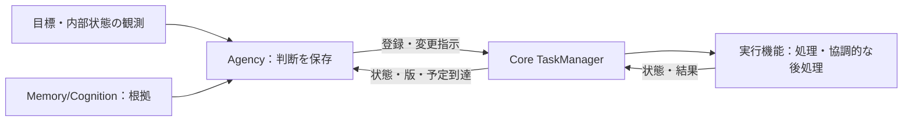

# Agencyの活動実行と継続判断（v1.6候補）

[ADR 0034](adr/0034-v1.6-agency-execution.md)・親#16で、[v1.5の判断・保存](agency.md)をCore TaskManagerの実行状態へ接続する。公開版はv1.2.0。この資料は開発候補の契約を説明し、受入の進捗は[B06](validation/v1.6.md)で確認する。

## できること

利用側は目標・内部状態・利用可能な活動の観測を与える。AgencyがMemory/Cognitionの根拠から活動を選び、登録・期間/優先度/未開始時刻の変更・中断・再開・終了をCoreへ依頼する。Coreは値に基づく実行管理を行い、活動の価値を決めない。



この初期循環は入力された目標に基づく規則的な自律実行で、目標そのものの自律生成・自由会話・人間の情動モデルではない。起動だけでは活動を始めない。

## 構成と接続

同じ配布物の`nymph_toolkit.subsystems.agency:execution_factory`を使う。従来の`factory`と`ntk.agency.decisions/1`は維持する。実行用factoryにはdecisions/1と`ntk.agency.activities/1`の両契約を宣言し、Groupで`enable_activities`を有効にする。実行機能は公開`ModuleContext.provide_executor`でIDを提供する。

従来の`path`・`memory_module_id`・`cognition_module_id`・`catalog`に次を加える。

```python
execution = {
    "poll_seconds": 0.1,
    "max_activities": 32,
    "pause_executors": [{"module_id": "worker", "executor_id": "study"}],
}
```

poll_secondsは0.02〜60秒の有限数。活動状態の観測間隔で、ヘルスチェックではない。max_activitiesは1セッションの登録合計1〜128。実行枠やConnections容量と別。pause_executorsは最大16組で、実行機能の宣言と一致させる。Coreが中断を拒否した場合は、その結果を保持する。

## 制御契約

`nymph_toolkit.contracts.agency`の`AGENCY_ACTIVITIES_KEY`・`AGENCY_ACTIVITIES_CONTRACT`を利用する。全操作ASYNC、許可済み直接通信とCore経由の両方で利用できる。5操作の例では`core`は呼出元の公開CoreClientとする。

| 操作 | 契約 |
|---|---|
| activate(session_id, observation) | 明示有効化。返る状態は受付時の観測であり、活動開始の保証ではない |
| observe(session_id, expected_revision, observation) | 観測全体を置換。版一致で1増加。直近の同じ要求を再適用しない |
| status(after=0, limit=8) | 状態と登録順の活動要約を取得。after 0〜128、limit 1〜16。next_afterで続きを取得 |
| halt(session_id) | 新規判断を止め、所有活動だけへ安全な終了を要求する |
| history() | Coreの過去活動履歴と読出しの問題を取得。現在状態・自動復元ではない |

```python
await core.bind(AGENCY_ACTIVITIES_KEY, "agency", timeout=5)
accepted = await core.invoke(
    AGENCY_ACTIVITIES_KEY, "activate", "session-1",
    {"state": {"sleep_pressure": 100, "cognitive_load": 100, "social_need": 0},
     "goals": [{"goal_id": "cat", "record_id": "lesson", "token": "猫",
                "importance": 800, "target_documents": 1}],
     "available": ["study", "apply", "rest"]}, timeout=5)
state = await core.invoke(AGENCY_ACTIVITIES_KEY, "status", timeout=5)
```

目標のMemory原本とカタログは先に用意する。state/goals/availableはdecisions/1と同じ制約。now・currentはAgencyが時計とCoreから取得するため、制御入力へ指定しない。セッションIDはtrim済みUTF-8 128 bytes以内。1起動で最大64セッション、同じID/同じ初期入力は再起動せず状態を返す。内容違いはagency.session_conflict。停止後に新しい循環を始める場合は新しいIDを使う。

## 状態と適用結果

状態はinactive、active、waiting、stopping、stopped、failed。waitingでは、候補なし・同じ観測での完了済み作業・根拠取得の容量不足などにより新しい入力や活動変化を待つ。同じ観測のタイマーだけで失敗要求を再送しない。

statusには観測版、直近決定ID、前景活動ID、登録件数、ページごとの活動状態/版/予定/期間/優先度/計時/確認フラグ、直近32操作の要約、失敗と結果不明を含む。操作要約は永続履歴の代替ではない。時刻・期間・計時の意味は[TaskManager](task-manager.md)に従う。Coreの履歴とAgencyの決定は、決定IDから導くactivity_id/command_idで対応させる。

変更のacceptedは未完了。Coreのapplied/no_changeを確認して、適用済みのplanだけを次の判断のcurrentへ渡す。別活動へ切り替える中断指示に含まれる新候補を、現在活動のplanへ上書きしない。中断した活動へ戻る際は同じ実行継続を再開する。

予定時間到達後も活動は続く。Agencyが同じ活動を選んだ場合は延長を判断し、適用後の予定版を観測する。同じ通知に対する重複延長を防ぐ。実行中の開始時刻は変更しない。

## 失敗・停止・再起動

入力はagency.invalid、観測版競合はagency.revision_conflict、セッション上限はagency.session_full。登録合計上限はagency.activity_full、命令拒否はagency.command_rejected、実行失敗はagency.execution_failedとしてstatusへ残す。実行先未登録などのCore例外も保持する。元の失敗活動・命令は自動再送しない。

根拠側のTemporaryUnavailableはwaitingとし、実行中の学習を中断せず、新しい観測・活動変化まで待つ。連携エラーでは所有活動の協調的な後処理を先に確認し、その後に中断完了を報告して個別ヘルスを申請する。無関係な機能を止めたり、接続先を切り替えたりしない。

管理RPCの結果不明はstatus.unknownへ要求IDを残す。同じCoreClient.resultで照会し、確認後にreleaseする。元の操作を送り直さない。照会不能なら未実行や後処理済みを保証せず、新セッションも開始しない。haltの返却だけで終了完了とせず、stoppedとcleanup_confirmedを確認する。通常の協調終了を強制終了に置き換えない。

判断根拠側の結果不明はerrorのOutcomeUnknown・request_id・scope=decision_dependencyへ残す。管理RPCの要求IDと混同しない。回復処理が重ねて失敗しても元の結果不明を保持する。終了状態でも後処理未確認の活動が残る間は新セッションを受け付けない。

Runtime停止ではCore自身が活動終了を管理し、Agencyは所有操作・保存worker・窓口を回収する。再起動ではinactiveで始まり、Core履歴と決定履歴を照会できる。中断位置や前のセッションを自動復元しない。

## 実行例

```console
python examples/agency_execution_demo.py
```

14番目の例は、Memoryに教材を保存し、Agencyが選んだstudyで実際にCognition.learnを呼び出す。学習済み根拠からapplyへ移り、睡眠圧の観測変更でrestへ切り替え、元の活動へ戻り、haltで終了する。教材の区切り・ラベルは明示された教師情報。例のworkerは教材を実行するための機能で、本番のSleepやPersonaではない。

別プロセスの例用workerを読み込むため、例の実行時だけ例フォルダをPYTHONPATHへ設定する。本番機能は共有Python環境へ導入する。4配置・両経路・再起動・障害の確認範囲は[B06記録](validation/v1.6.md)を参照する。
