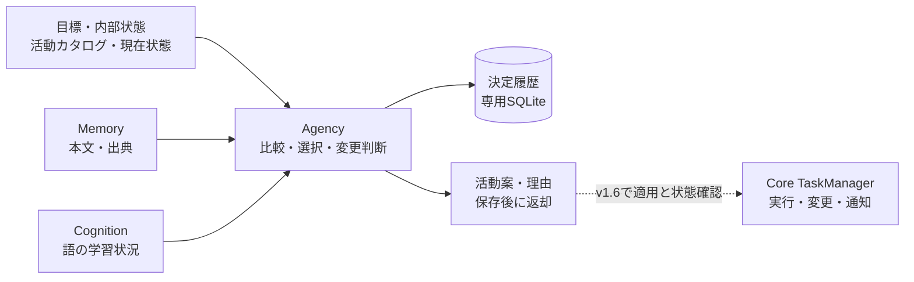

# Agency：根拠と内部状態から活動を決める

v1.5開発候補に同梱するNymph側の意思決定機構。[ADR 0032](adr/0032-v1.5-agency-decisions.md)・親#15・子#132〜#136・[B05記録](validation/v1.5.md)で追跡する。公開版はv1.2.0。Coreの実行管理と区別し、v1.5では決定・保存・照会、v1.6で登録・変更適用・実行状態との循環を扱う。

## 何ができるか

目標と活動カタログ、休息の必要度などの内部状態を入力し、Memory原本とCognitionの学習例数を参照して活動を選ぶ。同じ目標でも、未知なら調査、学習済みなら活用、睡眠圧が強ければ休息へ選択が変わる。理由、候補の得点、根拠、時刻・期間・優先度、現在の活動への変更案を記録する。



目標とカタログを入力することは、毎回の活動選択を外部が指定することとは異なる。Agency自身が観測と規則から選ぶ。ただし目的の自律生成、汎用推論、意味理解、人格・情動の完成ではない。人工的な状態指標と解釈可能な初期規則`utility-v1`であり、既存LLMを中核に使わない。

## 配置と設定

factoryは`nymph_toolkit.subsystems.agency:factory`。`ModuleKind.SUBSYSTEM`、Memory/Cognitionへの必要依存、`AGENCY_CONTRACT`を宣言する。契約は`nymph_toolkit.contracts.agency`からimportする。`HybridGroup`のLOCAL/PROCESSどちらでも使用できる。詳細な組立ては[実行例](../examples/agency_demo.py)。

```python
config = {
    "path": "D:/ntk-data/agency.db",  # 既存の親ディレクトリ内の絶対ファイル
    "memory_module_id": "memory",
    "cognition_module_id": "cognition",
    "catalog": [{
        "template_id": "study", "motive": "explore",
        "content": "学習目標を調べる",
        "executor_module_id": "worker", "executor_id": "study",
        "parameters": {}, "min_seconds": 60, "max_seconds": 300,
        "delay_seconds": 0,
    }],
}
```

max_frame_bytesは65536以上。専用DBは1実体が所有し、同時受付は1件。DBには自身のID・選択先・カタログを記録し、不一致設定での再利用を拒否する。カタログ変更を既存履歴の書換えでごまかさず、変更・移行の設計を別途行う。実行先は活動案の宛先であり、v1.5の決定だけでは実在確認・予約・実行を行わない。

## 公開操作 decisions/1

| ASYNC操作 | 入力 | 結果 |
|---|---|---|
| decide(request) | 下記のJSON | 保存済み決定、または失敗値 |
| get(decision_id) | 非空のID | 過去の決定そのもの。外部機能へ照会しない |

```python
request = {
    "decision_id": "decide-001",
    "now": "2026-11-24T12:00:00Z",
    "state": {"sleep_pressure": 100, "cognitive_load": 100, "social_need": 50},
    "goals": [{"goal_id": "understand-cat", "record_id": "lesson", "token": "猫",
               "importance": 800, "target_documents": 1}],
    "available": ["study"],
    "current": None,
}
receipt = await link.acall("decide", request, timeout=15)
saved = await link.acall("get", "decide-001", timeout=5)
```

Memoryには`lesson`の本文と出典が保存済みであること。目標語が本文中にあるか確認し、同じ出典区分でCognition inspectを取得する。個々の観測は逐次取得で、全機能の原子的な同時スナップショットではない。入力の列挙順を正規化するが、時刻・状態・目標が異なれば別入力になる。

現在活動を再検討する場合のcurrent:

```json
{"decision_id":"decide-001","state":"running","revision":2,
 "planned_end_notified":false,"supports_pause":true}
```

decision_idは、実際に登録/変更を適用したplanを持つ過去の決定を指す。未適用の候補を現在の活動として渡さない。state/revision/到達通知/中断対応は実行側の観測値であり、決定器が実行状態を推定した値ではない。

## 得点・予定と結果

不足度は`max(0, target_documents-documents)*1000//target_documents`。restは睡眠圧・認知負荷の最大、socialは交流必要度、exploreは重要度×不足度、achieveは重要度×充足度を使い、0〜1000へ揃える。正の最高点を選び、同点なら現在活動、次にID順とする。利用不能と報告された候補を除外するが、これはCoreの接続許可・容量予約ではない。

期間はmin〜maxを得点で線形補間し整数秒、priorityは得点、開始遅延は設定遅延×(1000-score)//1000秒。0なら即時要求、その他はnowから計算した時刻を指定する。v1.6で実際にCoreへ届くまでに過去になった場合はCoreの拒否を受けてAgencyが再判断する。

結果には`decision_id/sequence/policy/requested_at/directive/target/plan/selected/candidates/evidence/state`を含む。planはActivityRequest相当の7項目とtemplate_id/goal_id/executor_module_id/executor_id。parametersはconfiguredと、実行対象を示すgoal_id/record_id/tokenに分かれる。新しい活動IDは決定IDから安定に生成し、同じ活動の変更では維持する。

| directive | Agencyの判断。v1.5では適用しない |
|---|---|
| start / idle | 現在活動がない、または終了済み。新規案を開始 / 候補なし |
| continue / change | 同じ活動を維持 / 時刻・期間・優先度の変更案 |
| pause / finish | 別候補を優先する、または候補なし。現在活動の協調的中断 / 終了案 |
| resume | 元のplanのまま再開。変更は再開観測後の判断へ分ける |
| wait | 開始・中断・再開待ち・終了の遷移中。確定を待つ |

runningの開始時刻は変更しない。pendingでも期間・優先度が同じなら既存の開始時刻を維持し、再観測のたびに延期しない。予定到達の通知があり、同じ活動を再選択した場合は現在の合計期間に選んだ期間を足す変更案を返す。Core自身は延長を決めない。実行内容や根拠/語の変更をActivityChangeで書き換えず、別活動として扱う。1決定は1操作で、中断・終了確認前に次を開始しない。変更の受付と適用完了・版競合はv1.6で接続する。

## 保存・失敗・再起動

最大4096決定の入力・根拠・結果をSQLiteへ原子的に保存し、commit後に返す。同じIDと正規化入力は、学習状況が後で変わっても元の決定を返す。再評価には新しいIDを使う。根拠のMemory fingerprint・出典区分・学習例数は観測時点の証拠であり、真偽や理解の保証ではない。

| 結果 | 扱い |
|---|---|
| agency.invalid | 入力/現在参照/計算可能範囲を修正する |
| agency.evidence | 提供結果の形・出典・目標との整合を確認する |
| agency.not_found | 決定IDなし。実行されたことを示さない |
| agency.decision_conflict | 同じ決定IDに異なる入力。IDを流用しない |
| agency.history_full | 上限。古い決定の照会・再要求は保持。自動削除なし |
| agency.storage | 保存失敗。結果を照会し、DBを確認する |
| Memory/Cognitionの業務失敗 | 元の失敗値を保持し、決定は保存しない |
| TemporaryUnavailable | 停止中・処理中・提供先容量不足。自動再送しない |

LinkFailureは該当窓口のclose・中断完了報告・ヘルス申請で処理する。結果不明は復旧/稼働通知の失敗でも隠さず、IDで照会する。利用ごとの接続選び直し・自動切替はしない。待機取消・期限切れは未保存保証ではない。受付済み処理とSQLite workerを所有し、停止は保存・窓口・workerの後処理を待つ。

再起動時は形式・設定・全決定の整合を検査して読み、活動を自動登録しない。破損・未知形式のDBを空にして続行しない。カタログ16件、目標8件、正規化入力16384 bytes、parameters4096 bytes、期間/遅延86400秒などの全境界はADR 0032を参照する。

## 再現

```console
python examples/agency_demo.py
python -W error -m unittest tests.subsystems.test_agency tests.subsystems.test_agency_service -v
```

実Memory/Cognitionで未知→学習→疲労の選択変化、原本保持、保存後の再要求、再起動、4配置/両経路を検証する。TaskManagerへの自律的な登録・継続的実行はv1.6の受入で確認する。[全体進捗](implementation-progress.md)

## v1.6で追加する活動適用

本書のdecisions/1とfactoryは維持する。任意のexecution_factoryとactivities/1による継続判断・Core適用は[活動循環ガイド](agency-execution.md)とADR 0034を参照する。v1.5時点の対象外と、後続で採用した範囲を区別する。
