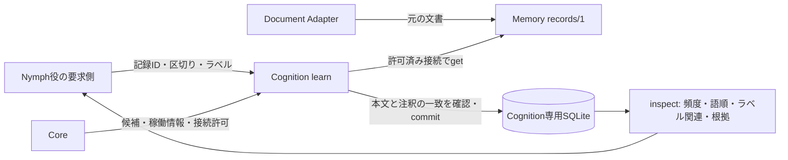
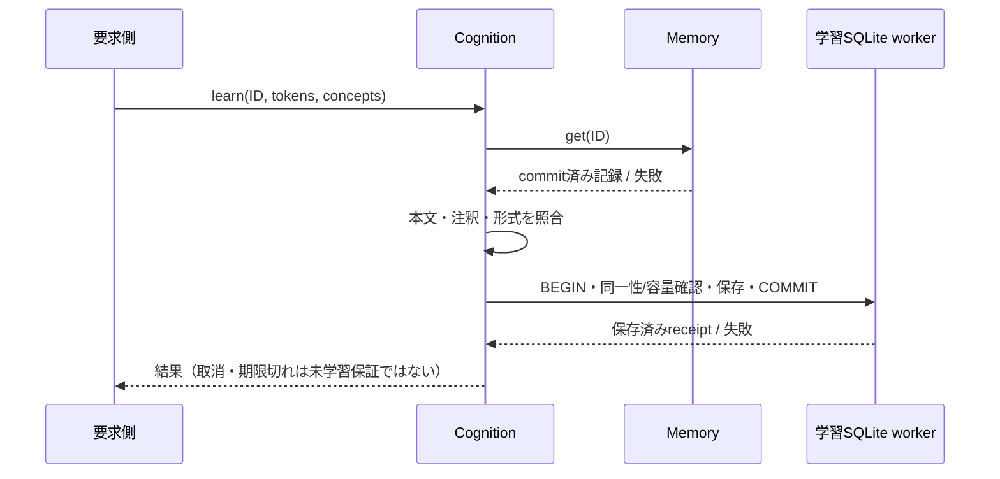

# Cognition Subsystem — v1.3の初期学習

R35・[ADR 0029](adr/0029-v1.3-cognition-learning.md)で具体化した開発候補。公開済みv1.2.0には含まれない。Memoryの記録に、要求側が語の区切りと概念ラベルを添えて学習する。語彙の出現数、例内の隣接語順、語とラベルの共起を、根拠付きで照会できる。

**この版は小さな学習実験の基盤である。** 語の分節や概念ラベルは教師情報として与える。自然な日本語の理解、完全な文法獲得、自律的な概念形成、会話・文章生成を実現したものではない。初期語彙は空で、LLM・事前学習モデル・外部Python依存は使わない。

## 役割と保存先



学習を行うか、どの記録を使うか、区切りとラベルをどう与えるかは要求側が決める。Coreは認知や真偽の判断を代行しない。Memoryは元記録を保持し、CognitionはID・記録fingerprint・区分・tokens/labelsを専用DBへ保持する。元のMemory本文やCoreのFileStore履歴を置き換えない。

## 登録・前提

ModuleKind.SUBSYSTEM。公開入口は`nymph_toolkit.subsystems.cognition:factory`、設定は絶対ファイルパス`path`と、選択済みの提供先ID`memory_module_id`の2項目のみ。DBの親ディレクトリは先に作り、Memory/Coreと異なるファイルを使う。1つのDBは1つのCognition実体が所有する。max_frame_bytesは65536以上。

```python
from pathlib import Path
from nymph_toolkit.contracts import ModuleSpec, ModuleKind, ModuleAdvertisement, Placement
from nymph_toolkit.contracts.cognition import COGNITION_KEY, COGNITION_CONTRACT

group.register_module(
    ModuleSpec("cognition", ModuleKind.SUBSYSTEM, ("memory",)),
    ModuleAdvertisement("cognition", "1.3.0", (COGNITION_CONTRACT,)),
    "nymph_toolkit.subsystems.cognition:factory",
    {"path": str(Path("cognition.sqlite3").resolve()), "memory_module_id": "memory"},
    Placement.PROCESS,
)
```

LOCALも同じ契約。機能実装版1.3.0、契約版1、内部保存形式1は別の版である。最初のlearnで候補と稼働情報を確認し、設定IDへbindする。同一起動中の接続先は固定し、許可済みDirectLinkを再利用する。requiresによる依存宣言は接続許可そのものではない。

## 2つの操作

`ContractKey("ntk.cognition.learning", "1")`の全操作はASYNC。以下は接続を準備済みの利用例。

```python
# "cat-sleep" はMemoryに保存済みの、本文が「猫 は 眠る」の記録。
receipt = await link.acall("learn", "cat-sleep",
    tokens=["猫", "は", "眠る"], concepts=["animal", "sleep"], timeout=10)
profile = await link.acall("inspect", "猫", source_kind="observed", after=0, limit=8, timeout=5)
```

成功値以外に下表の業務失敗・容量不足・通信障害を受ける。dictと確認してから各項目を読む。外側の10秒は利用例の予算で、Cognition内部の個別Memory RPCは5秒。学習をまとめるシナリオの期限とは分ける。

| 入力 | 条件 |
|---|---|
| learnのrecord_id | Memoryと同じ非空・前後空白なし・UTF-8 128 bytes以下 |
| tokens | listで1〜32語。各語は非空・Unicode空白/NULなし・UTF-8 64 bytes以下 |
| concepts | listで0〜8ラベル。同じ文字制約、重複不可。順序は区別しない |
| 本文との対応 | Memory本文からUnicode空白を除いた値とtokensの連結が一致すること |
| inspectのtoken | tokensの1要素と同じ文字制約。大小文字・表記・活用は別の語として扱う |
| source_kind | None（全区分）またはobserved/reported/inferred/imagined/dream |
| after / limit | 学習sequenceのカーソル0〜2^63-1 / 根拠ページ1〜8。bool不可 |

`learn`の成功結果はrecord_id・Cognitionの学習sequence・Memory応答のfingerprint。SQLite commit後に返す。同じID/記録/注釈は同じreceiptで二重加算しない。異なる記録や注釈は競合とし、元の学習を維持する。訂正や忘却を暗黙に実装しない。

## 観察できるもの

| inspectの結果 | 意味 |
|---|---|
| token / known | 問い合わせ語 / 絞込条件内で学習済みか。未知はfalse |
| count / documents | 語の出現回数 / 語を含む学習例数 |
| source_counts | 出典区分ごとの、その語を含む例数。区分を真偽の順位へ変換しない |
| successors / successor_total | 次語・回数・相対頻度の上位8件 / 全候補数 |
| end_count / end_probability | 例の終端に現れた回数 / 語の出現数に対する割合 |
| concepts / concept_total | ラベル・共起例数・support_ratioの上位8件 / 全候補数 |
| evidence | 学習sequence、Memory record_id、fingerprint、source_kind。最大limit件 |
| after / has_more | 次の根拠ページへ渡すカーソル / 続きがあるか |

次語/終端の割合は語の出現数で割る。conceptのsupport_ratioは語を含む例数で割り、同じ語が1例に何回出てもそのラベルは1回だけ数える。これは関連の支持率であり、真偽や意味を理解できる確率ではない。複数ラベルの支持率の合計は1に限らない。ランキングは回数降順、同数ならUnicode文字列順。上位だけを表示しても総候補数を返す。

例として「猫 猫 眠る」「猫 遊ぶ」「猫」の3例では、猫の出現は4回、3例、次語は猫/眠る/遊ぶが各1回、終端が1回となる。例をまたぐ語順は作らない。ページ指定は根拠だけへ適用し、count等は絞込条件に一致する全学習例の値を返す。元の記録はMemory getで参照し、fingerprintと照合できる。fingerprintはMemoryの返却8項目をASCII escape・キー昇順・コンパクトJSONにしたSHA-256。

## 失敗・再起動・停止



| 結果 | 扱い |
|---|---|
| cognition.invalid | 入力違反・本文とtokensの不一致。新しい学習は行わない |
| cognition.conflict | 同じIDが異なる記録/注釈と結び付いている。上書きしない |
| cognition.full | 初期モデルの256例上限。既存例の照会・冪等再要求は可能 |
| cognition.storage | SQLite操作失敗。保存先・権限・容量・別writerを確認 |
| MemoryのOperationFailure | not_found等をそのまま返す。学習に成功した扱いにしない |
| TemporaryUnavailable | 処理中・停止中・Memory容量不足。待機列へ入れない |
| LinkFailure | 接続をcloseし、停止中でなければ返されたinterruption_idで中断完了報告を行い、対象Memoryのhealthを個別申請する。元のgetを再送しない |
| OutcomeUnknown / TimeoutError / ConnectionNotReadyError | 接続をcloseし、停止中でなければ対象Memoryのhealthを個別申請する。中断IDのない経路では中断完了報告を行わず、元の例外を保持する。再送しない |
| ProtocolError | Memory記録の形式違反など。上記例外経路と同じ後処理を行う。呼出し元への伝達形は配置/呼出し経路の既存契約に従う |

全操作で同時受付1件。I/Oと集計は専用workerで処理し、取消/stopも受付済みtaskとworkerの終了を待つ。取消や通信期限切れはrollback保証ではない。結果不明なら、要求側が接続状態を確認して同じID/注釈を明示再要求し、receiptとinspectを照合する。復旧時の再prepareは同じ提供先で行い、別の先への自動切替はない。

SQLiteのロック待ちは1秒。未知保存形式・破損・設定と異なるMemory IDのDBは起動時に拒否し、自動移行・上書きしない。再起動後のinspectは保存された学習例から同じ統計を再現し、Memoryを毎回照会しない。元Memoryが失われた場合、参照不能な根拠を自動修復しない。新しいlearnは再びMemory getで根拠を確認する。

## 試す・確認する

[開発手順](development.md)でこのcheckoutをeditable導入して実行する。

```text
python examples/cognition_demo.py
python -W error -m unittest tests.subsystems.test_cognition tests.subsystems.test_cognition_integration -v
```

10番目の例はDocument→Memory→Cognition、語順/関連と出典区分、直接/Core経由、冪等/競合、再起動を照合し、`PASS: Cognition learning, evidence, source separation, Memory/Document, restart, cleanup`で終わる。一時文書・DBは終了時に削除する。[B03検証記録](validation/v1.3.md)で初期確認、全回帰、配布、確定コミットのCIを区別する。

未分割日本語の分節、完全な構文/意味理解、自律的な概念形成、文章生成/対話、訂正/削除/忘却、Web/対話Adapter、学習計画、大規模/長期性能・物理故障/電源断は今回の対象外。初期の有限コーパスでの結果を一般的な日本語能力へ外挿しない。
