# NTK 契約・利用ガイド

**Nymph Toolkit / 対象 v1.11.0（開発候補） / 公開版 v1.2.0 / 2026-11-28**

## この資料で分かること

NTKは人工人格Nymphの成長を支えるPython基盤です。本書は導入担当者と開発担当者に向けて、Core・接続契約・Memory・Document・Cognition・Text/Web・Agency・Persona・Sleep・睡眠活動・音声観測の実装、使い方、制約をまとめます。

**Nymphが活動を決め、Coreが実行を管理します。** Agencyの活動循環・特性反映とSleepの初期統合を含みます。自然な会話や人格を備えたNymph全体は未完成です。Cognitionは区切りと概念ラベルを与える初期学習であり、一般的な意味理解の完成を示しません。

| 読みたい内容 | 章 |
|---|---|
| Coreの構成・配置・起動停止 | 01〜03 |
| 登録・接続・操作・ストリーム | 04〜07 |
| 活動・失敗・保存・再起動・設定 | 08〜13 |
| 6区分の接続契約・実機能・音声・入力候補 | 14〜18K |
| 導入・実行例・開発者向けAPI | 19〜23 |
| 適用範囲・検証・参照先 | 24 |

**公開版v1.2.0**はCore・Memory・Documentを含みます。**開発候補v1.11.0**は、従来の開発候補に入力候補の共通準備を追加します。前段PR #123/#131/#137/#143/#149/#156/#162は未マージです。**Discord Bot確認はクリア**。実受信・通常停止・受信後の退出停止の実測と、追加確認を不要とするユーザー判断に基づきます。先行#169と全体の最終確認は別です。候補の機能には、そのcheckoutの開発用導入が必要です。

本書の「契約」はAPIの入力・結果・状態・失敗・責任分担を指します。v1.0で確立した6区分の共通契約を維持し、業務ごとの契約を追加しています。正確な署名は[API一覧](api-reference.md)、意味は[Core API](core-api.md)と各機能ガイドを参照してください。

<!-- pagebreak -->

## 01 全体像：判断する機能と実行を支える基盤

Nymph側の機能が「何を、いつ、どのくらい行うか」を指定します。Coreは、その要求を受け付け、実行条件と状態を管理します。Subsystemは内部の機能、Adapterは外部との接点を担当する構成です。

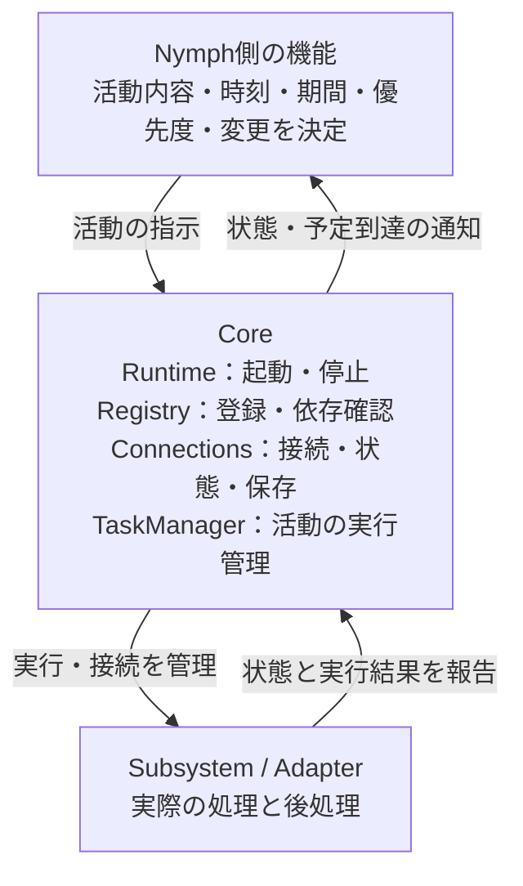

図1：責務の区分。箱は担当範囲を表し、クラスの継承関係や全ての内部呼出しを表してはいません。

| Coreが提供するもの | 利用側が用意するもの |
|---|---|
| 起動・停止、依存関係と状態の確認 | 機能の実装、登録情報、起動時の構成 |
| 候補情報、接続先の記録と検証 | 候補を比較して選ぶ判断、操作の意味 |
| 活動の時刻監視、変更と状態通知 | 活動内容・優先度・終了・再開の判断 |
| 保存と障害通知、後処理を待つ仕組み | 安全な中断点、所有する資源の解放 |

CoreとContractsは一つの`nymph-toolkit`パッケージです。Subsystem・Adapterは必要に応じて別配布にできる方針です。Memory・Documentは公開版に同梱し、Cognition・Text Interaction・Web・Agency・Persona・Sleepは開発候補に同梱します。睡眠活動との循環と音声をv1.10候補へ追加しています。音声の依存とモデルは明示導入します。

<!-- pagebreak -->

## 02 実行配置：同じPCで組み合わせる

機能ごとに同一プロセス（LOCAL）またはCore所有の子プロセス（PROCESS）を選べます。配置は起動前に指定し、その起動中は固定します。

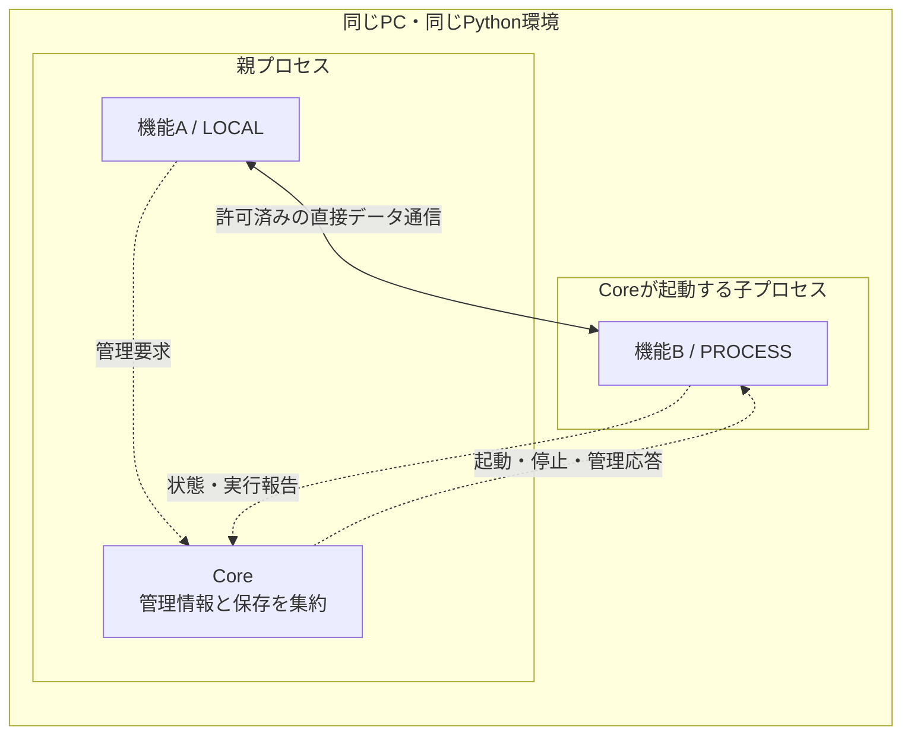

図2：管理情報は親Coreへ集約。管理通信と直接データ通信を分けます。Core経由のデータ呼出しも利用できます。

| 項目 | ModuleGroup＋Connections | HybridGroup |
|---|---|---|
| 配置 | 同一プロセス | LOCALとPROCESSを組合せ |
| 操作の宣言 | SYNC／ASYNC | LOCALを含めASYNCのみ |
| 直接呼出し | 保持したPythonメソッド | 同一配置はメソッド、別プロセスはRPC |
| データ | 既存ローカル操作入力をJSONへ一律制限しない | 転送入力・結果はJSON値と対応Contractsの範囲 |
| 子の起動 | なし | 同じPython実行ファイル、機能ごとに1子 |

HybridGroupのfactoryは、共有Python環境からimportできる`module:attribute`です。`ModuleContext`とJSON設定を受け、`start/run/stop`を備えたサービスを返します。

通信は同じPCの`127.0.0.1`とOS割当ポートを使います。他のPCへの分散、外部で起動済みのプロセスの管理、子だけの自動再起動は対象外です。Windowsでは子プロセス対応のイベントループを使います。同梱例は標準の`asyncio.run`を使用します。

<!-- pagebreak -->

## 03 起動・停止：後処理までがライフサイクル

サービスは非同期の`start()`、`run()`、`stop()`を実装します。Runtimeがこれらを所有して呼び出すため、利用側が同時に個別のフックを呼び出さないようにします。

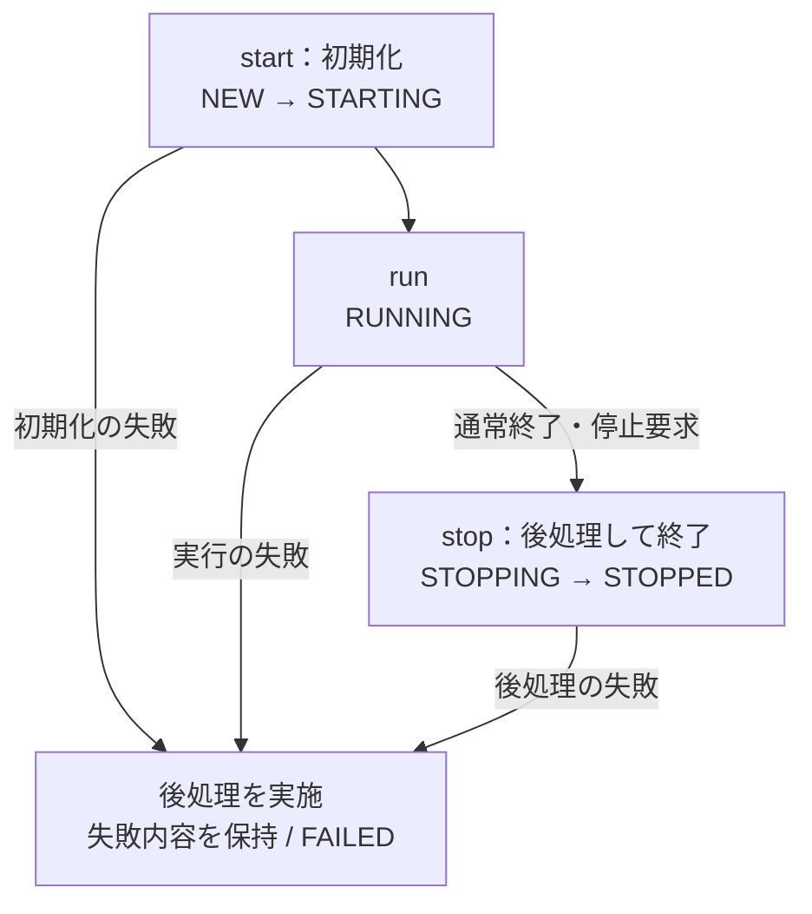

図3：主な経路。失敗しても、初期化に入った対象の後処理を進めます。未初期化などの細かな拒否条件はRuntimeの契約に従います。

| 操作 | 利用側が受け取るもの・守ること |
|---|---|
| `await runtime.start()` | 初期化完了。複数機能では依存先から起動し、全初期化後にrunを開始 |
| `await runtime.wait()` | runの戻り値、または停止に伴うNone。後処理まで待つ |
| `await runtime.stop()` | 停止・後処理を待つ。繰返し呼出しでも後処理を重ねて取消しない |
| 失敗した場合 | `RuntimeFailure`に初期化・実行・後処理の失敗を保持。後からwait/stopしても通知 |
| 再実行したい場合 | 新しいRuntimeとGroupを構築する。同じインスタンスは再起動しない |

ModuleGroupは依存順に初期化し、その逆順に後処理します。サービスの`stop`は自分が作ったタスク・接続などを解放します。Coreは無関係な呼出側タスクを一律停止しません。

待機者が`wait()`を取り消してもサービス自体は継続します。`stop()`の待機取消も停止完了を意味しません。所有者は再びstop/waitで結果を確認します。開始待機の取消は停止を要求します。

同一プロセスの処理には協調的な終了が必要です。Core停止時に限り、期限を超えたCore所有子を強制終了できます。その場合の後処理未確認を成功と扱いません。通常の活動終了への指示とは別です。

<!-- pagebreak -->

## 04 登録と提供機能：3種類の「利用できる」を分ける

登録情報、通信契約、稼働報告は別の情報です。登録依存が満たされていても、相手が動作中・受付可能であるとは限りません。

| 情報 | 利用側が指定する内容 | Coreから分かること |
|---|---|---|
| `ModuleSpec` | 機能ID、SUBSYSTEM／ADAPTER、必要な機能ID集合 | 登録の世代、依存充足、不足している依存 |
| `ModuleAdvertisement` | 機能ID、実装版、提供契約、タグ・属性 | 候補の静的な能力・条件 |
| `ContractKey` | 契約IDと版の文字列 | IDと版の完全一致による照合 |
| `ContractSpec` / `OperationSpec` | 操作名とSYNC／ASYNC | 宣言と呼出しの一致 |
| `Usage` | state、accepting、active、capacity | 機能全体・契約ごとの通知済み稼働情報 |

**確認の順序は、登録依存 → 稼働と受付 → 実際の操作受付です。** 候補に表示された空き容量は予約ではありません。最終的な受付は提供機能が判断します。

| 登録操作 | 結果と制限 |
|---|---|
| `register` | 重複ID・循環依存を変更なしで拒否。未登録の依存先を持つ登録は可能 |
| `get` / `entries` | 不変の観測値。後続の変更で古い値は書き換わらない |
| `unregister` | 依存元が利用不能になる場合も、その変化を結果に含める |
| `RegistryUpdate.changes` | 変更前後のEntry。継続購読ではなく、登録・解除の戻り値 |

Groupの起動開始から停止完了まで機能構成を固定します。起動前の登録・解除、停止後の明示解除を扱い、稼働中の実体追加・交換は行いません。停止済みGroupへ追加登録して再使用する場合も、新しいGroupを作ります。

提供機能の宣言は開始前に固定し、稼働情報は開始時と変更時に機能から通知します。未通知はUNKNOWNです。タグ・属性の条件を比較して候補を選ぶのは要求側で、Coreへ選定関数を渡す方式ではありません。

例：文書機能が記憶機能を必要とする場合、記憶機能の登録後に依存は充足します。しかし通信には別途、契約宣言・稼働報告・接続の確立が必要です。[Registry](registry.md)と[Connections](connections.md)で詳細を確認できます。

<!-- pagebreak -->

## 05 接続：要求側が選び、Coreが記録する

要求側はCoreから候補・属性・稼働状況を受け取り、利用先を選びます。Coreはその指定を検証して保存し、以後の接続先を管理します。

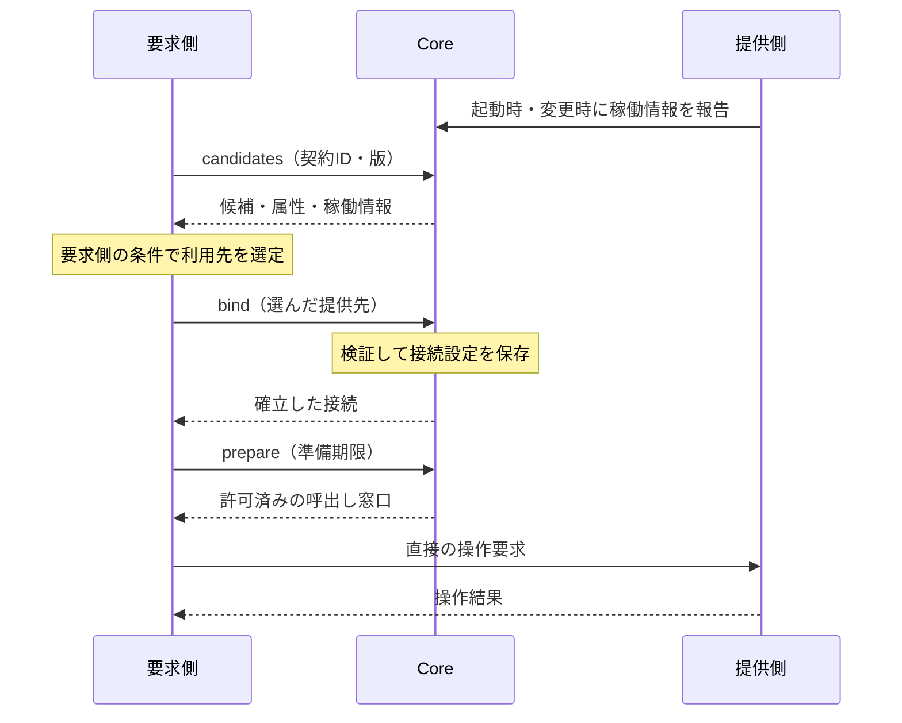

図4：正常な初回接続と直接呼出し。Core経由を選ぶ場合はinvokeを使います。

接続の固定単位は**要求元＋契約ID・版につき1接続**です。用途名による追加分割はありません。同じ相手へのbindは既存接続を返し、別の相手への変更は`ConnectionConflictError`になります。初回追加は稼働中にもできます。

`bind`の成功は接続設定の確立、`prepare`の成功は操作準備を意味します。検証中・協調的中断中・保存側の受付停止中などは、要求側の期限まで準備を待ちます。準備後も新しい無効通知を受けた窓口では新規操作を開始しません。

確立後に毎回候補を選び直したり、Coreへ許可を再申請したりすることはありません。起動時と申請されたヘルスチェックで接続を確認します。失効は不整合によるエラー回避が目的であり、連携機能がCoreの管理結果に従う前提です。

<!-- pagebreak -->

## 06 呼出し：入力・結果・期限の意味

実装する配置に合う窓口を使います。同じ契約ID・版の同期操作を、別プロセスで暗黙に非同期へ読み替えることはありません。

| 用途 | 同一プロセスのConnections | HybridGroupのCoreClient／DirectLink |
|---|---|---|
| 候補取得 | `candidates(contract)` | `await core.candidates(contract)` |
| 接続設定 | `await bind(requester, contract, provider, wait_timeout=...)` | `await core.bind(contract, provider, timeout=...)` |
| 準備 | `await prepare(binding_key, wait_timeout=...)` | `await core.prepare(contract, timeout=...)` |
| 直接呼出し | `handle.call`／`await handle.acall` | `await link.acall` |
| Core経由 | `await invoke(...)` | `await core.invoke(...)` |
| 通信窓口の解放 | Groupが管理するローカル参照 | `await link.close()`で通信資源を回収 |

表は入口の対応です。厳密な引数順・キーワード・型は[API一覧](api-reference.md)を参照してください。

| 期限や結果 | 利用側が理解しておくこと |
|---|---|
| Connectionsの`wait_timeout` | 準備待ちの期限。0以上の有限秒。操作本体の実行時間を制限しない |
| 別プロセスの呼出し期限 | 正の有限秒。未送信ならTimeoutError、送信開始後で成否未確認ならOutcomeUnknownとなり得る |
| `OutcomeUnknown(request_id)` | 失敗確定ではない。対象窓口のresultで照会し、完了後releaseする |
| 待機の取消 | 受付済み管理処理が取り消されたとは限らない。IDと現在結果を確認する |

別プロセスの引数・結果はJSON値と対応するContractsに限ります。文字列キーの辞書、配列、文字列、有限数、真偽値、nullを基本とし、任意オブジェクト・関数・pickleは転送しません。Pythonオブジェクトの同一性や元の例外オブジェクトの同一性もプロセスを越えて保証しません。

`pending_requests`は窓口が保持する要求ID、`result(id)`は結果の確認、`release(id)`は完了後の一時保持の解放です。未完了の解放は結果不明として扱います。IDは窓口と起動世代の中で使い、別の窓口へ渡しません。Coreは自動再送・自動接続先切替を行いません。

<!-- pagebreak -->

## 07 ストリーム：送信受付・受信・処理完了を分ける

連続データは片方向のストリームで送ります。双方向なら独立した2本を開きます。Coreはバイト列を運び、音声・文書等の形式と意味は利用機能の契約で定義します。

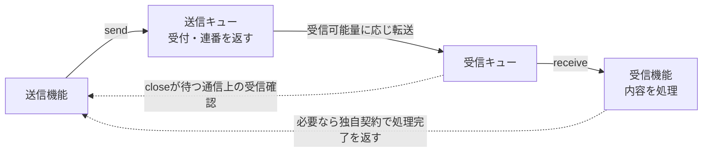

図5：sendの成功はローカル受付です。closeの成功も内容処理の完了までは含みません。

| 設定・操作 | 契約 |
|---|---|
| `StreamOptions` | 送受信それぞれのバイト数・チャンク数上限と混雑方針を、開設時に指定 |
| `WAIT` | 空きができるまで指定期限内で送信を待つ |
| `DROP_OLDEST` | 未転送の古いチャンクを丸ごと破棄。欠落範囲・件数を受信側へ通知 |
| 大きすぎる単一チャンク | ChunkTooLarge。分割は送信機能が担当 |
| `send` / `receive` | 有限期限を指定。空バイト列もデータとして扱い、終端・障害と区別 |
| `close` | 未破棄データと終端の通信上の受信確認まで待つ |
| `abort` / `aclose` | 明示打切り／所有通信タスク・ソケットの回収 |

closeの待機期限が切れても、CLOSINGの排出処理は続きます。状態照会・再度のclose・明示abortを使い分けます。送信受付前の期限切れや取消は後から受付せず、受付済みデータは待機取消だけでは撤回しません。

上限はアプリケーションの転送キューを対象とし、OS内部のTCPバッファは含みません。上限・混雑方針は開設中に変更しません。切断時は受信済みデータの後に異常終端を返し、自動再送しません。活動中断・終了時のclose／abortは利用機能が担当し、機能停止時に残った通信資源を回収します。

<!-- pagebreak -->

## 08 活動：予定時間の到達は判断を求める通知

`ActivityRequest`で要求元・活動ID、内容、開始時刻、期間、パラメータ、優先度を指定します。開始時刻はタイムゾーン付きdatetime、明示的な即時開始はNoneです。期間は正のtimedeltaです。

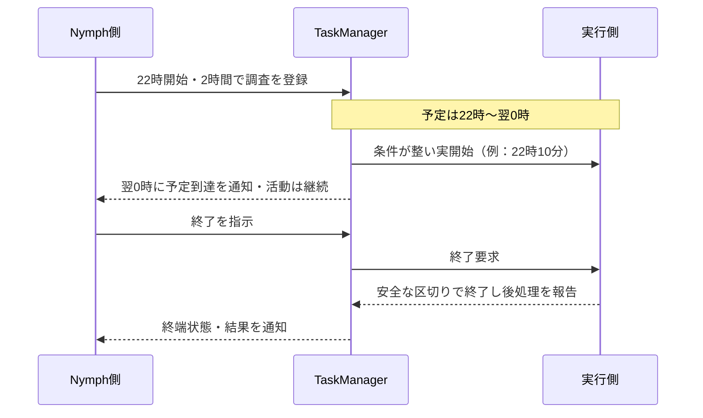

図6：受付時点では未来の予定で、実開始だけが遅れた例。受付時点で22時を過ぎていた要求は開始せずNymphへ返します。

| 観測値 | 意味 |
|---|---|
| 予定開始・予定終了 | Nymph指定の予定。到達は実開始と独立し、自動繰延べしない |
| 実開始・実終了 | 実際の開始と後処理完了。遠隔では実行側の報告で確認 |
| `elapsed_seconds` | 実開始からの経過秒。中断・再開待ち・後処理を含む |
| `execution_seconds` | 中断完了から実再開までを除いた秒。通常のI/O待ち・後処理を含み、CPU時間ではない |
| `timing_confirmed` / `cleanup_confirmed` | 遠隔で計時・後処理の確認が届いた範囲 |

過去時刻の要求は`ActivityStartInPastError`となり、活動を登録しません。Nymphが開始時刻を再指定します。受理済みの活動IDは、完了後も同一起動内では再利用できません。

予定到達だけでCoreは終了・延長・価値判断をしません。自然完了はCOMPLETED、明示終了はSTOPPED、実行の失敗はFAILEDとして区別します。結果の業務上の意味はNymph側が判断します。

<!-- pagebreak -->

## 09 活動変更：受理と適用完了を区別する

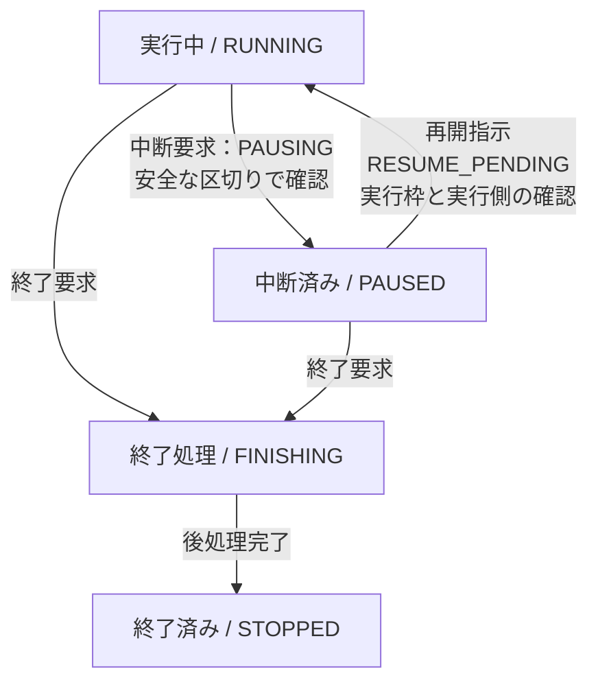

図7：実開始後の協調的中断・再開と明示終了。中断・再開の途中状態は矢印上に記載しています。未開始・遠隔開始、自然完了・失敗などは省略しています。全状態はAPI一覧を参照してください。

| 指示 | 適用内容 |
|---|---|
| 開始時刻変更 | 未開始の活動だけ。Noneは即時開始への変更、未指定UNCHANGEDとは異なる |
| 期間変更 | 現在の予定開始から数える新しい合計期間。追加時間ではない |
| 優先度変更 | 開始・再開待ちの順番に作用。大きな整数を先にし、同順位は待機順 |
| 中断 | 対応を宣言した実行側が安全な区切りでcheckpointに入り、PAUSEDを確認 |
| 再開 | 同一起動内で保持した処理の続きへ戻る。関数を最初から再実行しない |
| 終了 | 変更・中断・再開に優先し、後処理の完了を待つ |

変更・中断・再開には、活動内で一意の`command_id`と観測した`expected_revision`を渡します。同じID・同じ内容・同じ期待版なら元の要求の最新結果を返し、二重適用しません。古い版や内容衝突は理由付きで拒否します。`request`は初回入力、`current_request`は現在の実効入力です。

`accepted`は受理済みで未完了です。`wait_command`などで、applied／no_change／rejected／superseded／failedの終端結果を確認します。待機を取り消しても受付済みの変更要求は取り消されません。

実行枠を`max_running`で制限した場合、開始と明示再開を同じ待機列で扱います。優先度だけで実行中の活動を中断しません。中断対応は`supports_pause=True`で宣言し、実行側が作業状態と資源の扱いを担います。機能の連携エラーによる中断とは別の仕組みです。

<!-- pagebreak -->

## 10 失敗：どこまで止め、誰が回復を判断するか

通常の業務失敗、連携の想定外失敗、Core基盤の障害を区別します。失敗した要求の自動再実行や、別の接続先への自動切替は行いません。

| 事象 | 表現の例 | 利用側・Coreの対応 |
|---|---|---|
| 業務上の失敗 | OperationFailureという値 | 利用機能が内容を解釈する |
| 受付容量不足 | TemporaryUnavailableという値 | 即時応答。これだけで中断・ヘルス申請を起こさない |
| 連携の想定外失敗 | LinkFailureと通知 | 要求元機能が協調的中断・後処理・完了報告 |
| 入力・状態の不整合 | 型・状態別の例外 | 宣言・入力・順序を確認して修正 |
| 子の予期しない終了 | プロセス終了・通信切断 | 未処理の機能障害としてRuntimeを停止 |
| 保存・TaskManager内部障害 | 基盤の失敗情報 | 所有資源を後処理し、回復不能なら停止 |

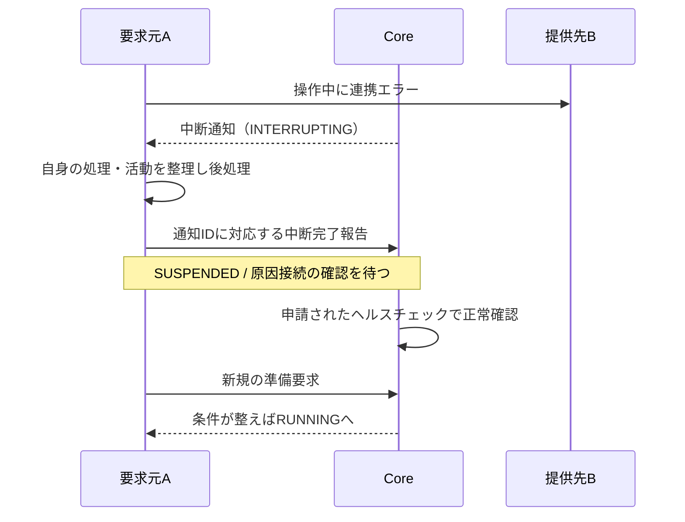

図8：要求元の復帰の代表例。正常確認と中断完了の到着順は前後できます。元の失敗操作の再生ではありません。

ヘルスチェックは保持する登録世代・宣言・稼働情報を確認し、機能の自己診断を呼び出すものではありません。Coreの定期申請や申請の統合も行いません。別の利用者には必要な接続の失効を通知し、通常の連携エラーで無関係な機能を一律停止しません。

<!-- pagebreak -->

## 11 保存：受付した履歴と保存済み履歴

FileStoreが接続設定と運用履歴を保存します。Group／Connectionsがライフサイクルを所有します。FileStoreを一つのSubsystemとして登録する構成ではありません。

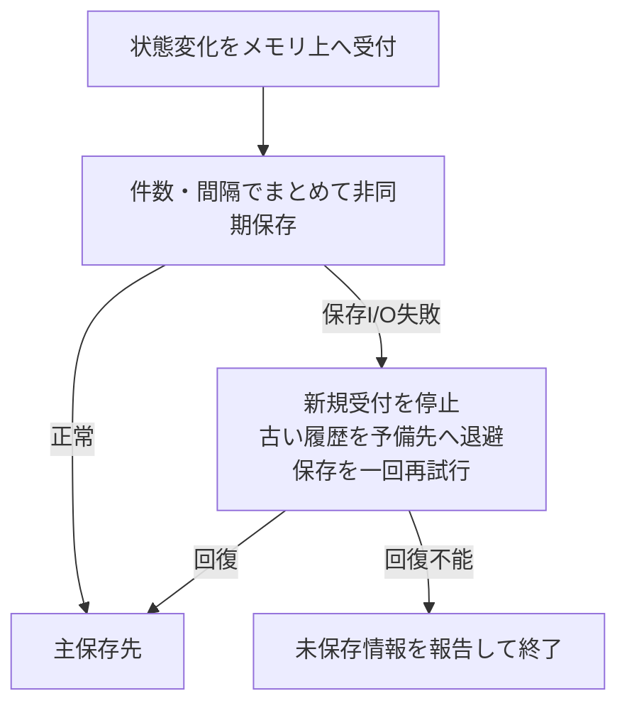

図9：保存I/O失敗時の内蔵手順。回復時は受付を再開します。破損設定を空に置換する手順ではありません。

| 項目 | 利用時の扱い |
|---|---|
| 接続設定 | 保存完了後に確立した接続として公開 |
| 履歴のappend | メモリ受付。ディスクへ書き終わった保証とは異なる |
| 明示flush | その時点までの履歴保存を待つ |
| 通常停止 | 進行中I/Oと未保存履歴の排出を待つ |
| 主・予備保存先 | 相互に包含しない専用ディレクトリ。同じ主保存先を複数Coreで同時使用しない |
| `unsaved_events` | 受付済みで未保存の件数。保存処理の追随状況を確認する |

通常の履歴バッファは上限なしです。生成が書込みを上回り続けるとメモリ使用量も増えます。`batch_size`は一回の書込件数であり、受付停止の閾値ではありません。転送キューや活動の実行枠の上限とは別です。

回復不能時には原因・未保存件数・未保存設定の有無を報告します。終了時に未保存バッファを追加退避する保証はありません。急なプロセス終了による未保存分の消失はあり得ます。ストリーム履歴には開設・終端・理由・欠落等を記録し、本文を一律保存しません。

<!-- pagebreak -->

## 12 再起動：接続を検証し、活動はNymphが決める

再起動では新しいRuntimeとGroupを作ります。保存情報のすべてを現在状態へ戻す処理ではありません。

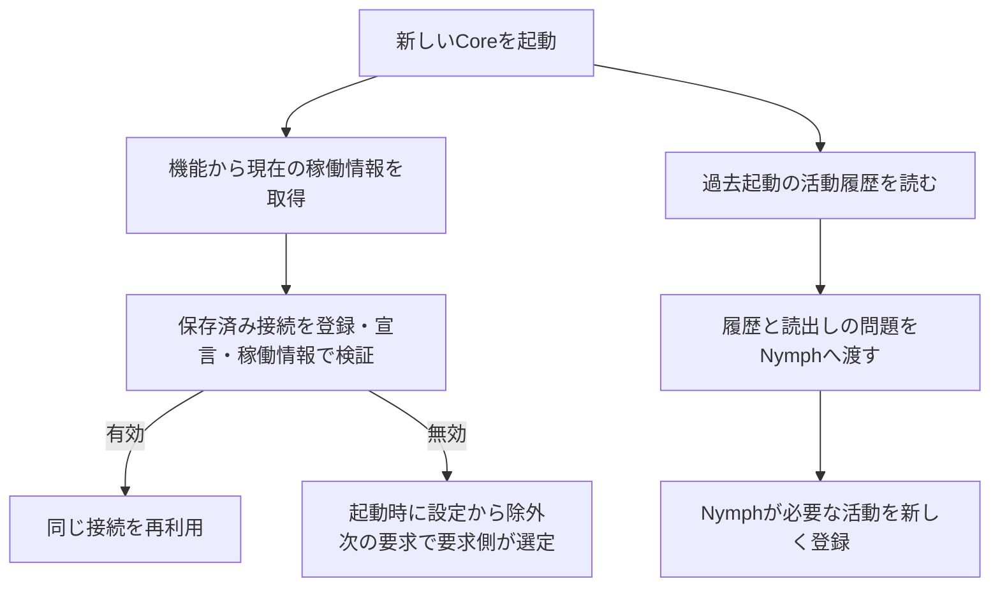

図10：接続再利用と活動履歴は独立して扱います。稼働中に失効した接続先を自動で切り替えることはありません。

| 情報 | 再起動時の扱い |
|---|---|
| 保存済み接続 | 現在の情報で検証して再利用または起動時に除外 |
| 稼働状況・空き容量 | 機能から取り直す。過去履歴を現在値にしない |
| 活動履歴 | Nymphへ渡す。現在の活動へ自動登録しない |
| 中断位置・実行関数・未完了操作 | 継続状態を自動復元・再実行しない |
| PID・ソケット・ストリーム途中データ | 復元しない |

活動履歴は主・予備の過去起動を読み、現在起動を除外します。同じ起動ID・連番の同内容記録は一件として扱い、内容競合は問題として返します。読出し問題は`history.issues`で確認します。

履歴の末尾不完全・未知形式・読出し失敗があっても、原本を修復・上書きしません。`issues`が空でも、急な終了などで失われた記録まで完全であるという保証ではありません。異なる起動IDの並びを実時間順と見なさず、記録の時刻・起動IDを確認します。

<!-- pagebreak -->

## 13 設定早見表：同じ「上限」「時間」でも用途が違う

必要な値は利用環境と機能に合わせて指定します。実行例にある数値はデモ用であり、全用途への推奨値や性能保証ではありません。

| 設定・入力 | 型・単位と範囲 | 作用 |
|---|---|---|
| HybridSettings.startup_timeout | 正の有限秒、明示必須 | 子・機能の起動待機 |
| HybridSettings.shutdown_timeout | 正の有限秒、明示必須 | Core停止時の子の後処理待機 |
| HybridSettings.call_timeout | 正の有限秒、明示必須 | 期限省略可能な管理呼出しの待機 |
| max_frame_bytes | 正整数・バイト、明示必須 | 通信フレーム長。任意に大きなデータを一度に送らない |
| max_requests / max_streams | 正整数、明示必須 | 同時要求・ストリーム数 |
| StreamOptionsの各上限 | 送受信それぞれ正のバイト数・件数 | アプリケーション転送キュー |
| StreamOptions.overflow | WAIT／DROP_OLDEST、明示必須 | 空き待ちか古い未転送チャンクの破棄 |
| FileStore.retention | 0以上のtimedelta、明示必須 | 保存救命時に古い履歴を選ぶ期間基準 |
| FileStore.batch_size | 正整数、明示必須 | 一回にまとめて書き込む件数 |
| FileStore.flush_interval | 正の有限秒、明示必須 | 履歴の書込み間隔 |
| clock_check_interval | 正の有限秒、明示必須 | 活動の壁時計再確認の間隔 |
| max_running | None、または正整数。既定None | 活動の同時実行枠。Noneは上限なし |
| ActivityRequest.priority | boolを除く整数。既定0 | 開始・再開待ちの順序 |
| supports_pause | bool。既定False | 実行側が協調的中断に対応する宣言 |

**時間を区別する4つの例**

1. 活動期間が2時間でも、通信呼出しを2時間待つ意味にはなりません。
2. Connectionsの準備期限が切れても、操作本体を強制停止したことにはなりません。
3. ストリームcloseの待機期限が切れても、排出処理は継続します。
4. Core停止期限による子の強制終了は、通常の活動終了への期限ではありません。

**容量も別々です。** Usage.capacity、max_requests、max_running、転送キューの上限、上限なしの履歴バッファを同じ設定として扱わないでください。

<!-- pagebreak -->

## 14 Core接続契約：共通の6区分

機能はCore内部を直接importせず、公開Contractsの窓口を使います。共通契約はv1.0で確立し、Memory・Document・Cognitionも同じ基盤へ接続します。

| 契約区分 | 機能側とCoreが共有する内容 |
|---|---|
| Module | ID・種別・依存、実装版と提供契約、factory・設定・配置 |
| Lifecycle | start/run/stop、依存順起動・逆順停止、部分初期化の後処理 |
| Capability | 契約ID/版・操作名・ASYNC・ストリーム/実行処理の宣言 |
| Communication | 候補・要求側選定・bind固定・prepare・直接/Core経由 |
| Task | 活動の登録・開始・変更・通知・終了。判断はNymph |
| Error | 値で返す業務失敗/容量/連携失敗と、例外・結果不明の区別 |


図11：登録前検証は宣言と設定を確認します。factoryのimport・起動・保存や、機能の実動作の保証は行いません。提供ハンドラーは初期化完了までに登録します。

**移行時の注意**：v0.9のCoreClient.requestは公開APIから除外しました。名前付き管理APIと業務契約の操作を使います。ModuleContextの内部資源管理メソッドへの依存も避けます。Core 15名・Contracts 98名の共通API基準と、各業務契約の版を分けて確認してください。

型・互換性の境界は[共通接続契約](module-contracts.md)、変更点は[v1.0移行手順](migration-v1.md)にあります。

<!-- pagebreak -->

## 15 Memory：経験・知識を出典付きで保存する

Memoryはv1.1から同梱しています。契約は`ntk.memory.records/1`、操作はすべてASYNCです。記録の内容や真偽をCoreやMemoryが判断することはありません。

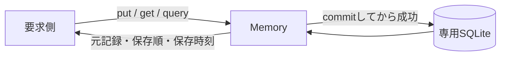

図12：Coreの接続・活動履歴とMemoryの経験・知識は別の保存物です。

| 操作・入力 | 成功結果と制約 |
|---|---|
| put(record) | record_id・kind・content・source_kind・source・occurred_atを保存 |
| get(record_id) | 元の6項目にsequence・stored_atを加えた記録 |
| query(kind, source_kind, after, limit) | 完全一致フィルタと保存順ページ。最大8件 |
| source_kind | observed / reported / inferred / imagined / dream。真偽の順位ではない |
| 保存上限 | 1記録の正規化JSONが4096 bytes以下。ASCII escapeで計算 |
| 同じID | 同じ正規化内容は冪等。異なる内容はmemory.conflict |

factoryは`nymph_toolkit.subsystems.memory:factory`、設定は絶対ファイルパス`path`です。1つのDBを1つの実体が所有します。SQLite対応Python、フレーム上限65536 bytes以上を使います。

同時受付は1件です。未知形式・破損を自動上書きしません。取消や期限切れは未保存保証ではなく、要求側がIDで結果を確認します。Memory原本の編集・削除・忘却・意味検索は未実装です。Sleepの別状態での統合とは区別します。[Memoryガイド](memory.md)

<!-- pagebreak -->

## 16 Document：ローカル文書をMemoryへ取り込む

Documentはv1.2から同梱するAdapterです。契約`ntk.document.import/1`の`ingest(request)`で、明示したUTF-8 txt/mdを1件のMemory記録にします。

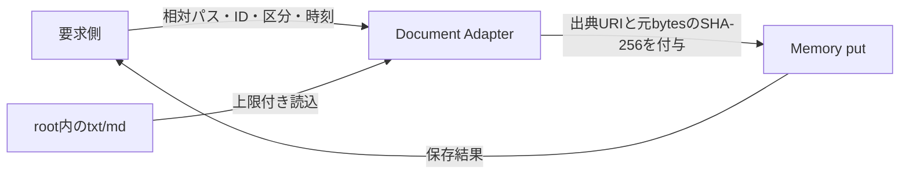

図13：内容の学習はDocumentの責務に含めません。Cognitionへの学習要求は別の操作です。

| 項目 | 契約 |
|---|---|
| 設定 | 既存絶対ディレクトリroot、選択済みmemory_module_id |
| ingest入力 | path・record_id・kind・source_kind・occurred_atの5項目 |
| ファイル | 通常ファイル、UTF-8、最大65536 bytes。先頭BOMのみ除去 |
| Memory上限 | 出典URI/hash等も含め4096 JSON bytes。超過は保存せず返す |
| 再取込 | 同じID/内容は冪等。本文・出典・区分等が違えば競合 |

root外・上位移動・不正文字コード・空白のみ/NUL本文は拒否します。root制限は敵対的なファイル交換へのセキュリティ境界ではありません。Document自体は自動分割・監視取込、PDF/Office/HTML/URL・OCRに対応しません。v1.4のHTTP/HTML入力は別のWeb Adapterが担当します。

接続先は要求側が指定し、Core許可後に固定して再利用します。同時受付1件。結果不明ならMemoryのgetで照合し、自動再送しません。[Documentガイド](document.md)

<!-- pagebreak -->

## 17 Cognition：注釈から初期の規則性を学ぶ

**v1.3で追加し、v1.10候補にも含む**Subsystemです。ユーザー採用済みの初期方式として、Memoryの記録へ語の区切りと概念ラベルを与えます。空の語彙から頻度・隣接語順・ラベルの共起を蓄積します。

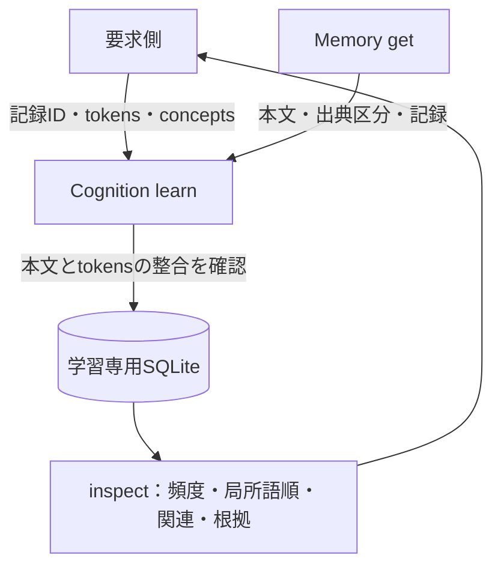

図14：元記録はMemory、学習例はCognition、接続許可と実行管理はCoreが担当します。学習を始めるか、何を使うかは要求側が決めます。

契約は`ntk.cognition.learning/1`のASYNC `learn` / `inspect`。factoryは`nymph_toolkit.subsystems.cognition:factory`、設定は専用DBの絶対`path`と選択済み`memory_module_id`です。

| 観察できる値 | 意味 |
|---|---|
| count / documents | 語の出現回数 / 語を含む学習例数 |
| successors / end_probability | 例内の次語と終端の相対頻度 |
| concepts / support_ratio | 語とラベルを共に含む例の割合。真偽・理解の確率ではない |
| source_counts / evidence | 出典区分、Memory ID・fingerprint・学習sequence |

語の区切りと概念ラベルは教師情報です。自律的な分節・概念形成、完全な構文/意味理解、会話生成を実現したものではありません。LLM・外部モデルを使いません。[Cognitionガイド](cognition.md)

<!-- pagebreak -->

## 18 Cognition：入力・失敗・保存の扱い

以下はMemoryに本文「猫 は 眠る」が保存済みで、Cognitionへの接続が準備済みの場合の操作例です。

```python
receipt = await link.acall("learn", "cat-sleep",
    tokens=["猫", "は", "眠る"],
    concepts=["animal", "sleep"], timeout=10)
profile = await link.acall("inspect", "猫",
    source_kind="observed", after=0, limit=8, timeout=5)
```

成功値のdictか、失敗値かを確認してから結果を読みます。外側の期限はシナリオに応じて設定し、Cognition内部の個別Memory RPCの5秒と区別します。

| 入力・保存 | 制約 |
|---|---|
| tokens / concepts | 1〜32語 / 0〜8ラベル。各非空・空白/NULなし・UTF-8 64 bytes以下 |
| 本文との整合 | 本文の空白除去とtokensの連結が一致。ラベル重複は拒否 |
| 学習保存 | 最大256例。commit後にreceiptを返す。再起動後に統計を再現 |
| 再要求 | 同じID/記録/注釈は冪等。異なる内容はcognition.conflict |
| inspect | 次語/概念は上位8件と総数。根拠は最大8件の保存順ページ |

`cognition.invalid/full/storage`、Memoryの業務失敗、`TemporaryUnavailable`を区別します。LinkFailureではclose後、中断IDに対する完了報告と対象Memoryへのhealth申請を行います。結果不明等の例外経路はIDなしの完了報告をせず、元の例外を保持します。停止中はhealthを申請しません。

取消・期限切れは未学習保証ではありません。要求側が接続状態を確認し、同じID/注釈の明示再要求で結果を照合します。元処理の自動再送・接続先切替は行いません。訂正は次頁のrevision/1を明示有効化して使います。削除・忘却・長期/大規模性能は後続課題です。

<!-- pagebreak -->

## 18A Text Interactionと注釈訂正：指示と原本を分ける

Text Interactionは、文章を保存するobserve、教師情報を渡すlearn、照会するinspect/get_revision、注釈を訂正するcorrectを提供します。全操作ASYNCで、同時受付は1件です。保存しただけでは学習しません。

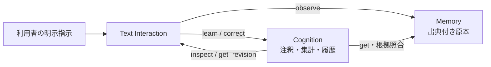

図15：許可済み契約で接続。訂正はMemory原本を変えず、Cognitionの注釈と集計へ反映します。

| 訂正の条件 | 結果と確認方法 |
|---|---|
| command_idとexpected_revisionを指定 | 初回学習の版は0、変更時に1増加。同一注釈はno_change |
| 同じ命令ID・同じ入力 | 過去receiptを返し、再適用しない。現在値はget_revision |
| 同じ命令IDで異なる入力／古い版 | command_conflict／revision_conflictで拒否 |
| 訂正命令4096件に到達 | history_full。過去証跡は消さず保持 |

訂正は`enable_revision=true`と`ntk.cognition.revision/1`の宣言で明示有効化します。保存形式1を検証して2へ原子的に移行するため、**有効化前に停止したDBのバックアップを取得します。形式2を旧v1.3バイナリでは読めません。** 最大256学習例とは別に訂正履歴を管理します。

`python examples/text_interaction_demo.py --interactive --data-dir .local/text-session`で1行1JSONの操作と結果を試せます。EOFで後処理して終了します。入力待ちでもCoreは動作を継続します。コマンド形式・5操作・失敗は[入力・訂正ガイド](interaction.md)へ。自然な自由会話や自律的な教師情報生成の完成を示す機能ではありません。

<!-- pagebreak -->

## 18B Web Adapter：取得・保存・学習を分ける

明示したHTTP(S) URLを取得し、抽出した文章をMemoryへ保存します。ingestの入力はurl・record_id・kind・source_kind・occurred_at。出典区分や時刻は要求側が指定します。出典には元URL・最終URL・取得bytesのSHA-256を残します。


図16：redirectも各遷移で許可originを確認。取得拒否時はMemoryへ保存要求を送りません。

| 制約 | 初期範囲 |
|---|---|
| 接続先 | allowed_originsのscheme/host/port。redirect最大3回 |
| 形式とサイズ | 非圧縮UTF-8 text/plain・text/html、65536 bytesまで |
| HTML | script/style等を除外。JS実行・CSS可視性の再現なし |
| 保存 | Memoryの4096 JSON bytesを超えたら拒否。切捨て・分割なし |
| 時間 | 読込予算3秒・各blocking最大2秒。OSのDNS待機の強制終了保証なし |

環境proxy・cookie・認証を引き継がず、巡回・自動再送・自動学習をしません。HTTPSの証明書検証を維持します。origin制限は運用設定であり、敵対的DNSや機能を隔離する境界ではありません。

取消・期限切れは未保存保証ではありません。所有する取得worker・操作・窓口の後処理を待ち、結果不明はMemory ID等を明示照会します。連携エラーでは中断完了報告と対象のhealth確認を行い、元操作を再送しません。

`python examples/web_demo.py`は所有するローカルHTTPサーバーで取得・出典・明示学習を確認し、後処理後にPASSで終了します。公開サイトの互換性試験とは区別します。[詳細契約・上限・エラー](interaction.md)

<!-- pagebreak -->

## 18C Agency：活動を選び、判断の根拠を残す

AgencyはNymph側の意思決定を担います。目標・内部状態・活動カタログを受け、Memoryの本文/出典とCognitionの学習例数を参照して選びます。Coreは活動の価値を判断しません。

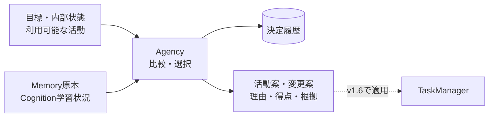

図17：v1.5の判断・保存・照会を、v1.6の任意実行機能へ接続できます。次章で活動循環を説明します。

| 判断の例 | 説明できる結果 |
|---|---|
| 目標の語が未学習 | 学習不足と重要度から調査を選ぶ |
| 同じ語を学習した後 | 新しい決定IDで再評価し、知識の活用へ変わる |
| 睡眠圧が高い | 休息の得点が上がり、活動を再検討する |
| 予定時間到達後も同じ活動を選ぶ | Agencyが延長案を返す。Coreは自動延長しない |

契約は`ntk.agency.decisions/1`のASYNC decide / get。時刻・期間・優先度、開始/変更/中断/再開/終了/待機の案を返します。値は解釈可能な初期規則で生成し、目標と状態からの選択を検証できます。人格や一般的な推論・目的の自律生成の完成を示すものではありません。

決定は専用SQLiteへ原子的に保存してから返します。同じID/入力は元の決定を返し、再起動後も照会できます。別の入力でIDを流用すると競合です。最大4096決定で、上限でも過去履歴を自動削除しません。決定保存は活動の実行成功を意味しません。

Memory原本を変更せず、出典区分・fingerprintと学習例数を判断根拠へ残します。取消や結果不明は未保存保証ではなく、IDで照会します。`python examples/agency_demo.py`で選択変化・再起動を再現できます。[設定・入力・失敗・上限](agency.md)

<!-- pagebreak -->

## 18D Agency：決定を実行し、結果から次を判断する

v1.6の任意`execution_factory`は、明示有効化した後に活動を選び、Coreへ登録・変更を依頼します。Coreは実行状態を返します。保存した決定、命令の受付、適用完了、実行後処理を区別します。

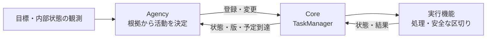

図18：活動の選択と継続判断はAgencyが担当します。実学習の結果で次の活動が変わることを検証します。

| activities/1の操作 | 利用側が確認すること |
|---|---|
| activate | セッションIDと観測を指定。受付時点で活動開始済みとは限らない |
| observe | 内部状態・目標・利用可能な活動を更新。観測版で競合を検出 |
| status | 前景活動、予定・期間・優先度・計時、受付/適用、失敗・結果不明 |
| halt | 所有活動へ協調的な終了を要求。stoppedと後処理確認を待つ |
| history | 過去のCore活動履歴を照会。現在の活動へ自動復元しない |

休息を選んだ場合は、元の活動の中断を確認して切り替えます。元の活動へ戻るときは同じ継続を再開します。予定時間到達の通知後はAgencyが継続・変更を判断し、Coreが勝手に延長・終了しません。

容量不足では新しい観測・活動変化を待ちます。連携障害では所有活動の後処理後に中断完了を報告します。管理要求の結果不明は同じ要求IDで照会し、元の操作を自動再送しません。再起動はinactiveで始まります。

`python examples/agency_execution_demo.py`は、選ばれた学習活動がCognitionへ実際に学習を登録し、休息へ切り替えて元へ戻る例です。初期目標や教材は入力されたもので、一般的な推論・目的の自律生成やSleepの完成ではありません。[設定・全契約・上限・停止](agency-execution.md)

<!-- pagebreak -->

## 18E Persona：人格特性を保持し、外部の修正を記録する

v1.7候補のPersonaは、長期特性を参照に応じて返し、外部から明示された差分を適用します。自身で更新を開始せず、Coreが人格や活動の価値を判断することもありません。

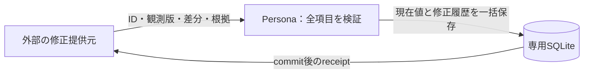

図19：初期値を使うのは空DBの作成時だけです。再起動後は保存済みの値と履歴を使い、同じ修正を再適用しません。

| traits/1の操作 | 利用側が確認すること |
|---|---|
| get | module_id・現在版・全特性・更新時刻 |
| apply | 命令ID・観測版・差分・reason/sourceを渡す。保存後の前後値・版を取得 |
| get_update | 更新IDで保存済み結果を照会。通信応答がないことを未保存と扱わない |
| history | 保存順に最大4件ずつ取得。next_afterで続きへ進む |

特性は利用側が名付けた1〜32項目、値は整数0〜1000です。差分は-1000〜1000。版違いや適用後の範囲超過は全体を拒否し、勝手に丸めません。同じID・同じ要求は元の結果を返し、異なる要求は競合です。全差分0は履歴だけ追加し、現在版を維持します。

設定は専用DBの絶対パスとinitial_traits。成功履歴は4096件までで、上限では既存値/履歴を保持して新規更新を拒否します。未知形式・破損・設定違いを自動初期化しません。同時受付は1件です。

取消や期限切れでも保存が完了する場合があります。受付済みworkerの完了と後処理を待ち、更新IDで照合します。sourceは提供側の申告情報で、認証証明ではありません。

`python examples/persona_demo.py`で、2特性の外部修正・両経路・同一IDの再要求・履歴・再起動を試せます。特性名と数値は説明用で、心理学的診断尺度や人格全体を表すものではありません。Agencyへの反映は次章、Sleepの修正案は18Gで説明します。[契約・設定・失敗](persona.md)

<!-- pagebreak -->

## 18F PersonaとAgency：特性を選択に反映する

v1.8候補では、Agencyに任意のpersona設定を加え、対応する特性を活動の得点へ反映します。Personaは値を保持し、Agencyが選び、Coreが実行を管理します。

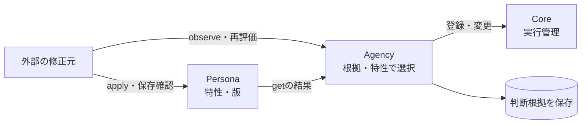

図20：許可済み接続で特性を参照。AgencyはPersonaの値を自動更新しません。

| 設定・値 | 意味 |
|---|---|
| persona.module_id | 参照先を明示。自動切替しない |
| persona.motive_traits | rest/explore/achieve/socialへ特性名を対応付ける |
| 特性500 | 中立。元の得点と同じ |
| 特性0 / 1000 | 元の得点の0.5倍 / 1.5倍。上限1000、元の0点は0 |
| 判断履歴 | Personaの版・値・対応付け、候補の基礎点・倍率・結果を保存 |

例えば知識活用800点と休息600点なら知識活用を選びます。休息の特性だけを500から1000へ更新すると休息は900点となり、Agencyが切替を判断します。例の数値は初期規則で、心理診断や人格全体の完成ではありません。

新しい判断で現在値を読みます。外部更新をすぐ反映したい場合は、保存確認後にobserveで新しい観測版を知らせます。同じ決定IDの再要求は元の結果を返し、過去判断を書き換えません。更新だけで既存判断が即座に取り消される保証はありません。

persona設定を省略すると従来動作・DB形式1を維持します。有効時は新しいAgency DB形式2を作成し、旧DBを自動移行・上書きしません。容量不足は新しい観測を待ち、連携エラーでは所有活動の後処理を確認します。

`python examples/persona_agency_demo.py`で、特性更新→活動切替→元の継続再開を試せます。再起動では保存値と履歴を確認し、活動は明示有効化を待ちます。[設定・得点・互換性](persona-agency.md)・[検証](validation/v1.8.md)

<!-- pagebreak -->

## 18G Sleep：統合状態・夢・人格案を分ける

v1.9候補では、Memoryの原記録とCognitionの教師注釈を読み、Sleep自身の統合根拠を整理します。Coreは接続・実行を管理し、経験の価値を判断しません。

```mermaid
flowchart LR
    E["Memory原記録<br/>Cognition注釈"] -->|"読出し・照合"| S["Sleep<br/>統合・減衰・夢・修正案"]
    P["Persona<br/>現在特性"] -->|"getの結果"| S
    S --> D[("周期履歴<br/>現在状態")]
    S -->|"修正案"| R["利用側の明示適用"]
    R -->|"apply"| P
```

図21：案を作るSleepと、適用を指示する利用側を分けます。Sleepは原記録や既存学習を変更しません。

| 操作・状態 | 利用側が確認すること |
|---|---|
| cycle / get | ID・観測版・0〜4記録で周期を実行 / 保存済み結果を照会 |
| state / inspect | 現在根拠・夢をページ取得 / ラベル別の件数・寄与と出典を照会 |
| strength | 再観測で1000。未観測の成功周期ごとに250減り、4周期で外れる |
| 現在夢 | 2件のtokensを再結合。次の成功周期で前の夢を失効 |
| 人格修正案 | 初回評価のobservedだけを使用。traitごとに周期±5、現在値の範囲内 |

**忘却対象はSleepの現在統合状態です。** Memory原本・Cognitionの学習・周期監査は保持します。一般的な意味理解、Nymph全体の知識削除や、自然な夢文章の完成ではありません。

夢はdream区分と元IDを持ち、現実の経験や人格差分の根拠にしません。過去のreceiptを読んでも現在夢を復活させません。人格案を作っただけではPersonaは変わらず、利用側がapplyと保存結果を照合します。

同ID/同入力は再実行せず元の結果を返します。取消・通信期限切れは未保存保証ではなく、getで照合します。現在根拠16件、周期履歴4096件、同時受付1件。再起動だけでは周期を進めません。

`python examples/sleep_demo.py`で統合・失効・利用側の人格適用と再起動を確認できます。[設定・対応範囲](sleep.md)・[検証](validation/v1.9.md)

<!-- pagebreak -->

## 18H 睡眠活動：案の生成と適用をつなぐ

Agencyが選んだ睡眠活動をCoreが管理し、専用の実行側がSleepの周期とPersonaの更新を接続します。Nymph側が適用を指定した場合だけ、人格修正案を公開契約で渡します。

```mermaid
flowchart LR
    A["Agency<br/>休息を選択"] --> C["Core<br/>活動の実行管理"]
    C --> E["睡眠実行側<br/>意図・結果を保存"]
    E --> S["Sleep<br/>周期と人格案"]
    S --> E
    E -->|"指定がある場合"| P["Persona<br/>外部差分を適用"]
    P -->|"次判断で参照"| A
```

図22：意思決定はNymph側にあり、Coreは採用した活動を管理します。

| 契約 `ntk.sleep.activities/1` | 役割 |
|---|---|
| `get(request_id)` | 保存済みの段階・周期・適用結果を読む |
| `reconcile(request_id)` | 相手へ結果を照会する。元操作は再送しない |
| `apply(request_id)` | 適用指定あり・周期保存済み・未送信の案を明示適用 |

周期の成功と人格適用の成功は別です。結果不明は照会で確認し、版の競合を自動修正して適用しません。同じ要求を再登録しても過去記録を返すだけで、再起動だけで活動を再開しません。

実行側は最大4096要求を専用SQLiteへ保存します。途中の保存や通信は安全な区切りまで進め、中断中は同じ状態を保持します。[契約と使い方](sleep-activity.md)

<!-- pagebreak -->

## 18I 音声観測：同意と期限を伴う外部入力

Discord Voice Adapterは、告知と本人の同意を確認した音声を一時的に観測する開発候補です。**Discord Bot確認はクリア**。既存の実受信・退出停止等の実測と、追加確認を不要とするユーザー判断に基づきます。未実施のケースを実測合格とはしません。[受入判断](adr/0040-discord-bot-acceptance.md)・[実測履歴](validation/v1.10.md#live-voice-followup)

```mermaid
flowchart LR
    O["運用者<br/>告知・同意確認"] --> V["Voice Adapter"]
    D["Discord<br/>DAVE・Opus"] --> N["所有Node helper<br/>話者別PCM"]
    N --> V
    V --> A["ローカルVosk<br/>文字起こし・音響特徴"]
    A --> Q["期限付き観測<br/>利用側がread"]
    V --> X["撤回・参加者変更・停止<br/>消去と後処理"]
```

図23：音声知覚を補助技術で行い、Cognitionの意味理解とは分けます。

音声用の追加依存・日本語モデルを明示導入します。Coreの必須依存は増えません。Runtime起動だけでは接続せず、Bot tokenはローカル環境変数から渡します。モデルの内容は起動時に照合します。

実行例は接続前にtokenの設定を検査します。起動失敗は資格情報不足・helper作成・開始情報送信・応答待ち超過を固定コードで区別し、秘密の値や例外本文を表示しません。[実行・診断手順](voice.md#voice-startup-diagnostics)

接続時にBot以外の全参加者の同意を確認します。参加・離脱・Botの移動・撤回・接続エラーで止まり、自動再接続しません。開始途中の停止でも、その後の接続・受信を開始しません。取得・ASRへの同意は、学習や永続保存への同意を兼ねません。Memory/Cognitionへの自動投入も行いません。

文字起こしは推定です。区間長・音量の指標・ゼロ交差率から、感情や人格を断定しません。[導入・同意・現時点の制約](voice.md)

ケース別ツールは将来必要な際の任意の診断用です。v1.10の追加確認は不要で、利用者へ再試験を求めません。新たな実受信には、その操作への告知・同意が必要です。[診断手順](voice.md#voice-live-acceptance)

<!-- pagebreak -->

## 18J 音声契約と保持・削除

契約`ntk.voice.observation/1`の5操作はいずれも非同期です。

| 操作 | 利用側が確認すること |
|---|---|
| `start_session(session_id, consent)` | 同意参照・参加者ID・保持秒数を指定して開始 |
| `status()` | 状態・理由・件数・後処理完了を確認 |
| `read(session_id, after, limit)` | 期限内の観測をページ単位で取得 |
| `stop_session(session_id)` | 停止・消去・所有処理の回収を待つ |
| `revoke(session_id, user_id)` | 同意撤回としてセッション全体を停止 |

観測には話者・取得時刻・出典区分、文字起こしと語の時刻/信頼値、音響特徴、PCM hashを付けます。生音声ファイルは保存しません。保持は最終PCM受付から1〜300秒、セッションは最大600秒です。

| 境界 | 初期上限 |
|---|---|
| 同意の参加者 | 1〜8名 |
| 音声の区間 / ASR worker | 最大5秒 / 1つ |
| 待機区間 / 保持観測 | 8区間 / 64件 |
| 1回の読出し | 最大4件・49152 JSON bytes |
| 同じRuntimeのセッションID | 最大64件 |

上限超過を隠して継続せず停止します。撤回/停止時は待機音声と観測を消し、処理中ASRが後から返っても公開しません。後処理完了を待ち、再接続は新しいIDで明示します。

メモリの物理的消去や、返却済みコピーの削除は保証しません。利用側は端末出力・保存先の保持と削除を管理します。[詳細契約](voice.md)・[検証と残作業](validation/v1.10.md)

<!-- pagebreak -->

## 18K 入力候補：準備・保存・学習

v1.11開発候補では、取得済みのWeb・文書・テキスト対話を `ntk.input.prepare/1` に渡せます。共通入口 `prepare` は記録ID、本文、出典、取得処理、要求側の明示項目を受け取ります。候補を確認した要求側が、既存のMemory契約で明示保存します。

```mermaid
flowchart LR
  A["取得済みの本文と出典"] --> B["前処理 prepare"]
  B --> C["候補と項目の由来"]
  C --> D["要求側が採用"]
  D --> E["Memoryへ明示保存"]
```

| 応答 | 要求側の対応 |
|---|---|
| ready | 6項目の候補と由来を確認し、採用する場合に保存 |
| needs_input | 不足項目を補い、新しい準備要求を作成 |
| failed | 入力・許可・処理・上限の失敗段階とコードを確認 |

既定値補完型は未指定の区分だけを補います。AI型は送信を明示した本文を模擬APIへ渡し、推定区分は確認用に返します。初版は実AIサービスに接続しません。Web・文書の既存取込と対話の既存操作も使えます。[ADR 0033と設定](adr/0033-input-candidate-contract.md)

<!-- pagebreak -->

## 19 使い始める：公開版で動きを確認する

CPython 3.12以上を用意します。現行版で検証済みなのはWindows／Linux × CPython 3.12〜3.15です。実行時の外部Python依存はありません。導入するwheelと実行例の版を揃えます。

1. [v1.2.0 Release](https://github.com/Tao-pyth/nymph-toolkit/releases/tag/v1.2.0)からwheel・sdist・SHA256SUMSを取得し、ハッシュを照合します。
2. 新しいvenvへwheelを通常インストールします。wheelには実行例が含まれないため、同版sdistのexamplesを使います。
3. 公開版が1.2.0、import元がvenvのsite-packagesであることを確認します。
4. Runtimeから順に例を実行し、出力と終了コードを確認します。

コマンド一式は[通常導入ガイド](getting-started.md)にあります。開発用の`pip install -e .`は作業ツリーを読む方式で、公開wheelの通常導入とは分けます。

| 実行例 | 確認できること |
|---|---|
| runtime_demo.py | start→run→stop、戻り値、残存タスク0 |
| registry_demo.py | 登録依存、起動・停止順、停止後解除 |
| connections_demo.py | 要求側選定、直接／Core経由、保存済み接続の再利用 |
| task_manager_demo.py | 予定到達後の継続、明示終了、再起動後の履歴 |
| activity_changes_demo.py | 予定・優先度変更、中断・同じ処理からの再開 |
| hybrid_demo.py | 子へのRPC・ストリーム・遠隔活動・後処理確認 |
| module_contract_demo.py | 6区分の接続契約・登録前検証 |
| memory_demo.py / document_demo.py | 保存・文書取込・再起動取得 |

例の履歴は一時保存で、通常終了時に削除します。残す方法は[実行例ガイド](tutorials.md)を参照してください。正常停止と残存タスク0を確認してから、独自機能を接続します。

<!-- pagebreak -->

## 19A 開発候補の機能を試す

このページの例は公開v1.2.0には含まれません。対象候補のcheckoutと同じ版の環境を用意します。公開版9例に次の11例を加え、v1.11候補では20例です。

| 実行例 | 確認できること |
|---|---|
| cognition_demo.py | 注釈付き学習・根拠・出典区分・再起動 |
| text_interaction_demo.py | 明示指示による保存・学習・注釈訂正 |
| web_demo.py | ローカルHTTP教材の取得・出典・保存と学習 |
| agency_demo.py | 内部状態/学習根拠からの選択・判断保存 |
| agency_execution_demo.py | 活動登録・実学習・中断/再開・協調終了 |
| persona_demo.py | 特性の参照・外部差分・版/ID・履歴 |
| persona_agency_demo.py | 特性更新で選択を変え、元の活動を再開 |
| sleep_demo.py | 根拠統合・夢失効・人格案の明示適用・再起動 |
| sleep_activity_demo.py | 休息活動から周期/人格適用・次判断まで |
| voice_audio_demo.py | 外部接続なしの合成PCM特徴検証 |
| input_candidate_demo.py | 2方式の準備・実Memoryへの明示保存 |

例は説明用の明示教材・観測・特性を使います。自由会話や一般的意味理解の完成を示すものではありません。通常の例は後処理を終えて終了し、一時保存先も削除します。Textの対話モードは明示JSON指示を受け付けます。

Coreの状態が変わったことと、Agencyが命令適用を確認したことは別の観測です。再開の例ではRUNNINGとappliedの両方を待ちます。保存結果が不明ならIDで照会し、再起動後に活動を自動再登録しません。

実行コマンド・期待出力・履歴保持は[実行例ガイド](tutorials.md)、開発環境と配布検証は[開発手順](development.md)を参照してください。

<!-- pagebreak -->

## 20 実装例：最小のサービスを動かす

最小のRuntime利用例です。環境構築後にPythonファイルへ保存して実行できます。サービスのフックは、初期化・主処理・後処理を分けるための入口です。

```python
import asyncio
from nymph_toolkit.core import Runtime

class Service:
    async def start(self):
        pass
    async def run(self):
        return "completed"
    async def stop(self):
        pass

async def main():
    runtime = Runtime(Service())
    await runtime.start()
    try:
        print(await runtime.wait())
    finally:
        await runtime.stop()

asyncio.run(main())
```

`completed`を出力して終了します。startは初期化、runは本処理、stopは資源の解放に使います。実際のサービスではstopが部分的な初期化にも対応できるようにします。処理の戻り値はRuntime.waitから取得します。

この例はイベントループをasyncio.runで作ります。既存のasyncioアプリに組み込む場合は、そのループ内からstart・wait・stopをawaitします。ブロッキングI/Oや長いCPU処理をそのままループへ置くと、他の処理の進行にも影響します。

公開版は9例、候補は20例です。通常例は後処理後に終了します。Text例の対話モードは明示コマンドを受け付けますが、常駐する自律Nymphアプリではありません。機能を増やす段階では[Registry](registry.md)でGroupの構成を、[Connections](connections.md)で契約宣言と接続を確認します。別プロセス化する場合は[HybridGroup](hybrid.md)のfactoryと共有環境を使います。

<!-- pagebreak -->

## 21 開発者向け付録：公開入口と責任

Coreの公開入口は以下の15件です。共有型・列挙値・例外は`nymph_toolkit.contracts`からimportします。表は所有関係の案内で、全引数の一覧は[生成API資料](api-reference.md)にあります。

| Coreの公開名 | 利用する場面 | 所有・終了の責任 |
|---|---|---|
| validate_module_registration | import/起動/保存前の登録検証 | 宣言・設定の妥当性を確認 |
| Runtime | 実行入口の起動・待機・停止 | 呼出側が同じイベントループで操作 |
| Registry | 登録・識別・依存確認 | 作成スレッドで操作 |
| ModuleGroup | 複数サービスの組立て | Runtimeにライフサイクルを所有させる |
| Connections | 宣言・候補・接続・ヘルス | Groupへ一度取り付ける |
| PreparedConnection | ローカルの許可済み呼出し | prepareの戻り値を利用し、直接構築しない |
| FileStore | 接続設定・履歴保存 | Connectionsが開始・停止を所有 |
| TaskManager | ローカル活動の登録・変更・通知 | Groupへ取り付ける |
| HybridGroup | LOCAL／PROCESSの組合せ | 機能を起動前に登録し、Runtimeで管理 |
| HybridTaskManager | 遠隔実行処理IDによる活動 | enable_activitiesで取り付ける |
| ModuleContext | 機能の提供ハンドラーを登録 | factoryに渡されるものを使う |
| CoreClient | 機能から親Coreへの管理操作 | context.core等から取得 |
| DirectLink | ハイブリッドの直接呼出し | prepareで取得し、closeで解放 |
| StreamSender | ストリーム送信 | close／abort／acloseを使い分ける |
| StreamReceiver | ストリーム受信 | 受信処理が終端と資源を管理 |

利用順序は、**Groupを作る → 機能・契約を宣言する → 必要な管理機能を取り付ける → Runtimeで開始する → run以降に操作する → Runtimeで後処理まで待つ**、が基本です。

HybridGroupのfactoryまたはasync startの完了前に、ModuleContextの`provide`、`provide_stream`、`provide_executor`で提供内容を登録します。同じ操作名へ通常ハンドラーとストリーム受信を重複登録しません。`submit_remote`へ渡すのは登録済みの実行処理IDであり、関数実体ではありません。

基盤のstart/run/stopがAPI一覧に載っていても、Runtime管理中に別の所有者が並行して呼ぶ使い方にはしません。詳細は[Core API](core-api.md)、[ハイブリッド実行](hybrid.md)を参照してください。

<!-- pagebreak -->

## 22 開発者向け付録：共有データと結果の読み方

Contractsは型・状態・結果を共有するためのパッケージです。公開98名の署名と定義は[API一覧](api-reference.md)に収録しています。実装で使う主なまとまりは次のとおりです。

| 区分 | 主な型・値 | 確認する内容 |
|---|---|---|
| ライフサイクル | RuntimeService、RuntimeState、LifecyclePhase、RuntimeFailure | 非同期フック、現在状態、どの段階で失敗したか |
| 登録 | ModuleSpec、ModuleKind、RegistryEntry、RegistryUpdate | 機能ID、依存、登録世代、変更前後 |
| 提供契約 | ContractKey、ContractSpec、OperationSpec、OperationMode | ID・版・操作名・同期／非同期 |
| 候補・稼働 | ModuleAdvertisement、Candidate、Usage、OperatingState | 属性、機能全体・契約の受付状況 |
| 接続・中断 | BindingKey、ConnectionSnapshot、ConnectionNotice、ModuleExecutionState | 固定単位、接続状態、通知ID、協調的中断 |
| ヘルス・保存 | HealthResult、BindingHealth、StorageFailure | その確認の結果、原因・未保存情報 |

Registryの`available`、稼働報告の`state`、受付の`accepting`、接続の状態は別の軸です。停止・異常・満杯・未通知の機能も候補一覧には含まれます。スナップショットの条件に合うものを要求側で選び、実際の受付結果を確認します。

同じ契約ID・版で異なる操作宣言を登録しません。実装版と契約版も別の値です。実装版から契約の互換性を推定することはありません。

<!-- pagebreak -->

## 23 共有データ：活動・配置・結果

活動と通信の状態は、それぞれの公開型で確認します。遠隔で報告が失われた場合は、Coreが未確認の値を正常結果で埋め合わせることはありません。

| 区分 | 主な型・値 | 確認する内容 |
|---|---|---|
| 活動入力 | ActivityKey、ActivityRequest、ActivityChange、UNCHANGED | 要求元とID、初回・変更後の予定 |
| 活動観測 | ActivitySnapshot、ActivityState、ActivityNotice、ActivityCommandResult | revision、状態、要求の受理と適用完了 |
| 活動実行・履歴 | ActivityContext、ActivityHistory、ActivityHistoryRecord、ActivityHistoryIssue | 制御要求、安全な区切り、読出し結果と問題 |
| 配置・通信 | Placement、HybridSettings、ProcessSnapshot、OutcomeUnknown、RemoteError | 配置、上限、子の状態、結果不明と遠隔例外 |
| ストリーム | StreamOptions、OverflowPolicy、StreamState、StreamEvent | 上限・混雑方針、データ・終端・欠落・理由 |

**不変の観測値**は取得した時点の情報です。以前のsnapshotが後から更新されると考えず、必要な時点で再照会します。Registryのrevisionと活動のrevision、接続の世代や通信の要求IDは用途が異なります。

**値で返る失敗と、例外を区別します。** OperationFailure・TemporaryUnavailable・LinkFailure、ActivityCommandResultのrejected等は通常の戻り値として解釈します。宣言・入力・状態の誤り、通信・保存基盤の障害は各入口の例外契約を確認します。

**完了の観測も別々です。** 活動のwaitは終端snapshot、変更のwait_commandは終端命令結果、ストリームcloseは通信上の受信確認、Runtimeのstopは所有資源の後処理待機です。名前が似た待機APIでも、何の完了を待つかを取り違えないでください。

<!-- pagebreak -->

## 24 適用範囲・検証状況・参照先

Coreと各機能、睡眠活動・音声観測を検証しています。公開版は9例、候補は20例。新たな実音声接続は同意確認後に個別実行します。v1.4〜v1.8は各版の全回帰・通常配布・CI・顧客資料を確認済みです。Discord Bot確認はクリア。実測履歴と追加確認不要の判断、別途残る先行#169と全体の最終確認は[B09](validation/v1.9.md)・[B10](validation/v1.10.md)で追跡します。

| 導入時に確認する点 | 現在の扱い |
|---|---|
| Windows終了時の課題 #94 | NTK所有ソケットの解放が抜ける条件を修正し、v1.0以降に含む。正常終了・後処理確認の区別は維持 |
| 処理量と保持 | 未保存履歴、保持した活動・命令結果・通知が増え続ける運用は、使用量の確認が必要 |
| 強制停止 | 同一プロセスの非協調処理は強制停止できない。子の強制終了でも後処理を確認できない場合がある |
| 長時間性能 | 30分負荷はv0.8の特定コミットの測定。後続修正・各環境の全てを同じ測定結果で代表しない |
| 後続の機能 | v1.0の共通契約は採用済み。v1.5のAgencyはADR 0032。活動循環はADR 0034、自由会話は後続判断 |

現在の対象外は、分散実行、稼働中の実体着脱、活動継続状態の自動復元、子だけの自動再起動、Personaの自発更新・Desktop、複製・移植・伝播機構です。PC全体の状況取得は将来のAdapterが担当します。Core管理の失効は、敵対する機能を遮断するセキュリティ境界ではありません。

| 用語 | 本資料での意味 |
|---|---|
| 契約 | 入力・結果・状態・失敗・責任分担の取り決め |
| RPC | 別プロセスの操作を要求し、結果を受け取る通信 |
| スナップショット | 取得した時点の不変の観測値 |
| 協調的中断 | 実行側が安全な区切りと後処理を担当して止まること |
| 結果不明 | 処理が失敗したと確定できず、照会が必要な状態 |

手順は[導入](getting-started.md)・[実行例](tutorials.md)・[問題解決](troubleshooting.md)、契約は[Core API](core-api.md)・[API一覧](api-reference.md)、判断は[ADR索引](adr/README.md)、証拠は[B00](validation/v1.0.md)・[B01](validation/v1.1.md)・[B02](validation/v1.2.md)・[B03](validation/v1.3.md)・[B04](validation/v1.4.md)・[B05](validation/v1.5.md)・[B06](validation/v1.6.md)・[B07](validation/v1.7.md)・[B08](validation/v1.8.md)・[B09](validation/v1.9.md)・[B10](validation/v1.10.md)を参照してください。Windows終了時の修正は[検証記録](validation/windows-shutdown.md)にあります。

本資料とNTKの自作コード・Contracts・設計文書には[Apache-2.0](../LICENSE)を適用します。第三者成果物とNymphの個体データは、それぞれの条件で扱います。本資料は公開版と開発候補を区別して説明し、将来機能を実装済みとして含めません。
