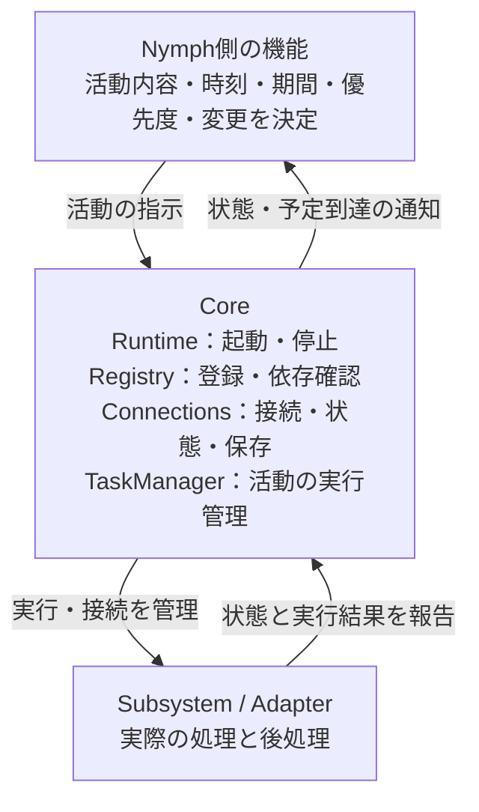
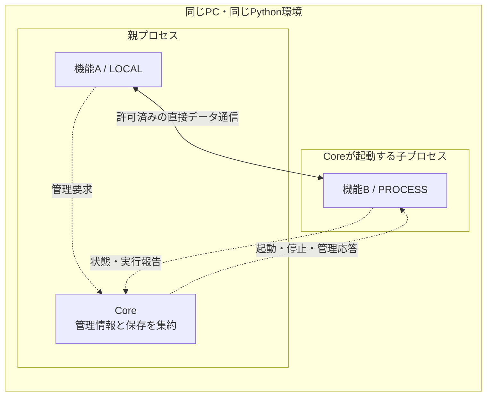
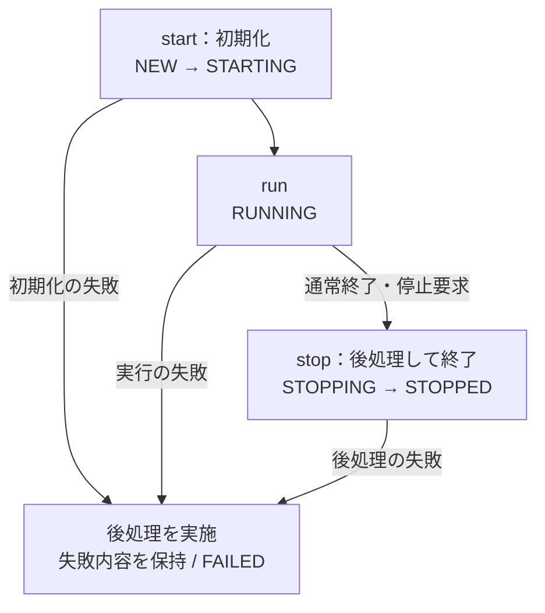
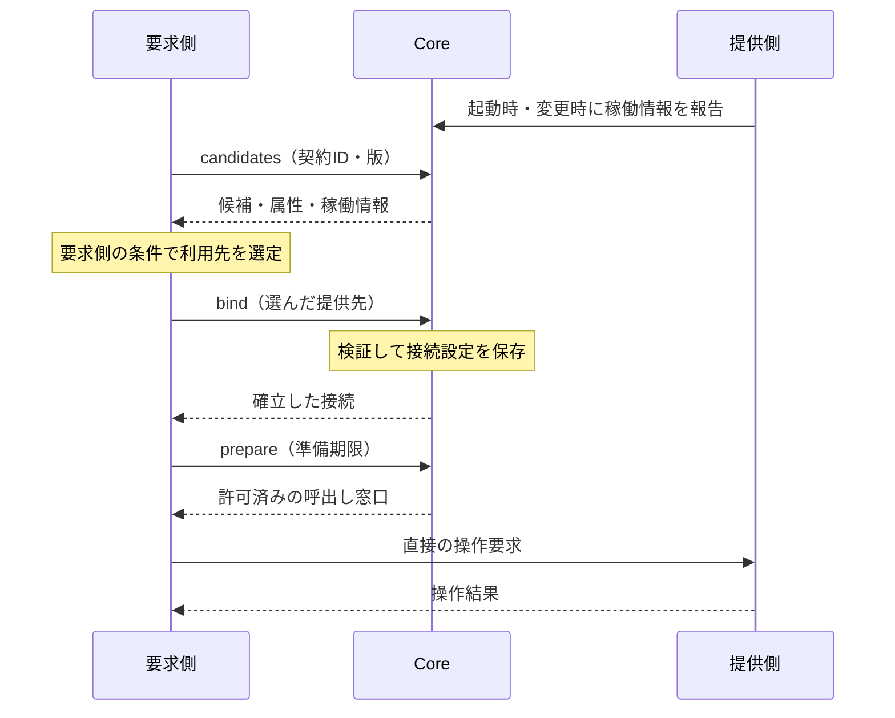
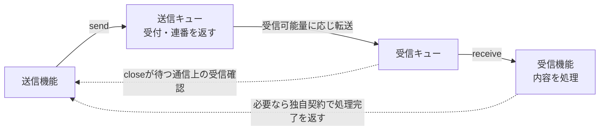
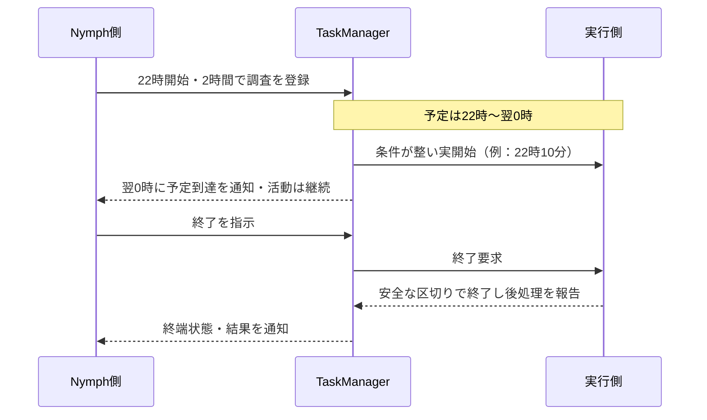
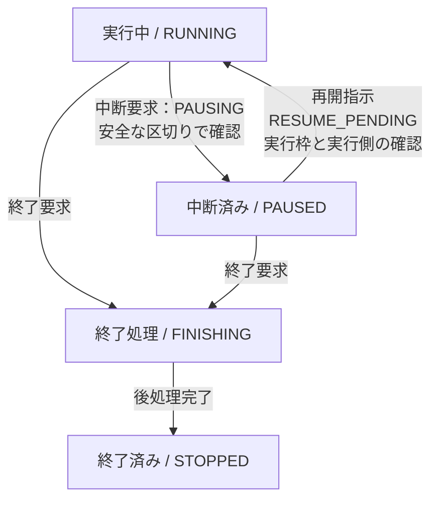
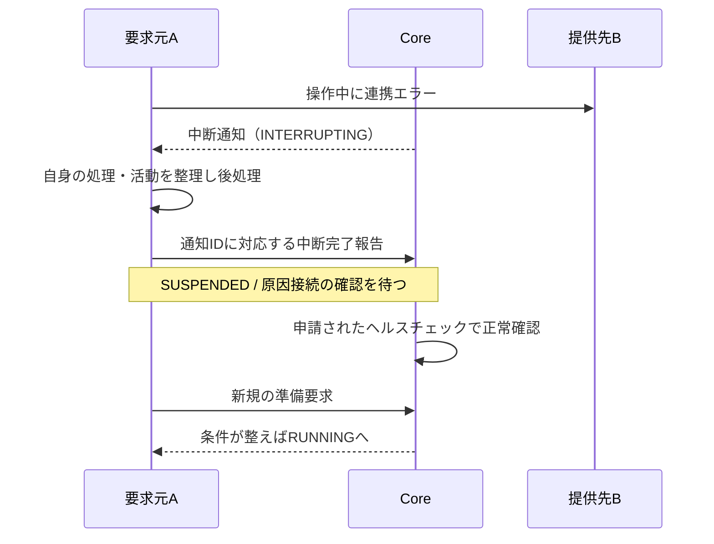
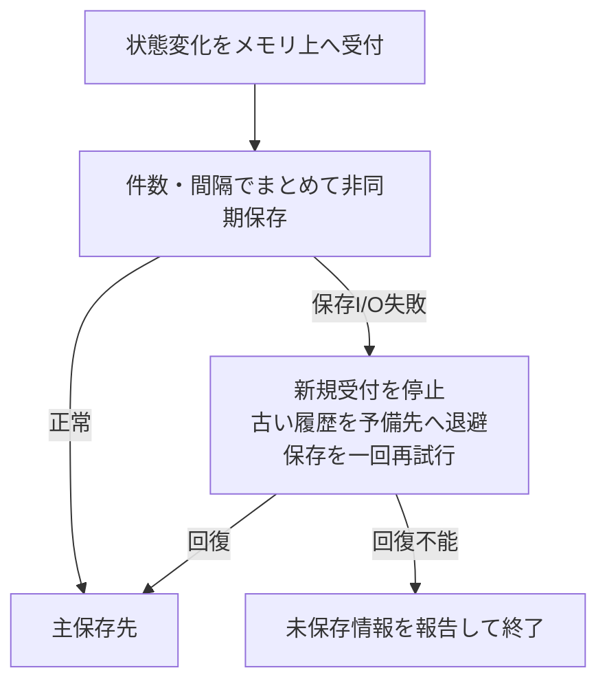
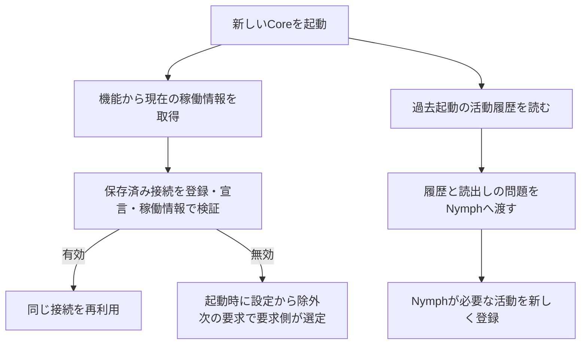

# NTK Core 契約・利用ガイド

**Nymph Toolkit / 公開 v0.9.0 / 2026年11月22日版**

## この資料で分かること

NTK Coreは、複数の機能を組み合わせて動かすためのPython基盤です。機能の登録、接続、活動の実行管理、状態と履歴の記録を担います。本資料は、導入を検討する方と、Subsystem・Adapterを接続する開発者の両方を対象とします。

**Nymphが活動を決め、Coreがその実行を管理します。** Coreの完成とは、合意したこの基盤機能の完成を指します。会話・学習・人格を備えたNymph全体の完成を指すものではありません。

| 知りたいこと | 読む章 |
|---|---|
| 導入すると何ができるか | 01〜03：構成・実行配置・起動と停止 |
| 機能同士をどうつなぐか | 04〜07：登録・宣言・接続・呼出し・ストリーム |
| 活動をどう制御するか | 08〜09：時刻と期間・変更・中断と再開 |
| 障害・保存・再起動をどう扱うか | 10〜12：通知・後処理・履歴・再登録 |
| 何を設定し、どう使い始めるか | 13〜14：設定値・実行手順・確認点 |
| 実装時にどのAPIを見るか | 15〜16：公開入口・共有データの参照表 |
| 適用範囲と検証上の限界 | 17：既知の課題・用語・関連資料 |

ここでいう「契約」は、APIの入力・結果・状態・失敗時の振る舞いを意味します。章分けは説明用です。v1.0.0で検討するModule／Lifecycle／Capability／Communication／Task／Error Contractの正式な区分や互換性保証を、この資料で新たに確定するものではありません。

本文と図は公開v0.9.0の実装を説明します。図で省略した分岐は本文・契約表で補います。公開APIの正確な署名は[API一覧](api-reference.md)、操作の詳しい定義は[Core API](core-api.md)を参照してください。

<!-- pagebreak -->

## 01 全体像：判断する機能と実行を支える基盤

Nymph側の機能が「何を、いつ、どのくらい行うか」を指定します。Coreは、その要求を受け付け、実行条件と状態を管理します。Subsystemは内部の機能、Adapterは外部との接点を担当する構成です。



図1：責務の区分。箱は担当範囲を表し、クラスの継承関係や全ての内部呼出しを表してはいません。

| Coreが提供するもの | 利用側が用意するもの |
|---|---|
| 起動・停止、依存関係と状態の確認 | 機能の実装、登録情報、起動時の構成 |
| 候補情報、接続先の記録と検証 | 候補を比較して選ぶ判断、操作の意味 |
| 活動の時刻監視、変更と状態通知 | 活動内容・優先度・終了・再開の判断 |
| 保存と障害通知、後処理を待つ仕組み | 安全な中断点、所有する資源の解放 |

CoreとContractsは一つの`nymph-toolkit`パッケージです。Subsystem・Adapterは必要に応じて別配布にできる方針です。本番のMemory・Agency・Persona等は、現在のCore配布に含まれません。

<!-- pagebreak -->

## 02 実行配置：同じPCで組み合わせる

機能ごとに同一プロセス（LOCAL）またはCore所有の子プロセス（PROCESS）を選べます。配置は起動前に指定し、その起動中は固定します。



図2：管理情報は親Coreへ集約。管理通信と直接データ通信を分けます。Core経由のデータ呼出しも利用できます。

| 項目 | ModuleGroup＋Connections | HybridGroup |
|---|---|---|
| 配置 | 同一プロセス | LOCALとPROCESSを組合せ |
| 操作の宣言 | SYNC／ASYNC | LOCALを含めASYNCのみ |
| 直接呼出し | 保持したPythonメソッド | 同一配置はメソッド、別プロセスはRPC |
| データ | 既存ローカル操作入力をJSONへ一律制限しない | 転送入力・結果はJSON値と対応Contractsの範囲 |
| 子の起動 | なし | 同じPython実行ファイル、機能ごとに1子 |

HybridGroupのfactoryは、共有Python環境からimportできる`module:attribute`です。`ModuleContext`とJSON設定を受け、`start/run/stop`を備えたサービスを返します。

通信は同じPCの`127.0.0.1`とOS割当ポートを使います。他のPCへの分散、外部で起動済みのプロセスの管理、子だけの自動再起動は対象外です。Windowsでは子プロセス対応のイベントループを使います。同梱例は標準の`asyncio.run`を使用します。

<!-- pagebreak -->

## 03 起動・停止：後処理までがライフサイクル

サービスは非同期の`start()`、`run()`、`stop()`を実装します。Runtimeがこれらを所有して呼び出すため、利用側が同時に個別のフックを呼び出さないようにします。



図3：主な経路。失敗しても、初期化に入った対象の後処理を進めます。未初期化などの細かな拒否条件はRuntimeの契約に従います。

| 操作 | 利用側が受け取るもの・守ること |
|---|---|
| `await runtime.start()` | 初期化完了。複数機能では依存先から起動し、全初期化後にrunを開始 |
| `await runtime.wait()` | runの戻り値、または停止に伴うNone。後処理まで待つ |
| `await runtime.stop()` | 停止・後処理を待つ。繰返し呼出しでも後処理を重ねて取消しない |
| 失敗した場合 | `RuntimeFailure`に初期化・実行・後処理の失敗を保持。後からwait/stopしても通知 |
| 再実行したい場合 | 新しいRuntimeとGroupを構築する。同じインスタンスは再起動しない |

ModuleGroupは依存順に初期化し、その逆順に後処理します。サービスの`stop`は自分が作ったタスク・接続などを解放します。Coreは無関係な呼出側タスクを一律停止しません。

待機者が`wait()`を取り消してもサービス自体は継続します。`stop()`の待機取消も停止完了を意味しません。所有者は再びstop/waitで結果を確認します。開始待機の取消は停止を要求します。

同一プロセスの処理には協調的な終了が必要です。Core停止時に限り、期限を超えたCore所有子を強制終了できます。その場合の後処理未確認を成功と扱いません。通常の活動終了への指示とは別です。

<!-- pagebreak -->

## 04 登録と提供機能：3種類の「利用できる」を分ける

登録情報、通信契約、稼働報告は別の情報です。登録依存が満たされていても、相手が動作中・受付可能であるとは限りません。

| 情報 | 利用側が指定する内容 | Coreから分かること |
|---|---|---|
| `ModuleSpec` | 機能ID、SUBSYSTEM／ADAPTER、必要な機能ID集合 | 登録の世代、依存充足、不足している依存 |
| `ModuleAdvertisement` | 機能ID、実装版、提供契約、タグ・属性 | 候補の静的な能力・条件 |
| `ContractKey` | 契約IDと版の文字列 | IDと版の完全一致による照合 |
| `ContractSpec` / `OperationSpec` | 操作名とSYNC／ASYNC | 宣言と呼出しの一致 |
| `Usage` | state、accepting、active、capacity | 機能全体・契約ごとの通知済み稼働情報 |

**確認の順序は、登録依存 → 稼働と受付 → 実際の操作受付です。** 候補に表示された空き容量は予約ではありません。最終的な受付は提供機能が判断します。

| 登録操作 | 結果と制限 |
|---|---|
| `register` | 重複ID・循環依存を変更なしで拒否。未登録の依存先を持つ登録は可能 |
| `get` / `entries` | 不変の観測値。後続の変更で古い値は書き換わらない |
| `unregister` | 依存元が利用不能になる場合も、その変化を結果に含める |
| `RegistryUpdate.changes` | 変更前後のEntry。継続購読ではなく、登録・解除の戻り値 |

Groupの起動開始から停止完了まで機能構成を固定します。起動前の登録・解除、停止後の明示解除を扱い、稼働中の実体追加・交換は行いません。停止済みGroupへ追加登録して再使用する場合も、新しいGroupを作ります。

提供機能の宣言は開始前に固定し、稼働情報は開始時と変更時に機能から通知します。未通知はUNKNOWNです。タグ・属性の条件を比較して候補を選ぶのは要求側で、Coreへ選定関数を渡す方式ではありません。

例：文書機能が記憶機能を必要とする場合、記憶機能の登録後に依存は充足します。しかし通信には別途、契約宣言・稼働報告・接続の確立が必要です。[Registry](registry.md)と[Connections](connections.md)で詳細を確認できます。

<!-- pagebreak -->

## 05 接続：要求側が選び、Coreが記録する

要求側はCoreから候補・属性・稼働状況を受け取り、利用先を選びます。Coreはその指定を検証して保存し、以後の接続先を管理します。



図4：正常な初回接続と直接呼出し。Core経由を選ぶ場合はinvokeを使います。

接続の固定単位は**要求元＋契約ID・版につき1接続**です。用途名による追加分割はありません。同じ相手へのbindは既存接続を返し、別の相手への変更は`ConnectionConflictError`になります。初回追加は稼働中にもできます。

`bind`の成功は接続設定の確立、`prepare`の成功は操作準備を意味します。検証中・協調的中断中・保存側の受付停止中などは、要求側の期限まで準備を待ちます。準備後も新しい無効通知を受けた窓口では新規操作を開始しません。

確立後に毎回候補を選び直したり、Coreへ許可を再申請したりすることはありません。起動時と申請されたヘルスチェックで接続を確認します。失効は不整合によるエラー回避が目的であり、連携機能がCoreの管理結果に従う前提です。

<!-- pagebreak -->

## 06 呼出し：入力・結果・期限の意味

実装する配置に合う窓口を使います。同じ契約ID・版の同期操作を、別プロセスで暗黙に非同期へ読み替えることはありません。

| 用途 | 同一プロセスのConnections | HybridGroupのCoreClient／DirectLink |
|---|---|---|
| 候補取得 | `candidates(contract)` | `await core.candidates(contract)` |
| 接続設定 | `await bind(requester, contract, provider, wait_timeout=...)` | `await core.bind(contract, provider, timeout=...)` |
| 準備 | `await prepare(binding_key, wait_timeout=...)` | `await core.prepare(contract, timeout=...)` |
| 直接呼出し | `handle.call`／`await handle.acall` | `await link.acall` |
| Core経由 | `await invoke(...)` | `await core.invoke(...)` |
| 通信窓口の解放 | Groupが管理するローカル参照 | `await link.close()`で通信資源を回収 |

表は入口の対応です。厳密な引数順・キーワード・型は[API一覧](api-reference.md)を参照してください。

| 期限や結果 | 利用側が理解しておくこと |
|---|---|
| Connectionsの`wait_timeout` | 準備待ちの期限。0以上の有限秒。操作本体の実行時間を制限しない |
| 別プロセスの呼出し期限 | 正の有限秒。未送信ならTimeoutError、送信開始後で成否未確認ならOutcomeUnknownとなり得る |
| `OutcomeUnknown(request_id)` | 失敗確定ではない。対象窓口のresultで照会し、完了後releaseする |
| 待機の取消 | 受付済み管理処理が取り消されたとは限らない。IDと現在結果を確認する |

別プロセスの引数・結果はJSON値と対応するContractsに限ります。文字列キーの辞書、配列、文字列、有限数、真偽値、nullを基本とし、任意オブジェクト・関数・pickleは転送しません。Pythonオブジェクトの同一性や元の例外オブジェクトの同一性もプロセスを越えて保証しません。

`pending_requests`は窓口が保持する要求ID、`result(id)`は結果の確認、`release(id)`は完了後の一時保持の解放です。未完了の解放は結果不明として扱います。IDは窓口と起動世代の中で使い、別の窓口へ渡しません。Coreは自動再送・自動接続先切替を行いません。

<!-- pagebreak -->

## 07 ストリーム：送信受付・受信・処理完了を分ける

連続データは片方向のストリームで送ります。双方向なら独立した2本を開きます。Coreはバイト列を運び、音声・文書等の形式と意味は利用機能の契約で定義します。



図5：sendの成功はローカル受付です。closeの成功も内容処理の完了までは含みません。

| 設定・操作 | 契約 |
|---|---|
| `StreamOptions` | 送受信それぞれのバイト数・チャンク数上限と混雑方針を、開設時に指定 |
| `WAIT` | 空きができるまで指定期限内で送信を待つ |
| `DROP_OLDEST` | 未転送の古いチャンクを丸ごと破棄。欠落範囲・件数を受信側へ通知 |
| 大きすぎる単一チャンク | ChunkTooLarge。分割は送信機能が担当 |
| `send` / `receive` | 有限期限を指定。空バイト列もデータとして扱い、終端・障害と区別 |
| `close` | 未破棄データと終端の通信上の受信確認まで待つ |
| `abort` / `aclose` | 明示打切り／所有通信タスク・ソケットの回収 |

closeの待機期限が切れても、CLOSINGの排出処理は続きます。状態照会・再度のclose・明示abortを使い分けます。送信受付前の期限切れや取消は後から受付せず、受付済みデータは待機取消だけでは撤回しません。

上限はアプリケーションの転送キューを対象とし、OS内部のTCPバッファは含みません。上限・混雑方針は開設中に変更しません。切断時は受信済みデータの後に異常終端を返し、自動再送しません。活動中断・終了時のclose／abortは利用機能が担当し、機能停止時に残った通信資源を回収します。

<!-- pagebreak -->

## 08 活動：予定時間の到達は判断を求める通知

`ActivityRequest`で要求元・活動ID、内容、開始時刻、期間、パラメータ、優先度を指定します。開始時刻はタイムゾーン付きdatetime、明示的な即時開始はNoneです。期間は正のtimedeltaです。



図6：受付時点では未来の予定で、実開始だけが遅れた例。受付時点で22時を過ぎていた要求は開始せずNymphへ返します。

| 観測値 | 意味 |
|---|---|
| 予定開始・予定終了 | Nymphが指定した予定。実開始の遅れでCoreが自動繰延べしない |
| 実開始・実終了 | 実際の開始と後処理完了。遠隔では実行側の報告で確認 |
| `elapsed_seconds` | 実開始からの経過秒。中断・再開待ち・後処理を含む |
| `execution_seconds` | 中断完了から実再開までを除いた秒。通常のI/O待ち・後処理を含み、CPU時間ではない |
| `timing_confirmed` / `cleanup_confirmed` | 遠隔で計時・後処理の確認が届いた範囲 |

過去時刻の要求は`ActivityStartInPastError`となり、活動を登録しません。Nymphが開始時刻を再指定します。受理済みの活動IDは、完了後も同一起動内では再利用できません。

予定到達だけでCoreは終了・延長・価値判断をしません。自然完了はCOMPLETED、明示終了はSTOPPED、実行の失敗はFAILEDとして区別します。結果の業務上の意味はNymph側が判断します。

<!-- pagebreak -->

## 09 活動変更：受理と適用完了を区別する



図7：実開始後の協調的中断・再開と明示終了。中断・再開の途中状態は矢印上に記載しています。未開始・遠隔開始、自然完了・失敗などは省略しています。全状態はAPI一覧を参照してください。

| 指示 | 適用内容 |
|---|---|
| 開始時刻変更 | 未開始の活動だけ。Noneは即時開始への変更、未指定UNCHANGEDとは異なる |
| 期間変更 | 現在の予定開始から数える新しい合計期間。追加時間ではない |
| 優先度変更 | 開始・再開待ちの順番に作用。大きな整数を先にし、同順位は待機順 |
| 中断 | 対応を宣言した実行側が安全な区切りでcheckpointに入り、PAUSEDを確認 |
| 再開 | 同一起動内で保持した処理の続きへ戻る。関数を最初から再実行しない |
| 終了 | 変更・中断・再開に優先し、後処理の完了を待つ |

変更・中断・再開には、活動内で一意の`command_id`と観測した`expected_revision`を渡します。同じID・同じ内容・同じ期待版なら元の要求の最新結果を返し、二重適用しません。古い版や内容衝突は理由付きで拒否します。`request`は初回入力、`current_request`は現在の実効入力です。

`accepted`は受理済みで未完了です。`wait_command`などで、applied／no_change／rejected／superseded／failedの終端結果を確認します。待機を取り消しても受付済みの変更要求は取り消されません。

実行枠を`max_running`で制限した場合、開始と明示再開を同じ待機列で扱います。優先度だけで実行中の活動を中断しません。中断対応は`supports_pause=True`で宣言し、実行側が作業状態と資源の扱いを担います。機能の連携エラーによる中断とは別の仕組みです。

<!-- pagebreak -->

## 10 失敗：どこまで止め、誰が回復を判断するか

通常の業務失敗、連携の想定外失敗、Core基盤の障害を区別します。失敗した要求の自動再実行や、別の接続先への自動切替は行いません。

| 事象 | 表現の例 | 利用側・Coreの対応 |
|---|---|---|
| 業務上の失敗 | OperationFailureという値 | 利用機能が内容を解釈する |
| 受付容量不足 | TemporaryUnavailableという値 | 即時応答。これだけで中断・ヘルス申請を起こさない |
| 連携の想定外失敗 | LinkFailureと通知 | 要求元機能が協調的中断・後処理・完了報告 |
| 入力・状態の不整合 | 型・状態別の例外 | 宣言・入力・順序を確認して修正 |
| 子の予期しない終了 | プロセス終了・通信切断 | 未処理の機能障害としてRuntimeを停止 |
| 保存・TaskManager内部障害 | 基盤の失敗情報 | 所有資源を後処理し、回復不能なら停止 |



図8：要求元の復帰の代表例。正常確認と中断完了の到着順は前後できます。元の失敗操作の再生ではありません。

ヘルスチェックは保持する登録世代・宣言・稼働情報を確認し、機能の自己診断を呼び出すものではありません。Coreの定期申請や申請の統合も行いません。別の利用者には必要な接続の失効を通知し、通常の連携エラーで無関係な機能を一律停止しません。

<!-- pagebreak -->

## 11 保存：受付した履歴と保存済み履歴

FileStoreが接続設定と運用履歴を保存します。Group／Connectionsがライフサイクルを所有します。FileStoreを一つのSubsystemとして登録する構成ではありません。



図9：保存I/O失敗時の内蔵手順。回復時は受付を再開します。破損設定を空に置換する手順ではありません。

| 項目 | 利用時の扱い |
|---|---|
| 接続設定 | 保存完了後に確立した接続として公開 |
| 履歴のappend | メモリ受付。ディスクへ書き終わった保証とは異なる |
| 明示flush | その時点までの履歴保存を待つ |
| 通常停止 | 進行中I/Oと未保存履歴の排出を待つ |
| 主・予備保存先 | 相互に包含しない専用ディレクトリ。同じ主保存先を複数Coreで同時使用しない |
| `unsaved_events` | 受付済みで未保存の件数。保存処理の追随状況を確認する |

通常の履歴バッファは上限なしです。生成が書込みを上回り続けるとメモリ使用量も増えます。`batch_size`は一回の書込件数であり、受付停止の閾値ではありません。転送キューや活動の実行枠の上限とは別です。

回復不能時には原因・未保存件数・未保存設定の有無を報告します。終了時に未保存バッファを追加退避する保証はありません。急なプロセス終了による未保存分の消失はあり得ます。ストリーム履歴には開設・終端・理由・欠落等を記録し、本文を一律保存しません。

<!-- pagebreak -->

## 12 再起動：接続を検証し、活動はNymphが決める

再起動では新しいRuntimeとGroupを作ります。保存情報のすべてを現在状態へ戻す処理ではありません。



図10：接続再利用と活動履歴は独立して扱います。稼働中に失効した接続先を自動で切り替えることはありません。

| 情報 | 再起動時の扱い |
|---|---|
| 保存済み接続 | 現在の情報で検証して再利用または起動時に除外 |
| 稼働状況・空き容量 | 機能から取り直す。過去履歴を現在値にしない |
| 活動履歴 | Nymphへ渡す。現在の活動へ自動登録しない |
| 中断位置・実行関数・未完了操作 | 継続状態を自動復元・再実行しない |
| PID・ソケット・ストリーム途中データ | 復元しない |

活動履歴は主・予備の過去起動を読み、現在起動を除外します。同じ起動ID・連番の同内容記録は一件として扱い、内容競合は問題として返します。読出し問題は`history.issues`で確認します。

履歴の末尾不完全・未知形式・読出し失敗があっても、原本を修復・上書きしません。`issues`が空でも、急な終了などで失われた記録まで完全であるという保証ではありません。異なる起動IDの並びを実時間順と見なさず、記録の時刻・起動IDを確認します。

<!-- pagebreak -->

## 13 設定早見表：同じ「上限」「時間」でも用途が違う

必要な値は利用環境と機能に合わせて指定します。実行例にある数値はデモ用であり、全用途への推奨値や性能保証ではありません。

| 設定・入力 | 型・単位と範囲 | 作用 |
|---|---|---|
| HybridSettings.startup_timeout | 正の有限秒、明示必須 | 子・機能の起動待機 |
| HybridSettings.shutdown_timeout | 正の有限秒、明示必須 | Core停止時の子の後処理待機 |
| HybridSettings.call_timeout | 正の有限秒、明示必須 | 期限省略可能な管理呼出しの待機 |
| max_frame_bytes | 正整数・バイト、明示必須 | 通信フレーム長。任意に大きなデータを一度に送らない |
| max_requests / max_streams | 正整数、明示必須 | 同時要求・ストリーム数 |
| StreamOptionsの各上限 | 送受信それぞれ正のバイト数・件数 | アプリケーション転送キュー |
| StreamOptions.overflow | WAIT／DROP_OLDEST、明示必須 | 空き待ちか古い未転送チャンクの破棄 |
| FileStore.retention | 0以上のtimedelta、明示必須 | 保存救命時に古い履歴を選ぶ期間基準 |
| FileStore.batch_size | 正整数、明示必須 | 一回にまとめて書き込む件数 |
| FileStore.flush_interval | 正の有限秒、明示必須 | 履歴の書込み間隔 |
| clock_check_interval | 正の有限秒、明示必須 | 活動の壁時計再確認の間隔 |
| max_running | None、または正整数。既定None | 活動の同時実行枠。Noneは上限なし |
| ActivityRequest.priority | boolを除く整数。既定0 | 開始・再開待ちの順序 |
| supports_pause | bool。既定False | 実行側が協調的中断に対応する宣言 |

**時間を区別する4つの例**

1. 活動期間が2時間でも、通信呼出しを2時間待つ意味にはなりません。
2. Connectionsの準備期限が切れても、操作本体を強制停止したことにはなりません。
3. ストリームcloseの待機期限が切れても、排出処理は継続します。
4. Core停止期限による子の強制終了は、通常の活動終了への期限ではありません。

**容量も別々です。** Usage.capacity、max_requests、max_running、転送キューの上限、上限なしの履歴バッファを同じ設定として扱わないでください。

<!-- pagebreak -->

## 14 使い始める：公開版で動きを確認する

CPython 3.12以上を用意します。v0.9.0で検証済みなのはWindows／Linux × CPython 3.12〜3.15です。実行時の外部Python依存はありません。導入するwheelと実行例の版を揃えます。

1. [v0.9.0 Release](https://github.com/Tao-pyth/nymph-toolkit/releases/tag/v0.9.0)からwheel・sdist・SHA256SUMSを取得し、ハッシュを照合します。
2. 新しいvenvへwheelを通常インストールします。wheelには実行例が含まれないため、同版sdistのexamplesを使います。
3. 版が0.9.0、import元がvenvのsite-packagesであることを確認します。
4. Runtimeから順に例を実行し、出力と終了コードを確認します。

コマンド一式は[通常導入ガイド](getting-started.md)にあります。開発用の`pip install -e .`は作業ツリーを読む方式で、公開wheelの通常導入とは分けます。

| 実行例 | 確認できること |
|---|---|
| runtime_demo.py | start→run→stop、戻り値、残存タスク0 |
| registry_demo.py | 登録依存、起動・停止順、停止後解除 |
| connections_demo.py | 要求側選定、直接／Core経由、保存済み接続の再利用 |
| task_manager_demo.py | 予定到達後の継続、明示終了、再起動後の履歴 |
| activity_changes_demo.py | 予定・優先度変更、中断・同じ処理からの再開 |
| hybrid_demo.py | 子へのRPC・ストリーム・遠隔活動・後処理確認 |

FileStoreを使う例の履歴は一時フォルダへ保存され、通常終了時に消えます。結果を残す場合は[実行例ガイド](tutorials.md)のログ保存手順を使います。各例の正常停止と残存タスク0を確認してから、独自機能の接続へ進んでください。

<!-- pagebreak -->

## 14 実装例：最小のサービスを動かす

最小のRuntime利用例です。環境構築後にPythonファイルへ保存して実行できます。サービスのフックは、初期化・主処理・後処理を分けるための入口です。

```python
import asyncio
from nymph_toolkit.core import Runtime

class Service:
    async def start(self):
        pass
    async def run(self):
        return "completed"
    async def stop(self):
        pass

async def main():
    runtime = Runtime(Service())
    await runtime.start()
    try:
        print(await runtime.wait())
    finally:
        await runtime.stop()

asyncio.run(main())
```

`completed`を出力して終了します。startは初期化、runは本処理、stopは資源の解放に使います。実際のサービスではstopが部分的な初期化にも対応できるようにします。処理の戻り値はRuntime.waitから取得します。

この例はイベントループをasyncio.runで作ります。既存のasyncioアプリに組み込む場合は、そのループ内からstart・wait・stopをawaitします。ブロッキングI/Oや長いCPU処理をそのままループへ置くと、他の処理の進行にも影響します。

同梱の6例も後処理後に終了するデモで、常駐するNymphアプリではありません。機能を増やす段階では[Registry](registry.md)でGroupの構成を、[Connections](connections.md)で契約宣言と接続を確認します。別プロセス化する場合は[HybridGroup](hybrid.md)のfactoryと共有環境を使います。

<!-- pagebreak -->

## 15 開発者向け付録：公開入口と責任

Coreの公開入口は以下の14件です。共有型・列挙値・例外は`nymph_toolkit.contracts`からimportします。表は所有関係の案内で、全引数の一覧は[生成API資料](api-reference.md)にあります。

| Coreの公開名 | 利用する場面 | 所有・終了の責任 |
|---|---|---|
| Runtime | 実行入口の起動・待機・停止 | 呼出側が同じイベントループで操作 |
| Registry | 登録・識別・依存確認 | 作成スレッドで操作 |
| ModuleGroup | 複数サービスの組立て | Runtimeにライフサイクルを所有させる |
| Connections | 宣言・候補・接続・ヘルス | Groupへ一度取り付ける |
| PreparedConnection | ローカルの許可済み呼出し | prepareの戻り値を利用し、直接構築しない |
| FileStore | 接続設定・履歴保存 | Connectionsが開始・停止を所有 |
| TaskManager | ローカル活動の登録・変更・通知 | Groupへ取り付ける |
| HybridGroup | LOCAL／PROCESSの組合せ | 機能を起動前に登録し、Runtimeで管理 |
| HybridTaskManager | 遠隔実行処理IDによる活動 | enable_activitiesで取り付ける |
| ModuleContext | 機能の提供ハンドラーを登録 | factoryに渡されるものを使う |
| CoreClient | 機能から親Coreへの管理操作 | context.core等から取得 |
| DirectLink | ハイブリッドの直接呼出し | prepareで取得し、closeで解放 |
| StreamSender | ストリーム送信 | close／abort／acloseを使い分ける |
| StreamReceiver | ストリーム受信 | 受信処理が終端と資源を管理 |

利用順序は、**Groupを作る → 機能・契約を宣言する → 必要な管理機能を取り付ける → Runtimeで開始する → run以降に操作する → Runtimeで後処理まで待つ**、が基本です。

HybridGroupのfactoryではModuleContextの`provide`、`provide_stream`、`provide_executor`で提供内容を登録します。同じ操作名へ通常ハンドラーとストリーム受信を重複登録しません。`submit_remote`へ渡すのは登録済みの実行処理IDであり、関数実体ではありません。

基盤のstart/run/stopがAPI一覧に載っていても、Runtime管理中に別の所有者が並行して呼ぶ使い方にはしません。詳細は[Core API](core-api.md)、[ハイブリッド実行](hybrid.md)を参照してください。

<!-- pagebreak -->

## 16 開発者向け付録：共有データと結果の読み方

Contractsは型・状態・結果を共有するためのパッケージです。公開92名の署名と定義は[API一覧](api-reference.md)に収録しています。実装で使う主なまとまりは次のとおりです。

| 区分 | 主な型・値 | 確認する内容 |
|---|---|---|
| ライフサイクル | RuntimeService、RuntimeState、LifecyclePhase、RuntimeFailure | 非同期フック、現在状態、どの段階で失敗したか |
| 登録 | ModuleSpec、ModuleKind、RegistryEntry、RegistryUpdate | 機能ID、依存、登録世代、変更前後 |
| 提供契約 | ContractKey、ContractSpec、OperationSpec、OperationMode | ID・版・操作名・同期／非同期 |
| 候補・稼働 | ModuleAdvertisement、Candidate、Usage、OperatingState | 属性、機能全体・契約の受付状況 |
| 接続・中断 | BindingKey、ConnectionSnapshot、ConnectionNotice、ModuleExecutionState | 固定単位、接続状態、通知ID、協調的中断 |
| ヘルス・保存 | HealthResult、BindingHealth、StorageFailure | その確認の結果、原因・未保存情報 |

Registryの`available`、稼働報告の`state`、受付の`accepting`、接続の状態は別の軸です。停止・異常・満杯・未通知の機能も候補一覧には含まれます。スナップショットの条件に合うものを要求側で選び、実際の受付結果を確認します。

同じ契約ID・版で異なる操作宣言を登録しません。実装版と契約版も別の値です。実装版から契約の互換性を推定することはありません。

<!-- pagebreak -->

## 16 共有データ：活動・配置・結果

活動と通信の状態は、それぞれの公開型で確認します。遠隔で報告が失われた場合は、Coreが未確認の値を正常結果で埋め合わせることはありません。

| 区分 | 主な型・値 | 確認する内容 |
|---|---|---|
| 活動入力 | ActivityKey、ActivityRequest、ActivityChange、UNCHANGED | 要求元とID、初回・変更後の予定 |
| 活動観測 | ActivitySnapshot、ActivityState、ActivityNotice、ActivityCommandResult | revision、状態、要求の受理と適用完了 |
| 活動実行・履歴 | ActivityContext、ActivityHistory、ActivityHistoryRecord、ActivityHistoryIssue | 制御要求、安全な区切り、読出し結果と問題 |
| 配置・通信 | Placement、HybridSettings、ProcessSnapshot、OutcomeUnknown、RemoteError | 配置、上限、子の状態、結果不明と遠隔例外 |
| ストリーム | StreamOptions、OverflowPolicy、StreamState、StreamEvent | 上限・混雑方針、データ・終端・欠落・理由 |

**不変の観測値**は取得した時点の情報です。以前のsnapshotが後から更新されると考えず、必要な時点で再照会します。Registryのrevisionと活動のrevision、接続の世代や通信の要求IDは用途が異なります。

**値で返る失敗と、例外を区別します。** OperationFailure・TemporaryUnavailable・LinkFailure、ActivityCommandResultのrejected等は通常の戻り値として解釈します。宣言・入力・状態の誤り、通信・保存基盤の障害は各入口の例外契約を確認します。

**完了の観測も別々です。** 活動のwaitは終端snapshot、変更のwait_commandは終端命令結果、ストリームcloseは通信上の受信確認、Runtimeのstopは所有資源の後処理待機です。名前が似た待機APIでも、何の完了を待つかを取り違えないでください。

<!-- pagebreak -->

## 17 適用範囲・検証状況・参照先

v0.9.0は合意したCore機能をダミーで検証した版です。公開時にはWindows／Linux・Python 3.12〜3.15の8環境、300テスト、6実行例、通常wheel導入とsdist再ビルドを確認しました。各環境での運用性能や、任意の機能実装の品質を保証する測定ではありません。

| 導入時に確認する点 | 現在の扱い |
|---|---|
| 既知の終了時の課題 | Windows／Python 3.15のCIで子の終了時に通信切断・後処理未確認を1件観測。再実行・手元10反復では再現せず、原因調査を継続 |
| 処理量と保持 | 未保存履歴、保持した活動・命令結果・通知が増え続ける運用は、使用量の確認が必要 |
| 強制停止 | 同一プロセスの非協調処理は強制停止できない。子の強制終了でも後処理を確認できない場合がある |
| 長時間性能 | 30分負荷はv0.8の特定コミットの測定。後続修正・各環境の全てを同じ測定結果で代表しない |
| 将来の契約 | v1.0の契約体系化・互換性範囲は別途判断。v1.xのSubsystem名・順序・配分も提案 |

現在の対象外は、分散実行、稼働中の実体着脱、活動継続状態の自動復元、子だけの自動再起動、本番Subsystem・Adapter、複製・移植・伝播機構です。PC全体の状況取得は将来のAdapterが担当します。Core管理の失効は、敵対する機能を遮断するセキュリティ境界ではありません。

| 用語 | 本資料での意味 |
|---|---|
| 契約 | 入力・結果・状態・失敗・責任分担の取り決め |
| RPC | 別プロセスの操作を要求し、結果を受け取る通信 |
| スナップショット | 取得した時点の不変の観測値 |
| 協調的中断 | 実行側が安全な区切りと後処理を担当して止まること |
| 結果不明 | 処理が失敗したと確定できず、照会が必要な状態 |

手順は[導入](getting-started.md)・[実行例](tutorials.md)・[問題解決](troubleshooting.md)、厳密な定義は[Core API](core-api.md)・[API一覧](api-reference.md)、判断根拠は[ADR索引](adr/README.md)、製品の証拠は[v0.9検証記録](validation/v0.9.md)を参照してください。Windows終了時の調査は[課題 #94](https://github.com/Tao-pyth/nymph-toolkit/issues/94)で追跡します。

本資料とNTKの自作コード・Contracts・設計文書には[Apache-2.0](../LICENSE)を適用します。第三者成果物とNymphの個体データは、それぞれの条件で扱います。本資料は公開版の利用説明であり、将来機能を納品済みの機能として含めません。
