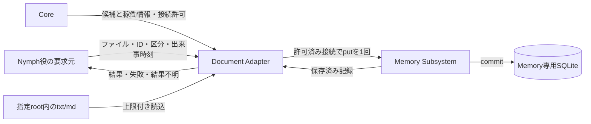

# Document Adapter — v1.2の文書入力とMemory連携

R33・[ADR 0028](adr/0028-v1.2-document-adapter.md)で具体化し、v1.2.0に同梱したAdapter。[通常導入](getting-started.md)で使用できる。ローカルの小さなUTF-8テキスト/Markdownを明示指定で取り込み、出典付き記録として[Memory](memory.md)へ保存する。内容の理解・真偽判定・自動分類・学習は行わない。

## 接続と責務



Coreは選定や内容の判断を代行しない。取込元、record_id、kind、source_kind、occurred_atは要求側が決める。Memoryの提供先IDはAdapter設定で明示し、初回の候補と稼働情報を確認してbindする。許可済みの接続を再利用し、確定した接続先を稼働中に変更しない。

## 設定・登録

factoryは`nymph_toolkit.adapters.document:factory`。設定は次の2項目のみ。

| 項目 | 条件 |
|---|---|
| root | 存在する絶対ディレクトリ。初期化時に解決する |
| memory_module_id | 利用者が選んだMemory提供先のID。契約は`ntk.memory.records/1` |

`ModuleKind.ADAPTER`として登録し、`ModuleSpec.requires`に同じMemory IDを指定する。依存順の起動・逆順停止を使う。`ModuleAdvertisement`には`nymph_toolkit.contracts.document.DOCUMENT_CONTRACT`を宣言する。Hybridのフレーム上限は65536 bytes以上。LOCAL/PROCESSは同じ公開契約を使う。

```python
group.register_module(
    ModuleSpec("document", ModuleKind.ADAPTER, ("memory",)),
    ModuleAdvertisement("document", "1.2.0", (DOCUMENT_CONTRACT,)),
    "nymph_toolkit.adapters.document:factory",
    {"root": str(document_directory), "memory_module_id": "memory"},
    Placement.PROCESS,
)
```

上の変数・import・Memory登録を含む実行可能な例は[document_demo.py](../examples/document_demo.py)。利用者が用意したroot内のファイルだけを読む。root制限は敵対的なファイル交換を防ぐセキュリティ境界ではない。

## 取込契約

`DOCUMENT_KEY = ContractKey("ntk.document.import", "1")`、ASYNC操作は`ingest(request)`の1つ。requestは次の文字列5項目のみ。未知の項目を無視しない。

| 項目 | 意味 |
|---|---|
| path | root内の相対`.txt`/`.md`。絶対パス、上位移動、解決後root外は拒否 |
| record_id | Memoryで照合するID。空白で囲まれない非空文字列、UTF-8で128 bytes以下 |
| kind | `experience` / `knowledge`。要求元による指定 |
| source_kind | `observed` / `reported` / `inferred` / `imagined` / `dream`。文書の内容の根拠区分を要求元が指定 |
| occurred_at | 出来事時刻。タイムゾーン付きRFC 3339、秒必須・小数秒最大6桁。UTCへ正規化 |

```python
await context.core.bind(DOCUMENT_KEY, "document", timeout=5)
link = await context.core.prepare(DOCUMENT_KEY, timeout=5)
try:
    result = await link.acall("ingest", {
        "path": "note.md", "record_id": "document-1",
        "kind": "knowledge", "source_kind": "reported",
        "occurred_at": "2026-11-23T09:00:00+09:00",
    }, timeout=10)
finally:
    await link.close()
```

これは機能側のcontextから呼ぶ例。Core経由なら同じbindの後で`context.core.invoke(DOCUMENT_KEY, "ingest", request, timeout=10)`を使える。外側の取込期限は、読込・初回接続と個別Memory RPC（5秒）を含めて設定する。例/統合試験の複数操作を束ねる制御RPCは30秒とする。

## 保存内容・上限・再取込

通常ファイルを最大65536 bytesまで読み、UTF-8の先頭BOMだけを除去する。Markdown記法やCRLF/LFは保持し、文字化けを置換しない。空白のみ・NULを含む文書は拒否する。1ファイルをMemoryの1記録にし、正規化した6項目のJSONが4096 bytesを超える場合は保存せず返す。この上限は本文だけでなくID、出典URI/hash、区分、時刻を含む。日本語はASCII escapeで計算するため、4096文字を保存できるという意味ではない。

contentは読んだ本文、sourceは`file:///.../note.md#sha256=<元bytesのハッシュ>`。hashはBOM・改行も含め、ファイル内容と出典を追跡する。元ファイルを書き換えず、全体の時点固定・外部書込ロックは提供しない。kind/source_kindは真偽の保証ではない。

成功結果はMemoryの6項目にsequence・stored_atを加えた記録。同じID・同じ正規化内容なら同じ記録を返す。本文、出典パス、元bytes、区分、時刻が異なる同じIDは`memory.conflict`。更新する場合にIDを変えるか、将来の訂正契約を使うかは要求側の判断であり、自動上書きしない。

## 失敗・取消・停止

| 結果 | 意味と対処 |
|---|---|
| `OperationFailure(document.invalid)` | 項目・区分・時刻・パス・文字コード・空/NUL本文を修正する。Memory未呼出し |
| `OperationFailure(document.unsupported)` | 未対応形式/通常ファイル以外。対応形式を用意する |
| `OperationFailure(document.read)` | ファイル不存在・読込権限・I/O失敗。入力先を確認する |
| `OperationFailure(document.too_large)` | ファイルまたはMemory JSON上限超過。部分保存・自動分割なし |
| `OperationFailure(memory.*)` | Memoryが返した業務失敗をそのまま返す。既存記録との競合、保存先の状態を確認する |
| `TemporaryUnavailable` | Adapterが処理中/停止中、選択したMemoryの候補/容量が不足、またはMemoryからの容量応答。自動待機列・再送なし |
| `LinkFailure` | 連携エラー。Adapterは接続の後処理・中断完了報告・health申請を行い、元のputを再送しない |
| `OutcomeUnknown`・期限切れ等 | 保存未実施とは限らない。要求元がMemoryのget(record_id)で確認する。例外の伝達形は配置/呼出し経路の既存契約に従う |

中断に伴いDocument入口の取得済みハンドルも無効になる場合がある。後続の要求側は同じ接続先を再prepareし、失敗した取込を自動再実行しない。healthはエラー時の個別申請で、Coreの定期検査や機能の自己診断呼出しを追加しない。

同時受付は1件。取消でも受付済み処理が保存まで進む場合があり、worker/Memory呼出しの完了を待ってから資源を回収する。Runtime停止時は新規受付と稼働通知を止め、進行処理・接続・workerを終了する。初期化失敗で子が先に終了した場合、親のcleanup_confirmedがfalseになることがある。終了と後処理確認を混同せず、ProcessSnapshotのreturncode/reasonも確認する。

## 実行・検証と次の範囲

[9つの実行例ガイド](tutorials.md)の通常wheelと同版sdistを使う。開発checkoutではeditable導入後に`python examples/document_demo.py`を実行できる。9番目の例は一時ディレクトリに自作ダミー文書とMemory DBを作り、直接/Core経由取込、同じIDの再取込、未取得/競合、Core/Memory再起動後の取得、終了を確認して一時ファイルを削除する。外部文書や実データは使用しない。

[B02検証記録](validation/v1.2.md)に条件と結果を記載する。PDF/Office/HTML/URL・OCR、分割/再帰/監視取込、意味抽出/分類/学習、訂正/削除/忘却、複製/移植/伝播は未採用。v1.1の公開物を後から置換しない。
