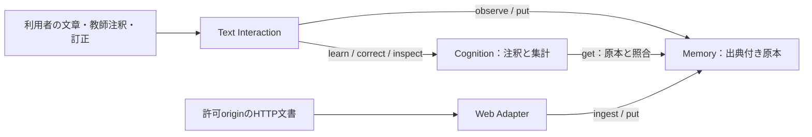

# Text Interaction・Web入力と学習訂正（v1.4開発候補）

R37・[ADR 0031](adr/0031-v1.4-text-web-and-correction.md)の実装判断。公開版v1.2には含まれない。前段のCognitionはPR #123の未マージ候補を基点とする。現状と検証範囲は[B04記録](validation/v1.4.md)、後続v1.10までの作業は[進捗](implementation-progress.md)で区別する。

## 観測から訂正まで



矢印はCoreが管理・許可した契約の呼出し。Core経由も利用できる。取得・保存・学習は別操作であり、文章を保存しただけでは学習しない。教師が語の区切り・概念ラベルを指定する。自然な自由会話、未分割文の自律学習、完全な意味理解を提供するものではない。

## 登録と配置

| 機能 | factory（`nymph_toolkit.`に続く名前） | 設定 | 提供する契約 |
|---|---|---|---|
| Text Interaction | `adapters.text_interaction:factory` | `memory_module_id`・`cognition_module_id` | `ntk.text.interaction/1` |
| Web | `adapters.web:factory` | `memory_module_id`・`allowed_origins` | `ntk.web.import/1` |
| Cognitionの訂正 | `subsystems.cognition:factory` | 既存設定に`enable_revision: true` | 既存learning/1に加え`ntk.cognition.revision/1` |

Contractsはそれぞれ`nymph_toolkit.contracts.text_interaction`、`.web`、`.cognition_revision`から`*_KEY`・`*_CONTRACT`をimportする。TextはMemoryとCognition、WebはMemoryへの必須依存をModuleSpecに記載する。Cognitionには両契約を広告する。完全な構成例は[interaction_setup.py](../examples/interaction_setup.py)。全操作はASYNC、LOCAL/PROCESSとも同じ意味を持ち、frame上限は65536 bytes以上。

提供先IDは要求側の設定値。候補の契約と稼働状況を確認して初回にbindし、同一起動内で相手を固定する。満杯はTemporaryUnavailable。自動選定し直し・再送・定期healthを追加しない。

## Text Interactionの操作

| 操作 | 引数 | 結果・担当 |
|---|---|---|
| observe | `record` | Memory putのreceipt。Memoryの6項目と4096 JSON bytes制限に従う |
| learn | `record_id, *, tokens, concepts` | Cognition learnのreceipt。原本と注釈を照合 |
| inspect | `token, *, source_kind=None, after=0, limit=8` | 頻度・隣接語順・概念関連と根拠 |
| get_revision | `record_id` | 現在の注釈・根拠・revision |
| correct | `record_id, *, command_id, expected_revision, tokens, concepts` | 訂正命令のreceipt |

入力はJSON値。受付時に複製し、ローカル呼出側の後からの変更を取り込まない。各提供先の入力検証と業務エラーを維持し、保存成功を学習成功とは扱わない。これはAPIの利用窓口であり、活動の価値判断をしない。

## 訂正契約と保存形式

初回学習のrevisionは0。訂正で注釈が変わると1増え、同じ注釈なら`no_change`で同じrevisionを返す。成功は`record_id`・`command_id`・`revision`・`status`（`applied`または`no_change`）のdict。同じ命令IDと入力は過去receiptを返すため、その後に別の訂正があっても再適用しない。現在値が必要ならget_revisionを呼ぶ。

command_idはCognition内で一意、非空・前後空白なし・UTF-8 128 bytes以下。expected_revisionは0〜2^63−2のintでbool不可。語の区切り・ラベルの上限は[初期学習](cognition.md)と同じ。Memory本文・fingerprint・出典区分を再照合し、Memoryは編集しない。訂正後に古いlearnを送って巻き戻すことはできない。

| 業務失敗 | 意味・次の操作 |
|---|---|
| cognition.invalid | 不正な注釈・命令ID・版、原本と注釈の不一致 |
| cognition.not_found | 未学習。必要ならlearnを明示する |
| cognition.revision_conflict | 古い版。get_revisionで確認して利用者が判断する |
| cognition.command_conflict | 同じ命令IDに異なる入力。新しい操作か再照会かを判断する |
| cognition.conflict | 根拠または既存学習との不一致 |
| cognition.history_full | 最大4096訂正命令に到達。過去命令を消さず拒否する |
| cognition.storage | 保存障害。状態を確認するまで成功とも未適用とも断定しない |

学習例の最大256件と訂正命令4096件は別。訂正は現在注釈・revision・変更前後とreceiptを一つのSQLiteトランザクションで保存する。

`enable_revision`を省略するとfalse。trueで既知の形式1を検証してから形式2へトランザクション移行する。未知形式・破損・異なるMemory IDは上書きしない。**移行前に停止したDBのバックアップを運用側で取得する。形式2は旧v1.3バイナリで読めない。** 新コードでは訂正を無効化しても形式2のlearn/inspectを利用できる。これは個体の複製・移植機構ではない。

## Webの操作と取得条件

`ingest(request)`は`url`・`record_id`・`kind`・`source_kind`・`occurred_at`の5文字列を受ける。区分・ID・時刻はMemoryの制約に従い、取得前に検証する。成功はMemory putのreceipt。同じIDでも本文・取得出典が変わればMemory側で競合になる。

- `allowed_origins`例：`["https://example.org", "http://127.0.0.1:8080"]`。scheme/host/portを照合し、path/queryは指定しない。
- URLはHTTP(S)のみ、最大2048文字。userinfo・fragment・空白・制御文字・不正ポート・backslashを拒否する。URLはASCIIで渡し、非ASCII pathはpercent-encode、hostはIDNAを用いる。
- GETのみ。環境proxy・cookie・認証を使わず、HTTPSは既定の証明書検証を維持。最大3回のredirectは各遷移でoriginを確認する。
- 非圧縮のUTF-8 text/plainまたはtext/html、取得上限65536 bytes。読込予算3秒・個々のblocking操作は最大2秒。進行中のblockingやOSのDNS解決を予算時刻に強制終了する保証ではない。
- HTMLはscript/style/head/noscript/template/iframe/objectを除き、本文区切り・文字参照を処理する。CSS可視性・JS生成DOM・ブラウザー表示の再現ではない。
- sourceは`url`・`final_url`・取得bytesの`sha256`を持つJSON文字列。取得原文と、保存した抽出文章を区別する。
- Memoryの正規化後4096 JSON bytes上限を超えたら保存せず`web.too_large`。切捨て・自動分割・巡回・暗黙の学習はしない。

`web.invalid/origin/redirect/unsupported/too_large/http/read/timeout`は取得前後の業務失敗で、この場合Memory putを呼ばない。putに進んだ後はMemoryの結果を返す。origin制限は運用上の取得許可であり、敵対的DNSや機能を隔離する境界ではない。

## 取消・終了・連携エラー

各Adapterは同時受付1件。所有worker/taskと窓口の後処理が終わるまでstopは待つ。受付済み処理の呼出側を取り消しても、処理は保存まで進む場合があるため、未保存保証とはしない。結果不明・期限切れでも自動再送しない。Memory IDまたは訂正命令IDと現在版を明示照会する。

LinkFailureでは窓口close、要求元の中断完了報告、対象のhealth申請を行う。新しい明示要求から再接続し、元の操作を再実行しない。後処理やusage報告が重ねて失敗しても、元のOutcomeUnknownを通常の保存失敗へ置換しない。

## 実行例とJSON-linesコンソール

開発用導入後に実行する。公開wheel v1.2にはこの機能を含まない。

```powershell
python examples/text_interaction_demo.py
python examples/web_demo.py
python examples/text_interaction_demo.py --interactive --data-dir .local/text-session
```

最初の2例は一時データを使いPASSで終了する。Web例は所有するローカルHTTPサーバーを使用し、インターネットへ接続しない。対話モードは1行1JSON指示・1行1JSON結果で、EOFで後処理して終了する。Windows端末はCtrl+Z→Enter、通常のUnix端末はCtrl+D。Ctrl+CもRuntimeの停止を待つ。`--data-dir`は対話モード専用で、未指定は終了時にデータを削除する。

```json
{"operation":"observe","args":[{"record_id":"lesson","kind":"experience","content":"猫 は 眠る","source_kind":"reported","source":"console:user","occurred_at":"2026-11-24T00:00:00Z"}]}
{"operation":"learn","args":["lesson"],"kwargs":{"tokens":["猫","は","眠る"],"concepts":["wrong"]}}
{"operation":"correct","args":["lesson"],"kwargs":{"command_id":"fix-1","expected_revision":0,"tokens":["猫","は","眠る"],"concepts":["sleep"]}}
{"operation":"inspect","args":["猫"]}
```

保存・学習・訂正のreceiptと、最後にsleepへの関連・根拠付き集計を返す。OperationFailure等の値には`type`を添えてJSON化し、不正コマンドや例外は`error`・`message`で返す。入力待ちはCoreのイベントループを止めない。自由文へ自動返答するチャットではない。
