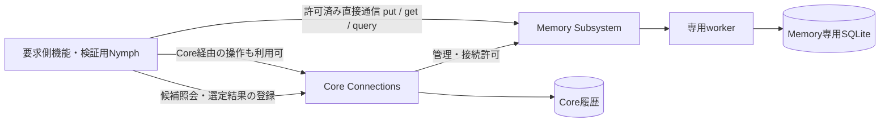
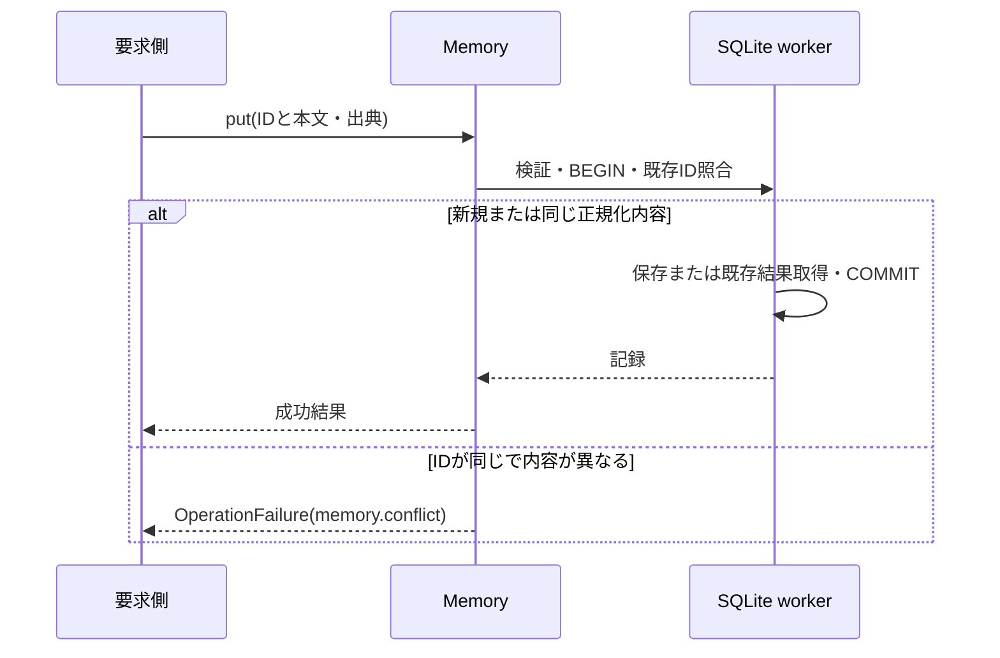

# Memory Subsystem v1.1

R31・[ADR 0027](adr/0027-v1.1-memory.md)に基づく最小の経験・知識の保存/取得。v1.1.0で追加した機能の説明。公開先は[v1.1.0 Release](https://github.com/Tao-pyth/nymph-toolkit/releases/tag/v1.1.0)。結果は[B01検証記録](validation/v1.1.md)を参照する。

## 役割と構成

Memoryは、要求側が指定した本文・種別・根拠を保持する。真偽の判定、言語学習、活動選択は担当しない。Coreは登録・接続・実行を管理する。MemoryのファイルはCoreのFileStore履歴・退避・保存期間の対象外である。



同じ`nymph-toolkit`配布物に同梱する。ModuleKindはSUBSYSTEM、factoryは`nymph_toolkit.subsystems.memory:factory`。公開宣言は`nymph_toolkit.contracts.memory`の`MEMORY_KEY`・`MEMORY_CONTRACT`。Core内部や他のSubsystemへ依存しない。

## 登録・設定

既存の[接続契約](module-contracts.md)に従い、起動前にHybridGroupへ登録する。

```python
from pathlib import Path
from nymph_toolkit.contracts import ModuleSpec, ModuleKind, ModuleAdvertisement, Placement
from nymph_toolkit.contracts.memory import MEMORY_KEY, MEMORY_CONTRACT

# groupは設定済みのHybridGroup。保存先の親ディレクトリは先に用意する。
group.register_module(
    ModuleSpec("memory", ModuleKind.SUBSYSTEM),
    ModuleAdvertisement("memory", "1.1.0", (MEMORY_CONTRACT,)),
    "nymph_toolkit.subsystems.memory:factory",
    {"path": str(Path("memory.sqlite3").resolve())},
    Placement.PROCESS,  # LOCALも同じ契約
)
```

設定は絶対ファイルパスの`path`だけ。起動時に新規/空のSQLiteを初期化し、既存DBは識別・版・構造・quick_checkを確認する。未知形式や破損を自動上書きしない。SQLiteを含むCPython 3.12〜3.15、HybridSettings.max_frame_bytes >= 65536が必要。1ファイルは1つのMemory実体が所有する。

## 3つの操作

契約は`ContractKey("ntk.memory.records", "1")`、全操作ASYNC。機能実装版1.1.0、契約版1、内部保存版1は別の版である。

| 操作 | 引数 | 成功結果 |
|---|---|---|
| put | `record`：下表の6項目のみのdict | 保存した記録。commit後に返す |
| get | `record_id`：文字列 | 対象の記録 |
| query | keywordのみ：`kind=None, source_kind=None, after=0, limit=8` | `records`一覧、次に渡す`after`、`has_more` |

| putの項目 | 意味・制約 |
|---|---|
| record_id | 要求側が決めるID。非空・前後空白なし、UTF-8で128 bytes以下 |
| kind | `experience`（経験）/ `knowledge`（知識）。Memoryが自動推定しない |
| content | 非空の本文 |
| source_kind | `observed`（観測）、`reported`（伝聞）、`inferred`（推論）、`imagined`（想像）、`dream`（夢） |
| source | 非空の出典/根拠の参照文字列。参照先を取得・検証する機能は含まない |
| occurred_at | タイムゾーン付きRFC 3339。秒必須、小数秒は最大6桁、UTCへ正規化 |

保存結果に`sequence`（保存順）・`stored_at`（Memory側のUTC保存時刻）を追加する。出来事時刻から順序・価値を推定しない。正規化6項目のコンパクトJSONはASCII escapeで4096 bytes以下。未知フィールドは拒否する。

```python
core = context.core
candidates = await core.candidates(MEMORY_KEY)
# 実際には属性・稼働情報を確認し、要求側の方針で選ぶ。
await core.bind(MEMORY_KEY, "memory", timeout=5)
link = await core.prepare(MEMORY_KEY, timeout=5)
try:
    result = await link.acall("put", {
        "record_id": "observation-001", "kind": "experience",
        "content": "雨を観測した。", "source_kind": "observed",
        "source": "dummy:weather", "occurred_at": "2026-11-23T09:30:00+09:00",
    }, timeout=5)
    page = await core.invoke(MEMORY_KEY, "query", kind="experience", limit=8, timeout=5)
finally:
    await link.close()
```

上の変数`result`・`page`は成功値のほかに業務失敗や容量不足を取り得る。利用側は下記の結果型を確認してからdictの項目を読む。処理結果不明時の照会・解放は既存DirectLink/CoreClientの契約に従う。

queryは指定フィルタのAND完全一致で、`sequence > after`を昇順に返す。afterは0〜2^63-1、limitは1〜8の整数（bool不可）。次ページには同じフィルタと返却afterを渡す。空結果は入力afterを返す。ページ間の追記は後続ページに現れる場合があり、検索全体の時点固定・関連度順・類似検索は保証しない。

## 重複・失敗・停止



同じID・同じ正規化内容は同じsequence/stored_atを返す。異なる本文や出典で既存記録を上書きしない。自動再送は行わず、応答消失時は要求側が同じIDで照会する。

| 結果 | 意味・対応 |
|---|---|
| OperationFailure `memory.invalid` | 入力/フィルタ/上限違反。要求内容を確認する |
| OperationFailure `memory.not_found` | IDが存在しない。空のqueryは正常な空一覧 |
| OperationFailure `memory.conflict` | IDの内容不一致。元記録は維持される |
| OperationFailure `memory.storage` | SQL/保存/読込の失敗。保存先・権限・容量・別writerを調べる |
| TemporaryUnavailable | 処理中または停止中。待機列へ入らず容量不足として返る |
| 既存の通信例外・結果不明 | 接続障害・期限超過。成功/未実行と決めつけない |

受付は同時1件、SQLiteロック待ちは1秒。稼働情報は処理開始/終了時に通知する。保存I/Oは専用thread、取消はworker完了まで待ち、停止は進行処理後にファイルとworkerを閉じる。取消や通信期限切れはrollback保証ではない。停止期限とCore所有子の扱いはADR 0022に従う。

保存形式は内部形式。手編集・並行writer・自動形式移行を提供しない。ロック解放後の再要求は要求側が判断する。通常のエラーを理由にCoreへ自動ヘルス申請・周期再試行・接続切替を追加しない。

## 試す・検証する

公開wheelと同版sdistでの実行は[通常導入](getting-started.md)と[8つの例](tutorials.md)に従う。以下はリポジトリ直下からの開発用手順。

```text
python -m pip install -e .
python examples/memory_demo.py
python -W error -m unittest tests.subsystems.test_memory tests.subsystems.test_memory_integration -v
```

例は一時ディレクトリ内でMemoryを別プロセス、要求側ダミーをLOCALに置き、直接/Core通信・最大ページ・失敗・再起動取得を確認して終了する。`PASS: Memory persistence, provenance, direct/Core RPC, restart, cleanup`が最後の出力。例のデータは終了時に削除される。実利用では保持する絶対パスを指定する。

Document Adapter、編集・訂正/削除・忘却、Working/Procedural Memory、意味検索、統合、学習は未実装。夢区分は保存上の区別で、生成や次の睡眠時の失効を実装したものではない。複製・移植・伝播を追加していない。
