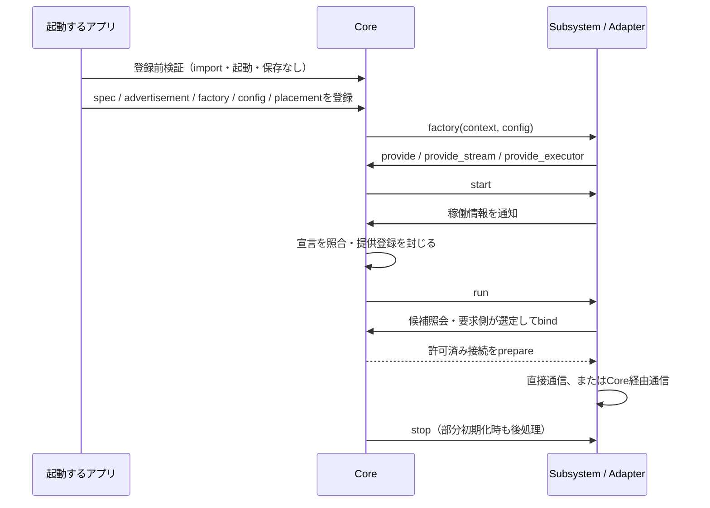

# v1.0 Core接続契約

v1.0.0で確立し、公開v1.2.0と開発候補v1.3.0でも維持するCore共通接続契約を説明する。[導入ガイド](getting-started.md)は公開v1.2.0を対象とする。v0.9からの移行差分は[移行手順](migration-v1.md)を参照する。本資料の対象は[R29・ADR 0026](adr/0026-v1.0-core-connection-contracts.md)の共通契約であり、業務契約は[Memory](memory.md)・[Document](document.md)・[Cognition候補](cognition.md)の各ガイドへ分ける。

## 接続までの流れ



候補は契約ID・版に一致する登録・属性・稼働情報である。候補一覧への掲載と現在利用できること、bindの保存と呼出し準備完了は別である。要求側が選定し、要求元＋契約ID/版ごとに接続先を固定する。毎回Coreへ許可再審査を依頼しない。稼働中に機能構成や確定先を交換せず、初回接続追加だけを認める。

## 6契約と所有境界

| 契約 | 機能実装者・起動アプリが用意するもの | Coreが行うこと・制約 |
|---|---|---|
| Module | ModuleSpec、ModuleAdvertisement、import可能なfactory、JSON設定、Placement | ID一致と明示配置を検査。Subsystem/Adapterで同じ規則。requiresはモジュールID依存であり契約依存ではない |
| Lifecycle | RuntimeServiceのasync start/run/stop。factoryはサービスまたはAwaitableを返す | 依存順start、run管理、逆順stop。部分初期化でもstopを呼ぶので未作成資源を考慮する |
| Capability | ContractKey、ContractSpec、OperationSpec、属性・タグ、変更時のUsage通知 | 同じID/版の操作集合とmodeを照合。Coreは最適候補を選ばない。契約版の範囲指定・自動交渉はしない |
| Communication | context.core、prepareした窓口、RPC/streamハンドラー | 許可済み直接通信とCore経由を提供。準備の期限と実行期限、送信受付と受信確認を分ける |
| Task | ActivityRequest、ActivityChange、ActivityContextを使うexecutor、Nymphからの指示 | 登録・開始・状態追跡・通知・変更適用。予定終了通知後も継続し、終了指示後は安全な区切りと後処理を待つ |
| Error | 業務失敗値、協調的な中断・後処理・報告 | 容量不足と障害、結果不明と失敗、受付と完了を区別。自動再送・切替・活動復元をしない |

## 公開型と登録規則

機能コードは`nymph_toolkit.contracts`からModuleFactory、ModuleContextProtocol、CoreClientProtocol、DirectLinkProtocol、StreamSenderProtocol、StreamReceiverProtocolを参照できる。RuntimeServiceとActivityContextを再利用し、Coreへのimportは不要。Protocolは構造的な型の説明であり、runtimeのisinstanceは署名・型・動作の完全な検証やセキュリティ境界ではない。契約試験を併用する。

ModuleContextの利用対象はmodule_id、generation、settings、coreとprovide系3メソッド。Core所有の参照・設定を機能側から書き換えない。provideは契約キーと操作名→Awaitableを返すCallableのMapping、provide_streamは契約キー・操作名・async handler(receiver, metadata)、provide_executorはID・async handler(ActivityContext, arguments)・supports_pauseを受け取る。

登録可能なのはfactory作成からstart完了まで。RPCとstreamで同じ操作を二重提供せず、宣言の全操作をちょうど一つのハンドラーで満たす。実行中・停止後の登録はProtocolError。executorは操作宣言とは別のIDを持ち、実行側が対応する中断機能だけを宣言する。サービスが独自に作るタスク・外部資源はサービス自身のstopで回収する。

`validate_module_registration(spec, advertisement, factory, config, placement)`はCoreの公開関数。検証済みの独立したJSON設定コピーを返す。ModuleSpec/Placementの型違反はTypeError、ID不一致・factory表記・ASYNC宣言の違反はValueError、JSON違反はProtocolErrorとなる。実登録も同じ検証を使うが、重複登録・依存・契約宣言の競合などはRegistry/Connectionsの登録時検査で扱う。事前検証だけではimport可否・ハンドラーの正しさ・稼働可否を保証しない。

## 配置・通信・活動の使い分け

| 場面 | 窓口・値 | 注意 |
|---|---|---|
| 従来の同一プロセス接続 | Connections / PreparedConnection、宣言したSYNC/ASYNC | SYNCのPython値や同一性を維持する。Hybridへの透過移行とはしない |
| Hybrid LOCAL / PROCESS | CoreClient / DirectLink、ASYNC、JSON互換の引数・結果 | 4配置で同じ機能契約。Core所有子・同じPC/Python環境。CoreClientはfactory contextから得る |
| バイト転送 | DirectLink.open_stream→StreamSender、受信handlerにStreamReceiver | バイト列とJSON metadata。optionsの上下限とoverflowを指定。send/receive/closeには期限が必要 |
| 活動 | CoreClient.submit_remote、activity、ActivityContext | 決定はNymph、実行管理はCore。調査内容や睡眠時刻・優先度をCoreが作らない |

CoreClientの活動操作名と引数は次のとおり。すべて現在の要求元が所有する活動を対象にする。

| activityのoperation | keyと追加引数 | 返却 |
|---|---|---|
| snapshot | ActivityKey | ActivitySnapshot |
| change | ActivityKey、change=ActivityChange、command_id、expected_revision | ActivityCommandResult |
| pause / resume | ActivityKey、command_id、expected_revision | ActivityCommandResult。受付と適用完了を区別 |
| finish | ActivityKey、任意のreason | ActivitySnapshot。後処理完了とは別 |
| wait | ActivityKey | 最終ActivitySnapshotまで待つ |
| command | ActivityKey、command_id | ActivityCommandResultの完了を待つ |
| notice | key省略 | 要求元向け次のActivityNoticeを待つ |
| history | key省略 | ActivityHistory |

引数の正確な署名は[API一覧](api-reference.md)のHybridTaskManager/TaskManager、振る舞いは[活動管理](task-manager.md)と[Hybrid](hybrid.md)を参照する。RPCのtimeoutで待機をやめても処理中止を意味しない。OutcomeUnknownのrequest_idはpending_requests/resultで照会し、不要になった一時結果をreleaseする。実行中の再送は行わない。

OperationFailure/TemporaryUnavailableは通常結果、LinkFailureは接続障害を伴う中断通知、RemoteErrorは遠隔例外情報、OutcomeUnknownは結果不明として扱う。子の予期しない終了はRuntime停止となる。通常活動終了に子強制終了期限を流用しない。[エラー・所有の詳細](core-api.md)を参照する。

## 安定APIと検証

安定基準は[contracts-v1.json](contracts-v1.json)。Core/Contractsの明示export、利用者向けメソッド・プロパティ・値/列挙・データフィールドを固定する。Coreが生成するModuleContext/CoreClient/DirectLink/StreamSender/StreamReceiver/PreparedConnectionのコンストラクタ、内部module・下線名・資源管理フィールド・wire/保存形式は独立した安定APIではない。Protocolで示す窓口の属性は読み取り用として扱う。

配布版1.xの互換性判断と、契約IDに付けた版、モジュール実装版、内部IPC版は別である。API照合は保守的に署名差分も止める。互換な任意引数追加を含め、基準を更新する前に互換性をレビューする。振る舞いの互換性はB00・既存64項目の回帰で確認する。

```powershell
python examples/module_contract_demo.py
python -W error -m unittest tests.core.test_module_contracts -v
python tools/check_contracts.py
```

7番目の例は[Contractsだけに依存する機能](../examples/contract_dummy.py)と[起動側](../examples/module_contract_demo.py)を分ける。正常時に直接/Core呼出し、stream、Nymphの終了指示、子の後処理を確認してPASSを表示する。設定・履歴は一時ディレクトリで後処理後に削除され、外部サービスへ接続しない。通常wheelからの再現も配布検証で確認する。
