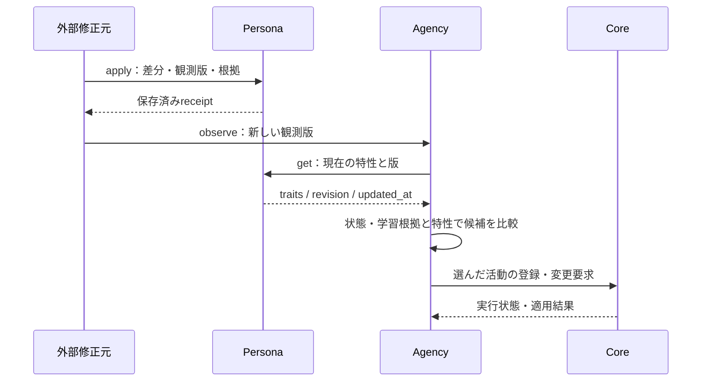

# PersonaとAgency：人格特性を活動選択へ反映する（v1.8候補）

[ADR 0036](adr/0036-v1.8-persona-agency.md)・親#18・子#151〜#155に対応する。Personaが特性を保持し、Agencyが参照して活動を選び、Coreが実行を管理する。公開版はv1.2.0で、この連携は開発候補。初期の説明可能な重み付けであり、人格全体や心理学的尺度の完成ではない。

## 有効化と互換性

既存の`nymph_toolkit.subsystems.agency:factory`または`execution_factory`へ、次の任意設定を加える。後者のexecution設定は[活動循環](agency-execution.md)と同じ。

```python
config["path"] = "/absolute/path/agency-persona.db"
config["persona"] = {
    "module_id": "persona",
    "motive_traits": {
        "rest": "rest_affinity",
        "explore": "curiosity",
        "achieve": "focus",
        "social": "sociability",
    },
}
```

Windowsは`D:/.../agency-persona.db`などの絶対パスを使う。Persona自身には[traits/1](persona.md)と対応する4特性を設定する。名前は説明用で、既定人格を意味しない。全4動機へ有効な特性名を対応付け、同じ特性を複数動機に使うこともできる。存在しない特性を中立値で補わない。

personaを省略すると既存のutility-v1・DB形式1・結果形式を維持する。nullは省略ではなく不正設定。有効時はAgency DB形式2を新しいパスへ作る。既存形式1を自動移行・上書きせず、旧DBは旧設定で照会する。逆方向の読込みも拒否する。提供先・対応付けなどの設定違いを自動修復しない。

## どの値が判断へ使われるか



新しい判断ごとにPersonaを1回参照する。Coreが管理する許可済み接続を使い、接続先を自動変更しない。Memory/Cognition/Personaは逐次の観測値で、全機能の同時点スナップショットではない。

| 項目 | 初期規則 |
|---|---|
| base_score | 従来の内部状態・学習不足から計算した0〜1000の得点 |
| multiplier_per_mille | 500 + 対応する特性値（500〜1500） |
| score | min(1000, base_score × multiplier_per_mille // 1000) |
| 特性500 | 中立。元の得点と同じ |
| 特性0 / 1000 | 0.5倍 / 1.5倍。元の0点は0点のまま |

同点解消、活動の時刻・期間・優先度、状態に応じた中断/再開等には従来規則と補正後の得点を使う。Personaが利用不能な活動を許可することはない。Coreは得点を生成せず、登録可否・版競合・後処理を管理する。

例えば知識活用800点・休息600点なら知識活用を選ぶ。休息への対応特性だけを500から1000へ変えると、休息は900点となり選択が変わる。実行中の活動を中断して休息へ移り、特性を戻した後は同じ継続を再開できる。元の活動を先頭から自動再実行する意味ではない。

## 再評価と根拠保存

decisions/1の新しいdecision_idで参照し、結果にpolicy=`utility-persona-v1`、Personaのmodule_id/版/値/更新時刻/対応付け、各候補の基礎点・倍率・補正後の点を残す。結果は49152 bytesまで。入力・根拠・結果を一括保存し、同ID/同じ入力の再要求とgetは以前の結果を返す。Personaが更新されても過去の判断を書き換えない。

execution_factoryは観測や活動状態が変わった際の次の判断で参照する。外部更新をすぐ反映したい場合、Personaのapply結果を確認後に、最新のobservation_revisionを使ってactivities/1.observeを呼ぶ。同じ内容でも新しい観測版を作れる。既存の観測競合・再要求規則は維持する。特性の更新だけで即時再評価や既存判断の取消が発生する保証はない。

AgencyによるPersonaの定期ポーリング・自動修正は行わない。再起動では保存済みの判断を照会できるが、活動循環はinactiveから明示有効化する。起動時に当時の保存根拠から結果を再計算し、破損や形式/設定違いを拒否する。

## 失敗と後処理

- 不正な提供結果、ID違い、特性欠落、値/版/時刻の不正はagency.evidence。中立値で代用しない。
- Personaの業務失敗はその結果を返す。容量不足は待機とし、観測/状態変化まで再問い合わせしない。現在の活動を容量不足だけで終了しない。
- 通常の連携エラーではAgencyが所有活動を協調的に終了し、後処理後に中断完了を報告する。無関係な活動の一律停止、元の失敗処理の自動再送はしない。
- 取消や通信期限切れは判断が未保存という保証ではない。受付済み処理とworkerを排出し、決定IDのgetで確認する。

## 検証例

```console
python examples/persona_agency_demo.py
python -W error -m unittest tests.subsystems.test_agency_persona tests.subsystems.test_agency_persona_integration -v
```

16番目の例では実際のCognition学習後、同じ観測・目標のまま特性だけを外部更新し、知識活用→休息→元の活動の再開を確認する。Coreの再開状態とAgencyの命令適用済みの両方を待つ。2回目の起動で特性と過去判断を確認し、活動が自動復元されないことを検証する。一時保存先は正常終了時に削除する。全受入の進捗は[B08記録](validation/v1.8.md)。Sleepによる修正値生成は後続の設計対象である。
