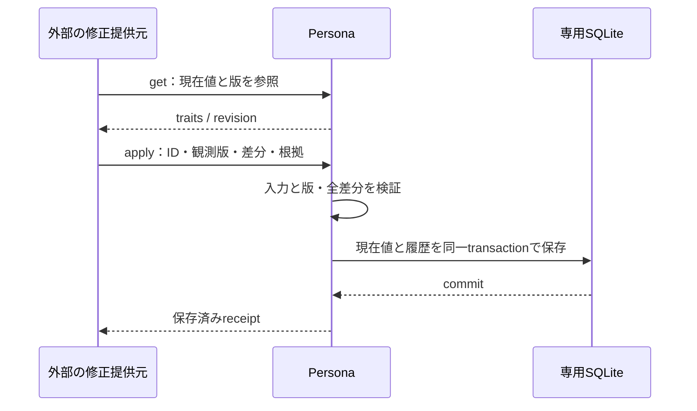

# Persona：人格特性の参照と外部修正（v1.7候補）

[ADR 0035](adr/0035-v1.7-persona.md)・親#17に対応する。公開版はv1.2.0で、この契約は開発候補。Personaは長期特性を保持し、明示された差分を適用する。自身で更新を開始せず、活動の価値判断はAgency、実行管理はCoreが担当する。

## 構成

`nymph_toolkit.subsystems.persona:factory`をGroupへ登録し、`nymph_toolkit.contracts.persona`のPERSONA_CONTRACT（`ntk.persona.traits/1`）を宣言する。同じパッケージに同梱し、実行時の追加Python依存はない。

```python
config = {
    "path": "/absolute/path/persona.sqlite3",
    "initial_traits": {"curiosity": 500, "sociability": 400},
}
```

Windowsでは`D:/.../persona.sqlite3`などの絶対パスを指定する。initial_traitsは1〜32項目、名前はASCIIの`[a-z][a-z0-9_]{0,31}`、値はboolを除く整数0〜1000。例の名前は説明用で、既定人格や心理学的尺度ではない。フレーム上限は65536 bytes以上。保存先は1実体が所有する。

初期値は空DB作成時だけ適用する。再起動時は保存値を使い、module_id/initial_traitsが保存した設定と異なる場合は起動を拒否する。設定を書き換えて現在値を初期化する仕組みではない。

## 契約

全操作ASYNC。Coreが許可した直接通信とCore経由の両方で利用できる。

| 操作 | 結果 |
|---|---|
| get() | module_id、revision、traits全項目、updated_at |
| apply(request) | commit後の修正receipt。複数の差分を一括適用 |
| get_update(command_id) | 過去のreceipt。通信結果不明の場合にも照会する |
| history(after=0, limit=4) | updates、next_after、current_revision。after 0〜4096、limit 1〜4 |

```python
await core.bind(PERSONA_KEY, "persona", timeout=5)
before = await core.invoke(PERSONA_KEY, "get", timeout=5)
receipt = await core.invoke(PERSONA_KEY, "apply", {
    "command_id": "experience-1",
    "expected_revision": before["revision"],
    "deltas": {"curiosity": 100, "sociability": -50},
    "reason": "経験の集計結果を反映",
    "source": {"actor_id": "observer", "reference": "memory:experience-1"},
}, timeout=5)
```

IDはtrim済み・非空・NULなしUTF-8 128 bytes以内。reason/referenceは512 bytes以内、actor_idは128 bytes以内。sourceはこの2項目だけで、提供側の申告であり認証証明ではない。要求全体はASCII escapeした正規化JSONで4096 bytes以内。未登録の名前、未知フィールド、float/boolの差分を拒否する。

差分は-1000〜1000の整数。適用後の値が範囲外なら、全項目を変更せず返す。自動で上限へ丸めない。expected_revisionは0〜2^63−1の整数で、新しい要求では現在版との一致が必要。値が変われば版を1増加し、全差分0ならno_changeを履歴へ保存するが、現在版とupdated_atは維持する。

receiptにはsequence・command_id・status・previous_revision・revision・before/after・reason/source・stored_atを含む。before/afterは全特性。時刻はUTC。履歴sequenceは成功要求ごとに増加する。

## 保存と再要求



成功済みIDと同じ要求は、過去のreceiptを返すだけで差分を再適用しない。同じIDで内容が異なる場合は競合。失敗要求は成功履歴へ保存せず、IDを予約しない。履歴は4096件までで、上限時も現在値と既存履歴の照会を続ける。自動削除・複製/移植/伝播は含めない。

## 失敗・取消・停止

| 結果 | 意味 |
|---|---|
| persona.invalid | 不正入力、未知特性、適用後の範囲超過。全体を拒否 |
| persona.revision_conflict | 新規要求の観測版が古い |
| persona.command_conflict | 同じ成功済みIDで異なる要求 |
| persona.not_found | 保存済み更新IDがない |
| persona.history_full | 4096件に達し、新しい更新を拒否 |
| persona.storage | 保存/読出し失敗。既存状態を確認して対処 |
| TemporaryUnavailable | 同時受付1件の容量不足、停止中など |

取消・期限切れは未保存の保証ではない。LOCALの直接呼出しはTimeoutError、PROCESSの送信後期限切れはOutcomeUnknownとなり得る。遠隔結果の照会でCancelledErrorが返っても、受付済みの保存は完了している場合がある。操作を自動再送せず、同じ更新IDのget_updateで永続結果を確認する。Coreの管理要求IDとPersonaの更新IDは別物。

Personaは受付済みworkerを排出してからDBとthreadを閉じる。Runtimeの停止では通信応答が届かない場合もあり、停止完了を「呼出元へ成功応答が届いた」と扱わない。再起動後に現在値・更新履歴を照合する。未知形式・破損・設定違いは起動を拒否し、自動修復しない。

## 実行例と後続

`python examples/persona_demo.py`は、値の参照、外部差分、再要求、版競合、両通信経路、再起動後の同じ値を検証して終了する。例の根拠・差分は明示入力であり、経験の意味評価を自動実行するものではない。

Agencyの選択への反映はv1.8、Sleepによる修正値生成はv1.9以降で具体化する。人格全体や人工人格の完成とは区別する。検証の進捗は[B07記録](validation/v1.7.md)を参照する。
