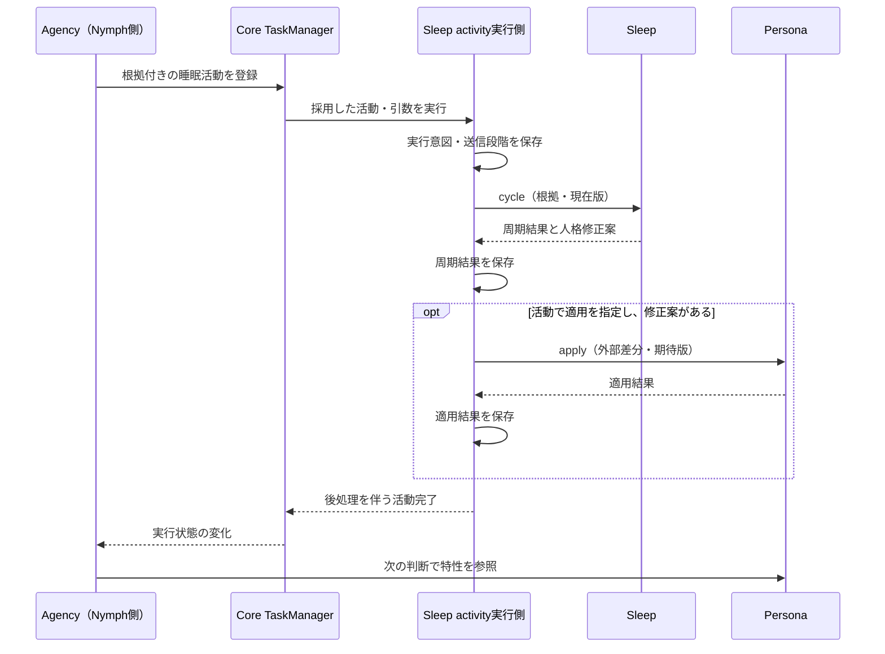

# 睡眠活動と人格更新の循環（v1.10開発候補）

[ADR 0038](adr/0038-v1.10-sleep-cycle-and-voice.md)の実装判断。公開v1.2.0には含まれない。Agencyが休息を選び、Coreがその活動を実行管理し、独立した睡眠実行側がSleepとPersonaの公開契約を使う。CoreやSleep自身に人格更新の意思決定を移さない。



## 登録・活動引数

factoryは`nymph_toolkit.subsystems.sleep_activity:factory`。設定は専用SQLiteの絶対`path`、`sleep_module_id`、`persona_module_id`。宣言する契約は`contracts.sleep_activity.SLEEP_ACTIVITY_CONTRACT`。同じ機能が`executor_id="sleep"`を中断・再開対応として登録する。配置はLOCAL/PROCESSの両方を使える。

活動引数の例：

```json
{"request_id":"night-one","expected_revision":0,"record_ids":["a","b"],"apply_persona":true}
```

`expected_revision`はSleepの現在版。`record_ids`は一意の0〜4件。`request_id`はUTF-8 128 bytes以内で、同じ要求の別内容への再利用は拒否する。Agencyカタログでは既存の`parameters.configured`へこの形を置く。個々の活動をいつ・なぜ行うかはAgency側で決める。

開始時と人格操作前に協調的な安全区切りを設ける。途中の保存/RPCは完了を待ち、中断中は状態を保持する。Nymphの終了要求を受けたら次の区切りで後処理する。予定時間到達だけで活動を打ち切らない。通常は一周期の完了を活動の自然完了とする。

## 結果を区別する契約

`ntk.sleep.activities/1`の全操作はASYNC。

| 操作 | 意味 |
|---|---|
| `get(request_id)` | ローカルの実行段階・周期・人格適用結果を取得 |
| `reconcile(request_id)` | 送信済みの周期/人格操作を公開契約で照会。元の操作を再送しない |
| `apply(request_id)` | 適用指定あり・周期保存済み・人格案あり・未送信の場合に限る明示適用。送信済みなら照会だけ |

記録の`phase`は`prepared → cycle_sent → cycle_saved → apply_sent → completed`。不適用・案なしでは人格送信を省略する。確定した失敗は`failed`。`sent`は送信前の意図が保存された段階で、相手で成功したかは未確認である。直後のクラッシュでは未実行の可能性もある。

**周期保存成功と人格適用成功は別。** 相手の結果が`not_found`でも未実行保証にせず、送信済み段階を維持する。版の競合を自動修正して再適用しない。照合だけで後続の人格操作を始めない。実Sleepのcycle IDは機能IDと全引数から生成し、ローカルrequest IDとの対応を記録する。

同じrequest ID・同じ内容の活動を再登録しても履歴を返し、周期や人格操作を再送しない。新しい周期は現在版と新しいrequest IDを使う。再起動だけでは活動を再開しない。

## 保存・失敗・上限

専用SQLite形式1、最大4096要求、1ファイル1所有者。変更操作は同時に1件で、`get`は実行中も利用できる。原子的保存と設定同一性・全記録の検証を行い、破損や未知形式を自動修復しない。Memory原本・Cognitionの学習・Sleepの周期監査は別所有のまま保持する。

業務失敗・容量不足・通信の結果不明を区別する。連携障害では所有操作の後処理を終えてからCoreへ中断完了・個別healthを申請する。元の操作の自動再試行、接続先の自動切替、無関係な機能の停止をしない。Coreの取消・期限切れは外部操作の未実行保証ではない。

## 試す

開発候補を導入して`python examples/sleep_activity_demo.py`を実行する。実Memory/Cognition/Agency/Persona/Sleepを接続し、休息の選択→睡眠周期→人格差分の適用→次の活動選択の変化を確認する。再起動後は履歴だけを復元し、活動0件・inactiveを確認する。

これは明示教材・初期動機・規則を使う例であり、自然な睡眠判断や人格全体の完成を示さない。[B10の検証記録](validation/v1.10.md)で、試験済み範囲と残作業を分けて追跡する。
