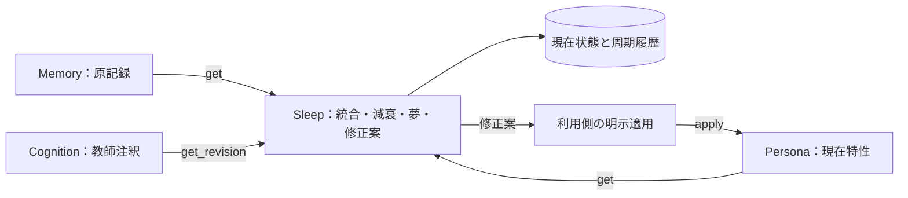

# Sleep：根拠の統合・忘却・夢と人格修正案（v1.9候補）

[ADR 0037](adr/0037-v1.9-sleep.md)・親#19・B09に対応する。公開版はv1.2.0。この初期実装は小さな規則で根拠を整理する。一般的な意味理解やNymph全体の記憶・人格の完成を示すものではない。

## 所有と接続

SleepはMemory原本とCognitionの教師注釈を公開契約で読み、専用SQLiteに統合根拠を保持する。Personaの現在特性も読み、適用可能な修正案を生成する。Coreは通信と実行環境を管理し、経験の価値を評価しない。



Sleep自体はMemory/Cognitionへの書込みもPersona.applyも行わない。利用側が案を適用する例を同梱する。睡眠活動とAgencyの自律循環はv1.10で具体化する。

## 設定

`nymph_toolkit.subsystems.sleep:factory`をSUBSYSTEMとして登録し、`contracts.sleep.SLEEP_CONTRACT`を宣言する。Memory・Cognition・PersonaのIDをrequiresへ指定する。

```python
config = {
    "path": "D:/ntk-data/sleep.sqlite3",
    "memory_module_id": "memory",
    "cognition_module_id": "cognition",
    "persona_module_id": "persona",
    "trait_rules": [{"concept": "explore", "trait": "curiosity", "delta": 3}],
}
```

パスは絶対ファイルパス。Cognitionはenable_revision=trueとrevision/1の宣言が必要。trait_rulesは1〜8個、conceptは一意、traitはPersonaに存在するASCII名、deltaは非bool整数−5〜5（0を除く）。例の対応付けは利用側の初期規則で、Sleepが語の意味を理解して評価した結果ではない。フレーム上限は65536 bytes以上。

## 操作

契約は`ntk.sleep.consolidation/1`。すべてASYNC。

| 操作 | 内容 |
|---|---|
| cycle(request) | 明示した根拠を取得し、統合状態と周期receiptを原子的に保存 |
| get(cycle_id) | 過去のreceipt。再観測せず、過去夢を復活させない |
| state(after=0, limit=4) | 現在版・根拠件数・最大4件の根拠ページ・現在夢・next_after |
| inspect(concept, source_kind=None) | 現在の概念ラベルに対応する件数/strength/出典別件数と根拠 |

```python
await core.bind(SLEEP_KEY, "sleep", timeout=5)
state = await core.invoke(SLEEP_KEY, "state", timeout=5)
result = await core.invoke(SLEEP_KEY, "cycle", {
    "cycle_id": "sleep-001",
    "expected_revision": state["revision"],
    "record_ids": ["experience-a", "experience-b"],
}, timeout=30)
```

record_idsは重複なし0〜4件、cycle_id/記録IDはtrim済み・非空・NULなしUTF-8 128 bytes以下。順序は正規化する。expected_revisionは0〜4096の整数。空IDリストでも成功周期を進め、未観測根拠を減衰する。

Sleepが扱う1記録は1〜16 tokens、0〜8 concepts、注釈根拠4096 ASCII JSON bytes以内。Cognitionの32-token契約を変更するものではなく、Sleepの初期対応範囲である。大きい注釈を自動で切り詰めない。Memoryの本文/出典/hashと注釈を照合し、先に取得した値を次のawaitより前にコピーする。提供先の観測は逐次であり、分散transactionではない。

## 統合と忘却の意味

今回観測した記録のstrengthを1000とし、観測しなかったものを成功周期ごとに250減らす。0になる4回目で利用中の根拠から外す。inspectの件数/合計も変わる。これは周期単位の初期規則で、経過時間・記憶の確率・真偽評価ではない。

現在根拠は最大16件。4件/周期・4周期の窓という規則から、この上限を保つ。超過防御はあるが、正常な入力系列で上限超過が発生すると主張しない。Cognition側で訂正した注釈は、同じ記録を新しい周期で再観測したとき反映する。外れた記録も明示再観測で戻せる。

**忘れるのはSleepの現在統合状態への寄与である。** Memory原本・Cognitionの学習・過去の周期監査は保持する。一般的な知識の削除機能と混同しない。

## 夢と人格修正

夢は現在根拠のうちdream以外の先頭2件をID順に選び、先の前半tokensと後の後半tokensを再結合する。2件未満なら生成しない。夢のsource_kind、元ID、規則を記録する。文法的な文章や現実の出来事として扱わない。

新しい成功周期で前の現在夢を失効させる。失敗周期では元の夢を維持する。stateは現在夢のtokensを返し、過去getはID/hashと失効記録を返す。監査の物理削除を保証するものではない。夢を自動で学習・保存したり人格の根拠にしたりしない。

人格案は、初めて評価するobservedのMemory IDだけから作る。ラベルに対応する差分を合算し、traitごとに周期±5へ制限、現在値0〜1000を超えない差分に縮める。reported/inferred/imagined/dreamからは生成しない。再観測や同IDの注釈訂正を新しい実経験として再加算しない。全差分0ならpersona_proposalはnull。

proposalはPersona.apply用のcommand_id・expected_revision・deltas・reason・sourceで、contributionsへ寄与IDと規則を残す。案の生成だけでは人格は変わらない。適用した利用側はget_updateで結果を照合する。Persona版が古ければ既存契約どおり拒否され、Sleepが勝手に版を読み替えたり再送したりしない。

## 永続化・失敗・終了

| 結果 | 意味 |
|---|---|
| sleep.invalid / sleep.evidence | 入力 / 提供根拠が対応形式外。周期を進めない |
| sleep.cycle_conflict / sleep.revision_conflict | ID内容違い / 現在版違い |
| sleep.active_full / sleep.history_full | 現在根拠の防御上限 / 4096周期上限。既存情報は保持 |
| sleep.not_found / sleep.storage | 周期なし / 保存・読出し障害 |
| TemporaryUnavailable / LinkFailure | 容量・停止 / 連携エラー。業務失敗とは分ける |

同ID/同じ入力の再要求は元のreceiptを返し、減衰・夢生成・修正案を二重実行しない。同時受付は1件。取消・期限切れは未保存保証ではなく、getで照合する。DBと現在状態/履歴/評価済みIDを一括commitし、rollback時は版もIDも消費しない。

再起動で全履歴を当時の規則と根拠から照合する。未知形式・設定違い・破損を上書きしない。再起動だけで周期を進めず、現在夢も次の成功周期まで保持する。stateのページは取得時点の現在状態なので、途中で版が変われば同じ一連のsnapshotとは扱わない。

接続は要求側が選び、Core許可後に固定窓口を再利用する。容量不足をhealth扱いせず、通常連携エラーでは窓口の後処理・自身の中断完了・個別healthを行う。元の操作の自動再実行や相手の自動切替はない。停止時は所有worker/taskの終了を待つ。

`python examples/sleep_demo.py`は実3機能からの観測、出典別統合、夢の失効、明示人格適用、原本/学習の維持、再起動を確認し終了する。[B09検証記録](validation/v1.9.md)と[開発手順](development.md)を参照。
