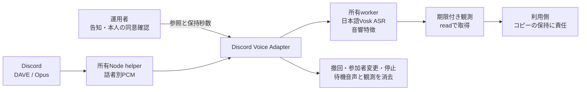

# Discord音声観測とローカルASR（v1.10開発候補）

採用した方式と上限は[ADR 0038](adr/0038-v1.10-sleep-cycle-and-voice.md)。公開v1.2.0には含まれない。2026年11月28日の利用者提供ログで、**実Discord受信・ASR・通常停止に加え、観測0件での参加者変更停止・Bot退出・後処理完了**を確認した。後者のログは受信済みデータの存在を示しておらず、その消去を証明しない。話者照合・認識精度、参加・撤回・切断・保持等の実機確認は残る。[各実行の結果と限界](validation/v1.10.md#live-voice-followup)

## できることと責務

Botが指定された通常の音声チャンネルに参加し、同意を確認した話者の音声を一時的に観測する。ASRは音声知覚の補助であり、Cognitionの意味理解や言語獲得を代行しない。初期AdapterはMemory/Cognitionへ保存・学習を自動投入しない。



Coreは接続・配置・Runtimeを管理する。音声取得と認識処理はAdapterが所有する。Node helperはAdapterの補助プロセスであり、Coreの管理IPCやハイブリッド実行契約を置き換えない。

## 明示導入

Coreの必須依存は空のまま。音声を利用する環境だけで、同じcheckoutへ`python -m pip install -e ".[voice]"`を実行する。音声extraは`vosk==0.3.45`。Node.js 24.17以上、pnpm 11.25.0を用意し、次を実行する。

```console
pnpm --dir src/nymph_toolkit/adapters/discord_voice/node install --frozen-lockfile
node --test tests/voice/test_bridge.mjs tests/voice/test_dependencies.mjs
```

Node依存は`@discordjs/voice@0.19.2`、`discord.js@14.28.1`、`opusscript@0.1.1`を固定し、lockを同梱する。通常wheelでは、導入先`nymph_toolkit/adapters/discord_voice/node/`のmanifestを使う。`node_modules_path`は`package.json`と`node_modules/`を含む**親ディレクトリ**である。

日本語モデルは[公式配布](https://alphacephei.com/vosk/models/vosk-model-small-ja-0.22.zip)を利用者が明示的に取得・展開する。Runtimeから自動取得しない。

| 項目 | 値 |
|---|---|
| モデル | `vosk-model-small-ja-0.22` |
| 公式zipのサイズ | 49704573 bytes |
| SHA256 | `efa092d280153a77615e9e0c7d7283e93e600de3d19d3bec686c57ef19d52eac` |
| 公式モデル一覧のライセンス | Apache-2.0 |

明示取得ツール`python tools/prepare_voice_model.py --destination .local/voice-model`も利用できる。取得したzipのサイズ/hashを照合してから展開し、展開されたモデルディレクトリを`model_path`に指定する。Adapter起動時も同梱`model-files.json`の16ファイルと内容を照合する。別モデル・追加/欠落/変更ファイルは拒否する。第三者ライブラリ・モデルの権利表示は各配布元の条件に従う。NTKのwheelにモデルや第三者のNode依存本体は同梱しない。

## 設定と同意

factoryは`nymph_toolkit.adapters.discord_voice:factory`、宣言は`contracts.voice.VOICE_CONTRACT`。Coreの`max_frame_bytes`は65536以上。Node/Voskの初期化・停止を含むため、起動/終了の枠は利用環境の実測で設定する。実行例では60秒/30秒を指定する。任意のnative処理の強制終了完了を保証する値ではない。

設定JSONは`node_executable`（Node実行ファイルの絶対パス）、`node_modules_path`、`model_path`、`guild_id`、`voice_channel_id`、`token_env`の6項目。ディレクトリも絶対パス、Discord IDは文字列で渡す。

**token_envには環境変数の名前だけを指定する。** Bot tokenの値はローカル環境変数へ設定し、チャット・Issue・設定JSONへ書かない。helperへの引数にも含めず、無関係な環境変数や`NODE_OPTIONS`を渡さない。Botには指定サーバー/チャンネルの表示・接続権限を用意する。ユーザーアカウントの自動操作やStageチャンネルは対象外。

同意JSONの構造例（参照は実際に確認したものへ置き換える）：

```json
{
  "notice_ref": "実施済みの告知への参照",
  "participants": {"参加者のDiscord ID": "本人の音声取得・ASRへの同意の参照"},
  "retention_seconds": 30
}
```

告知と本人の同意は運用者が確認する。JSONへ記入したこと自体は同意の証明ではない。1〜8名のIDと参照、1〜300秒の保持を指定する。接続時にBot以外の現在参加者全員が含まれることを確認する。学習や永続保存の同意を兼ねず、追加する場合は用途・権限・保持/削除を別途設計する。

## 契約 `ntk.voice.observation/1`

全操作ASYNC。Runtime起動だけではDiscordへ接続しない。

| 操作 | 結果・条件 |
|---|---|
| `start_session(session_id, consent)` | 明示接続。同ID・同内容は既存状態を返し再接続しない。別内容は`voice.session_conflict` |
| `status()` | 現在セッションの状態・理由・保持件数・後処理確認。機密参照や音声本文は含まない |
| `read(session_id, after=0, limit=4)` | 期限内の観測を最大4件・49152 JSON bytes以内で取得。`next_after`があれば続けて取得 |
| `stop_session(session_id)` | 停止・消去・処理排出・補助プロセス回収を待つ |
| `revoke(session_id, user_id)` | 同意撤回としてセッション全体を停止・消去 |

1回のRuntimeで最大64セッションIDを識別する。稼働または後処理中の別セッション追加は`TemporaryUnavailable`。停止後の再接続には新しいIDが必要。再起動後は履歴/観測を復元せずinactive。停止済みセッションには小さな状態要約と同意内容のfingerprintだけを保持し、Runtime停止で消去する。

状態は`inactive`、`starting`、`listening`、`stopping`、`stopped`、`failed`。失敗時は固定の理由コードを返し、SDK例外の機密を含み得る本文は返さない。取消や通信期限切れだけで停止完了とは判断せず、状態と`cleanup_confirmed`を照合する。

## 観測・上限・消去

観測はsequence、session/user/guild/channel ID、取得時刻、`source_kind=observed`、ASRモデル名/文字起こし/語の時刻と信頼値、PCM SHA256、音響特徴を含む。文字起こしは誤りを含み得る推定で、発話原文の保証やCognitionの意味理解の証拠ではない。

PCMは48kHz・16bit little-endian・stereo。左右を整数平均してmonoにし、Vosk内部のresamplerを使う。最大5秒の区間、1秒の無音で区切る。音響特徴は区間長・正規化RMS・peak・ゼロ交差率だけで、感情や人格を断定しない。

ASR workerは1つ、待機8区間、保持64観測。上限超過は切捨てて継続せず停止する。セッションは最大600秒。参加/離脱・Bot自身の移動/切断・同意撤回・DAVE確認不能・取得/接続エラーでも停止し、自動再接続しない。指定チャンネルから外れた場合は、通信Readyのままでも停止する。

保持期限は最終PCM受付の単調時計から数える。タイマーは0.1秒間隔、読出時にも期限を照合し、待機PCM・未確定区間・観測を破棄する。処理中のnative ASRは安全に完了を待ち、期限後や撤回後の結果を公開しない。停止は保持データを即時消去してから後処理完了を待つ。helperが通常停止に応じない場合は5秒後に所有helperだけを終了・回収する。

メモリ・OS swapの物理的消去、既に利用側へ返したコピーの削除は保証しない。初期版は音声ファイルを書かない。利用側の保存/ログ/画面出力には利用側の保持・削除責任がある。

## 実行例と確認の区別

```console
python examples/voice_audio_demo.py
python examples/voice_audio_demo.py --model MODEL_DIRECTORY --wav AUTHORIZED_WAV
python examples/voice_capture.py --config LOCAL_CONFIG_JSON --consent VERIFIED_CONSENT_JSON --seconds 30
```

最初は自作の合成トーンの特徴検証だけで、DiscordやASRモデルを使わない。2番目は明示指定したモデルで、許可された48kHz/16bit/stereo・最大5秒のWAVを認識する。3番目だけが実Discordへ接続する。実接続例は既定で件数・長さ等のみ表示し、文字起こしを端末へ出す場合は`--show-text`を明示する。`--via-core`と`--placement local`で経路/配置を変えられる。

現行の音声受信APIは上流の変更の影響を受ける。利用前に、同意確認済みの管理下のチャンネルでDAVE音声受信・話者ID・参加者変化・撤回・切断・資源解放を実測する。[B10](validation/v1.10.md)の未検証を、補助プロセス/SDKの試験成功で置き換えない。

<a id="voice-startup-diagnostics"></a>

## Windowsでの実行と起動失敗の切り分け

以下は`token_env`を`NTK_DISCORD_BOT_TOKEN`とした設定用。実際の設定・同意ファイルを指定し、本人が検証用音声チャンネルに参加してから実行する。PowerShellの**ブロック全体**を貼り付け、非表示入力へBot tokenを入力する。tokenはこのシェルと子プロセスで使用し、終了時に削除する。音声用依存を導入したPythonを使う。

```powershell
& {
    $env:NTK_DISCORD_BOT_TOKEN = [System.Net.NetworkCredential]::new('', (Read-Host 'Bot token（表示しません）' -AsSecureString)).Password
    try {
        python examples/voice_capture.py --config LOCAL_CONFIG_JSON --consent VERIFIED_CONSENT_JSON --seconds 30
    } finally {
        Remove-Item -LiteralPath Env:/NTK_DISCORD_BOT_TOKEN -ErrorAction SilentlyContinue
    }
}
```

実行例は接続前に環境変数名・tokenの存在/空/4096文字上限を検査する。この検査の成功はDiscordでの認証成功を意味しない。入力直後でも、別のシェルで実行した場合や、前回の`finally`で削除済みの場合は再入力が必要になる。値を確認するための表示・チャットへの貼付けは行わない。

| `reason` | 失敗した段階と確認対象 |
|---|---|
| `credential_missing` | Adapterまたはhelperで資格情報を利用できない。Adapterでは未設定・空・4096文字超過を含む。設定名と実行シェルを確認 |
| `helper_spawn_failed` | Node helperプロセスの作成に失敗。Nodeのパス・実行環境・環境変数の使用可否を確認 |
| `helper_start_write_failed` | helperへの開始情報の書込み/排出に失敗。helperが早期終了していないか確認 |
| `helper_ready_timeout` | Python側のReady待機25秒を超過。Node依存の読込みや起動応答の停止を切り分ける |
| `startup_timeout` | Node側の接続準備20秒を超過。ネットワークと接続準備を確認 |
| `invalid_input_or_dependencies` | helper入力またはNode依存の検査/読込みに失敗。固定依存の明示導入を確認 |
| `connection_failed` | helperの接続処理で失敗。資格情報の有効性・接続環境を確認。理由だけから認証失敗とは断定しない |
| `helper_start_failed` | 上記以外の起動例外。旧実装では複数の失敗段階がこの理由に集約されていた |

固定コードはSDK/OS例外の本文・token・音声本文を含まない。最初の停止理由を保持し、後処理で上書きしない。診断追加は接続/回収期限や自動再試行の変更ではない。[#171](https://github.com/Tao-pyth/nymph-toolkit/issues/171)・[ADR 0038 D6](adr/0038-v1.10-sleep-cycle-and-voice.md)を参照する。

失敗時は対象コミット、配置、`reason`、`cleanup_confirmed`だけをまず記録する。成功時も、`Voice observation started`（開始）、`Received observations`の件数（観測）、`cleanup_confirmed`と最後のRuntime回収確認（終了）を分けて確認する。0件での正常終了は受信成功と扱わず、件数があっても認識精度の証拠にはしない。

<a id="voice-live-acceptance"></a>
## 残る実機受入をケースごとに確認する

[#172](https://github.com/Tao-pyth/nymph-toolkit/issues/172)・[ADR 0038 D7](adr/0038-v1.10-sleep-cycle-and-voice.md)の[明示検証ツール](../tools/validate_voice_live.py)を使う。元の実行例は通常停止の初回確認に使い、このツールでは期待する停止理由、観測の消去、同じIDで再接続しないこと、Runtime停止と新起動を個別に判定する。各ケースを実施する前に、参加者へ操作内容と取得/ASR・保持条件を説明し、同意を確認する。

音声依存とモデルを導入した同じPythonを使い、対象checkoutのルートで実行する。資格情報の非表示入力とfinallyでの削除は上のPowerShell手順を使い、try内の実行行だけ次へ置き換える。ケースごとに1回だけ実行し、失敗しても自動再試行しない。

```powershell
python tools/validate_voice_live.py --config .local/voice-validation/config.json --consent .local/voice-validation/consent.json --case leave --seconds 30
```

| `--case` | 告知・同意後の操作と判定 |
|---|---|
| `speaker` | `--participant 1`等で指定した人だけが発話し、他の人は発話しない。全観測が指定ID・出典に合致することを確認。ID昇順の1始まり番号と実際の人は運用者がローカル設定で照合 |
| `join` | 開始時の参加者がまず発話し、同意設定済みだが未参加の人が約10秒後に参加。`participants_changed`で停止・消去。参加後の新しい人の音声取得を続ける試験ではない |
| `leave` | 開始後に短く発話し、同意済みの1名が退出。終了結果のobservationsが1件以上で、`participants_changed`・消去を確認。観測0件での停止だけでは、受信後の消去を合格にしない |
| `revoke` | 発話後、既定10秒で指定番号の人への`revoke`を明示発行し、`revoked`で全体停止・消去。事前にこの操作へ同意を確認 |
| `disconnect` | 発話後、運用者がBotを切断または対象外チャンネルへ移動。`voice_disconnected`・failed・後処理完了を確認。Botの画面上の退出も確認 |
| `retention` | 同意済み入力を別途用意し、例として保持5秒を明示。短く発話した後に無音とし、期限前に取得したsequenceが返らずexpired_countが進むことを確認。保持値＋5秒が観測枠未満でなければ接続前に拒否 |
| `runtime-stop` | 発話後、既定10秒で個別stop_sessionなしにRuntimeを停止。所有機能の後処理を確認し、新Runtimeがinactive・観測0から始まることを照合。新起動はDiscordへ接続しない |

補助ツールは観測件数を終了時の要約で返す。途中の観測到達を画面で確認しながら退出する場合は、元の`voice_capture.py`で1件以上の`sequence`行を確認してから退出する。その例のログでは、停止理由と件数を確認できるが、同じIDの非再接続までは直接検証しない。

`--seconds`は1〜30秒の観測ループ、`--action-after`はrevoke/Runtime停止の発行時機（既定10秒）で、観測枠より短くする。接続準備と後処理は別に待つ。`--placement local`と`--via-core`で配置と経路を明示できる。既定はPROCESS・直接経路。既存の同意入力をツールが上書きすることはない。

出力は件数・参加者番号別件数・状態・理由・照合結果・版/checkout等だけで、個人ID・本文・同意参照・資格情報を含めない。`--output .local/voice-validation/leave-summary.json`を明示すると同じ要約を新規保存する。既存ファイルは置換しない。出力先へ保存できない場合も非ゼロで終了する。

終了コード0と`passed=true`は、選んだケースの機械的検査の合格である。実際の話者・操作・告知/同意の確認を結果へ併記してB10の証拠にする。音声の認識精度や全B10合格を意味しない。観測0・話者不一致・想定外の理由・消去/回収未確認は合格にならない。未知の理由はother、例外は固定エラーへ丸めるため、値を露出させず該当時機を調査する。オフライン試験の結果と実機結果を混在させない。
