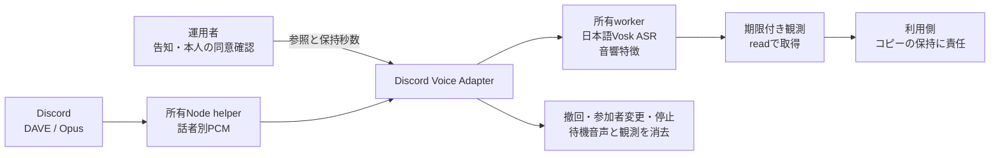

# Discord音声観測とローカルASR（v1.10開発候補）

採用した方式と上限は[ADR 0038](adr/0038-v1.10-sleep-cycle-and-voice.md)。公開v1.2.0には含まれない。実装・ローカル試験は進行中で、**実DiscordのDAVE受信は未検証**。通常の試験用音声で成功したことと、実サービスでの動作を区別する。[検証状況](validation/v1.10.md)

## できることと責務

Botが指定された通常の音声チャンネルに参加し、同意を確認した話者の音声を一時的に観測する。ASRは音声知覚の補助であり、Cognitionの意味理解や言語獲得を代行しない。初期AdapterはMemory/Cognitionへ保存・学習を自動投入しない。



Coreは接続・配置・Runtimeを管理する。音声取得と認識処理はAdapterが所有する。Node helperはAdapterの補助プロセスであり、Coreの管理IPCやハイブリッド実行契約を置き換えない。

## 明示導入

Coreの必須依存は空のまま。音声を利用する環境だけで、同じcheckoutへ`python -m pip install -e ".[voice]"`を実行する。音声extraは`vosk==0.3.45`。Node.js 24.17以上、pnpm 11.25.0を用意し、次を実行する。

```console
pnpm --dir src/nymph_toolkit/adapters/discord_voice/node install --frozen-lockfile
node --test tests/voice/test_bridge.mjs tests/voice/test_dependencies.mjs
```

Node依存は`@discordjs/voice@0.19.2`、`discord.js@14.28.1`、`opusscript@0.1.1`を固定し、lockを同梱する。通常wheelでは、導入先`nymph_toolkit/adapters/discord_voice/node/`のmanifestを使う。`node_modules_path`は`package.json`と`node_modules/`を含む**親ディレクトリ**である。

日本語モデルは[公式配布](https://alphacephei.com/vosk/models/vosk-model-small-ja-0.22.zip)を利用者が明示的に取得・展開する。Runtimeから自動取得しない。

| 項目 | 値 |
|---|---|
| モデル | `vosk-model-small-ja-0.22` |
| 公式zipのサイズ | 49704573 bytes |
| SHA256 | `efa092d280153a77615e9e0c7d7283e93e600de3d19d3bec686c57ef19d52eac` |
| 公式モデル一覧のライセンス | Apache-2.0 |

明示取得ツール`python tools/prepare_voice_model.py --destination .local/voice-model`も利用できる。取得したzipのサイズ/hashを照合してから展開し、展開されたモデルディレクトリを`model_path`に指定する。Adapter起動時も同梱`model-files.json`の16ファイルと内容を照合する。別モデル・追加/欠落/変更ファイルは拒否する。第三者ライブラリ・モデルの権利表示は各配布元の条件に従う。NTKのwheelにモデルや第三者のNode依存本体は同梱しない。

## 設定と同意

factoryは`nymph_toolkit.adapters.discord_voice:factory`、宣言は`contracts.voice.VOICE_CONTRACT`。Coreの`max_frame_bytes`は65536以上。Node/Voskの初期化・停止を含むため、起動/終了の枠は利用環境の実測で設定する。実行例では60秒/30秒を指定する。任意のnative処理の強制終了完了を保証する値ではない。

設定JSONは`node_executable`（Node実行ファイルの絶対パス）、`node_modules_path`、`model_path`、`guild_id`、`voice_channel_id`、`token_env`の6項目。ディレクトリも絶対パス、Discord IDは文字列で渡す。

**token_envには環境変数の名前だけを指定する。** Bot tokenの値はローカル環境変数へ設定し、チャット・Issue・設定JSONへ書かない。helperへの引数にも含めず、無関係な環境変数や`NODE_OPTIONS`を渡さない。Botには指定サーバー/チャンネルの表示・接続権限を用意する。ユーザーアカウントの自動操作やStageチャンネルは対象外。

同意JSONの構造例（参照は実際に確認したものへ置き換える）：

```json
{
  "notice_ref": "実施済みの告知への参照",
  "participants": {"参加者のDiscord ID": "本人の音声取得・ASRへの同意の参照"},
  "retention_seconds": 30
}
```

告知と本人の同意は運用者が確認する。JSONへ記入したこと自体は同意の証明ではない。1〜8名のIDと参照、1〜300秒の保持を指定する。接続時にBot以外の現在参加者全員が含まれることを確認する。学習や永続保存の同意を兼ねず、追加する場合は用途・権限・保持/削除を別途設計する。

## 契約 `ntk.voice.observation/1`

全操作ASYNC。Runtime起動だけではDiscordへ接続しない。

| 操作 | 結果・条件 |
|---|---|
| `start_session(session_id, consent)` | 明示接続。同ID・同内容は既存状態を返し再接続しない。別内容は`voice.session_conflict` |
| `status()` | 現在セッションの状態・理由・保持件数・後処理確認。機密参照や音声本文は含まない |
| `read(session_id, after=0, limit=4)` | 期限内の観測を最大4件・49152 JSON bytes以内で取得。`next_after`があれば続けて取得 |
| `stop_session(session_id)` | 停止・消去・処理排出・補助プロセス回収を待つ |
| `revoke(session_id, user_id)` | 同意撤回としてセッション全体を停止・消去 |

1回のRuntimeで最大64セッションIDを識別する。稼働または後処理中の別セッション追加は`TemporaryUnavailable`。停止後の再接続には新しいIDが必要。再起動後は履歴/観測を復元せずinactive。停止済みセッションには小さな状態要約と同意内容のfingerprintだけを保持し、Runtime停止で消去する。

状態は`inactive`、`starting`、`listening`、`stopping`、`stopped`、`failed`。失敗時は固定の理由コードを返し、SDK例外の機密を含み得る本文は返さない。取消や通信期限切れだけで停止完了とは判断せず、状態と`cleanup_confirmed`を照合する。

## 観測・上限・消去

観測はsequence、session/user/guild/channel ID、取得時刻、`source_kind=observed`、ASRモデル名/文字起こし/語の時刻と信頼値、PCM SHA256、音響特徴を含む。文字起こしは誤りを含み得る推定で、発話原文の保証やCognitionの意味理解の証拠ではない。

PCMは48kHz・16bit little-endian・stereo。左右を整数平均してmonoにし、Vosk内部のresamplerを使う。最大5秒の区間、1秒の無音で区切る。音響特徴は区間長・正規化RMS・peak・ゼロ交差率だけで、感情や人格を断定しない。

ASR workerは1つ、待機8区間、保持64観測。上限超過は切捨てて継続せず停止する。セッションは最大600秒。参加/離脱・同意撤回・DAVE確認不能・取得/接続エラーでも停止し、自動再接続しない。

保持期限は最終PCM受付の単調時計から数える。タイマーは0.1秒間隔、読出時にも期限を照合し、待機PCM・未確定区間・観測を破棄する。処理中のnative ASRは安全に完了を待ち、期限後や撤回後の結果を公開しない。停止は保持データを即時消去してから後処理完了を待つ。helperが通常停止に応じない場合は5秒後に所有helperだけを終了・回収する。

メモリ・OS swapの物理的消去、既に利用側へ返したコピーの削除は保証しない。初期版は音声ファイルを書かない。利用側の保存/ログ/画面出力には利用側の保持・削除責任がある。

## 実行例と確認の区別

```console
python examples/voice_audio_demo.py
python examples/voice_audio_demo.py --model MODEL_DIRECTORY --wav AUTHORIZED_WAV
python examples/voice_capture.py --config LOCAL_CONFIG_JSON --consent VERIFIED_CONSENT_JSON --seconds 30
```

最初は自作の合成トーンの特徴検証だけで、DiscordやASRモデルを使わない。2番目は明示指定したモデルで、許可された48kHz/16bit/stereo・最大5秒のWAVを認識する。3番目だけが実Discordへ接続する。実接続例は既定で件数・長さ等のみ表示し、文字起こしを端末へ出す場合は`--show-text`を明示する。`--via-core`と`--placement local`で経路/配置を変えられる。

現行の音声受信APIは上流の変更の影響を受ける。利用前に、同意確認済みの管理下のチャンネルでDAVE音声受信・話者ID・参加者変化・撤回・切断・資源解放を実測する。[B10](validation/v1.10.md)の未検証を、補助プロセス/SDKの試験成功で置き換えない。
